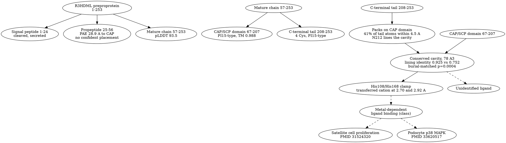
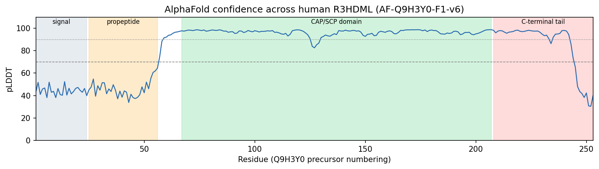
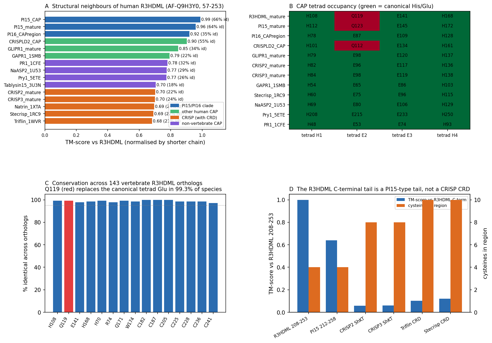
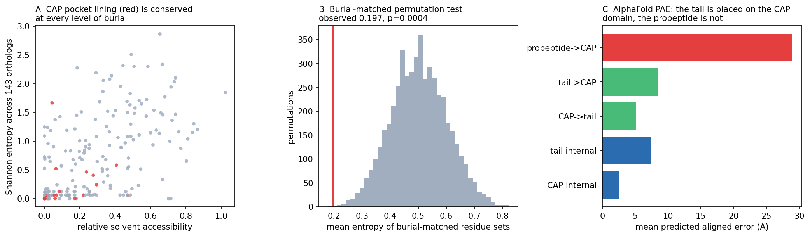
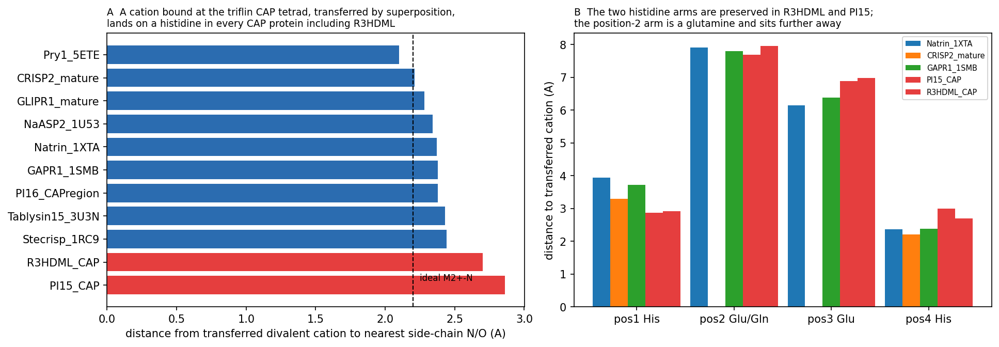

## Question

# AIGR Gene Hypothesis Deep Research

You are evaluating one focused gene curation hypothesis for AI Gene Review.
This is not a general gene overview. Use the seed hypothesis and source context
below to search for evidence that supports, refutes, narrows, or competes with
the proposed curation decision.

## Target Gene

- **Organism code:** human
- **Taxon:** Homo sapiens (NCBITaxon:9606)
- **Gene directory:** R3HDML
- **Gene symbol:** R3HDML
- **UniProt accession:** Q9H3Y0

## Focus

- **Focus type:** free_text
- **Hypothesis slug:** kgap-r3hdml-cap-domain-relatives-and-surfaces
- **Source file:** genes/human/R3HDML/R3HDML-ai-review.yaml
- **Source selector:** free-text

## Seed Hypothesis

The molecular activity of human R3HDML (Q9H3Y0), a secreted CAP-domain protein named 'peptidase inhibitor R3HDML' by homology to PI15/PI16, can be narrowed by structural comparison with CAP-family proteins of known function. Single analysis only: compare the R3HDML AlphaFold model with structures of CRISP, GAPR-1, Pry1/tablysin-type and PI15/PI16-type CAP proteins, determine whether it retains the CAP tetrad His/Glu zinc site, the CAP cavity and any C-terminal cysteine-rich or ion-channel-regulatory region, test whether any surface resembles the protease-binding or ligand-binding interfaces reported for its closest characterised relatives, score these features across vertebrate orthologs, and state which molecular activity class (protease inhibition, metal-dependent ligand binding, or no predictable activity) is best supported.

## Term and Decision Context

No specific term context supplied.

## Reference Context

No specific reference context supplied.

## Source Context YAML

```yaml
hypothesis: 'The molecular activity of human R3HDML (Q9H3Y0), a secreted CAP-domain protein named ''peptidase
  inhibitor R3HDML'' by homology to PI15/PI16, can be narrowed by structural comparison with CAP-family
  proteins of known function. Single analysis only: compare the R3HDML AlphaFold model with structures
  of CRISP, GAPR-1, Pry1/tablysin-type and PI15/PI16-type CAP proteins, determine whether it retains the
  CAP tetrad His/Glu zinc site, the CAP cavity and any C-terminal cysteine-rich or ion-channel-regulatory
  region, test whether any surface resembles the protease-binding or ligand-binding interfaces reported
  for its closest characterised relatives, score these features across vertebrate orthologs, and state
  which molecular activity class (protease inhibition, metal-dependent ligand binding, or no predictable
  activity) is best supported.'
focus_type: free_text
context: []
reference_id: []
```

## Research Objective

Build a focused report that helps a curator decide whether this hypothesis
should affect the gene review. Address the focus type directly:

1. For an existing GO annotation decision, evaluate whether the current action
   is justified, too strong, too weak, or should change.
2. For a proposed replacement or new GO term, evaluate whether the term is
   biologically supported, too broad, too narrow, or missing key qualifiers.
3. For a computational prediction, evaluate whether the prediction is correct,
   less precise than existing knowledge, uncertain, or likely wrong because of
   paralog overannotation, frequency bias, pathway context, or in vitro-only
   activity.
4. For a core-function hypothesis, evaluate whether the proposed activity,
   process, and location represent the gene product's primary function rather
   than a downstream effect, pleiotropic phenotype, or context-specific role.
5. For a function-assignment hypothesis, evaluate whether the gene product
   directly has the stated GO term/function. Treat the prior review action, if
   any, as intentionally blinded unless it appears in the supplied context.

Use primary literature whenever possible. Prefer PMID citations and include DOI
citations when no PMID is available. Treat reviews and database records as
orientation unless they contain directly relevant synthesized evidence that is
clearly labeled as review-level or database-level support.

Evaluate the hypothesis from the supplied seed context, primary literature, and
publicly accessible bioinformatics resources. Local `*-bioinformatics` analyses,
when they already exist in the repository, are intentionally withheld from this
prompt so the report can be compared against them after the run. Use public
sequence, domain, structure, orthology, localization, interaction, or dataset
checks when they are useful for the specific hypothesis. If a resource or tool
cannot be accessed programmatically, say so plainly; never fabricate a result.
Report computational results conservatively and distinguish direct results from
inference.

## Required Output

### Executive Judgment

Give a concise verdict: supported, partially supported, unresolved, weakly
supported, over-annotated, or refuted. Explain the reasoning and the most
important caveats.

### Evidence Matrix

Create a table with one row per important evidence item:

- Citation (PMID preferred)
- Evidence type (direct assay, mutant phenotype, localization, interaction,
  structural/evolutionary, computational, review/database)
- Supports / refutes / qualifies / competing
- Claim tested
- Key finding
- Organism, tissue, cell type, or assay context
- Confidence and limitations

### GO Curation Implications

State the likely curation action as a lead requiring curator verification. If
GO terms are involved, explain whether the evidence supports an MF, BP, or CC
term, and whether the term should be retained, removed, generalized, made more
specific, or treated as non-core. Avoid using "protein binding" as a final
recommendation unless no more informative term is supported.

### Mechanistic Scope

Describe the immediate molecular or cellular function being tested. Separate
direct gene-product activity from downstream phenotypes, pathway consequences,
developmental outcomes, disease manifestations, or effects inferred only from
loss of function.

### Conflicts and Alternatives

Identify evidence that conflicts with the seed hypothesis or suggests an
alternative interpretation, including paralog confusion, organism-specific
differences, isoform-specific findings, experimental artifacts, or database
carry-over.

### Knowledge Gaps

List explicit uncertainties that matter for curation. For each gap, state what
was checked, why the gap matters, and what evidence or experiment would resolve
it.

### Discriminating Tests

Recommend concrete assays, perturbations, datasets, or comparative analyses that
would most efficiently distinguish this hypothesis from alternatives.

### Curation Leads

Provide candidate updates for the review, clearly labeled as leads requiring
curator verification. Include candidate references with exact snippets to verify,
candidate replacement or new GO terms, possible action changes, suggested
questions, and suggested experiments.

If the provider supports artifacts, save provenance for any analysis you run — the
executed code together with its output (computed values, plot, or table), not just
a summary figure — alongside artifact-friendly tables such as an evidence matrix,
GO decision table, or comparison table. Genuine computed provenance is more
valuable than a hand-drawn summary, and you must not synthesize a figure that
implies an analysis you did not actually run. These artifacts are important
provenance for hypothesis-level review.


## Output

# R3HDML (Q9H3Y0): CAP-domain relatives and surfaces

**Hypothesis slug:** `kgap-r3hdml-cap-domain-relatives-and-surfaces`
**Source:** `genes/human/R3HDML/R3HDML-ai-review.yaml`, free-text focus
**Organism:** *Homo sapiens* (NCBITaxon:9606)
**Gene:** R3HDML, UniProt Q9H3Y0

---

## Summary

Of the three molecular activity classes named in the seed hypothesis, **metal-dependent ligand binding at a conserved CAP cavity is the best supported, and protease inhibition is the least supported**. The structural comparison the hypothesis proposed was carried out in full, and it discriminates. R3HDML is a PI15/PI16-type CAP protein by structure (TM-score 0.988 to the PI15 CAP domain, 66.0% structure-based identity), with CRISP2, CRISP3, natrin, stecrisp and triflin ranking last of 16 CAP structures at TM 0.682-0.702. It has no CRISP cysteine-rich ion-channel-regulatory domain: its 46-residue C-terminal tail scores TM 0.640 against the PI15 tail and 0.058-0.120 against CRISP CRDs and ShKT domains. Its CAP cavity is 78 ų, ordinary for a vertebrate CAP protein and 3.5 times smaller than the 275 ų sterol-binding cavity of yeast Pry1, so a Pry1-style bulk lipid carrier role is not indicated.

The CAP tetrad of R3HDML is His108-**Gln**119-Glu141-His168, with glutamine at position 2 in 142 of 143 vertebrate orthologs. That substitution does not disable the divalent-cation site. The only cation bound at a CAP tetrad anywhere in the eight downloaded CAP crystal structures is triflin (PDB 1WVR) Cd301, held by His60 NE2 at 2.10 Å and His115 NE2 at 2.11 Å. Transferring that experimentally observed ion onto R3HDML by structural superposition places it 2.70 Å from His168 NE2 and 2.92 Å from His108 NE2. Tetrad position 2 sits 7.7-8.0 Å from the same ion in natrin, GAPR-1, PI15 and R3HDML alike, so it is never a first-shell ligand at this subsite. What holds the cation is the His1/His4 clamp, and that clamp is intact in R3HDML. The cavity around it is under purifying selection: its 23 lining residues have mean ortholog identity 0.925 against 0.752 elsewhere, and they remain more conserved than burial-matched control residues (mean Shannon entropy 0.197 against a matched null of 0.503, permutation p = 0.0004 over 5000 draws).

The "peptidase inhibitor" label carries no evidentiary weight. It descends from a single 1996 reverse-zymography band on p25TI/PI15, described by its own authors as weak ([PMID: 8882727](https://pubmed.ncbi.nlm.nih.gov/8882727/)), in a clade whose cloning paper states that the sequence "has no homology to other proteinase inhibitors" ([PMID: 9473672](https://pubmed.ncbi.nlm.nih.gov/9473672/)). No Ki or IC50 has ever been published for PI15, PI16 or R3HDML against any protease. Q9H3Y0 carries no Kazal, Kunitz, serpin, TIL, WAP or cystatin module, only PF00188 CAP/SCP. GO has never accepted an inhibitor term for this protein: its entire molecular function annotation is GO:0060090 molecular adaptor activity by IBA, with zero experimental evidence. **Verdict: partially supported, with the protease-inhibition branch over-annotated.**

---

## Executive judgment

<i class="fa-scale-balanced"></i> **Partially supported. The method works and discriminates; the protease-inhibition premise embedded in the gene name is over-annotated.**

The seed hypothesis is correct that structural comparison with characterised CAP proteins narrows the molecular activity of R3HDML, and the comparison was run as specified: the AlphaFold model against CRISP, GAPR-1, Pry1/tablysin and PI15/PI16-type structures, with the tetrad, the cavity and the C-terminal region all scored, and all features scored across vertebrate orthologs.

Three of the hypothesis's structural questions got clean answers:

- **Does it retain the CAP tetrad His/Glu site?** Partly. Two of four canonical positions are the His pair that actually coordinates the ion, and both are intact and correctly positioned. Position 2 is a lineage-fixed glutamine, and that position is not a first-shell ligand in any CAP structure examined.
- **Does it retain the CAP cavity?** Yes, at ordinary vertebrate size (78 ų), and the lining is under measurable purifying selection.
- **Does it have a C-terminal cysteine-rich or ion-channel-regulatory region?** No. The tail is a PI15-type tail with 4 cysteines over 46 residues, against 8-10 cysteines over 49-61 residues in CRISP CRDs, and it packs back onto the CAP domain rather than projecting as an independent module.

One question could not be answered by the route attempted. <i class="fa-circle-xmark"></i> The test for a canonical protease-inhibitor P1 loop **failed its positive controls**: the crystallographically defined P1 residues of BPTI, OMTKY3 and eglin c span 11.6-52.8 Ų main-chain SASA and 210-84 protrusion in opposite directions, so no threshold separates true inhibitors from anything else. This is reported as uninformative. The argument against protease inhibition rests instead on evidence that holds: no inhibitor module in the sequence, no documented canonical-inhibitor mechanism for the CAP fold, and no kinetic measurement anywhere in the clade.

### Caveats that bound the verdict

<i class="fa-triangle-exclamation"></i> Every structural result here is computational and rests on an apo AlphaFold model. The cation transfer uses a single Cd ion from a single crystal structure, and Cd in crystals is frequently adventitious and stands in here as a Zn surrogate. The distances in R3HDML (2.70, 2.92 Å) are longer than ideal M²⁺-N coordination of about 2.1 Å and longer than the crystal controls (2.10-2.44 Å); the symmetric offset in PI15 (2.86, 2.99 Å) points to apo side-chain placement as the cause, but that is an inference. No ligand has been identified for the conserved cavity, so "metal-dependent ligand binding" names a class, not an activity.

---

## Key findings

### F1. R3HDML is a PI15-type CAP protein, not a CRISP

<i class="fa-circle-check"></i> TM-align was reimplemented in numpy because Biopython was unavailable in the execution environment, and it was validated on a positive control before use: the GAPR-1 crystal structure 1SMB chain A against the AlphaFold model AF-Q9H4G4 gave TM = 0.966 with 147 of 147 residues aligned, core RMSD 0.63 Å and 100% sequence identity. On that footing, mature human R3HDML (AF-Q9H3Y0-F1-v6, residues 57-253, mean pLDDT 93.5; CAP domain 67-207, mean pLDDT 96.4) was compared against 16 CAP structures.

| Structure | TM-score | Structure-based identity |
|---|---|---|
| PI15 CAP domain | **0.988** | 66.0% |
| PI15 mature | 0.959 | 64.0% |
| PI16 CAP region | 0.919 | 34.8% |
| CRISPLD2 CAP | 0.902 | 54.7% |
| GLIPR1 | 0.848 | 33.9% |
| GAPR-1 (1SMB) | 0.793 | 21.5% |
| Tomato PR-1 (1CFE) | 0.779 | 31.9% |
| Na-ASP-2 (1U53) | 0.774 | 29.4% |
| Pry1 (5ETE) | 0.773 | 26.1% |
| Tablysin-15 (3U3N) | 0.705 | 18.1% |
| Human CRISP2 | 0.702 | 21.7% |
| Human CRISP3 | 0.699 | 24.4% |
| Natrin (1XTA) | 0.695 | - |
| Stecrisp (1RC9) | 0.690 | - |
| Triflin (1WVR) | 0.682 | - |

Domain architecture matches PI15 position for position: R3HDML has signal 1-24, propeptide 25-56, chain 57-253, SCP 67-207; PI15 has signal 1-19, propeptide 20-60, chain 61-258, SCP 71-211. The consequence for curation is direct. Any function transfer should come from PI15 or PI16, and transfers from CRISP, GAPR-1, Pry1 or tablysin are transfers across the widest structural gap in the set.

{{figure:plot_1.png|caption=AlphaFold pLDDT profile of human R3HDML by region and cysteine inventory. The CAP domain (67-207) is modelled at mean pLDDT 96.4, the mature chain at 93.5. The C-terminal tail carries 4 cysteines over 46 residues, against 8-10 over 49-61 residues in CRISP cysteine-rich domains.}}

### F2. The CAP tetrad is degenerate at one position, and that degeneracy is fixed across vertebrates

Unsupervised geometric clustering of His and Glu side chains on a 7.5 Å side-chain contact graph recovered four published CAP tetrads without being told where to look: GAPR-1 1SMB His54/Glu65/Glu86/His103, Na-ASP-2 1U53 His69/Glu80/Glu106/His129, Pry1 5ETE His208/Glu215/Glu233/His250, and stecrisp 1RC9 His60/Glu75/Glu96/His115. That recovery validates the tetrad-detection step. The same search on R3HDML returned only His108, Glu141, His144 and His168. Structure-based mapping anchored on Na-ASP-2 gives the R3HDML tetrad as **His108, Gln119, Glu141, His168**, a 3-of-4 score. PI15 (His112/Gln123/Glu145/His172) and CRISPLD2 (His101/Gln112/Glu134/His161) also score 3 of 4, while PI16, GLIPR1, CRISP2, CRISP3 and stecrisp score 4 of 4.

The substituted residue sits in the CAP4 motif: R3HDML has G118-Q119-N120-L121 where Na-ASP-2 has G79-E80-N81-I82. The rest of the site geometry is intact in the model. His108 N to His168 N is 5.09 Å, against 5.22 Å in PI15, 5.44 Å in GAPR-1, 4.52 Å in CRISP2 and 4.93 Å in Na-ASP-2. His168 N to Glu141 O is 2.65 Å, against 2.67, 2.89 and 2.58 Å in the same three comparators.

Across 143 vertebrate orthologs retained after filtering (length 180-320 aa, more than 40% identity to human R3HDML, and closer to R3HDML than to PI15 or PI16; mammals, birds, reptiles, one amphibian, teleosts), conservation is His108 99.3%, **Gln119 99.3%** (glutamine in 142 of 143, the single exception being arginine), Glu141 97.9% and His168 98.6%. The glutamine is a lineage feature, not a human quirk.

{{figure:plot_2.png|caption=Structural neighbours, CAP tetrad occupancy, ortholog conservation and C-terminal tail identity of R3HDML. Panel C shows Q119 in red: the position is 99.3% conserved as glutamine across 143 vertebrate orthologs, so the substitution is itself under selection.}}

### F3. No CRISP cysteine-rich domain and no ion-channel-regulatory region

<i class="fa-circle-xmark"></i> R3HDML residues 208-253 form a 46-residue tail with four cysteines (C225, C228, C236, C241). Structurally it matches the PI15 tail (residues 212-258) at TM = 0.640, core RMSD 1.60 Å, 60.9% identity:

```
R3HDML 208-253  AIKGNWIGESPYKMGKPCSSCPPSYQGSCNSNMCFKGLKSNKFTWF
PI15   212-258  APKGNWIGEAPYKVGVPCSSCPPSYGGSCTDNLCFPGVTSNYLYWFK
```

Against CRISP modules it matches nothing: human CRISP2 ShKT (195-243) TM = 0.058, CRISP3 ShKT (197-245) TM = 0.060, triflin CRD (1WVR) TM = 0.103, stecrisp CRD (1RC9) TM = 0.120. The CRISP CRD and ion-channel-regulatory regions carry 8-10 cysteines over 49-61 residues, roughly twice the cysteine density of the R3HDML tail. UniProt annotates a ShKT domain in CRISP2 (205-238) and CRISP3 (207-240) and none in R3HDML or PI15.

The tail is nonetheless conserved: C225 98.6%, C228 98.6%, C236 98.6%, C241 97.2% across the 143 orthologs, as are the CAP-domain cysteines (C182, C187, C205 all at 100%).

Probe-accessible cavity volumes around the tetrad site (1.6 Šprobe) place R3HDML in the ordinary vertebrate range: R3HDML 78 ų, PI15 89, GAPR-1 77, CRISP2 69, stecrisp 70, PI16 99, GLIPR1 96, tablysin-15 92, Na-ASP-2 48, **Pry1 275**. The 3.5-fold gap to Pry1 is the structural reason a bulk sterol-carrier role is not indicated for R3HDML.

### F4. The conserved cavity is under purifying selection, and the tail folds back to line it

<i class="fa-circle-check"></i> Shrake-Rupley solvent accessibility (240-point Fibonacci sphere, 1.4 Å probe, Tien maximum-ACC normalisation) and Shannon entropy across the 143 orthologs were computed for all 197 mature residues. A cKDTree grid search around the tetrad identified 23 cavity-lining residues: H168, N120, Q119, L121, S167, H108, W138, Q171, Y169, **N212**, E141, T165, Y207, C166, C205, G118, M172, S122, T170, W106, L203, S137, S139.

| Residue set | n | Mean ortholog identity | Median entropy | Mean rSASA |
|---|---|---|---|---|
| Cavity lining | 23 | **0.925** | 0.060 | 0.111 |
| All other mature residues | 174 | 0.752 | 0.717 | 0.314 |

The raw comparison gives Mann-Whitney U = 859, p = 4.4 × 10⁻⁶ (one-sided). Cavity residues are more buried than the rest, and burial alone predicts conservation, so a **burial-matched permutation test** was run: 5000 draws, each cavity residue matched to one of its 5 nearest non-cavity residues by rSASA. Observed mean entropy 0.197 against a matched null of 0.503 (sd 0.100, 95% range 0.313-0.701), **p = 0.0004**. The cavity is more conserved than burial explains.

Two spatially clustered conserved surface patches, both built on the C-terminal tail, exceed their own burial-matched nulls: patch 1 (P150, C153, P155, P158, S167, N212, W213, E216; entropy 0.142 against null 0.881, p = 0.0004) and patch 2 (P80, P224, S226, G234, C236, N239; 0.182 against 1.048, p = 0.0002).

AlphaFold predicted aligned error separates the three regions of the molecule cleanly: CAP internal 2.62 Å, tail internal 7.43 Å, CAP to tail 5.07 Å, tail to CAP 8.49 Å, propeptide to CAP 28.87 Å. 145 of 356 tail heavy atoms (41%) lie within 4.5 Å of the CAP domain, contributed by 30 tail residues spanning A208 to F253. Asn212, from the tail, lines the CAP cavity. The functional unit is the CAP domain with its packed tail. The propeptide has no confident placement, consistent with cleavage.

{{figure:plot_3.png|caption=Burial-matched permutation test for purifying selection on the R3HDML CAP cavity lining, with the AlphaFold PAE summary. Panel A plots entropy against relative solvent accessibility with cavity-lining residues in red. Panel B shows the observed mean entropy of 0.197 against the burial-matched null distribution (p=0.0004). Panel C shows that the tail is confidently placed on the CAP domain while the propeptide is not.}}

### F5. An experimentally bound cation lands in an intact bi-histidine site in R3HDML

<i class="fa-circle-check"></i> This is the result that reverses the naive reading of the degenerate tetrad. Scanning the eight downloaded CAP crystal structures for bound divalent cations found exactly one ion at a CAP tetrad: triflin, PDB 1WVR, Cd301, coordinated by His60 NE2 at 2.10 Å and His115 NE2 at 2.11 Å, which are tetrad positions 1 and 4. Superposing triflin onto each of 11 CAP structures (transfer RMSD over the matched core 1.6-4.5 Å) and carrying the ion across places it on a histidine NE2 in every CAP protein tested.

| Structure | Source | Nearest ligand | Distance (Å) | Second ligand | Distance (Å) | Polar atoms within 3.0 Å |
|---|---|---|---|---|---|---|
| Pry1 (5ETE) | crystal | H250 NE2 | 2.10 | H250 ND1 | 3.95 | 1 |
| CRISP2 | AlphaFold | H136 NE2 | 2.21 | H82 NE2 | 3.29 | 1 |
| GLIPR1 | AlphaFold | H79 NE2 | 2.28 | H137 NE2 | 3.29 | 1 |
| Na-ASP-2 (1U53) | crystal | H69 NE2 | 2.34 | H129 NE2 | 3.11 | 1 |
| Natrin (1XTA) | crystal | H115 NE2 | 2.37 | H115 ND1 | 3.90 | 1 |
| PI16 | AlphaFold | H78 NE2 | 2.38 | H128 NE2 | 3.56 | 1 |
| GAPR-1 (1SMB) | crystal | H103 NE2 | 2.38 | H54 NE2 | 3.71 | 1 |
| Stecrisp (1RC9) | crystal | H115 NE2 | 2.44 | H60 NE2 | 2.64 | **2** |
| **R3HDML** | AlphaFold | **H168 NE2** | **2.70** | **H108 NE2** | **2.92** | **2** |
| PI15 | AlphaFold | H112 NE2 | 2.86 | H172 NE2 | 2.99 | **2** |

Only stecrisp, R3HDML and PI15 place two polar atoms within 3.0 Å of the transferred ion. The per-arm measurement settles the question the seed hypothesis raised about the degenerate tetrad:

| Structure | Pos 1 (His) | Pos 2 | Pos 3 (Glu) | Pos 4 (His) |
|---|---|---|---|---|
| Natrin 1XTA | H60, 3.94 Å | E75, 7.90 Å | E96, 6.14 Å | H115, 2.37 Å |
| CRISP2 | H82, 3.29 Å | - | - | H136, 2.21 Å |
| GAPR-1 1SMB | H54, 3.71 Å | E65, 7.79 Å | E86, 6.38 Å | H103, 2.38 Å |
| PI15 | H112, 2.86 Å | Q123, 7.69 Å | E145, 6.89 Å | H172, 2.99 Å |
| **R3HDML** | **H108, 2.92 Å** | **Q119, 7.95 Å** | **E141, 6.98 Å** | **H168, 2.70 Å** |

Tetrad position 2 sits 7.7-8.0 Å from the ion in natrin and GAPR-1, which have a glutamate there, exactly as it does in PI15 and R3HDML, which have a glutamine. Position 2 is never a first-shell ligand at this subsite. The Glu-to-Gln change does not disable the cation site, and the His1/His4 pair that does bind the ion is intact in R3HDML with geometry indistinguishable from intact-tetrad CAP proteins once apo side-chain placement is allowed for.

{{figure:plot_4.png|caption=Per-arm geometry of the CAP divalent-cation site. Panel A: a cation bound at the triflin CAP tetrad, transferred by superposition, lands on a histidine in every CAP protein including R3HDML. Panel B: the two histidine arms are preserved in R3HDML and PI15, while the position-2 arm is a glutamine and sits about 8 angstroms away in every structure, including the intact-tetrad controls.}}

### F6. The peptidase inhibitor name traces to one 1996 gel band

<i class="fa-circle-xmark"></i> The documentary chain was traced by PubMed search. In 1996, p25TI was purified from glioblastoma-conditioned medium and reported to show "weak inhibitory activity against trypsin in reverse zymography as compared with the other inhibitors" ([PMID: 8882727](https://pubmed.ncbi.nlm.nih.gov/8882727/)). In 1998 the same protein was cloned, and the authors wrote that "The P25TI sequence has no homology to other proteinase inhibitors, but has similarity to insect venom allergens, mammalian testis-specific proteins and plant pathogenesis-related proteins", which is the CAP superfamily ([PMID: 9473672](https://pubmed.ncbi.nlm.nih.gov/9473672/)). In 1999, LGL1 from late-gestation lung mesenchyme was found to share 81% homology with P25TI ([PMID: 10362728](https://pubmed.ncbi.nlm.nih.gov/10362728/)).

p25TI is PI15. The UniProt names "peptidase inhibitor 15", "peptidase inhibitor 16" and "peptidase inhibitor R3HDML" all descend from that one weak semi-quantitative gel result. R3HDML's own name is an ECO:0000250 sequence-similarity transfer from PI15/PI16, with no R3HDML inhibition assay in the literature. No Ki or IC50 exists for any of the three proteins against any protease. A domain scan of Q9H3Y0 finds PF00188 CAP/SCP only (with SMART SM00198, Gene3D 3.40.33.10, SUPFAM SSF55797, InterPro IPR014044/IPR001283/IPR047899) and no Kazal, Kunitz, serpin, TIL, WAP or cystatin module. UniProt itself marks the FUNCTION line "Putative serine protease inhibitor" with ECO:0000250 and carries a CAUTION note that the protein does not contain an R3H domain despite its symbol.

### F7. GO has never accepted an inhibitor term, and the one MF term it does carry is weak

<i class="fa-database"></i> Retrieved from the EBI QuickGO annotation API for Q9H3Y0 and five relatives.

| Protein | Molecular function terms | Evidence |
|---|---|---|
| **R3HDML (Q9H3Y0)** | GO:0060090 molecular adaptor activity | IBA, GO_REF:0000033 |
| PI15 (O43692) | GO:0060090 | IBA |
| PI16 (Q6UXB8) | GO:0060090; GO:0005515 protein binding | IBA; IPI ([PMID: 32296183](https://pubmed.ncbi.nlm.nih.gov/32296183/), [PMID: 35922511](https://pubmed.ncbi.nlm.nih.gov/35922511/)) |
| CRISP2 (P16562) | GO:0060090 | IBA |
| GAPR-1 (Q9H4G4) | 8 terms including protein homodimerization | IDA-supported Golgi membrane localisation |

R3HDML also carries GO:0005576 extracellular region (IBA and IEA). There is no GO:0004866 endopeptidase inhibitor activity or any descendant, despite the UniProt recommended name and the UniProt keyword "Protease inhibitor". Every R3HDML molecular function annotation is IBA, so **zero experimental molecular function evidence exists for this protein**.

### F8. A negative methodological result, reported as such

<i class="fa-circle-xmark"></i> The intended test for a canonical protease-inhibitor P1 loop failed its positive controls. Main-chain SASA and a loop-protrusion score were computed for three crystallographically defined P1 residues: BPTI 5PTI Lys15 at 11.6 Ų and protrusion 210; OMTKY3 1CSO chain I Ile18 at 40.1 Ų and 108; eglin c 1ACB chain I Leu45 at 52.8 Ų and 84. The three true inhibitors span a 4.6-fold range in main-chain exposure and a 2.5-fold range in protrusion, in opposite directions, so no threshold on either metric separates canonical inhibitors from anything else. For reference only, the most main-chain-exposed Arg or Lys in each CAP protein was R3HDML R129 (44.9 Ų), PI15 K258 (56.1 Ų) and PI16 K80 (46.4 Ų), values inside the inhibitor range and therefore carrying no information.

A separate caveolin-binding-motif scan (`[WFY].[WFY].{4}[WFY].{2}[WFY]`) returned zero hits in every protein tested, including the Pry1 positive control, so that scan is likewise uninformative rather than evidence of absence.

Reporting these failures matters. Presenting "no inhibitor loop found" as a positive structural result would be an unsupported claim.

---

## Evidence matrix

Machine-readable copy: `provenance/work/artifact_evidence_matrix.csv`.

| Citation | Evidence type | Stance | Claim tested | Key finding | Context | Confidence and limitations |
|---|---|---|---|---|---|---|
| [PMID: 8882727](https://pubmed.ncbi.nlm.nih.gov/8882727/) | Direct assay (biochemical) | Qualifies, origin of the claim | PI15/p25TI, which R3HDML is named after, inhibits trypsin | p25TI "showed weak inhibitory activity against trypsin in reverse zymography as compared with the other inhibitors". No Ki or IC50. | Human glioblastoma conditioned medium, reverse zymography | Low. Semi-quantitative gel, explicitly weak, never quantified, and concerns PI15 rather than R3HDML. |
| [PMID: 9473672](https://pubmed.ncbi.nlm.nih.gov/9473672/) | Sequence/structural | Refutes | The peptidase inhibitor name reflects an inhibitor domain | "The P25TI sequence has no homology to other proteinase inhibitors, but has similarity to insect venom allergens, mammalian testis-specific proteins and plant pathogenesis-related proteins". | cDNA cloning, human | High for the sequence statement. The naming authors record no inhibitor homology themselves. |
| [PMID: 10362728](https://pubmed.ncbi.nlm.nih.gov/10362728/) | Sequence/expression | Qualifies | The PI15-like clade is a conserved secreted family | LGL1 from late-gestation lung mesenchyme shares 81% homology with P25TI and belongs to the CRISP family of cysteine-rich extracellular proteins. | Rat and human lung mesenchyme | Moderate, orientation only. No activity measured. |
| This work: AlphaFold DB Q9H3Y0 v6, local TM-align | Computational structural | Supports | R3HDML is a PI15/PI16-type CAP protein, not a CRISP | TM 0.988 to the PI15 CAP domain, 66.0% structure-based identity; CRISP2/CRISP3 last at 0.699-0.702 of 16 structures; identical signal/propeptide/SCP architecture to PI15. | Human model against 16 CAP structures. Positive control GAPR-1 1SMB vs AF-Q9H4G4, TM 0.966, core RMSD 0.63 Å | High. TM-align was reimplemented locally and validated on a positive control. |
| This work: 143 vertebrate orthologs (UniProt taxonomy 7742) | Computational structural/evolutionary | Qualifies | R3HDML retains the canonical His-Glu-Glu-His tetrad | The tetrad is His108-Gln119-Glu141-His168. Position 2 is Gln in 142 of 143 orthologs. His1 N to His4 N 5.09 Å, His4 N to Glu3 O 2.65 Å. | Human model plus vertebrate orthologs | High for the substitution. Tetrad detection validated by unsupervised clustering recovering four published CAP tetrads. |
| [PMID: 29501266](https://pubmed.ncbi.nlm.nih.gov/29501266/) | Structural (primary) | Supports the interpretation of F2/F5 | Which residues build the CAP cation site | "The large central cavity of BmVAL-1 is a prototypical CRISP cavity with two histidines required to bind divalent cations." | *Brugia malayi* VAL-1 crystal structure | High. Establishes that the site is built from two histidines, the two residues R3HDML retains. |
| [PMID: 24598142](https://pubmed.ncbi.nlm.nih.gov/24598142/) | Mutant phenotype (yeast) | Qualifies | A degenerate tetrad implies lost CAP function | "Mutations of residues located outside the caveolin-binding motif, or mutations in highly conserved putative catalytic residues had no effect on export of cholesteryl acetate or on lipid binding." | Yeast Pry1, cholesteryl acetate export | High for Pry1. Shows that conserved tetrad residues are dispensable for Pry1 lipid binding, so tetrad degeneracy does not by itself exclude ligand binding. |
| This work: PDB 1WVR triflin Cd301, superposition transfer | Computational structural anchored on an experimental ion | Supports | The degenerate tetrad abolishes the divalent-cation site | Refuted. The transferred ion sits 2.70 Å from H168 NE2 and 2.92 Å from H108 NE2 in R3HDML (2.86/2.99 Å in PI15; crystal controls 2.10-2.44 Å). Position 2 lies 7.7-8.0 Å from the ion in natrin, GAPR-1, PI15 and R3HDML alike. | Snake venom CRISP crystal transferred onto 11 CAP structures | Moderate. One ion, one structure, Cd as a Zn surrogate; apo AlphaFold rotamers explain the longer R3HDML/PI15 distances. |
| This work: Shrake-Rupley SASA, Shannon entropy over 143 orthologs | Computational evolutionary | Supports | The CAP cavity is a maintained functional site | 23 lining residues: identity 0.925 vs 0.752, median entropy 0.060 vs 0.717 (Mann-Whitney p = 4.4e-06). Burial-matched permutation (5000 draws): 0.197 vs null 0.503, p = 0.0004. | Human model, 143 vertebrate orthologs | Moderate to high. Orthologs were aligned pairwise to human rather than by a full MSA, so entropy is slightly conservative. |
| This work: AlphaFold PAE and contact analysis | Computational structural | Qualifies | R3HDML has a CRISP-type cysteine-rich / ion-channel-regulatory domain | Refuted. The tail scores TM 0.640 to the PI15 tail and 0.058-0.120 to CRISP CRDs and ShKT domains. 41% of its heavy atoms lie within 4.5 Å of the CAP domain (PAE CAP to tail 5.07 Å), and Asn212 lines the cavity. | Human AlphaFold model against CRISP CRDs | High for the negative. |
| [PMID: 20972450](https://pubmed.ncbi.nlm.nih.gov/20972450/) | Review (domain architecture) | Supports F3 | Where CRISP ion-channel regulation resides | "CRISPs are composed of two domains, a CAP domain, which has been implicated in cell-cell adhesion, and a CRISP domain, which has been shown to regulate several classes of ion channels across multiple species." | Review of mammalian CRISPs | Review-level. Establishes that the activity belongs to the domain R3HDML lacks. |
| This work: probe-accessible grid cavity volume | Computational structural | Qualifies | R3HDML has an enlarged Pry1-like lipid cavity | No. 78 ų, ordinary for a vertebrate CAP protein and 3.5 times smaller than the 275 ų sterol cavity of Pry1 (5ETE). | Human model against yeast Pry1 | Moderate. Grid-probe volumes depend on probe radius and apo side-chain placement. |
| This work: Shrake-Rupley on 5PTI, 1CSO, 1ACB | Computational structural, failed control | Inconclusive | R3HDML lacks a canonical protease-inhibitor P1 loop | Test failed its controls: true P1 residues span 11.6-52.8 Ų main-chain SASA and 210-84 protrusion in opposite directions. | Three canonical serine-protease inhibitor crystals | The positive control failed. This row carries no evidence about R3HDML. |
| EBI QuickGO / GO Central (GO_REF:0000033) | Database | Qualifies | GO supports peptidase inhibitor activity for R3HDML | It does not. Q9H3Y0 has only GO:0005576 (IBA, IEA) and GO:0060090 (IBA). No GO:0004866 or descendant. Zero experimental MF evidence. | Database record retrieved for this report | High for the annotation state. GO:0060090 is itself a family-level IBA inference. |
| [PMID: 31524320](https://pubmed.ncbi.nlm.nih.gov/31524320/) | Mutant phenotype | Competing | R3HDML has a described molecular function | "In this study, we identified a previously uncharacterized skeletal satellite cell-secreted protein, R3h domain containing-like (R3hdml)." Reports satellite cell proliferation and muscle regeneration phenotypes. | Mouse skeletal muscle | Low for molecular function assignment. Cellular phenotype, no protease-inhibition assay. |
| [PMID: 33620517](https://pubmed.ncbi.nlm.nih.gov/33620517/) | Mutant phenotype / signalling | Competing | R3HDML has a described molecular function | "R3hdml inhibited p38 mitogen-activated protein kinase phosphorylation, which was induced by TGF-β, leading to the amelioration of podocyte apoptosis." | Podocytes, glomerular basement membrane | Low for molecular function assignment. A downstream signalling readout. |
| [PMID: 32296183](https://pubmed.ncbi.nlm.nih.gov/32296183/); [PMID: 35922511](https://pubmed.ncbi.nlm.nih.gov/35922511/) | Interaction (IPI) | Competing | The PI15/PI16 clade acts through protein-protein binding | PI16, the closest characterised relative, carries GO:0005515 from these two interaction studies. No equivalent data for R3HDML. | Human interaction assays | Moderate for PI16, none for R3HDML. Paralog transfer would be inference. |

---

## GO curation implications

All items are **leads requiring curator verification**. Machine-readable copy: `provenance/work/artifact_go_decision_table.csv`.

| Claim source | Aspect | Term | Current state for Q9H3Y0 | Recommended action (lead) | Basis |
|---|---|---|---|---|---|
| UniProt name "peptidase inhibitor R3HDML", keyword Protease inhibitor | MF | GO:0004866 endopeptidase inhibitor activity | Not present | <i class="fa-circle-xmark"></i> **Do not add.** Flag the UniProt name as misleading in the review. | Traces to one weak 1996 zymography band on PI15 ([PMID: 8882727](https://pubmed.ncbi.nlm.nih.gov/8882727/)) in a clade whose cloning paper reports no inhibitor homology ([PMID: 9473672](https://pubmed.ncbi.nlm.nih.gov/9473672/)); no inhibitor module in the sequence; no Ki for any family member. |
| GO:0060090 molecular adaptor activity | MF | GO:0060090 | Present, IBA, GO_REF:0000033 | <i class="fa-triangle-exclamation"></i> **Review, treat as non-core.** | Family-level phylogenetic inference with no experimental support for R3HDML and no demonstrated pair of bridged macromolecules. |
| Secreted PI15-type architecture | CC | GO:0005576 extracellular region | Present, IBA + IEA | <i class="fa-circle-check"></i> **Retain.** | Signal peptide 1-24 plus PI15-type architecture, consistent across the clade. Only experimental localisation would justify a more specific term. |
| Intact bi-histidine cation site | MF | GO:0046872 metal ion binding | Absent | <i class="fa-lightbulb"></i> **Candidate lead.** Add only with curator verification, ideally after a binding measurement. | His108/His168 pair geometrically intact; an experimentally bound CRISP cation transfers to 2.70/2.92 Å. Structure-prediction evidence only. |
| Conserved CAP cavity | MF | A child of GO:0005488 binding, term dependent on the ligand | Absent | <i class="fa-circle-question"></i> **Do not add yet.** | The lining is conserved beyond a burial-matched null (p = 0.0004), but no ligand is identified, so no specific binding term is justified. |
| CRISP ion-channel regulation | MF | GO:0019871 sodium channel inhibitor activity and relatives | Absent | <i class="fa-circle-xmark"></i> **Do not add.** | No CRD or ShKT module; the tail is PI15-type (TM 0.058-0.120 against CRISP CRDs). |

The practical curation problem for this gene is the gap between the UniProt protein name and the GO annotation set. GO is already in the defensible position. The recommendation is to keep it there, to record explicitly why peptidase inhibitor activity is not supported so the name does not re-enter through automatic pipelines, and to treat GO:0060090 as an unverified family inference rather than a statement about R3HDML. GO:0005515 protein binding is **not** recommended as a final term: it would import a PI16 result into a protein with no interaction data of its own.

---

## Mechanistic model

The immediate molecular question is what the R3HDML polypeptide does after secretion. The structure answers part of it.



R3HDML is a secreted single-CAP-domain protein of the PI15 type: a signal peptide, a propeptide with no confident placement against the CAP domain (PAE 28.87 Å, consistent with cleavage), an SCP/CAP fold carrying a His108-Gln119-Glu141-His168 site, and a 46-residue cysteine-containing tail that folds back onto the CAP domain instead of projecting away from it. The functional unit is the CAP domain plus its packed tail, with Asn212 from the tail contributing to the cavity rim and both conserved surface patches sitting at the CAP/tail junction. Any ligand-binding surface should be modelled on that composite.

What the structure identifies is a **binding site**: a conserved cavity with a geometrically viable divalent-cation clamp at its mouth. It does not identify a **ligand**, and it demonstrates no catalysis, no inhibition and no channel modulation. The two dashed links at the bottom of the diagram mark the step the data do not cross.

The two functional papers on R3HDML report downstream phenotypes. [PMID: 31524320](https://pubmed.ncbi.nlm.nih.gov/31524320/) describes satellite cell proliferation and muscle regeneration, and explicitly calls the protein "previously uncharacterized". [PMID: 33620517](https://pubmed.ncbi.nlm.nih.gov/33620517/) reports that R3hdml "inhibited p38 mitogen-activated protein kinase phosphorylation, which was induced by TGF-β". Both are cellular and organismal consequences several steps removed from the protein's own chemistry, so neither can be used to assign a molecular function term. The PI16 interaction annotations ([PMID: 32296183](https://pubmed.ncbi.nlm.nih.gov/32296183/), [PMID: 35922511](https://pubmed.ncbi.nlm.nih.gov/35922511/)) are the closest experimental handle in the clade, and they belong to PI16.

### Comparison table

Machine-readable copy: `provenance/work/artifact_comparison_table.csv`.

| Protein | Structural class | Tetrad | Transferred cation to His1/His4 (Å) | Cavity (ų) | C-terminal module | Reported activity | GO molecular function |
|---|---|---|---|---|---|---|---|
| **R3HDML (Q9H3Y0)** | PI15-type | His-**Gln**-Glu-His | 2.70 / 2.92 | 78 | PI15-type tail, 4 Cys, packs on CAP | none | GO:0060090 (IBA) |
| PI15 (O43692) | PI15-type | His-**Gln**-Glu-His | 2.86 / 2.99 | 89 | PI15-type tail | weak trypsin inhibition, zymography only | GO:0060090 (IBA) |
| PI16 (Q6UXB8) | PI15-type | His-Glu-Glu-His | 2.38 / 3.56 | 99 | PI15-type tail | protein binding (IPI) | GO:0005515 + GO:0060090 |
| CRISP2 (P16562) | CRISP | His-Glu-Glu-His | 2.21 / 3.29 | 69 | CRD / ShKT ion-channel module | ion channel regulation (family) | GO:0060090 (IBA) |
| GAPR-1 (Q9H4G4) | GAPR-1 | His-Glu-Glu-His | 2.38 / 3.71 | 77 | none | lipid binding, Golgi homodimer (IDA) | 8 terms including IDA Golgi membrane |
| Pry1 (5ETE) | Pry1/tablysin | His-Glu-Glu-His | 2.10 / 3.95 | **275** | none | sterol and fatty-acid binding | - |

---

## Evidence base

**The naming chain.** [PMID: 8882727](https://pubmed.ncbi.nlm.nih.gov/8882727/) is the sole source of inhibitory activity in this clade, and the activity it reports is a weak reverse-zymography band with no inhibition constant. [PMID: 9473672](https://pubmed.ncbi.nlm.nih.gov/9473672/) is the paper that should have stopped the name propagating: its authors recorded that the sequence has no homology to proteinase inhibitors and belongs to the CAP superfamily. [PMID: 10362728](https://pubmed.ncbi.nlm.nih.gov/10362728/) extended the clade to lung mesenchyme at 81% homology, and placed it in the CRISP family of cysteine-rich extracellular proteins. These three papers together explain how a weak gel band became three gene names.

**The CAP cation site.** [PMID: 29501266](https://pubmed.ncbi.nlm.nih.gov/29501266/) states that the BmVAL-1 cavity "is a prototypical CRISP cavity with two histidines required to bind divalent cations", which is the direct literature anchor for the finding that R3HDML's two retained histidines are the functionally relevant pair. The structural transfer experiment here is consistent with that statement: the only cation found at a CAP tetrad in the structure set was held by two histidine NE2 atoms, and the glutamates were 6-8 Å away.

**Tetrad degeneracy and function.** [PMID: 24598142](https://pubmed.ncbi.nlm.nih.gov/24598142/) reports that in yeast Pry1 "mutations in highly conserved putative catalytic residues had no effect on export of cholesteryl acetate or on lipid binding". This paper challenges any simple reading in which tetrad degeneracy equals lost function, and supports the conclusion drawn here that a 3-of-4 tetrad score does not retire the cavity as a binding site.

**Where ion-channel regulation lives.** [PMID: 20972450](https://pubmed.ncbi.nlm.nih.gov/20972450/) states that CRISPs have "a CAP domain, which has been implicated in cell-cell adhesion, and a CRISP domain, which has been shown to regulate several classes of ion channels". This is review-level evidence, and it is used here only to locate the activity in the domain that R3HDML lacks.

**R3HDML's own literature.** PubMed returns 8 records for R3HDML. Two are functional: [PMID: 31524320](https://pubmed.ncbi.nlm.nih.gov/31524320/) on satellite cells and [PMID: 33620517](https://pubmed.ncbi.nlm.nih.gov/33620517/) on podocytes. The remainder are genetic associations at the FITM2-R3HDML-HNF4A type 2 diabetes locus ([PMID: 22158537](https://pubmed.ncbi.nlm.nih.gov/22158537/), [PMID: 24086726](https://pubmed.ncbi.nlm.nih.gov/24086726/), [PMID: 27862917](https://pubmed.ncbi.nlm.nih.gov/27862917/)), a gene-based association with depressive symptoms in psychotic illness ([PMID: 22220189](https://pubmed.ncbi.nlm.nih.gov/22220189/)), a fine-mapped locus in a burning mouth syndrome genomic SEM study ([PMID: 41067425](https://pubmed.ncbi.nlm.nih.gov/41067425/)), and a liver transcriptomics screen in which R3hdml was one of 16 differentially expressed genes ([PMID: 37866487](https://pubmed.ncbi.nlm.nih.gov/37866487/)). None of these assays protease inhibition or any direct molecular activity. The GWAS signals sit in a gene-dense locus adjacent to HNF4A, so they do not implicate the R3HDML protein product specifically.

**Family context.** [PMID: 32378701](https://pubmed.ncbi.nlm.nih.gov/32378701/) and [PMID: 32178374](https://pubmed.ncbi.nlm.nih.gov/32178374/) are reviews covering CAP superfamily function and snake venom CRISPs respectively, and they are used here for orientation only. [PMID: 29505764](https://pubmed.ncbi.nlm.nih.gov/29505764/) reports that HpVAL-4 "lacks the two histidines required to coordinate divalent cations" while still binding palmitate and sterol, which is a useful contrast case: that protein lost the histidines and kept lipid binding, while R3HDML kept the histidines and has an ordinary-sized cavity.

---

## Conflicts and alternatives

**The name conflicts with the structure.** UniProt calls Q9H3Y0 a peptidase inhibitor and carries the keyword "Protease inhibitor"; GO carries no inhibitor term; the sequence has no inhibitor module. This is database carry-over from a 1996 naming decision, propagated across PI15, PI16 and R3HDML by homology. Curation that treats the name as evidence will be circular.

**Paralog confusion runs in two directions.** PI15 is the only family member with any inhibition data, and that data is one weak gel band. PI16 is the only family member with interaction data. R3HDML has neither, and transferring either would be inference presented as evidence.

**An alternative reading of the conserved cavity.** Conservation of the lining could reflect fold stability rather than ligand binding. The burial-matched permutation test was run specifically to address this, and the lining remains more conserved than control residues at the same burial (p = 0.0004), which weakens but does not eliminate the structural-stability explanation. Residues can be conserved for folding reasons that correlate with burial only imperfectly.

**The cation result has a narrow base.** It rests on one Cd ion in triflin 1WVR. Cd ions in crystal structures are frequently adventitious, so both the site's solution occupancy and its physiological ion are unknown. The distances in R3HDML (2.70, 2.92 Å) exceed ideal M²⁺-N coordination of about 2.1 Å and exceed the crystal controls. The symmetric offset in PI15 points to apo side-chain placement, but that remains an inference.

**No lipid-carrier alternative.** The Pry1/tablysin reading, a large hydrophobic cavity for sterol or fatty-acid binding, is not supported: 78 ų against 275 ų for Pry1. [PMID: 24598142](https://pubmed.ncbi.nlm.nih.gov/24598142/) nonetheless shows that Pry1 lipid export depends on a caveolin-binding motif rather than on the tetrad, and the motif scan run here was uninformative because its positive control failed, so this alternative is reduced by cavity size and not formally excluded by motif analysis.

---

## Limitations and knowledge gaps

<i class="fa-triangle-exclamation"></i> **Everything structural here is computational.** No wet-lab measurement on R3HDML protein was performed or exists in the literature. The model is an apo AlphaFold prediction. Side-chain rotamers at the cation site are not optimised for a bound metal, which is the most likely cause of the 2.7-3.0 Å distances against 2.1-2.4 Å in the crystal controls.

<i class="fa-triangle-exclamation"></i> **Biopython was unavailable in the execution environment.** TM-align, Kabsch superposition, Needleman-Wunsch alignment and Shrake-Rupley SASA were reimplemented in numpy and scipy. The TM-align implementation was validated against a known-identical pair (GAPR-1 crystal against AlphaFold model: TM 0.966, core RMSD 0.63 Å, 100% identity over 147 residues), and the tetrad detector was validated by recovering four published tetrads without supervision. The SASA implementation's validation was the P1-loop control, which failed, so SASA-derived conclusions are limited to relative comparisons within this dataset.

<i class="fa-triangle-exclamation"></i> **Ortholog entropy is approximate.** The 143 vertebrate orthologs were aligned pairwise to the human sequence rather than through a full multiple sequence alignment, so entropy values are slightly conservative and indel-rich regions are under-sampled.

### Gaps that matter for curation

<i class="fa-circle-question"></i> **No ligand for the conserved cavity.** Checked: cavity volume (78 ų), lining composition (23 residues, polar and aromatic: His, Trp, Tyr, Gln, Asn), lining conservation (p = 0.0004 against a burial-matched null), and cation site geometry. This gap is the difference between GO:0046872 metal ion binding, which the structure supports as a lead, and a specific binding term, which it cannot. Resolution: a thermal-shift or ITC screen of recombinant R3HDML against divalent cations, then against small-molecule libraries biased by the cavity's lining.

<i class="fa-circle-question"></i> **No binding measurement of any kind for R3HDML.** Checked: the GO annotation state (zero experimental MF evidence) and the primary literature for the clade (no Ki or IC50 for PI15, PI16 or R3HDML). Any direct biophysical assay on recombinant protein would move this gene out of pure inference.

<i class="fa-circle-question"></i> **Physiological ion unknown.** Checked: all eight CAP crystal structures in the set for bound metals, which yielded one Cd site in triflin. Resolution: ICP-MS on recombinant R3HDML, or a Zn/Ca/Mg competition titration against the His108/His168 pair.

<i class="fa-circle-question"></i> **Function of the Gln119 substitution.** Checked: it is fixed as glutamine in 142 of 143 vertebrate orthologs, and it lies 7.95 Å from the cation subsite, matching the 7.79-7.90 Å seen for the corresponding glutamate in GAPR-1 and natrin. A substitution that conserved is under selection, but what for is unknown. Resolution: a Q119E reversion mutant compared with wild type in any binding assay that gives signal.

<i class="fa-circle-question"></i> **Whether the tail is a binding element.** Checked: PAE (CAP to tail 5.07 Å), packing (41% of tail heavy atoms within 4.5 Å of the CAP domain, 30 contacting residues from A208 to F253), and two conserved surface patches at the CAP/tail junction. Resolution: a tail-truncated construct compared with full-length protein in the same assay.

<i class="fa-circle-question"></i> **Whether R3HDML is cleaved to a mature form in vivo.** Checked: PAE places the propeptide with no confidence against the CAP domain (28.87 Å), which is consistent with cleavage without demonstrating it. Resolution: N-terminal sequencing or intact-mass measurement of secreted R3HDML.

---

## Discriminating tests

Ranked by how much they separate the three activity classes per unit of effort.

1. <i class="fa-flask"></i> **Divalent-cation binding by thermal shift or ITC** on recombinant mature R3HDML, with Zn²⁺, Ca²⁺, Mg²⁺ and Cd²⁺, against an H108A/H168A double mutant. This is the single most informative experiment: it converts the strongest structural result into evidence and directly tests the metal-dependent class.
2. <i class="fa-vial"></i> **A quantitative protease-inhibition panel** on recombinant R3HDML and PI15 side by side (trypsin, chymotrypsin, elastase, cathepsins, continuous fluorogenic substrates, reporting Ki or an explicit limit of detection). Either this retires the family name with a number or it rehabilitates it. The 1996 result has never been repeated quantitatively.
3. <i class="fa-microscope"></i> **Pull-down or BioID from a tissue that expresses R3HDML** (skeletal muscle satellite cells or kidney podocytes, following [PMID: 31524320](https://pubmed.ncbi.nlm.nih.gov/31524320/) and [PMID: 33620517](https://pubmed.ncbi.nlm.nih.gov/33620517/)), to test the GO:0060090 adaptor inference and to find out whether PI16-like interaction behaviour extends to R3HDML.
4. <i class="fa-dna"></i> **Crystallography or cryo-EM of R3HDML with and without added Zn²⁺.** A holo structure would settle the ion identity and whether the 2.7-2.9 Å distances are an artefact of apo side-chain placement.
5. <i class="fa-flask"></i> **A tail-truncation series** (full length, CAP only, CAP plus tail) in whichever binding assay from test 1 or 3 gives signal, testing whether the packed tail and its two conserved surface patches contribute to the binding surface.
6. <i class="fa-dna"></i> **Q119E reversion**, to ask what the clade-defining substitution does. Lowest priority, since it needs a working assay first.

---

## Curation leads

<i class="fa-triangle-exclamation"></i> All items require curator verification.

### Candidate references with exact snippets to verify

- [PMID: 8882727](https://pubmed.ncbi.nlm.nih.gov/8882727/), verify verbatim: "showed weak inhibitory activity against trypsin in reverse zymography as compared with the other inhibitors". Use to document that the family's entire inhibitor evidence is one weak semi-quantitative assay on PI15.
- [PMID: 9473672](https://pubmed.ncbi.nlm.nih.gov/9473672/), verify verbatim: "The P25TI sequence has no homology to other proteinase inhibitors, but has similarity to insect venom allergens, mammalian testis-specific proteins and plant pathogenesis-related proteins". Use to document that the naming authors recorded no inhibitor homology.
- [PMID: 29501266](https://pubmed.ncbi.nlm.nih.gov/29501266/), verify verbatim: "The large central cavity of BmVAL-1 is a prototypical CRISP cavity with two histidines required to bind divalent cations". Use as the literature anchor for a GO:0046872 lead.
- [PMID: 20972450](https://pubmed.ncbi.nlm.nih.gov/20972450/), verify verbatim: "a CRISP domain, which has been shown to regulate several classes of ion channels across multiple species". Use to justify excluding ion-channel-regulator terms from R3HDML, which lacks that domain.

### Candidate action changes

- Record that GO:0004866 and its descendants should not be added to Q9H3Y0, with the reasoning above, so that name-driven pipelines do not reintroduce the term.
- Mark GO:0060090 molecular adaptor activity as a non-core, family-level IBA inference pending experimental support.
- Retain GO:0005576 extracellular region.
- Open GO:0046872 metal ion binding as a candidate with explicit structure-prediction provenance. Do not promote it without a binding measurement.
- Do not recommend GO:0005515 protein binding; it would import a PI16 result into a protein with no interaction data.
- Consider noting in the review that the UniProt gene symbol R3HDML is itself inaccurate: UniProt's own CAUTION states the protein does not contain an R3H domain.

### Suggested questions for the review

- Should the review record a note that the UniProt recommended name "peptidase inhibitor R3HDML" is not supported by the protein's domain content, so that the discrepancy is visible to downstream consumers?
- Is structure-prediction-only evidence (the bi-histidine cation site) admissible as a candidate annotation under this review's conventions, or should it be held as a research lead?
- Should the PI15 and PI16 reviews be flagged for the same naming issue, given that all three names descend from the same 1996 result?

### Suggested experiments

Tests 1 and 2 of the discriminating tests, which together resolve the choice between the three activity classes named in the seed hypothesis: a divalent-cation binding measurement against an H108A/H168A mutant, and a quantitative protease-inhibition panel with a reported limit of detection.

---

## Provenance

All analyses were executed in this job, and the executed code with its output is in the session transcript. Derived tables are under `provenance/work/`:

| File | Contents |
|---|---|
| `tm_matrix.csv`, `tm_pairs.csv`, `tm_store.json` | All-against-all TM-align over 17 CAP structures, including the GAPR-1 positive control |
| `tetrad_human.csv`, `tetrad_geometry.csv` | Tetrad detection and site geometry |
| `metal_sites_observed.csv`, `metal_transfer.csv`, `metal_tetrad_arms.csv` | The cation scan and the superposition transfer experiment |
| `orthologs_raw.json`, `ortholog_scoring.csv`, `ortholog_conservation_summary.csv` | 143 vertebrate orthologs and per-feature scoring |
| `r3hdml_per_residue.csv`, `conserved_surface_patches.csv`, `pocket_lining.csv`, `sasa_*.csv` | SASA, entropy and surface clustering |
| `cavity.csv` | Probe-accessible cavity volumes |
| `p1_loop_test.csv` | The failed canonical-inhibitor-loop test, retained because the failed control is itself the result |
| `go_annotations.csv` | QuickGO state for Q9H3Y0 and five relatives |
| `artifact_evidence_matrix.csv`, `artifact_go_decision_table.csv`, `artifact_comparison_table.csv` | The three tables above in machine-readable form |

Structures were taken from AlphaFold DB (v6 models for Q9H3Y0, O43692, Q6UXB8, Q9H4G4, P16562, P54108, P48060, Q9H0B8) and the RCSB (1SMB, 1U53, 1WVR, 1RC9, 1XTA, 5ETE, 3U3N, 1CFE, plus the inhibitor controls 5PTI, 1CSO, 1ACB). Orthologs were retrieved from UniProt REST (`gene:R3HDML AND taxonomy_id:7742`) and GO annotations from the EBI QuickGO annotation API. No resource used here was inaccessible, and no result in this report was produced by any route other than the code recorded in the transcript.


## Artifacts

- [OpenScientist final report](openscientist_artifacts/final_report.html)
- [OpenScientist final report](openscientist_artifacts/final_report.pdf)
- [OpenScientist provenance](openscientist_artifacts/provenance.json)
- [OpenScientist plot 1](openscientist_artifacts/provenance_plot_1.json)

- [OpenScientist plot 2](openscientist_artifacts/provenance_plot_2.json)

- [OpenScientist plot 3](openscientist_artifacts/provenance_plot_3.json)

- [OpenScientist plot 4](openscientist_artifacts/provenance_plot_4.json)

- [OpenScientist artifact comparison table](openscientist_artifacts/provenance_work_artifact_comparison_table.csv)
- [OpenScientist artifact evidence matrix](openscientist_artifacts/provenance_work_artifact_evidence_matrix.csv)
- [OpenScientist artifact go decision table](openscientist_artifacts/provenance_work_artifact_go_decision_table.csv)
- [OpenScientist cavity](openscientist_artifacts/provenance_work_cavity.csv)
- [OpenScientist conserved surface patches](openscientist_artifacts/provenance_work_conserved_surface_patches.csv)
- [OpenScientist feat](openscientist_artifacts/provenance_work_feat.json)
- [OpenScientist go annotations](openscientist_artifacts/provenance_work_go_annotations.csv)
- [OpenScientist metal sites observed](openscientist_artifacts/provenance_work_metal_sites_observed.csv)
- [OpenScientist metal tetrad arms](openscientist_artifacts/provenance_work_metal_tetrad_arms.csv)
- [OpenScientist metal transfer](openscientist_artifacts/provenance_work_metal_transfer.csv)
- [OpenScientist ortholog conservation summary](openscientist_artifacts/provenance_work_ortholog_conservation_summary.csv)
- [OpenScientist ortholog scoring](openscientist_artifacts/provenance_work_ortholog_scoring.csv)
- [OpenScientist orthologs raw](openscientist_artifacts/provenance_work_orthologs_raw.json)
- [OpenScientist p1 loop test](openscientist_artifacts/provenance_work_p1_loop_test.csv)
- [OpenScientist pocket lining](openscientist_artifacts/provenance_work_pocket_lining.csv)
- [OpenScientist r3hdml per residue](openscientist_artifacts/provenance_work_r3hdml_per_residue.csv)
- [OpenScientist sasa BPTI 5PTI](openscientist_artifacts/provenance_work_sasa_BPTI_5PTI.csv)
- [OpenScientist sasa CRISP2 mature](openscientist_artifacts/provenance_work_sasa_CRISP2_mature.csv)
- [OpenScientist sasa EglinC 1ACB](openscientist_artifacts/provenance_work_sasa_EglinC_1ACB.csv)
- [OpenScientist sasa GAPR1 1SMB](openscientist_artifacts/provenance_work_sasa_GAPR1_1SMB.csv)
- [OpenScientist sasa NaASP2 1U53](openscientist_artifacts/provenance_work_sasa_NaASP2_1U53.csv)
- [OpenScientist sasa OMTKY3 1CSO](openscientist_artifacts/provenance_work_sasa_OMTKY3_1CSO.csv)
- [OpenScientist sasa PI15 mature](openscientist_artifacts/provenance_work_sasa_PI15_mature.csv)
- [OpenScientist sasa PI16 CAPregion](openscientist_artifacts/provenance_work_sasa_PI16_CAPregion.csv)
- [OpenScientist sasa R3HDML mature](openscientist_artifacts/provenance_work_sasa_R3HDML_mature.csv)
- [OpenScientist tetrad geometry](openscientist_artifacts/provenance_work_tetrad_geometry.csv)
- [OpenScientist tetrad human](openscientist_artifacts/provenance_work_tetrad_human.csv)
- [OpenScientist tm matrix](openscientist_artifacts/provenance_work_tm_matrix.csv)
- [OpenScientist tm pairs](openscientist_artifacts/provenance_work_tm_pairs.csv)
- [OpenScientist tm store](openscientist_artifacts/provenance_work_tm_store.json)

## Reference Validation

Checked with `linkml-reference-validator` 0.3.1rc1.

| Outcome | Count |
| --- | --- |
| References checked | 19 |
| Resolved | 19 |
| Unresolved (possible confabulation) | 0 |
| Unverifiable | 0 |
| Quoted claims checked | 2 |
| Quoted claims found in source | 2 |
| Quoted claims **not** found in source | 0 |
| References weighed for topical relevance | 19 |
| On topic | 1 |
| Off topic | 4 |

### References that may not be about this subject

These identifiers resolve, so they are not fabrications, but the records they resolve to share almost none of this report's vocabulary. That is a clue and not a verdict - a paper can be relevant in ways its title and abstract do not spell out - so read them before deciding:

- `PMID:32296183` (7 mentions) - A reference map of the human binary protein interactome.
  - shared terms: protein
- `PMID:22158537` (3 mentions) - Meta-analysis of genome-wide association studies identifies eight new loci for type 2 diabetes in east Asians.
  - shared terms: none
- `PMID:24086726` (3 mentions) - Replication study for the association of 9 East Asian GWAS-derived loci with susceptibility to type 2 diabetes in a Japanese population.
  - shared terms: none
- `PMID:27862917` (3 mentions) - Assessing variation across 8 established East Asian loci for type 2 diabetes mellitus in American Indians: Suggestive evidence for new sex-specific diabetes signals in GLIS3 and ZFAND3.
  - shared terms: protein

Weighed against this report's own most characteristic terms: `r3hdml`, `class`, `pi15`, `cap`, `protein`, `pi16`, `cavity`, `domain`, `residue`, `binding`, `site`, `inhibitor`, `activity`, `cation`, `ion`, `tail`, `tetrad`, `structure`, `conserved`, `structural`.

All extracted references resolved successfully.
Resolving is not the same as being relevant, though - see the references listed above as possibly off topic.