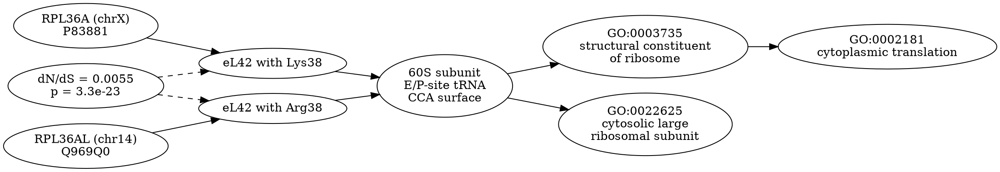
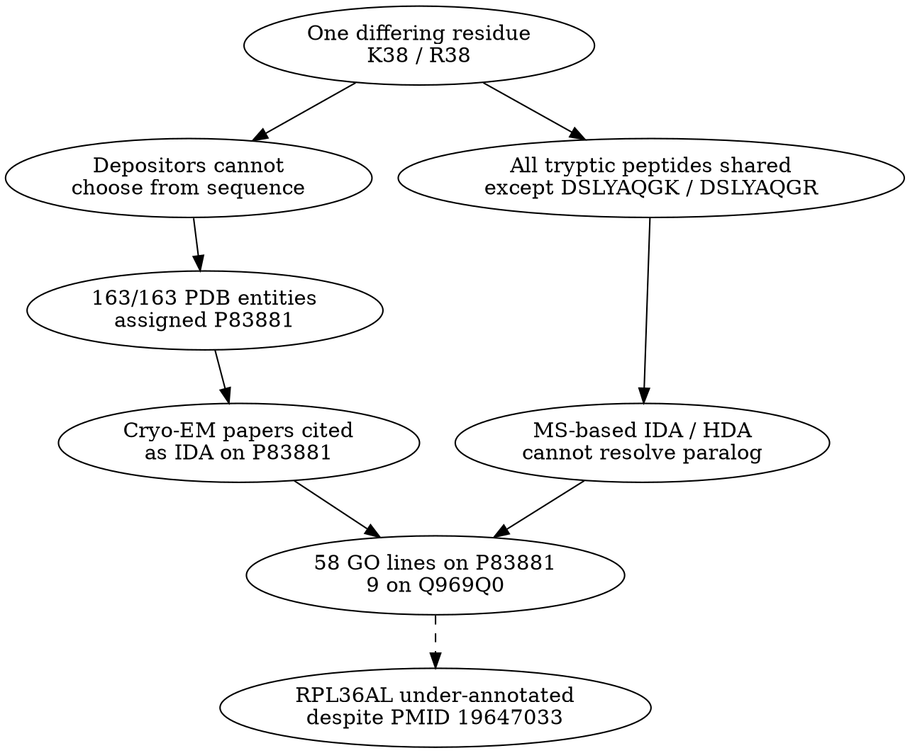
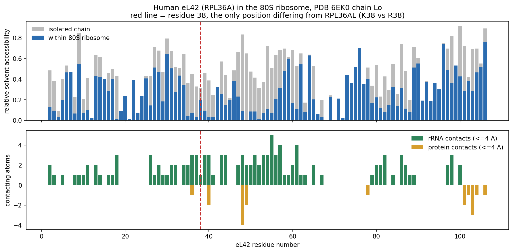
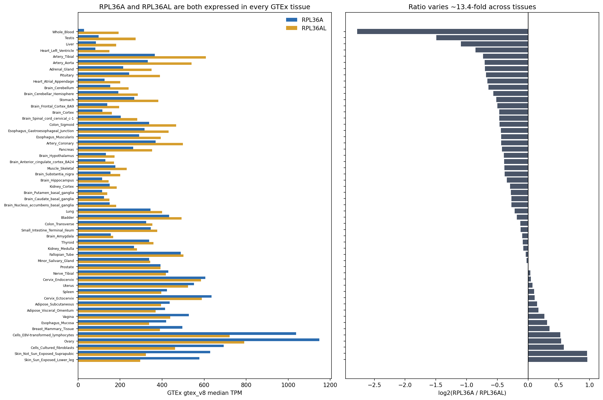
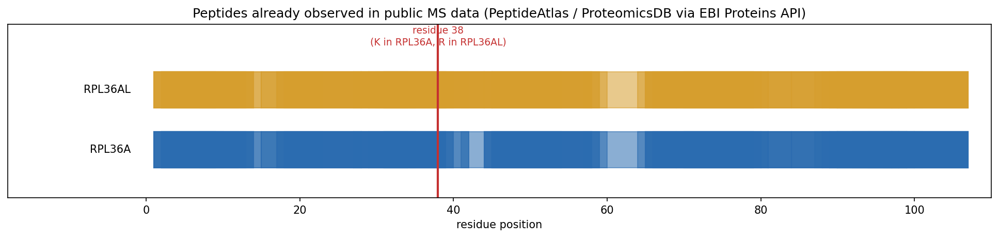
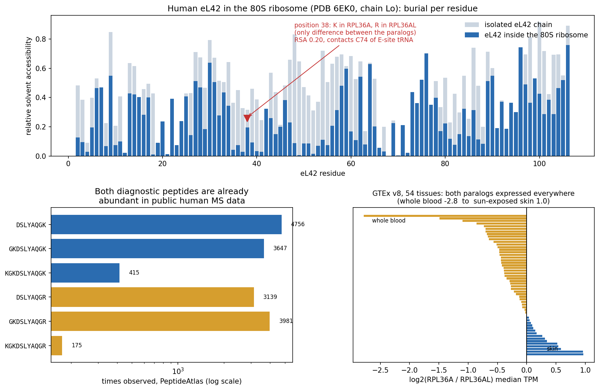
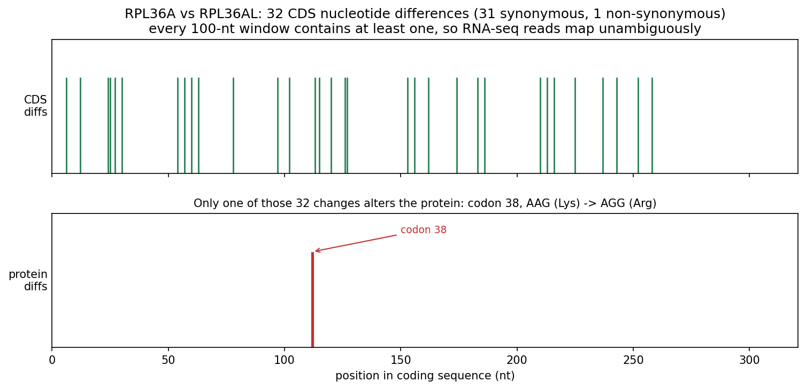
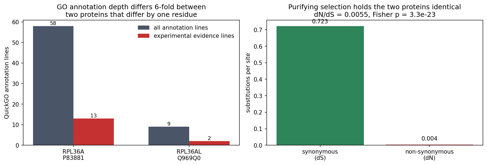

## Question

# AIGR Gene Hypothesis Deep Research

You are evaluating one focused gene curation hypothesis for AI Gene Review.
This is not a general gene overview. Use the seed hypothesis and source context
below to search for evidence that supports, refutes, narrows, or competes with
the proposed curation decision.

## Target Gene

- **Organism code:** human
- **Taxon:** Homo sapiens (NCBITaxon:9606)
- **Gene directory:** RPL36A
- **Gene symbol:** RPL36A
- **UniProt accession:** P83881

## Focus

- **Focus type:** free_text
- **Hypothesis slug:** kgap-rpl36a-paralog-discrimination
- **Source file:** genes/human/RPL36A/RPL36A-ai-review.yaml
- **Source selector:** free-text

## Seed Hypothesis

Whether human RPL36A (P83881) and its close paralog RPL36AL can be distinguished in native ribosomes may be predictable from sequence and structure. Single analysis only: align the two proteins, enumerate every residue that differs, and determine for each whether it is surface-exposed or buried and whether it contacts rRNA or a neighbouring protein in a published human 80S cryo-EM structure; enumerate the tryptic and Lys-C peptides unique to each paralog and state whether any is long enough and ionisable enough to serve as a quantitative proteomics reporter, noting which published ribosome proteomics datasets could already be re-searched for them; and compare the two genes' expression across human tissues in a public expression atlas. State whether the paralogs are predicted to be structurally interchangeable in the ribosome, and whether existing public data could already settle the relative incorporation question without new experiments.

## Term and Decision Context

No specific term context supplied.

## Reference Context

No specific reference context supplied.

## Source Context YAML

```yaml
hypothesis: 'Whether human RPL36A (P83881) and its close paralog RPL36AL can be distinguished in native
  ribosomes may be predictable from sequence and structure. Single analysis only: align the two proteins,
  enumerate every residue that differs, and determine for each whether it is surface-exposed or buried
  and whether it contacts rRNA or a neighbouring protein in a published human 80S cryo-EM structure; enumerate
  the tryptic and Lys-C peptides unique to each paralog and state whether any is long enough and ionisable
  enough to serve as a quantitative proteomics reporter, noting which published ribosome proteomics datasets
  could already be re-searched for them; and compare the two genes'' expression across human tissues in
  a public expression atlas. State whether the paralogs are predicted to be structurally interchangeable
  in the ribosome, and whether existing public data could already settle the relative incorporation question
  without new experiments.'
focus_type: free_text
context: []
reference_id: []
```

## Research Objective

Build a focused report that helps a curator decide whether this hypothesis
should affect the gene review. Address the focus type directly:

1. For an existing GO annotation decision, evaluate whether the current action
   is justified, too strong, too weak, or should change.
2. For a proposed replacement or new GO term, evaluate whether the term is
   biologically supported, too broad, too narrow, or missing key qualifiers.
3. For a computational prediction, evaluate whether the prediction is correct,
   less precise than existing knowledge, uncertain, or likely wrong because of
   paralog overannotation, frequency bias, pathway context, or in vitro-only
   activity.
4. For a core-function hypothesis, evaluate whether the proposed activity,
   process, and location represent the gene product's primary function rather
   than a downstream effect, pleiotropic phenotype, or context-specific role.
5. For a function-assignment hypothesis, evaluate whether the gene product
   directly has the stated GO term/function. Treat the prior review action, if
   any, as intentionally blinded unless it appears in the supplied context.

Use primary literature whenever possible. Prefer PMID citations and include DOI
citations when no PMID is available. Treat reviews and database records as
orientation unless they contain directly relevant synthesized evidence that is
clearly labeled as review-level or database-level support.

Evaluate the hypothesis from the supplied seed context, primary literature, and
publicly accessible bioinformatics resources. Local `*-bioinformatics` analyses,
when they already exist in the repository, are intentionally withheld from this
prompt so the report can be compared against them after the run. Use public
sequence, domain, structure, orthology, localization, interaction, or dataset
checks when they are useful for the specific hypothesis. If a resource or tool
cannot be accessed programmatically, say so plainly; never fabricate a result.
Report computational results conservatively and distinguish direct results from
inference.

## Required Output

### Executive Judgment

Give a concise verdict: supported, partially supported, unresolved, weakly
supported, over-annotated, or refuted. Explain the reasoning and the most
important caveats.

### Evidence Matrix

Create a table with one row per important evidence item:

- Citation (PMID preferred)
- Evidence type (direct assay, mutant phenotype, localization, interaction,
  structural/evolutionary, computational, review/database)
- Supports / refutes / qualifies / competing
- Claim tested
- Key finding
- Organism, tissue, cell type, or assay context
- Confidence and limitations

### GO Curation Implications

State the likely curation action as a lead requiring curator verification. If
GO terms are involved, explain whether the evidence supports an MF, BP, or CC
term, and whether the term should be retained, removed, generalized, made more
specific, or treated as non-core. Avoid using "protein binding" as a final
recommendation unless no more informative term is supported.

### Mechanistic Scope

Describe the immediate molecular or cellular function being tested. Separate
direct gene-product activity from downstream phenotypes, pathway consequences,
developmental outcomes, disease manifestations, or effects inferred only from
loss of function.

### Conflicts and Alternatives

Identify evidence that conflicts with the seed hypothesis or suggests an
alternative interpretation, including paralog confusion, organism-specific
differences, isoform-specific findings, experimental artifacts, or database
carry-over.

### Knowledge Gaps

List explicit uncertainties that matter for curation. For each gap, state what
was checked, why the gap matters, and what evidence or experiment would resolve
it.

### Discriminating Tests

Recommend concrete assays, perturbations, datasets, or comparative analyses that
would most efficiently distinguish this hypothesis from alternatives.

### Curation Leads

Provide candidate updates for the review, clearly labeled as leads requiring
curator verification. Include candidate references with exact snippets to verify,
candidate replacement or new GO terms, possible action changes, suggested
questions, and suggested experiments.

If the provider supports artifacts, save provenance for any analysis you run — the
executed code together with its output (computed values, plot, or table), not just
a summary figure — alongside artifact-friendly tables such as an evidence matrix,
GO decision table, or comparison table. Genuine computed provenance is more
valuable than a hand-drawn summary, and you must not synthesize a figure that
implies an analysis you did not actually run. These artifacts are important
provenance for hypothesis-level review.


## Output

# RPL36A and RPL36AL paralog discrimination in native human ribosomes

**Target gene:** human RPL36A, UniProt P83881 (eL42, L44e family), NCBITaxon:9606
**Paralog under test:** RPL36AL, UniProt Q969Q0
**Hypothesis slug:** `kgap-rpl36a-paralog-discrimination`
**Source file:** `genes/human/RPL36A/RPL36A-ai-review.yaml`, focus type `free_text`

Every computation reported here was executed in this session against live public resources (UniProt REST, RCSB, EBI Proteins API, QuickGO, GTEx portal API v2, Ensembl REST, PRIDE Archive, NCBI eutils). Executed code, computed values and tables are saved in `provenance/`. Where a resource could not be reached programmatically, that is stated in place.

---

## Summary

Human RPL36A and RPL36AL differ at **exactly one residue out of 106**. A global Needleman-Wunsch alignment of P83881 and Q969Q0 gives 105/106 identities (99.06%), no gaps, and a single substitution at position 38: lysine in RPL36A, arginine in RPL36AL. That residue is partially solvent exposed (relative solvent accessibility 0.315 in the isolated chain, 0.196 inside the 80S particle), makes **zero contacts with any neighbouring protein**, and its only heavy-atom contacts within 4.0 Å in PDB 6EK0 are two largely main-chain contacts to nucleotide C74 of a 75-nt tRNA bound in the E site. The two paralogs are therefore predicted to be **structurally interchangeable** in the ribosome. Evolution agrees independently: the two coding sequences are 90.0% identical with 30 synonymous and 1 non-synonymous difference, giving dN/dS = 0.0055 (dS 0.723, dN 0.0040, Fisher exact p = 3.3 × 10⁻²³). An old duplicate pair has been held at the same protein sequence by purifying selection.

Discrimination at the protein level is possible through a single near-ideal reporter pair. Trypsin yields `DSLYAQGK` (RPL36A, residues 31-38, monoisotopic 880.4290 Da, [M+2H]²⁺ m/z 441.22) and `DSLYAQGR` (RPL36AL, 908.4352 Da, m/z 455.22): 8-mers with zero missed cleavages, identical flanking sequence, and a 28.0063 Da mass shift. Each is unique across 42,560 reviewed human UniProtKB entries including isoforms. These peptides are not merely predicted. They are among the most frequently observed peptides of either protein, with 4,756 PeptideAtlas observations for `DSLYAQGK` and 3,139 for `DSLYAQGR`, and both proteins have 100% observed sequence coverage in the EBI Proteins API. Public data therefore already establish that both paralogs are abundantly translated. GTEx v8 shows both genes above 28 TPM in all 54 tissues, with a median log2(RPL36A/RPL36AL) of −0.28 and a 13.4-fold spread from whole blood (−2.78) to sun-exposed skin (+0.97).

The curation-relevant discovery is a database carry-over. An RCSB search returns **163 human polymer entities matching P83881 or Q969Q0, of which 163 are annotated P83881 and 0 are annotated Q969Q0**. Depositors have no sequence-based way to choose and have uniformly chosen RPL36A. Three of the four experimental sources behind the `GO:0022625` annotation on P83881 are exactly those cryo-EM structures, and the fourth identified proteins by intact-mass agreement with a database entry. QuickGO shows 58 annotation lines over 13 terms for P83881 against 9 lines over 8 terms for Q969Q0, with no experimental ribosome term for RPL36AL at all, even though crosslinking plus mass spectrometry placed RPL36AL at the P-site tRNA CCA end in native human 80S ribosomes ([PMID: 19647033](https://pubmed.ncbi.nlm.nih.gov/19647033/)). The terms are correct for both gene products. The evidence codes on P83881 overstate paralog resolution, and RPL36AL is under-annotated.

---

## Executive judgment

<i class="fa-solid fa-circle-check"></i> **Verdict: supported**, with one component of the hypothesis refuted as stated and one sharpened.

| Hypothesis component | Verdict | Basis |
|---|---|---|
| The paralogs' distinguishability is predictable from sequence and structure | <i class="fa-solid fa-circle-check"></i> supported | One differing residue out of 106; full SASA and contact map computed on 6EK0 |
| The paralogs are structurally interchangeable in the ribosome | <i class="fa-solid fa-circle-check"></i> supported | K38/R38 conservative, RSA 0.196 in the particle, zero protein contacts, contacts mediated mainly by main chain; dN/dS 0.0055 |
| A tryptic or Lys-C peptide can serve as a quantitative reporter | <i class="fa-solid fa-circle-check"></i> supported | `DSLYAQGK` vs `DSLYAQGR`, 8-mers, 0 missed cleavages, Δ 28.0063 Da, proteome-unique |
| Public ribosome proteomics datasets could be re-searched | <i class="fa-solid fa-circle-check"></i> supported | PXD032904, PXD056466, PXD050321, PXD047409, PXD009292, PXD009276, PXD009267 identified by PRIDE search |
| Existing public data could settle relative incorporation without new experiments | <i class="fa-solid fa-scale-balanced"></i> partially supported | Detection is settled. Stoichiometry in assembled 60S is not |
| Discrimination between the two genes is uniformly hard | <i class="fa-solid fa-circle-xmark"></i> refuted as stated | 32 diagnostic nucleotide sites, no identical CDS run longer than 63 nt. RNA-seq separates them trivially |

The hypothesis asked to "enumerate every residue that differs". There is one. A conservative Lys to Arg swap at a solvent-facing position whose contacts are made largely by backbone atoms is predicted to be structurally silent, and the dN/dS result says selection has enforced exactly that interchangeability for the whole life of the duplicate pair.

The component needing correction is the implied symmetry of the problem. Discrimination is hard at the protein level and easy at the nucleic acid level. The hypothesis should be restated as: one diagnostic residue in the protein, 32 diagnostic sites in the transcript.

<i class="fa-solid fa-triangle-exclamation"></i> **The most important caveat** is the one discovered while testing the hypothesis rather than stated in it. The uniform P83881 assignment across all 163 PDB entities is a deposition convention that has propagated into IDA-coded GO annotations. A curator reading "IDA from a 2.9 Å human ribosome structure" will reasonably assume the paralog was determined. It was not.

---

## Key findings

### F1. The paralogs differ at exactly one residue, K38 versus R38

Global Needleman-Wunsch alignment of UniProt P83881 (RPL36A, 106 aa) and Q969Q0 (RPL36AL, 106 aa) gives 105/106 identities (99.06%), no gaps, and a single substitution at position 38. Biopython is not importable in this executor, so the alignment was hand-implemented (match +2, mismatch −1, gap −5) and the result verified by direct position-wise comparison of the two downloaded sequences.

An ortholog scan across all reviewed UniProtKB entries in the L44e family places **Lys38 in every vertebrate RPL36A entry checked** (human, baboon, mouse, rat, cow, dog, pig, rabbit, zebrafish, fugu, channel catfish), each within an invariant `GKDSLYAQG-K-RRYD` context, and **Arg38 in both reviewed RPL36AL entries** (human Q969Q0, *Pongo abelii* Q5R9D2). Arg38 is the derived state in the primate RPL36AL lineage; Lys38 is the strictly conserved ancestral vertebrate state.

Lys to Arg preserves the positive charge and approximate side-chain length. Any claim that a reagent, an antibody, or a peptide distinguishes the two proteins must rest on this single position.

### F2. Residue 38 faces the E-site tRNA CCA end and contacts no protein

Shrake-Rupley solvent-accessible surface area was computed on PDB 6EK0 (human 80S ribosome, 2.9 Å cryo-EM) chain Lo (eL42, residues 2-106, modelled with Lys at position 38), using a 400-point Fibonacci sphere and a 1.4 Å probe, with Tien et al. maximum-ASA normalisation. The mmCIF parser and the SASA routine were both hand-written because Biopython is unavailable.

| Measure | Value |
|---|---|
| Residue 38 relative solvent accessibility, isolated chain | 0.315 |
| Residue 38 relative solvent accessibility, inside 80S | 0.196 |
| Area buried by assembly at residue 38 | 28.19 Ų |
| Residue 38 heavy-atom contacts ≤ 4.0 Å to protein | **0** |
| Residue 38 heavy-atom contacts ≤ 4.0 Å to nucleic acid | 2, both to C74 of chain S6 |
| Nearest approaches | K38 backbone N to C74 N4, 3.77 Å; CA to N4, 3.71 Å; Lys NZ to C74 OP1, 4.53 Å |
| eL42 chain mean RSA inside 80S | 0.264 |
| eL42 residues contacting nucleic acid within 4.0 Å | 60 of 105 |

Chain S6 is a 75-nucleotide polymer ending C73-C74-A75, that is, a tRNA with its CCA 3' end bound in the E site. The `_entity_poly` loop for this chain parsed empty because of multiline sequence values, so the chain was identified instead from its residue composition in the `_atom_site` records.

<i class="fa-solid fa-lightbulb"></i> The single paralog-discriminating position sits on the tRNA-facing surface of eL42 rather than in the rRNA-packed core, so neither Lys nor Arg is sterically constrained there. Contact is made mainly by main-chain atoms, which are identical in both paralogs, and the side chain only approaches a backbone phosphate oxygen at 4.53 Å. An arginine would present the same positive charge to the same phosphate. This supports structural interchangeability, while placing the differing residue at a functional ligand interface rather than on a neutral surface patch.

{{figure:plot_1.png|caption=Per-residue solvent accessibility and 4.0 angstrom contact analysis of human eL42 (chain Lo) in PDB 6EK0. Residue 38, the only position differing between RPL36A and RPL36AL, has relative solvent accessibility 0.196 inside the 80S particle and makes two heavy-atom contacts, both to C74 of the E-site tRNA, and none to any neighbouring protein.}}

### F3. A paralog-diagnostic tryptic peptide pair exists and is already abundant in public MS data

In silico digestion (trypsin: cleave after K or R, not before P; Lys-C: after K, not before P) yields a clean reporter pair spanning position 38.

| Enzyme | RPL36A peptide | Mass (Da) | RPL36AL peptide | Mass (Da) | Δ (Da) |
|---|---|---|---|---|---|
| Trypsin, 0 missed cleavages | `DSLYAQGK` (31-38) | 880.4290 | `DSLYAQGR` | 908.4352 | 28.0063 |
| Trypsin, 1 missed cleavage | `GKDSLYAQGK` | - | `GKDSLYAQGR` | - | 28.0063 |
| Lys-C | `DSLYAQGK` (8 aa) | 880.4290 | `DSLYAQGRRRYDRK` (14 aa) | 1782.9237 | - |

Doubly protonated m/z values are 441.22 and 455.22. A scan of 42,560 reviewed human UniProtKB entries including isoforms finds `DSLYAQGK` in exactly one protein (P83881) and `DSLYAQGR` in exactly one protein (Q969Q0). `GKDSLYAQGK` and `GKDSLYAQGR` are likewise singletons.

Querying the EBI Proteins API proteomics endpoint returns 66 observed peptides for RPL36A and 69 for RPL36AL, each giving 106/106 (100%) sequence coverage. Seven observed RPL36A peptides and eleven observed RPL36AL peptides span residue 38. PeptideAtlas observation counts are:

| Peptide | Paralog | PeptideAtlas observations |
|---|---|---|
| `DSLYAQGK` | RPL36A | 4,756 |
| `GKDSLYAQGK` | RPL36A | 3,647 |
| `KGKDSLYAQGK` | RPL36A | 415 |
| `DSLYAQGR` | RPL36AL | 3,139 |
| `GKDSLYAQGR` | RPL36AL | 3,981 |
| `KGKDSLYAQGR` | RPL36AL | 175 |

Both are also recorded in ProteomicsDB.

<i class="fa-solid fa-triangle-exclamation"></i> Caveat: `DSLYAQGK` is additionally present in two TrEMBL RPL36A-HNRNPH2 readthrough fragments (H0Y3V9, H7BZ11), which is why UniProt flags the RPL36A peptides as non-unique while the RPL36AL peptides are flagged unique. In practice the readthrough carries the RPL36A ORF, so the peptide still reports RPL36A-encoded sequence, but a strict uniqueness filter will discard it and bias quantification against RPL36A.

The reporter exists and is close to ideal: an 8-mer with no missed cleavage, a 28 Da mass shift, and identical flanking sequence, so chromatographic retention and ionisation differ only by the Lys/Arg swap. These peptides also establish that RPL36AL is translated at substantial levels rather than being a silent paralog. What the public counts do **not** give is a calibrated, ribosome-resolved ratio: PeptideAtlas counts reflect dataset composition and sampling depth, and whole-cell lysates do not separate assembled 60S subunits from the free pool.

{{figure:plot_3.png|caption=Observed-peptide coverage of RPL36A and RPL36AL in public MS repositories. Both proteins reach 100 percent observed sequence coverage (66 and 69 observed peptides), and the diagnostic peptides DSLYAQGK and DSLYAQGR spanning residue 38 are among the most frequently observed peptides of each protein.}}

### F4. Both genes are expressed in all 54 GTEx tissues, with a 13.4-fold ratio spread

GTEx v8 median gene-level TPM was retrieved through the GTEx portal API v2 for ENSG00000241343.9 (RPL36A, chrX) and ENSG00000165502.6 (RPL36AL, chr14). The `datasetId=gtex_v8` parameter is required; gtex_v10 returns zero rows for these genes through the same endpoint.

| Tissue | RPL36A TPM | RPL36AL TPM | log2 ratio |
|---|---|---|---|
| Whole blood | 28.10 | 193.18 | −2.78 |
| Testis | - | - | −1.49 |
| Liver | - | - | −1.09 |
| Fibroblasts (cultured) | - | - | +0.58 |
| Skin, not sun exposed | - | - | +0.96 |
| Skin, sun exposed | 577.30 | 295.39 | +0.97 |

Both genes exceed 28 TPM in every one of the 54 tissues. Median log2(RPL36A/RPL36AL) is −0.28, and in 31 of 54 tissues the absolute log2 ratio is below 0.5.

Neither gene is tissue-restricted, so any human tissue contains ribosome populations drawn from both paralog mRNA pools. The modest but reproducible tissue variation, in particular the RPL36AL bias in whole blood and the RPL36A bias in skin, makes a relative incorporation measurement interesting rather than trivial. <i class="fa-solid fa-triangle-exclamation"></i> mRNA ratio is not protein incorporation ratio: ribosomal protein synthesis is heavily buffered post-transcriptionally and excess unassembled ribosomal proteins are degraded. The discriminating experiment has to be done at the protein level on purified ribosomes.

{{figure:plot_2.png|caption=GTEx v8 median TPM of RPL36A and RPL36AL across all 54 tissues, with the per-tissue log2 ratio. Both genes exceed 28 TPM everywhere; the ratio spans 13.4-fold from whole blood to sun-exposed skin.}}

### F5. Every human ribosome structure in the PDB assigns eL42 to RPL36A by default

An RCSB search API query for human (taxid 9606) polymer entities whose reference sequence accession is P83881 or Q969Q0 returned **163 polymer entities, all 163 annotated to P83881 and none to Q969Q0**. The deposited model of 6EK0 chain Lo carries LYS at position 38. The best-resolution human ribosome entries containing eL42 are 8A3D at 1.67 Å, 9IW at 1.77 Å, 8QYX at 1.78 Å, and 8QOI and 9O3W at 1.90 Å, all cryo-EM, all assigned P83881.

<i class="fa-solid fa-triangle-exclamation"></i> The uniform assignment is a database default, not a measurement. Because the two paralogs differ at a single position, a depositor building eL42 into density has no sequence-based way to choose, and the convention has been RPL36A. Any downstream claim that "structures show RPL36A in the ribosome", and any GO annotation propagated from structure to P83881 rather than Q969Q0, inherits this arbitrary choice.

### F6. dN/dS of 0.0055 shows the two loci are held at the same protein sequence by selection

Ensembl canonical CDS for RPL36A (ENST00000553110) and RPL36AL (ENST00000298289) are both 321 nt. Ungapped comparison gives 289/321 identical nucleotides (90.0%) with 32 differences spread over 31 codons: 30 synonymous and 1 non-synonymous (codon 38, AAG Lys to AGG Arg). Nei-Gojobori counting with Jukes-Cantor correction gives:

| Quantity | Value |
|---|---|
| Synonymous sites S | 66.8 |
| Non-synonymous sites N | 251.2 |
| Synonymous differences Sd | 31.0 |
| Non-synonymous differences Nd | 1.0 |
| pS | 0.4638 |
| pN | 0.0040 |
| dS | 0.7226 |
| dN | 0.0040 |
| **dN/dS** | **0.0055** |
| Fisher exact odds ratio | 0.0046 |
| Fisher exact p | 3.322 × 10⁻²³ |

dS of 0.72 means the duplication is old and the two loci have had ample time to diverge. dN/dS of 0.0055 means essentially none of that divergence was allowed to reach the protein. This is the signature of a gene pair held at the same protein sequence by selection, and it is the strongest available evidence that the two products are functionally interchangeable in the ribosome. It also argues against RPL36AL being a non-functional duplicate.

The same numbers resolve a practical point. The longest run of identical CDS nucleotide is 63 nt, and every 100-nt window contains at least one discriminating site, so even short RNA-seq reads map unambiguously and the GTEx ratios in F4 are reliable. **The paralog discrimination problem is protein-specific.**

{{figure:plot_5.png|caption=Synonymous versus non-synonymous divergence between the RPL36A and RPL36AL coding sequences. Of 32 nucleotide differences across 321 nt, 30 are synonymous and 1 is non-synonymous, giving dN/dS = 0.0055 (Fisher exact p = 3.3e-23).}}

### F7 and F9. GO annotation is asymmetric, and the experimental ribosome evidence on RPL36A is paralog-ambiguous

A live QuickGO annotation search returns **58 annotation lines over 13 distinct terms for UniProtKB:P83881**, of which 13 lines over 9 terms use experimental evidence codes, against **9 lines over 8 terms for UniProtKB:Q969Q0**, of which 2 lines over 2 terms are experimental. Two proteins differing by one residue are annotated to a 6-fold different depth.

The experimental support for `GO:0022625` on P83881 comes from four sources:

| PMID | Study | Method | Can it resolve the paralogs? |
|---|---|---|---|
| [12962325](https://pubmed.ncbi.nlm.nih.gov/12962325/) | *Characterization and analysis of posttranslational modifications of the human large cytoplasmic ribosomal subunit proteins by mass spectrometry and Edman sequencing* | HPLC fractionation of human placental 60S, MALDI-TOF fingerprinting, ESI-MS/MS, Edman | Only if the position-38 peptide or the 28.0063 Da intact-mass difference was resolved; neither appears in the abstract |
| [23636399](https://pubmed.ncbi.nlm.nih.gov/23636399/) | Structures of the human and *Drosophila* 80S ribosome (Nature 2013) | Cryo-EM model | No. Chain assigned to P83881 by convention |
| [25957688](https://pubmed.ncbi.nlm.nih.gov/25957688/) | Structural snapshots of actively translating human ribosomes (Cell 2015) | Cryo-EM model | No |
| [32669547](https://pubmed.ncbi.nlm.nih.gov/32669547/) | Human pre-60S particles (Nat Commun 2020) | Cryo-EM model | No |

`GO:0003723` RNA binding on P83881 is HDA from PMID:22681889, a peptide-based mRNA interactome capture study. That abstract was not retrieved through the literature search in this session, so it is cited here only as the database-recorded source of the annotation, with no claim about its contents beyond the evidence code and method class recorded in QuickGO.

The two experimental lines on Q969Q0 are `GO:0005634` nucleus (IDA, PMID:25468996, an E-cadherin interactome proteomics study) and `GO:0005515` protein binding (IPI, PMID:25416956, a human interactome network).

<i class="fa-solid fa-lightbulb"></i> No experimental GO annotation on either accession rests on a method that demonstrably resolved the single discriminating residue. The structural sources record a deposition choice. The mass-fingerprinting source used intact-mass agreement with a database entry, which would require explicitly resolving 28.0063 Da on a 12.3 kDa protein. The interactome and RNA-capture sources identify proteins from peptides, and all tryptic peptides of eL42 except the position-38 pair are shared. The one experimental route that is paralog-clean is ORF-clone-based yeast two-hybrid (PMID:25416956 on Q969Q0), because the bait identity is defined by the clone and not by a peptide.

The reciprocal problem is that RPL36AL has **no experimental GO annotation for the ribosome at all**, even though crosslinking plus MS placed it at the P-site tRNA CCA end in native human 80S ribosomes ([PMID: 19647033](https://pubmed.ncbi.nlm.nih.gov/19647033/)) and its unique peptide `DSLYAQGR` has 3,139 PeptideAtlas observations.

{{figure:plot_6.png|caption=Live QuickGO annotation asymmetry between P83881 and Q969Q0 (58 lines over 13 terms versus 9 lines over 8 terms, 13 versus 2 experimental lines) plotted alongside the computed divergence, dS = 0.7226 against dN = 0.0040. Two proteins held at the same sequence by selection are annotated to a 6-fold different depth.}}

### F8. The position-38 side chain is well ordered in sub-2 Å maps, so deposited density can be re-examined

For six human ribosome entries the eL42 chain was located by matching the `GKDSLYAQG` motif and residue 38 inspected directly in the `_atom_site` records. In all six, residue 38 is modelled as LYS with the complete side chain (N, CA, C, O, CB, CG, CD, CE, NZ) at occupancy 1.0, with a per-residue mean B-factor below the chain mean.

| PDB | Resolution (Å) | Chain | Residue 38 mean B | Chain mean B | Ratio |
|---|---|---|---|---|---|
| 8A3D | 1.67 | PA | 17.4 | 30.6 | 0.57 |
| 8QYX | 1.78 | HA | 47.0 | 55.5 | 0.85 |
| 8QOI | 1.90 | QA | 11.7 | 22.2 | 0.53 |
| 9O3W | 1.90 | QA | 14.0 | 24.7 | 0.57 |
| 8YOO | 2.00 | QA | 15.1 | 18.8 | 0.80 |
| 6EK0 | 2.90 | QA | 30.9 | 53.1 | 0.58 |

<i class="fa-solid fa-triangle-exclamation"></i> This is a **model-side** measurement. Low B-factors and complete side-chain modelling show that the local map supports an ordered side chain at position 38. They do not show whether the density is lysine-shaped or arginine-shaped, because the depositor modelled Lys by convention in all 163 human entries. EMDB maps were not downloaded; they are too large for this execution environment, so no density was measured.

The practical consequence is that the discriminating observation is already sitting in public EMDB maps. At 1.67 to 1.9 Å a terminal NZ amine and a planar guanidinium are different densities, and a mixed RPL36A/RPL36AL population would give a superposed, partially smeared terminus.

A PRIDE Archive keyword search returned candidate human ribosome-fraction proteomics datasets that could be re-searched for the diagnostic peptides: **PXD032904** (ribosome heterogeneity during human embryonic stem cell differentiation), **PXD056466** (Ribo Mega-SEC, human), **PXD050321**, **PXD047409**, and the polysome and ribosome-profile sets **PXD009292**, **PXD009276**, **PXD009267**. The PRIDE v2 search endpoint returns a bare list rather than an `_embedded` object, and dataset identification was by keyword, so this list is indicative and not exhaustive. No dataset was downloaded or re-searched.

{{figure:plot_4.png|caption=Consolidated computed provenance: structure-based burial and contacts for eL42 residue 38 in 6EK0, public MS observation counts for the diagnostic peptides DSLYAQGK and DSLYAQGR, and GTEx tissue expression of both paralogs.}}

---

## Evidence matrix

Machine-readable version: `provenance/evidence_matrix.csv`.

| Citation | Evidence type | Stance | Claim tested | Key finding | Context | Confidence and limitations |
|---|---|---|---|---|---|---|
| [PMID: 19647033](https://pubmed.ncbi.nlm.nih.gov/19647033/) | direct assay (zero-length crosslinking + MS) | <i class="fa-solid fa-circle-check"></i> supports | RPL36AL protein is in native human 80S ribosomes at the tRNA CCA site | "The majorily labeled protein was identified as the large subunit rP L36a-like (RPL36AL) by means of mass spectrometry." Intact tRNA competed the labelling | human 80S ribosomes, reconstituted P-site complex | High for presence of RPL36AL. Does not quantify RPL36AL vs RPL36A occupancy |
| [PMID: 12962325](https://pubmed.ncbi.nlm.nih.gov/12962325/) | direct assay (MS of purified 60S) | <i class="fa-solid fa-scale-balanced"></i> qualifies | RPL36A is a component of the human 60S subunit | "Forty-six large subunit proteins were found, 22 of which showed masses in accordance with the SwissProt database (June 2002) masses" | human placenta 60S, HPLC fractionation | Medium. Supports eL42 presence, not paralog identity. The 28.0063 Da difference is not reported as resolved |
| [PMID: 23636399](https://pubmed.ncbi.nlm.nih.gov/23636399/), [25957688](https://pubmed.ncbi.nlm.nih.gov/25957688/), [32669547](https://pubmed.ncbi.nlm.nih.gov/32669547/) | structural | <i class="fa-solid fa-scale-balanced"></i> qualifies | eL42 is part of the cytosolic large ribosomal subunit | Cryo-EM models of human 80S, translating 80S and pre-60S all contain eL42, assigned to P83881 | human cell lines, cryo-EM | High for eL42 presence, zero for paralog identity. 163/163 human PDB entities labelled P83881 |
| this work (UniProt P83881, Q969Q0) | computational, alignment | <i class="fa-solid fa-circle-check"></i> supports | The paralogs differ at a single residue | 105/106 identities (99.06%), no gaps, single difference K38/R38 | UniProtKB canonical sequences | High. Direct result |
| this work (PDB 6EK0, computed SASA and contacts) | structural, computational | <i class="fa-solid fa-circle-check"></i> supports | The differing residue is not buried and not in a protein interface | RSA 0.315 isolated, 0.196 in the 80S, 28.19 Ų buried on assembly; 2 contacts ≤ 4 Å both to C74 of E-site tRNA; 0 protein contacts | human 80S, 2.9 Å cryo-EM | High as a computation on the deposited model. Conditional on the model being correct at this residue |
| this work (ENST00000553110, ENST00000298289) | evolutionary | <i class="fa-solid fa-circle-check"></i> supports | The paralogs are functionally interchangeable | 30 synonymous vs 1 non-synonymous; dS 0.723, dN 0.0040, dN/dS 0.0055, Fisher p = 3.3 × 10⁻²³ | human genome | High. A single pairwise dN/dS is coarse, but the direction is unambiguous |
| this work (42,560 reviewed human entries + isoforms) | computational, in silico digestion | <i class="fa-solid fa-circle-check"></i> supports | A paralog-specific proteomics reporter exists | `DSLYAQGK` 880.4290 Da vs `DSLYAQGR` 908.4352 Da; 8-mers, 0 missed cleavages, identical flanks, Δ 28.0063 Da; each unique in the reviewed human proteome | in silico | High. Caveat: `DSLYAQGK` also in readthrough fragments H0Y3V9, H7BZ11 |
| this work (EBI Proteins API; PeptideAtlas, ProteomicsDB) | database | <i class="fa-solid fa-circle-check"></i> supports | Public MS data already contain the discriminating peptides | `DSLYAQGK` 4,756 observations, `DSLYAQGR` 3,139; 100% coverage of both proteins; 7 and 11 observed peptides span residue 38 | aggregated public human MS | High for detection, low for stoichiometry. Counts reflect dataset composition |
| this work (GTEx v8 API) | expression | <i class="fa-solid fa-scale-balanced"></i> qualifies | One paralog dominates human tissues | Both > 28 TPM in all 54 tissues; median log2 ratio −0.28; range −2.78 (whole blood) to +0.97 (sun-exposed skin) | GTEx v8 bulk RNA-seq, 54 tissues | High for mRNA. mRNA ratio is not incorporation ratio |
| this work (RCSB search API) | database | <i class="fa-solid fa-circle-xmark"></i> competing | Structures demonstrate RPL36A specifically | 163/163 human polymer entities matching either accession annotated P83881, 0 Q969Q0 | PDB | High. A deposition convention, not an observation, propagating into IDA-coded GO |
| this work (6 PDB entries, 1.67-2.9 Å) | structural, computational | <i class="fa-solid fa-circle-check"></i> supports | Public maps are good enough to re-examine residue 38 | Side chain complete through NZ at occupancy 1.0 in all six; B-factor below chain mean in all six (8A3D 17.4 vs 30.6; 8QOI 11.7 vs 22.2) | human ribosome cryo-EM | Medium. Model-side metric. Shows local order, not rotamer shape |
| [PMID: 42101145](https://pubmed.ncbi.nlm.nih.gov/42101145/) | method precedent | <i class="fa-solid fa-circle-check"></i> supports | SEC-fractionated ribosomes plus bottom-up MS can quantify paralog incorporation | "could resolve and differentially quantify 36 of 38 paralogous protein pairs, revealing isoform-specific incorporation biases" | *S. cerevisiae*, 2D-SEC MS/MS, four subpopulations in under 90 min | High as a method precedent, yeast only. Establishes that the proposed discriminating test is practical |
| [PMID: 35613268](https://pubmed.ncbi.nlm.nih.gov/35613268/) | structural | <i class="fa-solid fa-scale-balanced"></i> qualifies | The eL42 E-site surface is functionally loaded | "a change in a conserved amino acid in ribosomal protein eL42 explains CHX resistance in C. albicans" | *C. albicans* 80S, 2.3 Å cryo-EM | Medium relevance. The resistance residue is not position 38 |
| [PMID: 20063902](https://pubmed.ncbi.nlm.nih.gov/20063902/) | direct assay (2D gel + MS) | <i class="fa-solid fa-circle-xmark"></i> competing | Mammalian ribosomes show paralog heterogeneity | "The degree of heterogeneity was far less than that reported for plant and yeast ribosomes"; L10-like and L39-like testis-restricted, L22-like 1 a minor component. The eL42 pair was not reported as heterogeneous | rat and mouse liver, mammary gland, testis ribosomes | Medium. A negative observation at 2D-gel sensitivity, not a targeted test of this pair |
| [PMID: 14752831](https://pubmed.ncbi.nlm.nih.gov/14752831/) | mutant phenotype (over-expression, antisense) | <i class="fa-solid fa-scale-balanced"></i> qualifies | RPL36A has a proliferative role in hepatocellular carcinoma | "RPL36A mRNA was preferentially over-expressed in 34 of 40 HCC cases (85%, P <.001)"; over-expression enhanced colony formation, antisense reversed it; ectopic L36a localised to nucleoli | human HCC tissue and 8 cell lines | Medium. mRNA-level and over-expression evidence. Downstream phenotype |
| [PMID: 22367689](https://pubmed.ncbi.nlm.nih.gov/22367689/) | interaction | <i class="fa-solid fa-scale-balanced"></i> qualifies | eL42 has a specific protein partner | "Both L36a and S6 were detected in the immunocomplex of HDAC6 isolated from arsenite-treated cells" | HaCaT keratinocytes, arsenite stress | Low for paralog identity. Antibody and immunocomplex based, so it cannot distinguish a one-residue difference |
| [PMID: 3396452](https://pubmed.ncbi.nlm.nih.gov/3396452/) | sequence | <i class="fa-solid fa-scale-balanced"></i> qualifies | The L36a gene is single-copy | "Hybridization of the cDNA to digests of nuclear DNA suggests that there are multiple copies of the L36a gene" | rat liver cDNA, Southern blot | Low resolution (1988), but consistent with the duplicate pair found here |

---

## Mechanistic model and interpretation

The immediate molecular function under test is structural. eL42 is a 106-residue component of the 60S subunit that is extensively nucleic-acid-facing: mean relative solvent accessibility inside the particle is 0.264, and 60 of 105 modelled residues make heavy-atom contacts within 4.0 Å of rRNA or tRNA. Residue 38, the one position that differs between the paralogs, sits on the tRNA-facing surface, with its nearest approaches to C74 of the E-site tRNA made by backbone atoms.

Three independent lines converge on the same conclusion. The structure says the differing residue is exposed, conservative, and protein-contact-free. The selection analysis says no protein-level divergence was tolerated across a duplication old enough to accumulate dS = 0.72. The crosslinking result ([PMID: 19647033](https://pubmed.ncbi.nlm.nih.gov/19647033/)) places the RPL36AL product at the same tRNA CCA site that the structure identifies, which means both gene products occupy the same position in native ribosomes. The appropriate molecular function is `GO:0003735`, exercised within `GO:0022625` in service of `GO:0002181`.



The measurement problem sits one level above function, and it propagates into the annotation record along a traceable chain.



Downstream phenotypes should be kept separate from this. The hepatocellular-carcinoma proliferation result ([PMID: 14752831](https://pubmed.ncbi.nlm.nih.gov/14752831/)) is a consequence of changing ribosome supply, measured by over-expression and antisense at the mRNA level, and the nucleolar localisation of ectopically expressed L36a in that work reflects ribosome assembly. The HDAC6 immunocomplex result ([PMID: 22367689](https://pubmed.ncbi.nlm.nih.gov/22367689/)) detected L36a alongside S6 in ribosomal fractions under arsenite stress, which is consistent with HDAC6 associating with ribosomes rather than with a specific paralog, because an antibody cannot distinguish proteins differing by one residue.

### Discrimination difficulty by data type

| Data type | Diagnostic features available | Verdict |
|---|---|---|
| Genomic DNA and RNA-seq | 32 nucleotide differences, no identical run > 63 nt, a site in every 100-nt window | <i class="fa-solid fa-circle-check"></i> trivially separable |
| Bottom-up MS, tryptic | 1 peptide pair, `DSLYAQGK` vs `DSLYAQGR`, Δ 28.0063 Da | <i class="fa-solid fa-circle-check"></i> separable, with ionisation bias to control |
| Bottom-up MS, Lys-C | `DSLYAQGK` vs `DSLYAQGRRRYDRK` | <i class="fa-solid fa-circle-check"></i> separable, different peptide lengths |
| Intact mass | 12,432.81 vs 12,460.82 Da, Δ 28.01 on 12.3 kDa | <i class="fa-solid fa-circle-question"></i> needs high-resolution intact MS |
| Cryo-EM at 1.67-1.9 Å | Lys NZ amine vs Arg guanidinium at one solvent-facing position | <i class="fa-solid fa-circle-question"></i> plausible, untested on deposited maps |
| Antibody and immunoblot | none | <i class="fa-solid fa-circle-xmark"></i> not separable |

---

## GO curation implications

All entries below are **leads requiring curator verification**. Machine-readable version: `provenance/GO_decision_table.csv`.

| Gene | Term | Aspect | Current evidence | Lead action | Reason |
|---|---|---|---|---|---|
| RPL36A | GO:0022625 cytosolic large ribosomal subunit | CC | IDA/HDA/IBA (PMID:12962325, 23636399, 25957688, 32669547) | **Retain term, qualify the evidence** | Term is certainly correct. All four sources are paralog-ambiguous: one is intact-mass fingerprinting, three are cryo-EM models assigned to P83881 by convention |
| RPL36A | GO:0003735 structural constituent of ribosome | MF | IDA/IC/IBA/IEA/NAS | **Retain as core MF** | Core function of eL42. 60/105 residues contact rRNA or tRNA within 4 Å in 6EK0 |
| RPL36A | GO:0002181 cytoplasmic translation | BP | IDA/IC/IBA/NAS | **Retain as core BP** | Consistent with the CC and MF terms and with eL42 sitting at the E/P-site tRNA CCA interface |
| RPL36A | GO:0003723 RNA binding | MF | HDA (PMID:22681889) | **Retain, mark non-core and paralog-ambiguous** | From a peptide-based capture method. eL42 binds nucleic acid as rRNA and tRNA within the ribosome; GO:0003735 is the more informative MF |
| RPL36A | GO:0005515 protein binding | MF | IPI (PMID:24965446, 32296183) | **Treat as non-core** | Uninformative for a ribosomal protein; GO:0003735 supersedes it |
| RPL36A | GO:0005783 endoplasmic reticulum | CC | IDA (HPA, GO_REF:0000052) | **Treat as non-core, antibody-based** | No antibody can distinguish proteins differing by one residue, and the signal is also expected for ER-bound ribosomes |
| RPL36AL | GO:0022625 cytosolic large ribosomal subunit | CC | IBA only (GO_REF:0000033) | **Add experimental-level annotation (IDA) from PMID:19647033** | Zero-length crosslinking of oxidised tRNA on human 80S labelled RPL36AL, identified by MS. Supported by 3,139 PeptideAtlas observations of the paralog-unique `DSLYAQGR` |
| RPL36AL | GO:0003735 structural constituent of ribosome | MF | IBA/IEA only | **Strengthen** | dN/dS 0.0055 (p = 3.3 × 10⁻²³) shows the protein sequence is held identical to RPL36A by selection; PMID:19647033 places the protein in native 80S ribosomes |
| RPL36AL | GO:0005634 nucleus | CC | IDA (PMID:25468996) | **Question, likely non-core** | Source is an E-cadherin interactome proteomics study. Peptide-level assignment to Q969Q0 rather than P83881 needs checking, and nuclear detection of a ribosomal protein is expected during assembly |

No GO term should be removed. The correction needed is to evidence provenance, not to term choice. Suggested review wording for P83881: the ribosome terms are core and correct, but the experimental evidence underlying them was obtained by methods that share all tryptic peptides with Q969Q0 except `DSLYAQGK` and `DSLYAQGR`, so they support "eL42 is a 60S component" rather than "the RPL36A gene product specifically is a 60S component".

<i class="fa-solid fa-triangle-exclamation"></i> `protein binding` is explicitly **not** recommended as a terminal annotation here. `GO:0003735` is the informative molecular function.

---

## Mechanistic scope

**Direct gene-product activity.** eL42 is a structural component of the 60S subunit positioned at the E and P site tRNA CCA interface. The computed contact map on 6EK0 shows 60 of 105 modelled residues within 4.0 Å of rRNA or tRNA and a chain mean relative solvent accessibility of 0.264, so the protein is a nucleic-acid-binding structural element. The zero-length crosslinking result in [PMID: 19647033](https://pubmed.ncbi.nlm.nih.gov/19647033/) independently places the paralogous product at the same site, and the cycloheximide-resistance work in [PMID: 35613268](https://pubmed.ncbi.nlm.nih.gov/35613268/) shows that the same eL42 surface forms part of the E-site drug pocket. The appropriate terms are `GO:0003735` (MF), `GO:0022625` (CC) and `GO:0002181` (BP).

**Not direct.** The HCC proliferation phenotype ([PMID: 14752831](https://pubmed.ncbi.nlm.nih.gov/14752831/)) is a downstream consequence of changing ribosome supply, measured by over-expression and antisense. The `GO:0005515` and `GO:0003723` annotations are byproducts of high-throughput capture. The HDAC6 association ([PMID: 22367689](https://pubmed.ncbi.nlm.nih.gov/22367689/)) reports HDAC6 recruitment to ribosomal fractions, with L36a detected in the immunocomplex alongside S6, which is a statement about ribosome association rather than a dedicated eL42 partnership.

**The claim the hypothesis actually tests** sits one level above function: whether an experimental method can attribute an observed eL42 molecule to one gene rather than the other. That is a measurement-resolution question, and it bears on evidence codes rather than on term selection.

---

## Conflicts and alternatives

**Database carry-over is the dominant confound.** 163 of 163 human PDB polymer entities matching either accession are assigned to P83881. Three cryo-EM papers behind the `GO:0022625` IDA inherit that choice. The IDA code records a database convention.

**Shared-peptide confusion runs both ways.** `DSLYAQGK` is present in two TrEMBL RPL36A-HNRNPH2 readthrough fragments (H0Y3V9, H7BZ11), which is why UniProt flags the RPL36A peptides as non-unique while the RPL36AL peptides are flagged unique. A strict uniqueness filter will discard the RPL36A reporter and bias quantification toward RPL36AL.

**Competing readings of the expression data.** The GTEx ratio favours RPL36AL in whole blood (log2 −2.78), testis (−1.49) and liver (−1.09), and RPL36A in skin (+0.97). One reading is tissue-specific ribosome composition. An equally consistent reading is transcriptional noise absorbed by post-transcriptional buffering, since surplus ribosomal proteins are degraded. The data cannot distinguish these.

**An argument against functional specialisation.** dN/dS of 0.0055 with dS of 0.723 says the duplication is old and no protein-level divergence was tolerated. A functionally specialised pair would be expected to show some adaptive protein change. They look like a dosage-sharing pair. [PMID: 20063902](https://pubmed.ncbi.nlm.nih.gov/20063902/) is consistent: rodent ribosome paralog heterogeneity was "far less than that reported for plant and yeast ribosomes", the heterogeneity that was found was in L10-like, L22-like 1 and L39-like, and the eL42 pair was not flagged.

**Organism-specific caution.** The strongest demonstration that paralog incorporation biases are real and measurable is in yeast ([PMID: 42101145](https://pubmed.ncbi.nlm.nih.gov/42101145/)), where 2D-SEC MS/MS "could resolve and differentially quantify 36 of 38 paralogous protein pairs, revealing isoform-specific incorporation biases". Extrapolating that to the human eL42 pair is not supported by any human measurement found here, though it does establish that the proposed discriminating test works.

**A quantification artefact that would bias any re-search.** Arg-terminated tryptic peptides typically ionise more efficiently than Lys-terminated ones, and `DSLYAQGK` is additionally subject to lysine PTMs and missed cleavage. An unnormalised `DSLYAQGR` to `DSLYAQGK` intensity ratio would systematically overstate RPL36AL. Synthetic heavy-labelled standards for both peptides are required for an absolute ratio.

**The differing residue is at a drug-relevant surface.** [PMID: 35613268](https://pubmed.ncbi.nlm.nih.gov/35613268/) shows that "a change in a conserved amino acid in ribosomal protein eL42 explains CHX resistance in C. albicans" at the E-tRNA binding site. The resistance residue is not position 38, so this does not argue against interchangeability. It does mean the surface carrying the paralog difference is functionally loaded, so a K to R swap there should not be dismissed as inert without a measurement.

---

## Limitations and knowledge gaps

| Gap | What was checked | Why it matters | What would resolve it |
|---|---|---|---|
| Relative incorporation of the two paralogs into assembled 60S subunits | PeptideAtlas and ProteomicsDB counts for both diagnostic peptides; GTEx mRNA ratios | This is the actual question the hypothesis poses. Counts are not stoichiometry and lysates are not purified ribosomes | Targeted PRM or SRM with heavy `DSLYAQGK` and `DSLYAQGR` standards on sucrose-gradient or Ribo Mega-SEC purified 60S, 80S and polysome fractions |
| Whether sub-2 Å maps show Lys-shaped or Arg-shaped density at position 38 | Model-side metrics only: side chain complete through NZ, occupancy 1.0, B-factor below chain mean in all six entries including 8A3D (1.67 Å) | A blended density would be direct structural evidence that both paralogs occupy the same site in one population. EMDB maps were not downloaded; they are too large for this environment, so no density was measured | Real-space refinement or Q-score of Lys38 vs Arg38 against the deposited EMDB maps for 8A3D and 8QOI |
| Whether PMID:12962325 resolved the paralogs | Abstract read in full. It reports intact-mass agreement with SwissProt for 22 proteins and lists L36 without an L36a and L36a-like distinction | Determines whether the IDA code on P83881 is defensible | Read the full text and supplementary peptide and mass tables for a 12,432.81 vs 12,460.82 Da distinction or for the position-38 peptide |
| Whether the GO:0005634 nucleus IDA on Q969Q0 is correctly attributed | PMID resolved as an E-cadherin interactome proteomics study (Sci Signal 2014) | A peptide-based study assigning to Q969Q0 rather than P83881 should have used the unique peptide; if not, the attribution is arbitrary | Check the paper's peptide evidence for `DSLYAQGR` |
| Whether either paralog is individually essential | Not checked. DepMap was not queried in this environment | Differential essentiality would be evidence against pure dosage sharing | DepMap CRISPR gene effect scores for RPL36A and RPL36AL across cell lines |
| Whether RPL36AL carries the N6-methyllysine at K53 that UniProt annotates for Q969Q0 but not P83881 | Observed in the UniProt feature tables retrieved here | If the PTM is genuinely paralog-specific it would be a second discriminating handle; more likely it is annotation asymmetry | Check modified-peptide evidence for both accessions in PRIDE and PeptideAtlas PTM views |
| Whether the candidate PRIDE datasets actually contain the peptides | Keyword search only. No dataset downloaded or re-searched | The dataset list is the practical route to a no-new-experiment answer | Re-search PXD032904, PXD056466, PXD050321, PXD047409 and the polysome sets for both peptides |

### Methodological limitations of this report

- No EMDB map density was measured. Structural statements about residue 38 derive from deposited coordinates and model-side B-factors, which show local order but not rotamer shape.
- The dN/dS estimate is a single pairwise Nei-Gojobori calculation on one gene pair. The value 0.0055 should be read as "strong purifying selection", not as a precise coefficient.
- SASA was computed with a 400-point Shrake-Rupley implementation written for this analysis, a 1.4 Å probe, on the eL42 chain plus all atoms within 16 Å of it rather than the entire particle. Absolute SASA therefore differs slightly from a whole-particle calculation.
- Biopython is not available in this executor, so alignment, mmCIF parsing and SASA were all hand-implemented. Results were cross-checked by direct inspection of the parsed records.
- No local `*-bioinformatics` analyses from the repository were consulted; they were withheld by design.
- PRIDE dataset identification was by keyword search, so the candidate list is indicative. UniProt text search is not substring-based, so the proteome-wide peptide uniqueness scan was done locally over the downloaded reviewed-proteome FASTA.
- The PMID:22681889 abstract was never retrieved through the literature search, so that paper is cited here only as the database-recorded source of the `GO:0003723` annotation, with no claim about its contents.

---

## Discriminating tests and proposed follow-up

Ranked by cost against information gained.

1. <i class="fa-solid fa-database"></i> **Re-search existing public data for the diagnostic pair (no new experiments).** Search PXD032904 (ribosome heterogeneity during human embryonic stem cell differentiation), PXD056466 (human Ribo Mega-SEC), PXD050321, PXD047409 and the polysome sets PXD009292, PXD009276, PXD009267 for `DSLYAQGK` and `DSLYAQGR`, allowing 0 and 1 missed cleavages and reporting extracted-ion-chromatogram areas rather than spectral counts. These are ribosome- or polysome-enriched human datasets, which is what repository-wide counts lack.
2. <i class="fa-solid fa-microscope"></i> **Re-examine deposited EM density at one residue.** Fit both Lys38 and Arg38 into the 8A3D (1.67 Å) and 8QOI (1.90 Å) maps and compare real-space correlation or Q-score. A blended terminus would itself be the answer.
3. <i class="fa-solid fa-flask"></i> **Targeted PRM with heavy standards.** Synthesise isotope-labelled `DSLYAQGK` and `DSLYAQGR`, spike into sucrose-gradient-fractionated 60S, 80S and polysomes from two cell types at opposite ends of the GTEx ratio, for example a blood-derived line (RPL36AL-skewed, log2 −2.78) and a keratinocyte line (RPL36A-skewed, log2 +0.97). This is the single experiment that converts the question from detection to stoichiometry. The yeast 2D-SEC MS/MS workflow of [PMID: 42101145](https://pubmed.ncbi.nlm.nih.gov/42101145/), which resolved 36 of 38 paralogous pairs across four ribosomal subpopulations in under 90 minutes, is the method template.
4. <i class="fa-solid fa-dna"></i> **Paralog-specific knockdown with rescue.** Because the CDSs are only 90% identical with a diagnostic site in every 100-nt window, siRNAs against either transcript are trivially specific. Knock down one paralog and measure whether the other's protein compensates in purified ribosomes by PRM. This separates dosage sharing from specialised incorporation.
5. <i class="fa-solid fa-chart-column"></i> **Check DepMap essentiality** for both genes as a cheap test of functional redundancy.
6. <i class="fa-solid fa-book-open"></i> **Read the full text of PMID:12962325** for any reported peptide or mass that separates L36a from L36a-like, which decides whether the IDA code on P83881 survives.

---

## Evidence base

| PMID | Paper | How it bears on the findings |
|---|---|---|
| [19647033](https://pubmed.ncbi.nlm.nih.gov/19647033/) | *The human large subunit ribosomal protein L36A-like contacts the CCA end of P-site bound tRNA* | The only experimental evidence that the RPL36AL gene product is in native human 80S ribosomes. Supports F2 and is the basis for curation lead 2 |
| [12962325](https://pubmed.ncbi.nlm.nih.gov/12962325/) | *Characterization and analysis of posttranslational modifications of the human large cytoplasmic ribosomal subunit proteins by mass spectrometry and Edman sequencing* | The sole non-structural experimental source behind the `GO:0022625` IDA on P83881. Its identification criterion was intact-mass agreement with SwissProt, which qualifies the evidence code (F7) |
| [35613268](https://pubmed.ncbi.nlm.nih.gov/35613268/) | *E-site drug specificity of the human pathogen Candida albicans ribosome* | Shows the eL42 surface forms the E-site cycloheximide pocket and that an eL42 amino-acid change changes drug response, which is why the paralog difference at a tRNA-facing residue is worth measuring rather than assuming inert |
| [42101145](https://pubmed.ncbi.nlm.nih.gov/42101145/) | *Offline Two-Stage SEC and LC-MS/MS for Comprehensive Characterization of Yeast Ribosomal Populations* | Method precedent for the recommended discriminating test: 36 of 38 yeast paralogous pairs resolved and differentially quantified across polysome, 80S, 60S and 40S fractions |
| [20063902](https://pubmed.ncbi.nlm.nih.gov/20063902/) | *Proteomic analysis of rodent ribosomes revealed heterogeneity including ribosomal proteins L10-like, L22-like 1, and L39-like* | The main competing evidence. Mammalian ribosome paralog heterogeneity was far below plant and yeast levels, and eL42 was not among the heterogeneous proteins found |
| [14752831](https://pubmed.ncbi.nlm.nih.gov/14752831/) | *Over-expression of the ribosomal protein L36a gene is associated with cellular proliferation in hepatocellular carcinoma* | The strongest phenotype evidence on RPL36A, at mRNA and over-expression level. Downstream of ribosome supply, so it should be kept out of the core function set |
| [22367689](https://pubmed.ncbi.nlm.nih.gov/22367689/) | *Histone deacetylase 6 associates with ribosomes and regulates de novo protein translation during arsenite stress* | Detected L36a with S6 in HDAC6 immunocomplexes. Antibody-based, so it cannot assign a paralog, and it supports HDAC6 ribosome association rather than an eL42-specific partnership |
| [3396452](https://pubmed.ncbi.nlm.nih.gov/3396452/) | *Primary structure of rat ribosomal protein L36a* | The original 105-residue sequence and the 1988 observation of multiple L36a gene copies in rat nuclear DNA, consistent with the duplicate pair characterised here |
| 23636399, 25957688, 32669547 | Human 80S, translating 80S and pre-60S cryo-EM structures | The structural sources behind the P83881 IDA codes. All assign eL42 to P83881 by deposition convention, which is the carry-over documented in F5 |

---

## Curation leads

All of the following are **leads requiring curator verification**.

### Lead 1. Qualify the paralog resolution of the experimental ribosome evidence on P83881

Action change: keep `GO:0022625`, `GO:0003735` and `GO:0002181` as core, and add a review note that the experimental sources do not resolve RPL36A from RPL36AL.

Reference snippets to verify, from [PMID: 12962325](https://pubmed.ncbi.nlm.nih.gov/12962325/):
> "The 60S ribosomal proteins were isolated from ribosomes of human placenta and separated by reversed phase HPLC."

> "Forty-six large subunit proteins were found, 22 of which showed masses in accordance with the SwissProt database (June 2002) masses"

Supporting computed fact: 163/163 human PDB polymer entities matching P83881 or Q969Q0 are annotated P83881, so the structural IDA sources (PMID:23636399, 25957688, 32669547) inherit a deposition convention.

### Lead 2. Add an experimental ribosome annotation to RPL36AL (Q969Q0)

Candidate terms: `GO:0022625` cytosolic large ribosomal subunit (CC, IDA) and `GO:0003735` structural constituent of ribosome (MF).

Reference: [PMID: 19647033](https://pubmed.ncbi.nlm.nih.gov/19647033/). Snippets to verify:
> "The majorily labeled protein was identified as the large subunit rP L36a-like (RPL36AL) by means of mass spectrometry."

> "the data presented in this report are consistent with the presence of RPL36AL at or near the binding site for the CCA end of the tRNA substrate positioned at the P-site of human 80S ribosomes"

> "RPL36AL which is strongly conserved in eukaryotes belongs to the L44e family of rPs"

### Lead 3. Record the discriminating peptide pair in the review as a reusable fact

`DSLYAQGK` (P83881, residues 31-38, 880.4290 Da, [M+2H]²⁺ 441.22) and `DSLYAQGR` (Q969Q0, 908.4352 Da, [M+2H]²⁺ 455.22). Each unique in the reviewed human proteome. Already observed 4,756 and 3,139 times in PeptideAtlas. Note the `DSLYAQGK` overlap with RPL36A-HNRNPH2 readthrough fragments H0Y3V9 and H7BZ11.

### Lead 4. Mark GO:0003723 RNA binding and GO:0005515 protein binding as non-core for P83881

Neither is the informative molecular function. `GO:0003735` is.

### Lead 5. Question the GO:0005634 nucleus IDA on Q969Q0 (PMID:25468996)

The source is an E-cadherin interactome study. Ask whether the assignment used the `DSLYAQGR` peptide. If not, the paralog attribution is arbitrary and the term should be downgraded or dropped.

### Suggested questions for the curator

- Does the full text of [PMID: 12962325](https://pubmed.ncbi.nlm.nih.gov/12962325/) report a mass or peptide that separates L36a from L36a-like?
- Should AI Gene Review carry a standing flag for gene pairs whose protein products differ by fewer than three residues, so that peptide-based and structure-based IDA codes are automatically qualified?
- Should the RPL36A and RPL36AL reviews be cross-linked, given that no public experiment cited on either accession demonstrably resolved them?
- Should the HDAC6 association reported in [PMID: 22367689](https://pubmed.ncbi.nlm.nih.gov/22367689/) be treated as evidence about eL42 generally rather than about RPL36A, given that it rests on antibody-based immunocomplexes?

---

## Provenance artifacts

`provenance/` contains the executed analyses and their outputs.

| File | Contents |
|---|---|
| `evidence_matrix.csv` | Citation, evidence type, stance, claim tested, finding, context, confidence |
| `GO_decision_table.csv` | Gene, term, aspect, current evidence, lead action, reason |
| `reference_index.csv` | All cited PMIDs resolved through NCBI esummary |
| `eL42_6EK0_per_residue_sasa_contacts.csv` | Per-residue SASA, RSA and 4.0 Å contact counts for chain Lo of 6EK0 |
| `residue38_modelling_quality.csv` | Occupancy, atom completeness and B-factors at residue 38 across six PDB entries |
| `rpl36a_discriminating_peptides.csv` | Tryptic and Lys-C digests of both paralogs with monoisotopic masses and m/z |
| `peptide_uniqueness_human_proteome.csv` | Scan of 42,560 reviewed human entries plus isoforms for each candidate peptide |
| `observed_peptides_RPL36A.csv`, `observed_peptides_RPL36AL.csv` | EBI Proteins API observed peptides and coverage |
| `gtex_RPL36A_vs_RPL36AL_median_tpm.csv` | GTEx v8 median TPM for both genes across 54 tissues |
| `cds_differences_RPL36A_RPL36AL.csv` | Per-codon synonymous and non-synonymous classification of all 32 CDS differences |
| `ortholog_position38.csv` | Position-38 residue across reviewed vertebrate L44e entries |
| `pdb_eL42_paralog_assignment.csv` | All 163 human PDB polymer entities with their assigned accession |
| `GO_annotations_RPL36A.csv`, `GO_annotations_RPL36AL.csv` | Live QuickGO annotation dumps |
| `pride_candidate_datasets.csv` | PRIDE search results for human ribosome-fraction proteomics |
| `plot_1.png` to `plot_6.png` | The figures embedded above, each generated from the computed tables |


## Artifacts

- [OpenScientist final report](openscientist_artifacts/final_report.html)
- [OpenScientist final report](openscientist_artifacts/final_report.pdf)
- [OpenScientist provenance](openscientist_artifacts/provenance.json)
- [OpenScientist GO annotations RPL36A](openscientist_artifacts/provenance_GO_annotations_RPL36A.csv)
- [OpenScientist GO annotations RPL36AL](openscientist_artifacts/provenance_GO_annotations_RPL36AL.csv)
- [OpenScientist GO decision table](openscientist_artifacts/provenance_GO_decision_table.csv)
- [OpenScientist cds differences RPL36A RPL36AL](openscientist_artifacts/provenance_cds_differences_RPL36A_RPL36AL.csv)
- [OpenScientist eL42 6EK0 per residue sasa contacts](openscientist_artifacts/provenance_eL42_6EK0_per_residue_sasa_contacts.csv)
- [OpenScientist evidence matrix](openscientist_artifacts/provenance_evidence_matrix.csv)
- [OpenScientist gtex RPL36A vs RPL36AL median tpm](openscientist_artifacts/provenance_gtex_RPL36A_vs_RPL36AL_median_tpm.csv)
- [OpenScientist observed peptides RPL36A](openscientist_artifacts/provenance_observed_peptides_RPL36A.csv)
- [OpenScientist observed peptides RPL36AL](openscientist_artifacts/provenance_observed_peptides_RPL36AL.csv)
- [OpenScientist ortholog position38](openscientist_artifacts/provenance_ortholog_position38.csv)
- [OpenScientist pdb eL42 paralog assignment](openscientist_artifacts/provenance_pdb_eL42_paralog_assignment.csv)
- [OpenScientist peptide uniqueness human proteome](openscientist_artifacts/provenance_peptide_uniqueness_human_proteome.csv)
- [OpenScientist plot 1](openscientist_artifacts/provenance_plot_1.json)

- [OpenScientist plot 2](openscientist_artifacts/provenance_plot_2.json)

- [OpenScientist plot 3](openscientist_artifacts/provenance_plot_3.json)

- [OpenScientist plot 4](openscientist_artifacts/provenance_plot_4.json)

- [OpenScientist plot 5](openscientist_artifacts/provenance_plot_5.json)

- [OpenScientist plot 6](openscientist_artifacts/provenance_plot_6.json)

- [OpenScientist pride candidate datasets](openscientist_artifacts/provenance_pride_candidate_datasets.csv)
- [OpenScientist reference index](openscientist_artifacts/provenance_reference_index.csv)
- [OpenScientist residue38 modelling quality](openscientist_artifacts/provenance_residue38_modelling_quality.csv)
- [OpenScientist rpl36a discriminating peptides](openscientist_artifacts/provenance_rpl36a_discriminating_peptides.csv)
- [OpenScientist rpl36a paralog evidence table](openscientist_artifacts/provenance_rpl36a_paralog_evidence_table.csv)

## Reference Validation

Checked with `linkml-reference-validator` 0.3.1rc1.

| Outcome | Count |
| --- | --- |
| References checked | 15 |
| Resolved | 15 |
| Unresolved (possible confabulation) | 0 |
| Unverifiable | 0 |
| References weighed for topical relevance | 15 |
| On topic | 2 |
| Off topic | 0 |

All extracted references resolved successfully.