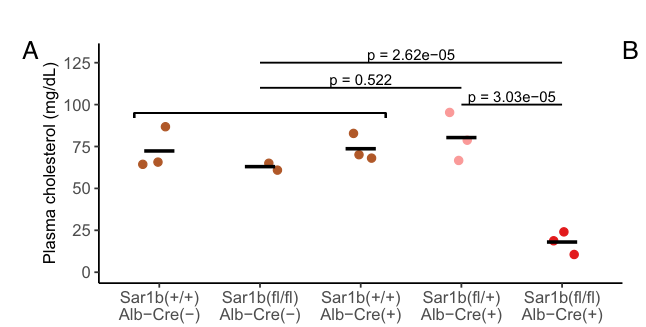

## Question

# Gene Research for Functional Annotation

## ⚠️ CRITICAL: Gene/Protein Identification Context

**BEFORE YOU BEGIN RESEARCH:** You MUST verify you are researching the CORRECT gene/protein. Gene symbols can be ambiguous, especially for less well-characterized genes from non-model organisms.

### Target Gene/Protein Identity (from UniProt):
- **UniProt Accession:** Q9Y6B6
- **Protein Description:** RecName: Full=Small COPII coat GTPase SAR1B {ECO:0000305|PubMed:23433038}; EC=3.6.5.2 {ECO:0000269|PubMed:32358066, ECO:0000269|PubMed:36369712}; AltName: Full=GTP-binding protein B {ECO:0000303|Ref.2}; Short=GTBPB {ECO:0000303|Ref.2}; AltName: Full=Secretion-associated Ras-related GTPase 1B {ECO:0000312|HGNC:HGNC:10535};
- **Gene Information:** Name=SAR1B {ECO:0000303|PubMed:33186557, ECO:0000312|HGNC:HGNC:10535}; Synonyms=SARA2 {ECO:0000303|PubMed:17309654}, SARB;
- **Organism (full):** Homo sapiens (Human).
- **Protein Family:** Belongs to the small GTPase superfamily. SAR1 family.
- **Key Domains:** P-loop_NTPase. (IPR027417); Small_GTP-bd. (IPR005225); Small_GTPase_ARF/SAR. (IPR006689); Small_GTPase_SAR1. (IPR006687); Arf (PF00025)

### MANDATORY VERIFICATION STEPS:

1. **Check if the gene symbol "SAR1B" matches the protein description above**
2. **Verify the organism is correct:** Homo sapiens (Human).
3. **Check if protein family/domains align with what you find in literature**
4. **If you find literature for a DIFFERENT gene with the same or similar symbol, STOP**

### If Gene Symbol is Ambiguous or You Cannot Find Relevant Literature:

**DO NOT PROCEED WITH RESEARCH ON A DIFFERENT GENE.** Instead:
- State clearly: "The gene symbol 'SAR1B' is ambiguous or literature is limited for this specific protein"
- Explain what you found (e.g., "Found extensive literature on a different gene with the same symbol in a different organism")
- Describe the protein based ONLY on the UniProt information provided above
- Suggest that the protein function can be inferred from domain/family information

### Research Target:

Please provide a comprehensive research report on the gene **SAR1B** (gene ID: SAR1B, UniProt: Q9Y6B6) in human.

The research report should be a detailed narrative explaining the function, biological processes, and localization of the gene product. Citations should be given for all claims.

You should prioritize authoritative reviews and primary scientific literature when conducting research. You can supplement
this with annotations you find in gene/protein databases, but these can be outdated or inaccurate.

We are specifically interested in the primary function of the gene - for enzymes, what reaction is catalyzed, and what is the substrate specificity? For transporters, what is the substrate? For structural proteins or adapters, what is the broader structural role? For signaling molecules, what is the role in the pathway.

We are interested in where in or outside the cell the gene product carries out its function.

We are also interested in the signaling or biochemical pathways in which the gene functions. We are less interested in broad pleiotropic effects, except where these elucidate the precise role.

Include evidence where possible. We are interested in both experimental evidence as well as inference from structure, evolution, or bioinformatic analysis. Precise studies should be prioritized over high-throughput, where available.

## Output

Question: You are an expert researcher providing comprehensive, well-cited information.

Provide detailed information focusing on:
1. Key concepts and definitions with current understanding
2. Recent developments and latest research (prioritize 2023-2024 sources)
3. Current applications and real-world implementations
4. Expert opinions and analysis from authoritative sources
5. Relevant statistics and data from recent studies

Format as a comprehensive research report with proper citations. Include URLs and publication dates where available.
Always prioritize recent, authoritative sources and provide specific citations for all major claims.

# Gene Research for Functional Annotation

## ⚠️ CRITICAL: Gene/Protein Identification Context

**BEFORE YOU BEGIN RESEARCH:** You MUST verify you are researching the CORRECT gene/protein. Gene symbols can be ambiguous, especially for less well-characterized genes from non-model organisms.

### Target Gene/Protein Identity (from UniProt):
- **UniProt Accession:** Q9Y6B6
- **Protein Description:** RecName: Full=Small COPII coat GTPase SAR1B {ECO:0000305|PubMed:23433038}; EC=3.6.5.2 {ECO:0000269|PubMed:32358066, ECO:0000269|PubMed:36369712}; AltName: Full=GTP-binding protein B {ECO:0000303|Ref.2}; Short=GTBPB {ECO:0000303|Ref.2}; AltName: Full=Secretion-associated Ras-related GTPase 1B {ECO:0000312|HGNC:HGNC:10535};
- **Gene Information:** Name=SAR1B {ECO:0000303|PubMed:33186557, ECO:0000312|HGNC:HGNC:10535}; Synonyms=SARA2 {ECO:0000303|PubMed:17309654}, SARB;
- **Organism (full):** Homo sapiens (Human).
- **Protein Family:** Belongs to the small GTPase superfamily. SAR1 family.
- **Key Domains:** P-loop_NTPase. (IPR027417); Small_GTP-bd. (IPR005225); Small_GTPase_ARF/SAR. (IPR006689); Small_GTPase_SAR1. (IPR006687); Arf (PF00025)

### MANDATORY VERIFICATION STEPS:

1. **Check if the gene symbol "SAR1B" matches the protein description above**
2. **Verify the organism is correct:** Homo sapiens (Human).
3. **Check if protein family/domains align with what you find in literature**
4. **If you find literature for a DIFFERENT gene with the same or similar symbol, STOP**

### If Gene Symbol is Ambiguous or You Cannot Find Relevant Literature:

**DO NOT PROCEED WITH RESEARCH ON A DIFFERENT GENE.** Instead:
- State clearly: "The gene symbol 'SAR1B' is ambiguous or literature is limited for this specific protein"
- Explain what you found (e.g., "Found extensive literature on a different gene with the same symbol in a different organism")
- Describe the protein based ONLY on the UniProt information provided above
- Suggest that the protein function can be inferred from domain/family information

### Research Target:

Please provide a comprehensive research report on the gene **SAR1B** (gene ID: SAR1B, UniProt: Q9Y6B6) in human.

The research report should be a detailed narrative explaining the function, biological processes, and localization of the gene product. Citations should be given for all claims.

You should prioritize authoritative reviews and primary scientific literature when conducting research. You can supplement
this with annotations you find in gene/protein databases, but these can be outdated or inaccurate.

We are specifically interested in the primary function of the gene - for enzymes, what reaction is catalyzed, and what is the substrate specificity? For transporters, what is the substrate? For structural proteins or adapters, what is the broader structural role? For signaling molecules, what is the role in the pathway.

We are interested in where in or outside the cell the gene product carries out its function.

We are also interested in the signaling or biochemical pathways in which the gene functions. We are less interested in broad pleiotropic effects, except where these elucidate the precise role.

Include evidence where possible. We are interested in both experimental evidence as well as inference from structure, evolution, or bioinformatic analysis. Precise studies should be prioritized over high-throughput, where available.

# Human SAR1B (UniProt Q9Y6B6): functional annotation and research report

## Identity and central function

**Identity verified.** The target is human **SAR1B**, also called **SARA2**, encoding a 198-amino-acid Sar1/ARF-family small GTPase; the human paralog **SAR1A** is a different protein (UniProt Q9NR31). Primary studies explicitly identify human SAR1B as **Q9Y6B6**. Its conserved nucleotide-binding regions and small-GTPase fold agree with the supplied P-loop NTPase, ARF/SAR and SAR1 domain annotations. Human SAR1A and SAR1B differ at 20 of 198 residues, so experiments on one paralog must not automatically be attributed to the other. (georges2011molecularanalysisand pages 1-2, charcosset2008andersonorchylomicron pages 4-6, tang2024functionaloverlapbetween pages 2-3)

**Primary annotation:** SAR1B is a **GTP-dependent initiator and regulator of coat protein complex II (COPII) assembly at endoplasmic-reticulum (ER) exit sites**. Its best-established physiologically important cargo pathway is export of **apolipoprotein B-containing lipoproteins**, particularly intestinal prechylomicrons. SAR1B is not a triglyceride transporter or an enzyme that chemically modifies chylomicrons: **GTP is its enzymatic substrate**, whereas lipoproteins are secretory cargo whose trafficking depends on its GTPase cycle and coat-protein interactions. (levy2024unravelingchylomicronretention pages 2-4, melville2020smallsequencevariations pages 5-7, sane2017understandingchylomicronretention pages 1-2, levy2024unravelingchylomicronretention pages 7-9)

## Molecular activity, partners and cellular location

SAR1B is a guanine-nucleotide molecular switch. The ER-membrane exchange factor **SEC12** promotes replacement of bound GDP with GTP; the GTP-loaded protein exposes its **N-terminal amphipathic helix**, which inserts into the **cytosolic leaflet of the ER membrane** at ER exit sites. Membrane-associated SAR1B recruits **SEC23–SEC24** to form the inner COPII coat, followed by **SEC13–SEC31** outer-coat assembly. SEC24 participates in cargo selection, while membrane insertion and coat assembly help remodel the ER membrane. **SEC23 is the principal GTPase-activating partner**, with SEC31 modulating the reaction: SAR1B catalyzes **GTP + H₂O → GDP + inorganic phosphate**, facilitating coat turnover and subsequent cargo delivery. Inactive GDP-bound SAR1B is principally cytosolic; its central functional site is the **ER–Golgi interface**, not the extracellular space or the lumen of a chylomicron. Whether hydrolysis itself is invariably required for vesicle scission, as opposed to regulating coat dynamics and delivery, remains debated. (georges2011molecularanalysisand pages 11-12, levy2024unravelingchylomicronretention pages 2-4, downes2025mechanismsofcopii pages 9-11, levy2024unravelingchylomicronretention pages 7-9)

The nucleotide-binding fold and conserved guanine-recognition residues support this enzymatic assignment, but the strongest specificity data come from purified-protein experiments rather than domain prediction. Melville, Studer and Schekman found that purified **human SAR1B recruited SEC23A or SEC23B to liposomes approximately fivefold more strongly than SAR1A**. Conversely, SAR1A loaded GTP faster and bound a SEC31A fragment more strongly; **GTP-hydrolysis rates showed no strong consistent difference** under their tested conditions. Swapping SAR1 paralog-specific clusters near the nucleotide pocket and an exposed helix near the COPII-binding interface altered these biochemical properties. Thus, *nucleotide exchange*, *GTP hydrolysis* and *coat-partner affinity* are distinct measurements; faster exchange does not imply faster hydrolysis. [Melville et al., *Journal of Biological Chemistry*, June 2020](https://doi.org/10.1074/jbc.RA120.012964). (melville2020smallsequencevariations pages 5-7, melville2020smallsequencevariations pages 2-5)

## Biological pathway and experimental evidence

In intestinal enterocytes, dietary lipids are assembled with **ApoB-48** into prechylomicrons in the ER. These bulky particles must reach the Golgi before basolateral secretion. Human **SAR1B-null Caco-2/15 enterocytes** retained approximately **40% of control triglyceride secretion, 57% of control ApoB-48 secretion and 34.5% of control chylomicron output**—that is, these numbers are **remaining outputs, not percentage decreases**. Combined SAR1A/SAR1B disruption nearly eliminated these outputs, demonstrating both SAR1B dependence and partial compensation by SAR1A in this cell model. [Sané et al., *Arteriosclerosis, Thrombosis, and Vascular Biology*, December 2017](https://doi.org/10.1161/ATVBAHA.117.310121). (sane2017understandingchylomicronretention pages 1-2)

A distinction matters for precise annotation: **SAR1B is required for efficient chylomicron export, but a universal requirement for SAR1B in the physical budding of every prechylomicron carrier is not established**. In a cell-free intestinal assay, approximately **250-nm** prechylomicron transport vesicles could bud without GTP or COPII proteins, yet failed to dock and fuse efficiently with the Golgi unless COPII components were available. Removing **SEC24C** nearly abolished docking and adding it back restored docking; SEC23 depletion reduced docking by approximately **25%**. This identifies an especially clear **COPII-dependent targeting/docking step** in that assay, without proving that budding is COPII-independent in every intact human enterocyte. [Siddiqi, Siddiqi and Mansbach, *Journal of Lipid Research*, May 2010](https://doi.org/10.1194/jlr.M002758). (siddiqi2010sec24cisrequired pages 1-2)

SAR1B also supports hepatic export of **ApoB-100-containing lipoproteins**. In a rat hepatoma secretion model, SAR1B depletion impaired ApoB-100 release; re-expression of SAR1B, but not SAR1A under those conditions, restored secretion, and the paralog-specific coat-binding helix was important. This is mechanistic evidence for lipoprotein-export specialization, **not** proof that hepatic secretion is absent in people with SAR1B-related disease. [Melville et al., June 2020](https://doi.org/10.1074/jbc.RA120.012964). (melville2020sar1paralogsdiffer pages 4-6, melville2020smallsequencevariations pages 5-7)

The following evidence matrix separates direct observations from interpretations and species-specific limitations. (melville2020smallsequencevariations pages 5-7, sane2017understandingchylomicronretention pages 1-2, siddiqi2010sec24cisrequired pages 1-2, tang2024functionaloverlapbetween pages 3-5)

| Evidence / model | Direct observation | Inference and limitation | Source |
|---|---|---|---|
| **Human identity and patient intestine** | Human **SAR1B**, formerly **SARA2**, UniProt **Q9Y6B6**, was identified as a Sar1/ARF-family small GTPase. Patient duodenal biopsies showed reduced SAR1B expression and lipid-laden enterocytes; increased SAR1A did not compensate. | Confirms the requested human protein identity and connects SAR1B deficiency to intestinal lipoprotein retention. Only three patients were studied, so the findings do not establish prevalence or universal genotype–phenotype relationships. (georges2011molecularanalysisand pages 1-2, georges2011molecularanalysisand pages 4-6, georges2011molecularanalysisand pages 8-11) | Georges et al., 2011. *Orphanet Journal of Rare Diseases* 6:1. [DOI](https://doi.org/10.1186/1750-1172-6-1) |
| **Purified human SAR1 paralogs; rat hepatoma secretion model** | Purified SAR1B recruited SEC23A or SEC23B to membranes approximately **fivefold more strongly** than SAR1A. SAR1A exchanged nucleotide faster, but GTP-hydrolysis activity was broadly similar in vitro. In SAR1B-deficient McArdle RH7777 rat hepatoma cells, SAR1B—but not SAR1A—restored secretion of APOB100-containing lipoproteins. | Direct biochemical evidence that small sequence differences affect COPII assembly and lipoprotein export. The secretion experiment used rat hepatoma cells rather than human enterocytes; faster nucleotide exchange must not be interpreted as faster GTP hydrolysis. (melville2020smallsequencevariations pages 5-7, melville2020sar1paralogsdiffer pages 17-19, melville2020smallsequencevariations pages 2-5) | Melville, Studer & Schekman, 2020. *Journal of Biological Chemistry* 295:8401–8412. [DOI](https://doi.org/10.1074/jbc.RA120.012964) |
| **Human Caco-2/15 intestinal epithelial cells** | Complete SAR1B knockout retained approximately **40% of control triglyceride secretion, 57% of control APOB48 secretion, and 34.5% of control chylomicron output**. Combined SAR1A/SAR1B disruption produced near-complete inhibition. | Demonstrates a causal role in intestinal triglyceride-rich lipoprotein secretion while revealing partial paralog compensation. These are **percent-of-control outputs**, not percentage decreases; an immortalized cell line does not fully reproduce severe human disease. (sane2017understandingchylomicronretention pages 1-2) | Sané et al., 2017. *Arteriosclerosis, Thrombosis, and Vascular Biology* 37:2243–2251. [DOI](https://doi.org/10.1161/ATVBAHA.117.310121) |
| **Cell-free intestinal prechylomicron transport-vesicle assay** | Prechylomicron transport vesicles averaged approximately **250 nm**. Budding from intestinal ER membranes did not require GTP or COPII proteins, but Golgi docking did: SEC23 depletion reduced docking by **25%**, whereas SEC24C depletion nearly abolished it and recombinant SEC24C restored activity. | COPII/SAR1 involvement may be strongest at targeting or docking rather than strictly required for budding in this reconstituted system. The assay does not prove that all intact human enterocytes use wholly COPII-independent budding. (siddiqi2010sec24cisrequired pages 1-2) | Siddiqi, Siddiqi & Mansbach, 2010. *Journal of Lipid Research* 51:1093–1100. [DOI](https://doi.org/10.1194/jlr.M002758) |
| **Heterozygous Sar1b mice under dietary challenge** | Five-week-old male and female **Sar1b** deletion or D137N heterozygotes received chow or high-fat diet for **8 weeks**. The models showed genotype- and sex-dependent changes in weight gain, adiposity, insulin resistance, plasma lipids, hepatic steatosis, and fatty-acid composition; male mutants on high-fat diet had lower hepatic triglycerides and lipid accumulation than controls. | Supports a role for Sar1b dosage in whole-body lipid handling and dietary response. These were heterozygous mice, many effects depended on sex and allele, and the study does not directly reproduce recessive human SAR1B deficiency. (auclair2023highfatdietreveals pages 1-2, auclair2023highfatdietreveals pages 7-7, auclair2023highfatdietreveals pages 9-10) | Auclair et al., 2023. *Journal of Lipid Research* 64:100423. [DOI](https://doi.org/10.1016/j.jlr.2023.100423) |
| **Conditional and coding-sequence-replacement mouse genetics** | Hepatocyte-specific Sar1b loss lowered plasma cholesterol to approximately **20 mg/dL versus 75 mg/dL** in controls. Adenoviral expression of either mouse SAR1A or SAR1B restored cholesterol to wild-type levels by day 3. Replacing endogenous Sar1b coding sequence with Sar1a rescued Sar1b-null perinatal lethality; homozygous replacement mice survived with normal growth, fertility, histology, and plasma cholesterol. | Strong in-vivo evidence for extensive biochemical overlap and transcriptional subfunctionalization of mouse paralogs. Mouse Sar1b-null lethality differs from viable human chylomicron-retention disease, so rescue by mouse SAR1A does not establish that SAR1A upregulation will treat patients. (tang2024functionaloverlapbetween pages 3-5, tang2024functionaloverlapbetween pages 5-6, tang2024functionaloverlapbetween media 7721ba05) | Tang et al., 2024. *Proceedings of the National Academy of Sciences* 121:e2322164121. [DOI](https://doi.org/10.1073/pnas.2322164121) |

*Table: A compact evidence matrix integrating human identity, biochemical function, intestinal and hepatic lipoprotein transport, and recent mouse genetics. It distinguishes direct observations from model-specific inferences and limitations.*

## Human disease and real-world use

**Biallelic pathogenic SAR1B variants cause autosomal-recessive chylomicron retention disease**—also called Anderson disease. The functional clue is a selective failure of intestinal chylomicron secretion: patient enterocytes can synthesize ApoB-48 but accumulate lipid droplets and lipoprotein-sized particles, while circulating postprandial chylomicrons are deficient. Clinical findings include childhood fat malabsorption, steatorrhea or diarrhea, poor growth, low cholesterol and deficiencies of fat-soluble vitamins. A 2024 review describes retained intestinal triglycerides and cholesteryl esters despite ApoB-48 production, supporting a **trafficking/secretion defect rather than simply failure to synthesize ApoB-48**. [Levy et al., *Biomedicines*, July 2024](https://doi.org/10.3390/biomedicines12071548). (levy2024unravelingchylomicronretention pages 9-10, levy2024unravelingchylomicronretention pages 7-9)

Clinical implementation centers on **SAR1B genetic testing** in a compatible malabsorption/hypocholesterolemia phenotype. Duodenal biopsy may provide supporting evidence of **oil-red-O-positive, lipid-laden enterocytes**; a three-patient molecular study documented reduced intestinal SAR1B expression despite increased SAR1A expression. The pattern of absent intestinal ApoB-48-containing circulating particles with ApoB-100-containing particles still detectable helps localize the defect, but biochemical findings alone do not establish the genotype. Dietary management reported in affected patients includes **restriction of long-chain fat, medium-chain-triglyceride supplementation and replacement of deficient fat-soluble vitamins**; these measures address the consequences of defective export, **not the underlying GTPase defect**. No population prevalence estimate can reliably be inferred from the small published patient cohorts. [Georges et al., *Orphanet Journal of Rare Diseases*, January 2011](https://doi.org/10.1186/1750-1172-6-1). (georges2011molecularanalysisand pages 4-6, georges2011molecularanalysisand pages 8-11, georges2011molecularanalysisand pages 1-2)

## Developments in 2023–2024 and interpretation

A **2023 dietary-challenge study** examined male and female mice heterozygous for a *Sar1b* deletion or D137N substitution after **eight weeks** of chow or high-fat diet. Lipoprotein composition, fatty-acid profiles and metabolic responses differed by **allele and sex**; high-fat-fed male mutant animals had less hepatic triglyceride accumulation than controls. These mouse findings extend SAR1B-associated biology to dietary lipid handling, but they should not be read as quantitative predictions for people with **biallelic** disease. [Auclair et al., *Journal of Lipid Research*, September 2023](https://doi.org/10.1016/j.jlr.2023.100423). (auclair2023highfatdietreveals pages 7-7, auclair2023highfatdietreveals pages 9-10)

The strongest recent test of paralog specificity came from **2024 mouse genetics**. Hepatocyte-specific *Sar1b* deletion lowered plasma cholesterol to approximately **20 mg/dL versus 75 mg/dL** in controls; delivery of either mouse SAR1A or SAR1B restored cholesterol toward normal. More decisively, replacing the coding sequence at the endogenous mouse *Sar1b* locus with *Sar1a* rescued *Sar1b*-null perinatal lethality, yielding adults with apparently normal growth, fertility and plasma cholesterol. These results support substantial **functional overlap and expression-pattern-dependent specialization** in mice, even though biochemical assays detect paralog differences. They do **not** establish SAR1A upregulation as a proven treatment for human disease: mouse complete loss is perinatally lethal, whereas affected humans survive, and compensation varies by model. [Tang et al., *Proceedings of the National Academy of Sciences*, April 2024](https://doi.org/10.1073/pnas.2322164121). (tang2024functionaloverlapbetween pages 3-5, tang2024functionaloverlapbetween pages 5-6, tang2024functionaloverlapbetween media 7721ba05)

**Assessment.** The most defensible human functional annotation is **SEC12-activated, SEC23/SEC31-regulated GTP hydrolysis coupled to COPII assembly and ER-to-Golgi export, with a particularly consequential role in enterocyte chylomicron trafficking**. The relative contributions of carrier budding, cargo capture and Golgi docking—and the extent to which human SAR1A can substitute for SAR1B in each tissue—remain experimentally context-dependent. (melville2020smallsequencevariations pages 5-7, sane2017understandingchylomicronretention pages 1-2, siddiqi2010sec24cisrequired pages 1-2, tang2024functionaloverlapbetween pages 5-6)

References

1. (georges2011molecularanalysisand pages 1-2): Amandine Georges, Jessica Bonneau, Dominique Bonnefont-Rousselot, Jacqueline Champigneulle, Jean P Rabès, Marianne Abifadel, Thomas Aparicio, Jean C Guenedet, Eric Bruckert, Catherine Boileau, Alain Morali, Mathilde Varret, Lawrence P Aggerbeck, and Marie E Samson-Bouma. Molecular analysis and intestinal expression of sar1 genes and proteins in anderson's disease (chylomicron retention disease). Orphanet Journal of Rare Diseases, 6:1-1, Jan 2011. URL: https://doi.org/10.1186/1750-1172-6-1, doi:10.1186/1750-1172-6-1. This article has 89 citations and is from a peer-reviewed journal.

2. (charcosset2008andersonorchylomicron pages 4-6): Mathilde Charcosset, Agnès Sassolas, Noël Peretti, Claude C. Roy, Colette Deslandres, Daniel Sinnett, Emile Levy, and Alain Lachaux. Anderson or chylomicron retention disease: molecular impact of five mutations in the sar1b gene on the structure and the functionality of sar1b protein. Molecular genetics and metabolism, 93 1:74-84, Jan 2008. URL: https://doi.org/10.1016/j.ymgme.2007.08.120, doi:10.1016/j.ymgme.2007.08.120. This article has 95 citations and is from a peer-reviewed journal.

3. (tang2024functionaloverlapbetween pages 2-3): Vi T. Tang, Jie Xiang, Zhimin Chen, Joseph McCormick, Prabhodh S. Abbineni, Xiao-Wei Chen, Mark Hoenerhoff, Brian T. Emmer, Rami Khoriaty, Jiandie D. Lin, and David Ginsburg. Functional overlap between the mammalian sar1a and sar1b paralogs in vivo. Proceedings of the National Academy of Sciences of the United States of America, Apr 2024. URL: https://doi.org/10.1073/pnas.2322164121, doi:10.1073/pnas.2322164121. This article has 19 citations and is from a highest quality peer-reviewed journal.

4. (levy2024unravelingchylomicronretention pages 2-4): Emile Levy, Catherine Fallet-Bianco, Nickolas Auclair, Natalie Patey, Valérie Marcil, Alain Théophile Sané, and Schohraya Spahis. Unraveling chylomicron retention disease enhances insight into sar1b gtpase functions and mechanisms of actions, while shedding light of intracellular chylomicron trafficking. Biomedicines, 12:1548, Jul 2024. URL: https://doi.org/10.3390/biomedicines12071548, doi:10.3390/biomedicines12071548. This article has 1 citations.

5. (melville2020smallsequencevariations pages 5-7): David B. Melville, Sean Studer, and Randy Schekman. Small sequence variations between two mammalian paralogs of the small gtpase sar1 underlie functional differences in coat protein complex ii assembly. Journal of Biological Chemistry, 295:8401-8412, Jun 2020. URL: https://doi.org/10.1074/jbc.ra120.012964, doi:10.1074/jbc.ra120.012964. This article has 33 citations and is from a domain leading peer-reviewed journal.

6. (sane2017understandingchylomicronretention pages 1-2): Alain Théophile Sané, Ernest Seidman, Noel Peretti, Marie Laure Kleme, Edgard Delvin, Colette Deslandres, Carole Garofalo, Schohraya Spahis, and Emile Levy. Understanding chylomicron retention disease through sar1b gtpase gene disruption: insight from cell culture. Arteriosclerosis, Thrombosis, and Vascular Biology, 37:2243–2251, Dec 2017. URL: https://doi.org/10.1161/atvbaha.117.310121, doi:10.1161/atvbaha.117.310121. This article has 65 citations and is from a domain leading peer-reviewed journal.

7. (levy2024unravelingchylomicronretention pages 7-9): Emile Levy, Catherine Fallet-Bianco, Nickolas Auclair, Natalie Patey, Valérie Marcil, Alain Théophile Sané, and Schohraya Spahis. Unraveling chylomicron retention disease enhances insight into sar1b gtpase functions and mechanisms of actions, while shedding light of intracellular chylomicron trafficking. Biomedicines, 12:1548, Jul 2024. URL: https://doi.org/10.3390/biomedicines12071548, doi:10.3390/biomedicines12071548. This article has 1 citations.

8. (georges2011molecularanalysisand pages 11-12): Amandine Georges, Jessica Bonneau, Dominique Bonnefont-Rousselot, Jacqueline Champigneulle, Jean P Rabès, Marianne Abifadel, Thomas Aparicio, Jean C Guenedet, Eric Bruckert, Catherine Boileau, Alain Morali, Mathilde Varret, Lawrence P Aggerbeck, and Marie E Samson-Bouma. Molecular analysis and intestinal expression of sar1 genes and proteins in anderson's disease (chylomicron retention disease). Orphanet Journal of Rare Diseases, 6:1-1, Jan 2011. URL: https://doi.org/10.1186/1750-1172-6-1, doi:10.1186/1750-1172-6-1. This article has 89 citations and is from a peer-reviewed journal.

9. (downes2025mechanismsofcopii pages 9-11): Katie W. Downes and Giulia Zanetti. Mechanisms of copii coat assembly and cargo recognition in the secretory pathway. Nature reviews. Molecular cell biology, Mar 2025. URL: https://doi.org/10.1038/s41580-025-00839-y, doi:10.1038/s41580-025-00839-y. This article has 54 citations.

10. (melville2020smallsequencevariations pages 2-5): David B. Melville, Sean Studer, and Randy Schekman. Small sequence variations between two mammalian paralogs of the small gtpase sar1 underlie functional differences in coat protein complex ii assembly. Journal of Biological Chemistry, 295:8401-8412, Jun 2020. URL: https://doi.org/10.1074/jbc.ra120.012964, doi:10.1074/jbc.ra120.012964. This article has 33 citations and is from a domain leading peer-reviewed journal.

11. (siddiqi2010sec24cisrequired pages 1-2): Shahzad Siddiqi, Shadab A. Siddiqi, and Charles M. Mansbach. Sec24c is required for docking the prechylomicron transport vesicle with the golgi. Journal of Lipid Research, 51:1093-1100, May 2010. URL: https://doi.org/10.1194/jlr.m002758, doi:10.1194/jlr.m002758. This article has 52 citations and is from a peer-reviewed journal.

12. (melville2020sar1paralogsdiffer pages 4-6): David B. Melville, Sean Studer, and Randy Schekman. Sar1 paralogs differ biochemically in assembly of the copii coat. bioRxiv, Feb 2020. URL: https://doi.org/10.1101/2020.02.09.940833, doi:10.1101/2020.02.09.940833. This article has 0 citations.

13. (tang2024functionaloverlapbetween pages 3-5): Vi T. Tang, Jie Xiang, Zhimin Chen, Joseph McCormick, Prabhodh S. Abbineni, Xiao-Wei Chen, Mark Hoenerhoff, Brian T. Emmer, Rami Khoriaty, Jiandie D. Lin, and David Ginsburg. Functional overlap between the mammalian sar1a and sar1b paralogs in vivo. Proceedings of the National Academy of Sciences of the United States of America, Apr 2024. URL: https://doi.org/10.1073/pnas.2322164121, doi:10.1073/pnas.2322164121. This article has 19 citations and is from a highest quality peer-reviewed journal.

14. (georges2011molecularanalysisand pages 4-6): Amandine Georges, Jessica Bonneau, Dominique Bonnefont-Rousselot, Jacqueline Champigneulle, Jean P Rabès, Marianne Abifadel, Thomas Aparicio, Jean C Guenedet, Eric Bruckert, Catherine Boileau, Alain Morali, Mathilde Varret, Lawrence P Aggerbeck, and Marie E Samson-Bouma. Molecular analysis and intestinal expression of sar1 genes and proteins in anderson's disease (chylomicron retention disease). Orphanet Journal of Rare Diseases, 6:1-1, Jan 2011. URL: https://doi.org/10.1186/1750-1172-6-1, doi:10.1186/1750-1172-6-1. This article has 89 citations and is from a peer-reviewed journal.

15. (georges2011molecularanalysisand pages 8-11): Amandine Georges, Jessica Bonneau, Dominique Bonnefont-Rousselot, Jacqueline Champigneulle, Jean P Rabès, Marianne Abifadel, Thomas Aparicio, Jean C Guenedet, Eric Bruckert, Catherine Boileau, Alain Morali, Mathilde Varret, Lawrence P Aggerbeck, and Marie E Samson-Bouma. Molecular analysis and intestinal expression of sar1 genes and proteins in anderson's disease (chylomicron retention disease). Orphanet Journal of Rare Diseases, 6:1-1, Jan 2011. URL: https://doi.org/10.1186/1750-1172-6-1, doi:10.1186/1750-1172-6-1. This article has 89 citations and is from a peer-reviewed journal.

16. (melville2020sar1paralogsdiffer pages 17-19): David B. Melville, Sean Studer, and Randy Schekman. Sar1 paralogs differ biochemically in assembly of the copii coat. bioRxiv, Feb 2020. URL: https://doi.org/10.1101/2020.02.09.940833, doi:10.1101/2020.02.09.940833. This article has 0 citations.

17. (auclair2023highfatdietreveals pages 1-2): Nickolas Auclair, Alain T. Sané, Léna Ahmarani, Nour-El-Houda Ould-Chikh, Nathalie Patey, Jean-François Beaulieu, Edgard Delvin, Schohraya Spahis, and Emile Levy. High-fat diet reveals the impact of sar1b defects on lipid and lipoprotein profile and cholesterol metabolism. Journal of Lipid Research, 64:100423, Sep 2023. URL: https://doi.org/10.1016/j.jlr.2023.100423, doi:10.1016/j.jlr.2023.100423. This article has 11 citations and is from a peer-reviewed journal.

18. (auclair2023highfatdietreveals pages 7-7): Nickolas Auclair, Alain T. Sané, Léna Ahmarani, Nour-El-Houda Ould-Chikh, Nathalie Patey, Jean-François Beaulieu, Edgard Delvin, Schohraya Spahis, and Emile Levy. High-fat diet reveals the impact of sar1b defects on lipid and lipoprotein profile and cholesterol metabolism. Journal of Lipid Research, 64:100423, Sep 2023. URL: https://doi.org/10.1016/j.jlr.2023.100423, doi:10.1016/j.jlr.2023.100423. This article has 11 citations and is from a peer-reviewed journal.

19. (auclair2023highfatdietreveals pages 9-10): Nickolas Auclair, Alain T. Sané, Léna Ahmarani, Nour-El-Houda Ould-Chikh, Nathalie Patey, Jean-François Beaulieu, Edgard Delvin, Schohraya Spahis, and Emile Levy. High-fat diet reveals the impact of sar1b defects on lipid and lipoprotein profile and cholesterol metabolism. Journal of Lipid Research, 64:100423, Sep 2023. URL: https://doi.org/10.1016/j.jlr.2023.100423, doi:10.1016/j.jlr.2023.100423. This article has 11 citations and is from a peer-reviewed journal.

20. (tang2024functionaloverlapbetween pages 5-6): Vi T. Tang, Jie Xiang, Zhimin Chen, Joseph McCormick, Prabhodh S. Abbineni, Xiao-Wei Chen, Mark Hoenerhoff, Brian T. Emmer, Rami Khoriaty, Jiandie D. Lin, and David Ginsburg. Functional overlap between the mammalian sar1a and sar1b paralogs in vivo. Proceedings of the National Academy of Sciences of the United States of America, Apr 2024. URL: https://doi.org/10.1073/pnas.2322164121, doi:10.1073/pnas.2322164121. This article has 19 citations and is from a highest quality peer-reviewed journal.

21. (tang2024functionaloverlapbetween media 7721ba05): Vi T. Tang, Jie Xiang, Zhimin Chen, Joseph McCormick, Prabhodh S. Abbineni, Xiao-Wei Chen, Mark Hoenerhoff, Brian T. Emmer, Rami Khoriaty, Jiandie D. Lin, and David Ginsburg. Functional overlap between the mammalian sar1a and sar1b paralogs in vivo. Proceedings of the National Academy of Sciences of the United States of America, Apr 2024. URL: https://doi.org/10.1073/pnas.2322164121, doi:10.1073/pnas.2322164121. This article has 19 citations and is from a highest quality peer-reviewed journal.

22. (levy2024unravelingchylomicronretention pages 9-10): Emile Levy, Catherine Fallet-Bianco, Nickolas Auclair, Natalie Patey, Valérie Marcil, Alain Théophile Sané, and Schohraya Spahis. Unraveling chylomicron retention disease enhances insight into sar1b gtpase functions and mechanisms of actions, while shedding light of intracellular chylomicron trafficking. Biomedicines, 12:1548, Jul 2024. URL: https://doi.org/10.3390/biomedicines12071548, doi:10.3390/biomedicines12071548. This article has 1 citations.

## Artifacts

- [Edison artifact artifact-00](SAR1B-deep-research-falcon_artifacts/artifact-00.md)

## Citations

1. sane2017understandingchylomicronretention pages 1-2
2. georges2011molecularanalysisand pages 1-2
3. charcosset2008andersonorchylomicron pages 4-6
4. tang2024functionaloverlapbetween pages 2-3
5. levy2024unravelingchylomicronretention pages 2-4
6. melville2020smallsequencevariations pages 5-7
7. levy2024unravelingchylomicronretention pages 7-9
8. georges2011molecularanalysisand pages 11-12
9. downes2025mechanismsofcopii pages 9-11
10. melville2020smallsequencevariations pages 2-5
11. tang2024functionaloverlapbetween pages 3-5
12. georges2011molecularanalysisand pages 4-6
13. georges2011molecularanalysisand pages 8-11
14. auclair2023highfatdietreveals pages 1-2
15. auclair2023highfatdietreveals pages 7-7
16. auclair2023highfatdietreveals pages 9-10
17. tang2024functionaloverlapbetween pages 5-6
18. levy2024unravelingchylomicronretention pages 9-10
19. Melville et al., *Journal of Biological Chemistry*, June 2020
20. Sané et al., *Arteriosclerosis, Thrombosis, and Vascular Biology*, December 2017
21. Siddiqi, Siddiqi and Mansbach, *Journal of Lipid Research*, May 2010
22. Melville et al., June 2020
23. DOI
24. Levy et al., *Biomedicines*, July 2024
25. Georges et al., *Orphanet Journal of Rare Diseases*, January 2011
26. Auclair et al., *Journal of Lipid Research*, September 2023
27. Tang et al., *Proceedings of the National Academy of Sciences*, April 2024
28. https://doi.org/10.1074/jbc.RA120.012964
29. https://doi.org/10.1161/ATVBAHA.117.310121
30. https://doi.org/10.1194/jlr.M002758
31. https://doi.org/10.1186/1750-1172-6-1
32. https://doi.org/10.1016/j.jlr.2023.100423
33. https://doi.org/10.1073/pnas.2322164121
34. https://doi.org/10.3390/biomedicines12071548
35. https://doi.org/10.1186/1750-1172-6-1,
36. https://doi.org/10.1016/j.ymgme.2007.08.120,
37. https://doi.org/10.1073/pnas.2322164121,
38. https://doi.org/10.3390/biomedicines12071548,
39. https://doi.org/10.1074/jbc.ra120.012964,
40. https://doi.org/10.1161/atvbaha.117.310121,
41. https://doi.org/10.1038/s41580-025-00839-y,
42. https://doi.org/10.1194/jlr.m002758,
43. https://doi.org/10.1101/2020.02.09.940833,
44. https://doi.org/10.1016/j.jlr.2023.100423,