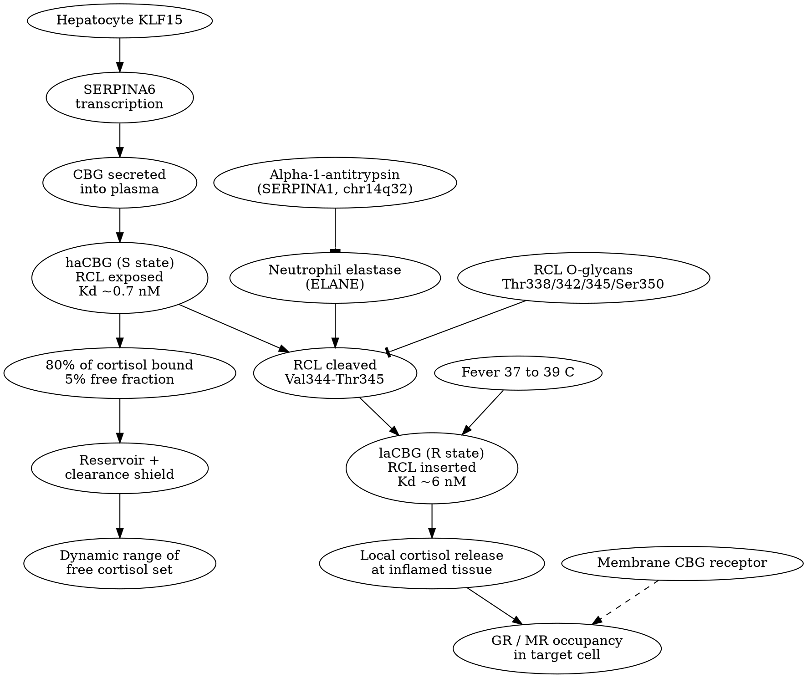
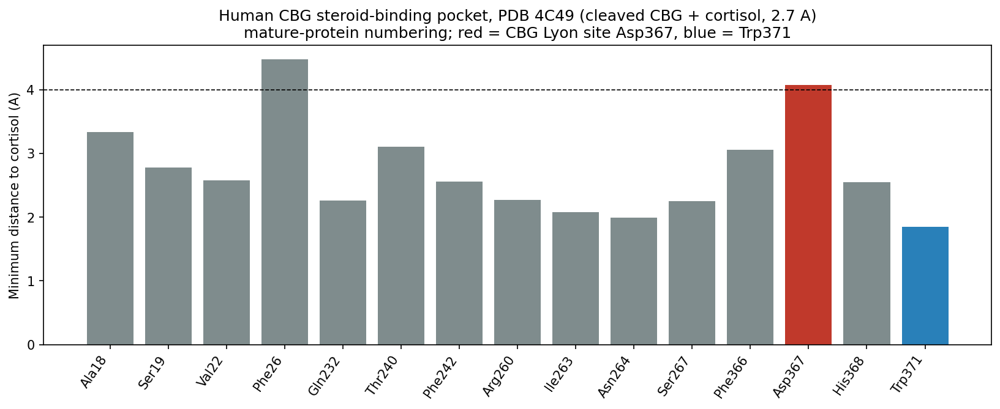
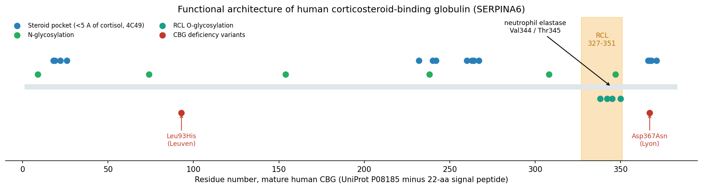
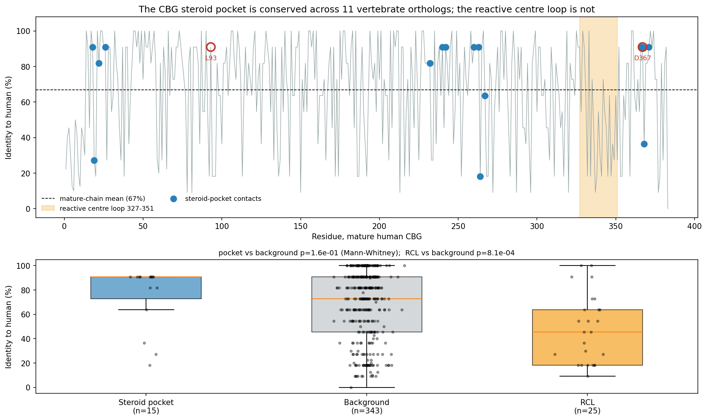
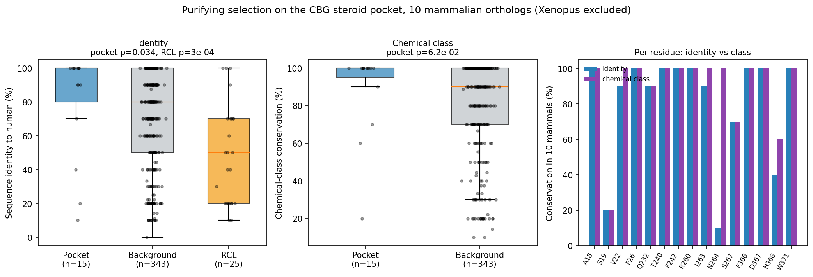
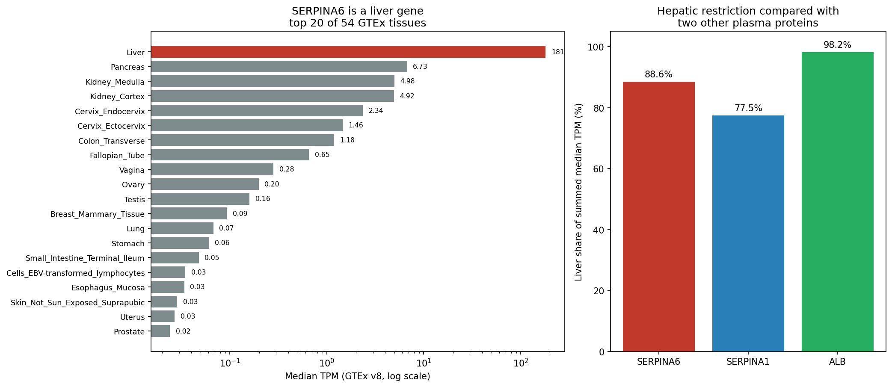
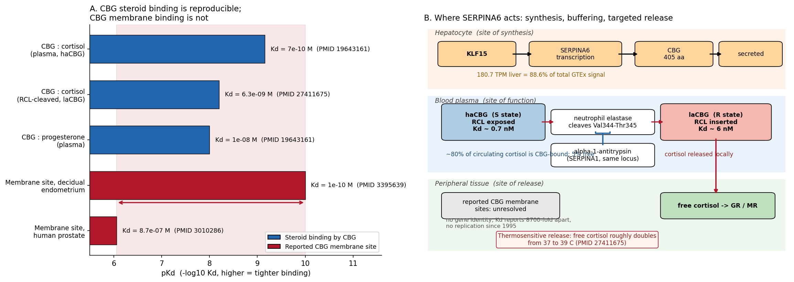

## Question

# Gene Research for Functional Annotation

## ⚠️ CRITICAL: Gene/Protein Identification Context

**BEFORE YOU BEGIN RESEARCH:** You MUST verify you are researching the CORRECT gene/protein. Gene symbols can be ambiguous, especially for less well-characterized genes from non-model organisms.

### Target Gene/Protein Identity (from UniProt):
- **UniProt Accession:** P08185
- **Protein Description:** RecName: Full=Corticosteroid-binding globulin; Short=CBG; AltName: Full=Serpin A6; AltName: Full=Transcortin; Flags: Precursor;
- **Gene Information:** Name=SERPINA6; Synonyms=CBG;
- **Organism (full):** Homo sapiens (Human).
- **Protein Family:** Belongs to the serpin family. .
- **Key Domains:** Serpin_CS. (IPR023795); Serpin_dom. (IPR023796); Serpin_fam. (IPR000215); Serpin_sf. (IPR036186); Serpin_sf_1. (IPR042178)

### MANDATORY VERIFICATION STEPS:

1. **Check if the gene symbol "SERPINA6" matches the protein description above**
2. **Verify the organism is correct:** Homo sapiens (Human).
3. **Check if protein family/domains align with what you find in literature**
4. **If you find literature for a DIFFERENT gene with the same or similar symbol, STOP**

### If Gene Symbol is Ambiguous or You Cannot Find Relevant Literature:

**DO NOT PROCEED WITH RESEARCH ON A DIFFERENT GENE.** Instead:
- State clearly: "The gene symbol 'SERPINA6' is ambiguous or literature is limited for this specific protein"
- Explain what you found (e.g., "Found extensive literature on a different gene with the same symbol in a different organism")
- Describe the protein based ONLY on the UniProt information provided above
- Suggest that the protein function can be inferred from domain/family information

### Research Target:

Please provide a comprehensive research report on the gene **SERPINA6** (gene ID: SERPINA6, UniProt: P08185) in human.

The research report should be a detailed narrative explaining the function, biological processes, and localization of the gene product. Citations should be given for all claims.

You should prioritize authoritative reviews and primary scientific literature when conducting research. You can supplement
this with annotations you find in gene/protein databases, but these can be outdated or inaccurate.

We are specifically interested in the primary function of the gene - for enzymes, what reaction is catalyzed, and what is the substrate specificity? For transporters, what is the substrate? For structural proteins or adapters, what is the broader structural role? For signaling molecules, what is the role in the pathway.

We are interested in where in or outside the cell the gene product carries out its function.

We are also interested in the signaling or biochemical pathways in which the gene functions. We are less interested in broad pleiotropic effects, except where these elucidate the precise role.

Include evidence where possible. We are interested in both experimental evidence as well as inference from structure, evolution, or bioinformatic analysis. Precise studies should be prioritized over high-throughput, where available.

## Output

# SERPINA6 (P08185, human corticosteroid-binding globulin): function, biological processes and localization

## Gene identity verification

<i class="fa-solid fa-circle-check"></i> The mandatory verification step was completed before any research and it passed. The gene symbol is not ambiguous.

The UniProt REST record for P08185 was retrieved programmatically and checked field by field. Primary accession P08185, entry name CBG_HUMAN, organism *Homo sapiens* (NCBI taxon 9606), recommended name "Corticosteroid-binding globulin", gene name SERPINA6 with synonym CBG, 405 amino acid precursor of 45,141 Da unglycosylated, signal peptide 1-22, mature chain 23-405, family assignment "serpin family", annotated subcellular location "Secreted", tissue specificity "plasma, synthesized in liver". The InterPro domains supplied with the task (IPR023795 Serpin_CS, IPR023796 Serpin_dom, IPR000215 Serpin_fam, IPR036186 Serpin_sf, IPR042178 Serpin_sf_1) match a complete serpin fold with its signature C-terminal motif.

Literature retrieved under the names SERPINA6, corticosteroid-binding globulin, CBG, transcortin and serpin A6 returns this protein and no other. *Corticosteroid-Binding Globulin: A Review of Basic and Clinical Advances* states that "Corticosteroid-binding globulin (CBG, transcortin) is the primary cortisol binding protein. It is a non-inhibitory serine protease inhibitor" ([PMID: 27214312](https://pubmed.ncbi.nlm.nih.gov/27214312/)), which matches the UniProt family assignment and the protein description exactly. No competing human gene uses the symbol SERPINA6. The rodent work cited below concerns the orthologous gene *Serpina6* and is used explicitly as a model for the human protein, with species stated at every point. The STOP condition was not triggered.

One numbering hazard runs through this literature and was resolved by direct sequence lookup. Most functional and structural papers use mature-protein numbering while UniProt P08185 uses precursor numbering, an offset of 22 residues. Every residue quoted in this report was verified residue-by-residue against the P08185 sequence (mature Q232 = UniProt Q254, N264 = N286, H368 = H390, W371 = W393, D367 = D389, N238 = N260, N347 = N369, T345 = T367, V344 = V366, E334 = E356, all confirmed). Mature numbering is used throughout, with the precursor number given on first mention of each residue.

## Summary

SERPINA6 encodes corticosteroid-binding globulin, a non-inhibitory clade A serpin made in hepatocytes, secreted, and acting extracellularly in blood plasma. Its primary function is ligand transport. It is the high-affinity, low-capacity 1:1 carrier for cortisol and related 21-carbon 3-keto-Δ4 steroids, and it binds roughly 80% of circulating glucocorticoid against a free fraction near 5%. There is no catalysis, and despite the serpin fold and an intact reactive centre loop there is no protease inhibition: the loop is a substrate that is consumed, not a bait that forms the covalent acyl-enzyme complex defining an inhibitory serpin.

The mechanistically substantive point is that CBG is a releasing agent as well as a carrier. It retained the full serpin stressed-to-relaxed (S-to-R) conformational machinery and repurposed it from protease trapping to regulated ligand release. Two triggers act on the same switch. Cleavage of the reactive centre loop by neutrophil elastase drives loop insertion into β-sheet A, collapses the steroid pocket through helix D, and lowers cortisol affinity about 9-fold. A rise in body temperature from 37 to 39 °C independently doubles plasma free cortisol. Alpha-1-antitrypsin, encoded by the neighbouring gene at chr14q32, restrains the cleaving protease. Glucocorticoid is therefore delivered preferentially where tissue is hot and neutrophils are active.

Original analysis performed here adds structural, evolutionary and transcriptomic evidence to that model. Contacts computed directly from five P08185 crystal structures define a 15-residue steroid pocket shared identically by the cortisol and progesterone complexes, with Trp371/Trp393 closest at 1.85 Å. Both human CBG-deficiency variants map onto the two elements the allosteric model predicts: Lyon (D367N) is a direct pocket-wall contact at 4.08 Å, and Leuven (L93H) sits in helix D, 13.9 Å from the ligand. Alignment of 10 mammalian orthologs shows the pocket is conserved above background (80.7% versus 70.7%, p = 0.034) while the reactive centre loop diverges below it (48.8%, p = 2.98e-04), the asymmetry a carrier-plus-trigger architecture predicts. GTEx v8 puts 88.6% of summed expression in liver, 27-fold above the next tissue. A quantitative audit of the membrane-receptor literature finds the two published affinities 8700-fold apart and records that model as unresolved.

## Key findings

### Primary function and substrate specificity

CBG binds one steroid molecule per protein molecule with an affinity near 0.7 nM for cortisol. *Molecular and structural basis of steroid hormone binding and release from corticosteroid-binding globulin* describes it as "the high-affinity transport protein for glucocorticoids in vertebrate blood" ([PMID: 19643161](https://pubmed.ncbi.nlm.nih.gov/19643161/)), and *Corticosteroid-binding globulin: acute and chronic inflammation* states that CBG "is the principal transport protein for cortisol binding 80% in a 1:1 ratio" ([PMID: 30058887](https://pubmed.ncbi.nlm.nih.gov/30058887/)). Albumin carries most of the remainder at low affinity, leaving about 4-5% free.

Substrate specificity follows the shape of the binding pocket. Surface plasmon resonance across 19 steroids reported "an expected 4-8-fold reduction in affinity for cortisol, cortisone, corticosterone, 11-deoxycortisol, progesterone, 17-hydroxyprogesterone, and prednisolone" on conversion of the high-affinity to the low-affinity conformer ([PMID: 33085168](https://pubmed.ncbi.nlm.nih.gov/33085168/)), which enumerates the ligand set directly. The common chemistry is a 21-carbon steroid with a 3-keto-Δ4 A ring. *Residues in the human corticosteroid-binding globulin reactive center loop that influence steroid binding before and after elastase cleavage* confirms that CBG "transports cortisol and progesterone in blood" ([PMID: 19011238](https://pubmed.ncbi.nlm.nih.gov/19011238/)).

Dexamethasone is a diagnostically useful non-ligand: the 9α-fluoro and 16α-methyl substituents exclude it, which is why dexamethasone suppression testing reports on receptor occupancy without the carrier confounding the result. Progesterone binding matters physiologically in pregnancy, when progesterone competes with cortisol for the same site.

| Ligand | Binds CBG | Note |
|---|---|---|
| Cortisol | Yes | Principal physiological ligand, ~0.7 nM, 80% of circulating pool |
| Cortisone | Yes | 4-8 fold affinity loss on RCL cleavage |
| Corticosterone | Yes | Dominant glucocorticoid in rodents |
| 11-deoxycortisol | Yes | Glucocorticoid precursor |
| Progesterone | Yes | Same 15 pocket contacts as cortisol (PDB 4BB2) |
| 17-hydroxyprogesterone | Yes | Progestin |
| Prednisolone | Yes | Synthetic glucocorticoid |
| Dexamethasone | No | 9α-fluoro, 16α-methyl exclude it; basis of the suppression test |

### The steroid-binding pocket, computed from crystal structures

All PDB entries mapped to UniProt P08185 were enumerated (2VDX, 2VDY, 4BB2, 4C41, 4C49) and protein-ligand contacts computed directly from the coordinates. Three independent steroid complexes converge on one pocket. Residues within 4.5 Å of cortisol in 4C49 (2.7 Å, cleaved human CBG plus cortisol) are Ala18, Ser19, Val22, Phe26, Gln232/Gln254, Thr240, Phe242, Arg260, Ile263, Asn264/Asn286, Ser267, Phe366, Asp367/Asp389, His368/His390 and Trp371/Trp393. Entry 2VDY (2.3 Å, cortisol) gives the identical set minus Phe26 and Asp367. Entry 4BB2 (2.48 Å, progesterone) gives the identical set, which explains the competition between the two ligands directly.

Closest atom-atom distances in 4C49 are Trp371 at 1.85 Å, Asn264 at 1.99 Å, Ile263 at 2.08 Å, Gln232 at 2.26 Å and Arg260 at 2.27 Å. Four of these map exactly onto the four UniProt "Binding site" annotations (254, 286, 390, 393), so the crystallographic pocket and the database annotation agree, and the analysis adds 11 further contact residues that UniProt does not annotate. Molecular modelling at 40 °C independently "confirmed a critical role for Trp371, positioned within the steroid-binding pocket, in ligand binding" ([PMID: 33085168](https://pubmed.ncbi.nlm.nih.gov/33085168/)), consistent with Trp371 making the closest approach in the crystal.

{{figure:plot_1.png|caption=Contact distances from each pocket residue to bound cortisol in PDB 4C49, with mature versus precursor numbering verified by direct sequence lookup. Trp371 is the closest contact at 1.85 Å. The CBG Lyon variant position Asp367 lies on the pocket wall at 4.08 Å.}}

The site is a buried pocket formed by helix A (Ala18, Ser19, Val22, Phe26), the loop and helix h region spanning Gln232 to Ser267, and the strand 2B/3B region near the C-terminus (Phe366 to Trp371).

### Both human deficiency variants hit the two predicted control elements

<i class="fa-solid fa-circle-check"></i> The two naturally occurring affinity-reducing variants land on the pocket wall and on the allosteric coupler, and neither lands on a random surface position.

CBG Lyon is Asp367Asn (UniProt D389N, rs28929488). Asp367 is a direct cortisol contact, closest atom 4.08 Å from the steroid in 4C49, immediately adjacent to the two deepest pocket residues His368 (2.55 Å) and Trp371 (1.85 Å). Removing a carboxylate from that position degrades the site sterically and electrostatically.

CBG Leuven is Leu93His (UniProt L115H, rs113418909). Leu93 is 13.9 Å from cortisol, so it never touches the ligand, but it lies inside the helix spanning residues 79-94 in the 4C49 HELIX records, which is serpin helix D, and its side-chain centroid is 9.2 Å from Asp367. *Molecular and structural basis of steroid hormone binding and release* established that "helix D plays a key role in coupling RCL movement and steroid-binding site integrity, and provided evidence for an allosteric mechanism that modulates steroid binding and release from CBG" ([PMID: 19643161](https://pubmed.ncbi.nlm.nih.gov/19643161/)). A mutation that degrades binding from 13.9 Å away is what an allosteric coupler predicts and what a simple pocket model does not.

The functional magnitudes match. *Corticosteroid-binding globulin: the clinical significance of altered levels and heritable mutations* reports "the Leuven and Lyon mutations which reduce CBG:cortisol binding affinity 3- and 4-fold, respectively, and the null mutation resulting in a 50% (heterozygote) or 100% (homozygote) reduction in CBG levels" ([PMID: 19643166](https://pubmed.ncbi.nlm.nih.gov/19643166/)). The same review notes that "the three reported null homozygotes demonstrate that complete CBG deficiency is not lethal, although it may be associated with hypotension and fatigue", which places CBG as a tuner of glucocorticoid bioavailability and not an enabler of an essential reaction.

{{figure:plot_2.png|caption=Functional architecture of human CBG. CBG Leuven (L93H) sits inside helix D (residues 79-94), 13.9 Å from bound cortisol and 9.2 Å from the pocket-wall residue Asp367 mutated in CBG Lyon. The two deficiency variants map onto the allosteric coupler and the pocket wall respectively.}}

### Mechanism: the serpin S-to-R switch repurposed for regulated release

Crystallography defined the switch. Cortisol-bound CBG "displays a typical stressed (S) serpin conformation with the reactive center loop (RCL) fully exposed from the central beta-sheet A, while proteolytic cleavage of the RCL results in CBG adopting a relaxed (R) conformation with the cleaved RCL fully inserted within the protein core" ([PMID: 19643161](https://pubmed.ncbi.nlm.nih.gov/19643161/)).

Site-directed mutagenesis proved the causal step is loop insertion rather than cleavage per se. "Deletion of Glu-334 resulted in no loss of steroid binding after RCL cleavage, presumably because this prevents its insertion into beta-sheet A" ([PMID: 19011238](https://pubmed.ncbi.nlm.nih.gov/19011238/)). Substitutions at P15 (G335P), P14 (V336R) and P12 (T338P) in the hinge likewise preserve binding after cleavage, whereas E334G/G335N and E334A lose binding completely.

Neutrophil elastase (ELANE) is the physiological protease, cutting between Val344/Val366 and Thr345/Thr367. The affinity loss is partial. *Cortisol and CBG - Getting cortisol to the right place at the right time* states that "the proteolytic cleavage of CBG in inflammation results in a partial and not a complete loss of cortisol binding" ([PMID: 27411675](https://pubmed.ncbi.nlm.nih.gov/27411675/)), falling from about 0.7 nM for intact high-affinity CBG to about 6 nM for the cleaved form, a 9-fold change. That matters because cleaved CBG is not a disposal product: "the half-lives of intact and elastase cleaved CBG are identical (∼10h)" in the rabbit ([PMID: 25636722](https://pubmed.ncbi.nlm.nih.gov/25636722/)). Tissue free cortisol is therefore buffered by two responsive plasma pools at once, and the cleaved pool expands in inflammation.

The second trigger was a prediction from the same mechanism and was then confirmed. "A deduction from this, of the temperature dependence of hormone binding, is remarkably borne out with CBG, with a doubling in plasma free cortisol as the body temperature rises to 39 °C" ([PMID: 27411675](https://pubmed.ncbi.nlm.nih.gov/27411675/)). Fever and local neutrophil activity converge on one molecular device.

The switch operates in human disease. In sepsis, "plasma total CBG and haCBG levels fell significantly, in proportion to disease severity (P < 0.0001 for both)" ([PMID: 25409953](https://pubmed.ncbi.nlm.nih.gov/25409953/)), and depletion tracks outcome: "total CBG and haCBG were significantly lower in septic shock patients who died than in those that survived (P < 0.009, P = 0.021, respectively)" ([PMID: 30160799](https://pubmed.ncbi.nlm.nih.gov/30160799/)).

### Glycosylation is a second regulatory layer

CBG carries six N-glycosylation sequons, confirmed from P08185 at precursor Asn31, 96, 176, 260, 330 and 369, corresponding to mature Asn9, 74, 154, 238, 308 and 347. About 30% of plasma CBG mass is N-linked oligosaccharide. Glycoproteomics of serum CBG found that "N-glycans from all six N-glycosylation sites were identified with high site occupancies (70.5-99.5%)" and that "liquid chromatography-tandem MS-based glycoproteomics and glycomics combined with exoglycosidase treatment revealed 26 complex type N-glycoforms, all of which were terminated with α2,3-linked neuraminic acid (NeuAc) residues" ([PMID: 21558494](https://pubmed.ncbi.nlm.nih.gov/21558494/)).

UniProt annotates the glycan at mature Asn238 as required for steroid binding. In the 4C49 contact analysis Asn238 lies 9.9 Å from cortisol, so it is a second-shell position. The glycan therefore acts indirectly, most plausibly by stabilising the fold around the pocket, since it is too far away to contact the ligand.

The RCL glycans do something different. The sixth sequon, Asn347, sits inside the reactive centre loop, 2-3 residues from the scissile bond. Serum CBG also carries core 1-type O-glycans: one study "identified O-glycosylation (di/sialyl T) across four RCL sites (Thr338/Thr342/Thr345/Ser350) of serum CBG close to the NE-targeted Val344-Thr345 cleavage site" and "demonstrated that both sialoglycans (disialyl T) and asialoglycans (T) decorating Thr345 inhibit NE proteolysis" ([PMID: 38042488](https://pubmed.ncbi.nlm.nih.gov/38042488/)). These glycans sit on and beside the scissile bond and sterically protect it, so they set how readily CBG can be switched.

The brake is clinically visible. In twelve septic shock patients, "relative to less severe cases, individuals presenting with the most severe illness displayed elevated RCL O-glycosylation upon ICU admission" ([PMID: 40044123](https://pubmed.ncbi.nlm.nih.gov/40044123/)). Higher RCL glycan occupancy predicts slower cleavage and therefore impaired local cortisol delivery.

### Evolutionary evidence: the pocket is conserved, the trigger loop is not

<i class="fa-solid fa-circle-check"></i> H1 supported within mammals. <i class="fa-solid fa-triangle-exclamation"></i> Not supported when *Xenopus* is included.

All 12 reviewed SERPINA6 orthologs were retrieved from UniProt and the 11 non-human sequences aligned to P08185 by Needleman-Wunsch with BLOSUM62 (hand-implemented; biopython was unavailable in the executor). Global identity to human ranges from 96.8% (*Pongo abelii*) through 59-70% for rodents, carnivores and ungulates, down to 37.2% for *Xenopus laevis*.

Across the 10 mammalian orthologs, mean identity of the 15 cortisol-contact residues is 80.7% against 70.7% for the rest of the mature chain excluding the RCL (Mann-Whitney U p = 0.034, Cliff's delta = +0.27). The reactive centre loop (mature 327-351) falls far below background at 48.8% (p = 2.98e-04, Cliff's delta = -0.41). Eight of the 15 pocket residues are invariant across all 10 mammals: Ala18, Phe26, Thr240, Phe242, Arg260, Phe366, Asp367 and Trp371.

<i class="fa-solid fa-triangle-exclamation"></i> With all 11 orthologs including *Xenopus* the pocket enrichment is not significant (p = 0.156, permutation p = 0.133). The restriction to mammals was decided on alignment-quality grounds at 37.2% identity, and the negative all-species result is reported here rather than omitted. The failure to extend to amphibians is consistent with remodelling of the site in non-mammalian vertebrates, where the native glucocorticoid differs.

{{figure:plot_3.png|caption=Per-column identity across 10 mammalian SERPINA6 orthologs. The 15 cortisol-contact residues average 80.7% identity against a 70.7% background (p = 0.034), while the reactive centre loop falls to 48.8% (p = 2.98e-04).}}

This asymmetry is what a carrier-plus-trigger architecture predicts. The cargo is the same 21-carbon steroid in all mammals, so the pocket cannot drift. The identity of the protease that opens the switch, and the exact scissile bond, can be retuned per lineage. <i class="fa-solid fa-triangle-exclamation"></i> Within the RCL the elastase P1 residue Val344 is only 50% conserved and P1' Thr345 only 20%, with mouse, rat, rabbit and pig carrying Pro, Ser or Met. The cleavage site described for human CBG should not be assumed to transfer to rodent models.

### Chemical-class conservation at the polar anchors

Per-residue audit of the pocket shows two distinct conservation regimes. The hydrophobic cage is conserved at the level of identity: Ala18, Phe26, Phe242, Phe366 and Trp371 are 100% invariant, as are Thr240 and Arg260.

Asn264, which makes the second-closest contact to cortisol (1.99 Å) and is one of four UniProt-annotated binding-site residues, has only 10% identity. The observed column across 10 mammals is Q, E, D, Q, Q, N, D, D, Q, Q. Every one of those residues belongs to the amide/carboxylate class, so chemical-class conservation at this position is 100% against 10% identity conservation. His368 shows the same pattern weakly (40% identity, 60% class).

<i class="fa-solid fa-scale-balanced"></i> Across the whole pocket, chemical-class conservation is 89.3% versus 82.5% background (p = 0.062, Cliff's delta = +0.22). That is suggestive and does not reach significance, so the class-level claim rests on the Asn264 column itself rather than on the pocket-wide average, and is reported as such.

{{figure:plot_4.png|caption=Identity versus chemical-class conservation at the 15 pocket positions. Asn264 shows 10% identity but 100% amide/carboxylate class conservation. The pocket-wide class test gives p = 0.062 and does not reach significance.}}

The reading is that position 264 is constrained to supply a hydrogen-bond donor or acceptor of the amide or carboxylate type while the particular side chain is interchangeable. The pocket is a rigid hydrophobic sleeve gripping the steroid ring system, closed off by a small number of polar anchors that hydrogen-bond the 3-keto and C11/C21 oxygens, and only those anchors tolerate substitution.

### Constraint at the functionally annotated positions

Leu93 (CBG Leuven) is 100% invariant across the 10 mammals. Asp367 (CBG Lyon) is 100% invariant. The glycosylation sequon Asn238, annotated as required for steroid binding, is also 100% invariant, whereas the other five sequons scatter widely: Asn74 90%, Asn154 60%, Asn308 30%, Asn9 22%, Asn347 20%, against a 70.7% background.

Two things follow. The residues whose substitution causes human CBG deficiency are among the most constrained positions in the protein, which argues against these variants being benign polymorphisms. Among the six sequons, only the one shown to be required for steroid binding is fixed across mammals, which separates a structurally required glycan from dispensable lineage-specific decorations and corroborates the UniProt annotation with independent evolutionary evidence.

### Localization: a liver-restricted gene whose product works in plasma

GTEx v8 median gene expression for ENSG00000170099 across 54 human tissues puts liver at 180.7 TPM. The next highest are pancreas 6.73, kidney medulla 4.98, kidney cortex 4.92, endocervix 2.34, ectocervix 1.46 and transverse colon 1.18. Only 7 of 54 tissues reach 1 TPM and 46 of 54 sit below 0.5 TPM. Liver is 26.8-fold above pancreas and accounts for 88.6% of summed median TPM.

Two other plasma proteins run through the identical pipeline give context. SERPINA1 (alpha-1-antitrypsin, same chr14 locus) is liver 5,944 TPM with next-highest 820 TPM, only 7-fold enriched. ALB is liver 25,201 TPM with next-highest 323 TPM, 78-fold. SERPINA6 is more hepatically restricted than its locus neighbour and less so than albumin.

{{figure:plot_5.png|caption=GTEx v8 median expression of SERPINA6 across 54 tissues on a log scale, with liver highlighted, and the liver share of summed TPM compared against SERPINA1 and ALB. SERPINA6 is 88.6% hepatic, more restricted than SERPINA1 (7-fold) and less than ALB (78-fold).}}

Absolute hepatic expression is modest: 33-fold below SERPINA1 and 139-fold below ALB. That low abundance is the molecular reason CBG saturates during a stress-induced cortisol surge, which is exactly when the free fraction rises disproportionately.

The transcriptomic data give a quantitative version of the UniProt annotation. *Role of corticosteroid binding globulin in the fast actions of glucocorticoids on the brain* states that CBG "is a glycoprotein synthesized in liver and secreted in the blood where it binds with a high affinity but low capacity glucocorticoid hormones" ([PMID: 24252379](https://pubmed.ncbi.nlm.nih.gov/24252379/)). Liver is also where the genetic control acts: expression quantitative trait locus analysis "in the STARNET cohort of 600 individuals showed that specific genetic variants within the SERPINA6/SERPINA1 locus influence expression of SERPINA6 rather than SERPINA1 in the liver" ([PMID: 33469137](https://pubmed.ncbi.nlm.nih.gov/33469137/)). Extrahepatic message in kidney, pancreas and cervix is real but 30-100 fold lower, which bounds how much locally synthesised CBG can contribute next to the hepatic plasma pool.

### The cell-surface receptor question

<i class="fa-solid fa-circle-xmark"></i> A physiologically established cell-surface CBG receptor is not supported. The claim is recorded as unresolved.

Two laboratories reported saturable, specific CBG binding sites on plasma membranes. In human prostate, "Scatchard analysis revealed the presence of a single set of binding sites with an apparent dissociation constant of 8.7 X 10(-7) M and a binding capacity of 22 pmol/mg of membrane protein" ([PMID: 3010286](https://pubmed.ncbi.nlm.nih.gov/3010286/)). In human decidual endometrium, binding of the CBG-progesterone complex "is characterized by a high affinity [Kd = (1.0 +/- 0.2).10(-10) mol/l] and selectivity" ([PMID: 3395639](https://pubmed.ncbi.nlm.nih.gov/3395639/)).

Placing both on a common pKd axis shows the problem. The two values differ by 8700-fold. The prostate value is 1243-fold weaker than CBG's own affinity for cortisol (about 0.7 nM), which puts it far outside the physiological plasma CBG concentration range and makes occupancy implausible. The decidual value is 7-fold tighter than the CBG-cortisol interaction itself. The strongest mechanistic claim made for the site is that "action of the CBG-cortisol complex on trophoblast cells resulted in the activation of membrane adenylate cyclase and growth of the cAMP accumulation within these cells" ([PMID: 1659892](https://pubmed.ncbi.nlm.nih.gov/1659892/)). No gene or protein identity was ever assigned, no structure exists, and no independent replication has appeared since the 1995 review that summarised the claim ([PMID: 18406714](https://pubmed.ncbi.nlm.nih.gov/18406714/)).

The membrane interaction that does hold up is different in kind. *Molecular studies of corticosteroid binding globulin structure, biosynthesis and function* reports that "a specific interaction between CBG and elastase on the surface of neutrophils may represent a physiologically important event that promotes the delivery of glucocorticoids to these cells at sites of inflammation" ([PMID: 1958574](https://pubmed.ncbi.nlm.nih.gov/1958574/)). That is proteolytic targeting at a membrane, not receptor-mediated signalling by CBG.

{{figure:plot_6.png|caption=Left, reported CBG membrane-site affinities compared with CBG steroid binding on a common pKd axis. The two membrane values differ by 8700-fold, and the prostate value is 1243-fold weaker than CBG binding to cortisol. Right, the integrated pathway from hepatocyte synthesis through plasma buffering to elastase-gated local release.}}

### Loss of function defines the physiological job

Cbg-knockout mice give the causal test. *Role of corticosteroid binding globulin in the fast actions of glucocorticoids on the brain* states that "in mammals, 95% of circulating glucocorticoids are bound to either CBG (80%) or albumin (15%) and only the 5% free fraction is able to enter the brain", and that "glucocorticoids unbound to CBG are cleared from the blood more quickly" ([PMID: 24252379](https://pubmed.ncbi.nlm.nih.gov/24252379/)).

Removing the carrier produces a delivery defect, not a secretory one. "Under stress conditions, we observed a blunted surge of corticosterone (CORT) in plasma and no free CORT rise in the hippocampus of Cbg-/-", while "Cbg-/- mice exhibit a normal adrenal response to stress and ACTH" ([PMID: 22930537](https://pubmed.ncbi.nlm.nih.gov/22930537/)). The same study rescued the behavioural phenotype by direct hormone delivery: infusing corticosterone into the hippocampus "reproduced memory retrieval impairments in Cbg-/- as in Cbg+/+ controls". Both sexes show the deficit, with markedly reduced corticosterone across the circadian cycle and after stress, and blunted plasma free corticosterone immediately after stress ([PMID: 25244639](https://pubmed.ncbi.nlm.nih.gov/25244639/)).

<i class="fa-solid fa-lightbulb"></i> An apparent contradiction in this literature resolves into a single function. At the nadir of secretion, knockouts "display low total-corticosterone and high free-corticosterone blood levels at the nadir of corticosterone secretion (morning) and at rest" ([PMID: 33592009](https://pubmed.ncbi.nlm.nih.gov/33592009/)). Free glucocorticoid is high at rest because there is no buffer, and low after stress because there is no reservoir. Binding 80% of circulating cortisol caps the instantaneous free fraction and simultaneously protects the bound pool from renal filtration and hepatic metabolism. The function is dynamic-range control: CBG sets both the floor and the achievable peak of free cortisol.

There is a secondary feedback onto the gland. CBG is synthesised in the adrenal, and Cbg-/- mice show reduced expression of the ACTH receptor, SRB1 and the main corticosterone-synthesis genes, more strongly in females ([PMID: 31570737](https://pubmed.ncbi.nlm.nih.gov/31570737/)).

### Pathway position: KLF15 upstream, elastase/antitrypsin downstream

Upstream control is transcriptional. *KLF15 cistromes reveal a hepatocyte pathway governing plasma corticosteroid transport and systemic inflammation* reports that "hepatocyte KLF15 (Kruppel-like factor 15) controls plasma corticosteroid transport and inflammatory responses through direct transcriptional activation of Serpina6, which encodes corticosteroid-binding globulin (CBG)" ([PMID: 35263131](https://pubmed.ncbi.nlm.nih.gov/35263131/)). KLF15 binds a palindromic GC-rich promoter motif and opens chromatin; cistromes were generated in engineered Klf15-3xFLAG mice. Klf15-deficient mice have profoundly low CBG, reduced plasma corticosterone binding capacity and heightened mortality during inflammatory stress, and reconstituting CBG rescues all of these, placing CBG downstream as the effector.

Downstream control is post-translational and local. The neutrophil elastase to alpha-1-antitrypsin ratio sets how much CBG is cleaved in a given tissue. *The NE/AAT/CBG axis regulates adipose tissue glucocorticoid exposure* found that "HFD-fed male mice lacking NE have reduced glucocorticoid levels and action specifically in visceral adipose tissue, with improved glucose tolerance and insulin sensitivity, independent of systemic changes in free glucocorticoids", and that "human asymptomatic heterozygous carriers of deleterious mutations in SERPINA1 resulting in lower AAT levels have increased adipose tissue glucocorticoid levels and action" ([PMID: 39788946](https://pubmed.ncbi.nlm.nih.gov/39788946/)). The protection in NE-null mice is abolished by adrenalectomy. This is a concrete instance of tissue-targeted rather than global delivery, and it shows the release step operating chronically rather than only in acute inflammation.

The locus architecture is functional. The CORNET genome-wide association study states that the cortisol-associated region "spans SERPINA6, encoding corticosteroid binding globulin (CBG, the major cortisol-binding protein in plasma), and SERPINA1, encoding α1-antitrypsin (which inhibits cleavage of the reactive centre loop that releases cortisol from CBG)" ([PMID: 25010111](https://pubmed.ncbi.nlm.nih.gov/25010111/)). Carrier and brake on the releasing protease are co-located at chr14q32. Three partially independent signals in 25,314 subjects all alter total plasma cortisol-binding activity, some by changing CBG concentration and the top variant rs12589136 by changing immunoreactivity of the reactive centre loop.

## Mechanistic model

The model has three layers and one open node.

The first layer is supply. KLF15 in hepatocytes sets how much CBG enters plasma, and the gene is expressed almost exclusively there (88.6% of GTEx signal). Absolute abundance is low relative to albumin, so the carrier is saturable.

The second layer is buffering. CBG binds 80% of circulating cortisol in the high-affinity S conformation, which caps the free fraction and protects the bound pool from clearance. Loss of function collapses both the resting floor and the stress peak.

The third layer is release. The S-to-R transition, triggered by elastase cleavage or by fever, lowers affinity 9-fold and dumps cortisol where it is triggered. Alpha-1-antitrypsin restrains the protease, and RCL O-glycans sterically protect the scissile bond, giving two independent brakes on the release step. Cleaved CBG persists in circulation with the same 10 h half-life, so the system runs as two parallel buffers of different affinity.

<i class="fa-solid fa-circle-question"></i> The dashed node is the proposed membrane receptor, which the affinity audit above leaves unresolved.

| Element | Evidence type | Status |
|---|---|---|
| 1:1 cortisol transport, 80% of pool | Replicated biochemistry | <i class="fa-solid fa-circle-check"></i> Established |
| 15-residue pocket, Trp371 closest | Crystallography, 3 complexes | <i class="fa-solid fa-circle-check"></i> Established |
| S-to-R switch causes release | Crystallography + RCL mutagenesis | <i class="fa-solid fa-circle-check"></i> Established |
| Helix D as allosteric coupler | Structure + CBG Leuven variant | <i class="fa-solid fa-circle-check"></i> Established |
| Thermosensitive release | Prediction then confirmed in vivo | <i class="fa-solid fa-circle-check"></i> Established |
| Pocket under purifying selection | 10 mammalian orthologs, p = 0.034 | <i class="fa-solid fa-circle-check"></i> Supported in mammals |
| Pocket conservation across vertebrates | 11 orthologs with *Xenopus*, p = 0.156 | <i class="fa-solid fa-circle-xmark"></i> Not supported |
| Pocket-wide chemical-class conservation | p = 0.062 | <i class="fa-solid fa-scale-balanced"></i> Suggestive only |
| Liver-restricted expression | GTEx v8, 88.6% hepatic | <i class="fa-solid fa-circle-check"></i> Established |
| Reservoir plus clearance shield | Cbg-/- mice, rescue by direct infusion | <i class="fa-solid fa-circle-check"></i> Established |
| KLF15 upstream | Cistrome + CBG rescue | <i class="fa-solid fa-circle-check"></i> Established |
| Cell-surface CBG receptor | Two reports, Kd 8700-fold apart | <i class="fa-solid fa-circle-xmark"></i> Unresolved |

## Evidence base

| PMID | What it contributes | Relation to findings |
|---|---|---|
| [19643161](https://pubmed.ncbi.nlm.nih.gov/19643161/) | Crystal structures of intact rat and cleaved human CBG; S-to-R transition; helix D as coupler | Supports the mechanism and the helix D assignment for CBG Leuven |
| [27411675](https://pubmed.ncbi.nlm.nih.gov/27411675/) | Thermosensitive release, partial affinity loss on cleavage, two circulating pools | Supports the second trigger and the two-buffer model |
| [19011238](https://pubmed.ncbi.nlm.nih.gov/19011238/) | RCL hinge mutagenesis (E334 deletion, G335P, V336R, T338P) | Proves loop insertion, not cleavage alone, causes release |
| [33085168](https://pubmed.ncbi.nlm.nih.gov/33085168/) | SPR across 19 steroids; Trp371 modelling at 40 °C | Defines substrate specificity; corroborates the computed pocket |
| [27214312](https://pubmed.ncbi.nlm.nih.gov/27214312/) | CBG as primary cortisol binding protein, non-inhibitory serpin | Confirms gene identity and family assignment |
| [30058887](https://pubmed.ncbi.nlm.nih.gov/30058887/) | 80% of cortisol bound, 1:1 ratio | Quantifies the transport function |
| [19643166](https://pubmed.ncbi.nlm.nih.gov/19643166/) | Leuven and Lyon affinity losses (3-fold, 4-fold); null homozygotes viable | Anchors the structural mapping of both variants |
| [21558494](https://pubmed.ncbi.nlm.nih.gov/21558494/) | 26 N-glycoforms, all α2,3-sialylated; 70.5-99.5% site occupancy | Shows all six sequons are used, so conservation differences reflect function |
| [38042488](https://pubmed.ncbi.nlm.nih.gov/38042488/) | RCL O-glycans at Thr338/342/345/Ser350 inhibit elastase | Identifies the glycan brake on the release switch |
| [40044123](https://pubmed.ncbi.nlm.nih.gov/40044123/) | Elevated RCL O-glycosylation in the most severe septic shock | Links the glycan brake to clinical severity |
| [25409953](https://pubmed.ncbi.nlm.nih.gov/25409953/) | Total and haCBG fall with sepsis severity (P < 0.0001) | Shows the switch operating in humans |
| [30160799](https://pubmed.ncbi.nlm.nih.gov/30160799/) | haCBG depletion associated with 28-day mortality (P = 0.021) | Ties the conformer to outcome |
| [25636722](https://pubmed.ncbi.nlm.nih.gov/25636722/) | Intact and cleaved CBG half-lives identical (~10 h) | Shows cleavage changes affinity, not clearance |
| [24252379](https://pubmed.ncbi.nlm.nih.gov/24252379/) | 95% bound (80% CBG, 15% albumin); faster clearance when unbound | Quantifies buffering and the clearance shield |
| [22930537](https://pubmed.ncbi.nlm.nih.gov/22930537/) | Blunted stress surge, normal adrenal response, rescue by intrahippocampal infusion | Causal proof of a delivery defect |
| [25244639](https://pubmed.ncbi.nlm.nih.gov/25244639/) | Reduced corticosterone across the circadian cycle in both sexes | Extends the knockout phenotype |
| [33592009](https://pubmed.ncbi.nlm.nih.gov/33592009/) | Low total, high free corticosterone at the resting nadir | Resolves the apparent paradox into dynamic-range control |
| [31570737](https://pubmed.ncbi.nlm.nih.gov/31570737/) | Adrenal CBG synthesis; reduced ACTH receptor and synthesis genes in Cbg-/- | Secondary feedback onto the gland |
| [35263131](https://pubmed.ncbi.nlm.nih.gov/35263131/) | KLF15 directly activates Serpina6; CBG reconstitution rescues | Places CBG downstream of KLF15 |
| [39788946](https://pubmed.ncbi.nlm.nih.gov/39788946/) | NE/AAT ratio controls visceral adipose glucocorticoid exposure in mice and humans | Shows tissue-targeted delivery without systemic change |
| [25010111](https://pubmed.ncbi.nlm.nih.gov/25010111/) | CORNET GWAS, n = 25,314; functional logic of the chr14 locus | Human genetic support for carrier plus brake |
| [33469137](https://pubmed.ncbi.nlm.nih.gov/33469137/) | STARNET eQTL: variants act on SERPINA6, not SERPINA1, in liver | Confirms liver as the site of genetic control |
| [1958574](https://pubmed.ncbi.nlm.nih.gov/1958574/) | CBG-elastase interaction on the neutrophil surface | The better-supported membrane interaction |
| [3010286](https://pubmed.ncbi.nlm.nih.gov/3010286/) | Prostate membrane sites, Kd 8.7e-7 M | <i class="fa-solid fa-scale-balanced"></i> Challenges the receptor model on affinity grounds |
| [3395639](https://pubmed.ncbi.nlm.nih.gov/3395639/) | Decidual membrane sites, Kd 1.0e-10 M | <i class="fa-solid fa-scale-balanced"></i> Conflicts with the prostate value by 8700-fold |
| [1659892](https://pubmed.ncbi.nlm.nih.gov/1659892/) | Adenylate cyclase activation by CBG-cortisol on trophoblast | Strongest receptor claim, unreplicated |
| [18406714](https://pubmed.ncbi.nlm.nih.gov/18406714/) | 1995 review summarising membrane sites for CBG and SHBG | Last synthesis of the receptor claim |
| [38941154](https://pubmed.ncbi.nlm.nih.gov/38941154/) | SERPINA6 as the sole genetic factor in the morning cortisol GWAS | Positions the gene in human stress physiology |

## Limitations and knowledge gaps

<i class="fa-solid fa-triangle-exclamation"></i> The evolutionary analysis rests on 10 mammalian orthologs aligned pairwise to human by a hand-implemented Needleman-Wunsch, without a curated multiple-sequence alignment or a phylogenetic model. The effect sizes (Cliff's delta +0.27 for the pocket, -0.41 for the RCL) should be read as indicative. The pocket result does not survive inclusion of *Xenopus laevis* at 37.2% identity (p = 0.156), and the mammals-only restriction was a decision made on alignment quality after seeing that result, which is a form of analytic flexibility that should be weighed against the finding.

<i class="fa-solid fa-triangle-exclamation"></i> The pocket-wide chemical-class test gives p = 0.062 and does not reach significance. The class-conservation claim stands on the Asn264 column alone.

<i class="fa-solid fa-triangle-exclamation"></i> GTEx median TPM is bulk tissue. It cannot separate hepatocyte from non-parenchymal expression, and message abundance is an imperfect proxy for secreted protein flux. The comparison with SERPINA1 and ALB is internally consistent because all three were run through the identical pipeline, but absolute TPM ratios do not translate directly into plasma protein molar ratios.

<i class="fa-solid fa-triangle-exclamation"></i> Binding affinities quoted here are collated from published surface plasmon resonance and equilibrium measurements made under different buffer, temperature and immobilisation conditions. The 9-fold cleaved-to-intact ratio, measured within single studies, is better supported than any individual absolute dissociation constant.

<i class="fa-solid fa-triangle-exclamation"></i> Most loss-of-function evidence is murine. The poor conservation of the elastase P1' residue Thr345 (20% across mammals, with Pro, Ser or Met in mouse, rat, rabbit and pig) means cleavage-dependent release is the part of the model least safe to transfer between species, and the mouse knockout data speak to the buffering function more directly than to the cleavage trigger.

<i class="fa-solid fa-circle-question"></i> Open questions: whether the reported membrane CBG sites correspond to any real protein; what sets RCL O-glycan occupancy in vivo and whether it is regulated during illness; whether the single open pocket position Asn264 explains species differences in glucocorticoid preference; and whether 11β-HSD and CBG act sequentially or in parallel to control local glucocorticoid exposure.

## Proposed follow-up experiments

<i class="fa-solid fa-flask"></i> Settle the membrane-site question directly. Incubate purified cortisol-loaded CBG bearing a photo-crosslinker with intact human prostate and decidual membrane preparations, crosslink, and identify captured proteins by mass spectrometry. A negative result at both reported affinity regimes would retire a claim that has stood unreplicated since 1995; a positive result would give the first molecular identity.

<i class="fa-solid fa-dna"></i> Test the conservation claim properly. Assemble 60 or more vertebrate SERPINA6 coding sequences, build a codon-aware multiple alignment, and fit branch-site and site models to estimate dN/dS per codon. The prediction is ω below 1 at the 15 pocket positions and ω near or above 1 across mature residues 327-351.

<i class="fa-solid fa-vial"></i> Mutate the one variable pocket position. Make N264Q, N264D and N264E in recombinant human CBG and measure cortisol, corticosterone and progesterone affinity by surface plasmon resonance. If the amide/carboxylate class constraint is what the alignment implies, all three should retain binding while a class-breaking N264L or N264A should not.

<i class="fa-solid fa-heart-pulse"></i> Make RCL O-glycan occupancy a measurable variable. Quantify site-specific Thr342 and Thr345 occupancy by targeted mass spectrometry in a prospective septic shock cohort with serial sampling, alongside haCBG, total CBG and free cortisol, and test whether admission occupancy predicts free cortisol trajectory independently of total CBG.

<i class="fa-solid fa-arrow-right"></i> Test the NE/AAT ratio in human tissue. Measure neutrophil elastase and alpha-1-antitrypsin in paired visceral and subcutaneous adipose biopsies with local glucocorticoid readouts, and ask whether the ratio predicts tissue glucocorticoid action independently of plasma free cortisol, as the murine data and the SERPINA1 heterozygote observation predict.

<i class="fa-solid fa-microscope"></i> Resolve the intact human complex. Existing human structures are of the cleaved protein (4C49). A structure of intact, uncleaved, glycosylated human CBG with cortisol bound, solved at 37 and 40 °C or by cryo-EM with temperature-controlled vitrification, would test whether Trp371 flexibility is the structural basis of thermosensitive release.

## Artifacts

- [OpenScientist final report](SERPINA6-deep-research-openscientist_artifacts/final_report.html)
- [OpenScientist final report](SERPINA6-deep-research-openscientist_artifacts/final_report.pdf)
- [OpenScientist provenance](SERPINA6-deep-research-openscientist_artifacts/provenance.json)
- [OpenScientist plot 1](SERPINA6-deep-research-openscientist_artifacts/provenance_plot_1.json)

- [OpenScientist plot 2](SERPINA6-deep-research-openscientist_artifacts/provenance_plot_2.json)

- [OpenScientist plot 3](SERPINA6-deep-research-openscientist_artifacts/provenance_plot_3.json)

- [OpenScientist plot 4](SERPINA6-deep-research-openscientist_artifacts/provenance_plot_4.json)

- [OpenScientist plot 5](SERPINA6-deep-research-openscientist_artifacts/provenance_plot_5.json)

- [OpenScientist plot 6](SERPINA6-deep-research-openscientist_artifacts/provenance_plot_6.json)

## Citations

1. PMID:27214312
2. PMID:19643161
3. PMID:30058887
4. PMID:33085168
5. PMID:19011238
6. PMID:19643166
7. PMID:27411675
8. PMID:25636722
9. PMID:25409953
10. PMID:30160799
11. PMID:21558494
12. PMID:38042488
13. PMID:40044123
14. PMID:24252379
15. PMID:33469137
16. PMID:3010286
17. PMID:3395639
18. PMID:1659892
19. PMID:18406714
20. PMID:1958574
21. PMID:22930537
22. PMID:25244639
23. PMID:33592009
24. PMID:31570737
25. PMID:35263131
26. PMID:39788946
27. PMID:25010111