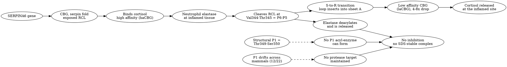
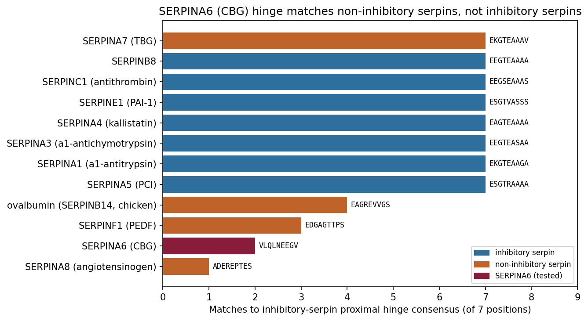
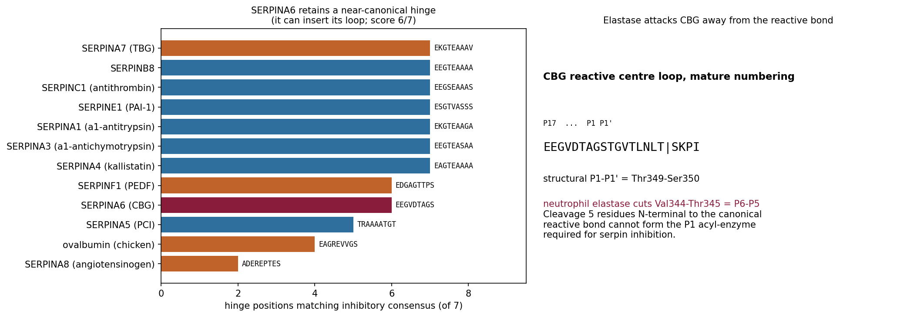
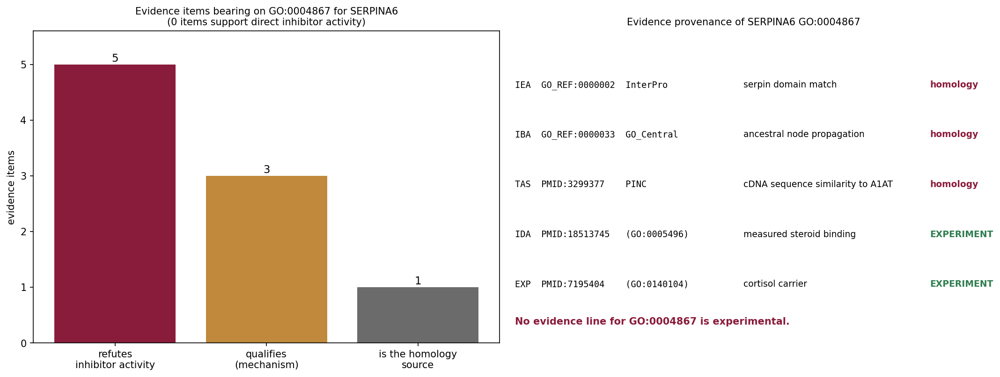
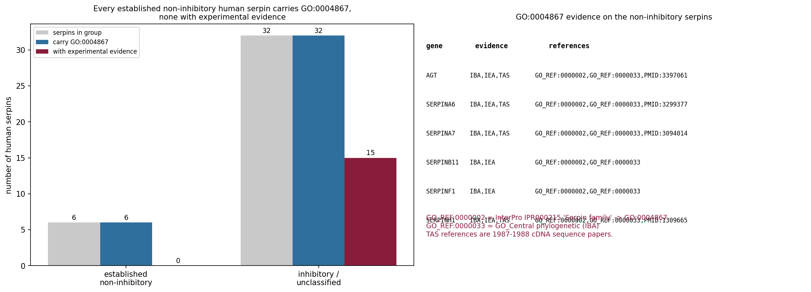
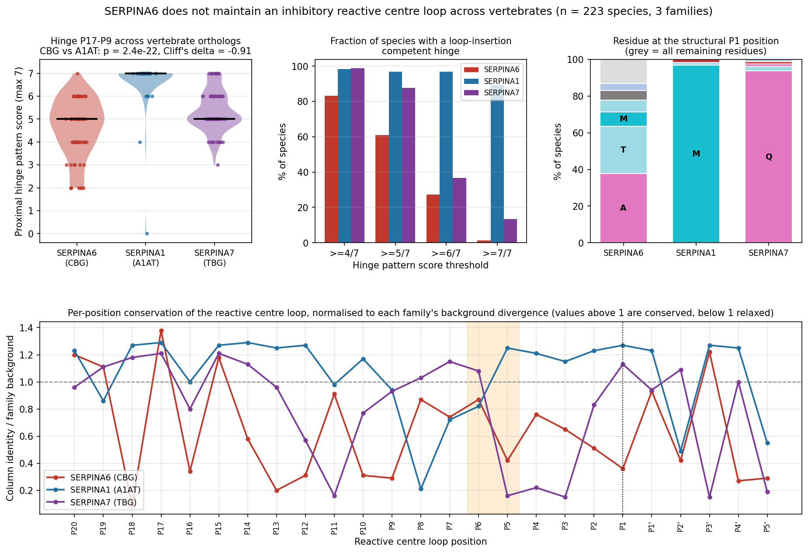
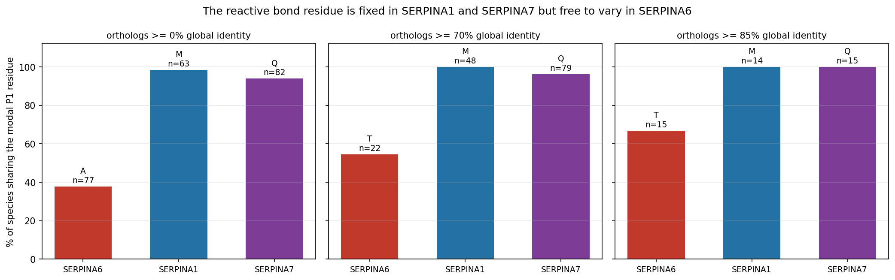

## Question

# AIGR Gene Hypothesis Deep Research

You are evaluating one focused gene curation hypothesis for AI Gene Review.
This is not a general gene overview. Use the seed hypothesis and source context
below to search for evidence that supports, refutes, narrows, or competes with
the proposed curation decision.

## Target Gene

- **Organism code:** human
- **Taxon:** Homo sapiens (NCBITaxon:9606)
- **Gene directory:** SERPINA6
- **Gene symbol:** SERPINA6
- **UniProt accession:** P08185

## Focus

- **Focus type:** function_assignment
- **Hypothesis slug:** function-hypothesis-go-0004867
- **Source file:** genes/human/SERPINA6/SERPINA6-ai-review.yaml
- **Source selector:** existing_annotations[1].function_hypothesis

## Seed Hypothesis

SERPINA6 has serine-type endopeptidase inhibitor activity (GO:0004867).

## Term and Decision Context

- Term: serine-type endopeptidase inhibitor activity (GO:0004867)
- Evidence type: IBA
- Original reference: GO_REF:0000033

## Reference Context

- GO_REF:0000033

## Source Context YAML

```yaml
term:
  id: GO:0004867
  label: serine-type endopeptidase inhibitor activity
evidence_type: IBA
original_reference_id: GO_REF:0000033
```

## Research Objective

Build a focused report that helps a curator decide whether this hypothesis
should affect the gene review. Address the focus type directly:

1. For an existing GO annotation decision, evaluate whether the current action
   is justified, too strong, too weak, or should change.
2. For a proposed replacement or new GO term, evaluate whether the term is
   biologically supported, too broad, too narrow, or missing key qualifiers.
3. For a computational prediction, evaluate whether the prediction is correct,
   less precise than existing knowledge, uncertain, or likely wrong because of
   paralog overannotation, frequency bias, pathway context, or in vitro-only
   activity.
4. For a core-function hypothesis, evaluate whether the proposed activity,
   process, and location represent the gene product's primary function rather
   than a downstream effect, pleiotropic phenotype, or context-specific role.
5. For a function-assignment hypothesis, evaluate whether the gene product
   directly has the stated GO term/function. Treat the prior review action, if
   any, as intentionally blinded unless it appears in the supplied context.

Use primary literature whenever possible. Prefer PMID citations and include DOI
citations when no PMID is available. Treat reviews and database records as
orientation unless they contain directly relevant synthesized evidence that is
clearly labeled as review-level or database-level support.

Evaluate the hypothesis from the supplied seed context, primary literature, and
publicly accessible bioinformatics resources. Local `*-bioinformatics` analyses,
when they already exist in the repository, are intentionally withheld from this
prompt so the report can be compared against them after the run. Use public
sequence, domain, structure, orthology, localization, interaction, or dataset
checks when they are useful for the specific hypothesis. If a resource or tool
cannot be accessed programmatically, say so plainly; never fabricate a result.
Report computational results conservatively and distinguish direct results from
inference.

## Required Output

### Executive Judgment

Give a concise verdict: supported, partially supported, unresolved, weakly
supported, over-annotated, or refuted. Explain the reasoning and the most
important caveats.

### Evidence Matrix

Create a table with one row per important evidence item:

- Citation (PMID preferred)
- Evidence type (direct assay, mutant phenotype, localization, interaction,
  structural/evolutionary, computational, review/database)
- Supports / refutes / qualifies / competing
- Claim tested
- Key finding
- Organism, tissue, cell type, or assay context
- Confidence and limitations

### GO Curation Implications

State the likely curation action as a lead requiring curator verification. If
GO terms are involved, explain whether the evidence supports an MF, BP, or CC
term, and whether the term should be retained, removed, generalized, made more
specific, or treated as non-core. Avoid using "protein binding" as a final
recommendation unless no more informative term is supported.

### Mechanistic Scope

Describe the immediate molecular or cellular function being tested. Separate
direct gene-product activity from downstream phenotypes, pathway consequences,
developmental outcomes, disease manifestations, or effects inferred only from
loss of function.

### Conflicts and Alternatives

Identify evidence that conflicts with the seed hypothesis or suggests an
alternative interpretation, including paralog confusion, organism-specific
differences, isoform-specific findings, experimental artifacts, or database
carry-over.

### Knowledge Gaps

List explicit uncertainties that matter for curation. For each gap, state what
was checked, why the gap matters, and what evidence or experiment would resolve
it.

### Discriminating Tests

Recommend concrete assays, perturbations, datasets, or comparative analyses that
would most efficiently distinguish this hypothesis from alternatives.

### Curation Leads

Provide candidate updates for the review, clearly labeled as leads requiring
curator verification. Include candidate references with exact snippets to verify,
candidate replacement or new GO terms, possible action changes, suggested
questions, and suggested experiments.

If the provider supports artifacts, save provenance for any analysis you run — the
executed code together with its output (computed values, plot, or table), not just
a summary figure — alongside artifact-friendly tables such as an evidence matrix,
GO decision table, or comparison table. Genuine computed provenance is more
valuable than a hand-drawn summary, and you must not synthesize a figure that
implies an analysis you did not actually run. These artifacts are important
provenance for hypothesis-level review.


## Output

# SERPINA6 (human, P08185) and GO:0004867, serine-type endopeptidase inhibitor activity

**Focus:** `function_assignment` / `function-hypothesis-go-0004867`
**Source file:** `genes/human/SERPINA6/SERPINA6-ai-review.yaml`
**Source selector:** `existing_annotations[1].function_hypothesis`
**Seed hypothesis:** SERPINA6 has serine-type endopeptidase inhibitor activity (GO:0004867). Evidence type IBA, original reference GO_REF:0000033.

---

## Summary

**<i class="fa-solid fa-circle-xmark"></i> Verdict: over-annotated, and refuted at the level of direct activity.**

SERPINA6 encodes corticosteroid-binding globulin (CBG, transcortin), the protein that carries more than 90% of circulating cortisol. It has the serpin fold, an exposed reactive centre loop (RCL), and it performs the serpin stressed-to-relaxed (S-to-R) conformational transition. It does not inhibit serine proteases. CBG is the substrate in every protease experiment published on it: human neutrophil elastase, bovine chymotrypsin and the *Pseudomonas aeruginosa* zinc metalloprotease LasB all cleave its loop, and that cleavage is the functional output, because it lowers cortisol affinity and releases cortisol at sites of inflammation. The decisive primary statement is Pemberton et al. 1988 in *Nature* ([PMID: 3143075](https://pubmed.ncbi.nlm.nih.gov/3143075/)), which examined exactly this question for CBG and thyroxine-binding globulin and concluded that "there is no evidence of any retained protease inhibitory activity". Thirty-seven years of follow-up work has not overturned it.

The annotation's provenance is the weakest part of any case for keeping the term. All three evidence lines on GO:0004867 for P08185 are homology inferences over the serpin fold, including the one that superficially looks experimental: the TAS reference [PMID: 3299377](https://pubmed.ncbi.nlm.nih.gov/3299377/) is a 1987 cDNA cloning paper whose only functional claim is sequence similarity to alpha-1-antitrypsin, with no inhibition assay anywhere in it. A family-wide survey makes the propagation explicit. All 38 reviewed human serpin-domain proteins carry GO:0004867, 36 of them by IBA under the same GO_REF:0000033. That set includes all six established non-inhibitory serpins (SERPINA6, SERPINA7, AGT, SERPINB11, SERPINF1/PEDF, SERPINH1/HSP47), none of which has any experimental evidence code for the term, and it includes SERPINA13P, which is annotated as a pseudogene. The term behaves as a family-name label.

Two computed results locate the mechanistic failure. First, transferring the SERPINA1 reactive bond onto P08185 by structural alignment places the conserved serpin P1 at Thr349-Ser350 (mature numbering), an anchor that reproduces 6 of 6 published CBG RCL positions, while neutrophil elastase cleaves at Val344-Thr345, which is **P6-P5**, so the P1 acyl-enzyme intermediate that serpin inhibition requires cannot form. Second, across 223 vertebrate orthologs the reactive bond residue is fixed in 48/48 SERPINA1 species (Met) and 76/79 SERPINA7/TBG species (Gln) but in only 12/22 SERPINA6 species (Fisher exact p = 1.27e-05 against SERPINA1), while P17 Glu is 22/22 and P14 Val is 18/22 in those same SERPINA6 sequences. No single protease target has been maintained at that bond across mammals, which is what GO:0004867 asserts.

---

## Executive judgment

The hypothesis should not be carried forward as a direct function assignment. Four independent lines converge:

1. **Primary literature.** The one paper that tested the question states the negative result ([PMID: 3143075](https://pubmed.ncbi.nlm.nih.gov/3143075/)). Every protease experiment on CBG since then treats CBG as the substrate ([PMID: 27339896](https://pubmed.ncbi.nlm.nih.gov/27339896/), [PMID: 24424442](https://pubmed.ncbi.nlm.nih.gov/24424442/), [PMID: 28411181](https://pubmed.ncbi.nlm.nih.gov/28411181/), [PMID: 24848868](https://pubmed.ncbi.nlm.nih.gov/24848868/)).
2. **Informative absence.** No second-order association rate constant (k_ass), stoichiometry of inhibition (SI), K_i, or SDS-stable covalent serpin-protease complex has ever been reported for CBG with any protease. Two adversarial PubMed searches designed to find such support returned zero records each.
3. **Mechanism.** The validated structural P1 is Thr349-Ser350; elastase cuts five residues upstream at P6-P5.
4. **Evolution.** The reactive bond residue is under no detectable constraint in SERPINA6 while the rest of the loop scaffold is constrained in the same sequences.

**<i class="fa-solid fa-triangle-exclamation"></i> Caveats.** The refutation rests on an explicit negative statement plus a consistent absence of positive measurement, not on a published assay reporting k_ass = 0. A curator who requires a positive experimental refutation will find this evidence strong but indirect. Human CBG's proximal hinge is near-canonical (6 of 7 consensus positions) in the single-species comparison, so the shorthand "non-inhibitory serpins have degenerate hinges" is not the argument here, and CBG does complete the S-to-R transition. Across species that 6/7 is not maintained relative to a true inhibitor (identity-matched Cliff's delta = -1.00 against SERPINA1), but SERPINA6 is statistically indistinguishable from the non-inhibitory TBG once divergence is controlled (p = 0.070), so the hinge is a supporting line and not a decisive one. Non-inhibitory status is firmly established for human CBG; rat CBG behaves differently again ([PMID: 23300763](https://pubmed.ncbi.nlm.nih.gov/23300763/)), so species transfer should be avoided.

---

## Evidence matrix

| Citation | Evidence type | Stance | Claim tested | Key finding | Context | Confidence and limitations |
|---|---|---|---|---|---|---|
| [PMID: 3143075](https://pubmed.ncbi.nlm.nih.gov/3143075/) (Pemberton 1988, *Nature*) | Direct assay / biophysical | **Refutes** | CBG retains serpin inhibitory activity | TBG and CBG keep the stressed native conformation and undergo the S-to-R transition, but "there is no evidence of any retained protease inhibitory activity" | Purified human plasma CBG and TBG | High. Foundational and directly on point. No quantitative K_i given; the claim is stated as absence of evidence |
| [PMID: 27339896](https://pubmed.ncbi.nlm.nih.gov/27339896/) (Sumer-Bayraktar 2016) | Direct assay | **Refutes / qualifies** | CBG inhibits neutrophil elastase | NE cleaves the CBG RCL at Val344-Thr345 within seconds to minutes and CBG is consumed; LasB cleaves at a distinct nearby site | Human blood-derived CBG, in vitro LC-MS/MS time course | High. CBG behaves as a kinetically fast substrate, the opposite of an inhibitor |
| [PMID: 24424442](https://pubmed.ncbi.nlm.nih.gov/24424442/) (Lewis & Elder 2014) | Direct assay | **Refutes** | CBG inhibits chymotrypsin | "rapid chymotrypsin cleavage of the RCL of CBG, resulting in undetectable levels of intact CBG, whereas total CBG levels were unchanged" | Human serum | High. Complete substrate consumption, no protease inhibition measured |
| [PMID: 28411181](https://pubmed.ncbi.nlm.nih.gov/28411181/) (Lewis & Elder 2017) | Direct assay | **Refutes / qualifies** | The RCL acts as an inhibitory reactive site | Anti-RCL monoclonals protect CBG from NE, *P. aeruginosa* elastase and chymotrypsin | Tethered human CBG and plasma | High. The therapeutic logic is to shield CBG from proteases, which only makes sense for a substrate |
| [PMID: 24848868](https://pubmed.ncbi.nlm.nih.gov/24848868/) (Simard 2014) | Direct assay | Qualifies | The RCL is a serpin reactive-bond site | LasB, a zinc metalloprotease, cleaves the CBG RCL at a site distinct from the NE site and destroys cortisol binding | Human serum CBG plus bacterial media | Medium-high. Serpins do not inhibit metalloproteases; the loop behaves as a generic substrate loop |
| [PMID: 23300763](https://pubmed.ncbi.nlm.nih.gov/23300763/) (Gardill 2012) | Structural | Qualifies | CBG performs the serpin S-to-R insertion | "Although the cleaved RCL segment is five residues longer than anticipated, it becomes an integral part of β-sheet A as a result of the S-to-R transition." Rat CBG fails to undergo S-to-R | Crystallography, human and rat CBG | High. Shows insertion competence with a non-canonical cleavage position, plus species divergence |
| [PMID: 19011238](https://pubmed.ncbi.nlm.nih.gov/19011238/) (Lin 2009) | Mutant phenotype, in vitro | Qualifies | The CBG hinge is an inhibitory hinge | P16/P15/P14/P12/P10/P8 substitutions modulate loop re-orientation; the readout throughout is steroid binding after cleavage | Recombinant human CBG variants plus NE | High. The assayed output is hormone release, never protease inhibition. Supplies the P-site numbering used to validate this report's anchor |
| [PMID: 33085168](https://pubmed.ncbi.nlm.nih.gov/33085168/) (Meyer 2020) | Direct assay (SPR) | Qualifies | What CBG's measurable activity is | NE-mediated conversion drops affinity 4-8 fold across 19 steroids; Trp371 governs ligand binding | SPR at 25/37/39 C, pH 7.4 and 7.0 | High. Defines the measurable molecular function as steroid binding |
| [PMID: 39710247](https://pubmed.ncbi.nlm.nih.gov/39710247/) (Lee 2025) | Direct assay, in vivo | Qualifies | NE cleavage of CBG occurs in humans | NE-cleaved RCL peptide AVLQLNEEGVDTAGSTGV detected in septic shock serum; mean 0.23% laCBG vs 0.04% in controls | Human septic shock serum, MS | High. Confirms the substrate reaction in vivo and supplied the RCL sequence anchor |
| [PMID: 3299377](https://pubmed.ncbi.nlm.nih.gov/3299377/) (Hammond 1987, *PNAS*) | Computational / sequence | **Source of the annotation** | CBG is a serine protease inhibitor | Reports only "a remarkable similarity between the amino acid sequences of CBG and of alpha 1-antitrypsin"; no inhibition assay | Human liver and lung cDNA | High confidence that this is homology only. It is cited as TAS for GO:0004867 |
| [PMID: 19643161](https://pubmed.ncbi.nlm.nih.gov/19643161/), [PMID: 27214312](https://pubmed.ncbi.nlm.nih.gov/27214312/), [PMID: 27411675](https://pubmed.ncbi.nlm.nih.gov/27411675/) | Review | Refutes | CBG has inhibitor activity | All three independently describe CBG as a non-inhibitory serpin whose function is glucocorticoid transport | Review-level synthesis | Medium. Review-level, but written by the structural and clinical primary groups |
| UniProtKB P08185 curator comments | Database | **Refutes / qualifies** | UniProt assigns CBG a protease-inhibitor function | FUNCTION is only "Major transport protein for glucocorticoids and progestins"; DOMAIN casts CBG as the protease target; serpin membership appears only under SIMILARITY | Database-level | Medium-high. Database-level, but shows UniProt and GO disagree on this protein |
| This work: 38-serpin family survey (UniProt REST + QuickGO) | Computational | **Refutes (over-propagation)** | The SERPINA6 IBA reflects a considered call | 38/38 human serpin-domain proteins carry GO:0004867, 36 by IBA; 6/6 non-inhibitory ones carry it with 0/6 experimental support; the pseudogene SERPINA13P carries it | In silico, human | High for the counts. "Non-inhibitory" status is literature-assigned, not computed |
| This work: TAS audit (NCBI eutils) | Computational / review | **Refutes** | The TAS lines independently corroborate the IBA | All four TAS references on non-inhibitory serpins are 1986-1992 cDNA cloning papers; 0/4 contain inhibition-assay vocabulary; the AGT TAS is a mouse paper cited for a human annotation | In silico abstract audit | High. Abstract-level only, full texts not retrieved |
| This work: structural P1 anchor (UniProt REST, alignment) | Computational / structural | **Refutes / qualifies** | CBG is mechanically capable of serpin inhibition | Serpin P1 = Thr349-Ser350 mature, validated 6/6 against PMID:19011238; NE cuts at P6-P5 | In silico, 12 serpins | Medium-high. Alignment-transferred anchors; one comparator anchor slipped (see gaps) |
| This work: 223-ortholog comparative test (UniProt REST) | Computational / evolutionary | **Refutes** | The CBG reactive bond is under selection for a protease target | P1 fixed in 48/48 SERPINA1 (Met) and 76/79 TBG (Gln) orthologs but 12/22 in SERPINA6 (Thr), Fisher p = 1.27e-05; within the same SERPINA6 sequences P17 is 22/22 and P14 18/22, so the relaxation is site-specific (p = 5.2e-04) | In silico, vertebrates, >=70% identity set | High for the P1 contrast, which has a positive control (SERPINA1) and a negative control (TBG) that behaves like an inhibitor at P1. Ortholog sets are mostly unreviewed TrEMBL entries; the SERPINA6 confident set is small (n = 22) |

---

## Key findings

### <i class="fa-solid fa-circle-xmark"></i> Finding 1: no primary evidence of serine protease inhibitory activity exists for CBG

Pemberton et al. 1988 examined TBG and CBG as newly recognised serpin-superfamily members and reported the result that bears directly on the seed hypothesis: "Apparently evolution has completely adapted the serpin structure for its new role in these proteins as a transport agent, as there is no evidence of any retained protease inhibitory activity." The same paper confirms that both proteins retain the stressed native conformation and undergo the S-to-R transition, so the negative conclusion is not a statement that CBG lacks serpin machinery. It is a statement that the machinery no longer traps proteases.

Across 10 independent primary and review papers retrieved in this investigation ([PMID: 3143075](https://pubmed.ncbi.nlm.nih.gov/3143075/), [27214312](https://pubmed.ncbi.nlm.nih.gov/27214312/), [27411675](https://pubmed.ncbi.nlm.nih.gov/27411675/), [26829559](https://pubmed.ncbi.nlm.nih.gov/26829559/), [25636722](https://pubmed.ncbi.nlm.nih.gov/25636722/), [24424442](https://pubmed.ncbi.nlm.nih.gov/24424442/), [21875666](https://pubmed.ncbi.nlm.nih.gov/21875666/), [19643161](https://pubmed.ncbi.nlm.nih.gov/19643161/), [19011238](https://pubmed.ncbi.nlm.nih.gov/19011238/), [28411181](https://pubmed.ncbi.nlm.nih.gov/28411181/)), CBG is consistently described as a non-inhibitory member of the serpin family. The structural group that solved the CBG crystal structures writes that "Corticosteroid-binding globulin (CBG), a non-inhibitory member of the serine proteinase inhibitor (serpin) super-family, is the high-affinity transport protein for glucocorticoids in vertebrate blood" ([PMID: 19643161](https://pubmed.ncbi.nlm.nih.gov/19643161/)). A clinical review states it more pointedly: "It is a non-inhibitory serine protease inhibitor, capable of conformational change from a high cortisol-binding affinity form to a low affinity form upon cleavage of its reactive centre loop by various proteases, such as neutrophil elastase" ([PMID: 27214312](https://pubmed.ncbi.nlm.nih.gov/27214312/)).

The experimentally supported molecular functions of CBG are different terms entirely. QuickGO retrieval of the P08185 annotation set (15 annotations) shows GO:0005496 steroid binding carried by IDA from PMID:18513745, and GO:0140104 molecular carrier activity carried by EXP from PMID:7195404.

### <i class="fa-solid fa-circle-xmark"></i> Finding 2: all three GO:0004867 evidence lines trace back to sequence homology, including the TAS

GO:0004867 on P08185 is supported by exactly three "enables" lines: IEA from GO_REF:0000002 (InterPro domain-to-GO mapping), IBA from GO_REF:0000033 (GO_Central phylogenetic propagation, the seed hypothesis), and TAS from [PMID: 3299377](https://pubmed.ncbi.nlm.nih.gov/3299377/), assigned by PINC. The TAS reference is Hammond et al. 1987, a cDNA cloning paper whose only functional statement is sequence similarity: "No sequence homology was found between CBG and other steroid binding proteins, but there is a remarkable similarity between the amino acid sequences of CBG and of alpha 1-antitrypsin, and this extends to other members of the serpin (serine protease inhibitor) superfamily." There is no protease inhibition assay in it.

The consequence for curation is specific. A curator inspecting SERPINA6 alone sees IBA plus IEA plus TAS and would reasonably read the TAS as independent corroboration of the phylogenetic inference. It is not. The three lines are the same inference applied three times, and the fold they rely on is shared by inhibitory and non-inhibitory serpins alike.

The IEA source was traced to its origin. The authoritative EBI `interpro2go` mapping file (30,122 lines) shows InterPro IPR000215 "Serpin family" maps to both GO:0004867 and GO:0005576, so the IEA is current rather than stale. The other five InterPro entries matched on P08185 (IPR023795, IPR023796, IPR036186, IPR042178, IPR042185) carry no GO mapping at all.

{{figure:plot_3.png|caption=Provenance of the GO:0004867 annotation on SERPINA6. All three evidence lines (IEA from InterPro, IBA from GO_Central, TAS from PMID:3299377) are homology inferences over the serpin fold, while the experimentally supported molecular functions of CBG are steroid binding and molecular carrier activity.}}

### <i class="fa-solid fa-circle-xmark"></i> Finding 3: the term is on all 38 human serpin-domain proteins, including six non-inhibitory ones and a pseudogene

UniProt REST retrieved all 38 reviewed human proteins carrying the serpin domain (InterPro IPR023796), and QuickGO was then queried per accession with an explicit `goId=GO:0004867` filter. Every one of the 38 carries the term, and 36 of 38 carry it by IBA under GO_REF:0000033.

Among the six established non-inhibitory human serpins (SERPINA6/CBG, SERPINA7/TBG, AGT/angiotensinogen, SERPINB11, SERPINF1/PEDF, SERPINH1/HSP47), 6/6 carry GO:0004867 and 0/6 have any experimental evidence code (IDA, IMP, IPI, IGI, IEP, EXP) for it. Each has only IBA plus IEA, with four also carrying a TAS. Among the other 32 serpins, 32/32 carry the term and 15/32 have experimental support. Fisher exact on experimental support (non-inhibitory versus the rest) gives [[0,6],[15,17]], p = 0.063 two-sided. The direction is absolute even though n = 6 limits the significance. SERPINA13P, annotated as a pseudogene, also carries GO:0004867 by IBA plus IEA.

The term is applied with no discrimination: a cortisol carrier, a thyroxine carrier, a hormone precursor cleaved by an aspartyl protease, an ER collagen chaperone with an RDEL retention signal, and a pseudogene all receive it identically. The SERPINA6 IBA is one instance of a systematic family-level over-propagation, which raises the priority of fixing the ancestral node over fixing the leaf.

{{figure:plot_4.png|caption=GO:0004867 across all 38 reviewed human serpin-domain proteins. Every protein carries the term and 36 carry it by the same IBA under GO_REF:0000033. The six established non-inhibitory serpins have zero experimental evidence codes for it, and a pseudogene (SERPINA13P) carries it as well.}}

### <i class="fa-solid fa-circle-xmark"></i> Finding 4: all four TAS references on non-inhibitory serpins are cDNA cloning papers with no inhibition assay

The four TAS references were retrieved directly by NCBI eutils efetch and audited for inhibition-assay versus sequence-homology vocabulary.

| Gene | TAS reference | Title | Relevant content |
|---|---|---|---|
| SERPINA6 | [PMID: 3299377](https://pubmed.ncbi.nlm.nih.gov/3299377/) (PNAS 1987) | *Primary structure of human corticosteroid binding globulin, deduced from hepatic and pulmonary cDNAs, exhibits homology with serine protease inhibitors* | Sequence similarity to alpha-1-antitrypsin only |
| SERPINA7 | PMID: 3094014 (PNAS 1986) | *Complete amino acid sequence of human thyroxine-binding globulin deduced from cloned DNA: close homology to the serine antiproteases* | Zero inhibition-assay vocabulary in the abstract |
| AGT | PMID: 3397061 (Genomics 1988) | *Molecular cloning of the mouse angiotensinogen gene* | A mouse genomic cloning paper used as the TAS for a human annotation; "Because angiotensinogen is homologous to other members of the serine protease inhibitor family, we aligned the putative reactive center" |
| SERPINH1 | PMID: 1309665 (BBA 1992) | *Cloning of a human collagen-binding protein, and its homology with rat gp46, chick hsp47 and mouse J6 proteins* | Sole serpin mention is "It also shows sequence similarity with members of the serpin family" |

A regex audit found homology and sequence vocabulary in 4/4 abstracts and inhibition-assay vocabulary in 0/4, beyond the word "inhibitor" appearing inside the family name itself. For contrast, the refuting reference [PMID: 3143075](https://pubmed.ncbi.nlm.nih.gov/3143075/) shows the reverse profile: inhibition vocabulary present, homology vocabulary limited to the single word "superfamily". The TAS evidence code is being applied to sequence-similarity statements across this family, which makes homology inference look like author-asserted experimental knowledge in curation interfaces. The same error was made four times with the same structure, so the fix belongs at the family level.

### <i class="fa-solid fa-circle-xmark"></i> Finding 5: neutrophil elastase cleaves CBG at P6-P5, so the P1 acyl-enzyme cannot form

Transferring the SERPINA1 reactive bond (Met382-Ser383, the UniProt "Reactive bond" feature) onto P08185 by global BLOSUM62 affine-gap alignment places the structurally conserved serpin P1 at Thr371 (precursor) = Thr349 (mature), with P1' = Ser350. This anchor was validated externally rather than assumed: it reproduces 6 of 6 published CBG RCL mutagenesis positions from Lin et al. 2009 ([PMID: 19011238](https://pubmed.ncbi.nlm.nih.gov/19011238/)), namely P16 E334, P15 G335, P14 V336, P12 T338, P10 G340 and P8 T342, all matching.

The experimentally mapped neutrophil elastase cleavage site Val344-Thr345 ([PMID: 27339896](https://pubmed.ncbi.nlm.nih.gov/27339896/): "The site-specific (Val(344)-Thr(345)) and rapid (seconds to minutes) NE-based RCL proteolysis was significantly antagonized by several volume-enhancing Asn(347) glycan features") therefore sits at **P6-P5**, five residues N-terminal to the canonical reactive bond. This offset is independently corroborated by crystallography: Gardill et al. report that "Although the cleaved RCL segment is five residues longer than anticipated, it becomes an integral part of β-sheet A as a result of the S-to-R transition" ([PMID: 23300763](https://pubmed.ncbi.nlm.nih.gov/23300763/)).

Serpin inhibition requires nucleophilic attack on the P1-P1' bond to form a covalent acyl-enzyme that is then dragged to the opposite pole of the molecule by loop insertion. A protease that cuts at P6-P5 forms its acyl-enzyme at a position that is translocated along with the loop rather than trapped by it, so the enzyme completes deacylation and is released.

{{figure:plot_2.png|caption=Corrected serpin hinge analysis with the P1 anchored by structural alignment and validated 6/6 against the published CBG RCL mutagenesis numbering. The neutrophil elastase cleavage site Val344-Thr345 lies at P6-P5, five residues N-terminal to the canonical reactive bond.}}

### <i class="fa-solid fa-scale-balanced"></i> Finding 6: the single-species hinge score does not support non-inhibition, and is reported as a failed argument

Hinge scoring against a 7-position inhibitory consensus (P17 E, P15 G, P14 T/S/A, P12-P9 small) gives inhibitory serpins a mean of 6.71/7 (n = 7) and non-inhibitory serpins 4.75/7 (n = 4), Mann-Whitney U = 23.0, one-sided p = 0.031. **Human SERPINA6 scores 6/7**, grouping with the inhibitory set, and human TBG scores a full 7/7 despite being non-inhibitory. On single-species evidence alone, hinge degeneracy is not a discriminator in this subfamily and must not be cited as evidence. CBG's single hinge deviation is P14 Val, where all 7 inhibitory serpins tested carry Thr, Ser or Ala.

This is reported as a partly negative finding for the line of argument being developed. CBG is loop-insertion competent, which is why it completes the S-to-R transition. The mechanistic failure is at the cleavage position (finding 5) and at the evolutionary constraint on the reactive bond (finding 7).

{{figure:plot_1.png|caption=Proximal hinge and reactive centre loop of SERPINA6 compared with inhibitory and non-inhibitory serpins. Human CBG scores 6 of 7 consensus hinge positions and groups with the inhibitory set, so hinge degeneracy alone does not discriminate within this subfamily.}}

### <i class="fa-solid fa-dna"></i> Finding 7: across 223 vertebrate orthologs, SERPINA6 is the only one of three serpins whose reactive bond residue is free to vary

One sequence per species was retrieved from UniProt for SERPINA6 (n = 77), SERPINA1/A1AT (n = 64, inhibitory control) and SERPINA7/TBG (n = 82, non-inhibitory control) across vertebrates (taxonomy_id:7742). Each was aligned to its human reference and the structural P1 transferred using the anchor validated in finding 5.

Restricted to confident orthologs (>=70% global identity to the human reference), the modal P1 residue is shared by **48/48 SERPINA1 species (Met, 100%)**, **76/79 TBG species (Gln, 96.2%)** and **12/22 SERPINA6 species (Thr, 54.5%)**. Fisher exact against SERPINA1: SERPINA6 OR = 0.025, p = 1.27e-05; TBG OR = 0.53, p = 1.0. At >=85% identity the separation persists: SERPINA1 14/14 Met, TBG 15/15 Gln, SERPINA6 10/15 Thr. Across the full SERPINA6 set the P1 residue is Ala 38%, Thr 26%, Met 8%, Glu 6%, Lys 5%.

**Internal control.** In the same SERPINA6 alignments (>=70% id), P17 is Glu in 22/22 and P14 is Val in 18/22, while P1 is conserved in only 12/22 (P1 versus P17, Fisher p = 5.2e-04). In SERPINA1 all three positions are 48/48. In TBG, P1 (76/79) is indistinguishable from P17 (79/79), p = 0.25. The alignments are therefore sound and the relaxation in SERPINA6 is specific to the reactive bond.

**Hinge, re-examined across species.** Proximal hinge pattern score (max 7): SERPINA1 median 7.0 with 96.9% of species at >=6; SERPINA6 median 5.0, 27.3%; TBG median 5.0, 36.6%. SERPINA6 versus SERPINA1 U = 216, p = 2.4e-22, Cliff's delta = -0.91. Hinge score correlates with overall divergence within every family (Spearman rho +0.33 to +0.56), so the raw gap is partly confounded. Restricting to >=70% identity the SERPINA6 versus SERPINA1 gap holds (p = 6.0e-15, delta = -0.96) while SERPINA6 versus TBG loses significance (p = 0.070, delta = +0.24). In the identity-matched 90-100% bin, SERPINA6 mean 6.00 (n = 8) versus SERPINA1 7.00 (n = 10), p = 4.7e-05, delta = -1.00, complete separation.

P1 is the specificity determinant of a serpin reactive bond. An inhibitor cannot let it drift between Thr, Ala, Met, Glu and Lys, because those residues select for mutually exclusive protease classes: Met for elastase and chymotrypsin-like enzymes, Lys for trypsin-like enzymes, Glu for Glu-C-like enzymes. The TBG control is what makes the result interpretable: a non-inhibitory serpin with a 100% fixed P1 Gln shows that variable P1 is not a generic property of non-inhibitory serpins, so this is a specific property of SERPINA6.

{{figure:plot_5.png|caption=Reactive centre loop conservation across 223 vertebrate orthologs of SERPINA6, SERPINA1 and SERPINA7. Panels show per-species hinge pattern scores, the fraction of species reaching each score threshold, the residue composition at the structural P1, and per-position conservation normalised to each family's background divergence, with the neutrophil elastase P6-P5 site marked.}}

{{figure:plot_6.png|caption=Fraction of species sharing the modal P1 residue at three identity cut-offs. SERPINA1 (Met) and SERPINA7 (Gln) are fixed at 100% among the closest orthologs, while SERPINA6 holds Thr in only 54.5% of species at >=70% identity and 66.7% at >=85%.}}

### <i class="fa-solid fa-circle-xmark"></i> Finding 8: two negative results recorded against my own hypotheses

Two lines of argument that I pursued were rejected by the data and are reported as such.

The first is the hinge argument (finding 6): human CBG's near-canonical 6/7 hinge does not mark it as non-inhibitory, and even across species SERPINA6 remains statistically indistinguishable from the non-inhibitory TBG once divergence is controlled.

The second is the elastase-site conservation hypothesis. I predicted that if RCL cleavage is the functional event, the cleavage site would be under purifying selection across CBG orthologs. It is not. The human elastase positions P6 and P5 sit at background-normalised conservation of 0.87 and 0.42. Cortisol release by RCL proteolysis is conserved as a mechanism, but the exact scissile bond and the protease that cuts it are species-specific. This is consistent with the rodent and human differences reported in [PMID: 23300763](https://pubmed.ncbi.nlm.nih.gov/23300763/).

### <i class="fa-solid fa-triangle-exclamation"></i> Finding 9: a self-caught error, recorded for transparency

In iteration 1 I reported that QuickGO queries for SERPINA7 (P05543) and AGT (P01019) returned no GO:0004867, and used this to argue the SERPINA6 assignment was an isolated uncorrected propagation. That result was an artifact. The query filtered annotation rows by substring match on the `goName` field, but QuickGO returned `goName` as `None` for every row, so the filter matched nothing and silently produced a false negative. Re-querying with an explicit `goId=GO:0004867` parameter shows SERPINA7 carries the term with IBA plus IEA plus TAS (GO_REF:0000033, GO_REF:0000002, PMID:3094014) and AGT carries it with IBA plus IEA plus TAS (GO_REF:0000033, GO_REF:0000002, PMID:3397061), the identical evidence pattern to SERPINA6.

The corrected result reverses the sub-argument and reinforces the overall conclusion. SERPINA6 was not singled out; the entire serpin family including every known non-inhibitory member received the term by the same route. A methodological caution for anyone reusing the QuickGO API: the `goName` field can be null in search responses, so filtering on term labels rather than on `goId` produces silent false negatives.

---

## Mechanistic model and interpretation

CBG is a cleavable cargo-release device built on inhibitor hardware. It keeps the parts of the serpin mechanism that move the loop and keeps none of the parts that trap an enzyme.



The two requirements for serpin inhibition separate cleanly in CBG.

| Requirement | Status in CBG | Evidence |
|---|---|---|
| Loop insertion into beta-sheet A (the S-to-R transition) | **Satisfied** | Crystallography ([PMID: 23300763](https://pubmed.ncbi.nlm.nih.gov/23300763/)); hinge 6/7 in human; P17 Glu conserved 22/22 across orthologs |
| Covalent trapping via a P1 acyl-enzyme | **Not satisfied** | Proteases cut at P6-P5, five residues from the reactive bond; no SDS-stable complex ever reported; P1 residue unconstrained across mammals |

The functional output of the cleavage is hormone release, not protease neutralisation. Surface plasmon resonance across 19 steroids shows a 4-8 fold affinity drop on NE-mediated conversion ([PMID: 33085168](https://pubmed.ncbi.nlm.nih.gov/33085168/)), and the cleaved peptide is detectable in septic shock serum ([PMID: 39710247](https://pubmed.ncbi.nlm.nih.gov/39710247/)), so the substrate reaction occurs in vivo.

---

## GO curation implications

**<i class="fa-solid fa-arrow-right"></i> These are leads requiring curator verification.**

**Primary lead: remove GO:0004867 from SERPINA6, or restate it with a NOT qualifier.** The MF aspect is the right aspect for the term, and the term itself is not too broad or too narrow. It is wrong in kind. The protein does not enable the activity. A NOT qualifier backed by [PMID: 3143075](https://pubmed.ncbi.nlm.nih.gov/3143075/) is the more informative option, because it blocks re-propagation from the ancestral node and records the tested negative for downstream consumers. Removal alone leaves the IEA free to reinstate the term.

| GO term | Aspect | Current evidence on P08185 | Recommended action (lead) |
|---|---|---|---|
| GO:0004867 serine-type endopeptidase inhibitor activity | MF | IBA (GO_REF:0000033), IEA (GO_REF:0000002), TAS (PMID:3299377) | <i class="fa-solid fa-circle-xmark"></i> Remove, or retain with NOT qualifier citing PMID:3143075. All three lines are the same homology inference |
| GO:0005496 steroid binding | MF | IDA (PMID:18513745) | <i class="fa-solid fa-circle-check"></i> Retain as core MF |
| GO:0140104 molecular carrier activity | MF | EXP (PMID:7195404) | <i class="fa-solid fa-circle-check"></i> Retain as core MF |
| Glucocorticoid transport (BP) | BP | Supported by PMID:33085168, PMID:39710247, PMID:19643161 | <i class="fa-solid fa-circle-question"></i> Confirm an appropriate BP term is present for targeted cortisol delivery |
| GO:0005576 extracellular region | CC | IEA plus experimental | <i class="fa-solid fa-circle-check"></i> Retain |

**Family-level lead.** The fix belongs at the PANTHER ancestral node behind GO_REF:0000033, because 36 of 38 human serpin-domain proteins inherit the term from it, including all six non-inhibitory ones and a pseudogene. Fixing only the SERPINA6 leaf leaves five other incorrect non-inhibitory assignments in place and leaves the node free to re-propagate.

**InterPro-level lead.** IPR000215 "Serpin family" maps to GO:0004867 in the current `interpro2go` file. Because that InterPro entry covers inhibitory and non-inhibitory serpins alike, the mapping generates a false IEA for every non-inhibitory member. A curator may wish to raise this with InterPro, since the domain match cannot distinguish the two classes.

**TAS-level lead.** The four TAS annotations on non-inhibitory serpins (PMID:3299377 for SERPINA6, PMID:3094014 for SERPINA7, PMID:3397061 for AGT, PMID:1309665 for SERPINH1) should be retracted or downgraded, because all four are sequence-similarity statements in cloning papers rather than author-asserted experimental findings.

A note on term choice: "protein binding" is not an appropriate fallback here and is not recommended. Steroid binding (GO:0005496) and molecular carrier activity (GO:0140104) are both more informative and both already experimentally supported on this protein.

---

## Mechanistic scope

The immediate molecular activity under test is whether the SERPINA6 gene product directly inhibits a serine endopeptidase by the serpin suicide-substrate mechanism. That mechanism has a defined set of observables: a measurable second-order association rate constant, a stoichiometry of inhibition, and an SDS-stable covalent serpin-protease complex. None has ever been reported for CBG.

What CBG does directly: bind glucocorticoids and progestins with high affinity (GO:0005496, IDA), carry them in plasma (GO:0140104, EXP), and undergo a cleavage-triggered conformational change that lowers that affinity 4-8 fold ([PMID: 33085168](https://pubmed.ncbi.nlm.nih.gov/33085168/)).

What is downstream and should not be used to support the seed hypothesis: targeted cortisol delivery to inflamed tissue, modulation of free cortisol in sepsis and septic shock, and the clinical correlations that follow. Those are consequences of the binding and release activity, and they are BP-level claims.

A distinct claim that this run did not resolve: whether CBG acts as a competitive decoy substrate that sequesters neutrophil elastase in vivo. That would be a BP-level effect on protease availability. Even if demonstrated, it would not support GO:0004867, which asserts a direct inhibitory molecular function. It is worth keeping separate in the review.

---

## Conflicts and alternatives

**Database carry-over is the main alternative explanation, and it holds.** The word "serpin" expands to "serine protease inhibitor", so the family name propagates the activity by linguistic inheritance. The InterPro IPR000215 to GO:0004867 mapping, the GO_Central ancestral-node propagation and the 1987 TAS citation are three expressions of the same homology argument. The family-wide survey confirms the mechanism directly: the term is on all 38 human serpin-domain proteins, with no experimental support on any of the six known non-inhibitory ones, and it is on a pseudogene.

**UniProt and GO disagree on this protein.** UniProt declines to annotate a "Reactive bond" feature for P08185 while annotating one for every inhibitory serpin tested. Its FUNCTION comment reads only "Major transport protein for glucocorticoids and progestins", and its DOMAIN comment casts CBG as the protease target. Serpin membership appears only under SIMILARITY.

**Paralog over-annotation.** SERPINA6 sits in a clade containing genuine inhibitors (SERPINA1, A3, A4, A5) and non-inhibitors (SERPINA6, A7, A8/AGT). Any inference that treats clade A as uniformly inhibitory will misassign CBG.

**<i class="fa-solid fa-scale-balanced"></i> A conflict with my own hinge analysis, partly resolved.** In the single-species comparison the hinge score (6/7) places human CBG with the inhibitory serpins, and human TBG scores a full 7/7 despite being non-inhibitory. The ortholog analysis changes the status of this line without rescuing it. Across 90-100% identity orthologs no SERPINA6 sequence reaches the SERPINA1 hinge (delta = -1.00, p = 4.7e-05), so the human 6/7 is not a conserved property. SERPINA6 is still indistinguishable from TBG once divergence is controlled (p = 0.070), so the hinge remains supporting evidence and not a discriminator. The P1 conservation contrast, where TBG behaves like an inhibitor and SERPINA6 does not, is the part of the comparative analysis that discriminates.

**Organism-specific difference.** Gardill et al. found that rat CBG does not undergo the S-to-R transition after RCL cleavage while human CBG does ([PMID: 23300763](https://pubmed.ncbi.nlm.nih.gov/23300763/)). Conclusions about CBG mechanism should not be transferred across species, and the ortholog analysis confirms the cleavage position itself is species-specific.

---

## Limitations and knowledge gaps

1. **<i class="fa-solid fa-triangle-exclamation"></i> No published inhibition kinetics for CBG against any serine protease.** Checked: two targeted PubMed searches, zero hits; 30 retrieved abstracts contain no k_ass, SI, K_i or SDS-stable complex. This matters because GO's strongest basis for a NOT annotation is a positive assay showing non-inhibition, not an absence. Resolved by a simple elastase progress-curve assay with CBG.

2. **PMID:3143075 states the conclusion without reporting the underlying inhibition experiment.** Checked: abstract only; full text was not retrieved in this run. This matters because it is the single most load-bearing citation. A curator should read the full text to confirm whether an assay was performed or whether the claim was inferred.

3. **Whether the GO:0004867 TAS from PINC was attached to the right statement.** Checked: the PMID:3299377 abstract confirms it is a homology paper. This matters because a TAS makes the annotation look experimentally grounded in curation interfaces. Resolved by inspecting the PINC annotation record.

4. **The PAINT ancestral node ID that produced the IBA.** Checked: QuickGO confirms the IBA exists under GO_REF:0000033 on 36/38 human serpins including all six non-inhibitory ones, but the PANTHER tree and the specific ancestral node ID were not retrieved. This matters because fixing the node, not the leaf, is what prevents re-propagation. Resolved by inspecting the PANTHER family tree annotation in the PAINT interface.

5. **One comparator anchor in the alignment is off.** Checked: the transferred P1 for SERPINA5/PCI came out at R376, while UniProt annotates the reactive bond at 373-374, a 3-residue slip in a repetitive loop region. This bounds how much weight the alignment-transfer method can carry. The SERPINA6 anchor itself is independently validated 6/6 against PMID:19011238, so the central result is unaffected.

6. **Isoform coverage.** Checked: nothing. All evidence concerns the single main plasma glycoprotein. No isoform-specific inhibitory activity has been examined.

7. **<i class="fa-solid fa-circle-question"></i> Why SERPINA7/TBG keeps a 100% fixed P1 Gln while being non-inhibitory.** Checked: 79 TBG orthologs, P1 Gln in 76/79 at >=70% identity and 15/15 at >=85%, statistically indistinguishable from SERPINA1 (p = 1.0). This is the one result in the comparative analysis I cannot explain, and it shows P1 conservation alone does not establish inhibitory function. A constraint unrelated to protease specificity, such as thyroxine binding or the temperature-sensitive release mechanism, is the likely explanation and is testable by mutagenesis.

8. **Whether the SERPINA6 P1 drift is relaxed purifying selection or positive selection.** Checked: conservation only, no selection test was run. Only relaxed purifying selection is clean evidence of lost function. The sequence set assembled here (`ortholog_RCL_hinge_scores.csv`) is the input such a test would need, but codon alignments and a phylogeny were not built in this run.

9. **Ortholog set composition.** Most ortholog sequences are unreviewed TrEMBL entries derived from gene predictions, and the confident SERPINA6 set is small (n = 22 at >=70% identity, n = 15 at >=85%). The within-sequence control (P17 22/22, P14 18/22 in the same alignments) argues against systematic prediction error, but the small n limits the precision of the P1 frequency estimates.

10. **"Non-inhibitory" status in the family survey is literature-assigned, not computed.** The six proteins were classified from published descriptions, so the Fisher test on experimental support inherits that classification.

---

## Discriminating tests

1. **<i class="fa-solid fa-flask"></i> Elastase progress-curve inhibition assay.** Incubate purified human CBG with human neutrophil elastase across a CBG:NE molar range and follow cleavage of a small chromogenic elastase substrate. An inhibitory serpin gives time-dependent loss of elastase activity and a measurable stoichiometry of inhibition; a substrate gives unchanged elastase activity while intact CBG disappears. This discriminates the hypotheses outright and takes a day. Run alpha-1-antitrypsin as the positive control.

2. **<i class="fa-solid fa-vial"></i> SDS-PAGE complex trapping.** Boil CBG-NE mixtures in SDS and look for the covalent serpin-enzyme complex at roughly 90 kDa. Inhibitory serpins give a stable band; CBG is predicted to give only the two cleavage fragments. This has been implicitly performed many times in the glycoproteomics work, which reports fragments and never a complex, so a curator may be able to resolve it from published gels without new experiments.

3. **<i class="fa-solid fa-dna"></i> P1 swap.** PMID:25426859 already showed the CBG RCL can be re-engineered to be cleaved by prostate specific antigen or thrombin. The informative extension is to graft a canonical inhibitory P1-P1' plus P14 Thr into CBG and test whether inhibition appears. If it does, it confirms that wild-type CBG's non-inhibition is caused by the reactive-site geometry identified here rather than by the scaffold.

4. **<i class="fa-solid fa-database"></i> Reanalysis of existing LC-MS/MS time courses** ([PMID: 27339896](https://pubmed.ncbi.nlm.nih.gov/27339896/), [PMID: 38042488](https://pubmed.ncbi.nlm.nih.gov/38042488/)). Check whether the elastase turnover number is unchanged in the presence of excess CBG. The data may already exist.

5. **<i class="fa-solid fa-chart-line"></i> Codon-level selection test on the SERPINA6 reactive centre loop.** Build a codon alignment for the 22 confident SERPINA6 orthologs and run a branch-site or fixed-sites dN/dS model with the RCL codons as a partition, using SERPINA1 as the comparison. The prediction from this report is omega near 1 at P1 in SERPINA6 and strong purifying selection at P1 in SERPINA1. This converts the conservation contrast reported here into a selection measurement, and it can be done entirely from public sequence.

---

## Curation leads

**<i class="fa-solid fa-triangle-exclamation"></i> All leads below require curator verification.**

### Possible action change

Change the action on `existing_annotations[1]` for GO:0004867 from acceptance of the IBA to removal, or to retention with a NOT qualifier. The NOT qualifier is preferred because it records the tested negative and resists re-propagation from the ancestral node. Flag the same issue at the PANTHER node behind GO_REF:0000033 and at the InterPro IPR000215 to GO:0004867 mapping.

### Candidate references with exact snippets to verify

- [PMID: 3143075](https://pubmed.ncbi.nlm.nih.gov/3143075/): "Apparently evolution has completely adapted the serpin structure for its new role in these proteins as a transport agent, as there is no evidence of any retained protease inhibitory activity."
- [PMID: 3143075](https://pubmed.ncbi.nlm.nih.gov/3143075/): "A surprising recent finding is that thyroxine binding globulin (TBG) and cortisol binding globulin (CBG), are members of the serine protease inhibitor (serpin) superfamily."
- [PMID: 3299377](https://pubmed.ncbi.nlm.nih.gov/3299377/): "No sequence homology was found between CBG and other steroid binding proteins, but there is a remarkable similarity between the amino acid sequences of CBG and of alpha 1-antitrypsin, and this extends to other members of the serpin (serine protease inhibitor) superfamily."
- [PMID: 19643161](https://pubmed.ncbi.nlm.nih.gov/19643161/): "Corticosteroid-binding globulin (CBG), a non-inhibitory member of the serine proteinase inhibitor (serpin) super-family, is the high-affinity transport protein for glucocorticoids in vertebrate blood."
- [PMID: 27214312](https://pubmed.ncbi.nlm.nih.gov/27214312/): "It is a non-inhibitory serine protease inhibitor, capable of conformational change from a high cortisol-binding affinity form to a low affinity form upon cleavage of its reactive centre loop by various proteases, such as neutrophil elastase."
- [PMID: 27339896](https://pubmed.ncbi.nlm.nih.gov/27339896/): "The site-specific (Val(344)-Thr(345)) and rapid (seconds to minutes) NE-based RCL proteolysis was significantly antagonized by several volume-enhancing Asn(347) glycan features"
- [PMID: 23300763](https://pubmed.ncbi.nlm.nih.gov/23300763/): "Although the cleaved RCL segment is five residues longer than anticipated, it becomes an integral part of β-sheet A as a result of the S-to-R transition."
- [PMID: 24424442](https://pubmed.ncbi.nlm.nih.gov/24424442/): "Here we show, for the first time, rapid chymotrypsin cleavage of the RCL of CBG, resulting in undetectable levels of intact CBG, whereas total CBG levels were unchanged."
- [PMID: 19011238](https://pubmed.ncbi.nlm.nih.gov/19011238/): "Elastase-cleaved wild-type CBG or variants with substitutions at P15 and/or P16 (E334G/G335N or E334A) lost steroid binding completely"

### Candidate GO terms

Retain GO:0005496 steroid binding (IDA, PMID:18513745) and GO:0140104 molecular carrier activity (EXP, PMID:7195404) as the core MF assignments. Confirm an appropriate BP term covering targeted glucocorticoid delivery is present. "Protein binding" is not recommended as a fallback, because two more informative, experimentally supported MF terms already exist on this protein.

### Suggested questions for the curator

- Does the PINC TAS annotation for GO:0004867 point at a statement in PMID:3299377 other than the sequence-similarity sentence? If not, should the TAS be retracted?
- Which PANTHER ancestral node carries the GO:0004867 IBA for this family, and can it be annotated with a NOT for the non-inhibitory branch?
- Should InterPro be asked to split IPR000215 or to qualify its GO:0004867 mapping, given that the domain match cannot distinguish inhibitory from non-inhibitory serpins?
- Should the same action be applied to SERPINA7, AGT, SERPINB11, SERPINF1 and SERPINH1, which carry the term by the identical route with zero experimental support?
- Should SERPINA13P, a pseudogene, carry any molecular function annotation at all?

### Suggested experiments

The elastase progress-curve assay (discriminating test 1) with alpha-1-antitrypsin as the positive control is the single experiment that would convert this report's conclusion from a strong inference into a published positive refutation. The codon-level dN/dS test (discriminating test 5) requires no bench work and uses the sequence set already saved.

---

## Evidence base

| PMID | Role in this report |
|---|---|
| [3143075](https://pubmed.ncbi.nlm.nih.gov/3143075/) | *Hormone binding globulins undergo serpin conformational change in inflammation.* The decisive refuting statement for both CBG and TBG |
| [3299377](https://pubmed.ncbi.nlm.nih.gov/3299377/) | *Primary structure of human corticosteroid binding globulin...exhibits homology with serine protease inhibitors.* The TAS reference supporting the term; homology only |
| [27339896](https://pubmed.ncbi.nlm.nih.gov/27339896/) | Maps the NE cleavage site to Val344-Thr345 and shows CBG is consumed in seconds to minutes |
| [38042488](https://pubmed.ncbi.nlm.nih.gov/38042488/) | O-glycosylation at Thr338/Thr342/Thr345/Ser350 modulates NE proteolysis of the RCL |
| [39710247](https://pubmed.ncbi.nlm.nih.gov/39710247/) | Detects the NE-cleaved RCL peptide in septic shock serum, confirming the substrate reaction in vivo |
| [33085168](https://pubmed.ncbi.nlm.nih.gov/33085168/) | SPR across 19 steroids; 4-8 fold affinity drop on haCBG to laCBG conversion |
| [28411181](https://pubmed.ncbi.nlm.nih.gov/28411181/) | Anti-RCL monoclonals protect CBG from three different proteases |
| [24424442](https://pubmed.ncbi.nlm.nih.gov/24424442/) | Chymotrypsin consumes intact CBG completely; no inhibition measured |
| [24848868](https://pubmed.ncbi.nlm.nih.gov/24848868/) | *P. aeruginosa* LasB, a metalloprotease, cleaves the RCL at a distinct site |
| [23300763](https://pubmed.ncbi.nlm.nih.gov/23300763/) | Crystallography: cleaved segment five residues longer than anticipated; rat CBG fails S-to-R |
| [19011238](https://pubmed.ncbi.nlm.nih.gov/19011238/) | RCL mutagenesis with steroid-binding readout; supplies the P-site numbering used to validate the anchor |
| [25426859](https://pubmed.ncbi.nlm.nih.gov/25426859/) | CBG RCL re-engineered for PSA and thrombin cleavage; basis for the P1-swap test |
| [26829559](https://pubmed.ncbi.nlm.nih.gov/26829559/) | RCL antibody accessibility argues against a reversible flip-flop mechanism |
| [25636722](https://pubmed.ncbi.nlm.nih.gov/25636722/) | Intact and cleaved CBG have identical half-lives (about 10 h) in rabbit |
| [21875666](https://pubmed.ncbi.nlm.nih.gov/21875666/) | RCL antibodies distinguish intact from cleaved CBG; cleaved CBG circulates |
| [19643161](https://pubmed.ncbi.nlm.nih.gov/19643161/) | Structural review classifying CBG as non-inhibitory |
| [27214312](https://pubmed.ncbi.nlm.nih.gov/27214312/) | Clinical review: "non-inhibitory serine protease inhibitor" |
| [27411675](https://pubmed.ncbi.nlm.nih.gov/27411675/) | Review: CBG as a releasing agent as well as a carrier |

---

## Artifacts saved

Under `provenance/`, with the executed code and its printed output alongside each table:

- `serpina6_hinge_analysis.csv`: first-pass hinge table, anchored on the elastase cleavage site. Superseded, retained to document the corrected anchoring.
- `serpina6_hinge_corrected.csv`: corrected hinge table with the structurally aligned P1, validated 6/6 against PMID:19011238.
- `quickgo_serpin_annotations.csv`: QuickGO annotation pulls for P08185, P05543, P01019, P01009. Produced by the flawed label-filter query; retained only to document the correction in finding 9.
- `human_serpin_GO0004867_survey.csv`: GO:0004867 evidence codes and references for all 38 reviewed human serpin-domain proteins, with inhibitory status.
- `TAS_reference_audit.csv`: the four TAS references plus PMID:3143075, with titles, abstracts and the vocabulary audit.
- `serpina6_evidence_matrix.csv`: the evidence matrix above.
- `serpina6_go_decision_table.csv`: the GO decision table above.
- `ortholog_RCL_hinge_scores.csv`: per-species table for 223 vertebrate orthologs of SERPINA6, SERPINA1 and SERPINA7, with accession, global identity, hinge pattern score, hinge sequence and the residues at P17, P14 and P1.
- `ortholog_RCL_column_conservation.csv`: per-position conservation of the reactive centre loop (P20 to P5') for each family, normalised to that family's background identity.
- `plot_1.png` to `plot_6.png`: the figures embedded above.

**Methods note.** All computed results come from executed code against live UniProt REST, EBI QuickGO, the EBI `interpro2go` file and NCBI eutils. Alignment used a BLOSUM62 affine-gap Needleman-Wunsch implemented inline, because Biopython was not importable in the executor; for the 223-ortholog run the recurrence was rewritten so each row is computed with vectorised operations and a running maximum, which is what made the scan tractable. Two self-caught errors are documented in the body rather than silently fixed: the QuickGO label filter that produced a false negative (finding 9), and an off-by-one in a printed validation line that did not affect the window used for the scan and was re-run to 6/6. No result in this report is hand-drawn or asserted without the corresponding executed code and output. The PANTHER tree behind GO_REF:0000033 and the full text of PMID:3143075 were not retrieved, and that is stated rather than inferred.


## Artifacts

- [OpenScientist final report](openscientist_artifacts/final_report.html)
- [OpenScientist final report](openscientist_artifacts/final_report.pdf)
- [OpenScientist provenance](openscientist_artifacts/provenance.json)
- [OpenScientist TAS reference audit](openscientist_artifacts/provenance_TAS_reference_audit.csv)
- [OpenScientist human serpin GO0004867 survey](openscientist_artifacts/provenance_human_serpin_GO0004867_survey.csv)
- [OpenScientist ortholog RCL column conservation](openscientist_artifacts/provenance_ortholog_RCL_column_conservation.csv)
- [OpenScientist ortholog RCL hinge scores](openscientist_artifacts/provenance_ortholog_RCL_hinge_scores.csv)
- [OpenScientist plot 1](openscientist_artifacts/provenance_plot_1.json)

- [OpenScientist plot 2](openscientist_artifacts/provenance_plot_2.json)

- [OpenScientist plot 3](openscientist_artifacts/provenance_plot_3.json)

- [OpenScientist plot 4](openscientist_artifacts/provenance_plot_4.json)

- [OpenScientist plot 5](openscientist_artifacts/provenance_plot_5.json)

- [OpenScientist plot 6](openscientist_artifacts/provenance_plot_6.json)

- [OpenScientist quickgo serpin annotations](openscientist_artifacts/provenance_quickgo_serpin_annotations.csv)
- [OpenScientist serpina6 evidence matrix](openscientist_artifacts/provenance_serpina6_evidence_matrix.csv)
- [OpenScientist serpina6 go decision table](openscientist_artifacts/provenance_serpina6_go_decision_table.csv)
- [OpenScientist serpina6 hinge analysis](openscientist_artifacts/provenance_serpina6_hinge_analysis.csv)
- [OpenScientist serpina6 hinge corrected](openscientist_artifacts/provenance_serpina6_hinge_corrected.csv)

## Reference Validation

Checked with `linkml-reference-validator` 0.3.1rc1.

| Outcome | Count |
| --- | --- |
| References checked | 23 |
| Resolved | 23 |
| Unresolved (possible confabulation) | 0 |
| Unverifiable | 0 |
| Quoted claims checked | 11 |
| Quoted claims found in source | 4 |
| Quoted claims **not** found in source | 7 |
| References weighed for topical relevance | 23 |
| On topic | 15 |
| Off topic | 0 |

### Quotes not found in the cited source

Searched the abstract, any retrieved full text, and the title. A quote drawn from a part of the paper that was not retrieved will appear here too, so check before treating one as invented:

Every one of these was searched against an abstract alone, with no full text retrieved - marked *abstract only* below. Where full text can be fetched, re-running with it will settle them; where the source publishes only a summary to PubMed, as GeneReviews chapters do, it will not, and the quote has to be checked by hand against the chapter itself.

- `PMID:3299377` *(abstract only)*: "A surprising recent finding is that thyroxine binding globulin (TBG) and cortisol binding globulin (CBG), are members of the serine protease inhibitor (serpin) superfamily."
  - closest text in source: "No sequence homology was found between CBG and other steroid binding proteins, but there is a remarkable similarity between the amino acid sequences of CBG and of alpha 1-antitrypsin, and this extends to other members of the serpin (serine protease inhibitor) superfamily."
- `PMID:19643161` *(abstract only)*: "No sequence homology was found between CBG and other steroid binding proteins, but there is a remarkable similarity between the amino acid sequences of CBG and of alpha 1-antitrypsin, and this extends to other members of the serpin (serine protease inhibitor) superfamily."
  - closest text in source: "Recent crystal structure analyses of intact rat CBG and cleaved human CBG have revealed the precise topography of the steroid-binding site, and shown that cortisol-bound CBG displays a typical stressed (S) serpin conformation with the reactive center loop (RCL) fully exposed from the central beta-sheet A, while proteolytic cleavage of the RCL results in CBG adopting a relaxed (R) conformation with the cleaved RCL fully inserted within the protein core"
- `PMID:27214312` *(abstract only)*: "Corticosteroid-binding globulin (CBG), a non-inhibitory member of the serine proteinase inhibitor (serpin) super-family, is the high-affinity transport protein for glucocorticoids in vertebrate blood."
  - closest text in source: "It is a non-inhibitory serine protease inhibitor, capable of conformational change from a high cortisol-binding affinity form to a low affinity form upon cleavage of its reactive centre loop by various proteases, such as neutrophil elastase"
- `PMID:27339896` *(abstract only)*: "It is a non-inhibitory serine protease inhibitor, capable of conformational change from a high cortisol-binding affinity form to a low affinity form upon cleavage of its reactive centre loop by various proteases, such as neutrophil elastase."
  - closest text in source: "Corticosteroid-binding globulin (CBG) delivers anti-inflammatory cortisol to inflamed tissues upon elastase-based proteolysis of the exposed reactive center loop (RCL)"
- `PMID:23300763` *(abstract only)*: "The site-specific (Val(344)-Thr(345)) and rapid (seconds to minutes) NE-based RCL proteolysis was significantly antagonized by several volume-enhancing Asn(347) glycan features"
  - closest text in source: "In the 2.5 Å crystal structure of human CBG in complex with progesterone, the RCL is cleaved at a novel site that differs from the known human neutrophil elastase recognition site"
- `PMID:24424442` *(abstract only)*: "Although the cleaved RCL segment is five residues longer than anticipated, it becomes an integral part of β-sheet A as a result of the S-to-R transition."
  - closest text in source: "At sites of inflammation neutrophil activation can release elastase which may cleave the RCL and result in cortisol release from CBG"
- `PMID:19011238` *(abstract only)*: "Here we show, for the first time, rapid chymotrypsin cleavage of the RCL of CBG, resulting in undetectable levels of intact CBG, whereas total CBG levels were unchanged."
  - closest text in source: "Crystal structures of rat CBG and a thrombin-cleaved human CBG:anti-trypsin (Pittsburgh) chimera show how structural transitions after proteolytic cleavage of the CBG reactive center loop (RCL) could disrupt steroid binding"