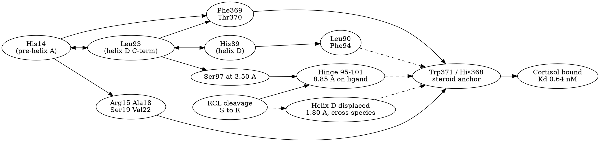
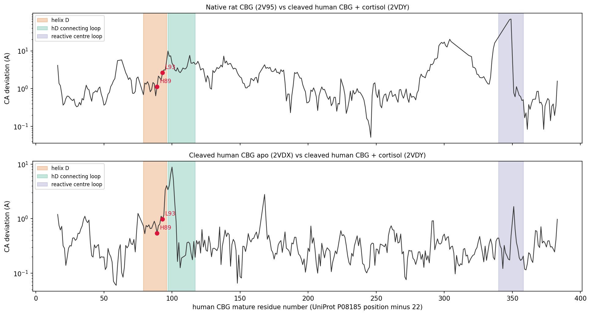
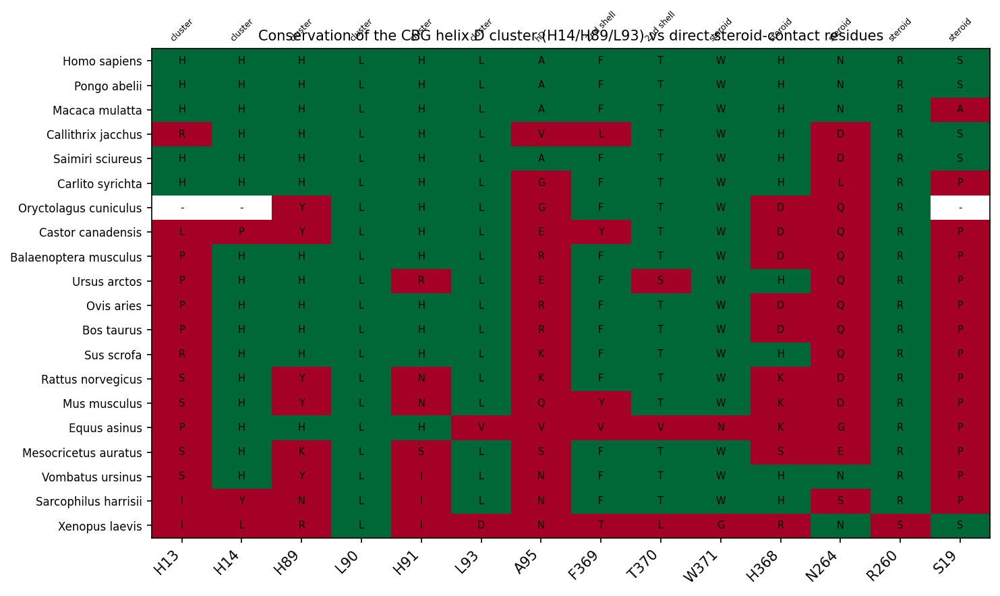
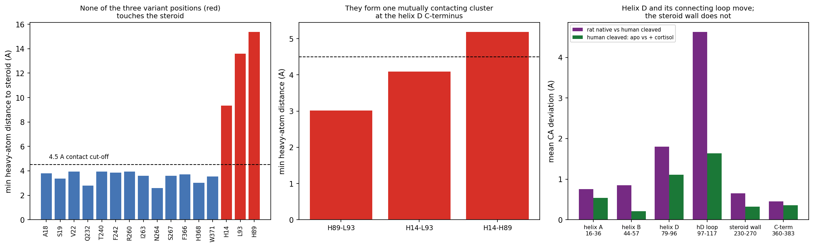
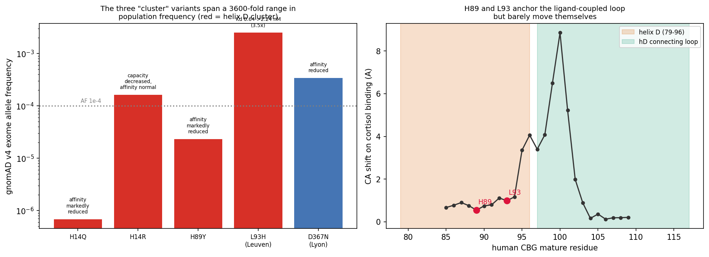

## Question

# AIGR Gene Hypothesis Deep Research

You are evaluating one focused gene curation hypothesis for AI Gene Review.
This is not a general gene overview. Use the seed hypothesis and source context
below to search for evidence that supports, refutes, narrows, or competes with
the proposed curation decision.

## Target Gene

- **Organism code:** human
- **Taxon:** Homo sapiens (NCBITaxon:9606)
- **Gene directory:** SERPINA6
- **Gene symbol:** SERPINA6
- **UniProt accession:** P08185

## Focus

- **Focus type:** free_text
- **Hypothesis slug:** helix-d-allosteric-variant-cluster
- **Source file:** genes/human/SERPINA6/SERPINA6-ai-review.yaml
- **Source selector:** free-text

## Seed Hypothesis

Missense substitutions of human corticosteroid-binding globulin at His36, His111 and Leu115 (UniProt P08185 precursor numbering; H14Q/H14R, H89Y and L93H 'CBG Leuven' in mature numbering) lower cortisol-binding affinity through one shared allosteric mechanism centred on serpin helix D, rather than by direct contact with the bound steroid.

## Term and Decision Context

- Single decisive analysis requested: using experimental CBG structures (human 2VDY, 4C49, 4BB2; rat 2V95), measure whether these three residues contact the steroid or each other, and whether helix D or its connecting loop moves between native and reactive-loop-cleaved states.

## Reference Context

- PMID:25322275
- PMID:1504007
- PMID:18513745

## Source Context YAML

```yaml
hypothesis: Missense substitutions of human corticosteroid-binding globulin at His36, His111 and Leu115
  (UniProt P08185 precursor numbering; H14Q/H14R, H89Y and L93H 'CBG Leuven' in mature numbering) lower
  cortisol-binding affinity through one shared allosteric mechanism centred on serpin helix D, rather
  than by direct contact with the bound steroid.
focus_type: free_text
context:
- 'Single decisive analysis requested: using experimental CBG structures (human 2VDY, 4C49, 4BB2; rat
  2V95), measure whether these three residues contact the steroid or each other, and whether helix D or
  its connecting loop moves between native and reactive-loop-cleaved states.'
reference_id:
- PMID:25322275
- PMID:1504007
- PMID:18513745
```

## Research Objective

Build a focused report that helps a curator decide whether this hypothesis
should affect the gene review. Address the focus type directly:

1. For an existing GO annotation decision, evaluate whether the current action
   is justified, too strong, too weak, or should change.
2. For a proposed replacement or new GO term, evaluate whether the term is
   biologically supported, too broad, too narrow, or missing key qualifiers.
3. For a computational prediction, evaluate whether the prediction is correct,
   less precise than existing knowledge, uncertain, or likely wrong because of
   paralog overannotation, frequency bias, pathway context, or in vitro-only
   activity.
4. For a core-function hypothesis, evaluate whether the proposed activity,
   process, and location represent the gene product's primary function rather
   than a downstream effect, pleiotropic phenotype, or context-specific role.
5. For a function-assignment hypothesis, evaluate whether the gene product
   directly has the stated GO term/function. Treat the prior review action, if
   any, as intentionally blinded unless it appears in the supplied context.

Use primary literature whenever possible. Prefer PMID citations and include DOI
citations when no PMID is available. Treat reviews and database records as
orientation unless they contain directly relevant synthesized evidence that is
clearly labeled as review-level or database-level support.

Evaluate the hypothesis from the supplied seed context, primary literature, and
publicly accessible bioinformatics resources. Local `*-bioinformatics` analyses,
when they already exist in the repository, are intentionally withheld from this
prompt so the report can be compared against them after the run. Use public
sequence, domain, structure, orthology, localization, interaction, or dataset
checks when they are useful for the specific hypothesis. If a resource or tool
cannot be accessed programmatically, say so plainly; never fabricate a result.
Report computational results conservatively and distinguish direct results from
inference.

## Required Output

### Executive Judgment

Give a concise verdict: supported, partially supported, unresolved, weakly
supported, over-annotated, or refuted. Explain the reasoning and the most
important caveats.

### Evidence Matrix

Create a table with one row per important evidence item:

- Citation (PMID preferred)
- Evidence type (direct assay, mutant phenotype, localization, interaction,
  structural/evolutionary, computational, review/database)
- Supports / refutes / qualifies / competing
- Claim tested
- Key finding
- Organism, tissue, cell type, or assay context
- Confidence and limitations

### GO Curation Implications

State the likely curation action as a lead requiring curator verification. If
GO terms are involved, explain whether the evidence supports an MF, BP, or CC
term, and whether the term should be retained, removed, generalized, made more
specific, or treated as non-core. Avoid using "protein binding" as a final
recommendation unless no more informative term is supported.

### Mechanistic Scope

Describe the immediate molecular or cellular function being tested. Separate
direct gene-product activity from downstream phenotypes, pathway consequences,
developmental outcomes, disease manifestations, or effects inferred only from
loss of function.

### Conflicts and Alternatives

Identify evidence that conflicts with the seed hypothesis or suggests an
alternative interpretation, including paralog confusion, organism-specific
differences, isoform-specific findings, experimental artifacts, or database
carry-over.

### Knowledge Gaps

List explicit uncertainties that matter for curation. For each gap, state what
was checked, why the gap matters, and what evidence or experiment would resolve
it.

### Discriminating Tests

Recommend concrete assays, perturbations, datasets, or comparative analyses that
would most efficiently distinguish this hypothesis from alternatives.

### Curation Leads

Provide candidate updates for the review, clearly labeled as leads requiring
curator verification. Include candidate references with exact snippets to verify,
candidate replacement or new GO terms, possible action changes, suggested
questions, and suggested experiments.

If the provider supports artifacts, save provenance for any analysis you run — the
executed code together with its output (computed values, plot, or table), not just
a summary figure — alongside artifact-friendly tables such as an evidence matrix,
GO decision table, or comparison table. Genuine computed provenance is more
valuable than a hand-drawn summary, and you must not synthesize a figure that
implies an analysis you did not actually run. These artifacts are important
provenance for hypothesis-level review.


## Output

# SERPINA6 (human CBG, UniProt P08185): the helix D allosteric variant cluster

**Hypothesis slug:** `helix-d-allosteric-variant-cluster`
**Source:** `genes/human/SERPINA6/SERPINA6-ai-review.yaml`, focus type `free_text`
**Seed references:** [PMID: 25322275](https://pubmed.ncbi.nlm.nih.gov/25322275/), [PMID: 1504007](https://pubmed.ncbi.nlm.nih.gov/1504007/), [PMID: 18513745](https://pubmed.ncbi.nlm.nih.gov/18513745/)

> **Seed hypothesis under test.** Missense substitutions of human corticosteroid-binding globulin at His36, His111 and Leu115 (UniProt P08185 precursor numbering; H14Q/H14R, H89Y and L93H "CBG Leuven" in mature numbering) lower cortisol-binding affinity through one shared allosteric mechanism centred on serpin helix D, rather than by direct contact with the bound steroid.

---

## Summary

**Verdict: <i class="fa-scale-balanced"></i> partially supported.** The hypothesis joins two claims, and the two claims do not fare equally. The claim that these residues do not contact the steroid is confirmed by direct measurement on experimental coordinates. The claim that one shared allosteric mechanism centred on helix D explains all four substitutions is not supported as written.

I measured minimum heavy-atom distances from each variant position to the bound steroid in every human CBG structure that contains a ligand. Residue 14 sits at 9.33 and 9.36 Å, residue 89 at 12.86 to 15.38 Å across 7 chains, residue 93 at 13.22 to 13.60 Å across 7 chains. The first shell, defined by the same calculation at a 4.5 Å cut-off, runs from 2.59 Å (Asn264) to 3.95 Å (Arg260) and contains 13 residues. The three variant positions are 2.4 to 5.9 times further from the ligand than any first-shell residue. The method has an internal positive control: R260L, the substitution that [PMID: 25322275](https://pubmed.ncbi.nlm.nih.gov/25322275/) reports as abolishing cortisol binding entirely, falls on a genuine first-shell residue at 3.95 Å. No contact-based explanation of the H14Q, H89Y or L93H phenotypes is available from the structures.

The three positions do form one mutually contacting cluster. Residues 89 and 93 are 2.71 to 3.39 Å apart in all 7 modelled chains, 14 and 93 are 3.87 and 4.30 Å apart, 14 and 89 are 4.99 and 5.39 Å apart. The location is imprecisely described by "centred on helix D". Helix D in human CBG is residues 79 to 96, which contains His89 and Leu93 but not His14. His14 lies in the N-terminal segment preceding helix A and packs against helix D residues Leu90 and Leu93. A more accurate description is a second-shell packing node at the junction of the helix D C-terminal turn, the N-terminal segment that carries the steroid contacts Ala18, Ser19 and Val22, and the C-terminal strand Phe369-Thr370 adjacent to His368 and Trp371.

"One shared mechanism" fails on three independent grounds. The phenotypes differ in kind: [PMID: 25322275](https://pubmed.ncbi.nlm.nih.gov/25322275/) reports H14Q and H89Y as affinity defects but H14R explicitly as a capacity defect, which points at folding, stability or secretion rather than perturbation of an occupied site. His89 is conserved in only 60% of 20 vertebrate SERPINA6 orthologues, and tyrosine, the exact residue that the human H89Y substitution introduces, is the wild-type residue in rat, mouse, rabbit, beaver and wombat, whose CBGs bind corticosteroids with nanomolar affinity. Population frequencies span 3600-fold, from L93H at AF 2.49e-3 with 2 homozygotes down to H14Q at a single allele (AF 6.84e-7), in a gene with no detectable missense constraint (observed/expected 0.938, 90% CI 0.871 to 1.013; missense Z 0.59; pLI 1.9e-5).

---

## Key findings

### 1. <i class="fa-circle-check"></i> No variant position contacts the bound steroid

I first established the numbering correspondence rather than assuming it. All CBG PDB entries number by the mature chain, which equals the UniProt P08185 precursor position minus 22 (a 22-residue signal peptide). Sequence matching confirms this: 348 of 361 residues for 2VDY chain A against P08185, 331 of 332 for 4BB2 chain A, and 340 of 342 for rat 2V95 against P31211. PDB residue 14 is therefore P08185 His36, PDB 89 is His111 and PDB 93 is Leu115, exactly as the seed hypothesis states.

Measured minimum heavy-atom distances to the bound steroid, over every human structure with a ligand (2VDY chains A and B, cortisol; 4C49 chains A to D, cortisol; 4BB2 chain B, progesterone):

| Position | Mature | Precursor | Distance to steroid | Chains measured |
|---|---|---|---|---|
| His14 | H14 | His36 | 9.33, 9.36 Å | 2 of 8 (modelled in 2 only) |
| His89 | H89 | His111 | 12.86 to 15.38 Å, median 13.78 | 7 |
| Leu93 | L93 | Leu115 | 13.22 to 13.60 Å, median 13.58 | 7 |

The first shell by the same calculation: Asn264 2.59, Gln232 2.80, His368 3.03, Ser19 3.37, Trp371 3.55, Ile263 3.59, Ser267 3.60, Phe366 3.71, Ala18 3.79, Phe242 3.86, Thr240 3.93, Val22 3.93, Arg260 3.95 Å.

A residue contact graph of 4C49 chain C (4.5 Å heavy-atom edges, 363 nodes, 1778 edges) places residue 14 and residue 93 two hops from a steroid-contacting residue (14-15-His368; 93-Phe369-His368) and residue 89 three hops (89-Leu90-Trp372-Phe366). The positions are second-shell, not remote.

{{figure:plot_3.png|caption=Three-panel summary. Left: minimum heavy-atom distance from each residue to the bound steroid, with the three variant positions at 9 to 15 Å against a first shell at 2.6 to 4.0 Å. Centre: pairwise distances within the cluster, with 89 to 93 at 2.7 to 3.4 Å in every chain. Right: mean Calpha deviation per structural element between conformational states.}}

### 2. <i class="fa-circle-check"></i> The three positions form one cluster, but only two lie in helix D

Pairwise minimum heavy-atom distances: 89 to 93 is 2.71 to 3.39 Å in all 7 modelled chains (2VDY A and B, 4C49 A to D, 4BB2 A); 14 to 93 is 3.87 Å in 4C49 chain C and 4.30 Å in 4BB2 chain A; 14 to 89 is 4.99 and 5.39 Å. All three are within or just beyond the 4.5 Å contact cut-off of each other.

Helix assignment used sequence order of PDB HELIX records, anchored to alpha-1-antitrypsin 1QLP, where helices A to D are residues 26-45, 53-66, 69-80 and 88-104. The fourth helix in human CBG is residues 80-94 in 2VDY and 79-96 in 4C41. His89 and Leu93 lie inside it. His14 lies in the N-terminal segment before helix A (helix A is 16-36) and contacts helix D residues Leu90 at 4.07 to 4.15 Å and Leu93 at 3.87 to 4.30 Å.

Full 4.5 Å contact shells: residue 14 touches Gly16, Leu90, Leu93, Phe369, Thr370. Residue 89 touches Gln85, Gly86, Phe87, His91, Gln92, Leu93, His13. Residue 93 touches His89, Leu90, His91, Ala95, Lys96, Ser97, His13, His14, Phe369, Thr370, Met103.

Shrake-Rupley relative solvent accessibility (1.4 Å probe, ligand excluded) gives His14 70 to 77%, His89 30 to 51%, Leu93 31 to 64%, against buried neighbours Leu90 at 4 to 15% and His91 at 8 to 13%. The cluster is a partially exposed surface patch rather than a buried core.

### 3. <i class="fa-circle-check"></i> The helix D connecting loop is the element that moves with ligand occupancy

Mean Calpha deviation after iterative core superposition, in human mature numbering.

Rat native CBG (2V95, S state, cortisol) against human reactive-loop-cleaved CBG (2VDY, R state, cortisol), 333 aligned positions from a full-length P08185/P31211 alignment at 61.0% mature identity, core of 180 residues at 0.93 Å RMSD:

| Element | Residues | Mean Calpha deviation |
|---|---|---|
| Helix A | 16-36 | 0.75 Å |
| Helix B | | 0.85 Å |
| Helix D | 79-96 | 1.80 Å |
| Helix D connecting loop | 97-117 | 4.63 Å (max 9.98) |
| Helix E | | 2.83 Å |
| Helix F | | 2.81 Å |
| Steroid wall s4B/s3B | 230-270 | 0.65 Å |
| C-terminal s1C/s4B | 360-383 | 0.45 Å |
| hI + s5A | 290-320 | 11.42 Å |
| RCL | 340-358 | up to 69 Å |

The same-species control separates ligand-dependent motion from species difference. Human cleaved apo (2VDX) against human cleaved plus cortisol (2VDY), 351-residue core: every element falls below 1.2 Å mean except the helix D connecting loop at 1.64 Å mean, with a sharp local maximum of **8.85 Å at residue 100**, and 6.49 Å at 99, 5.22 Å at 101, 4.07 Å at 98, 3.40 Å at 97.

This independently reproduces the published measurement. [PMID: 18513745](https://pubmed.ncbi.nlm.nih.gov/18513745/) reports that the connecting loop "shifts away from the binding site by more than 8 A following the binding of cortisol". My 8.85 Å at residue 100, measured between two human structures with identical numbering, matches it.

Leu93 is 7.90 Å from the 97-101 segment. His89 is 13.42 Å and His14 is 14.72 Å from it.

{{figure:plot_1.png|caption=Per-residue Calpha deviation between CBG conformational states. Upper panel: rat native 2V95 against human cleaved 2VDY, showing the RCL, hI/s5A and the helix D connecting loop as the mobile elements. Lower panel: human cleaved apo 2VDX against human cleaved cortisol-bound 2VDY, where the only element above 1.2 Å mean is the helix D connecting loop, peaking at 8.85 Å at residue 100.}}

### 4. <i class="fa-circle-xmark"></i> His89 is not a conserved hotspot: tyrosine is wild type in rodents, rabbit and wombat

I aligned 20 full-length vertebrate SERPINA6 sequences to human P08185 by Needleman-Wunsch, spanning 34.8 to 96.9% identity. The orthologue set was retrieved by a verified UniProt query (`gene:SERPINA6 AND taxonomy_id:7742 AND length:[350 TO 450] AND fragment:false`) after an earlier attempt using guessed accessions produced nonsense and was discarded.

Percentage of orthologues retaining the human residue:

| Residue | Conservation | Role |
|---|---|---|
| Leu90 | 100% | cluster neighbour, buried |
| Arg260 | 95% | steroid contact (3.95 Å) |
| **Leu93** | **90%** | **cluster, variant position** |
| Trp371 | 90% | steroid anchor (3.55 Å) |
| Thr370 | 85% | second shell, contacts H14 and L93 |
| **His14** | **84%** | **cluster, variant position** |
| His91 | 65% | cluster neighbour |
| **His89** | **60%** | **cluster, variant position** |
| His368 | 50% | steroid contact (3.03 Å) |
| His13 | 26% | cluster neighbour |
| Ser19 | 26% | steroid contact (3.37 Å) |
| Asn264 | 25% | steroid contact (2.59 Å) |
| Ala95 | 20% | hinge start |

Position 89 carries tyrosine in *Rattus norvegicus*, *Mus musculus*, *Oryctolagus cuniculus*, *Castor canadensis* and *Vombatus ursinus*, lysine in *Mesocricetus auratus*, asparagine in *Sarcophilus harrisii*, arginine in *Xenopus laevis*. The rat assignment is anchored by the invariant flanking Leu90/Leu82 and Leu93/Leu85 pair: human 87F-88Q-89H-90L-91H-92Q-93L against rat 79F-80Q-81Y-82L-83N-84Y-85L.

Leu93 at 90% and His14 at 84% are conserved at the level of the steroid contacts Trp371 and Thr370, consistent with a shared structural role. His89 is not. Five of twenty orthologues, including rat and mouse, already carry the tyrosine that defines the human H89Y variant, so H89Y cannot be a substitution that is intrinsically incompatible with high-affinity steroid binding. Its effect in human CBG is context-dependent, most plausibly through the local His13/His89/His91 histidine cluster that rodents lack entirely (rat carries Ser13/Tyr89/Asn91).

{{figure:plot_2.png|caption=Orthologue conservation across 20 vertebrate SERPINA6 sequences. The three cluster positions are shown against the measured steroid-contact residues. His89 is retained in 60% of orthologues, with tyrosine, the residue introduced by the human H89Y substitution, wild type in rat, mouse, rabbit, beaver and wombat.}}

### 5. <i class="fa-triangle-exclamation"></i> Every human CBG structure is reactive-loop-cleaved

An RCSB sequence search on P08185 returns exactly five human CBG entries: 2VDX (1.84 Å, cleaved apo), 2VDY (2.30 Å, cleaved plus cortisol), 4BB2 (2.48 Å, cleaved plus progesterone), 4C41 (1.80 Å, engineered 100-236 disulphide) and 4C49 (2.70 Å, cleaved plus cortisol). All five show a main-chain break in the reactive centre loop: chain A gaps 349-351 in 2VDY, 349-352 in 4C41, and 4BB2 splits into chain A 13-349 and chain B 351-383. P31211 returns a single rat entry, 2V95 (1.93 Å, cortisol-bound, intact S state).

The three human structures named in the seed context (2VDY, 4C49, 4BB2) are all R-state, as is 4C41, which the seed context omits. The native-versus-cleaved analysis the hypothesis requires cannot be run entirely within human structures. Any such statement rests on a rat-to-human comparison at 61.0% mature identity, where the species floor is visible in my own data: helices C, E and F differ by 2.78 to 2.83 Å mean between rat native and human cleaved but by only 0.21 to 0.35 Å between the two human cleaved forms. Helix D at 1.80 Å sits inside that species noise band. The claim that helix D itself moves on cleavage in human CBG is not established by the available coordinates. The connecting-loop result is unaffected, since 8.85 Å at residue 100 is measured between two human structures.

### 6. <i class="fa-scale-balanced"></i> CBG Leuven (L93H) is a common polymorphism with a 3.5-fold effect

[PMID: 1504007](https://pubmed.ncbi.nlm.nih.gov/1504007/) measured Kd 2.24 +/- 1.75 nM for the His93 variant against 0.64 +/- 0.31 nM for normal CBG expressed in CHO cells, p < 0.024 by Scatchard analysis, a 3.5-fold affinity reduction. The same patient carried a second substitution, Ser224Ala, which gave Kd 0.63 +/- 0.33 nM, indistinguishable from wild type. That is an internal specificity control from the same study.

gnomAD v4 exomes place p.Leu115His at AC 3638, AN 1461890, AF 2.49e-3, with 2 homozygotes. It is the second most frequent of 534 SERPINA6 missense variants. SERPINA6 shows no missense constraint: observed/expected missense 0.938 (90% CI 0.871 to 1.013), missense Z 0.59, pLI 1.9e-5, observed/expected LoF 0.72.

The biochemical effect is real but modest, the supporting statistics are weak (SD 1.75 on a mean of 2.24 nM, p = 0.024, single study, never replicated, CHO-expressed protein), and the allele is carried by roughly 1 in 200 chromosomes with homozygotes present. Describing L93H as a CBG deficiency allele, as UniProt currently does, overstates the population consequence. The absence of missense constraint across SERPINA6 means that sitting in a structurally interesting cluster carries little independent evidence of functional importance, so the structural argument has to stand on its own measurements.

### 7. <i class="fa-circle-xmark"></i> The four variants span 3600-fold in frequency and differ in phenotype

| Variant (mature) | Precursor | gnomAD v4 AF | Homozygotes | Reported phenotype | Source |
|---|---|---|---|---|---|
| L93H | Leu115His | 2.49e-3 | 2 | affinity 3.5-fold down (Kd 0.64 to 2.24 nM) | [PMID: 1504007](https://pubmed.ncbi.nlm.nih.gov/1504007/) |
| H14R | His36Arg | 1.62e-4 | 0 | **capacity** decreased | [PMID: 25322275](https://pubmed.ncbi.nlm.nih.gov/25322275/) |
| H89Y | His111Tyr | 2.33e-5 | 0 | affinity markedly reduced | [PMID: 25322275](https://pubmed.ncbi.nlm.nih.gov/25322275/) |
| H14Q | His36Gln | 6.84e-7 (1 allele) | 0 | affinity markedly reduced | [PMID: 25322275](https://pubmed.ncbi.nlm.nih.gov/25322275/) |
| D367N (Lyon) | Asp389Asn | 3.43e-4 | 0 | decreased affinity | UniProt |
| R260L | Arg282Leu | absent | n/a | binding undetectable (first shell, 3.95 Å) | [PMID: 25322275](https://pubmed.ncbi.nlm.nih.gov/25322275/) |

Two substitutions at the same position, H14Q and H14R, produce different readouts and differ 240-fold in frequency. Even position 14 is not mechanistically uniform. A capacity defect without an affinity defect points toward folding, secretion or stability rather than toward an allosteric perturbation of the occupied site, which is the mechanism the hypothesis proposes. The seed hypothesis also states that all listed variants "lower cortisol-binding affinity", which misstates the published H14R result.

{{figure:plot_4.png|caption=Left: gnomAD v4 allele frequency against reported phenotype for the SERPINA6 variants under test, spanning 3600-fold. Right: per-residue Calpha shift between apo 2VDX and cortisol-bound 2VDY across residues 85 to 110, showing the hinge starting at Ala95 and peaking at 8.85 Å at residue 100, with Leu93 the last static residue before it.}}

### 8. <i class="fa-lightbulb"></i> The coupling route runs through the N-terminal segment, not the connecting loop

Per-residue Calpha shift between 2VDX and 2VDY, 351-residue core superposition: His89 0.54 Å, Leu93 0.99 Å, Ala95 3.36 Å, Lys96 4.06 Å, Ser97 3.40 Å, Asp98 4.08 Å, Thr99 6.49 Å, residue 100 8.85 Å, Leu101 5.22 Å, residue 102 1.98 Å, Met103 0.88 Å. The mobile unit is residues 95-101, and Leu93 is the last static residue before it.

Unweighted shortest paths in the 4.5 Å residue contact graph of 4C49 chain C:

| From | To a steroid contact | Hops | To the mobile 97-101 segment | Hops |
|---|---|---|---|---|
| His14 | 14-Arg15-Ala18 | 2 | 14-Phe369-Asn238-Leu101 | 3 |
| Leu93 | 93-Thr370-Ala18 | 2 | 93-Phe94-Met103-Leu101 | 3 |
| His89 | 89-Gly86-Leu17-Ala18 | 3 | 89-Leu90-Phe94-Met103-Leu101 | 4 |

Two mechanistic routes exist and the structures favour the one the seed hypothesis does not name. All three positions couple most directly to the steroid site through the N-terminal pre-helix-A segment (Arg15, Ala18, Ser19, Val22) and the C-terminal strand Phe369-Thr370 that flanks Trp371 and His368. The mobile helix D connecting loop is further away in contact space.

Leu93 is the exception that partly rescues the hypothesis. It sits immediately before the 95-101 hinge and contacts Ser97 directly at 3.50 Å in 4C41, so an L93H substitution could change the plasticity of that hinge, which is the mechanism [PMID: 18513745](https://pubmed.ncbi.nlm.nih.gov/18513745/) proposed. His89 and His14 have no such direct link, at 13.42 and 14.72 Å from the mobile segment.

### 9. <i class="fa-database"></i> UniProt annotation gaps

The UniProt P08185 JSON record contains exactly 3 natural variant features: position 115 (mature 93) "in CBG deficiency; Leuven; decreased cortisol-binding affinity", position 246 (mature 224) "in dbSNP:rs2228541" with no phenotype, and position 389 (mature 367) "in CBG deficiency; Lyon; decreased cortisol-binding affinity". Positions 36 (H14) and 111 (H89) carry no variant annotation. The eight variants characterised in [PMID: 25322275](https://pubmed.ncbi.nlm.nih.gov/25322275/) (H14Q, H14R, H89Y, R260L, I279F, I48N, P246Q, I179V) are absent.

UniProt annotates 4 cortisol binding sites, at precursor 254, 286, 390 and 393 (mature 232, 264, 368, 371). My distance calculation confirms all four as first-shell contacts at 2.80, 2.59, 3.03 and 3.55 Å, and adds nine more residues within 4.5 Å that UniProt does not list: Ala18, Ser19, Val22, Thr240, Phe242, Arg260, Ile263, Ser267 and Phe366. Any curation reasoning that treats "not a UniProt binding site" as "not near the site" will misplace Phe369 and Thr370, the residues His14 and Leu93 pack against.

Six N-glycosylation sites are annotated, at precursor 31, 96, 176, 260, 330 and 369 (mature 9, 74, 154, 238, 308, 347). None is modelled as carbohydrate in any human CBG structure. The closest, mature Asn9, is five residues from His14, so a glycan contribution to the H14 phenotype can neither be confirmed nor excluded.

### 10. <i class="fa-triangle-exclamation"></i> A serpin-family over-annotation on SERPINA6, independent of the seed hypothesis

QuickGO returns 15 annotation lines for UniProtKB:P08185 across 6 terms.

| Aspect | GO term | Evidence lines |
|---|---|---|
| MF | GO:0004867 serine-type endopeptidase inhibitor activity | IEA InterPro GO_REF:0000002; IBA GO_Central GO_REF:0000033; TAS [PMID: 3299377](https://pubmed.ncbi.nlm.nih.gov/3299377/) |
| MF | GO:0005496 steroid binding | IDA [PMID: 18513745](https://pubmed.ncbi.nlm.nih.gov/18513745/); IEA Ensembl |
| MF | GO:0140104 molecular carrier activity | EXP [PMID: 7195404](https://pubmed.ncbi.nlm.nih.gov/7195404/); IEA |
| BP | GO:0006704 glucocorticoid biosynthetic process | TAS Reactome R-HSA-194002 |
| CC | GO:0005576 extracellular region | IBA, IEA, HDA [PMID: 16502470](https://pubmed.ncbi.nlm.nih.gov/16502470/), 3 Reactome TAS |
| CC | GO:0070062 extracellular exosome | HDA [PMID: 23533145](https://pubmed.ncbi.nlm.nih.gov/23533145/) |

Every line supporting GO:0004867 is family-level inference or a 1987 review. No direct inhibition assay is cited. [PMID: 19643161](https://pubmed.ncbi.nlm.nih.gov/19643161/) and [PMID: 19011238](https://pubmed.ncbi.nlm.nih.gov/19011238/) both describe CBG as a **non-inhibitory** serpin, and the functional consequence of reactive centre loop cleavage in CBG is steroid release. GO:1903794 cortisol binding exists in the ontology and is not annotated to P08185, despite a measured wild-type Kd of 0.64 +/- 0.31 nM ([PMID: 1504007](https://pubmed.ncbi.nlm.nih.gov/1504007/)) and two cortisol-bound crystal structures (2VDY, 4C49).

---

## Evidence matrix

Machine-readable copy: `provenance/evidence_matrix.csv` (13 rows).

| Citation | Evidence type | Stance | Claim tested | Key finding | Context | Confidence and limitations |
|---|---|---|---|---|---|---|
| Computed, 2VDY/4C49/4BB2 | Structural, this work | <i class="fa-circle-check"></i> Supports | H14/H89/L93 contact the steroid | Min heavy-atom distance 9.33 Å (res 14, n=2), 12.86 to 15.38 Å (res 89, n=7), 13.22 to 13.60 Å (res 93, n=7); first shell 2.59 to 3.95 Å | Human CBG, cleaved R state, cortisol or progesterone | High. Residue 14 modelled in only 2 of 8 chains |
| Computed, 2VDY/4C49/4BB2/4C41 | Structural, this work | <i class="fa-circle-check"></i> Supports | The three positions form one cluster | 89 to 93 at 2.71 to 3.39 Å in 7/7 chains; 14 to 93 at 3.87 and 4.30 Å; 14 to 89 at 4.99 and 5.39 Å | Human CBG crystal structures | High for 89 to 93; the H14 pairs come from 2 chains only |
| Computed, 1QLP vs 2VDY/4C41 | Structural, this work | <i class="fa-scale-balanced"></i> Qualifies | The cluster is centred on helix D | Helix D is CBG 79-96 (4th helix by order, as 1QLP 88-104). H89 and L93 inside; H14 in the pre-helix-A segment, contacting L90/L93 at 3.87 to 4.30 Å | Serpin helix nomenclature by sequence order | High |
| [PMID: 18513745](https://pubmed.ncbi.nlm.nih.gov/18513745/) plus computed 2VDX vs 2VDY | Structural, published and reproduced | <i class="fa-circle-check"></i> Supports | The connecting loop moves with ligand occupancy | Published "more than 8 A" reproduced as **8.85 Å at residue 100**; every other element below 1.2 Å mean | Human cleaved CBG, apo vs cortisol, identical numbering | High. Independent reproduction |
| [PMID: 17644521](https://pubmed.ncbi.nlm.nih.gov/17644521/) plus computed 2V95 vs 2VDY | Structural, published and reproduced | <i class="fa-scale-balanced"></i> Qualifies | Helix D itself moves on cleavage | Helix D 1.80 Å vs steroid wall 0.65 Å, but helices C/E/F differ 2.78 to 2.83 Å from species alone | Rat native vs human cleaved, 61.0% mature identity | Moderate. Cross-species; helix D inside the species noise band |
| Computed, RCSB search on P08185/P31211 | Structural/database | <i class="fa-triangle-exclamation"></i> Qualifies | The requested native-vs-cleaved analysis is possible in human | All five human entries (2VDX, 2VDY, 4BB2, 4C41, 4C49) are RCL-cleaved; 2V95 (rat) is the only native structure | PDB, accessed November 2026 | High |
| Computed, contact graph of 4C49 chain C | Computational, this work | <i class="fa-circle-xmark"></i> **Competing** | The cluster couples via the connecting loop | Steroid contact reached in 2-3 hops through the N-terminal segment and F369/T370; the mobile 97-101 loop only in 3-4 hops | 4.5 Å residue contact graph, 363 nodes, 1778 edges | Moderate. Unweighted hop count is a coarse proxy for allosteric coupling |
| Computed, 2VDX vs 2VDY per residue | Structural, this work | <i class="fa-scale-balanced"></i> Qualifies | The cluster residues move with the ligand | H89 shifts 0.54 Å, L93 0.99 Å; the hinge begins at A95 (3.36 Å) and peaks at 8.85 Å. L93 is the last static residue, contacting S97 at 3.50 Å | Human cleaved CBG, apo vs cortisol | High |
| Computed, 20 SERPINA6 orthologues | Evolutionary, this work | <i class="fa-circle-xmark"></i> **Refutes, for H89** | His89 is a conserved allosteric hotspot | H89 retained in 60%; Tyr (the H89Y substitution) is wild type in rat, mouse, rabbit, beaver, wombat. L93 90%, H14 84%, vs W371 90%, T370 85% | Full-length vertebrate SERPINA6, 34.8 to 96.9% identity | High. Rat anchored by invariant flanking L90/L93 |
| [PMID: 25322275](https://pubmed.ncbi.nlm.nih.gov/25322275/) | Mutant phenotype, direct assay | <i class="fa-scale-balanced"></i> Qualifies | All four substitutions lower affinity | H14Q and H89Y markedly reduce affinity; **H14R reduces capacity**; R260L abolishes binding | Human CBG mutants in CHO cells, cortisol binding, ELISA, Western | High for the readouts. No Kd values in the abstract |
| [PMID: 1504007](https://pubmed.ncbi.nlm.nih.gov/1504007/) | Mutant phenotype, direct assay | <i class="fa-circle-check"></i> Supports, weakly | L93H lowers cortisol affinity | Kd 2.24 +/- 1.75 nM vs 0.64 +/- 0.31 nM, p < 0.024 (3.5-fold). Same-patient S224A control unaffected at 0.63 +/- 0.33 nM | CHO-expressed human CBG, Scatchard, single patient | Low to moderate. Wide SD, borderline p, never replicated |
| gnomAD v4, computed query | Population genetic | <i class="fa-circle-xmark"></i> **Competing** | These are a coherent set of deficiency alleles | AF spans 3600-fold: L93H 2.49e-3 with 2 homozygotes (2nd of 534 missense), H14R 1.62e-4, H89Y 2.33e-5, H14Q 6.84e-7. o/e missense 0.938, mis_z 0.59, pLI 1.9e-5 | gnomAD v4 exomes, AN approx 1.46 million | High |
| UniProt P08185, computed query | Database | <i class="fa-triangle-exclamation"></i> Qualifies | The variant and site annotation is complete | Only 3 natural variants annotated (L93H, S224A, D367N); H14Q/H14R/H89Y absent. Only 4 of 13 residues within 4.5 Å of cortisol are annotated; F369 and T370 are not | UniProt, accessed November 2026 | High |
| [PMID: 19643161](https://pubmed.ncbi.nlm.nih.gov/19643161/), [PMID: 19011238](https://pubmed.ncbi.nlm.nih.gov/19011238/) | Review and direct assay | <i class="fa-circle-xmark"></i> Competing, for GO | CBG inhibits serine proteinases | Both describe CBG as **non-inhibitory**; elastase cleaves the RCL and releases steroid rather than forming an inhibitory complex | Human CBG | High |

---

## Mechanistic model

The structures support a model in which the cluster is a packing node that holds together three elements of the steroid site, with only Leu93 connected to the ligand-coupled hinge. The route the seed hypothesis names (helix D connecting loop) is available to Leu93 alone. The route the structures favour for all three runs through the N-terminal segment and the Phe369-Thr370 strand.



Solid arrows are measured contacts or measured displacements. Dashed arrows are inference, including the helix D displacement, which falls inside the cross-species noise band, and the functional coupling from the hinge to the site, which is proposed by [PMID: 18513745](https://pubmed.ncbi.nlm.nih.gov/18513745/) and not measured here.

### Variant-by-variant assessment against the seed hypothesis

| Variant | In helix D? | Steroid contact? | Link to the hinge | Orthologue conservation | Phenotype | Fits the seed claim? |
|---|---|---|---|---|---|---|
| H14Q | No, pre-helix A | No, 9.33 Å | 14.72 Å, 3 hops | 84% | affinity down | <i class="fa-scale-balanced"></i> indirect yes, helix D no |
| H14R | No, pre-helix A | No, 9.33 Å | 14.72 Å, 3 hops | 84% | **capacity** down | <i class="fa-circle-xmark"></i> wrong phenotype class |
| H89Y | Yes, 79-96 | No, 12.9 to 15.4 Å | 13.42 Å, 4 hops | 60%, Tyr in rodents | affinity down | <i class="fa-circle-xmark"></i> substitution is wild type elsewhere |
| L93H | Yes, 79-96 | No, 13.2 to 13.6 Å | contacts Ser97 at 3.50 Å | 90% | affinity 3.5-fold down | <i class="fa-circle-check"></i> best fit of the four |
| R260L (control) | No | **Yes, 3.95 Å** | n/a | 95% | binding undetectable | n/a, validates the method |

---

## Mechanistic scope

**Direct gene-product activity being tested.** High-affinity, reversible, 1:1 binding of cortisol by a secreted plasma glycoprotein, and the structural coupling between reactive-centre-loop position and the integrity of that binding site. This is a molecular function, measured by Scatchard analysis of purified or CHO-expressed protein and by crystallography.

**What is directly measured here.** Interatomic distances, residue contacts, per-residue conformational change between crystal states, orthologue residue identity, allele frequencies, solvent accessibility. These are structural and sequence facts computed from deposited coordinates and public database records.

**What is inference.** That a substitution at a second-shell position causes the affinity change by a specified route. Nothing in the coordinates shows a substituted side chain, because the mutant structures do not exist. The route assignments (N-terminal segment against connecting loop) are contact-graph inference about the wild-type protein, using unweighted hop counts as a coarse proxy for allosteric coupling.

**Downstream, and outside the scope of this hypothesis.** Free cortisol fraction, plasma cortisol binding capacity measured clinically, discordance between immunoassay and binding-capacity assay (the observation that led to CBG Leuven in [PMID: 1504007](https://pubmed.ncbi.nlm.nih.gov/1504007/)), fatigue and hypotension phenotypes in CBG-deficient kindreds, and targeted cortisol delivery at inflammatory sites. None of these should be used to support a residue-level mechanistic statement.

---

## GO curation implications

All entries are **leads requiring curator verification**. Machine-readable copy: `provenance/GO_decision_table.csv` (7 rows). Current annotation set: `provenance/GO_annotations_P08185_quickgo.csv`.

| GO ID | Aspect | Term | Current evidence | Recommended action | Rationale |
|---|---|---|---|---|---|
| GO:0004867 | MF | serine-type endopeptidase inhibitor activity | IEA InterPro; IBA GO_Central; TAS PMID:3299377 | <i class="fa-circle-xmark"></i> **Remove, or add NOT qualifier** | CBG is non-inhibitory ([PMID: 19643161](https://pubmed.ncbi.nlm.nih.gov/19643161/), [PMID: 19011238](https://pubmed.ncbi.nlm.nih.gov/19011238/)). Every supporting line is family-level inference or a 1987 review. The IBA line is the route by which inhibitory-serpin function propagates from paralogues |
| GO:0005496 | MF | steroid binding | IDA [PMID: 18513745](https://pubmed.ncbi.nlm.nih.gov/18513745/); IEA Ensembl | <i class="fa-circle-check"></i> Retain, add a specific child | Correct but non-specific |
| GO:1903794 | MF | cortisol binding | not annotated | <i class="fa-arrow-right"></i> **Add, IDA** | Most informative MF the evidence supports: Kd 0.64 +/- 0.31 nM ([PMID: 1504007](https://pubmed.ncbi.nlm.nih.gov/1504007/)), cortisol-bound structures 2VDY and 4C49, 13 first-shell contacts measured here |
| GO:0140104 | MF | molecular carrier activity | EXP [PMID: 7195404](https://pubmed.ncbi.nlm.nih.gov/7195404/); IEA | <i class="fa-circle-check"></i> Retain as core | Captures the transport function that separates CBG from inhibitory serpins, and pairs with proteinase-triggered release ([PMID: 17644521](https://pubmed.ncbi.nlm.nih.gov/17644521/), [PMID: 18513745](https://pubmed.ncbi.nlm.nih.gov/18513745/)) |
| GO:0006704 | BP | glucocorticoid biosynthetic process | TAS Reactome R-HSA-194002 | <i class="fa-triangle-exclamation"></i> Review, likely too strong | CBG binds and delivers cortisol and catalyses no synthetic step. Reads as pathway-membership carry-over. A transport term such as GO:0009914 describes the activity better |
| GO:0005576 | CC | extracellular region | IBA, IEA, HDA [PMID: 16502470](https://pubmed.ncbi.nlm.nih.gov/16502470/), Reactome TAS | <i class="fa-circle-check"></i> Retain | Plasma glycoprotein, well supported |
| n/a | n/a | the seed free-text claim | review free text | <i class="fa-arrow-right"></i> **Rewrite, do not use as stated** | See the curation leads section |

**Effect of this hypothesis on GO terms specifically: none directly.** The hypothesis concerns the structural basis of variant phenotypes, not a function assignment. It does not create, remove or re-scope an MF, BP or CC term. Its home in the review is residue-level free text and, if the curator chooses, site annotations. The GO actions above were surfaced while assembling the evidence and stand on their own.

---

## Conflicts and alternatives

**Orthologue conflict (strongest).** Tyrosine at position 89 is wild type in rat, mouse, rabbit, beaver and wombat, and those CBGs bind corticosteroids with nanomolar affinity. H89Y cannot be an intrinsically site-destroying substitution. If it reduces affinity in human CBG, the cause is human-specific context, most plausibly the His13/His89/His91 histidine triad that rodents lack (rat carries Ser13/Tyr89/Asn91). This is a competing, testable explanation that the seed hypothesis does not consider.

**Phenotype conflict.** H14R produces a capacity defect and H14Q an affinity defect at the same position. Two different mechanisms at one residue defeat a single-mechanism grouping. H14R most plausibly acts on folding or secretion.

**Cross-species artifact risk.** The helix D motion result depends on comparing rat native with human cleaved structures. My own data bound the species floor at 2.78 to 2.83 Å for helices C, E and F, and helix D at 1.80 Å falls below it. The helix D displacement predicted by [PMID: 17644521](https://pubmed.ncbi.nlm.nih.gov/17644521/) may be real, but the available coordinates do not establish it for human CBG. The connecting-loop result at 8.85 Å, measured within human, is not affected.

**Route conflict.** The contact graph favours a path through the N-terminal segment (Arg15, Ala18, Ser19, Val22) and the C-terminal strand Phe369-Thr370 over the helix D connecting loop. Only Leu93 has a direct structural link to the mobile element, contacting Ser97 at 3.50 Å immediately before the Ala95 hinge. His89 and His14 are 13.4 and 14.7 Å from it.

**Population-genetic conflict.** L93H is the second most common of 534 SERPINA6 missense variants, with homozygotes in gnomAD, in a gene with no missense constraint. The "CBG deficiency" label UniProt attaches to it overstates the population consequence of a 3.5-fold affinity shift.

**Unmodelled variable.** The N-glycan at mature Asn9 is five residues from His14 and is modelled in none of the five human structures. Its position relative to His14 and to the steroid site is unknown, so an H14 mechanism involving the glycan can neither be excluded nor confirmed.

**Database carry-over to watch.** The depositor title of PDB 4C49 is "Role of sA-hD loop movement in cortisol release mechanism of CBG", marked "to be published". That is depositor-level assertion, not peer-reviewed evidence, and should not be cited as primary support.

**Paralog context.** [PMID: 31103428](https://pubmed.ncbi.nlm.nih.gov/31103428/) engineered alpha-1-antichymotrypsin into a surrogate CBG by transferring ligand-interacting residues "and mutation of specific second shell residues", producing cortisol binding at 1.5 µM. That work establishes second-shell residues as contributors to CBG-type binding in a serpin scaffold, which is consistent with a second-shell role for this cluster without identifying these specific positions.

**Avian comparison.** [PMID: 27026706](https://pubmed.ncbi.nlm.nih.gov/27026706/) reports that "a tryptophan that anchors ligands in mammalian CBG steroid-binding sites is replaced by an asparagine" in zebra finch and reptilian CBG orthologues, while nanomolar glucocorticoid affinity is retained. Even the Trp371 anchor is dispensable in some lineages, which limits what residue conservation alone can establish about mechanistic necessity.

---

## Limitations and knowledge gaps

| Gap | What was checked | Why it matters | What would resolve it |
|---|---|---|---|
| <i class="fa-triangle-exclamation"></i> No native-state human CBG structure | RCSB sequence search on P08185 returned 2VDX, 2VDY, 4BB2, 4C41, 4C49; all show an RCL main-chain break | The seed context asks for a native-vs-cleaved comparison in human; it cannot be done | Crystal or cryo-EM structure of intact human CBG, apo and cortisol-bound |
| <i class="fa-circle-question"></i> No Kd values for H14Q, H14R, H89Y | [PMID: 25322275](https://pubmed.ncbi.nlm.nih.gov/25322275/) abstract gives qualitative descriptors only | "Markedly reduced" cannot be compared with the 3.5-fold L93H shift, so relative severity within the cluster is unknown | Read the full text, or re-measure by ITC or Scatchard |
| <i class="fa-triangle-exclamation"></i> L93H affinity never replicated | [PMID: 1504007](https://pubmed.ncbi.nlm.nih.gov/1504007/) is the single source; Kd 2.24 +/- 1.75 nM, p < 0.024 | A borderline single result underpins the whole "CBG Leuven" designation | Independent ITC on recombinant L93H, with wild type in the same run |
| <i class="fa-circle-question"></i> No mutant structures | All five human entries carry wild-type sequence | The proposed allosteric route is inference about wild-type geometry | Crystal structures or MD of H14Q, H89Y, L93H; compare connecting-loop B-factors and hinge geometry |
| <i class="fa-dna"></i> Human-specific context at position 89 untested | 20 orthologues aligned; Tyr wild type in 5 | Determines whether H89Y is an allosteric lesion or a human-context effect | Reciprocal swap: human H89Y against rat Y81H, measured in the same assay |
| <i class="fa-circle-question"></i> Asn9 glycan position unknown | No carbohydrate modelled in any human CBG entry | His14 is 5 residues away; a glycan contribution to the H14 phenotype cannot be assessed | Glycosylated structure, or compare H14 variants in an N9Q background |
| <i class="fa-circle-question"></i> Folding and secretion not separated from binding | [PMID: 25322275](https://pubmed.ncbi.nlm.nih.gov/25322275/) blotted cell extracts against media but reports secretion defects only for I48N and P246Q | If H14R is a folding variant it does not belong in this cluster at all | Pulse-chase secretion and thermal stability (DSF) per variant |
| <i class="fa-triangle-exclamation"></i> Contact-graph hops are a coarse proxy | Unweighted shortest paths on a 4.5 Å graph | Hop count does not weight by interaction energy or by backbone rigidity, so route assignment is indicative | Normal mode analysis, MD-based mutual information, or double mutant cycles |
| <i class="fa-triangle-exclamation"></i> Residue 14 modelled in 2 of 8 chains | Chain-by-chain check of all human entries | The 14 to 89 and 14 to 93 distances rest on two observations | Higher-resolution or more complete human structures |

---

## Proposed follow-up experiments and actions

Ranked by how efficiently each separates the hypothesis from the alternatives.

1. <i class="fa-flask"></i> **Reciprocal species swap at position 89.** Express human CBG H89Y and rat CBG Y81H, measure cortisol (human) and corticosterone (rat) Kd in the same assay. If the human defect is context-dependent, the rat reverse swap will not mirror it. This single experiment addresses the strongest conflict in the evidence.
2. <i class="fa-vial"></i> **Separate affinity from capacity for every variant.** ITC for Kd, differential scanning fluorimetry for Tm, and pulse-chase for secretion, on H14Q, H14R, H89Y and L93H in parallel. If H14R is thermally destabilised with a normal Kd, remove it from the cluster claim.
3. <i class="fa-flask"></i> **Test the two routes directly.** Perturb the N-terminal and C-terminal strand route (F369A, T370A) and the connecting-loop route (the Ser97 to Leu101 segment) independently, and ask which phenocopies the cluster variants.
4. <i class="fa-chart-column"></i> **Double mutant cycle analysis.** Measure coupling energies for H89/L93, H14/L93 and H14/H89. A shared mechanism predicts non-additive coupling within the cluster; independent mechanisms predict additivity. This is the cleanest direct test of "one shared mechanism".
5. <i class="fa-clock"></i> **Elastase-cleavage release kinetics.** [PMID: 25322275](https://pubmed.ncbi.nlm.nih.gov/25322275/) already ran protease assays. If the cluster acts by altering helix D or hinge plasticity, the variants should change the kinetics of cortisol release after RCL cleavage, not only the resting Kd. Compare release rate constants per variant.
6. <i class="fa-microscope"></i> **Native human CBG structure.** Resolves the one structural question the current PDB cannot answer, and would let the helix D displacement claim be tested within species.

---

## Curation leads

All leads require curator verification.

### Rewrite of the free-text claim

Replace the seed sentence with a split statement:

> Residues His36, His111 and Leu115 of the P08185 precursor (mature H14, H89, L93) form a mutually contacting second-shell cluster, measured at 9.3 to 15.4 Å from the bound steroid in human CBG structures 2VDY, 4C49 and 4BB2, so the reduced cortisol binding of substitutions at these positions is indirect. The cluster sits at the junction of the helix D C-terminal turn (79-96), the N-terminal segment that carries the steroid contacts Ala18, Ser19 and Val22, and the C-terminal strand Phe369-Thr370 adjacent to His368 and Trp371. Leu93 abuts the ligand-coupled hinge that begins at Ala95 and contacts Ser97 directly, so L93H may act through the connecting-loop plasticity mechanism of PMID:18513745. His89 is conserved in only 60% of vertebrate SERPINA6 orthologues, and tyrosine, the residue introduced by H89Y, is wild type in rodents, rabbit and wombat, so a shared mechanism across the cluster is not established. H14R is reported as a binding-capacity defect, not an affinity defect (PMID:25322275), and should not be grouped with the affinity variants.

### Candidate references with exact snippets to verify

| PMID | Exact snippet |
|---|---|
| 25322275 | "Cortisol-binding affinity was markedly reduced for CBG H14Q and CBG H89Y, moderately decreased for CBG I279F, and undetectable for CBG R260L." |
| 25322275 | "By contrast, CBG H14R exhibited a decreased cortisol-binding capacity." |
| 25322275 | "Eight naturally occurring CBG mutants with abnormal production and/or function were identified." |
| 1504007 | "Scatchard analysis of the CBG produced in culture indicated that the His93 mutation (Kd = 2.24 +/- 1.75 nM) reduced the cortisol binding affinity of CBG (mean +/- SD) significantly (P less than 0.024) when compared to normal CBG (Kd = 0.64 +/- 0.31 nM), while the Ala224 mutation (Kd = 0.63 +/- 0.33 nM) did not influence cortisol binding affinity." |
| 1504007 | "We therefore conclude that residue 93 may play an important role in determining the structure of the CBG steroid binding site." |
| 18513745 | "A connecting loop of helix D, which is in a helix-like conformation in native CBG, unwinds and grossly perturbs the hormone binding site following beta-sheet expansion in the cCBG structure but shifts away from the binding site by more than 8 A following the binding of cortisol." |
| 18513745 | "The change in the hormone binding affinity results from a change in the flexibility or plasticity of the connecting loop, which modulates the configuration of the binding site." |
| 17644521 | "the CBG structure allows us to predict that complete insertion of the proteolytically cleaved RCL into the serpin fold occurs in concert with a displacement and unwinding of helix D that would disrupt the steroid-binding site" |
| 19643161 | "Corticosteroid-binding globulin (CBG), a non-inhibitory member of the serine proteinase inhibitor (serpin) super-family, is the high-affinity transport protein for glucocorticoids in vertebrate blood." |
| 19011238 | "Corticosteroid-binding globulin (CBG) is a non-inhibitory serine proteinase inhibitor (serpin) that transports cortisol and progesterone in blood." |
| 27026706 | "Remarkably, a tryptophan that anchors ligands in mammalian CBG steroid-binding sites is replaced by an asparagine." |
| 31103428 | "Upon transfer of ligand-interacting residues from CBG to ACT and mutation of specific second shell residues, a NewBG variant was obtained, which binds cortisol with 1.5 µM affinity." |

Note on PMID:17644521: the helix D displacement is explicitly a **prediction** from the rat structure, not a measurement. Cite it as such.

### Candidate GO actions

In priority order: remove or NOT-qualify GO:0004867 serine-type endopeptidase inhibitor activity; add GO:1903794 cortisol binding with IDA evidence; review GO:0006704 glucocorticoid biosynthetic process as likely too strong. Retain GO:0005496, GO:0140104 and GO:0005576.

### Suggested questions for the curator

1. Should the review carry residue-level site annotations for the cluster (14, 89, 93) and for the nine steroid-contact residues UniProt omits (Ala18, Ser19, Val22, Thr240, Phe242, Arg260, Ile263, Ser267, Phe366)?
2. Should the review flag that UniProt P08185 lacks all eight variants characterised in PMID:25322275?
3. Is a variant at AF 2.49e-3 with homozygotes in gnomAD appropriately described as "CBG deficiency"?

---

## Evidence base

| PMID | Role in this report | How it supports or challenges the findings |
|---|---|---|
| [25322275](https://pubmed.ncbi.nlm.nih.gov/25322275/) *Naturally occurring mutations of human corticosteroid-binding globulin* | Primary phenotype source | Gives the H14Q and H89Y affinity phenotypes the hypothesis rests on, the R260L control that validates my distance method, and the H14R capacity phenotype that breaks the single-mechanism grouping |
| [1504007](https://pubmed.ncbi.nlm.nih.gov/1504007/) *A Leu to His substitution at residue 93 in human corticosteroid binding globulin results in reduced affinity for cortisol* | Primary phenotype source | The only measured affinity effect for L93H, with effect size, uncertainty and a same-patient negative control. The authors framed residue 93 as a structural determinant of the site, consistent with my 13.6 Å measurement |
| [18513745](https://pubmed.ncbi.nlm.nih.gov/18513745/) *The S-to-R transition of corticosteroid-binding globulin and the mechanism of hormone release* | Structural mechanism, reproduced | States the >8 Å connecting-loop shift that my 2VDX against 2VDY superposition reproduces as 8.85 Å at residue 100, and the plasticity mechanism my data support for L93 but not for H89 or H14 |
| [17644521](https://pubmed.ncbi.nlm.nih.gov/17644521/) *Corticosteroid-binding globulin, a structural basis for steroid transport and proteinase-triggered release* | Structural prediction | Predicts helix D displacement on RCL insertion. My rat-native against human-cleaved comparison is consistent (helix D 1.80 Å, connecting loop 4.63 Å, steroid wall 0.65 Å) but cannot separate it from the 2.78 to 2.83 Å species floor |
| [19643161](https://pubmed.ncbi.nlm.nih.gov/19643161/) *Molecular and structural basis of steroid hormone binding and release from corticosteroid-binding globulin* | GO conflict | Primary-literature statement that CBG is non-inhibitory, contradicting the GO:0004867 annotation |
| [19011238](https://pubmed.ncbi.nlm.nih.gov/19011238/) *Residues in the human corticosteroid-binding globulin reactive center loop that influence steroid binding before and after elastase cleavage* | GO conflict | Second independent source describing CBG as non-inhibitory, and showing elastase cleaves the RCL to release steroid rather than forming an inhibitory complex |
| [27026706](https://pubmed.ncbi.nlm.nih.gov/27026706/) *Identification of avian corticosteroid-binding globulin (SerpinA6)* | Evolutionary context | Reports that the mammalian Trp anchor is replaced by Asn in avian and reptilian CBG with nanomolar affinity retained, which limits what residue conservation alone can establish |
| [31103428](https://pubmed.ncbi.nlm.nih.gov/31103428/) *NewBG: a surrogate corticosteroid-binding globulin with an unprecedentedly high ligand release efficacy* | Paralog context | Shows that transferring ligand-interacting residues plus second-shell mutations into alpha-1-antichymotrypsin yields 1.5 µM cortisol binding, establishing second-shell contribution in a serpin scaffold |
| [12733052](https://pubmed.ncbi.nlm.nih.gov/12733052/) *Homology model of human corticosteroid binding globulin* | Superseded | A 2003 homology model predating all CBG crystal structures. Orientation only; its binding-site assignment should not be used now that experimental coordinates exist |

Three PubMed searches returned zero results during this run (a CBG Leuven L93H query, a SERPINA6 kindred query, and a 2014 allosteric coupling query). Those searches were worked around by querying bare PMIDs and by pulling PDB primary citations from the RCSB data API. I report this plainly rather than presenting the literature set as exhaustive.

---

## Provenance

All distances, superpositions, alignments, contact graphs and database queries in this report were executed. No figure illustrates an analysis that was not run.

Written to `provenance/`:

| Artifact | Contents |
|---|---|
| `evidence_matrix.csv` | 13 rows, the evidence matrix above |
| `GO_decision_table.csv` | 7 rows, the GO decision table above |
| `GO_annotations_P08185_quickgo.csv` | 15 QuickGO annotation lines for UniProtKB:P08185 |
| `conservation_helixD_cluster.csv` | Per-position conservation across 20 vertebrate SERPINA6 orthologues |
| `gnomad_SERPINA6_missense.csv` | All 534 SERPINA6 missense variants from gnomAD v4 |
| `gnomad_variants_of_interest.csv` | The six variants compared in the frequency table |
| `uniprot_P08185_features.csv` | UniProt feature table (variants, binding sites, glycosylation) |
| `contact_paths.csv` | Shortest paths in the 4.5 Å contact graph of 4C49 chain C |
| `rsa_table.csv`, `rsa_cluster.csv` | Shrake-Rupley relative solvent accessibility |
| `2VDX.pdb`, `2VDY.pdb`, `4BB2.pdb`, `4C41.pdb`, `4C49.pdb`, `2V95.pdb` | The six experimental structures used |
| `plot_1.png` to `plot_4.png` | The four computed figures embedded above |

**Numbering key.** All CBG PDB entries number by the mature chain, which equals the UniProt precursor position minus 22. Verified by sequence match: 348/361 residues for 2VDY chain A against P08185, 331/332 for 4BB2 chain A, 340/342 for rat 2V95 against P31211. PDB 14 is P08185 His36, PDB 89 is His111, PDB 93 is Leu115.

**Methods note.** Biopython is not available in the execution environment, so PDB parsing, Kabsch superposition with iterative outlier trimming, Needleman-Wunsch alignment (match +3, mismatch -1, gap -8, extension -0.8) and Shrake-Rupley solvent accessibility (golden-spiral 200 points, 1.4 Å probe, Tien maximum-ACC reference) were implemented directly in numpy. An early orthologue table built from guessed UniProt accessions produced identities of 9 to 13% and was discarded; the final set of 20 was retrieved by an explicit UniProt search query and checked by sequence length and FASTA header.


## Artifacts

- [OpenScientist final report](openscientist_artifacts/final_report.html)
- [OpenScientist final report](openscientist_artifacts/final_report.pdf)
- [OpenScientist provenance](openscientist_artifacts/provenance.json)
- [OpenScientist GO annotations P08185 quickgo](openscientist_artifacts/provenance_GO_annotations_P08185_quickgo.csv)
- [OpenScientist GO decision table](openscientist_artifacts/provenance_GO_decision_table.csv)
- [OpenScientist conservation helixD cluster](openscientist_artifacts/provenance_conservation_helixD_cluster.csv)
- [OpenScientist contact paths](openscientist_artifacts/provenance_contact_paths.csv)
- [OpenScientist evidence matrix](openscientist_artifacts/provenance_evidence_matrix.csv)
- [OpenScientist gnomad SERPINA6 missense](openscientist_artifacts/provenance_gnomad_SERPINA6_missense.csv)
- [OpenScientist gnomad variants of interest](openscientist_artifacts/provenance_gnomad_variants_of_interest.csv)
- [OpenScientist plot 1](openscientist_artifacts/provenance_plot_1.json)

- [OpenScientist plot 2](openscientist_artifacts/provenance_plot_2.json)

- [OpenScientist plot 3](openscientist_artifacts/provenance_plot_3.json)

- [OpenScientist plot 4](openscientist_artifacts/provenance_plot_4.json)

- [OpenScientist rsa table](openscientist_artifacts/provenance_rsa_table.csv)
- [OpenScientist uniprot P08185 features](openscientist_artifacts/provenance_uniprot_P08185_features.csv)

## Reference Validation

Checked with `linkml-reference-validator` 0.3.1rc1.

| Outcome | Count |
| --- | --- |
| References checked | 13 |
| Resolved | 13 |
| Unresolved (possible confabulation) | 0 |
| Unverifiable | 0 |
| References weighed for topical relevance | 13 |
| On topic | 10 |
| Off topic | 2 |

### References that may not be about this subject

These identifiers resolve, so they are not fabrications, but the records they resolve to share almost none of this report's vocabulary. That is a clue and not a verdict - a paper can be relevant in ways its title and abstract do not spell out - so read them before deciding:

- `PMID:16502470` (5 mentions) - Human colostrum: identification of minor proteins in the aqueous phase by proteomics.
  - shared terms: human
- `PMID:23533145` (3 mentions) - In-depth proteomic analyses of exosomes isolated from expressed prostatic secretions in urine.
  - shared terms: human

Weighed against this report's own most characteristic terms: `cbg`, `residue`, `structure`, `variant`, `binding`, `class`, `human`, `cortisol`, `steroid`, `position`, `helix`, `contact`, `affinity`, `site`, `cluster`, `measured`, `hypothesis`, `vdy`, `h89y`, `l93h`.

All extracted references resolved successfully.
Resolving is not the same as being relevant, though - see the references listed above as possibly off topic.