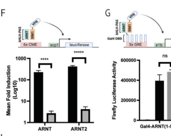

## Question

# Gene Research for Functional Annotation

## ⚠️ CRITICAL: Gene/Protein Identification Context

**BEFORE YOU BEGIN RESEARCH:** You MUST verify you are researching the CORRECT gene/protein. Gene symbols can be ambiguous, especially for less well-characterized genes from non-model organisms.

### Target Gene/Protein Identity (from UniProt):
- **UniProt Accession:** P81133
- **Protein Description:** RecName: Full=Single-minded homolog 1; AltName: Full=Class E basic helix-loop-helix protein 14; Short=bHLHe14;
- **Gene Information:** Name=SIM1; Synonyms=BHLHE14;
- **Organism (full):** Homo sapiens (Human).
- **Protein Family:** Not specified in UniProt
- **Key Domains:** bHLH_dom. (IPR011598); HLH_DNA-bd_sf. (IPR036638); PAC. (IPR001610); PAS. (IPR000014); PAS-like_dom_sf. (IPR035965)

### MANDATORY VERIFICATION STEPS:

1. **Check if the gene symbol "SIM1" matches the protein description above**
2. **Verify the organism is correct:** Homo sapiens (Human).
3. **Check if protein family/domains align with what you find in literature**
4. **If you find literature for a DIFFERENT gene with the same or similar symbol, STOP**

### If Gene Symbol is Ambiguous or You Cannot Find Relevant Literature:

**DO NOT PROCEED WITH RESEARCH ON A DIFFERENT GENE.** Instead:
- State clearly: "The gene symbol 'SIM1' is ambiguous or literature is limited for this specific protein"
- Explain what you found (e.g., "Found extensive literature on a different gene with the same symbol in a different organism")
- Describe the protein based ONLY on the UniProt information provided above
- Suggest that the protein function can be inferred from domain/family information

### Research Target:

Please provide a comprehensive research report on the gene **SIM1** (gene ID: SIM1, UniProt: P81133) in human.

The research report should be a detailed narrative explaining the function, biological processes, and localization of the gene product. Citations should be given for all claims.

You should prioritize authoritative reviews and primary scientific literature when conducting research. You can supplement
this with annotations you find in gene/protein databases, but these can be outdated or inaccurate.

We are specifically interested in the primary function of the gene - for enzymes, what reaction is catalyzed, and what is the substrate specificity? For transporters, what is the substrate? For structural proteins or adapters, what is the broader structural role? For signaling molecules, what is the role in the pathway.

We are interested in where in or outside the cell the gene product carries out its function.

We are also interested in the signaling or biochemical pathways in which the gene functions. We are less interested in broad pleiotropic effects, except where these elucidate the precise role.

Include evidence where possible. We are interested in both experimental evidence as well as inference from structure, evolution, or bioinformatic analysis. Precise studies should be prioritized over high-throughput, where available.

## Output

Question: You are an expert researcher providing comprehensive, well-cited information.

Provide detailed information focusing on:
1. Key concepts and definitions with current understanding
2. Recent developments and latest research (prioritize 2023-2024 sources)
3. Current applications and real-world implementations
4. Expert opinions and analysis from authoritative sources
5. Relevant statistics and data from recent studies

Format as a comprehensive research report with proper citations. Include URLs and publication dates where available.
Always prioritize recent, authoritative sources and provide specific citations for all major claims.

# Gene Research for Functional Annotation

## ⚠️ CRITICAL: Gene/Protein Identification Context

**BEFORE YOU BEGIN RESEARCH:** You MUST verify you are researching the CORRECT gene/protein. Gene symbols can be ambiguous, especially for less well-characterized genes from non-model organisms.

### Target Gene/Protein Identity (from UniProt):
- **UniProt Accession:** P81133
- **Protein Description:** RecName: Full=Single-minded homolog 1; AltName: Full=Class E basic helix-loop-helix protein 14; Short=bHLHe14;
- **Gene Information:** Name=SIM1; Synonyms=BHLHE14;
- **Organism (full):** Homo sapiens (Human).
- **Protein Family:** Not specified in UniProt
- **Key Domains:** bHLH_dom. (IPR011598); HLH_DNA-bd_sf. (IPR036638); PAC. (IPR001610); PAS. (IPR000014); PAS-like_dom_sf. (IPR035965)

### MANDATORY VERIFICATION STEPS:

1. **Check if the gene symbol "SIM1" matches the protein description above**
2. **Verify the organism is correct:** Homo sapiens (Human).
3. **Check if protein family/domains align with what you find in literature**
4. **If you find literature for a DIFFERENT gene with the same or similar symbol, STOP**

### If Gene Symbol is Ambiguous or You Cannot Find Relevant Literature:

**DO NOT PROCEED WITH RESEARCH ON A DIFFERENT GENE.** Instead:
- State clearly: "The gene symbol 'SIM1' is ambiguous or literature is limited for this specific protein"
- Explain what you found (e.g., "Found extensive literature on a different gene with the same symbol in a different organism")
- Describe the protein based ONLY on the UniProt information provided above
- Suggest that the protein function can be inferred from domain/family information

### Research Target:

Please provide a comprehensive research report on the gene **SIM1** (gene ID: SIM1, UniProt: P81133) in human.

The research report should be a detailed narrative explaining the function, biological processes, and localization of the gene product. Citations should be given for all claims.

You should prioritize authoritative reviews and primary scientific literature when conducting research. You can supplement
this with annotations you find in gene/protein databases, but these can be outdated or inaccurate.

We are specifically interested in the primary function of the gene - for enzymes, what reaction is catalyzed, and what is the substrate specificity? For transporters, what is the substrate? For structural proteins or adapters, what is the broader structural role? For signaling molecules, what is the role in the pathway.

We are interested in where in or outside the cell the gene product carries out its function.

We are also interested in the signaling or biochemical pathways in which the gene functions. We are less interested in broad pleiotropic effects, except where these elucidate the precise role.

Include evidence where possible. We are interested in both experimental evidence as well as inference from structure, evolution, or bioinformatic analysis. Precise studies should be prioritized over high-throughput, where available.

# Human SIM1 (UniProt P81133): functional annotation research report

**Identity verified.** The target is human **SIM1 (single-minded homolog 1)**, also designated **BHLHE14**, not its paralog SIM2. A primary study explicitly identifies the human SIM1 protein as **UniProt P81133** and uses full-length human SIM1 cDNA. Its basic helix–loop–helix (**bHLH**), PAS-A/PAS-B and associated PAC-domain architecture agrees with the supplied annotation. SIM1 is a **DNA-binding transcription factor**, not an enzyme, transporter or secreted signaling molecule. (ramachandrappa2013rarevariantsin pages 2-3, ramachandrappa2013rarevariantsin pages 7-8, mohammed2026novelsim1variants pages 2-3, liu2003identificationofthe pages 1-2)

## Primary molecular function and location

SIM1 regulates transcription principally as a heterodimer with **ARNT2**, a partner prominent in the nervous system; it can also function with **ARNT** in cellular assays. The N-terminal basic region recognizes DNA, the HLH and PAS regions contribute to heterodimer formation, and the C-terminal region modulates transcription. Whether SIM1 activates or represses a particular gene can depend on experimental and promoter context. Immunocytochemistry of expressed human SIM1 found the wild-type protein predominantly **in the nucleus**, the cellular compartment where its DNA-binding function occurs; this localization experiment was performed in cultured cells, not native human hypothalamic neurons. (ramachandrappa2013rarevariantsin pages 2-3, liu2003identificationofthe pages 1-2, ramachandrappa2013rarevariantsin pages 5-6)

Purified SIM1–ARNT2 preferentially recognizes **TACGTG-containing** DNA elements. A 2026 peer-reviewed biochemical study found that surrounding bases and DNA shape further influence specificity, helping distinguish SIM1–ARNT2 from other bHLH–PAS factors that recognize a similar core. Its analysis of the obesity-associated **SIM1 p.R171H** variant found impaired DNA-responsive reporter activity but preserved ARNT/ARNT2 association and dimerization-reporter activity. Importantly, purified wild-type and R171H complexes were **not distinguishable by the reported short- or long-probe electrophoretic mobility-shift assays**. The authors’ proposed defect in PAS-A-loop contacts with DNA or chromatin is therefore more specific than a claim that all intrinsic DNA binding is lost; some contacts are supported by structural modeling rather than a resolved SIM1–DNA structure. This study was received in **August 2024** but published in **January 2026**; it should not be counted as a 2024 publication. [Bersten et al., *Nucleic Acids Research*, January 2026](https://doi.org/10.1093/nar/gkaf1352). (bersten2026multimodalbhlhpasdna pages 1-2, bersten2026multimodalbhlhpasdna pages 7-9, bersten2026multimodalbhlhpasdna pages 11-12, bersten2026multimodalbhlhpasdna pages 12-15, bersten2026multimodalbhlhpasdna pages 15-16, bersten2026multimodalbhlhpasdna media 96596087)

## Biological processes and pathways

**Neuroendocrine hypothalamus development.** SIM1 activity is particularly important in the developing **paraventricular nucleus (PVN/PVH)**, **supraoptic nucleus** and **anterior periventricular region**. In *Sim1*-null mice, the PVN and supraoptic nucleus are hypocellular and neurosecretory populations marked by **oxytocin, vasopressin, corticotropin-releasing hormone, thyrotropin-releasing hormone and somatostatin** fail to develop normally; homozygotes die shortly after birth. These experiments establish a role in late differentiation and organization of neuroendocrine neurons, rather than indicating that SIM1 itself synthesizes or secretes those hormones. [Michaud et al., *Genes & Development*, October 1998](https://doi.org/10.1101/gad.12.20.3264). (michaud1998developmentofneuroendocrine pages 1-2)

A particularly well-supported developmental relationship is **SIM1–ARNT2 → BRN2/POU3F2 → neuroendocrine differentiation**: prospective neuroendocrine cells lose *Brn2* expression in *Sim1*- and *Arnt2*-deficient mice, and BRN2 is required for selected hormone-producing neuronal lineages. A neuronal-cell expression screen reported **268 candidate SIM1/ARNT2-responsive transcripts induced more than 1.7-fold**; *Jak2* and thyroid-hormone-receptor-β (*Thrb*, specifically the reported β2 form) also lost expression in the embryonic PVN of *Sim1* mutants. These results establish **downstream genetic dependence**, not direct SIM1 binding at each endogenous gene. Indeed, *Brn2* was not induced in that cell-line screen, illustrating the importance of cellular context. [Liu et al., *Journal of Biological Chemistry*, November 2003](https://doi.org/10.1074/jbc.M304489200). (liu2003identificationofthe pages 1-2, liu2003identificationofthe pages 11-11, liu2003identificationofthe pages 8-9)

**Maintenance of feeding circuits after development.** SIM1’s role is not solely embryonic. Postnatal conditional *Sim1* deletion in mice causes dosage-dependent **hyperphagia and obesity**, while substantially reducing hypothalamic *Oxt* and PVN *Mc4r* transcripts. Stereological counting and tract tracing in that study argued against global PVN neuron loss or loss of major examined projections as the explanation. Thus, SIM1 helps maintain the function of neuronal populations participating in the **leptin–melanocortin–oxytocin appetite-regulatory network**. Reduced *Oxt* or *Mc4r* expression does **not**, by itself, establish either as a directly bound SIM1 transcriptional target. [Tolson et al., *Journal of Neuroscience*, March 2010](https://doi.org/10.1523/JNEUROSCI.5444-09.2010). (tolson2010postnatalsim1deficiency pages 1-2, ramachandrappa2013rarevariantsin pages 6-7)

SIM1 should consequently be placed **within the transcriptional and developmental machinery of melanocortin-responsive hypothalamic neurons**, rather than described as the melanocortin receptor or as a simple, uniquely defined step downstream of MC4R. A 2021 mouse single-cell and genetic-intervention study found abnormal *Irx3/Irx5* expression in *Sim1*-haploinsufficient PVH cells. Reducing those genes’ dosage or deleting *Irx3* in the affected PVH lineage improved neuronal populations, melanocortin responsiveness and hyperphagia. This supports a mechanism involving altered **neuronal identity and activity**, but does not prove that human SIM1 directly represses *IRX3* or *IRX5*. [Son et al., *Science Advances*, October 2021](https://doi.org/10.1126/sciadv.abh4503). (son2021ectopicexpressionof pages 1-2, son2021ectopicexpressionof pages 6-7)

## Human evidence and developments in 2023–2024

The strongest human gene-specific evidence combines genetics with functional assays. Sequencing **2,100** individuals with severe early-onset obesity and **1,680** controls identified **13 heterozygous SIM1 variants in 28 unrelated affected individuals**; **nine of the 13** significantly reduced SIM1/ARNT2-dependent reporter activation. Carriers with impaired variants had greater measured test-meal intake, generally normal measured basal metabolic rate, and variable neurobehavioral and autonomic findings. Penetrance varied, and some identified variants also occurred in controls: *rarity alone is not proof of pathogenicity*. A second study found that three tested variants—p.T46R, p.H323Y and p.T714A—strongly reduced reporter activity and associated with obesity in families; its reported within-family odds ratios had wide confidence intervals. [Ramachandrappa et al., *Journal of Clinical Investigation*, July 2013](https://doi.org/10.1172/JCI68016); [Bonnefond et al., *Journal of Clinical Investigation*, July 2013](https://doi.org/10.1172/JCI68035). (bonnefond2013lossoffunctionmutationsin pages 1-2, ramachandrappa2013rarevariantsin pages 5-6, bonnefond2013lossoffunctionmutationsin pages 2-4, ramachandrappa2013rarevariantsin pages 1-2)

**2023:** Human **POU3F2/BRN2** variants were associated with hyperphagic obesity and neurodevelopmental phenotypes, with experimentally impaired DNA binding and promoter activation for many variants. This independently reinforces the clinical importance of a transcription factor placed **downstream of SIM1** by mouse developmental studies. It is evidence about **POU3F2**, however, not a new functional assay of human SIM1. [Schönauer et al., *American Journal of Human Genetics*, June 2023](https://doi.org/10.1016/j.ajhg.2023.04.010). (schonauer2023monoallelicintragenicpou3f2 pages 1-3, michaud1998developmentofneuroendocrine pages 1-2)

**2024:** Two rare autism-cohort variants in **hs576**, a neural enhancer associated with the SIM1 locus, reduced or eliminated activity of a matched reporter in several cranial nerves of embryonic mice. This suggests a potentially important *regulatory* route to altered SIM1-associated development, but **endogenous SIM1 expression was not shown to change**, and the authors lacked weight information for the relevant patients. The enhancer experiment therefore does not establish that these variants cause SIM1 deficiency, autism or obesity. [Shin et al., *Cell Genomics*, August 2024](https://doi.org/10.1016/j.xgen.2024.100609). (shin2024rarevariationin pages 1-2, shin2024rarevariationin pages 12-13, shin2024rarevariationin pages 10-12)

A 2024 overview of hypothalamic energy balance likewise identifies SIM1 as a PVH-developmental transcription factor implicated in severe monogenic obesity. It provides authoritative pathway context, but its SIM1 conclusions largely synthesize earlier functional research rather than report a new SIM1 mechanism. [Bombassaro et al., *Archives of Endocrinology and Metabolism*, November 2024](https://doi.org/10.20945/2359-4292-2024-0082). (bombassaro2024thehypothalamusas pages 4-5)

## Applications, translational status and limitations

**Current application is genetic interpretation**, particularly for severe early-onset hyperphagic obesity with possible developmental or behavioral features. Sequence findings should be evaluated alongside segregation, clinical phenotype and appropriately interpreted functional assays; a synthetic transcriptional reporter does not reproduce all native hypothalamic gene regulation. SIM1 also labels a heterogeneous neuronal lineage in experimental circuit studies, so manipulating “SIM1 neurons” does not automatically reveal a direct molecular action of the SIM1 protein. (ramachandrappa2013rarevariantsin pages 5-6, ramachandrappa2013rarevariantsin pages 6-7, son2021ectopicexpressionof pages 1-2)

**Restoring dosage is preclinical, not established care.** In *Sim1*-haploinsufficient mice, CRISPR-mediated activation of the intact allele through its promoter or an approximately **270-kb-distant hypothalamic enhancer** increased endogenous expression, reduced food intake and adiposity, and rescued obesity; postnatal hypothalamic viral delivery also worked in mice. This is a proof of principle, **not a human SIM1 gene therapy**. [Matharu et al., *Science*, January 2019](https://doi.org/10.1126/science.aau0629). (matharu2019crisprmediatedactivationof pages 1-3)

Similarly, **setmelanotide targets MC4R, not SIM1**. Clinical outcomes reported for other genetic deficiencies or acquired hypothalamic obesity must not be attributed to SIM1-deficient patients. A 2024 expert review explicitly noted the absence of an evidence-based SIM1-specific treatment; its discussion of oxytocin therapy was a hypothesis requiring testing in this genotype. [Fansa and Acosta, *Diabetes, Obesity and Metabolism*, 2024](https://doi.org/10.1111/dom.15555). (qamar2024setmelanotideamelanocortin4 pages 6-7, fansa2024themelanocortin‐4receptor pages 14-16)

**Bottom line:** Human SIM1/P81133 is predominantly a **nuclear bHLH–PAS transcriptional regulator**, working especially with ARNT2 to establish and sustain hypothalamic neuroendocrine and appetite-control programs. Human loss-of-function genetics and mouse deletion/rescue experiments strongly support the function; its **complete set of directly occupied human hypothalamic target genes remains unresolved**. (ramachandrappa2013rarevariantsin pages 7-8, liu2003identificationofthe pages 1-2, tolson2010postnatalsim1deficiency pages 1-2, matharu2019crisprmediatedactivationof pages 1-3, ramachandrappa2013rarevariantsin pages 6-7)

References

1. (ramachandrappa2013rarevariantsin pages 2-3): Shwetha Ramachandrappa, Anne Raimondo, Anna M.G. Cali, Julia M. Keogh, Elana Henning, Sadia Saeed, Amanda Thompson, Sumedha Garg, Elena G. Bochukova, Soren Brage, Victoria Trowse, Eleanor Wheeler, Adrienne E. Sullivan, Mehul Dattani, Peter E. Clayton, Vippan Datta, John B. Bruning, Nick J. Wareham, Stephen O’Rahilly, Daniel J. Peet, Ines Barroso, Murray L. Whitelaw, and I. Sadaf Farooqi. Rare variants in single-minded 1 (sim1) are associated with severe obesity. The Journal of clinical investigation, 123 7:3042-50, Jul 2013. URL: https://doi.org/10.1172/jci68016, doi:10.1172/jci68016. This article has 228 citations.

2. (ramachandrappa2013rarevariantsin pages 7-8): Shwetha Ramachandrappa, Anne Raimondo, Anna M.G. Cali, Julia M. Keogh, Elana Henning, Sadia Saeed, Amanda Thompson, Sumedha Garg, Elena G. Bochukova, Soren Brage, Victoria Trowse, Eleanor Wheeler, Adrienne E. Sullivan, Mehul Dattani, Peter E. Clayton, Vippan Datta, John B. Bruning, Nick J. Wareham, Stephen O’Rahilly, Daniel J. Peet, Ines Barroso, Murray L. Whitelaw, and I. Sadaf Farooqi. Rare variants in single-minded 1 (sim1) are associated with severe obesity. The Journal of clinical investigation, 123 7:3042-50, Jul 2013. URL: https://doi.org/10.1172/jci68016, doi:10.1172/jci68016. This article has 228 citations.

3. (mohammed2026novelsim1variants pages 2-3): Idris Mohammed, Wesam S. Ahmed, Tara Al-Barazenji, Hajar Dauleh, Donald R. Love, and Khalid Hussain. Novel sim1 variants expanding the spectrum of sim1-related obesity. International Journal of Molecular Sciences, 27:533, Jan 2026. URL: https://doi.org/10.3390/ijms27010533, doi:10.3390/ijms27010533. This article has 3 citations.

4. (liu2003identificationofthe pages 1-2): Chunqiao Liu, Eleni Goshu, Aynslee Wells, and Chen-Ming Fan. Identification of the downstream targets of sim1 and arnt2, a pair of transcription factors essential for neuroendocrine cell differentiation*. Journal of Biological Chemistry, 278:44857-44867, Nov 2003. URL: https://doi.org/10.1074/jbc.m304489200, doi:10.1074/jbc.m304489200. This article has 61 citations and is from a domain leading peer-reviewed journal.

5. (ramachandrappa2013rarevariantsin pages 5-6): Shwetha Ramachandrappa, Anne Raimondo, Anna M.G. Cali, Julia M. Keogh, Elana Henning, Sadia Saeed, Amanda Thompson, Sumedha Garg, Elena G. Bochukova, Soren Brage, Victoria Trowse, Eleanor Wheeler, Adrienne E. Sullivan, Mehul Dattani, Peter E. Clayton, Vippan Datta, John B. Bruning, Nick J. Wareham, Stephen O’Rahilly, Daniel J. Peet, Ines Barroso, Murray L. Whitelaw, and I. Sadaf Farooqi. Rare variants in single-minded 1 (sim1) are associated with severe obesity. The Journal of clinical investigation, 123 7:3042-50, Jul 2013. URL: https://doi.org/10.1172/jci68016, doi:10.1172/jci68016. This article has 228 citations.

6. (bersten2026multimodalbhlhpasdna pages 1-2): David C Bersten, Daniel P McDougal, Adrienne E Sullivan, Alexis Gerassimou, James Breen, Rebecca L Fitzsimmons, George E O Muscat, Stephen Pederson, John B Bruning, Chen-Ming Fan, Paul Q Thomas, Darryl L Russell, Daniel J Peet, and Murray L Whitelaw. Multimodal bhlh-pas dna binding controls specificity and drives obesity. Nucleic Acids Research, Jan 2026. URL: https://doi.org/10.1093/nar/gkaf1352, doi:10.1093/nar/gkaf1352. This article has 0 citations and is from a highest quality peer-reviewed journal.

7. (bersten2026multimodalbhlhpasdna pages 7-9): David C Bersten, Daniel P McDougal, Adrienne E Sullivan, Alexis Gerassimou, James Breen, Rebecca L Fitzsimmons, George E O Muscat, Stephen Pederson, John B Bruning, Chen-Ming Fan, Paul Q Thomas, Darryl L Russell, Daniel J Peet, and Murray L Whitelaw. Multimodal bhlh-pas dna binding controls specificity and drives obesity. Nucleic Acids Research, Jan 2026. URL: https://doi.org/10.1093/nar/gkaf1352, doi:10.1093/nar/gkaf1352. This article has 0 citations and is from a highest quality peer-reviewed journal.

8. (bersten2026multimodalbhlhpasdna pages 11-12): David C Bersten, Daniel P McDougal, Adrienne E Sullivan, Alexis Gerassimou, James Breen, Rebecca L Fitzsimmons, George E O Muscat, Stephen Pederson, John B Bruning, Chen-Ming Fan, Paul Q Thomas, Darryl L Russell, Daniel J Peet, and Murray L Whitelaw. Multimodal bhlh-pas dna binding controls specificity and drives obesity. Nucleic Acids Research, Jan 2026. URL: https://doi.org/10.1093/nar/gkaf1352, doi:10.1093/nar/gkaf1352. This article has 0 citations and is from a highest quality peer-reviewed journal.

9. (bersten2026multimodalbhlhpasdna pages 12-15): David C Bersten, Daniel P McDougal, Adrienne E Sullivan, Alexis Gerassimou, James Breen, Rebecca L Fitzsimmons, George E O Muscat, Stephen Pederson, John B Bruning, Chen-Ming Fan, Paul Q Thomas, Darryl L Russell, Daniel J Peet, and Murray L Whitelaw. Multimodal bhlh-pas dna binding controls specificity and drives obesity. Nucleic Acids Research, Jan 2026. URL: https://doi.org/10.1093/nar/gkaf1352, doi:10.1093/nar/gkaf1352. This article has 0 citations and is from a highest quality peer-reviewed journal.

10. (bersten2026multimodalbhlhpasdna pages 15-16): David C Bersten, Daniel P McDougal, Adrienne E Sullivan, Alexis Gerassimou, James Breen, Rebecca L Fitzsimmons, George E O Muscat, Stephen Pederson, John B Bruning, Chen-Ming Fan, Paul Q Thomas, Darryl L Russell, Daniel J Peet, and Murray L Whitelaw. Multimodal bhlh-pas dna binding controls specificity and drives obesity. Nucleic Acids Research, Jan 2026. URL: https://doi.org/10.1093/nar/gkaf1352, doi:10.1093/nar/gkaf1352. This article has 0 citations and is from a highest quality peer-reviewed journal.

11. (bersten2026multimodalbhlhpasdna media 96596087): David C Bersten, Daniel P McDougal, Adrienne E Sullivan, Alexis Gerassimou, James Breen, Rebecca L Fitzsimmons, George E O Muscat, Stephen Pederson, John B Bruning, Chen-Ming Fan, Paul Q Thomas, Darryl L Russell, Daniel J Peet, and Murray L Whitelaw. Multimodal bhlh-pas dna binding controls specificity and drives obesity. Nucleic Acids Research, Jan 2026. URL: https://doi.org/10.1093/nar/gkaf1352, doi:10.1093/nar/gkaf1352. This article has 0 citations and is from a highest quality peer-reviewed journal.

12. (michaud1998developmentofneuroendocrine pages 1-2): Jacques L. Michaud, Thomas Rosenquist, Noah R. May, and Chen-Ming Fan. Development of neuroendocrine lineages requires the bhlh-pas transcription factor sim1. Genes & development, 12 20:3264-75, Oct 1998. URL: https://doi.org/10.1101/gad.12.20.3264, doi:10.1101/gad.12.20.3264. This article has 460 citations and is from a highest quality peer-reviewed journal.

13. (liu2003identificationofthe pages 11-11): Chunqiao Liu, Eleni Goshu, Aynslee Wells, and Chen-Ming Fan. Identification of the downstream targets of sim1 and arnt2, a pair of transcription factors essential for neuroendocrine cell differentiation*. Journal of Biological Chemistry, 278:44857-44867, Nov 2003. URL: https://doi.org/10.1074/jbc.m304489200, doi:10.1074/jbc.m304489200. This article has 61 citations and is from a domain leading peer-reviewed journal.

14. (liu2003identificationofthe pages 8-9): Chunqiao Liu, Eleni Goshu, Aynslee Wells, and Chen-Ming Fan. Identification of the downstream targets of sim1 and arnt2, a pair of transcription factors essential for neuroendocrine cell differentiation*. Journal of Biological Chemistry, 278:44857-44867, Nov 2003. URL: https://doi.org/10.1074/jbc.m304489200, doi:10.1074/jbc.m304489200. This article has 61 citations and is from a domain leading peer-reviewed journal.

15. (tolson2010postnatalsim1deficiency pages 1-2): Kristen P. Tolson, Terry Gemelli, Laurent Gautron, Joel K. Elmquist, Andrew R. Zinn, and Bassil M. Kublaoui. Postnatal sim1 deficiency causes hyperphagic obesity and reduced mc4r and oxytocin expression. The Journal of Neuroscience, 30:3803-3812, Mar 2010. URL: https://doi.org/10.1523/jneurosci.5444-09.2010, doi:10.1523/jneurosci.5444-09.2010. This article has 191 citations.

16. (ramachandrappa2013rarevariantsin pages 6-7): Shwetha Ramachandrappa, Anne Raimondo, Anna M.G. Cali, Julia M. Keogh, Elana Henning, Sadia Saeed, Amanda Thompson, Sumedha Garg, Elena G. Bochukova, Soren Brage, Victoria Trowse, Eleanor Wheeler, Adrienne E. Sullivan, Mehul Dattani, Peter E. Clayton, Vippan Datta, John B. Bruning, Nick J. Wareham, Stephen O’Rahilly, Daniel J. Peet, Ines Barroso, Murray L. Whitelaw, and I. Sadaf Farooqi. Rare variants in single-minded 1 (sim1) are associated with severe obesity. The Journal of clinical investigation, 123 7:3042-50, Jul 2013. URL: https://doi.org/10.1172/jci68016, doi:10.1172/jci68016. This article has 228 citations.

17. (son2021ectopicexpressionof pages 1-2): Joe Eun Son, Zhengchao Dou, Siyi Wanggou, Jade Chan, Rong Mo, Xuejun Li, Xi Huang, Kyoung-Han Kim, Jacques L. Michaud, and Chi-chung Hui. Ectopic expression of <i>irx3</i> and <i>irx5</i> in the paraventricular nucleus of the hypothalamus contributes to defects in <i>sim1</i> haploinsufficiency. Science Advances, Oct 2021. URL: https://doi.org/10.1126/sciadv.abh4503, doi:10.1126/sciadv.abh4503. This article has 12 citations and is from a highest quality peer-reviewed journal.

18. (son2021ectopicexpressionof pages 6-7): Joe Eun Son, Zhengchao Dou, Siyi Wanggou, Jade Chan, Rong Mo, Xuejun Li, Xi Huang, Kyoung-Han Kim, Jacques L. Michaud, and Chi-chung Hui. Ectopic expression of <i>irx3</i> and <i>irx5</i> in the paraventricular nucleus of the hypothalamus contributes to defects in <i>sim1</i> haploinsufficiency. Science Advances, Oct 2021. URL: https://doi.org/10.1126/sciadv.abh4503, doi:10.1126/sciadv.abh4503. This article has 12 citations and is from a highest quality peer-reviewed journal.

19. (bonnefond2013lossoffunctionmutationsin pages 1-2): Amélie Bonnefond, Anne Raimondo, Fanny Stutzmann, Maya Ghoussaini, Shwetha Ramachandrappa, David C. Bersten, Emmanuelle Durand, Vincent Vatin, Beverley Balkau, Olivier Lantieri, Violeta Raverdy, François Pattou, Wim Van Hul, Luc Van Gaal, Daniel J. Peet, Jacques Weill, Jennifer L. Miller, Fritz Horber, Anthony P. Goldstone, Daniel J. Driscoll, John B. Bruning, David Meyre, Murray L. Whitelaw, and Philippe Froguel. Loss-of-function mutations in sim1 contribute to obesity and prader-willi-like features. The Journal of clinical investigation, 123 7:3037-41, Jul 2013. URL: https://doi.org/10.1172/jci68035, doi:10.1172/jci68035. This article has 218 citations.

20. (bonnefond2013lossoffunctionmutationsin pages 2-4): Amélie Bonnefond, Anne Raimondo, Fanny Stutzmann, Maya Ghoussaini, Shwetha Ramachandrappa, David C. Bersten, Emmanuelle Durand, Vincent Vatin, Beverley Balkau, Olivier Lantieri, Violeta Raverdy, François Pattou, Wim Van Hul, Luc Van Gaal, Daniel J. Peet, Jacques Weill, Jennifer L. Miller, Fritz Horber, Anthony P. Goldstone, Daniel J. Driscoll, John B. Bruning, David Meyre, Murray L. Whitelaw, and Philippe Froguel. Loss-of-function mutations in sim1 contribute to obesity and prader-willi-like features. The Journal of clinical investigation, 123 7:3037-41, Jul 2013. URL: https://doi.org/10.1172/jci68035, doi:10.1172/jci68035. This article has 218 citations.

21. (ramachandrappa2013rarevariantsin pages 1-2): Shwetha Ramachandrappa, Anne Raimondo, Anna M.G. Cali, Julia M. Keogh, Elana Henning, Sadia Saeed, Amanda Thompson, Sumedha Garg, Elena G. Bochukova, Soren Brage, Victoria Trowse, Eleanor Wheeler, Adrienne E. Sullivan, Mehul Dattani, Peter E. Clayton, Vippan Datta, John B. Bruning, Nick J. Wareham, Stephen O’Rahilly, Daniel J. Peet, Ines Barroso, Murray L. Whitelaw, and I. Sadaf Farooqi. Rare variants in single-minded 1 (sim1) are associated with severe obesity. The Journal of clinical investigation, 123 7:3042-50, Jul 2013. URL: https://doi.org/10.1172/jci68016, doi:10.1172/jci68016. This article has 228 citations.

22. (schonauer2023monoallelicintragenicpou3f2 pages 1-3): Ria Schönauer, Wenjun Jin, Christin Findeisen, Irene Valenzuela, Laura Alice Devlin, Jill Murrell, Emma C. Bedoukian, Linda Pöschla, Elena Hantmann, Korbinian M. Riedhammer, Julia Hoefele, Konrad Platzer, Ronald Biemann, Philipp M. Campeau, Johannes Münch, Henrike Heyne, Anne Hoffmann, Adhideb Ghosh, Wenfei Sun, Hua Dong, Falko Noé, Christian Wolfrum, Emily Woods, Michael J. Parker, Ruxandra Neatu, Gwenael Le Guyader, Ange-Line Bruel, Laurence Perrin, Helena Spiewak, Isabelle Missotte, Melanie Fourgeaud, Vincent Michaud, Didier Lacombe, Sarah A. Paolucci, Jillian G. Buchan, Margaret Glissmeyer, Bernt Popp, Matthias Blüher, John A. Sayer, and Jan Halbritter. Monoallelic intragenic pou3f2 variants lead to neurodevelopmental delay and hyperphagic obesity, confirming the gene’s candidacy in 6q16.1 deletions. The American Journal of Human Genetics, 110:998-1007, Jun 2023. URL: https://doi.org/10.1016/j.ajhg.2023.04.010, doi:10.1016/j.ajhg.2023.04.010. This article has 11 citations.

23. (shin2024rarevariationin pages 1-2): Taehwan Shin, J. H. Song, Michael Kosicki, Connor J Kenny, Samantha G. Beck, Lily Kelley, Irene Antony, Xuyu Qian, Julieta Bonacina, Frances Papandile, Dilenny M. Gonzalez, Julia Scotellaro, Evan M. Bushinsky, Rebecca E. Andersen, Eduardo A. Maury, Len A. Pennacchio, Ryan N. Doan, and Christopher A. Walsh. Rare variation in non-coding regions with evolutionary signatures contributes to autism spectrum disorder risk. Cell Genomics, 4:100609, Aug 2024. URL: https://doi.org/10.1016/j.xgen.2024.100609, doi:10.1016/j.xgen.2024.100609. This article has 44 citations and is from a peer-reviewed journal.

24. (shin2024rarevariationin pages 12-13): Taehwan Shin, J. H. Song, Michael Kosicki, Connor J Kenny, Samantha G. Beck, Lily Kelley, Irene Antony, Xuyu Qian, Julieta Bonacina, Frances Papandile, Dilenny M. Gonzalez, Julia Scotellaro, Evan M. Bushinsky, Rebecca E. Andersen, Eduardo A. Maury, Len A. Pennacchio, Ryan N. Doan, and Christopher A. Walsh. Rare variation in non-coding regions with evolutionary signatures contributes to autism spectrum disorder risk. Cell Genomics, 4:100609, Aug 2024. URL: https://doi.org/10.1016/j.xgen.2024.100609, doi:10.1016/j.xgen.2024.100609. This article has 44 citations and is from a peer-reviewed journal.

25. (shin2024rarevariationin pages 10-12): Taehwan Shin, J. H. Song, Michael Kosicki, Connor J Kenny, Samantha G. Beck, Lily Kelley, Irene Antony, Xuyu Qian, Julieta Bonacina, Frances Papandile, Dilenny M. Gonzalez, Julia Scotellaro, Evan M. Bushinsky, Rebecca E. Andersen, Eduardo A. Maury, Len A. Pennacchio, Ryan N. Doan, and Christopher A. Walsh. Rare variation in non-coding regions with evolutionary signatures contributes to autism spectrum disorder risk. Cell Genomics, 4:100609, Aug 2024. URL: https://doi.org/10.1016/j.xgen.2024.100609, doi:10.1016/j.xgen.2024.100609. This article has 44 citations and is from a peer-reviewed journal.

26. (bombassaro2024thehypothalamusas pages 4-5): Bruna Bombassaro, Eliana P. Araujo, and Licio A. Velloso. The hypothalamus as the central regulator of energy balance and its impact on current and future obesity treatments. Archives of Endocrinology and Metabolism, Nov 2024. URL: https://doi.org/10.20945/2359-4292-2024-0082, doi:10.20945/2359-4292-2024-0082. This article has 25 citations.

27. (matharu2019crisprmediatedactivationof pages 1-3): Navneet Matharu, Sawitree Rattanasopha, Serena Tamura, Lenka Maliskova, Yi Wang, Adelaide Bernard, Aaron Hardin, Walter L. Eckalbar, Christian Vaisse, and Nadav Ahituv. Crispr-mediated activation of a promoter or enhancer rescues obesity caused by haploinsufficiency. Science, Jan 2019. URL: https://doi.org/10.1126/science.aau0629, doi:10.1126/science.aau0629. This article has 415 citations and is from a highest quality peer-reviewed journal.

28. (qamar2024setmelanotideamelanocortin4 pages 6-7): Sulmaaz Qamar, Ritwika Mallik, and Janine Makaronidis. Setmelanotide: a melanocortin-4 receptor agonist for the treatment of severe obesity due to hypothalamic dysfunction. touchREVIEWS in Endocrinology, Oct 2024. URL: https://doi.org/10.17925/ee.2024.20.2.9, doi:10.17925/ee.2024.20.2.9. This article has 16 citations.

29. (fansa2024themelanocortin‐4receptor pages 14-16): Sima Fansa and Andres Acosta. The melanocortin‐4 receptor pathway and the emergence of precision medicine in obesity management. Diabetes, 26:46-63, Mar 2024. URL: https://doi.org/10.1111/dom.15555, doi:10.1111/dom.15555. This article has 19 citations and is from a highest quality peer-reviewed journal.

## Artifacts

- [Edison artifact artifact-00](SIM1-deep-research-falcon_artifacts/artifact-00.md)

## Citations

1. michaud1998developmentofneuroendocrine pages 1-2
2. bombassaro2024thehypothalamusas pages 4-5
3. matharu2019crisprmediatedactivationof pages 1-3
4. ramachandrappa2013rarevariantsin pages 2-3
5. ramachandrappa2013rarevariantsin pages 7-8
6. liu2003identificationofthe pages 1-2
7. ramachandrappa2013rarevariantsin pages 5-6
8. bersten2026multimodalbhlhpasdna pages 1-2
9. bersten2026multimodalbhlhpasdna pages 7-9
10. bersten2026multimodalbhlhpasdna pages 11-12
11. bersten2026multimodalbhlhpasdna pages 12-15
12. bersten2026multimodalbhlhpasdna pages 15-16
13. liu2003identificationofthe pages 11-11
14. liu2003identificationofthe pages 8-9
15. ramachandrappa2013rarevariantsin pages 6-7
16. son2021ectopicexpressionof pages 1-2
17. son2021ectopicexpressionof pages 6-7
18. bonnefond2013lossoffunctionmutationsin pages 1-2
19. bonnefond2013lossoffunctionmutationsin pages 2-4
20. ramachandrappa2013rarevariantsin pages 1-2
21. shin2024rarevariationin pages 1-2
22. shin2024rarevariationin pages 12-13
23. shin2024rarevariationin pages 10-12
24. Bersten et al., *Nucleic Acids Research*, January 2026
25. Michaud et al., *Genes & Development*, October 1998
26. Liu et al., *Journal of Biological Chemistry*, November 2003
27. Tolson et al., *Journal of Neuroscience*, March 2010
28. Son et al., *Science Advances*, October 2021
29. Ramachandrappa et al., *Journal of Clinical Investigation*, July 2013
30. Bonnefond et al., *Journal of Clinical Investigation*, July 2013
31. Schönauer et al., *American Journal of Human Genetics*, June 2023
32. Shin et al., *Cell Genomics*, August 2024
33. Bombassaro et al., *Archives of Endocrinology and Metabolism*, November 2024
34. Matharu et al., *Science*, January 2019
35. Fansa and Acosta, *Diabetes, Obesity and Metabolism*, 2024
36. https://doi.org/10.1093/nar/gkaf1352
37. https://doi.org/10.1101/gad.12.20.3264
38. https://doi.org/10.1074/jbc.M304489200
39. https://doi.org/10.1523/JNEUROSCI.5444-09.2010
40. https://doi.org/10.1126/sciadv.abh4503
41. https://doi.org/10.1172/JCI68016
42. https://doi.org/10.1172/JCI68035
43. https://doi.org/10.1016/j.ajhg.2023.04.010
44. https://doi.org/10.1016/j.xgen.2024.100609
45. https://doi.org/10.20945/2359-4292-2024-0082
46. https://doi.org/10.1126/science.aau0629
47. https://doi.org/10.1111/dom.15555
48. https://doi.org/10.1172/jci68016,
49. https://doi.org/10.3390/ijms27010533,
50. https://doi.org/10.1074/jbc.m304489200,
51. https://doi.org/10.1093/nar/gkaf1352,
52. https://doi.org/10.1101/gad.12.20.3264,
53. https://doi.org/10.1523/jneurosci.5444-09.2010,
54. https://doi.org/10.1126/sciadv.abh4503,
55. https://doi.org/10.1172/jci68035,
56. https://doi.org/10.1016/j.ajhg.2023.04.010,
57. https://doi.org/10.1016/j.xgen.2024.100609,
58. https://doi.org/10.20945/2359-4292-2024-0082,
59. https://doi.org/10.1126/science.aau0629,
60. https://doi.org/10.17925/ee.2024.20.2.9,
61. https://doi.org/10.1111/dom.15555,