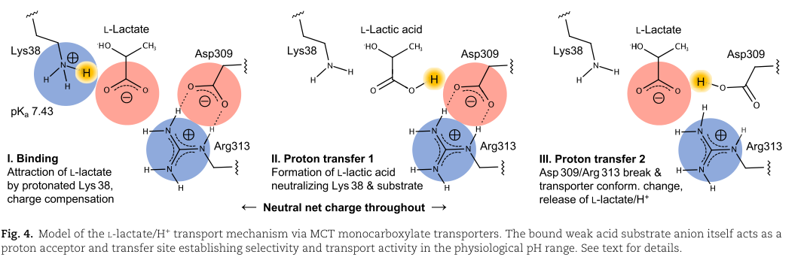

## Question

# Gene Research for Functional Annotation

## ⚠️ CRITICAL: Gene/Protein Identification Context

**BEFORE YOU BEGIN RESEARCH:** You MUST verify you are researching the CORRECT gene/protein. Gene symbols can be ambiguous, especially for less well-characterized genes from non-model organisms.

### Target Gene/Protein Identity (from UniProt):
- **UniProt Accession:** P53985
- **Protein Description:** RecName: Full=Monocarboxylate transporter 1 {ECO:0000303|PubMed:7835905}; Short=MCT 1; AltName: Full=Solute carrier family 16 member 1;
- **Gene Information:** Name=SLC16A1 {ECO:0000312|HGNC:HGNC:10922}; Synonyms=MCT1;
- **Organism (full):** Homo sapiens (Human).
- **Protein Family:** Belongs to the major facilitator superfamily.
- **Key Domains:** MCT. (IPR004743); MFS. (IPR011701); MFS_dom. (IPR020846); MFS_trans_sf. (IPR036259); Proton-linked_MCT. (IPR050327)

### MANDATORY VERIFICATION STEPS:

1. **Check if the gene symbol "SLC16A1" matches the protein description above**
2. **Verify the organism is correct:** Homo sapiens (Human).
3. **Check if protein family/domains align with what you find in literature**
4. **If you find literature for a DIFFERENT gene with the same or similar symbol, STOP**

### If Gene Symbol is Ambiguous or You Cannot Find Relevant Literature:

**DO NOT PROCEED WITH RESEARCH ON A DIFFERENT GENE.** Instead:
- State clearly: "The gene symbol 'SLC16A1' is ambiguous or literature is limited for this specific protein"
- Explain what you found (e.g., "Found extensive literature on a different gene with the same symbol in a different organism")
- Describe the protein based ONLY on the UniProt information provided above
- Suggest that the protein function can be inferred from domain/family information

### Research Target:

Please provide a comprehensive research report on the gene **SLC16A1** (gene ID: SLC16A1, UniProt: P53985) in human.

The research report should be a detailed narrative explaining the function, biological processes, and localization of the gene product. Citations should be given for all claims.

You should prioritize authoritative reviews and primary scientific literature when conducting research. You can supplement
this with annotations you find in gene/protein databases, but these can be outdated or inaccurate.

We are specifically interested in the primary function of the gene - for enzymes, what reaction is catalyzed, and what is the substrate specificity? For transporters, what is the substrate? For structural proteins or adapters, what is the broader structural role? For signaling molecules, what is the role in the pathway.

We are interested in where in or outside the cell the gene product carries out its function.

We are also interested in the signaling or biochemical pathways in which the gene functions. We are less interested in broad pleiotropic effects, except where these elucidate the precise role.

Include evidence where possible. We are interested in both experimental evidence as well as inference from structure, evolution, or bioinformatic analysis. Precise studies should be prioritized over high-throughput, where available.

## Output

Question: You are an expert researcher providing comprehensive, well-cited information.

Provide detailed information focusing on:
1. Key concepts and definitions with current understanding
2. Recent developments and latest research (prioritize 2023-2024 sources)
3. Current applications and real-world implementations
4. Expert opinions and analysis from authoritative sources
5. Relevant statistics and data from recent studies

Format as a comprehensive research report with proper citations. Include URLs and publication dates where available.
Always prioritize recent, authoritative sources and provide specific citations for all major claims.

# Gene Research for Functional Annotation

## ⚠️ CRITICAL: Gene/Protein Identification Context

**BEFORE YOU BEGIN RESEARCH:** You MUST verify you are researching the CORRECT gene/protein. Gene symbols can be ambiguous, especially for less well-characterized genes from non-model organisms.

### Target Gene/Protein Identity (from UniProt):
- **UniProt Accession:** P53985
- **Protein Description:** RecName: Full=Monocarboxylate transporter 1 {ECO:0000303|PubMed:7835905}; Short=MCT 1; AltName: Full=Solute carrier family 16 member 1;
- **Gene Information:** Name=SLC16A1 {ECO:0000312|HGNC:HGNC:10922}; Synonyms=MCT1;
- **Organism (full):** Homo sapiens (Human).
- **Protein Family:** Belongs to the major facilitator superfamily.
- **Key Domains:** MCT. (IPR004743); MFS. (IPR011701); MFS_dom. (IPR020846); MFS_trans_sf. (IPR036259); Proton-linked_MCT. (IPR050327)

### MANDATORY VERIFICATION STEPS:

1. **Check if the gene symbol "SLC16A1" matches the protein description above**
2. **Verify the organism is correct:** Homo sapiens (Human).
3. **Check if protein family/domains align with what you find in literature**
4. **If you find literature for a DIFFERENT gene with the same or similar symbol, STOP**

### If Gene Symbol is Ambiguous or You Cannot Find Relevant Literature:

**DO NOT PROCEED WITH RESEARCH ON A DIFFERENT GENE.** Instead:
- State clearly: "The gene symbol 'SLC16A1' is ambiguous or literature is limited for this specific protein"
- Explain what you found (e.g., "Found extensive literature on a different gene with the same symbol in a different organism")
- Describe the protein based ONLY on the UniProt information provided above
- Suggest that the protein function can be inferred from domain/family information

### Research Target:

Please provide a comprehensive research report on the gene **SLC16A1** (gene ID: SLC16A1, UniProt: P53985) in human.

The research report should be a detailed narrative explaining the function, biological processes, and localization of the gene product. Citations should be given for all claims.

You should prioritize authoritative reviews and primary scientific literature when conducting research. You can supplement
this with annotations you find in gene/protein databases, but these can be outdated or inaccurate.

We are specifically interested in the primary function of the gene - for enzymes, what reaction is catalyzed, and what is the substrate specificity? For transporters, what is the substrate? For structural proteins or adapters, what is the broader structural role? For signaling molecules, what is the role in the pathway.

We are interested in where in or outside the cell the gene product carries out its function.

We are also interested in the signaling or biochemical pathways in which the gene functions. We are less interested in broad pleiotropic effects, except where these elucidate the precise role.

Include evidence where possible. We are interested in both experimental evidence as well as inference from structure, evolution, or bioinformatic analysis. Precise studies should be prioritized over high-throughput, where available.

# Human SLC16A1 (MCT1): functional-annotation research report

**Identity verification.** The target is **human SLC16A1**, encoding **monocarboxylate transporter 1 (MCT1; UniProt P53985)**—not MCT2/SLC16A7, MCT4/SLC16A3, or another similarly named transporter. The supplied UniProt accession and major facilitator superfamily (MFS) domain annotation agree with the literature’s identification of MCT1 as a 500-amino-acid, 12-transmembrane-helix member of the SLC16 family. Although the family contains 14 members, only MCT1–MCT4 are the established proton-coupled lactate-transporting subgroup. (seka2024thenterminalsignature pages 1-2, koltai2024exploringmonocarboxylatetransporter pages 3-6, geistlinger2023humanmonocarboxylatetransporters pages 1-2, hasselt2014monocarboxylatetransporter1 pages 1-2)

## Primary molecular function and substrate specificity

MCT1’s principal established function is **reversible transport of monocarboxylates across membranes, coupled to proton movement**. Its major physiological substrate is **L-lactate**; **pyruvate**, the ketone bodies **β-hydroxybutyrate and acetoacetate**, and short-chain fatty acids including **butyrate** are additional substrates. Transport of one monocarboxylate anion with one H⁺ is effectively electroneutral and does not directly consume ATP. Net import or export depends on substrate and proton gradients, rather than MCT1 having an intrinsically fixed direction. Consequently, it can clear lactate and acid from glycolytic cells or import lactate into cells that oxidize it. Unlike MCT1, sodium-coupled SLC5A8 is a different transporter family. (koltai2024exploringmonocarboxylatetransporter pages 1-3, geistlinger2023humanmonocarboxylatetransporters pages 1-2, seka2024thenterminalsignature pages 1-2, stanescu2022mitochondrialbioenergeticis pages 1-2, rae2024brainenergymetabolism pages 13-15, sivaprakasam2018shortchainfattyacid pages 1-3)

The substrate assignment has experimental specificity. In a **2023 study of recombinant human MCT1** expressed in yeast lacking endogenous lactate transporters, the measured L-lactate *K*m was **2.32 ± 0.36 mM at pH 6.8**, versus **19.2 ± 4.1 mM at pH 7.8**. The apparent affinity is therefore assay- and pH-dependent, not a universal tissue constant. L-lactamide did not compete or undergo detectable transport; glycerol and L-proline were likewise excluded in the reported assays. An intestinal study’s literature review describes approximately **10-fold preference for L- over D-lactate**. (geistlinger2023humanmonocarboxylatetransporters pages 2-3, geistlinger2023humanmonocarboxylatetransporters pages 3-5, wang2024intestinalmonocarboxylatetransporter pages 1-2)

**Structural mechanism.** Cryo-electron-microscopy structures and functional work support *alternating access*: movements of the transporter’s two six-helix bundles alternately expose the central substrate site to extracellular and cytosolic solution. A 2023 mutagenesis, pH-titration, kinetic and heavy-water study implicates **Lys38, Asp309 and Arg313**. It proposes that lactate binds near protonated Lys38, temporarily accepts its proton, then relays it toward Asp309; disruption of the Asp309–Arg313 interaction permits the conformational transition. The residue-level proton relay is a **well-supported model, not direct visualization of each proton-transfer event**. Figure 4 in that study depicts the proposed sequence. (koltai2024exploringmonocarboxylatetransporter pages 3-6, geistlinger2023humanmonocarboxylatetransporters pages 2-3, geistlinger2023humanmonocarboxylatetransporters pages 5-6, geistlinger2023humanmonocarboxylatetransporters media 343d30ec)

## Localization and molecular partners

**The established site of action is the plasma membrane**, where MCT1 links cytosolic metabolism to extracellular fluid, blood or an adjacent cell. The single-pass accessory protein **basigin/CD147 (BSG)** is its usual trafficking partner; **embigin/GP70** can support MCT1 surface localization in some contexts. A **2024 human-cell study** found that MCT1 expressed alone was largely retained intracellularly, whereas co-expression with CD147 promoted surface localization. Mutations **G19C or W20A** in MCT1’s N-terminal signature region impaired complex stability, localization and substrate flux; CD147 increased MCT1’s measured thermal-aggregation temperature from approximately **60.5°C to 67.3°C** in that experimental system. Accessory proteins can also alter measured transport: a separate reconstituted-system study attributed a **4.5-fold** increase in intracellular lactate accumulation to basigin’s extracellular domain. (seka2024thenterminalsignature pages 1-2, seka2024thenterminalsignature pages 2-4, seka2024thenterminalsignature pages 4-7, kopnick2021basigindrivesintracellular pages 1-2)

Expression and membrane position vary with the tissue. MCT1 supports lactate exchange in **heart and oxidative skeletal muscle**, lactate efflux in **erythrocytes**, and monocarboxylate movement at the **intestinal epithelium**. It has been reported at both apical and basolateral colonic epithelial membranes, compatible with uptake from the lumen and transfer toward portal blood, although reviewers caution that the precise apical–basolateral distribution varies across studies. In the CNS, evidence places MCT1 in **oligodendroglia and myelin facing the periaxonal space**; MCT1-mediated lactate release can help supply axons, which also express other monocarboxylate transporters. MCT1 is normally **repressed in pancreatic β cells**, a localization exception with direct disease relevance. (wang2024intestinalmonocarboxylatetransporter pages 1-2, rae2024brainenergymetabolism pages 15-16, sivaprakasam2018shortchainfattyacid pages 4-6, sivaprakasam2018shortchainfattyacid pages 1-3, hasselt2014monocarboxylatetransporter1 pages 1-2, leon2024internationalguidelinesfor pages 5-6)

A **2024 bioRxiv preprint** additionally detected MCT1 in purified human cardiac mitochondrial preparations and proposed an inner-mitochondrial-membrane pool, supported by mouse cardiac localization and isotope-tracing experiments. Because that report was **not peer reviewed** and mitochondrial MCT1 localization remains debated, it should be recorded as a **proposed additional localization**, not substituted for the established plasma-membrane annotation. (cluntun2024directmitochondrialimport pages 4-7, cluntun2024directmitochondrialimport pages 53-55)

## Biochemical pathways and physiological roles

MCT1 connects **glycolysis to oxidative metabolism**. Lactate dehydrogenase generates lactate from pyruvate during glycolytic flux; MCT1 can export the resulting lactate/H⁺ to maintain intracellular acid–base balance. Elsewhere, MCT1-dependent uptake makes extracellular lactate available for conversion back to pyruvate and subsequent tricarboxylic-acid-cycle oxidation. Lactate can also serve as a gluconeogenic precursor in the liver, while MCT1-mediated ketone-body delivery supports extrahepatic fuel use during fasting or illness. These are roles in **metabolite transport**: MCT1 does not itself catalyze lactate–pyruvate interconversion or the mitochondrial TCA reactions. (koltai2024exploringmonocarboxylatetransporter pages 1-3, koltai2024exploringmonocarboxylatetransporter pages 3-6, zhang2024lactatetransportedby pages 1-2, hasselt2014monocarboxylatetransporter1 pages 1-2, hasselt2014monocarboxylatetransporter1 pages 4-5)

Recent tissue-specific work emphasizes that physiological direction and consequences depend on context. In a **June 2024 *Science Advances* study**, mouse skeletal-muscle *Slc16a1* deletion reduced the contribution of circulating lactate to muscle metabolites but increased glucose-derived TCA labeling, oxidative-fiber markers, mitochondrial measures and treadmill endurance; maximal grip strength fell. In murine myotubes, MCT1 inhibition increased intracellular and decreased extracellular lactate, and extended measured **PGC-1α protein half-life from 10.6 to 19.6 hours**, alongside changes in NAD⁺/SIRT1-associated regulation. These are **adaptive effects of mouse gene deletion or murine-cell inhibition**, not evidence that inhibiting MCT1 improves human athletic performance. (zhang2024lactatetransportedby pages 3-6, zhang2024lactatetransportedby pages 6-8, zhang2024lactatetransportedby pages 8-11)

An intestinal epithelial *Slc16a1* knockout study, available online in **November 2023** and published in a **2024** journal volume, found reduced intestinal-interstitial and portal-vein lactate in **male mice**, and reduced portal **butyrate and pentanoate** after an inulin challenge. Glucose-tolerance and inflammatory phenotypes differed markedly by sex. This supports intestinal monocarboxylate transfer while cautioning against assuming identical effects in humans. (wang2024intestinalmonocarboxylatetransporter pages 1-2, wang2024intestinalmonocarboxylatetransporter pages 9-11)

In the brain, MCT1-dependent exchange is mechanistically plausible and oligodendrocyte-to-axon metabolic support has experimental backing. Nevertheless, the broader proposition that a single **astrocyte-to-neuron lactate shuttle** dominates adult brain fuel supply remains contested: authors of a **2024 multi-author neurochemistry roadmap** emphasize limited convincing *in vivo* evidence for that universal interpretation and the possibility of flux in either direction. Likewise, lactate can signal through the separate receptor **HCAR1/GPR81** or influence lactylation, but neither makes MCT1 itself a lactate receptor or a lactylating enzyme. (rae2024brainenergymetabolism pages 15-16, rae2024brainenergymetabolism pages 13-15, bartoloni2024themultipleroles pages 4-5)

## Human genetic evidence and applications

**Loss of transporter function: recurrent ketoacidosis.** In a **November 2014 *New England Journal of Medicine* study**, sequencing an index case and investigating **96 patients** with otherwise unexplained suspected ketone-utilization defects identified **nine affected people carrying damaging SLC16A1 variants: three homozygous and six heterozygous**. Protein measurements and erythrocyte lactate-efflux tests showed dosage-related impairment. Episodes were typically precipitated by fasting or infection, consistent with inadequate delivery of ketone bodies to extrahepatic tissues. This is evidence of a **transport defect**, not a mutation of a ketolysis enzyme. A **2022** case report extended the reported phenotype to severe neurologic and lactic-acidosis features in one patient, which should not be assumed present in every case. (hasselt2014monocarboxylatetransporter1 pages 1-2, hasselt2014monocarboxylatetransporter1 pages 2-4, hasselt2014monocarboxylatetransporter1 pages 4-5, stanescu2022mitochondrialbioenergeticis pages 1-2)

**Inappropriate β-cell expression: exercise-induced hyperinsulinism.** The contrasting mechanism is **regulatory gain of expression**: promoter variants prevent the normal silencing of SLC16A1 in β cells. Pyruvate generated during anaerobic exercise can then enter β cells and provoke inappropriate insulin release and hypoglycemia. **International hyperinsulinism guidelines published in 2023 and available in a 2024 volume** recognize this characteristic phenotype and recommend broad genetic evaluation where indicated. A **December 2025, non-peer-reviewed medRxiv preprint** reported a 94-bp promoter deletion in **37 individuals from 11 families**, elevated MCT1 in affected pancreatic tissue and pyruvate-stimulated insulin release from patient-derived islet grafts. Its larger cohort and mechanistic results are promising but remain preliminary. (fisel2018clinicalandfunctional pages 4-5, leon2024internationalguidelinesfor pages 5-6, bennett2025a94bpdeletion pages 1-3)

**Oncology drug development.** MCT1 can support lactate export from glycolytic cancer cells and lactate uptake by more oxidative cells. The oral inhibitor **AZD3965** was evaluated in the registered phase-I trial **[NCT01791595](https://clinicaltrials.gov/study/NCT01791595)**. Its **2023** published dose-escalation analysis included **40 treated patients**; **seven** experienced dose-limiting toxicities at daily doses of at least 20 mg, including **five ocular events, one grade-3 troponin rise and one grade-3 acidosis**. The recommended dose was **10 mg twice daily**. Among **39 patients with a baseline disease assessment, nine (23.1%) had stable disease**; the study did not establish objective antitumor efficacy. MCT4 co-expression can bypass MCT1 inhibition in preclinical systems, which motivates interest in MCT1-high/MCT4-low tumors. **AZD3965 is investigational, not an established cancer treatment.** (halford2023aphasei pages 1-3, halford2023aphasei pages 3-4, halford2023aphasei pages 10-11, NCT01791595 chunk 1)

The accompanying matrix separates direct observations from model-based interpretations and preliminary findings.

| Molecular function/context | Best direct study and year | Observed result | Important evidence limitation |
|---|---|---|---|
| Proton-coupled L-lactate transport | Geistlinger et al., 2023, https://doi.org/10.1093/pnasnexus/pgad007 | Recombinant human MCT1 had lactate Km 2.32±0.36 mM pH 6.8. Mutagenesis, pH dependence and isotope effects supported a model in which bound lactate relays a proton from Lys38 toward Asp309, disrupting the Asp309–Arg313 salt bridge and initiating alternating access. (geistlinger2023humanmonocarboxylatetransporters pages 3-5, geistlinger2023humanmonocarboxylatetransporters pages 5-6) | Kinetics were measured in engineered yeast; the complete proton-transfer sequence is a data-supported mechanistic model rather than direct visualization of every transfer step. |
| Plasma-membrane trafficking by CD147/basigin | Seka et al., 2024, https://doi.org/10.1016/j.jbc.2024.107333 | In human-cell expression experiments, MCT1 required CD147 for efficient plasma-membrane localization. Co-expression with CD147 stabilized human MCT1 by approximately +7 °C; G19C and W20A impaired complex stability, surface localization and substrate flux. (seka2024thenterminalsignature pages 1-2, seka2024thenterminalsignature pages 2-4, seka2024thenterminalsignature pages 4-7) | Overexpression and mutagenesis establish trafficking requirements but do not quantify endogenous tissue-specific complex abundance. Embigin/GP70 can substitute in some cellular contexts. |
| Ketone-body delivery and inherited MCT1 deficiency | van Hasselt et al., 2014, https://doi.org/10.1056/NEJMoa1407778 | Among 96 patients investigated for unexplained ketoacidosis, the study identified 9 patients—3 biallelic and 6 monoallelic—with damaging SLC16A1 variants. Protein abundance and erythrocyte lactate transport were lowest in biallelic cases, supporting dosage-sensitive MCT1 deficiency and impaired extrahepatic ketone delivery. (hasselt2014monocarboxylatetransporter1 pages 1-2, hasselt2014monocarboxylatetransporter1 pages 2-4, hasselt2014monocarboxylatetransporter1 pages 4-5) | This rare-disease cohort was small, and the functional assay measured erythrocyte lactate efflux rather than ketone transport directly in every affected tissue. |
| Pharmacological MCT1 inhibition in cancer | Halford et al., 2023, https://doi.org/10.1158/1078-0432.CCR-22-2263; trial NCT01791595 | In phase-I dose escalation, 40 patients received AZD3965. Seven patients at ≥20 mg/day had dose-limiting toxicities; among 39 patients with baseline assessment, 9/39 had stable disease and no objective response was reported. The recommended phase-II dose was 10 mg twice daily. (halford2023aphasei pages 1-3, halford2023aphasei pages 10-11) | Non-randomized dose escalation was designed primarily for safety, not efficacy. Ocular, cardiac and acid–base effects were consistent with on-target inhibition; MCT4 co-expression may confer resistance. |
| Skeletal-muscle lactate flux and metabolic adaptation | Zhang et al., 2024, https://doi.org/10.1126/sciadv.adn4508 | In muscle-specific Slc16a1-knockout mice, loss of MCT1 altered circulating-to-muscle lactate contribution, shifted fibers toward oxidative types and increased running endurance. Genetic loss or AZD3965 treatment increased mitochondrial proteins, respiration and PGC-1α stability; in C2C12 cells, PGC-1α half-life increased from 10.6 to 19.6 hours. (zhang2024lactatetransportedby pages 3-6, zhang2024lactatetransportedby pages 1-2, zhang2024lactatetransportedby pages 6-8, zhang2024lactatetransportedby pages 8-11) | These are mouse and murine-cell results, not human intervention data. Because MCT1 is bidirectional, the adaptive phenotype should not be attributed exclusively to impaired lactate uptake or efflux. |
| Intestinal lactate and short-chain-fatty-acid transport | Wang et al., 2024, https://doi.org/10.1093/lifemeta/load041 | Intestinal-epithelial Slc16a1 deletion in male mice reduced intestinal interstitial and portal-vein lactate and reduced portal butyrate and pentanoate after substrate challenge; glucose tolerance, inflammation and microbiota changed in a sex-dependent manner. (wang2024intestinalmonocarboxylatetransporter pages 1-2, wang2024intestinalmonocarboxylatetransporter pages 9-11) | This was a conditional mouse study. Strong male–female divergence cautions against direct extrapolation to human intestinal physiology or treatment. |
| Proposed cardiac mitochondrial lactate import | Cluntun et al., 2024 bioRxiv, https://doi.org/10.1101/2024.10.07.617073 | MCT1 was detected in purified human cardiac mitochondrial preparations; mouse cardiomyocyte localization, protease protection, knockout and isotope-tracing experiments supported a proposed inner-mitochondrial-membrane role in lactate oxidation. (cluntun2024directmitochondrialimport pages 4-7) | Preliminary, non-peer-reviewed evidence; mitochondrial MCT1 localization and mitochondrial lactate oxidation remain controversial and should not replace the established plasma-membrane annotation. |

*Table: Direct functional, genetic and translational evidence for human SLC16A1/MCT1 (P53985), with species and evidentiary limitations made explicit.*

**Annotation conclusion.** The highest-confidence assignment for human **SLC16A1/P53985** is a **basigin-associated, principally plasma-membrane, proton-coupled transporter of L-lactate and other monocarboxylates**. Its immediate biochemical consequences are metabolite exchange and coupled acid movement; tissue-specific metabolic adaptation, receptor-mediated lactate signaling and proposed mitochondrial transport should be annotated separately at their respective levels of evidence. (geistlinger2023humanmonocarboxylatetransporters pages 1-2, seka2024thenterminalsignature pages 1-2, rae2024brainenergymetabolism pages 13-15, cluntun2024directmitochondrialimport pages 4-7)

**Principal sources and publication dates:** Geistlinger *et al.*, *PNAS Nexus*, **18 January 2023**, https://doi.org/10.1093/pnasnexus/pgad007; Seka *et al.*, *Journal of Biological Chemistry*, **22 May 2024** online, https://doi.org/10.1016/j.jbc.2024.107333; Zhang *et al.*, *Science Advances*, **26 June 2024**, https://doi.org/10.1126/sciadv.adn4508; van Hasselt *et al.*, *NEJM*, **13 November 2014**, https://doi.org/10.1056/NEJMoa1407778; Halford *et al.*, *Clinical Cancer Research*, **2023**, https://doi.org/10.1158/1078-0432.CCR-22-2263; Rae *et al.*, *Journal of Neurochemistry*, **2024**, https://doi.org/10.1111/jnc.16032. (geistlinger2023humanmonocarboxylatetransporters pages 1-2, seka2024thenterminalsignature pages 1-2, zhang2024lactatetransportedby pages 1-2, hasselt2014monocarboxylatetransporter1 pages 1-2, halford2023aphasei pages 1-3, rae2024brainenergymetabolism pages 1-3)

References

1. (seka2024thenterminalsignature pages 1-2): Devin J. Seka, Annika K. Schulz, Tarjani M. Thaker, and Thomas M. Tomasiak. The n-terminal signature motif on the transporter mct1 is critical for cd147-mediated trafficking. Journal of Biological Chemistry, 300:107333, Jun 2024. URL: https://doi.org/10.1016/j.jbc.2024.107333, doi:10.1016/j.jbc.2024.107333. This article has 6 citations and is from a domain leading peer-reviewed journal.

2. (koltai2024exploringmonocarboxylatetransporter pages 3-6): Tomas Koltai and Larry Fliegel. Exploring monocarboxylate transporter inhibition for cancer treatment. Exploration of Targeted Anti-tumor Therapy, 5:135-169, Feb 2024. URL: https://doi.org/10.37349/etat.2024.00210, doi:10.37349/etat.2024.00210. This article has 37 citations.

3. (geistlinger2023humanmonocarboxylatetransporters pages 1-2): Katharina Geistlinger, Jana D R Schmidt, and Eric Beitz. Human monocarboxylate transporters accept and relay protons via the bound substrate for selectivity and activity at physiological ph. PNAS Nexus, Jan 2023. URL: https://doi.org/10.1093/pnasnexus/pgad007, doi:10.1093/pnasnexus/pgad007. This article has 24 citations and is from a peer-reviewed journal.

4. (hasselt2014monocarboxylatetransporter1 pages 1-2): Peter M. van Hasselt, Sacha Ferdinandusse, Glen R. Monroe, Jos P.N. Ruiter, Marjolein Turkenburg, Maartje J. Geerlings, Karen Duran, Magdalena Harakalova, Bert van der Zwaag, Ardeshir A. Monavari, Ilyas Okur, Mark J. Sharrard, Maureen Cleary, Nuala O’Connell, Valerie Walker, M. Estela Rubio-Gozalbo, Maaike C. de Vries, Gepke Visser, Roderick H.J. Houwen, Jasper J. van der Smagt, Nanda M. Verhoeven-Duif, Ronald J.A. Wanders, and Gijs van Haaften. Monocarboxylate transporter 1 deficiency and ketone utilization. New England Journal of Medicine, 371:1900-1907, Nov 2014. URL: https://doi.org/10.1056/nejmoa1407778, doi:10.1056/nejmoa1407778. This article has 144 citations and is from a highest quality peer-reviewed journal.

5. (koltai2024exploringmonocarboxylatetransporter pages 1-3): Tomas Koltai and Larry Fliegel. Exploring monocarboxylate transporter inhibition for cancer treatment. Exploration of Targeted Anti-tumor Therapy, 5:135-169, Feb 2024. URL: https://doi.org/10.37349/etat.2024.00210, doi:10.37349/etat.2024.00210. This article has 37 citations.

6. (stanescu2022mitochondrialbioenergeticis pages 1-2): Sinziana Stanescu, Irene Bravo-Alonso, Amaya Belanger-Quintana, Belen Pérez, Montserrat Medina-Diaz, Pedro Ruiz-Sala, Nathaly Paola Flores, Raquel Buenache, Francisco Arrieta, and Pilar Rodríguez-Pombo. Mitochondrial bioenergetic is impaired in monocarboxylate transporter 1 deficiency: a new clinical case and review of the literature. Orphanet Journal of Rare Diseases, Jun 2022. URL: https://doi.org/10.1186/s13023-022-02389-4, doi:10.1186/s13023-022-02389-4. This article has 6 citations and is from a peer-reviewed journal.

7. (rae2024brainenergymetabolism pages 13-15): Caroline D. Rae, Joseph A. Baur, Karin Borges, Gerald Dienel, Carlos Manlio Díaz‐García, Starlette R. Douglass, Kelly Drew, João M. N. Duarte, Jordi Duran, Oliver Kann, Tibor Kristian, Dasfne Lee‐Liu, Britta E. Lindquist, Ewan C. McNay, Michael B. Robinson, Douglas L. Rothman, Benjamin D. Rowlands, Timothy A. Ryan, Joseph Scafidi, Susanna Scafidi, C. William Shuttleworth, Raymond A. Swanson, Gökhan Uruk, Nina Vardjan, Robert Zorec, and Mary C. McKenna. Brain energy metabolism: a roadmap for future research. Journal of neurochemistry, 168:910-954, Jan 2024. URL: https://doi.org/10.1111/jnc.16032, doi:10.1111/jnc.16032. This article has 132 citations and is from a domain leading peer-reviewed journal.

8. (sivaprakasam2018shortchainfattyacid pages 1-3): Sathish Sivaprakasam, Yangzom D. Bhutia, Shengping Yang, and Vadivel Ganapathy. Short-chain fatty acid transporters: role in colonic homeostasis. Comprehensive Physiology, 8 1:299-314, Dec 2018. URL: https://doi.org/10.1002/cphy.c170014, doi:10.1002/cphy.c170014. This article has 397 citations and is from a peer-reviewed journal.

9. (geistlinger2023humanmonocarboxylatetransporters pages 2-3): Katharina Geistlinger, Jana D R Schmidt, and Eric Beitz. Human monocarboxylate transporters accept and relay protons via the bound substrate for selectivity and activity at physiological ph. PNAS Nexus, Jan 2023. URL: https://doi.org/10.1093/pnasnexus/pgad007, doi:10.1093/pnasnexus/pgad007. This article has 24 citations and is from a peer-reviewed journal.

10. (geistlinger2023humanmonocarboxylatetransporters pages 3-5): Katharina Geistlinger, Jana D R Schmidt, and Eric Beitz. Human monocarboxylate transporters accept and relay protons via the bound substrate for selectivity and activity at physiological ph. PNAS Nexus, Jan 2023. URL: https://doi.org/10.1093/pnasnexus/pgad007, doi:10.1093/pnasnexus/pgad007. This article has 24 citations and is from a peer-reviewed journal.

11. (wang2024intestinalmonocarboxylatetransporter pages 1-2): Shuo Wang, Lingling Zhang, Jingyu Zhao, Meijuan Bai, Yijun Lin, Qianqian Chu, Jue Gong, Ju Qiu, and Yan Chen. Intestinal monocarboxylate transporter 1 mediates lactate transport in the gut and regulates metabolic homeostasis of mouse in a sex-dimorphic pattern. Life Metabolism, Nov 2024. URL: https://doi.org/10.1093/lifemeta/load041, doi:10.1093/lifemeta/load041. This article has 15 citations.

12. (geistlinger2023humanmonocarboxylatetransporters pages 5-6): Katharina Geistlinger, Jana D R Schmidt, and Eric Beitz. Human monocarboxylate transporters accept and relay protons via the bound substrate for selectivity and activity at physiological ph. PNAS Nexus, Jan 2023. URL: https://doi.org/10.1093/pnasnexus/pgad007, doi:10.1093/pnasnexus/pgad007. This article has 24 citations and is from a peer-reviewed journal.

13. (geistlinger2023humanmonocarboxylatetransporters media 343d30ec): Katharina Geistlinger, Jana D R Schmidt, and Eric Beitz. Human monocarboxylate transporters accept and relay protons via the bound substrate for selectivity and activity at physiological ph. PNAS Nexus, Jan 2023. URL: https://doi.org/10.1093/pnasnexus/pgad007, doi:10.1093/pnasnexus/pgad007. This article has 24 citations and is from a peer-reviewed journal.

14. (seka2024thenterminalsignature pages 2-4): Devin J. Seka, Annika K. Schulz, Tarjani M. Thaker, and Thomas M. Tomasiak. The n-terminal signature motif on the transporter mct1 is critical for cd147-mediated trafficking. Journal of Biological Chemistry, 300:107333, Jun 2024. URL: https://doi.org/10.1016/j.jbc.2024.107333, doi:10.1016/j.jbc.2024.107333. This article has 6 citations and is from a domain leading peer-reviewed journal.

15. (seka2024thenterminalsignature pages 4-7): Devin J. Seka, Annika K. Schulz, Tarjani M. Thaker, and Thomas M. Tomasiak. The n-terminal signature motif on the transporter mct1 is critical for cd147-mediated trafficking. Journal of Biological Chemistry, 300:107333, Jun 2024. URL: https://doi.org/10.1016/j.jbc.2024.107333, doi:10.1016/j.jbc.2024.107333. This article has 6 citations and is from a domain leading peer-reviewed journal.

16. (kopnick2021basigindrivesintracellular pages 1-2): Anna-Lena Köpnick, Annika Jansen, Katharina Geistlinger, Nathan Hugo Epalle, and Eric Beitz. Basigin drives intracellular accumulation of l-lactate by harvesting protons and substrate anions. PLoS ONE, 16:e0249110, Mar 2021. URL: https://doi.org/10.1371/journal.pone.0249110, doi:10.1371/journal.pone.0249110. This article has 34 citations and is from a peer-reviewed journal.

17. (rae2024brainenergymetabolism pages 15-16): Caroline D. Rae, Joseph A. Baur, Karin Borges, Gerald Dienel, Carlos Manlio Díaz‐García, Starlette R. Douglass, Kelly Drew, João M. N. Duarte, Jordi Duran, Oliver Kann, Tibor Kristian, Dasfne Lee‐Liu, Britta E. Lindquist, Ewan C. McNay, Michael B. Robinson, Douglas L. Rothman, Benjamin D. Rowlands, Timothy A. Ryan, Joseph Scafidi, Susanna Scafidi, C. William Shuttleworth, Raymond A. Swanson, Gökhan Uruk, Nina Vardjan, Robert Zorec, and Mary C. McKenna. Brain energy metabolism: a roadmap for future research. Journal of neurochemistry, 168:910-954, Jan 2024. URL: https://doi.org/10.1111/jnc.16032, doi:10.1111/jnc.16032. This article has 132 citations and is from a domain leading peer-reviewed journal.

18. (sivaprakasam2018shortchainfattyacid pages 4-6): Sathish Sivaprakasam, Yangzom D. Bhutia, Shengping Yang, and Vadivel Ganapathy. Short-chain fatty acid transporters: role in colonic homeostasis. Comprehensive Physiology, 8 1:299-314, Dec 2018. URL: https://doi.org/10.1002/cphy.c170014, doi:10.1002/cphy.c170014. This article has 397 citations and is from a peer-reviewed journal.

19. (leon2024internationalguidelinesfor pages 5-6): Diva D. De Leon, Jean Baptiste Arnoux, Indraneel Banerjee, Ignacio Bergada, Tricia Bhatti, Louise S. Conwell, Junfen Fu, Sarah E. Flanagan, David Gillis, Thomas Meissner, Klaus Mohnike, Tai L.S. Pasquini, Pratik Shah, Charles A. Stanley, Adrian Vella, Tohru Yorifuji, and Paul S. Thornton. International guidelines for the diagnosis and management of hyperinsulinism. Hormone Research in Paediatrics, 97:279-298, Jul 2023. URL: https://doi.org/10.1159/000531766, doi:10.1159/000531766. This article has 115 citations and is from a peer-reviewed journal.

20. (cluntun2024directmitochondrialimport pages 4-7): Ahmad A. Cluntun, Joseph R. Visker, Jesse N. Velasco-Silva, Marisa J. Lang, Luis Cedeño-Rosario, Thirupura S. Shankar, Rana Hamouche, Jing Ling, Ji Eon Kim, Ashish G. Toshniwal, Hayden K. Low, Corey N. Cunningham, James Carrington, Jonathan Leon Catrow, Quentinn Pearce, Mi-Young Jeong, Alex J. Bott, Álvaro J. Narbona-Pérez, Claire E. Stanley, Qing Li, David R. Eberhardt, Jeffrey T. Morgan, Tarun Yadav, Chloe E. Wells, Dinesh K. A. Ramadurai, Wojciech I. Swiatek, Dipayan Chaudhuri, Jeffery D. Rothstein, Deborah M. Muoio, Joao A. Paulo, Steven P. Gygi, Steven A. Baker, Sutip Navankasattusas, James E. Cox, Katsuhiko Funai, Stavros G. Drakos, Jared Rutter, and Gregory S. Ducker. Direct mitochondrial import of lactate supports resilient carbohydrate oxidation. bioRxiv, Oct 2024. URL: https://doi.org/10.1101/2024.10.07.617073, doi:10.1101/2024.10.07.617073. This article has 15 citations.

21. (cluntun2024directmitochondrialimport pages 53-55): Ahmad A. Cluntun, Joseph R. Visker, Jesse N. Velasco-Silva, Marisa J. Lang, Luis Cedeño-Rosario, Thirupura S. Shankar, Rana Hamouche, Jing Ling, Ji Eon Kim, Ashish G. Toshniwal, Hayden K. Low, Corey N. Cunningham, James Carrington, Jonathan Leon Catrow, Quentinn Pearce, Mi-Young Jeong, Alex J. Bott, Álvaro J. Narbona-Pérez, Claire E. Stanley, Qing Li, David R. Eberhardt, Jeffrey T. Morgan, Tarun Yadav, Chloe E. Wells, Dinesh K. A. Ramadurai, Wojciech I. Swiatek, Dipayan Chaudhuri, Jeffery D. Rothstein, Deborah M. Muoio, Joao A. Paulo, Steven P. Gygi, Steven A. Baker, Sutip Navankasattusas, James E. Cox, Katsuhiko Funai, Stavros G. Drakos, Jared Rutter, and Gregory S. Ducker. Direct mitochondrial import of lactate supports resilient carbohydrate oxidation. bioRxiv, Oct 2024. URL: https://doi.org/10.1101/2024.10.07.617073, doi:10.1101/2024.10.07.617073. This article has 15 citations.

22. (zhang2024lactatetransportedby pages 1-2): Lingling Zhang, Chenhao Xin, Shuo Wang, Shixuan Zhuo, Jing Zhu, Zixuan Li, Yuyi Liu, Lifeng Yang, and Yan Chen. Lactate transported by mct1 plays an active role in promoting mitochondrial biogenesis and enhancing tca flux in skeletal muscle. Science Advances, Jun 2024. URL: https://doi.org/10.1126/sciadv.adn4508, doi:10.1126/sciadv.adn4508. This article has 130 citations and is from a highest quality peer-reviewed journal.

23. (hasselt2014monocarboxylatetransporter1 pages 4-5): Peter M. van Hasselt, Sacha Ferdinandusse, Glen R. Monroe, Jos P.N. Ruiter, Marjolein Turkenburg, Maartje J. Geerlings, Karen Duran, Magdalena Harakalova, Bert van der Zwaag, Ardeshir A. Monavari, Ilyas Okur, Mark J. Sharrard, Maureen Cleary, Nuala O’Connell, Valerie Walker, M. Estela Rubio-Gozalbo, Maaike C. de Vries, Gepke Visser, Roderick H.J. Houwen, Jasper J. van der Smagt, Nanda M. Verhoeven-Duif, Ronald J.A. Wanders, and Gijs van Haaften. Monocarboxylate transporter 1 deficiency and ketone utilization. New England Journal of Medicine, 371:1900-1907, Nov 2014. URL: https://doi.org/10.1056/nejmoa1407778, doi:10.1056/nejmoa1407778. This article has 144 citations and is from a highest quality peer-reviewed journal.

24. (zhang2024lactatetransportedby pages 3-6): Lingling Zhang, Chenhao Xin, Shuo Wang, Shixuan Zhuo, Jing Zhu, Zixuan Li, Yuyi Liu, Lifeng Yang, and Yan Chen. Lactate transported by mct1 plays an active role in promoting mitochondrial biogenesis and enhancing tca flux in skeletal muscle. Science Advances, Jun 2024. URL: https://doi.org/10.1126/sciadv.adn4508, doi:10.1126/sciadv.adn4508. This article has 130 citations and is from a highest quality peer-reviewed journal.

25. (zhang2024lactatetransportedby pages 6-8): Lingling Zhang, Chenhao Xin, Shuo Wang, Shixuan Zhuo, Jing Zhu, Zixuan Li, Yuyi Liu, Lifeng Yang, and Yan Chen. Lactate transported by mct1 plays an active role in promoting mitochondrial biogenesis and enhancing tca flux in skeletal muscle. Science Advances, Jun 2024. URL: https://doi.org/10.1126/sciadv.adn4508, doi:10.1126/sciadv.adn4508. This article has 130 citations and is from a highest quality peer-reviewed journal.

26. (zhang2024lactatetransportedby pages 8-11): Lingling Zhang, Chenhao Xin, Shuo Wang, Shixuan Zhuo, Jing Zhu, Zixuan Li, Yuyi Liu, Lifeng Yang, and Yan Chen. Lactate transported by mct1 plays an active role in promoting mitochondrial biogenesis and enhancing tca flux in skeletal muscle. Science Advances, Jun 2024. URL: https://doi.org/10.1126/sciadv.adn4508, doi:10.1126/sciadv.adn4508. This article has 130 citations and is from a highest quality peer-reviewed journal.

27. (wang2024intestinalmonocarboxylatetransporter pages 9-11): Shuo Wang, Lingling Zhang, Jingyu Zhao, Meijuan Bai, Yijun Lin, Qianqian Chu, Jue Gong, Ju Qiu, and Yan Chen. Intestinal monocarboxylate transporter 1 mediates lactate transport in the gut and regulates metabolic homeostasis of mouse in a sex-dimorphic pattern. Life Metabolism, Nov 2024. URL: https://doi.org/10.1093/lifemeta/load041, doi:10.1093/lifemeta/load041. This article has 15 citations.

28. (bartoloni2024themultipleroles pages 4-5): Bianca Bartoloni, Michele Mannelli, Tania Gamberi, and Tania Fiaschi. The multiple roles of lactate in the skeletal muscle. Cells, 13:1177, Jul 2024. URL: https://doi.org/10.3390/cells13141177, doi:10.3390/cells13141177. This article has 77 citations.

29. (hasselt2014monocarboxylatetransporter1 pages 2-4): Peter M. van Hasselt, Sacha Ferdinandusse, Glen R. Monroe, Jos P.N. Ruiter, Marjolein Turkenburg, Maartje J. Geerlings, Karen Duran, Magdalena Harakalova, Bert van der Zwaag, Ardeshir A. Monavari, Ilyas Okur, Mark J. Sharrard, Maureen Cleary, Nuala O’Connell, Valerie Walker, M. Estela Rubio-Gozalbo, Maaike C. de Vries, Gepke Visser, Roderick H.J. Houwen, Jasper J. van der Smagt, Nanda M. Verhoeven-Duif, Ronald J.A. Wanders, and Gijs van Haaften. Monocarboxylate transporter 1 deficiency and ketone utilization. New England Journal of Medicine, 371:1900-1907, Nov 2014. URL: https://doi.org/10.1056/nejmoa1407778, doi:10.1056/nejmoa1407778. This article has 144 citations and is from a highest quality peer-reviewed journal.

30. (fisel2018clinicalandfunctional pages 4-5): Pascale Fisel, Elke Schaeffeler, and Matthias Schwab. Clinical and functional relevance of the monocarboxylate transporter family in disease pathophysiology and drug therapy. Clinical and Translational Science, 11:352-364, Apr 2018. URL: https://doi.org/10.1111/cts.12551, doi:10.1111/cts.12551. This article has 154 citations.

31. (bennett2025a94bpdeletion pages 1-3): Jasmin J. Bennett, Hazem Ibrahim, Jonna M E Männistö, Martina Timonen, Jessica R. Hopkinson, Jonna Saarimäki-Vire, Michaelis Vasiliadis, Muhammad Faiz Muhamad, Cécile Saint-Martin, Jean-Baptiste Arnoux, Orla Neylon, Julie Okiro, Jayne A. L. Houghton, Matthew N. Wakeling, Thomas W. Laver, Matthew B. Johnson, Andrew T. Hattersley, Solja Eurola, Eliisa Vähäkangas, Hossam Montaser, Kristen Neville, Sue Mei Lau, Elizabeth Palmer, Colm Costigan, Patrick Divilly, Rachel K. Crowley, Niall Swan, James Gibney, Donal O’Shea, Yusof Rahman, Lisa G. Riley, Diego Balboa, Nick D. L. Owens, Timo Otonkoski, and Sarah E. Flanagan. A 94-bp deletion in the promoter of the beta-cell disallowed gene <i>slc16a1</i> causing adult-onset hyperinsulinism. Unknown journal, Dec 2025. URL: https://doi.org/10.64898/2025.12.16.25342131, doi:10.64898/2025.12.16.25342131.

32. (halford2023aphasei pages 1-3): Sarah Halford, Gareth J. Veal, Stephen R. Wedge, Geoffrey S. Payne, Chris M. Bacon, Philip Sloan, Ilaria Dragoni, Kathrin Heinzmann, Sarah Potter, Becky M. Salisbury, Maxime Chénard-Poirier, Alastair Greystoke, Elizabeth C. Howell, William A. Innes, Karen Morris, Chris Plummer, Mihaela Rata, George Petrides, Hector C. Keun, Udai Banerji, and Ruth Plummer. A phase i dose-escalation study of azd3965, an oral monocarboxylate transporter 1 inhibitor, in patients with advanced cancer. Clinical cancer research : an official journal of the American Association for Cancer Research, 29:1429-1439, Jan 2023. URL: https://doi.org/10.1158/1078-0432.ccr-22-2263, doi:10.1158/1078-0432.ccr-22-2263. This article has 335 citations.

33. (halford2023aphasei pages 3-4): Sarah Halford, Gareth J. Veal, Stephen R. Wedge, Geoffrey S. Payne, Chris M. Bacon, Philip Sloan, Ilaria Dragoni, Kathrin Heinzmann, Sarah Potter, Becky M. Salisbury, Maxime Chénard-Poirier, Alastair Greystoke, Elizabeth C. Howell, William A. Innes, Karen Morris, Chris Plummer, Mihaela Rata, George Petrides, Hector C. Keun, Udai Banerji, and Ruth Plummer. A phase i dose-escalation study of azd3965, an oral monocarboxylate transporter 1 inhibitor, in patients with advanced cancer. Clinical cancer research : an official journal of the American Association for Cancer Research, 29:1429-1439, Jan 2023. URL: https://doi.org/10.1158/1078-0432.ccr-22-2263, doi:10.1158/1078-0432.ccr-22-2263. This article has 335 citations.

34. (halford2023aphasei pages 10-11): Sarah Halford, Gareth J. Veal, Stephen R. Wedge, Geoffrey S. Payne, Chris M. Bacon, Philip Sloan, Ilaria Dragoni, Kathrin Heinzmann, Sarah Potter, Becky M. Salisbury, Maxime Chénard-Poirier, Alastair Greystoke, Elizabeth C. Howell, William A. Innes, Karen Morris, Chris Plummer, Mihaela Rata, George Petrides, Hector C. Keun, Udai Banerji, and Ruth Plummer. A phase i dose-escalation study of azd3965, an oral monocarboxylate transporter 1 inhibitor, in patients with advanced cancer. Clinical cancer research : an official journal of the American Association for Cancer Research, 29:1429-1439, Jan 2023. URL: https://doi.org/10.1158/1078-0432.ccr-22-2263, doi:10.1158/1078-0432.ccr-22-2263. This article has 335 citations.

35. (NCT01791595 chunk 1):  A Phase I Trial of AZD3965 in Patients With Advanced Cancer. Cancer Research UK. 2013. ClinicalTrials.gov Identifier: NCT01791595

36. (rae2024brainenergymetabolism pages 1-3): Caroline D. Rae, Joseph A. Baur, Karin Borges, Gerald Dienel, Carlos Manlio Díaz‐García, Starlette R. Douglass, Kelly Drew, João M. N. Duarte, Jordi Duran, Oliver Kann, Tibor Kristian, Dasfne Lee‐Liu, Britta E. Lindquist, Ewan C. McNay, Michael B. Robinson, Douglas L. Rothman, Benjamin D. Rowlands, Timothy A. Ryan, Joseph Scafidi, Susanna Scafidi, C. William Shuttleworth, Raymond A. Swanson, Gökhan Uruk, Nina Vardjan, Robert Zorec, and Mary C. McKenna. Brain energy metabolism: a roadmap for future research. Journal of neurochemistry, 168:910-954, Jan 2024. URL: https://doi.org/10.1111/jnc.16032, doi:10.1111/jnc.16032. This article has 132 citations and is from a domain leading peer-reviewed journal.

## Artifacts

- [Edison artifact artifact-00](SLC16A1-deep-research-falcon_artifacts/artifact-00.md)

## Citations

1. cluntun2024directmitochondrialimport pages 4-7
2. seka2024thenterminalsignature pages 1-2
3. koltai2024exploringmonocarboxylatetransporter pages 3-6
4. geistlinger2023humanmonocarboxylatetransporters pages 1-2
5. koltai2024exploringmonocarboxylatetransporter pages 1-3
6. stanescu2022mitochondrialbioenergeticis pages 1-2
7. rae2024brainenergymetabolism pages 13-15
8. sivaprakasam2018shortchainfattyacid pages 1-3
9. geistlinger2023humanmonocarboxylatetransporters pages 2-3
10. geistlinger2023humanmonocarboxylatetransporters pages 3-5
11. wang2024intestinalmonocarboxylatetransporter pages 1-2
12. geistlinger2023humanmonocarboxylatetransporters pages 5-6
13. seka2024thenterminalsignature pages 2-4
14. seka2024thenterminalsignature pages 4-7
15. kopnick2021basigindrivesintracellular pages 1-2
16. rae2024brainenergymetabolism pages 15-16
17. sivaprakasam2018shortchainfattyacid pages 4-6
18. leon2024internationalguidelinesfor pages 5-6
19. cluntun2024directmitochondrialimport pages 53-55
20. zhang2024lactatetransportedby pages 1-2
21. zhang2024lactatetransportedby pages 3-6
22. zhang2024lactatetransportedby pages 6-8
23. zhang2024lactatetransportedby pages 8-11
24. wang2024intestinalmonocarboxylatetransporter pages 9-11
25. bartoloni2024themultipleroles pages 4-5
26. fisel2018clinicalandfunctional pages 4-5
27. halford2023aphasei pages 1-3
28. halford2023aphasei pages 3-4
29. halford2023aphasei pages 10-11
30. rae2024brainenergymetabolism pages 1-3
31. NCT01791595
32. https://clinicaltrials.gov/study/NCT01791595
33. https://doi.org/10.1093/pnasnexus/pgad007
34. https://doi.org/10.1016/j.jbc.2024.107333
35. https://doi.org/10.1056/NEJMoa1407778
36. https://doi.org/10.1158/1078-0432.CCR-22-2263;
37. https://doi.org/10.1126/sciadv.adn4508
38. https://doi.org/10.1093/lifemeta/load041
39. https://doi.org/10.1101/2024.10.07.617073
40. https://doi.org/10.1093/pnasnexus/pgad007;
41. https://doi.org/10.1016/j.jbc.2024.107333;
42. https://doi.org/10.1126/sciadv.adn4508;
43. https://doi.org/10.1056/NEJMoa1407778;
44. https://doi.org/10.1111/jnc.16032.
45. https://doi.org/10.1016/j.jbc.2024.107333,
46. https://doi.org/10.37349/etat.2024.00210,
47. https://doi.org/10.1093/pnasnexus/pgad007,
48. https://doi.org/10.1056/nejmoa1407778,
49. https://doi.org/10.1186/s13023-022-02389-4,
50. https://doi.org/10.1111/jnc.16032,
51. https://doi.org/10.1002/cphy.c170014,
52. https://doi.org/10.1093/lifemeta/load041,
53. https://doi.org/10.1371/journal.pone.0249110,
54. https://doi.org/10.1159/000531766,
55. https://doi.org/10.1101/2024.10.07.617073,
56. https://doi.org/10.1126/sciadv.adn4508,
57. https://doi.org/10.3390/cells13141177,
58. https://doi.org/10.1111/cts.12551,
59. https://doi.org/10.64898/2025.12.16.25342131,
60. https://doi.org/10.1158/1078-0432.ccr-22-2263,