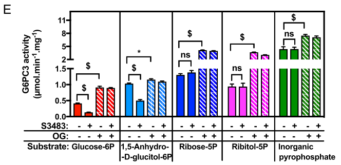

## Question

# Gene Research for Functional Annotation

## ⚠️ CRITICAL: Gene/Protein Identification Context

**BEFORE YOU BEGIN RESEARCH:** You MUST verify you are researching the CORRECT gene/protein. Gene symbols can be ambiguous, especially for less well-characterized genes from non-model organisms.

### Target Gene/Protein Identity (from UniProt):
- **UniProt Accession:** O43826
- **Protein Description:** RecName: Full=Glucose-6-phosphate exchanger SLC37A4 {ECO:0000305|PubMed:10026167, ECO:0000305|PubMed:21949678}; AltName: Full=Glucose-6-phosphate translocase {ECO:0000303|PubMed:9428641}; AltName: Full=Glucose-6-phosphate transporter {ECO:0000303|PubMed:41136424}; AltName: Full=Solute carrier family 37 member 4 {ECO:0000312|HGNC:HGNC:4061}; AltName: Full=Transformation-related gene 19 protein {ECO:0000312|EMBL:AAS00495.1}; Short=TRG-19 {ECO:0000312|EMBL:AAS00495.1};
- **Gene Information:** Name=SLC37A4 {ECO:0000312|HGNC:HGNC:4061}; Synonyms=G6PT {ECO:0000303|PubMed:41136424}, G6PT1; ORFNames=PRO0685, TRG19 {ECO:0000312|EMBL:AAS00495.1};
- **Organism (full):** Homo sapiens (Human).
- **Protein Family:** Belongs to the major facilitator superfamily.
- **Key Domains:** MFS. (IPR011701); MFS_dom. (IPR020846); MFS_trans_sf. (IPR036259); OPA_Antiporter. (IPR051337); Sugar-P_transporter_CS. (IPR021159)

### MANDATORY VERIFICATION STEPS:

1. **Check if the gene symbol "SLC37A4" matches the protein description above**
2. **Verify the organism is correct:** Homo sapiens (Human).
3. **Check if protein family/domains align with what you find in literature**
4. **If you find literature for a DIFFERENT gene with the same or similar symbol, STOP**

### If Gene Symbol is Ambiguous or You Cannot Find Relevant Literature:

**DO NOT PROCEED WITH RESEARCH ON A DIFFERENT GENE.** Instead:
- State clearly: "The gene symbol 'SLC37A4' is ambiguous or literature is limited for this specific protein"
- Explain what you found (e.g., "Found extensive literature on a different gene with the same symbol in a different organism")
- Describe the protein based ONLY on the UniProt information provided above
- Suggest that the protein function can be inferred from domain/family information

### Research Target:

Please provide a comprehensive research report on the gene **SLC37A4** (gene ID: SLC37A4, UniProt: O43826) in human.

The research report should be a detailed narrative explaining the function, biological processes, and localization of the gene product. Citations should be given for all claims.

You should prioritize authoritative reviews and primary scientific literature when conducting research. You can supplement
this with annotations you find in gene/protein databases, but these can be outdated or inaccurate.

We are specifically interested in the primary function of the gene - for enzymes, what reaction is catalyzed, and what is the substrate specificity? For transporters, what is the substrate? For structural proteins or adapters, what is the broader structural role? For signaling molecules, what is the role in the pathway.

We are interested in where in or outside the cell the gene product carries out its function.

We are also interested in the signaling or biochemical pathways in which the gene functions. We are less interested in broad pleiotropic effects, except where these elucidate the precise role.

Include evidence where possible. We are interested in both experimental evidence as well as inference from structure, evolution, or bioinformatic analysis. Precise studies should be prioritized over high-throughput, where available.

## Output

Question: You are an expert researcher providing comprehensive, well-cited information.

Provide detailed information focusing on:
1. Key concepts and definitions with current understanding
2. Recent developments and latest research (prioritize 2023-2024 sources)
3. Current applications and real-world implementations
4. Expert opinions and analysis from authoritative sources
5. Relevant statistics and data from recent studies

Format as a comprehensive research report with proper citations. Include URLs and publication dates where available.
Always prioritize recent, authoritative sources and provide specific citations for all major claims.

# Gene Research for Functional Annotation

## ⚠️ CRITICAL: Gene/Protein Identification Context

**BEFORE YOU BEGIN RESEARCH:** You MUST verify you are researching the CORRECT gene/protein. Gene symbols can be ambiguous, especially for less well-characterized genes from non-model organisms.

### Target Gene/Protein Identity (from UniProt):
- **UniProt Accession:** O43826
- **Protein Description:** RecName: Full=Glucose-6-phosphate exchanger SLC37A4 {ECO:0000305|PubMed:10026167, ECO:0000305|PubMed:21949678}; AltName: Full=Glucose-6-phosphate translocase {ECO:0000303|PubMed:9428641}; AltName: Full=Glucose-6-phosphate transporter {ECO:0000303|PubMed:41136424}; AltName: Full=Solute carrier family 37 member 4 {ECO:0000312|HGNC:HGNC:4061}; AltName: Full=Transformation-related gene 19 protein {ECO:0000312|EMBL:AAS00495.1}; Short=TRG-19 {ECO:0000312|EMBL:AAS00495.1};
- **Gene Information:** Name=SLC37A4 {ECO:0000312|HGNC:HGNC:4061}; Synonyms=G6PT {ECO:0000303|PubMed:41136424}, G6PT1; ORFNames=PRO0685, TRG19 {ECO:0000312|EMBL:AAS00495.1};
- **Organism (full):** Homo sapiens (Human).
- **Protein Family:** Belongs to the major facilitator superfamily.
- **Key Domains:** MFS. (IPR011701); MFS_dom. (IPR020846); MFS_trans_sf. (IPR036259); OPA_Antiporter. (IPR051337); Sugar-P_transporter_CS. (IPR021159)

### MANDATORY VERIFICATION STEPS:

1. **Check if the gene symbol "SLC37A4" matches the protein description above**
2. **Verify the organism is correct:** Homo sapiens (Human).
3. **Check if protein family/domains align with what you find in literature**
4. **If you find literature for a DIFFERENT gene with the same or similar symbol, STOP**

### If Gene Symbol is Ambiguous or You Cannot Find Relevant Literature:

**DO NOT PROCEED WITH RESEARCH ON A DIFFERENT GENE.** Instead:
- State clearly: "The gene symbol 'SLC37A4' is ambiguous or literature is limited for this specific protein"
- Explain what you found (e.g., "Found extensive literature on a different gene with the same symbol in a different organism")
- Describe the protein based ONLY on the UniProt information provided above
- Suggest that the protein function can be inferred from domain/family information

### Research Target:

Please provide a comprehensive research report on the gene **SLC37A4** (gene ID: SLC37A4, UniProt: O43826) in human.

The research report should be a detailed narrative explaining the function, biological processes, and localization of the gene product. Citations should be given for all claims.

You should prioritize authoritative reviews and primary scientific literature when conducting research. You can supplement
this with annotations you find in gene/protein databases, but these can be outdated or inaccurate.

We are specifically interested in the primary function of the gene - for enzymes, what reaction is catalyzed, and what is the substrate specificity? For transporters, what is the substrate? For structural proteins or adapters, what is the broader structural role? For signaling molecules, what is the role in the pathway.

We are interested in where in or outside the cell the gene product carries out its function.

We are also interested in the signaling or biochemical pathways in which the gene functions. We are less interested in broad pleiotropic effects, except where these elucidate the precise role.

Include evidence where possible. We are interested in both experimental evidence as well as inference from structure, evolution, or bioinformatic analysis. Precise studies should be prioritized over high-throughput, where available.

# Functional annotation of human SLC37A4 (UniProt O43826)

## Identity and principal function

**Identity verified:** Human **SLC37A4** encodes the glucose-6-phosphate transporter **G6PT**, also called G6PT1 or glucose-6-phosphate translocase. A structural study explicitly identifies its full-length human protein as **UniProt O43826**. Its assignment to the SLC37 family, major facilitator superfamily (MFS), and organophosphate/phosphate-transporter lineage agrees with the supplied domain annotations. This report concerns **Homo sapiens SLC37A4**, not the related transporter SLC37A2 or the glucose-6-phosphatase genes G6PC and G6PC3. (wang2025structuresofhuman pages 1-2, chou2014theslc37family pages 1-2, xia2025structuralbasisfor pages 1-2)

**Primary molecular function:** G6PT moves **glucose-6-phosphate (G6P) from the cytosol across the endoplasmic-reticulum (ER) membrane into the ER lumen**. It is a *transporter, not an enzyme*: glucose-6-phosphatases subsequently hydrolyze luminal G6P to glucose and inorganic phosphate (Pi). The established functional model describes G6PT as a G6P/Pi exchanger that can also exchange Pi for Pi. Thus, the G6PT-dependent step is membrane translocation, whereas G6PC or G6PC3 catalyzes the chemical reaction **G6P + H₂O → glucose + Pi**. (chou2014theslc37family pages 1-2, chou2014theslc37family pages 2-4, pan2011slc37a1andslc37a2 pages 3-4)

Direct evidence for the exchange model includes uptake of labeled G6P and Pi by **Pi-preloaded, G6PT-containing proteoliposomes**, without coexpressed phosphatase. In intact microsomes, G6P uptake is substantially greater when G6PT and a functional phosphatase are present together; phosphatase-generated luminal Pi provides a plausible counter-substrate and sustains uptake. These experiments establish G6PT transport activity independently of simply assigning it a function from sequence similarity. (chou2014theslc37family pages 2-4, pan2011slc37a1andslc37a2 pages 3-4)

## Localization, substrate recognition, and mechanism

G6PT acts in the **ER membrane**, between cytosol and ER lumen. The major human isoform has **429 amino acids**; an alternatively spliced 451-amino-acid form has also shown G6P-uptake activity. Earlier protease-protection and engineered-glycosylation experiments favored **10 membrane-spanning segments**, with both termini cytosolic. Human cryo-electron microscopy reported in **2025** instead resolves an **MFS-type 12-helix architecture**, with helices 1–6 and 7–12 forming two domains. The 10-helix description should therefore be treated as a historical topology model rather than an unqualified current structural annotation. (chou2014theslc37family pages 4-6, chou2014theslc37family pages 2-4, xia2025structuralbasisfor pages 1-2)

**G6P is the best-established physiological substrate.** In the conventional exchange cycle, cytosolic G6P enters the ER and luminal Pi moves outward; Pi can also be exchanged for Pi. Chlorogenic acid and derivatives inhibit G6PT transport, experimentally distinguishing it from SLC37A1 and SLC37A2 in earlier assays. A 2025 structural study found a cavity accommodating the phosphate and sugar portions of G6P and chlorogenic acid bound in a transport-inhibiting state. Another identified Pi- and sugar-phosphate-bound conformations; its binding assays favored phosphorylated sugars over glucose-1-phosphate or unphosphorylated carbohydrates. Binding of an alternative sugar phosphate alone, however, does **not** establish that it is a physiological transported substrate. (wang2025structuresofhuman pages 1-2, pan2011slc37a1andslc37a2 pages 3-4, xia2025structuralbasisfor pages 1-2)

There is a mechanistic qualification: a **2026** reconstitution study measured comparable SLC37A4-mediated G6P uptake **with and without an imposed Pi gradient**, reporting a G6P *K*ₘ of **21.45 ± 1.60 mM** under its conditions and proposing that Pi-independent transport can occur. That observation differs from earlier Pi-preloaded proteoliposome experiments and the reciprocal-antiport interpretation of 2025 structures. **G6P transport into the ER is secure; whether Pi exchange is obligatory under every biochemical condition remains unresolved.** (lai2026structuralbasisof pages 9-9, lai2026structuralbasisof pages 1-2, chou2014theslc37family pages 2-4)

## Pathways and tissue-specific consequences

In **liver, kidney, and intestine**, G6PT supplies luminal G6P to **G6Pase-α/G6PC**. G6P generated by either glycogen breakdown or gluconeogenesis can consequently be converted to glucose for release during fasting. Loss of this transport step blocks effective completion of both routes, despite their different upstream reactions, producing the impaired fasting glucose homeostasis characteristic of glycogen storage disease type Ib (**GSD-Ib**). G6PC deficiency instead causes GSD-Ia. (chou2014theslc37family pages 1-2, chou2014theslc37family pages 2-4, shao2024clinicalspectrumover pages 1-2)

In **neutrophils**, G6PT works with the more broadly expressed **G6Pase-β/G6PC3** in an additional, experimentally supported **metabolite-repair pathway**. Circulating **1,5-anhydroglucitol (1,5-AG)** undergoes low-level phosphorylation by glucose-phosphorylating enzymes, producing **1,5-anhydroglucitol-6-phosphate (1,5-AG6P)**. G6PT-dependent ER access permits G6PC3 to dephosphorylate this unwanted sugar phosphate. Without either protein, 1,5-AG6P accumulates and inhibits hexokinases, compromising glucose use and neutrophil function. Importantly, *unphosphorylated* 1,5-AG is the circulating precursor; **1,5-AG6P is the intracellular inhibitory metabolite**. (veigadacunha2023treatmentofthe pages 2-4, veigadacunha2019failuretoeliminate pages 2-3, veigadacunha2019failuretoeliminate pages 7-8)

The evidence for this second substrate should be described precisely. In the **2019 primary study**, the G6PT inhibitor S3483 suppressed 1,5-AG6P hydrolysis in *intact microsomes*, and G6PT-deficient cells and patient granulocytes accumulated 1,5-AG6P. Those findings strongly support transporter-dependent substrate access but are **not themselves a purified-protein measurement of 1,5-AG6P flux**; a 2025 human-G6PT study additionally reports transport of the analog. In a G6PC3-deficient neutrophil-precursor model exposed to **0.2 mM 1,5-AG**, intracellular 1,5-AG6P reached approximately **3 mM after 22 hours**. The investigators estimated that the accumulated concentration could inhibit hexokinase by **more than 80%** at physiological **2.5 mM ATP**. These figures describe the experimental model and its calculation, not a universal concentration in all patients. The relevant S3483-sensitive microsome comparison is shown in the cited study’s **Figure 1E**. (veigadacunha2019failuretoeliminate pages 7-8, xia2025structuralbasisfor pages 1-2, veigadacunha2019failuretoeliminate pages 4-6, veigadacunha2019failuretoeliminate pages 2-3, veigadacunha2019failuretoeliminate media 4acce978)

The following table separates experimentally established transport from pathway-level inference and clinical intervention. (chou2014theslc37family pages 2-4, veigadacunha2019failuretoeliminate pages 2-3)

| Process | Experimental evidence | Interpretation / caveat | Key sources |
|---|---|---|---|
| **G6P import into the ER with Pi countertransport** | Pi-preloaded G6PT proteoliposomes mediated radiolabeled G6P and Pi uptake, supporting G6P:Pi and Pi:Pi exchange. Microsomal G6P uptake increased markedly when G6PT and G6PC were coexpressed. Recent cryo-EM studies identified a positively charged MFS cavity and conformational changes consistent with reciprocal exchange. (chou2014theslc37family pages 2-4, pan2011slc37a1andslc37a2 pages 3-4, wang2025structuresofhuman pages 1-2) | **Strong support for annotation as an ER G6P/Pi exchanger.** A 2026 reconstitution study instead found comparable G6P uptake with and without a Pi gradient, suggesting possible Pi-independent uniport under its assay conditions. This conflict qualifies, but does not overturn, the established physiological antiporter model. (lai2026structuralbasisof pages 9-9, lai2026structuralbasisof pages 1-2) | Chen et al., 2008, [doi:10.1096/fj.07-104851](https://doi.org/10.1096/fj.07-104851); Wang et al., 2025, [doi:10.1038/s41467-025-66386-4](https://doi.org/10.1038/s41467-025-66386-4); Lai et al., 2026, [doi:10.1038/s41594-025-01712-4](https://doi.org/10.1038/s41594-025-01712-4) |
| **1,5-AG6P disposal** | In 2019, S3483 inhibited G6PT-dependent access of 1,5-AG6P to G6PC3 in intact microsomes; 1,5-AG6P accumulated in G6PT- or G6PC3-deficient cells and patient granulocytes. Physiological 0.2 mM 1,5-AG generated about 3 mM intracellular 1,5-AG6P after 22 hours in deficient neutrophil precursors, sufficient for calculated greater than 80% hexokinase inhibition at 2.5 mM ATP. (veigadacunha2019failuretoeliminate pages 4-6, veigadacunha2019failuretoeliminate pages 2-3, veigadacunha2019failuretoeliminate pages 7-8, veigadacunha2019failuretoeliminate media 4acce978) | **Evidence levels must be distinguished.** The 2019 inhibitor experiment demonstrated transporter dependence but did not directly measure purified G6PT translocation. Direct transport of 1,5-AG6P was reported in a 2025 human-G6PT study. G6PT enables ER entry; G6PC3 performs hydrolysis. (veigadacunha2019failuretoeliminate pages 7-8, xia2025structuralbasisfor pages 1-2) | Veiga-da-Cunha et al., 2019, [doi:10.1073/pnas.1816143116](https://doi.org/10.1073/pnas.1816143116); Xia et al., 2025, [doi:10.1038/s41467-025-64464-1](https://doi.org/10.1038/s41467-025-64464-1) |
| **ER topology: 12 versus 10 helices** | Protease-protection and engineered-glycosylation experiments historically favored 10 transmembrane segments with cytosolic termini. Human cryo-EM subsequently resolved a canonical MFS architecture with 12 helices, divided into TM1–6 and TM7–12 domains. (chou2014theslc37family pages 4-6, chou2014theslc37family pages 1-2, xia2025structuralbasisfor pages 1-2) | **The current structural annotation should be a 12-TM MFS fold.** The experimental but indirect 10-TM model remains historical context. The resolved architecture agrees with MFS, OPA and sugar-phosphate-transporter family assignments. | Chou and Mansfield, 2014, [doi:10.1016/B978-0-12-800223-0.00010-4](https://doi.org/10.1016/B978-0-12-800223-0.00010-4); Xia et al., 2025, [doi:10.1038/s41467-025-64464-1](https://doi.org/10.1038/s41467-025-64464-1) |
| **G6PC versus G6PC3 partnerships** | In liver, kidney and intestine, G6PT supplies G6P to G6Pase-alpha/G6PC for conversion to glucose and Pi. With ubiquitous G6Pase-beta/G6PC3, it supports myeloid-cell metabolism and 1,5-AG6P repair. Coexpression assays showed functional coupling; one comparison found G6PT/G6PC uptake 4.7-fold higher than G6PT/G6PC3 uptake. (chou2014theslc37family pages 1-2, chou2014theslc37family pages 2-4, pan2011slc37a1andslc37a2 pages 3-4) | SLC37A4 is **a transporter, not a phosphatase**. The G6PT–G6PC axis supports fasting glucose production, whereas G6PT–G6PC3 is especially important for neutrophil metabolite repair. Functional coupling does not necessarily establish a permanent stoichiometric complex. | Chou and Mansfield, 2014, [doi:10.1016/B978-0-12-800223-0.00010-4](https://doi.org/10.1016/B978-0-12-800223-0.00010-4); Veiga-da-Cunha et al., 2019, [doi:10.1073/pnas.1816143116](https://doi.org/10.1073/pnas.1816143116) |
| **Empagliflozin: indirect SGLT2/SGLT5 action** | Transport assays identified renal SGLT5/SLC5A10 as the main 1,5-AG reabsorber; tested human variants reduced transport by 50–100%. Empagliflozin inhibits SGLT2, causing glucosuria that interferes with SGLT5-mediated 1,5-AG reabsorption, lowers circulating 1,5-AG and limits intracellular 1,5-AG6P formation. (veigadacunha2023treatmentofthe pages 2-4, diederich2023sglt5isthe pages 1-2) | Empagliflozin **does not restore or activate SLC37A4**; it bypasses the defective repair pathway by lowering precursor supply. In a seven-patient 2024 study, G-CSF was stopped in six and reduced in one, although NET and LL-37 defects persisted. Evidence remains limited by small, mostly uncontrolled studies. (kaczor2024neutrophilfunctionsin pages 1-2) | Diederich et al., 2023, [doi:10.1007/s00018-023-04884-8](https://doi.org/10.1007/s00018-023-04884-8); Kaczor et al., 2024, [doi:10.1182/bloodadvances.2023012403](https://doi.org/10.1182/bloodadvances.2023012403) |

*Table: Evidence grading for the verified human SLC37A4/O43826 transporter, separating direct transport results from indirect mechanistic inference. The table also highlights topology revisions, tissue-specific phosphatase partners, therapeutic bypass mechanisms and unresolved transport-model conflicts.*

## 2023–2024 advances and current implementation

A **2023** transport study identified **SGLT5/SLC5A10** as an important *renal reabsorber of unphosphorylated 1,5-AG*; tested human SGLT5 variants reduced 1,5-AG transport by **50–100%** in expression assays. This clarifies why **empagliflozin**, an SGLT2 inhibitor, can benefit patients with SLC37A4 deficiency **without repairing G6PT**: SGLT2 inhibition causes glucosuria, which interferes with renal 1,5-AG reabsorption, lowers its circulating concentration, and reduces formation of toxic neutrophil 1,5-AG6P. Empagliflozin should not be characterized as an SLC37A4 activator or as transporting 1,5-AG6P itself. (diederich2023sglt5isthe pages 1-2, veigadacunha2023treatmentofthe pages 12-13)

Real-world evidence in **2024** is encouraging but mostly small or uncontrolled. In a single-center retrospective study of **35 children with GSD-Ib**, **14** received empagliflozin; the authors advised monitoring for urinary infection and hypoglycemia. In a prospective, **single-arm** study enrolling **eight** children with GSD-associated inflammatory bowel disease, **six completed 48 weeks**, with significant improvement in endoscopic disease scores and reported mucosal findings; one participant had sweating requiring rehydration and a urinary tract infection. A neutrophil-function study examined **seven patients** against **11 healthy donors**: empagliflozin improved several measured functions, and G-CSF was discontinued in **six of seven** and reduced in the seventh, although deficits in cathelicidin/LL-37 production and neutrophil extracellular traps persisted. These findings support treatment of the hematologic consequences, **not correction of the underlying hepatic G6PT defect**; small samples, nonrandomized designs, and incomplete functional rescue limit broad efficacy and long-term safety conclusions. (shao2024clinicalspectrumover pages 1-2, li2024empagliflozininchildren pages 2-3, kaczor2024neutrophilfunctionsin pages 1-2)

Clinical **SLC37A4 sequencing** provides a disease-specific diagnostic application: biallelic pathogenic variants establish GSD-Ib in the appropriate clinical setting. In the 2024 Chinese cohort, **34 of 35** children had symptoms or biochemical abnormalities before age one; this is a characteristic of that referral cohort, **not a population-wide penetrance estimate**. Nutritional prevention of fasting hypoglycemia addresses the metabolic defect, whereas empagliflozin addresses the 1,5-AG-dependent neutrophil pathway. (shao2024clinicalspectrumover pages 1-2, shao2024clinicalspectrumover pages 6-7, kaczor2024neutrophilfunctionsin pages 1-2)

## Annotation conclusion

**Recommended primary annotation:** *Human SLC37A4/O43826 is an ER-membrane, MFS-family glucose-6-phosphate transporter whose established physiological role is cytosol-to-ER G6P delivery, conventionally described as G6P/Pi exchange.* **Additional supported role:** G6PT-dependent ER delivery of the G6P analog 1,5-AG6P for G6PC3-mediated disposal, especially important in neutrophils. Neither phosphatase catalysis nor kidney 1,5-AG reabsorption is an activity of SLC37A4. The principal remaining mechanistic caveat is whether Pi countertransport is strictly obligatory under all conditions. (chou2014theslc37family pages 1-2, chou2014theslc37family pages 2-4, xia2025structuralbasisfor pages 1-2, veigadacunha2019failuretoeliminate pages 2-3, lai2026structuralbasisof pages 9-9)

### Selected primary and authoritative sources

- Chou & Mansfield, **2014**, SLC37-family functional review, *Current Topics in Membranes*. https://doi.org/10.1016/B978-0-12-800223-0.00010-4 (chou2014theslc37family pages 1-2)
- Veiga-da-Cunha *et al.*, **22 January 2019**, metabolite-repair experiments, *PNAS*. https://doi.org/10.1073/pnas.1816143116 (veigadacunha2019failuretoeliminate pages 2-3, veigadacunha2019failuretoeliminate pages 7-8)
- Diederich *et al.*, **August 2023**, renal SGLT5 transport experiments, *Cellular and Molecular Life Sciences*. https://doi.org/10.1007/s00018-023-04884-8 (diederich2023sglt5isthe pages 1-2)
- Kaczor *et al.*, **2024**, neutrophil-function study, *Blood Advances*. https://doi.org/10.1182/bloodadvances.2023012403 (kaczor2024neutrophilfunctionsin pages 1-2)
- Shao *et al.*, **April 2024**, pediatric cohort, *Orphanet Journal of Rare Diseases*. https://doi.org/10.1186/s13023-024-03137-6 (shao2024clinicalspectrumover pages 1-2)
- Li *et al.*, **April 2024**, prospective single-arm bowel-disease study, *Scientific Reports*. https://doi.org/10.1038/s41598-024-59320-z (li2024empagliflozininchildren pages 2-3)
- Xia *et al.*, **October 2025**, human transporter structure and inhibition, *Nature Communications*. https://doi.org/10.1038/s41467-025-64464-1 (xia2025structuralbasisfor pages 1-2)
- Wang *et al.*, **December 2025**, human transporter structural exchange model, *Nature Communications*. https://doi.org/10.1038/s41467-025-66386-4 (wang2025structuresofhuman pages 1-2)

References

1. (wang2025structuresofhuman pages 1-2): Qian Wang, Ning-Jie Guo, Yunxiang Du, Jun-Wu Liu, Wanting Ai, Feng-Yi Yang, Yuan Zhu, Yuan-Yuan Zhao, Di Wu, Lei Liu, X. Yao, and Shuai Gao. Structures of human glucose-6-phosphate transporter reveal reciprocal antiport mechanism driving glucose-6-phosphate and inorganic phosphate exchange. Nature Communications, Dec 2025. URL: https://doi.org/10.1038/s41467-025-66386-4, doi:10.1038/s41467-025-66386-4. This article has 5 citations and is from a highest quality peer-reviewed journal.

2. (chou2014theslc37family pages 1-2): Janice Y. Chou and Brian C. Mansfield. The slc37 family of sugar-phosphate/phosphate exchangers. Current topics in membranes, 73:357-82, Jan 2014. URL: https://doi.org/10.1016/b978-0-12-800223-0.00010-4, doi:10.1016/b978-0-12-800223-0.00010-4. This article has 79 citations and is from a peer-reviewed journal.

3. (xia2025structuralbasisfor pages 1-2): Zhanyi Xia, Yaqi Wang, Di Wu, Cheng Chi, Chen Li, Ligong Chen, and Daohua Jiang. Structural basis for transport and inhibition of the human glucose-6-phosphate transporter g6pt. Nature Communications, Oct 2025. URL: https://doi.org/10.1038/s41467-025-64464-1, doi:10.1038/s41467-025-64464-1. This article has 8 citations and is from a highest quality peer-reviewed journal.

4. (chou2014theslc37family pages 2-4): Janice Y. Chou and Brian C. Mansfield. The slc37 family of sugar-phosphate/phosphate exchangers. Current topics in membranes, 73:357-82, Jan 2014. URL: https://doi.org/10.1016/b978-0-12-800223-0.00010-4, doi:10.1016/b978-0-12-800223-0.00010-4. This article has 79 citations and is from a peer-reviewed journal.

5. (pan2011slc37a1andslc37a2 pages 3-4): Chi-Jiunn Pan, Shih-Yin Chen, Hyun Sik Jun, Su Ru Lin, Brian C. Mansfield, and Janice Y. Chou. Slc37a1 and slc37a2 are phosphate-linked, glucose-6-phosphate antiporters. PLoS ONE, 6:e23157, Sep 2011. URL: https://doi.org/10.1371/journal.pone.0023157, doi:10.1371/journal.pone.0023157. This article has 98 citations and is from a peer-reviewed journal.

6. (chou2014theslc37family pages 4-6): Janice Y. Chou and Brian C. Mansfield. The slc37 family of sugar-phosphate/phosphate exchangers. Current topics in membranes, 73:357-82, Jan 2014. URL: https://doi.org/10.1016/b978-0-12-800223-0.00010-4, doi:10.1016/b978-0-12-800223-0.00010-4. This article has 79 citations and is from a peer-reviewed journal.

7. (lai2026structuralbasisof pages 9-9): Qinxuan Lai, Mengzhen Xu, Yongxiang Gao, Zhisen Yang, Linfeng Sun, and Xin Liu. Structural basis of glucose-6-phosphate transport by human slc37a2. Nature Structural &amp; Molecular Biology, 33:112-122, Nov 2026. URL: https://doi.org/10.1038/s41594-025-01712-4, doi:10.1038/s41594-025-01712-4. This article has 4 citations and is from a highest quality peer-reviewed journal.

8. (lai2026structuralbasisof pages 1-2): Qinxuan Lai, Mengzhen Xu, Yongxiang Gao, Zhisen Yang, Linfeng Sun, and Xin Liu. Structural basis of glucose-6-phosphate transport by human slc37a2. Nature Structural &amp; Molecular Biology, 33:112-122, Nov 2026. URL: https://doi.org/10.1038/s41594-025-01712-4, doi:10.1038/s41594-025-01712-4. This article has 4 citations and is from a highest quality peer-reviewed journal.

9. (shao2024clinicalspectrumover pages 1-2): Yong-Xian Shao, Cui-Li Liang, Ya-Ying Su, Yun-Ting Lin, Zhi-Kun Lu, Rui-Zhu Lin, Zhi-Zi Zhou, Chun-Hua Zeng, Chun-Yan Tao, Zong-Cai Liu, Wen Zhang, and Li Liu. Clinical spectrum, over 12-year follow-up and experience of sglt2 inhibitors treatment on patients with glycogen storage disease type ib: a single-center retrospective study. Orphanet Journal of Rare Diseases, Apr 2024. URL: https://doi.org/10.1186/s13023-024-03137-6, doi:10.1186/s13023-024-03137-6. This article has 9 citations and is from a peer-reviewed journal.

10. (veigadacunha2023treatmentofthe pages 2-4): Maria Veiga-da-Cunha, Saskia B. Wortmann, Sarah C. Grünert, and Emile Van Schaftingen. Treatment of the neutropenia associated with gsd1b and g6pc3 deficiency with sglt2 inhibitors. Diagnostics, 13:1803, May 2023. URL: https://doi.org/10.3390/diagnostics13101803, doi:10.3390/diagnostics13101803. This article has 36 citations.

11. (veigadacunha2019failuretoeliminate pages 2-3): Maria Veiga-da-Cunha, Nathalie Chevalier, Xavier Stephenne, Jean-Philippe Defour, Nicole Paczia, Alina Ferster, Younes Achouri, Joseph P. Dewulf, Carole L. Linster, Guido T. Bommer, and Emile Van Schaftingen. Failure to eliminate a phosphorylated glucose analog leads to neutropenia in patients with g6pt and g6pc3 deficiency. Proceedings of the National Academy of Sciences of the United States of America, 116:1241-1250, Jan 2019. URL: https://doi.org/10.1073/pnas.1816143116, doi:10.1073/pnas.1816143116. This article has 201 citations and is from a highest quality peer-reviewed journal.

12. (veigadacunha2019failuretoeliminate pages 7-8): Maria Veiga-da-Cunha, Nathalie Chevalier, Xavier Stephenne, Jean-Philippe Defour, Nicole Paczia, Alina Ferster, Younes Achouri, Joseph P. Dewulf, Carole L. Linster, Guido T. Bommer, and Emile Van Schaftingen. Failure to eliminate a phosphorylated glucose analog leads to neutropenia in patients with g6pt and g6pc3 deficiency. Proceedings of the National Academy of Sciences of the United States of America, 116:1241-1250, Jan 2019. URL: https://doi.org/10.1073/pnas.1816143116, doi:10.1073/pnas.1816143116. This article has 201 citations and is from a highest quality peer-reviewed journal.

13. (veigadacunha2019failuretoeliminate pages 4-6): Maria Veiga-da-Cunha, Nathalie Chevalier, Xavier Stephenne, Jean-Philippe Defour, Nicole Paczia, Alina Ferster, Younes Achouri, Joseph P. Dewulf, Carole L. Linster, Guido T. Bommer, and Emile Van Schaftingen. Failure to eliminate a phosphorylated glucose analog leads to neutropenia in patients with g6pt and g6pc3 deficiency. Proceedings of the National Academy of Sciences of the United States of America, 116:1241-1250, Jan 2019. URL: https://doi.org/10.1073/pnas.1816143116, doi:10.1073/pnas.1816143116. This article has 201 citations and is from a highest quality peer-reviewed journal.

14. (veigadacunha2019failuretoeliminate media 4acce978): Maria Veiga-da-Cunha, Nathalie Chevalier, Xavier Stephenne, Jean-Philippe Defour, Nicole Paczia, Alina Ferster, Younes Achouri, Joseph P. Dewulf, Carole L. Linster, Guido T. Bommer, and Emile Van Schaftingen. Failure to eliminate a phosphorylated glucose analog leads to neutropenia in patients with g6pt and g6pc3 deficiency. Proceedings of the National Academy of Sciences of the United States of America, 116:1241-1250, Jan 2019. URL: https://doi.org/10.1073/pnas.1816143116, doi:10.1073/pnas.1816143116. This article has 201 citations and is from a highest quality peer-reviewed journal.

15. (diederich2023sglt5isthe pages 1-2): Jennifer Diederich, Pierre Mounkoro, Hernan A. Tirado, Nathalie Chevalier, Emile Van Schaftingen, and Maria Veiga-da-Cunha. Sglt5 is the renal transporter for 1,5-anhydroglucitol, a major player in two rare forms of neutropenia. Cellular and Molecular Life Sciences: CMLS, Aug 2023. URL: https://doi.org/10.1007/s00018-023-04884-8, doi:10.1007/s00018-023-04884-8. This article has 26 citations.

16. (kaczor2024neutrophilfunctionsin pages 1-2): Magdalena Kaczor, Stanislaw Malicki, Justyna Folkert, Ewelina Dobosz, Danuta Bryzek, Barbara Chruscicka-Smaga, Milena Greczan, Dorota Wesół- Kucharska, Barbara Piątosa, Emilia Samborowska, Joanna Madzio, Janusz Książyk, Ewa Ehmke vel Emczyńska, Małgorzata Hajdacka, Jan Potempa, Wojciech Młynarski, Dariusz Rokicki, and Florian Veillard. Neutrophil functions in patients with neutropenia due to glycogen storage disease type 1b treated with empagliflozin. Blood Advances, 8:2790-2802, May 2024. URL: https://doi.org/10.1182/bloodadvances.2023012403, doi:10.1182/bloodadvances.2023012403. This article has 15 citations and is from a peer-reviewed journal.

17. (veigadacunha2023treatmentofthe pages 12-13): Maria Veiga-da-Cunha, Saskia B. Wortmann, Sarah C. Grünert, and Emile Van Schaftingen. Treatment of the neutropenia associated with gsd1b and g6pc3 deficiency with sglt2 inhibitors. Diagnostics, 13:1803, May 2023. URL: https://doi.org/10.3390/diagnostics13101803, doi:10.3390/diagnostics13101803. This article has 36 citations.

18. (li2024empagliflozininchildren pages 2-3): Zhiling Li, Xiaoyan Zhang, Huan Chen, Hanshi Zeng, Jiaxing Wu, Ying Wang, Ni Ma, Jiaoli Lan, Yuxin Zhang, Huilin Niu, Lei Shang, Xun Jiang, and Min Yang. Empagliflozin in children with glycogen storage disease-associated inflammatory bowel disease: a prospective, single-arm, open-label clinical trial. Scientific Reports, Apr 2024. URL: https://doi.org/10.1038/s41598-024-59320-z, doi:10.1038/s41598-024-59320-z. This article has 12 citations and is from a peer-reviewed journal.

19. (shao2024clinicalspectrumover pages 6-7): Yong-Xian Shao, Cui-Li Liang, Ya-Ying Su, Yun-Ting Lin, Zhi-Kun Lu, Rui-Zhu Lin, Zhi-Zi Zhou, Chun-Hua Zeng, Chun-Yan Tao, Zong-Cai Liu, Wen Zhang, and Li Liu. Clinical spectrum, over 12-year follow-up and experience of sglt2 inhibitors treatment on patients with glycogen storage disease type ib: a single-center retrospective study. Orphanet Journal of Rare Diseases, Apr 2024. URL: https://doi.org/10.1186/s13023-024-03137-6, doi:10.1186/s13023-024-03137-6. This article has 9 citations and is from a peer-reviewed journal.

## Artifacts

- [Edison artifact artifact-00](SLC37A4-deep-research-falcon_artifacts/artifact-00.md)

## Citations

1. kaczor2024neutrophilfunctionsin pages 1-2
2. shao2024clinicalspectrumover pages 1-2
3. li2024empagliflozininchildren pages 2-3
4. xia2025structuralbasisfor pages 1-2
5. wang2025structuresofhuman pages 1-2
6. lai2026structuralbasisof pages 9-9
7. lai2026structuralbasisof pages 1-2
8. veigadacunha2023treatmentofthe pages 2-4
9. veigadacunha2019failuretoeliminate pages 2-3
10. veigadacunha2019failuretoeliminate pages 7-8
11. veigadacunha2019failuretoeliminate pages 4-6
12. veigadacunha2023treatmentofthe pages 12-13
13. shao2024clinicalspectrumover pages 6-7
14. doi:10.1096/fj.07-104851
15. doi:10.1038/s41467-025-66386-4
16. doi:10.1038/s41594-025-01712-4
17. doi:10.1073/pnas.1816143116
18. doi:10.1038/s41467-025-64464-1
19. doi:10.1016/B978-0-12-800223-0.00010-4
20. doi:10.1007/s00018-023-04884-8
21. doi:10.1182/bloodadvances.2023012403
22. https://doi.org/10.1096/fj.07-104851
23. https://doi.org/10.1038/s41467-025-66386-4
24. https://doi.org/10.1038/s41594-025-01712-4
25. https://doi.org/10.1073/pnas.1816143116
26. https://doi.org/10.1038/s41467-025-64464-1
27. https://doi.org/10.1016/B978-0-12-800223-0.00010-4
28. https://doi.org/10.1007/s00018-023-04884-8
29. https://doi.org/10.1182/bloodadvances.2023012403
30. https://doi.org/10.1186/s13023-024-03137-6
31. https://doi.org/10.1038/s41598-024-59320-z
32. https://doi.org/10.1038/s41467-025-66386-4,
33. https://doi.org/10.1016/b978-0-12-800223-0.00010-4,
34. https://doi.org/10.1038/s41467-025-64464-1,
35. https://doi.org/10.1371/journal.pone.0023157,
36. https://doi.org/10.1038/s41594-025-01712-4,
37. https://doi.org/10.1186/s13023-024-03137-6,
38. https://doi.org/10.3390/diagnostics13101803,
39. https://doi.org/10.1073/pnas.1816143116,
40. https://doi.org/10.1007/s00018-023-04884-8,
41. https://doi.org/10.1182/bloodadvances.2023012403,
42. https://doi.org/10.1038/s41598-024-59320-z,