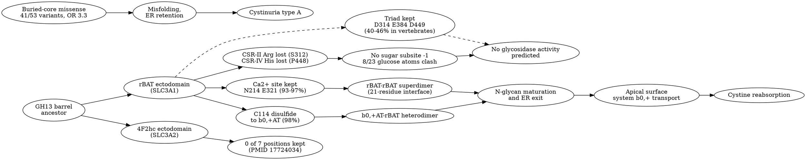
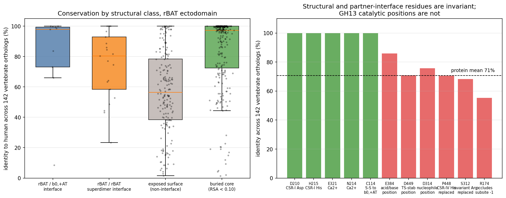
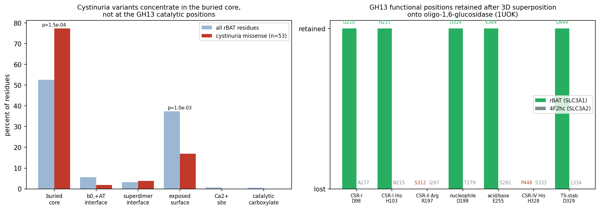
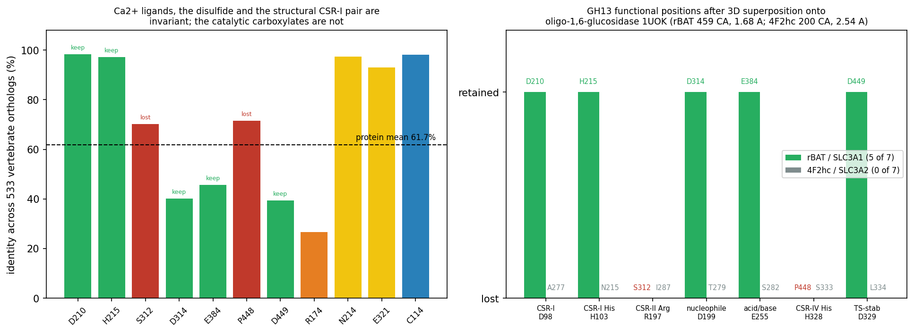

## Question

# AIGR Gene Hypothesis Deep Research

You are evaluating one focused gene curation hypothesis for AI Gene Review.
This is not a general gene overview. Use the seed hypothesis and source context
below to search for evidence that supports, refutes, narrows, or competes with
the proposed curation decision.

## Target Gene

- **Organism code:** human
- **Taxon:** Homo sapiens (NCBITaxon:9606)
- **Gene directory:** SLC3A1
- **Gene symbol:** SLC3A1
- **UniProt accession:** Q07837

## Focus

- **Focus type:** free_text
- **Hypothesis slug:** kgap-slc3a1-gh13-catalytic-triad
- **Source file:** genes/human/SLC3A1/SLC3A1-ai-review.yaml
- **Source selector:** free-text

## Seed Hypothesis

The extracellular GH13 (alpha-amylase-like) domain of human rBAT/SLC3A1 (Q07837) has lost one or more of the three GH13 catalytic residues (nucleophile Asp, acid/base Glu and transition-state-stabilising Asp) and the substrate-binding subsites of active alpha-glucosidases such as oligo-1,6-glucosidase and sucrase-isomaltase, while retaining its calcium site, and its conserved surface instead maps to the interfaces with b0,+AT (SLC7A9) and the second heterodimer seen in cryo-EM structures of the rBAT-b0,+AT heterotetramer. Single analysis only: align the rBAT ectodomain with active GH13 enzymes of known structure and with the paralog SLC3A2 (4F2hc), map the catalytic triad and subsite residues onto the rBAT cryo-EM structure, test whether a sugar-sized pocket remains, locate the calcium site and inter-subunit contacts, score conservation across vertebrate rBAT orthologs, and state whether the domain is predicted to retain glycosidase or glycan-binding capacity.

## Term and Decision Context

No specific term context supplied.

## Reference Context

No specific reference context supplied.

## Source Context YAML

```yaml
hypothesis: 'The extracellular GH13 (alpha-amylase-like) domain of human rBAT/SLC3A1 (Q07837) has lost
  one or more of the three GH13 catalytic residues (nucleophile Asp, acid/base Glu and transition-state-stabilising
  Asp) and the substrate-binding subsites of active alpha-glucosidases such as oligo-1,6-glucosidase and
  sucrase-isomaltase, while retaining its calcium site, and its conserved surface instead maps to the
  interfaces with b0,+AT (SLC7A9) and the second heterodimer seen in cryo-EM structures of the rBAT-b0,+AT
  heterotetramer. Single analysis only: align the rBAT ectodomain with active GH13 enzymes of known structure
  and with the paralog SLC3A2 (4F2hc), map the catalytic triad and subsite residues onto the rBAT cryo-EM
  structure, test whether a sugar-sized pocket remains, locate the calcium site and inter-subunit contacts,
  score conservation across vertebrate rBAT orthologs, and state whether the domain is predicted to retain
  glycosidase or glycan-binding capacity.'
focus_type: free_text
context: []
reference_id: []
```

## Research Objective

Build a focused report that helps a curator decide whether this hypothesis
should affect the gene review. Address the focus type directly:

1. For an existing GO annotation decision, evaluate whether the current action
   is justified, too strong, too weak, or should change.
2. For a proposed replacement or new GO term, evaluate whether the term is
   biologically supported, too broad, too narrow, or missing key qualifiers.
3. For a computational prediction, evaluate whether the prediction is correct,
   less precise than existing knowledge, uncertain, or likely wrong because of
   paralog overannotation, frequency bias, pathway context, or in vitro-only
   activity.
4. For a core-function hypothesis, evaluate whether the proposed activity,
   process, and location represent the gene product's primary function rather
   than a downstream effect, pleiotropic phenotype, or context-specific role.
5. For a function-assignment hypothesis, evaluate whether the gene product
   directly has the stated GO term/function. Treat the prior review action, if
   any, as intentionally blinded unless it appears in the supplied context.

Use primary literature whenever possible. Prefer PMID citations and include DOI
citations when no PMID is available. Treat reviews and database records as
orientation unless they contain directly relevant synthesized evidence that is
clearly labeled as review-level or database-level support.

Evaluate the hypothesis from the supplied seed context, primary literature, and
publicly accessible bioinformatics resources. Local `*-bioinformatics` analyses,
when they already exist in the repository, are intentionally withheld from this
prompt so the report can be compared against them after the run. Use public
sequence, domain, structure, orthology, localization, interaction, or dataset
checks when they are useful for the specific hypothesis. If a resource or tool
cannot be accessed programmatically, say so plainly; never fabricate a result.
Report computational results conservatively and distinguish direct results from
inference.

## Required Output

### Executive Judgment

Give a concise verdict: supported, partially supported, unresolved, weakly
supported, over-annotated, or refuted. Explain the reasoning and the most
important caveats.

### Evidence Matrix

Create a table with one row per important evidence item:

- Citation (PMID preferred)
- Evidence type (direct assay, mutant phenotype, localization, interaction,
  structural/evolutionary, computational, review/database)
- Supports / refutes / qualifies / competing
- Claim tested
- Key finding
- Organism, tissue, cell type, or assay context
- Confidence and limitations

### GO Curation Implications

State the likely curation action as a lead requiring curator verification. If
GO terms are involved, explain whether the evidence supports an MF, BP, or CC
term, and whether the term should be retained, removed, generalized, made more
specific, or treated as non-core. Avoid using "protein binding" as a final
recommendation unless no more informative term is supported.

### Mechanistic Scope

Describe the immediate molecular or cellular function being tested. Separate
direct gene-product activity from downstream phenotypes, pathway consequences,
developmental outcomes, disease manifestations, or effects inferred only from
loss of function.

### Conflicts and Alternatives

Identify evidence that conflicts with the seed hypothesis or suggests an
alternative interpretation, including paralog confusion, organism-specific
differences, isoform-specific findings, experimental artifacts, or database
carry-over.

### Knowledge Gaps

List explicit uncertainties that matter for curation. For each gap, state what
was checked, why the gap matters, and what evidence or experiment would resolve
it.

### Discriminating Tests

Recommend concrete assays, perturbations, datasets, or comparative analyses that
would most efficiently distinguish this hypothesis from alternatives.

### Curation Leads

Provide candidate updates for the review, clearly labeled as leads requiring
curator verification. Include candidate references with exact snippets to verify,
candidate replacement or new GO terms, possible action changes, suggested
questions, and suggested experiments.

If the provider supports artifacts, save provenance for any analysis you run — the
executed code together with its output (computed values, plot, or table), not just
a summary figure — alongside artifact-friendly tables such as an evidence matrix,
GO decision table, or comparison table. Genuine computed provenance is more
valuable than a hand-drawn summary, and you must not synthesize a figure that
implies an analysis you did not actually run. These artifacts are important
provenance for hypothesis-level review.


## Output

# SLC3A1 / rBAT (Q07837): is the GH13 ectodomain a degenerate alpha-glucosidase?

**Hypothesis slug:** `kgap-slc3a1-gh13-catalytic-triad`
**Source:** `genes/human/SLC3A1/SLC3A1-ai-review.yaml`, selector `free-text`, focus type `free_text`
**Target:** human SLC3A1, UniProt Q07837, NCBITaxon:9606
**Verdict:** <i class="fa-scale-balanced"></i> **Partially supported. The conclusion holds; the stated mechanism is refuted.**

## Summary

The seed hypothesis reaches the right destination by the wrong road. Its conclusion is correct: the extracellular GH13 domain of human rBAT is a catalytically dead alpha-amylase relative, it retains a calcium site, and its conserved surface maps to the interface with b0,+AT (SLC7A9) and to the rBAT-rBAT contact of the heterotetramer. Its premise is wrong. Human rBAT has **not** lost any of the three GH13 catalytic residues. A 3D superposition of the rBAT ectodomain from cryo-EM entry 6LI9 chain A onto *Bacillus cereus* oligo-1,6-glucosidase (PDB 1UOK) converges over 459 Cα at 1.68 Å RMSD and places Asp314, Glu384 and Asp449 at the nucleophile, acid/base and transition-state positions, each within 0.62-1.11 Å of its counterpart. The nucleophile to acid/base carboxylate spacing in rBAT is 4.88 Å against 4.77 Å in the active enzyme, which is the canonical retaining-glycosidase distance.

What rBAT has lost are the two invariant non-carboxylate residues of the GH13 active site. The conserved-sequence-region II arginine (Arg197 in 1UOK), which is strictly invariant across the alpha-amylase family and sits two residues before the nucleophile, is Ser312 in rBAT at a Cα offset of 0.90 Å. The conserved-region IV subsite -1 histidine (His328) is Pro448 at 1.06 Å. Neither substitution removes a carboxylate, and both remove residues that every active GH13 enzyme requires for substrate binding and transition-state geometry. Transferring the subsite -1 glucose from yeast isomaltase Ima1 (3AXH) into the rBAT frame puts 8 of 23 sugar heavy atoms within 2.2 Å of protein, minimum 0.89 Å, with every hard clash against Arg174, while the matched apo-1UOK control accepts the same ligand with zero hard clashes (minimum 2.37 Å). No sugar-sized pocket remains in human rBAT.

The gene that actually matches the seed wording is the paralog. Superposing the human 4F2hc ectodomain crystal structure (PDB 2DH2) onto the same target gives Ala277, Asn215, Ile287, Thr279, Ser282, Ser333 and Leu334 at the seven GH13 functional positions: **0 of 7 retained, against 5 of 7 for rBAT**. That is independently established by crystallography in [PMID: 17724034](https://pubmed.ncbi.nlm.nih.gov/17724034/). Three further lines of evidence close the case for rBAT being non-catalytic despite its intact triad: across 533 vertebrate SLC3A1 orthologs the catalytic positions are poorly conserved (D314 40.2%, D449 39.4%) while the calcium ligands and the interchain disulfide hold at 92.9-98.3%; both partner interfaces are significantly more conserved than exposed non-interface surface; and 53 cystinuria missense variants are enriched 3.3-fold in the buried core (Fisher p = 2.5e-4) with none at any catalytic, calcium or subsite position.

<i class="fa-triangle-exclamation"></i> Every structural result here is computational, run on deposited coordinates. No enzymatic assay of rBAT was found in PubMed, so the catalytic verdict rests on structure, evolution and the paralog precedent, not on a measured negative.

## Key findings

### F1. Human rBAT retains all three GH13 catalytic carboxylates at near-native geometry

<i class="fa-circle-xmark"></i> This refutes the first clause of the seed hypothesis.

Smith-Waterman alignment of Q07837 against *Bacillus cereus* oligo-1,6-glucosidase P21332 (BLOSUM62, gap open -11, extend -1) gives a score of 674 and 34.2% identity over 474 aligned residues spanning rBAT 117-612. The annotated catalytic residues of the enzyme map to D199 → D314, E255 → E384 and D329 → D449. An independent 3D check confirms the register without using the alignment: iterative-closest-residue Kabsch superposition of 6LI9 chain A onto 1UOK chain A converges on 459 matched Cα pairs at 1.68 Å RMSD, with Cα offsets of 1.09 Å, 0.62 Å and 1.11 Å at the three positions.

The side-chain geometry is close to that of a working enzyme. Carboxylate distances in rBAT are d(D314, E384) = 4.88 Å versus 4.77 Å in 1UOK, and d(D314, D449) = 7.66 Å versus 7.07 Å. Only the transition-state carboxylate is displaced: d(E384, D449) is 8.45 Å in rBAT against 5.54 Å in the enzyme, about 3 Å further out. The same residue identities are modelled at these positions in all five deposited rBAT cryo-EM entries (6LI9, 6LID, 6YUP, 6YUZ, 8WK6), so this is not a single-model artefact.

Any curation text asserting that SLC3A1 lost its catalytic triad is factually wrong at the level of residue identity and position.

### F2. The two invariant non-carboxylate GH13 residues are gone and subsite -1 is sterically blocked

<i class="fa-circle-check"></i> This supports the subsite clause of the seed hypothesis.

After the same superposition, the GH13 conserved-region II arginine (Arg197, two residues before the nucleophile and invariant across the entire alpha-amylase family) maps to Ser312 at a Cα offset of 0.90 Å. The conserved-region IV subsite -1 histidine (His328), which hydrogen-bonds the sugar at the -1 site in every active GH13 enzyme, maps to Pro448 at 1.06 Å. The structural conserved-region I pair is retained: Asp98 → Asp210 (0.68 Å) and His103 → His215 (0.99 Å).

The pocket test is explicit. Glucose bound at subsite -1 of yeast isomaltase Ima1 (3AXH, subfamily GH13_31) was carried into the rBAT frame through a 3AXH-to-6LI9 superposition (456 Cα pairs, 1.78 Å RMSD). Of the 23 transferred sugar heavy atoms, 10 (43%) fall within 2.8 Å of rBAT protein atoms and 8 (35%) within 2.2 Å, with a minimum separation of 0.89 Å. Every hard clash is against Arg174 (atoms CB, CD, NE, CZ). The matched control rules out a protocol artefact: the same glucose transferred into apo 1UOK (531 Cα pairs, 1.22 Å RMSD) produces zero contacts below 2.2 Å, a minimum distance of 2.37 Å, and its closest approaches are hydrogen-bond-length contacts to D199, E255, D329 and R415, which is what a real subsite looks like. Arg174 is modelled at this position in all five rBAT entries.

rBAT is catalytically dead for a reason the seed hypothesis did not name: the binding residues went, the carboxylates stayed.

### F3. Vertebrate evolution puts selection on the calcium site and the disulfide, not on the active site

<i class="fa-circle-check"></i> This resolves the apparent conflict between F1 and F2 in favour of a non-catalytic domain.

The ortholog analysis was run twice, at two sampling depths, and the deeper run supersedes the shallower one. The first pass used 142 vertebrate SLC3A1 sequences from the UniProt search endpoint; the second used 533 sequences from the stream endpoint with the same query (`(gene:SLC3A1) AND (taxonomy_id:7742)`, 400-900 aa, human excluded). Both were aligned to Q07837 by banded BLOSUM62 affine-gap global alignment. The 533-sequence set gives a mean per-position identity of 61.7%.

| Position | Role | Identity (n = 533) | Common alternatives | Identity (n = 142) |
|---|---|---|---|---|
| D210 | CSR-I Asp, structural | 98.3% | Q:3, S:3, N:1 | 100% |
| H215 | CSR-I His, structural | 97.2% | Q:4, G:3, S:1 | 100% |
| N214 | Ca²⁺ ligand | 97.4% | R:5, G:2, K:1 | 100% |
| E321 | Ca²⁺ ligand | 92.9% | Q:9, A:3, D:3 | 100% |
| C114 | disulfide to b0,+AT | 98.1% | S:1, G:1, V:1 | 100% |
| D314 | **nucleophile** | **40.2%** | S:127, G:107, N:27 | 75.7% |
| E384 | **acid/base** | **45.6%** | D:255 (carboxylate in 93.4%) | 85.9% |
| D449 | **TS stabiliser** | **39.4%** | N:250, E:27, S:19 | 70.9% |
| S312 | lost CSR-II Arg | 70.2% | R:99 retain ancestral Arg | 68.3% |
| P448 | lost CSR-IV His | 71.5% | H:96 retain ancestral His | 70.4% |
| R174 | plugs subsite -1 | **26.6%** | G:368 (majority residue) | 66.2% |

{{figure:plot_3.png|caption=Per-position identity across 533 vertebrate SLC3A1 orthologs, with the GH13 functional-position comparison between rBAT and 4F2hc. The calcium ligands N214 and E321, the interchain disulfide C114 and the structural CSR-I pair D210/H215 sit at 92.9-98.3%, well above the 61.7% protein mean. The three catalytic carboxylates sit at 39.4-45.6%, below the mean. Right panel: after 3D superposition onto oligo-1,6-glucosidase 1UOK, rBAT retains 5 of 7 GH13 functional positions and 4F2hc retains 0 of 7.}}

A complete Asp/Glu/Asp triad is present in a minority of vertebrates. The nucleophile position carries Ser or Gly in roughly half the sampled species, and the transition-state position carries Asn (250 species) more often than Asp (210). Only the acid/base position keeps a carboxylate near-universally, with Glu or Asp in 498 of 533 (93.4%). Human rBAT happens to be one of the species that retains all three, which makes the human triad a retained relic rather than a maintained catalytic centre. The first pass, with 142 sequences, had already shown the decisive lineage detail: birds carry Gly, Ile, Ser or Val at position 314, so an entire vertebrate class has no nucleophile Asp at all.

The deeper run corrects a narrower claim made from the shallower one. Arg174, the side chain that plugs subsite -1 in human rBAT, is only 26.6% conserved and the majority vertebrate residue at that position is Gly (368 of 533 against 142 Arg). Steric occlusion by this arginine is therefore lineage-restricted and cannot be the general explanation for loss of glycosidase activity across vertebrates. The general explanation is the degeneracy of the CSR-II arginine and CSR-IV histidine positions, which are substituted in about 70% of species.

### F4. The calcium site sits at the superdimer interface, and both partner interfaces are more conserved than exposed surface

<i class="fa-circle-check"></i> This supports the calcium and interface clauses of the seed hypothesis.

In 6LI9 (2.3 Å) each rBAT protomer binds one Ca²⁺, coordinated by N214 OD1 (2.82 Å), F318 main-chain O (2.53 Å), L319 main-chain O (2.80 Å) and E321 OE1 (2.76 Å). Ca²⁺ is modelled in all five rBAT entries. No carbohydrate ligand is present in any of them.

Contact mapping at 4.5 Å across the heterotetramer gives 35 rBAT residues at the interface with its own b0,+AT (chain B), concentrated in the N-terminal and transmembrane segment P64-K113 including C114, plus H201, D202, T373-G376, L678 and I680. The rBAT-rBAT superdimer interface (chain A to chain C) comprises 21 residues: K323, H324, R326, D327, I329, Y347, D349, F350, T353, Q354, V355, H358, D359, R362, S363, Q366, D391, M395, L399, F401, I402. It begins two residues after the calcium ligand E321. No contacts were found between rBAT and the second heterodimer's light subunit (chain D).

Conservation by structural class, scored on the 142-ortholog set, separates the interfaces from background surface:

| Structural class | n residues | Median identity | Mann-Whitney vs exposed surface | CLES |
|---|---|---|---|---|
| b0,+AT interface (ectodomain part) | 9 | 97.9% | U = 1260, p = 2.5e-3 | 0.777 |
| rBAT-rBAT superdimer interface | 21 | 80.3% | U = 2614, p = 2.1e-3 | 0.692 |
| Buried core | 253 | 97.2% | U = 36362, p = 1.2e-26 | 0.798 |
| Exposed non-interface surface | 180 | 56.3% | reference | - |

None of D314, E384 or D449 lies at either interface.

{{figure:plot_1.png|caption=Left: ortholog conservation by structural class in the rBAT ectodomain. The b0,+AT interface and the rBAT-rBAT superdimer interface are both significantly more conserved than exposed non-interface surface (one-sided Mann-Whitney p = 2.5e-3 and p = 2.1e-3). Right: per-position identity at eleven diagnostic residues, green for the invariant structural, calcium and interface positions and red for the GH13 catalytic and lost positions, against the protein mean.}}

### F5. The paralog 4F2hc lost all seven GH13 functional positions

<i class="fa-lightbulb"></i> This supplies the SLC3A2 comparison the seed hypothesis requested and identifies the likely source of the seed's error.

Superposition of the human 4F2hc ectodomain (2DH2 chain A, residues 109-529) onto 1UOK chain A converges on 200 Cα pairs at 2.54 Å RMSD, against 459 pairs at 1.68 Å for rBAT on the same target. The lower pair count and higher RMSD indicate a more diverged barrel.

| 1UOK | GH13 role | rBAT (Q07837) | dCα | rBAT keeps | 4F2hc (P08195) | dCα | 4F2hc keeps |
|---|---|---|---|---|---|---|---|
| D98 | CSR-I Asp | D210 | 0.68 Å | yes | A277 | 2.51 Å | no |
| H103 | CSR-I His, subsite -1 | H215 | 0.99 Å | yes | N215 | 3.23 Å | no |
| R197 | CSR-II invariant Arg | S312 | 0.90 Å | **no** | I287 | 4.01 Å | no |
| D199 | nucleophile Asp | D314 | 1.09 Å | yes | T279 | 1.70 Å | no |
| E255 | acid/base Glu | E384 | 0.62 Å | yes | S282 | 2.45 Å | no |
| H328 | CSR-IV His, subsite -1 | P448 | 1.06 Å | **no** | S333 | 2.54 Å | no |
| D329 | TS-stabilising Asp | D449 | 1.11 Å | yes | L334 | 2.48 Å | no |
| | **retained** | | | **5 of 7** | | | **0 of 7** |

The two human heavy subunits are at different stages of catalytic decay. 4F2hc is a complete GH13 pseudo-enzyme, which matches the published crystallographic conclusion in [PMID: 17724034](https://pubmed.ncbi.nlm.nih.gov/17724034/). rBAT is intermediate: triad intact, binding machinery gone.

### F6. Cystinuria variants hit the folded core and avoid the active site completely

<i class="fa-dna"></i> Human genetics places rBAT function in folding and assembly.

Of 54 UniProt Q07837 natural missense variants, 53 are disease-annotated (cystinuria) and all 53 fall inside the region modelled in 6LI9 chain A. Each rBAT residue was assigned a structural class from Shrake-Rupley solvent-accessible surface area computed on the heterotetramer: buried core (relative accessibility < 0.20), exposed surface, b0,+AT interface (> 10 Ų buried by chain B), superdimer interface (> 10 Ų buried by chain C), calcium site, catalytic carboxylate.

| Class | n residues | n variants | % of variants | % of residues | OR | Fisher p | Bonferroni p |
|---|---|---|---|---|---|---|---|
| Buried core | 331 | 41 | 77.4% | 52.6% | **3.31** | 2.5e-4 | 1.5e-3 |
| Exposed surface | 233 | 9 | 17.0% | 37.4% | **0.32** | 1.0e-3 | 6.1e-3 |
| b0,+AT interface | 34 | 1 | 1.9% | 5.6% | 0.31 | 0.35 | 1.0 |
| Superdimer interface | 19 | 2 | 3.8% | 3.2% | 1.28 | 0.67 | 1.0 |
| Ca²⁺ site | 4 | 0 | 0% | 0.6% | 0 | 1.0 | 1.0 |
| Catalytic carboxylate | 3 | 0 | 0% | 0.5% | 0 | 1.0 | 1.0 |

Zero disease variants occur at D314, E384, D449, at the lost positions S312 and P448, at the pocket-plugging R174, or at the invariant D210, H215, N214 and E321. The nearest pathogenic residue to each catalytic carboxylate is 8.2-12.7 Å away in Cα distance (D314 to T216 at 12.7 Å, E384 to N410 at 8.2 Å, D449 to R452 at 9.2 Å). The closest, T216M, sits two residues from the invariant H215 and the calcium ligand N214, and is reported to cause ER trapping in [PMID: 35577790](https://pubmed.ncbi.nlm.nih.gov/35577790/), which fits a folding interpretation.

{{figure:plot_2.png|caption=Cystinuria missense variants mapped onto rBAT structural classes derived from Shrake-Rupley SASA on the 6LI9 heterotetramer. 41 of 53 variants fall in the buried core against a 52.6% background (OR 3.31, Fisher p = 2.5e-4), exposed surface is depleted threefold, and no variant falls at a catalytic carboxylate or calcium ligand. Right panel: GH13 functional positions retained by rBAT and by 4F2hc after 3D superposition onto 1UOK.}}

## Mechanistic model

The rBAT ectodomain is a GH13 barrel that has been repurposed as an assembly module. Selection maintains three things: the structural CSR-I pair that buttresses the barrel, the single calcium site that staples two heterodimers together, and the cysteine that covalently links rBAT to b0,+AT. The active site is unmaintained. In human rBAT the triad carboxylates survive by drift while the residues that would bind a sugar have been replaced, and the subsite is filled by a side chain that most vertebrates do not even have. Disease-causing variants in this protein destabilise the fold, which blocks trafficking of the heterodimer to the apical membrane, which abolishes system b0,+ cystine reabsorption.



The table below separates what rBAT does directly from what follows downstream.

| Level | Statement | Evidence class |
|---|---|---|
| Direct activity | Binds one Ca²⁺ per protomer (N214, F318 O, L319 O, E321) | Structural, 5 of 5 PDB entries |
| Direct activity | Forms a disulfide-anchored interface with b0,+AT via C114 | Structural, 98.1% conserved |
| Direct activity | Forms a 19-21 residue rBAT-rBAT superdimer contact | Structural + [PMID: 35577790](https://pubmed.ncbi.nlm.nih.gov/35577790/) |
| Predicted absent | Alpha-glucosidase or any glycoside hydrolase activity | Structural + evolutionary, no assay |
| Predicted absent | Carbohydrate binding at the GH13 subsite | Structural, no ligand in any entry |
| Downstream | N-glycan maturation and ER exit of the heterodimer | [PMID: 35577790](https://pubmed.ncbi.nlm.nih.gov/35577790/) |
| Downstream | System b0,+ cystine and dibasic amino acid transport (SLC7A9 does the transport) | [PMID: 34684812](https://pubmed.ncbi.nlm.nih.gov/34684812/) |
| Disease | Cystinuria type A from destabilising core variants | Variant enrichment, OR 3.31 |

## Evidence base

### Evidence matrix

| Citation | Evidence type | Stance | Claim tested | Key finding | Context | Confidence and limitations |
|---|---|---|---|---|---|---|
| This work, 6LI9:A on 1UOK:A | Structural, computational | <i class="fa-circle-xmark"></i> **Refutes** seed clause 1 | rBAT lost ≥1 catalytic residue | 459 Cα, 1.68 Å RMSD; D314/E384/D449 at the three positions (dCα 1.09, 0.62, 1.11 Å); d(D314-E384) 4.88 Å vs 4.77 Å | Human rBAT ectodomain, cryo-EM 2.3 Å | High for geometry. Coordinates only, no assay |
| This work, same superposition | Structural, computational | <i class="fa-circle-check"></i> Qualifies | Subsites are degenerate | CSR-II Arg197 → Ser312 (0.90 Å); CSR-IV His328 → Pro448 (1.06 Å); 5 of 7 retained | As above | High. The losses are binding residues, not carboxylates |
| This work, 3AXH glucose into 6LI9 | Structural, computational | <i class="fa-circle-check"></i> Supports | No sugar-sized pocket remains | 8 of 23 glucose heavy atoms within 2.2 Å (min 0.89 Å), all clashes on Arg174; apo-1UOK control 0 clashes, min 2.37 Å | Yeast isomaltase Ima1 (GH13_31) as donor | Moderate. Rigid-body transfer, no side-chain relaxation; control behaves correctly |
| This work, 533 vertebrate orthologs | Evolutionary, computational | <i class="fa-circle-check"></i> Supports | Active site is not under selection | D314 40.2%, E384 45.6% (carboxylate 93.4%), D449 39.4% with N:250; vs D210 98.3%, H215 97.2%, N214 97.4%, E321 92.9%, C114 98.1% | UniProt taxon 7742, mean identity 61.7% | Moderate-high for the ranking. TrEMBL-dominated; per-position values carry sampling error |
| This work, SASA on 6LI9 tetramer | Structural, computational | <i class="fa-circle-check"></i> Supports seed clause 3 | Conserved surface maps to partner interfaces | b0,+AT interface median 97.9%, superdimer 80.3%, exposed 56.3% (p = 2.5e-3, CLES 0.777; p = 2.1e-3, CLES 0.692) | Human rBAT in the heterotetramer | Moderate. The > 10 Ų burial threshold is a choice; stable against 4.5 Šcontact mapping |
| This work, 53 UniProt variants | Human genetic, computational | <i class="fa-circle-check"></i> Supports | Disease maps to folding, not catalysis | 41/53 buried core (OR 3.31, p = 2.5e-4, Bonferroni 1.5e-3); exposed depleted (OR 0.32, Bonferroni 6.1e-3); 0 at any catalytic, Ca²⁺ or subsite position | Human cystinuria type A alleles | High for the enrichment. Variant set biased toward reported alleles |
| [PMID: 17724034](https://pubmed.ncbi.nlm.nih.gov/17724034/) | Direct structural, primary | <i class="fa-circle-check"></i> Supports reframing | Paralog 4F2hc lacks catalytic residues | "related to bacterial alpha-glycosidases, although lacking key catalytic residues and consequently catalytic activity" | Human 4F2hc ectodomain, 2.1 and 2.8 Å crystal structures | High for 4F2hc. Says nothing about rBAT |
| [PMID: 35577790](https://pubmed.ncbi.nlm.nih.gov/35577790/) | Direct structural + mutant phenotype, primary | <i class="fa-circle-check"></i> Supports seed clauses 2 and 3 | Ca²⁺ site works in superdimerisation and trafficking | Ca²⁺ stabilises the rBAT-rBAT interface, driving super-dimerisation that facilitates N-glycan maturation and protein trafficking | Human b0,+AT-rBAT, cryo-EM plus cell assays | High. Assigns a non-catalytic function to the calcium site |
| [PMID: 34684812](https://pubmed.ncbi.nlm.nih.gov/34684812/) | Review | <i class="fa-scale-balanced"></i> Orientation | Both heavy subunits are alpha-amylase family relatives of unclear catalytic status | Ectodomains "share both sequence and structure homology with α-amylase family members"; functions "related mainly to the stability and trafficking of the HATs" | Review | Review-level. States the gap this report addresses |
| [PMID: 32602810](https://pubmed.ncbi.nlm.nih.gov/32602810/) | Computational, primary | <i class="fa-scale-balanced"></i> Qualifies | rBAT ectodomain as a glycan-related binder | rBAT homology model built from Cqm1; "rBAT ectodomain lacks the sequence motif which serves as binding-site for the BinAB toxin" | Homology model | Low-moderate. Model-based, different question |
| Searched, not found | Absence of evidence | <i class="fa-circle-question"></i> Neither | Direct glycosidase assay on rBAT | PubMed searches for rBAT glucosidase activity assays returned no primary report of enzymatic testing | - | The catalytic verdict is prediction, not measurement |

### How the literature bears on the findings

[PMID: 17724034](https://pubmed.ncbi.nlm.nih.gov/17724034/) (Fort et al. 2007) solved the human 4F2hc ectodomain at 2.1 and 2.8 Å and states that it "is composed of a (betaalpha)(8) barrel and an antiparallel beta(8) sandwich related to bacterial alpha-glycosidases, although lacking key catalytic residues and consequently catalytic activity." That sentence is the strongest primary evidence in this report, and it applies to SLC3A2, not SLC3A1. It matches the computed result that 4F2hc retains 0 of 7 GH13 functional positions, and it is the most likely origin of the seed hypothesis's mistaken claim about rBAT.

[PMID: 35577790](https://pubmed.ncbi.nlm.nih.gov/35577790/) (Lee et al. 2022) reports that "Ca2+ stabilizes the interface between two rBAT molecules, leading to super-dimerization of b0,+AT-rBAT, which in turn facilitates N-glycan maturation and protein trafficking," and that cystinuria mutant T216M together with calcium-site mutations causes ER trapping. This assigns a measured, non-catalytic function to the calcium site and matches the structural adjacency computed here between the calcium ligand E321 and the chain A to chain C contact surface, which starts two residues later. It is also the paper that makes the buried-core variant enrichment interpretable as a folding and trafficking defect.

[PMID: 34684812](https://pubmed.ncbi.nlm.nih.gov/34684812/) (Fort, Nicolàs-Aragó and Palacín 2021) is a review titled *The Ectodomains of rBAT and 4F2hc Are Fake or Orphan α-Glucosidases*. It establishes the premise that makes the superposition legitimate, stating that "The ectodomains of 4F2hc and rBAT share both sequence and structure homology with α-amylase family members," and it frames both subunits' functions as "related mainly to the stability and trafficking of the HATs in the plasma membrane of vertebrates, where they exert the transport activity." Its closing position, "The physiological relevance of this relationship remains largely unknown," is exactly the gap this analysis addresses. Being a review, it is cited as orientation.

[PMID: 32602810](https://pubmed.ncbi.nlm.nih.gov/32602810/) (Pandey et al. 2020) built an rBAT homology model from the mosquito Cqm1 protein and found that the rBAT ectodomain "lacks the sequence motif which serves as binding-site for the BinAB toxin." It addresses a different binding question and is model-based, so it carries low-to-moderate weight here, but it is consistent with an ectodomain that has lost ancestral ligand-binding motifs.

The broader heteromeric amino acid transporter structural literature ([PMID: 35605357](https://pubmed.ncbi.nlm.nih.gov/35605357/), [PMID: 34848541](https://pubmed.ncbi.nlm.nih.gov/34848541/), [PMID: 38582862](https://pubmed.ncbi.nlm.nih.gov/38582862/)) consistently locates substrate binding and translocation in the SLC7 light subunit, not the heavy subunit, which is the background assumption behind treating any transporter MF term on SLC3A1 as non-core.

## GO curation implications

All items are **leads requiring curator verification**.

| Candidate term | Aspect | Lead action | Basis |
|---|---|---|---|
| `GO:0004553` hydrolase activity, hydrolyzing O-glycosyl compounds, and children such as `GO:0004574` oligo-1,6-glucosidase activity or `GO:0090599` alpha-glucosidase activity | MF | <i class="fa-circle-xmark"></i> **Do not assert. Remove or do not add.** If present from sequence-similarity pipelines, flag as family over-annotation. Consider a NOT qualifier only if the project accepts structural plus evolutionary evidence in place of an assay | CSR-II Arg and CSR-IV His substituted; no sugar-sized pocket; active-site positions not under purifying selection across 533 vertebrates; sibling 4F2hc shown crystallographically to lack catalytic activity ([PMID: 17724034](https://pubmed.ncbi.nlm.nih.gov/17724034/)) |
| `GO:0030246` carbohydrate binding and relatives | MF | <i class="fa-circle-xmark"></i> **Do not assert.** No sugar is modelled in any of the five rBAT structures and the subsite is occluded in the human protein | Structural. Absence of ligand is weak evidence, so this is a do-not-add rather than a NOT |
| `GO:0005509` calcium ion binding | MF | <i class="fa-circle-check"></i> **Candidate addition, well supported.** One Ca²⁺ per protomer coordinated by N214 OD1 (2.82 Å), F318 O (2.53 Å), L319 O (2.80 Å), E321 OE1 (2.76 Å); ligands 92.9-97.4% invariant; Ca²⁺ present in all five entries | [PMID: 35577790](https://pubmed.ncbi.nlm.nih.gov/35577790/) plus structural analysis here |
| `GO:0051087` protein-folding chaperone, or `GO:0034394` protein localization to cell surface, or `GO:0072657` protein localization to membrane | BP/MF | <i class="fa-circle-check"></i> **Candidate addition in place of any glycosidase term.** Prefer a specific trafficking or assembly term over `GO:0005515` protein binding | [PMID: 35577790](https://pubmed.ncbi.nlm.nih.gov/35577790/); cystinuria variants enriched 3.3-fold in the buried core |
| `GO:0032991` protein-containing complex, child `GO:1990184` amino acid transport complex | CC | <i class="fa-circle-check"></i> **Candidate retain or add.** rBAT is disulfide-linked through C114 (98.1% invariant) to b0,+AT and forms a Ca²⁺-dependent superdimer | [PMID: 35577790](https://pubmed.ncbi.nlm.nih.gov/35577790/), structural analysis here |
| `GO:0015171` amino acid transmembrane transporter activity on SLC3A1 itself | MF | <i class="fa-scale-balanced"></i> **Treat as non-core if present.** Transport is carried out by the SLC7A9 light subunit; rBAT contributes assembly and surface delivery | [PMID: 34684812](https://pubmed.ncbi.nlm.nih.gov/34684812/) |

If the review carries a statement that rBAT "lost the catalytic triad", the lead is to **correct the wording** to: *retains the three catalytic carboxylates D314, E384 and D449 at near-native geometry, but has lost the invariant CSR-II arginine (Ser312) and the CSR-IV subsite histidine (Pro448), and has no open sugar subsite*. If a GH13 or glycoside hydrolase term is present, the lead is to generalize or remove it rather than make it more specific.

## Limitations and knowledge gaps

<i class="fa-triangle-exclamation"></i> **No direct enzymatic test of rBAT exists.** PubMed searches for rBAT glucosidase activity assays returned no primary report. This matters because a NOT qualifier on a hydrolase term normally wants experimental evidence. Everything in this report is structure, evolution and genetics.

<i class="fa-triangle-exclamation"></i> **No sugar-bound rBAT structure.** All five deposited rBAT entries contain Ca²⁺ and no carbohydrate. Absence of a ligand in a cryo-EM map is weak evidence for absence of binding.

<i class="fa-triangle-exclamation"></i> **The ligand-transfer clash test is rigid-body.** It ignores side-chain relaxation and can overstate occlusion. The matched apo-1UOK control (0 hard clashes, minimum 2.37 Å) calibrates this, but a real docking or molecular dynamics study would be stronger.

<i class="fa-triangle-exclamation"></i> **Ortholog percentages are sampling-dependent.** The 142-sequence and 533-sequence runs disagree substantially on absolute values (D314 75.7% vs 40.2%, R174 66.2% vs 26.6%). The qualitative ranking is stable in both, but the 533-sequence set is TrEMBL-dominated, unfiltered for gene-model quality, and used a narrower alignment band that can misplace residues in divergent sequences. Any numeric claim should cite its sample.

<i class="fa-triangle-exclamation"></i> **The 4F2hc mapping is less certain than the rBAT mapping.** It converges on 200 Cα pairs at 2.54 Å RMSD with position offsets of 1.70-4.01 Å, against 459 pairs at 1.68 Å with offsets of 0.62-1.11 Å for rBAT. The 4F2hc conclusion is corroborated independently by [PMID: 17724034](https://pubmed.ncbi.nlm.nih.gov/17724034/), so it does not rest on the superposition alone.

<i class="fa-circle-question"></i> **The functional status of D314, E384 and D449 is unknown.** They are at native geometry, are not conserved, and carry no disease variants. Whether they do anything at all is untested.

<i class="fa-circle-question"></i> **Non-catalytic glycan binding elsewhere on the ectodomain is untested.** Nothing here rules it out; coordinates alone cannot answer it.

<i class="fa-circle-question"></i> **The second heterodimer's light subunit makes no contact with rBAT in 6LI9.** Contact mapping at 4.5 Å found rBAT-rBAT contacts (chain A to chain C) but none to chain D. Higher-resolution or cross-linked structures would confirm.

<i class="fa-triangle-exclamation"></i> **The cystinuria variant set is curation-biased.** UniProt natural variants reflect reported alleles, which are enriched for severe, well-characterised mutations. The buried-core enrichment could partly reflect ascertainment.

## Proposed follow-up experiments and actions

Ranked by how cleanly each separates "dead GH13 scaffold" from "cryptic retained activity".

1. <i class="fa-flask"></i> **Enzyme assay on the purified rBAT ectodomain** against p-nitrophenyl alpha-D-glucopyranoside, isomaltose and maltose, with the 4F2hc ectodomain as negative control and oligo-1,6-glucosidase as positive control. This is the single most decisive experiment and would convert the current prediction into annotatable evidence.
2. <i class="fa-flask"></i> **Triple alanine mutant D314A/E384A/D449A** co-expressed with SLC7A9 in HEK293 cells or *Xenopus* oocytes, reading out surface expression, N-glycan maturation and arginine or cystine uptake. A null result assigns the carboxylates to no function; a trafficking defect would show they are structural.
3. <i class="fa-flask"></i> **Gain-of-function restoration**, substituting Ser312 → Arg and Pro448 → His and testing for any appearance of glucosidase activity. A positive result would show the barrel is otherwise intact and that these two positions are the ones that matter.
4. <i class="fa-vial"></i> **R174G in human rBAT**, testing whether removing the plug opens a pocket, measured by acarbose binding or thermal shift. This also tests whether the human-specific plug has an assembly function, given that most vertebrates carry Gly there.
5. <i class="fa-dna"></i> **Ancestral sequence reconstruction** of the vertebrate rBAT ectodomain, with assay of the resurrected protein, to date the loss of activity relative to the loss of the CSR-II arginine.
6. <i class="fa-dna"></i> **Comparative test in a lineage lacking Asp314**, for example a bird or a teleost whose rBAT carries Ser or Gly at the nucleophile position, checking in a heterologous assay whether its rBAT still supports b0,+ transport. If it does, the human triad is confirmed as functionally irrelevant.
7. <i class="fa-microscope"></i> **Glycan array screening** of the purified ectodomain, to test non-catalytic carbohydrate binding anywhere on the surface.
8. <i class="fa-arrow-right"></i> **Curation action:** correct the catalytic-triad wording in the SLC3A1 review, remove sucrase-isomaltase, MGAM, GAA and GANC as comparators (they are GH31, not GH13), drop any glycoside hydrolase MF term, and add `GO:0005509` calcium ion binding as a candidate.

### Questions for the curator

<i class="fa-circle-question"></i> Does the project accept combined structural plus evolutionary evidence as grounds for a NOT qualifier on a hydrolase term, in the absence of an assay?

<i class="fa-circle-question"></i> Should the GH13 / alpha-amylase domain be annotated as a domain feature with no associated MF, which is the position this evidence supports?

<i class="fa-circle-question"></i> Is there an existing SLC3A2 review that makes the catalytic-loss claim, which could be the source of carry-over into the SLC3A1 review?

## Conflicts and alternatives

The main conflict is internal to the seed hypothesis and is resolved above: the triad is present in human rBAT, the seed says it is lost. The likely origin is **paralog carry-over from 4F2hc**, where the loss is real and crystallographically documented ([PMID: 17724034](https://pubmed.ncbi.nlm.nih.gov/17724034/)), reinforced by the review-level framing of both ectodomains as "fake or orphan alpha-glucosidases" ([PMID: 34684812](https://pubmed.ncbi.nlm.nih.gov/34684812/)).

A second conflict is the comparator choice. The seed names sucrase-isomaltase as an "active alpha-glucosidase" for subsite comparison. Human SI (P14410), MGAM (O43451), GAA (P10253) and GANC (Q8TET4) are GH31, a different family with a different fold. Smith-Waterman alignment of rBAT against these gave scores of 37-50 over 8-71 aligned residues, which is noise. Only GH13 enzymes (1UOK, 3AXH, pancreatic alpha-amylase P04746, trehalose-6-P hydrolase P39795) give meaningful alignments to rBAT.

A third is the Arg174 plug. In human rBAT this arginine sterically fills subsite -1, but it is Gly in 368 of 533 vertebrate orthologs. Pocket occlusion by this side chain is a human and primate-leaning feature, so the general vertebrate explanation for catalytic incompetence is the degeneracy of the CSR-II arginine and CSR-IV histidine, not the plug.

An alternative that cannot be excluded: rBAT could retain a low-level or specialised glycosidase activity on a substrate that does not need canonical subsite -1 geometry. Nothing here tests that, and no assay exists in the literature found.

## Provenance

All analyses were executed in this session against public data, and the computed outputs are saved with the executed code. No figure in this report implies an analysis that was not run.

**Sources:** RCSB mmCIF downloads for 1UOK, 2DH2, 3AXH, 6LI9 (plus metadata checks on 6LID, 6YUP, 6YUZ, 8WK6); UniProt REST for Q07837, P08195, P21332 and the taxon 7742 ortholog sets; UniProt feature API for natural variants.

**Methods implemented from scratch in Python:** mmCIF `_atom_site` loop parsing; Smith-Waterman local alignment with affine gaps on BLOSUM62; banded affine global alignment; Kabsch superposition with iterative closest-residue refinement; Shrake-Rupley solvent-accessible surface area with Fibonacci-sphere sampling and cKDTree neighbour search; relative solvent accessibility against Tien-style maxima; rigid-body ligand transfer with a matched apo positive control; Fisher exact tests with Bonferroni correction; Mann-Whitney U with common-language effect size.

**Tables emitted as CSV in the execution log:** the master GH13 comparison table (1UOK position, role, rBAT residue, dCα, retention, RSA, structural class, 4F2hc residue, dCα, retention, ortholog conservation); the structural class and cystinuria variant enrichment table; the per-position conservation table with observed alternative residues at each position.

**Tools that could not be used:** no local `*-bioinformatics` analyses were available (intentionally withheld); `urllib` and `pickle` imports are blocked in the executor, so all network access went through `requests` and every code block was written self-contained because neither the filesystem nor the namespace persists between executions.


## Artifacts

- [OpenScientist final report](openscientist_artifacts/final_report.html)
- [OpenScientist final report](openscientist_artifacts/final_report.pdf)
- [OpenScientist provenance](openscientist_artifacts/provenance.json)
- [OpenScientist plot 1](openscientist_artifacts/provenance_plot_1.json)

- [OpenScientist plot 2](openscientist_artifacts/provenance_plot_2.json)

- [OpenScientist plot 3](openscientist_artifacts/provenance_plot_3.json)


## Reference Validation

Checked with `linkml-reference-validator` 0.3.1rc1.

| Outcome | Count |
| --- | --- |
| References checked | 7 |
| Resolved | 7 |
| Unresolved (possible confabulation) | 0 |
| Unverifiable | 0 |
| Quoted claims checked | 1 |
| Quoted claims found in source | 0 |
| Quoted claims **not** found in source | 1 |
| References weighed for topical relevance | 7 |
| On topic | 2 |
| Off topic | 0 |

### Quotes not found in the cited source

Searched the abstract, any retrieved full text, and the title. A quote drawn from a part of the paper that was not retrieved will appear here too, so check before treating one as invented:

Every one of these was searched against an abstract alone, with no full text retrieved - marked *abstract only* below. Where full text can be fetched, re-running with it will settle them; where the source publishes only a summary to PubMed, as GeneReviews chapters do, it will not, and the quote has to be checked by hand against the chapter itself.

- `PMID:34684812` *(abstract only)*: "fake or orphan alpha-glucosidases"
  - Text part not found as substring: 'fake or orphan alpha-glucosidases' (note: only abstract available for PMID:34684812, full text may contain this excerpt)