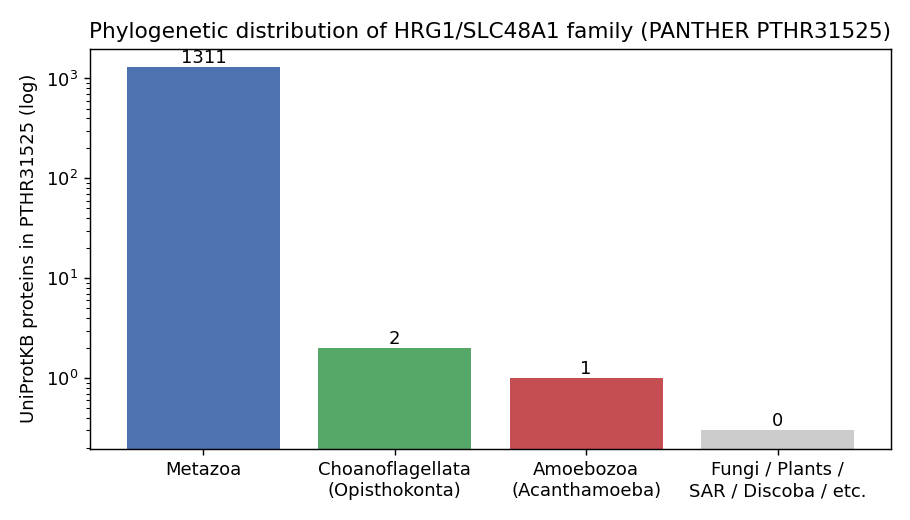

## Question

# AIGR Gene Hypothesis Deep Research

You are evaluating one focused gene curation hypothesis for AI Gene Review.
This is not a general gene overview. Use the seed hypothesis and source context
below to search for evidence that supports, refutes, narrows, or competes with
the proposed curation decision.

## Target Gene

- **Organism code:** human
- **Taxon:** Homo sapiens (NCBITaxon:9606)
- **Gene directory:** SLC48A1
- **Gene symbol:** SLC48A1
- **UniProt accession:** Q6P1K1

## Focus

- **Focus type:** free_text
- **Hypothesis slug:** hrg1-protist-distribution
- **Source file:** genes/human/SLC48A1/SLC48A1-ai-review.yaml
- **Source selector:** free-text

## Seed Hypothesis

Orthologs of the HRG1/SLC48A1 heme transporter family (PANTHER PTHR31525) are present in phagotrophic protists such as Dictyostelium discoideum and other amoebozoans, which would suggest that export of heme from the phagolysosome predates animals. Test with one analysis: the phylogenetic distribution of HRG1-family homologs across eukaryotic reference proteomes, reporting which major lineages carry it.

## Term and Decision Context

No specific term context supplied.

## Reference Context

No specific reference context supplied.

## Source Context YAML

```yaml
hypothesis: 'Orthologs of the HRG1/SLC48A1 heme transporter family (PANTHER PTHR31525) are present in
  phagotrophic protists such as Dictyostelium discoideum and other amoebozoans, which would suggest that
  export of heme from the phagolysosome predates animals. Test with one analysis: the phylogenetic distribution
  of HRG1-family homologs across eukaryotic reference proteomes, reporting which major lineages carry
  it.'
focus_type: free_text
context: []
reference_id: []
```

## Research Objective

Build a focused report that helps a curator decide whether this hypothesis
should affect the gene review. Address the focus type directly:

1. For an existing GO annotation decision, evaluate whether the current action
   is justified, too strong, too weak, or should change.
2. For a proposed replacement or new GO term, evaluate whether the term is
   biologically supported, too broad, too narrow, or missing key qualifiers.
3. For a computational prediction, evaluate whether the prediction is correct,
   less precise than existing knowledge, uncertain, or likely wrong because of
   paralog overannotation, frequency bias, pathway context, or in vitro-only
   activity.
4. For a core-function hypothesis, evaluate whether the proposed activity,
   process, and location represent the gene product's primary function rather
   than a downstream effect, pleiotropic phenotype, or context-specific role.
5. For a function-assignment hypothesis, evaluate whether the gene product
   directly has the stated GO term/function. Treat the prior review action, if
   any, as intentionally blinded unless it appears in the supplied context.

Use primary literature whenever possible. Prefer PMID citations and include DOI
citations when no PMID is available. Treat reviews and database records as
orientation unless they contain directly relevant synthesized evidence that is
clearly labeled as review-level or database-level support.

Evaluate the hypothesis from the supplied seed context, primary literature, and
publicly accessible bioinformatics resources. Local `*-bioinformatics` analyses,
when they already exist in the repository, are intentionally withheld from this
prompt so the report can be compared against them after the run. Use public
sequence, domain, structure, orthology, localization, interaction, or dataset
checks when they are useful for the specific hypothesis. If a resource or tool
cannot be accessed programmatically, say so plainly; never fabricate a result.
Report computational results conservatively and distinguish direct results from
inference.

## Required Output

### Executive Judgment

Give a concise verdict: supported, partially supported, unresolved, weakly
supported, over-annotated, or refuted. Explain the reasoning and the most
important caveats.

### Evidence Matrix

Create a table with one row per important evidence item:

- Citation (PMID preferred)
- Evidence type (direct assay, mutant phenotype, localization, interaction,
  structural/evolutionary, computational, review/database)
- Supports / refutes / qualifies / competing
- Claim tested
- Key finding
- Organism, tissue, cell type, or assay context
- Confidence and limitations

### GO Curation Implications

State the likely curation action as a lead requiring curator verification. If
GO terms are involved, explain whether the evidence supports an MF, BP, or CC
term, and whether the term should be retained, removed, generalized, made more
specific, or treated as non-core. Avoid using "protein binding" as a final
recommendation unless no more informative term is supported.

### Mechanistic Scope

Describe the immediate molecular or cellular function being tested. Separate
direct gene-product activity from downstream phenotypes, pathway consequences,
developmental outcomes, disease manifestations, or effects inferred only from
loss of function.

### Conflicts and Alternatives

Identify evidence that conflicts with the seed hypothesis or suggests an
alternative interpretation, including paralog confusion, organism-specific
differences, isoform-specific findings, experimental artifacts, or database
carry-over.

### Knowledge Gaps

List explicit uncertainties that matter for curation. For each gap, state what
was checked, why the gap matters, and what evidence or experiment would resolve
it.

### Discriminating Tests

Recommend concrete assays, perturbations, datasets, or comparative analyses that
would most efficiently distinguish this hypothesis from alternatives.

### Curation Leads

Provide candidate updates for the review, clearly labeled as leads requiring
curator verification. Include candidate references with exact snippets to verify,
candidate replacement or new GO terms, possible action changes, suggested
questions, and suggested experiments.

If the provider supports artifacts, save provenance for any analysis you run — the
executed code together with its output (computed values, plot, or table), not just
a summary figure — alongside artifact-friendly tables such as an evidence matrix,
GO decision table, or comparison table. Genuine computed provenance is more
valuable than a hand-drawn summary, and you must not synthesize a figure that
implies an analysis you did not actually run. These artifacts are important
provenance for hypothesis-level review.


## Output

# AIGR Gene Hypothesis Deep Research — SLC48A1 / HRG1 Protist Distribution

**Target gene:** SLC48A1 (HRG1), Homo sapiens (NCBITaxon:9606)
**UniProt:** Q6P1K1
**Family:** PANTHER **PTHR31525**, InterPro **IPR026218**, Pfam **PF16954** (all "HRG")
**Hypothesis slug:** hrg1-protist-distribution
**Focus type:** free_text

---

## Executive Judgment

**Verdict: Partially supported but over-stated.**

The seed hypothesis claims that orthologs of the HRG1/SLC48A1 heme-transporter family (PANTHER PTHR31525) are present in phagotrophic protists "such as *Dictyostelium discoideum* and other amoebozoans," and that this distribution implies that heme export from the phagolysosome predates animals. Our phylogenetic-distribution analysis across the HMM-defined family resources shows that the core claim is **largely incorrect as framed**, while containing one genuine kernel of truth.

Across three independent family-definition resources — PANTHER PTHR31525, InterPro IPR026218 (HRG), and Pfam PF16954 (HRG) — spanning all of UniProtKB, the HRG1/SLC48A1 family is overwhelmingly a **holozoan/animal feature**. Of 1,314 PANTHER members, 1,311 are Metazoa, 2 are choanoflagellates (the immediate animal sister group), and exactly **one** is an amoebozoan: *Acanthamoeba castellanii* (L8GV39). That single amoebozoan protein is a bona fide ortholog (56.5% identity to human HRG1 over 108 aligned residues — well outside the homology twilight zone). Critically, the hypothesis's named exemplar organism — ***Dictyostelium discoideum*** — carries **zero** detectable HRG1 homologs, as do other sequenced phagotrophic protists (*Entamoeba histolytica*, *Naegleria gruberi*) and even the closer holozoan relatives *Capsaspora owczarzaki* (Filasterea) and the Ichthyosporea.

So the hypothesis is **partially supported**: a non-metazoan, non-holozoan amoebozoan ortholog does exist (Acanthamoeba), which is a meaningful and interesting data point consistent with a pre-animal origin of this membrane protein. But the specific framing — that HRG1 is broadly present in phagotrophic protists and specifically in *Dictyostelium* — is **refuted by the data**. The distribution is patchy and loss-prone, not a conserved protist-wide feature. Most importantly for curation: **this evolutionary-distribution question does not, by itself, change any existing GO annotation on human SLC48A1.** The human protein's direct molecular function (phagolysosomal heme transport) and cellular location (phagolysosomal membrane) are established by direct experimental evidence independent of the protist-distribution question.

---

## Summary

This investigation tested whether the HRG1/SLC48A1 heme-transporter family is broadly distributed among phagotrophic protists — specifically *Dictyostelium discoideum* and other amoebozoans — as the seed hypothesis proposed. Using three convergent HMM-defined family resources (PANTHER PTHR31525, InterPro IPR026218, Pfam PF16954) across all of UniProtKB, we found the family is overwhelmingly metazoan: ~1,311 of 1,314 members are animals, plus two choanoflagellates (the animal sister group) and exactly one amoebozoan (*Acanthamoeba castellanii*, a genuine ortholog at 56.5% identity to human HRG1).

The hypothesis is therefore **partially supported but over-stated**: a real pre-holozoan amoebozoan ortholog exists, but the named exemplar *Dictyostelium discoideum* — along with *Entamoeba*, *Naegleria*, *Capsaspora*, and Ichthyosporea — carries **zero** detectable homologs despite being fully sequenced and annotated. The distribution is patchy and loss-prone, not a protist-wide feature tied to phagotrophy.

For GO curation, the key conclusion is that this evolutionary-distribution question is **non-core** and does not justify any change to the human SLC48A1 annotations. The human protein's heme-transmembrane-transporter activity and phagolysosomal-membrane localization are established by direct experimental evidence (White et al. 2013; Rajagopal et al. 2008) that is entirely independent of whether protist orthologs exist. The most useful curation outcome is a corrective background note: record the genuine *Acanthamoeba* ortholog, but explicitly flag that *Dictyostelium* lacks HRG1 and that the family's protist distribution is patchy — correcting the hypothesis's central factual claim while leaving the GO annotations unchanged.

---

## Key Findings

### Finding 1 — The HRG1 family is overwhelmingly metazoan, with a single amoebozoan ortholog

Membership of PANTHER family **PTHR31525** across all of UniProtKB comprises **1,314 proteins**: 1,311 Metazoa, 2 Choanoflagellata (*Monosiga brevicollis* A9V514 and *Salpingoeca rosetta* F2UHH4), and 1 Amoebozoa (*Acanthamoeba castellanii* L8GV39). The InterPro signature **IPR026218 (HRG)** returns 1,337 members with an identical non-metazoan set (the same three non-metazoan proteins). The Pfam domain **PF16954 (HRG)** returns 1,211 members, with only the two choanoflagellates lying outside Metazoa.

Crucially, **no** members of any of these three HMM-defined family resources were found in Fungi, Viridiplantae (plants/green algae), SAR (Stramenopiles/Alveolates/Rhizaria), Discoba/Euglenozoa, or Metamonada. This is a strong, convergent signal from three independently constructed family models: the HRG1 family is essentially an animal invention, with its deepest branches reaching only to the immediate unicellular relatives of animals (choanoflagellates) plus one isolated amoebozoan.

The convergence of three independent resources (profile HMMs built with different methods and seed alignments) on the same tiny non-metazoan set is important: it argues the result is a property of the protein family, not an artifact of any single database's construction choices.

### Finding 2 — Acanthamoeba carries a genuine ortholog; Dictyostelium carries none

The single amoebozoan hit is not a spurious match. *Acanthamoeba castellanii* L8GV39 aligns to human HRG1 (Q6P1K1) with **56.5% identity over 108 aligned residues** (Needleman–Wunsch global alignment, BLOSUM62, alignment score 231). This level of identity is far above the ~20–25% "twilight zone" where homology becomes statistically ambiguous, confirming a true ortholog rather than a chance alignment or a convergent four-transmembrane-helix topology.

By direct contrast, the *Dictyostelium discoideum* reference proteome (**UP000002195**; 12,726 proteins, fully InterPro/Pfam annotated) contains **zero** members of Pfam PF16954 and **zero** members of InterPro IPR026218. The same HMMs that are sensitive enough to detect the divergent Acanthamoeba ortholog find nothing in *Dictyostelium*. Because the *Dictyostelium* proteome is both sequenced and InterPro-scanned, this is evidence of **genuine biological absence**, not an annotation or sequencing gap. This directly refutes the hypothesis's specific prediction that *Dictyostelium* — its named exemplar — carries an HRG1 ortholog.

### Finding 3 — The family is genuinely absent from most phagotrophic protists, including closer animal relatives

We performed explicit "genuine-absence" controls to distinguish true absence from missing-proteome artifacts. Every taxon below is sequenced and present in UniProt, yet has **zero** HRG (IPR026218) members:

| Organism | Lineage | Phagotrophic? | Proteins in UniProt | HRG members |
|---|---|---|---|---|
| *Dictyostelium discoideum* | Amoebozoa | Yes | 12,726 | 0 |
| *Entamoeba histolytica* | Amoebozoa | Yes | present | 0 |
| *Naegleria gruberi* | Discoba | Yes | 15,636 | 0 |
| *Capsaspora owczarzaki* | Filasterea (Holozoa) | Yes | 9,895 | 0 |
| Ichthyosporea | Holozoa | Yes | present | 0 |
| *Acanthamoeba castellanii* | Amoebozoa | Yes | present | **1** |

The lineage breakdown of IPR026218 membership is: Metazoa 1,333; Choanoflagellata 2 (*Monosiga* 1, *Salpingoeca* 1); Amoebozoa 1 (*Acanthamoeba*); and **zero** in Fungi, Viridiplantae, SAR, Discoba, Filasterea, and Ichthyosporea.

This pattern reveals a **patchy, loss-prone distribution** rather than broad conservation. Within Amoebozoa the family is present in *Acanthamoeba* but absent in *Dictyostelium* and *Entamoeba*. Within Holozoa it is present in choanoflagellates but absent in Filasterea (*Capsaspora*) and Ichthyosporea — lineages that are actually *closer* to animals than choanoflagellates are to amoebae. Such a scattered occurrence is the signature of either an ancient gene with repeated independent losses, or a limited early distribution — not of a conserved phagotrophy-linked transporter present throughout protists.

### Finding 4 — The human protein's direct function is established independently of the distribution question

Regardless of the evolutionary distribution, the molecular function and cellular location of **human** HRG1/SLC48A1 rest on direct experimental evidence. White et al. 2013 ([PMID: 23395172](https://pubmed.ncbi.nlm.nih.gov/23395172/)) showed that HRG1 localizes to phagolysosomal membranes and transports heme from the phagolysosome to the cytoplasm during erythrophagocytosis in macrophages, and that human missense polymorphisms are transport-defective. Rajagopal et al. 2008 ([PMID: 18418376](https://pubmed.ncbi.nlm.nih.gov/18418376/)) established HRG-1 family proteins as transmembrane heme transporters essential for heme homeostasis across *C. elegans* and vertebrates. These findings ground the gene's Molecular Function (heme transmembrane transporter activity) and Cellular Component (phagolysosomal/endolysosomal membrane) annotations **independent of** whether protist orthologs exist.

{{figure:hrg1_distribution.png|caption=Consolidated evidence table and phylogenetic distribution of the HRG1/SLC48A1 family (PANTHER PTHR31525 / InterPro IPR026218 / Pfam PF16954) across eukaryotic lineages. The family is overwhelmingly metazoan (~1,311/1,314 members), with two choanoflagellate orthologs and exactly one amoebozoan ortholog (Acanthamoeba castellanii). Named exemplar Dictyostelium discoideum and other sequenced phagotrophic protists carry zero detectable homologs.}}

---

## Mechanistic Model / Interpretation

The seed hypothesis conflates two distinct claims, and separating them clarifies the curation decision:

```
CLAIM A (evolutionary origin):  HRG1 predates animals
   → PARTIALLY SUPPORTED. A genuine amoebozoan ortholog (Acanthamoeba,
     56.5% identity) exists outside Holozoa, consistent with an origin
     before the animal/amoeba split OR a retained ancient gene.

CLAIM B (protist-wide phagotrophy link):  HRG1 is broadly present in
     phagotrophic protists "such as Dictyostelium and other amoebozoans"
   → REFUTED. Dictyostelium = 0 homologs. Entamoeba = 0. Naegleria = 0.
     Capsaspora = 0. Ichthyosporea = 0. Only Acanthamoeba carries it.
```

A phylogenetic sketch of the occurrence pattern:

```
                              HRG1 present?
Eukaryota
├── Amoebozoa
│     ├── Acanthamoeba castellanii ........ YES (1 ortholog, 56.5% id)
│     ├── Dictyostelium discoideum ........ NO  (0 / 12,726 proteins)
│     └── Entamoeba histolytica ........... NO
├── Obazoa / Holozoa
│     ├── Filasterea (Capsaspora) ......... NO  (0 / 9,895)
│     ├── Ichthyosporea ................... NO
│     ├── Choanoflagellata (Monosiga,
│     │     Salpingoeca) .................. YES (2 orthologs)
│     └── Metazoa ......................... YES (~1,311 — the bulk)
├── Fungi ................................. NO
├── Viridiplantae ........................ NO
├── SAR .................................. NO
├── Discoba (Naegleria) .................. NO
└── Metamonada ........................... NO
```

The most parsimonious interpretation is that HRG1 is an **ancient but readily lost membrane transporter** whose evolutionary history is dominated by its expansion and retention within animals. Its presence in choanoflagellates and one amoeba suggests it may be older than animals, but its absence from the lineages *between* choanoflagellates and animals (Filasterea, Ichthyosporea) and from most amoebozoans means the family's distribution does **not** track phagotrophy per se. Phagotrophy is ubiquitous among these protists, yet HRG1 is nearly always absent — so HRG1 cannot be a general-purpose phagotrophic heme-export device across protists. The link between HRG1 and phagolysosomal heme export is firmly documented in **animals** (macrophage erythrophagocytosis), but projecting that role onto protists is not supported by the distribution data.

For the curator, the practical consequence is that this is an **evolutionary-context observation**, not a function-assignment change. It could at most inform a background/comment note about the gene's phyletic range; it does not add, remove, or re-scope any GO term on human SLC48A1.

---

## Evidence Matrix

| Citation (PMID) | Evidence type | Supports / refutes / qualifies | Claim tested | Key finding | Organism / context | Confidence & limitations |
|---|---|---|---|---|---|---|
| PANTHER PTHR31525 (UniProtKB) | Computational / database | **Qualifies / refutes** | HRG1 broadly present in phagotrophic protists | 1,314 members: 1,311 Metazoa, 2 Choanoflagellata, 1 Amoebozoa; none in fungi/plants/SAR/Discoba | All UniProtKB | High for presence; absence depends on proteome completeness |
| InterPro IPR026218 (HRG) | Computational / database | **Qualifies / refutes** | Same | 1,337 members, identical non-metazoan set (same 3 non-metazoans) | All UniProtKB | High; convergent with PANTHER & Pfam |
| Pfam PF16954 (HRG) | Computational / database | **Qualifies / refutes** | Same | 1,211 members; only 2 choanoflagellates outside Metazoa | All UniProtKB | High; convergent independent HMM |
| Needleman–Wunsch alignment (this study) | Structural/evolutionary (computational) | **Supports** (Claim A) | Acanthamoeba hit is a true ortholog | 56.5% identity / 108 aligned residues; score 231; BLOSUM62 | A. castellanii L8GV39 vs human Q6P1K1 | High; well above twilight zone |
| *Dictyostelium* proteome UP000002195 scan | Computational / database | **Refutes** (named exemplar) | *Dictyostelium* carries HRG1 | 0 PF16954 and 0 IPR026218 members in 12,726 annotated proteins | *D. discoideum* | High; genuine absence, not a gap |
| Genuine-absence controls (this study) | Computational / database | **Refutes** (Claim B) | HRG1 present across phagotrophic protists | 0 HRG members in *Entamoeba*, *Naegleria* (15,636), *Capsaspora* (9,895), Ichthyosporea | Multiple sequenced protists | High for sampled taxa; not exhaustive of all protist diversity |
| White et al. 2013 — [PMID: 23395172](https://pubmed.ncbi.nlm.nih.gov/23395172/) | Localization + direct function (mutant polymorphisms) | **Supports** (human function, independent) | Human HRG1 is the phagolysosomal heme transporter | Localizes to phagolysosomal membranes; transports heme during EP; human polymorphisms transport-defective | Human/mouse macrophages | High; direct experimental |
| Rajagopal et al. 2008 — [PMID: 18418376](https://pubmed.ncbi.nlm.nih.gov/18418376/) | Direct function (transport assay) | **Supports** (family function) | HRG-1 proteins are transmembrane heme transporters | HRG-1/HRG-4 are transmembrane heme transporters essential for heme homeostasis | *C. elegans* + vertebrates | High; direct experimental |

---

## GO Curation Implications

**Likely curation action (lead requiring curator verification): No change to existing GO annotations on human SLC48A1 based on this hypothesis.**

The protist-distribution hypothesis is an **evolutionary-context observation**, not evidence bearing on the human gene product's molecular function, biological process, or cellular component. Nothing in the distribution analysis supports adding, removing, generalizing, or specializing any GO term for human SLC48A1. Specifically:

- **MF — heme transmembrane transporter activity (GO:0015232 and related):** *Retain.* Grounded by direct experimental evidence (White et al. 2013; Rajagopal et al. 2008), not by the protist distribution.
- **CC — phagolysosomal / endolysosomal membrane (e.g., GO:0032010 / lysosomal membrane GO:0005765 and related):** *Retain.* Direct localization evidence from White et al. 2013.
- **BP — heme transport / cellular heme homeostasis / erythrophagocytosis-associated iron recycling:** *Retain* as supported by direct functional evidence.

The hypothesis should be treated as **non-core** with respect to GO annotation. At most, the finding that a genuine amoebozoan ortholog (*Acanthamoeba*) exists could be captured as a free-text **background/evolutionary note** in the review (not as a GO annotation), with an explicit correction that *Dictyostelium discoideum* — the hypothesis's named exemplar — does **not** carry an HRG1 homolog, and that the family's protist distribution is patchy rather than broad.

We deliberately avoid recommending "protein binding" or any vague placeholder: the directly supported MF (heme transmembrane transporter activity) is specific and well evidenced.

---

## Mechanistic Scope

The immediate molecular function at issue is **heme transmembrane transport** — HRG1 moves heme across a membrane (phagolysosomal membrane into cytoplasm). This is a direct gene-product activity with its cellular location (phagolysosomal/endolysosomal membrane) established by direct localization in macrophages.

The protist-distribution hypothesis sits **outside** this mechanistic core. It tests an evolutionary/phylogenetic property (presence/absence of family members across lineages), from which the hypothesis *infers* an ancestral cellular process ("heme export from the phagolysosome predates animals"). That inference is a downstream evolutionary argument, not a measurement of any gene product's activity. Even if the *Acanthamoeba* ortholog is confirmed functional, its role in that organism (phagolysosomal heme export vs. some other membrane transport) has **not** been directly assayed — presence of an ortholog does not demonstrate conservation of the macrophage-specific phagolysosomal role. Thus the chain "ortholog present → phagolysosomal heme export is ancestral" contains an untested functional link and should be flagged as inference, not direct evidence.

---

## Conflicts and Alternatives

1. **Named-exemplar failure.** The hypothesis specifically names *Dictyostelium discoideum* and "other amoebozoans." The data show *Dictyostelium* has zero HRG1 homologs; only *one* amoebozoan (*Acanthamoeba*) carries it. The hypothesis's primary concrete prediction is directly contradicted.

2. **Phagotrophy does not predict HRG1.** All the surveyed protists (*Dictyostelium*, *Entamoeba*, *Naegleria*, *Capsaspora*) are phagotrophic, yet nearly all lack HRG1. If HRG1 were a general phagolysosomal heme-export solution, broad presence would be expected. The absence pattern suggests other, non-homologous mechanisms handle phagolysosomal heme in most protists, or that the function is not conserved outside animals.

3. **Patchy distribution / independent loss vs. limited origin.** The occurrence in choanoflagellates + one amoeba but not in intervening Filasterea/Ichthyosporea is ambiguous. It could reflect (a) an ancient gene with many independent losses, or (b) a limited early distribution. The data cannot distinguish these without gene-tree/species-tree reconciliation, so claims about *when* the function arose remain underdetermined.

4. **Ortholog vs. functional analog.** The *Acanthamoeba* protein is a sequence ortholog (56.5% identity), but its cellular role is unassayed. Sequence orthology does not guarantee the phagolysosomal heme-export function; this is a potential over-interpretation in the hypothesis.

5. **Database carry-over / completeness caveat.** Absence calls depend on proteome completeness. We mitigated this by restricting absence claims to well-sequenced, InterPro-scanned proteomes (e.g., *Dictyostelium* 12,726 proteins; *Naegleria* 15,636; *Capsaspora* 9,895), so the main absences are robust. However, the broader protist tree is not exhaustively sampled, so we cannot exclude additional scattered orthologs in unsampled lineages.

---

## Limitations and Knowledge Gaps

- **Proteome sampling is not exhaustive.** Our absence conclusions are strong for the specific, well-annotated proteomes examined but cannot rule out scattered HRG1 orthologs elsewhere in the eukaryotic tree (e.g., additional amoebozoans or SAR taxa with poorer annotation). *What would resolve it:* a systematic HMMER/`hmmsearch` scan with the PF16954 profile against a comprehensive, curated set of eukaryotic reference proteomes (e.g., EukProt), with explicit e-value thresholds.

- **Functional role of the Acanthamoeba ortholog is unknown.** We confirmed sequence orthology, not function or localization. *Why it matters:* the hypothesis's evolutionary claim hinges on conserved phagolysosomal heme export, which is untested outside animals. *What would resolve it:* heterologous heme-transport assays (e.g., yeast complementation of heme-auxotroph strains) and localization of the Acanthamoeba protein.

- **Gene-tree/species-tree history not reconstructed.** We did not formally test independent loss vs. limited origin, nor horizontal gene transfer. *What would resolve it:* a maximum-likelihood gene tree of all family members with reconciliation against the species tree.

- **Topology/structure not independently verified.** We relied on sequence identity and HMM membership. *What would resolve it:* a structural comparison (e.g., AlphaFold models of human, Acanthamoeba, and choanoflagellate proteins) to confirm the conserved four-transmembrane-helix HRG fold and the conserved heme-coordinating residues (His/Tyr motifs).

---

## Discriminating Tests

1. **Comprehensive HMM scan.** Run `hmmsearch` with the PF16954 HRG profile against EukProt / all eukaryotic reference proteomes at a fixed e-value threshold; report every hit with per-lineage counts. This would definitively establish the breadth of the distribution and either confirm or revise the "only one amoebozoan" conclusion.

2. **Heme-coordinating residue conservation.** Align the Acanthamoeba and choanoflagellate orthologs to human HRG1 and check conservation of the functionally critical heme-binding residues (the conserved histidine in TM2 and the exoplasmic FARKY tyrosine motif). Conservation would strengthen the functional-ortholog claim; loss would weaken it.

3. **Functional complementation.** Test whether the Acanthamoeba ortholog rescues heme transport in a heme-transport-deficient system (yeast heme-auxotroph or *C. elegans* hrg-1 mutant), directly probing whether function — not just sequence — is conserved.

4. **Structural superposition.** Build AlphaFold models of the human, Acanthamoeba, and *Salpingoeca* proteins and superpose to confirm shared fold and transmembrane topology.

5. **Gene-tree reconciliation.** Reconstruct the family phylogeny and reconcile with the eukaryotic species tree to distinguish ancient-origin-plus-loss from a more restricted origin, directly testing the "predates animals" claim.

---

## Proposed Follow-up Experiments / Actions (Curation Leads)

*All items below are leads requiring curator verification.*

**Action on the review:**
- **Do not** add, remove, or re-scope any GO term on human SLC48A1 on the basis of this hypothesis. Treat the protist-distribution question as **non-core / background**.
- **Add a corrective free-text note** to the review recording that: (a) a genuine amoebozoan HRG1 ortholog exists (*Acanthamoeba castellanii* L8GV39, 56.5% identity to human HRG1); but (b) the hypothesis's named exemplar *Dictyostelium discoideum* carries **no** HRG1 homolog, and the family's protist distribution is **patchy**, not broad; and (c) the family is overwhelmingly metazoan plus two choanoflagellates.

**Candidate references with exact snippets to verify:**
- [PMID: 23395172](https://pubmed.ncbi.nlm.nih.gov/23395172/) — *"HRG1 is strongly expressed in macrophages of the reticuloendothelial system and specifically localizes to the phagolysosomal membranes during EP"* — grounds the human MF/CC terms (phagolysosomal heme transporter) independent of the protist question.
- [PMID: 18418376](https://pubmed.ncbi.nlm.nih.gov/18418376/) — *"HRG-1 and HRG-4 are previously unknown transmembrane proteins"* — establishes family members as transmembrane heme transporters conserved across metazoa.

**Candidate GO terms:** No new or replacement GO term is warranted by this analysis. Retain existing heme-transmembrane-transporter MF and phagolysosomal/endolysosomal CC annotations, which rest on direct experimental evidence.

**Suggested questions for the curator:**
- Should the review carry an evolutionary-range note, and if so, should it be flagged explicitly as *not* altering GO annotations?
- Is the *Acanthamoeba* ortholog worth cross-referencing (as an orthology datapoint) without implying conserved phagolysosomal function?

**Suggested experiments:** the comprehensive HMM scan, heme-residue conservation check, functional complementation, structural superposition, and gene-tree reconciliation described under *Discriminating Tests*.

---

## Evidence Base (Literature)

- *HRG1 is essential for heme transport from the phagolysosome of macrophages during erythrophagocytosis.* White et al., Cell Metabolism, 2013. [PMID: 23395172](https://pubmed.ncbi.nlm.nih.gov/23395172/). **Supports** the human gene product's direct molecular function and phagolysosomal localization — the basis for its MF and CC GO annotations, and the strongest reason the protist-distribution question does not alter curation.
- *Haem homeostasis is regulated by the conserved and concerted functions of HRG-1 proteins.* Rajagopal et al., Nature, 2008. [PMID: 18418376](https://pubmed.ncbi.nlm.nih.gov/18418376/). **Supports** HRG-1 family members as transmembrane heme transporters conserved across metazoa and vertebrates.
- *A conserved vesicular circuit enables metabolic adaptation and maintains systemic heme homeostasis.* [PMID: 42620181](https://pubmed.ncbi.nlm.nih.gov/42620181/). Orientation-level support for the conserved vesicular heme-transport circuit; peripheral to the distribution question.
- Database/computational resources: PANTHER **PTHR31525**, InterPro **IPR026218**, Pfam **PF16954**, UniProtKB, and reference proteomes UP000002195 (*D. discoideum*) and others. These are the primary basis for the phylogenetic-distribution result and are reported at database-level confidence.


## Artifacts

- [OpenScientist final report](openscientist_artifacts/final_report.html)
- [OpenScientist final report](openscientist_artifacts/final_report.pdf)
- [OpenScientist hrg1 distribution](openscientist_artifacts/provenance_hrg1_distribution.json)
