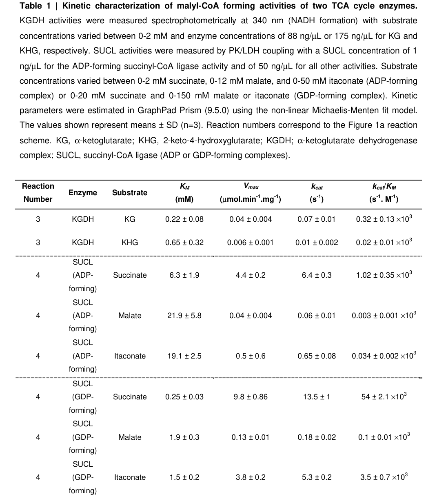

## Question

# Gene Research for Functional Annotation

## ⚠️ CRITICAL: Gene/Protein Identification Context

**BEFORE YOU BEGIN RESEARCH:** You MUST verify you are researching the CORRECT gene/protein. Gene symbols can be ambiguous, especially for less well-characterized genes from non-model organisms.

### Target Gene/Protein Identity (from UniProt):
- **UniProt Accession:** Q9P2R7
- **Protein Description:** RecName: Full=Succinate--CoA ligase [ADP-forming] subunit beta, mitochondrial {ECO:0000255|HAMAP-Rule:MF_03220}; EC=6.2.1.5 {ECO:0000255|HAMAP-Rule:MF_03220, ECO:0000269|PubMed:15877282}; AltName: Full=ATP-specific succinyl-CoA synthetase subunit beta {ECO:0000255|HAMAP-Rule:MF_03220}; Short=A-SCS {ECO:0000255|HAMAP-Rule:MF_03220}; AltName: Full=Itaconyl--CoA ligase [ADP-forming] subunit beta; EC=6.2.1.- {ECO:0000255|HAMAP-Rule:MF_03220, ECO:0000269|PubMed:40108300}; AltName: Full=Malyl--CoA ligase [ADP-forming] subunit beta; EC=6.2.1.9 {ECO:0000255|HAMAP-Rule:MF_03220, ECO:0000269|PubMed:40108300}; AltName: Full=Succinyl-CoA synthetase beta-A chain {ECO:0000255|HAMAP-Rule:MF_03220}; Short=SCS-betaA {ECO:0000255|HAMAP-Rule:MF_03220}; Flags: Precursor;
- **Gene Information:** Name=SUCLA2 {ECO:0000255|HAMAP-Rule:MF_03220, ECO:0000303|PubMed:34492704};
- **Organism (full):** Homo sapiens (Human).
- **Protein Family:** Belongs to the succinate/malate CoA ligase beta subunit
- **Key Domains:** ATP-grasp. (IPR011761); ATP-grasp_succ-CoA_synth-type. (IPR013650); ATP_grasp_subdomain_1. (IPR013815); Succ-CoA_synthase_bsu_CS. (IPR017866); SUCC_ACL_C. (IPR005811)

### MANDATORY VERIFICATION STEPS:

1. **Check if the gene symbol "SUCLA2" matches the protein description above**
2. **Verify the organism is correct:** Homo sapiens (Human).
3. **Check if protein family/domains align with what you find in literature**
4. **If you find literature for a DIFFERENT gene with the same or similar symbol, STOP**

### If Gene Symbol is Ambiguous or You Cannot Find Relevant Literature:

**DO NOT PROCEED WITH RESEARCH ON A DIFFERENT GENE.** Instead:
- State clearly: "The gene symbol 'SUCLA2' is ambiguous or literature is limited for this specific protein"
- Explain what you found (e.g., "Found extensive literature on a different gene with the same symbol in a different organism")
- Describe the protein based ONLY on the UniProt information provided above
- Suggest that the protein function can be inferred from domain/family information

### Research Target:

Please provide a comprehensive research report on the gene **SUCLA2** (gene ID: SUCLA2, UniProt: Q9P2R7) in human.

The research report should be a detailed narrative explaining the function, biological processes, and localization of the gene product. Citations should be given for all claims.

You should prioritize authoritative reviews and primary scientific literature when conducting research. You can supplement
this with annotations you find in gene/protein databases, but these can be outdated or inaccurate.

We are specifically interested in the primary function of the gene - for enzymes, what reaction is catalyzed, and what is the substrate specificity? For transporters, what is the substrate? For structural proteins or adapters, what is the broader structural role? For signaling molecules, what is the role in the pathway.

We are interested in where in or outside the cell the gene product carries out its function.

We are also interested in the signaling or biochemical pathways in which the gene functions. We are less interested in broad pleiotropic effects, except where these elucidate the precise role.

Include evidence where possible. We are interested in both experimental evidence as well as inference from structure, evolution, or bioinformatic analysis. Precise studies should be prioritized over high-throughput, where available.

## Output

Question: You are an expert researcher providing comprehensive, well-cited information.

Provide detailed information focusing on:
1. Key concepts and definitions with current understanding
2. Recent developments and latest research (prioritize 2023-2024 sources)
3. Current applications and real-world implementations
4. Expert opinions and analysis from authoritative sources
5. Relevant statistics and data from recent studies

Format as a comprehensive research report with proper citations. Include URLs and publication dates where available.
Always prioritize recent, authoritative sources and provide specific citations for all major claims.

# Gene Research for Functional Annotation

## ⚠️ CRITICAL: Gene/Protein Identification Context

**BEFORE YOU BEGIN RESEARCH:** You MUST verify you are researching the CORRECT gene/protein. Gene symbols can be ambiguous, especially for less well-characterized genes from non-model organisms.

### Target Gene/Protein Identity (from UniProt):
- **UniProt Accession:** Q9P2R7
- **Protein Description:** RecName: Full=Succinate--CoA ligase [ADP-forming] subunit beta, mitochondrial {ECO:0000255|HAMAP-Rule:MF_03220}; EC=6.2.1.5 {ECO:0000255|HAMAP-Rule:MF_03220, ECO:0000269|PubMed:15877282}; AltName: Full=ATP-specific succinyl-CoA synthetase subunit beta {ECO:0000255|HAMAP-Rule:MF_03220}; Short=A-SCS {ECO:0000255|HAMAP-Rule:MF_03220}; AltName: Full=Itaconyl--CoA ligase [ADP-forming] subunit beta; EC=6.2.1.- {ECO:0000255|HAMAP-Rule:MF_03220, ECO:0000269|PubMed:40108300}; AltName: Full=Malyl--CoA ligase [ADP-forming] subunit beta; EC=6.2.1.9 {ECO:0000255|HAMAP-Rule:MF_03220, ECO:0000269|PubMed:40108300}; AltName: Full=Succinyl-CoA synthetase beta-A chain {ECO:0000255|HAMAP-Rule:MF_03220}; Short=SCS-betaA {ECO:0000255|HAMAP-Rule:MF_03220}; Flags: Precursor;
- **Gene Information:** Name=SUCLA2 {ECO:0000255|HAMAP-Rule:MF_03220, ECO:0000303|PubMed:34492704};
- **Organism (full):** Homo sapiens (Human).
- **Protein Family:** Belongs to the succinate/malate CoA ligase beta subunit
- **Key Domains:** ATP-grasp. (IPR011761); ATP-grasp_succ-CoA_synth-type. (IPR013650); ATP_grasp_subdomain_1. (IPR013815); Succ-CoA_synthase_bsu_CS. (IPR017866); SUCC_ACL_C. (IPR005811)

### MANDATORY VERIFICATION STEPS:

1. **Check if the gene symbol "SUCLA2" matches the protein description above**
2. **Verify the organism is correct:** Homo sapiens (Human).
3. **Check if protein family/domains align with what you find in literature**
4. **If you find literature for a DIFFERENT gene with the same or similar symbol, STOP**

### If Gene Symbol is Ambiguous or You Cannot Find Relevant Literature:

**DO NOT PROCEED WITH RESEARCH ON A DIFFERENT GENE.** Instead:
- State clearly: "The gene symbol 'SUCLA2' is ambiguous or literature is limited for this specific protein"
- Explain what you found (e.g., "Found extensive literature on a different gene with the same symbol in a different organism")
- Describe the protein based ONLY on the UniProt information provided above
- Suggest that the protein function can be inferred from domain/family information

### Research Target:

Please provide a comprehensive research report on the gene **SUCLA2** (gene ID: SUCLA2, UniProt: Q9P2R7) in human.

The research report should be a detailed narrative explaining the function, biological processes, and localization of the gene product. Citations should be given for all claims.

You should prioritize authoritative reviews and primary scientific literature when conducting research. You can supplement
this with annotations you find in gene/protein databases, but these can be outdated or inaccurate.

We are specifically interested in the primary function of the gene - for enzymes, what reaction is catalyzed, and what is the substrate specificity? For transporters, what is the substrate? For structural proteins or adapters, what is the broader structural role? For signaling molecules, what is the role in the pathway.

We are interested in where in or outside the cell the gene product carries out its function.

We are also interested in the signaling or biochemical pathways in which the gene functions. We are less interested in broad pleiotropic effects, except where these elucidate the precise role.

Include evidence where possible. We are interested in both experimental evidence as well as inference from structure, evolution, or bioinformatic analysis. Precise studies should be prioritized over high-throughput, where available.

# Human SUCLA2: functional-annotation research report

**Identity and scope.** The supplied UniProt accession [Q9P2R7](https://www.uniprot.org/uniprotkb/Q9P2R7/entry) identifies human **SUCLA2**, the mitochondrial, ADP-forming succinyl-CoA ligase β-subunit. The literature independently confirms this assignment: SUCLA2 pairs with the shared α-subunit **SUCLG1** to form the ATP-producing enzyme, whereas the different β-subunit **SUCLG2** pairs with SUCLG1 to form the GDP-using, GTP-producing enzyme. These are distinct genes, not alternate names for the target protein. The ATP-grasp and CoA-ligase domains specified in the supplied annotation agree with the published structural and variant literature. (lancaster2023succinylcoasynthetasedysfunction pages 2-4, lancaster2023succinylcoasynthetasedysfunction pages 4-6, huang2020understandingthemechanism pages 14-17)

## Primary biochemical function and substrate specificity

The principal reaction of the **SUCLG1–SUCLA2 heterodimer** is the reversible mitochondrial tricarboxylic-acid-cycle reaction:

**Succinyl-CoA + ADP + inorganic phosphate ⇌ succinate + free CoA + ATP.**

In the usual forward TCA-cycle description, this is **substrate-level phosphorylation**: ATP is generated directly from ADP, without requiring ATP synthase to perform that phosphorylation. “ATP-specific” refers to the nucleotide **produced** in that direction; **ADP** is its nucleotide substrate. SUCLA2 determines the preference for the adenine nucleotide, in contrast to SUCLG2’s GDP/GTP-associated activity. Patient muscle mitochondria with damaging SUCLA2 variants have directly demonstrated markedly deficient ADP-forming succinyl-CoA synthetase activity. The human enzyme is an αβ heterodimer, so SUCLA2 should not be annotated as catalytically independent of SUCLG1. (lancaster2023succinylcoasynthetasedysfunction pages 2-4, elpeleg2005deficiencyofthe pages 1-3, dobolyi2015localizationofsucla2 pages 1-2)

Structurally, the β-subunit supplies the nucleotide-binding **ATP-grasp** region, while catalysis involves a transiently phosphorylated histidine on the α-subunit and movement of its phosphohistidine-containing loop between reaction sites. A human SUCLG1–SUCLA2 structure is identified as [PDB 6G4Q](https://www.rcsb.org/structure/6G4Q). Structural analogy helps explain the supplied ATP-grasp/CoA-ligase family assignments, but enzyme assays and genetics—not domain names alone—establish which nucleotide this particular human complex preferentially uses. (lancaster2023succinylcoasynthetasedysfunction pages 2-4, huang2020understandingthemechanism pages 114-118, huang2020understandingthemechanism pages 14-17)

**Newly characterized substrate breadth.** Griffith and colleagues’ peer-reviewed study, published **March 2025**, examined recombinant human ADP-forming SUCL alongside the GDP-forming complex. Both can use malate or itaconate instead of succinate in ATP- or GTP-consuming **reverse ligation** assays, yielding malyl-CoA or itaconyl-CoA, respectively. Detailed kinetic results in its **October 2024 preprint** indicate that the SUCLG1–SUCLA2 complex’s catalytic efficiency with itaconate was approximately **30-fold lower**, and with malate approximately **340-fold lower**, than with succinate. These are promiscuous activities, not evidence that malate or itaconate replaces succinate as the principal physiological substrate. Labeling showed that malate contributes carbon to cellular malyl-CoA, but did **not** establish that SUCLG1–SUCLA2 is its sole cellular source; α-ketoglutarate dehydrogenase has another documented malyl-CoA-forming side activity. The mitochondrial repair enzyme CLYBL hydrolyzes malyl-CoA, limiting its interference with the vitamin-B12-dependent methylmalonyl-CoA mutase. (griffith2025clyblavertsvitamin pages 1-2, griffith2024clyblavertsmethylmalonylcoa pages 13-15, griffith2024clyblavertsmethylmalonylcoa pages 3-5, griffith2024clyblavertsmethylmalonylcoa pages 5-7)

The following evidence summary distinguishes established SUCLA2 function from proposed or context-dependent roles. (lancaster2023succinylcoasynthetasedysfunction pages 2-4, griffith2024clyblavertsmethylmalonylcoa pages 3-5)

| Evidence tier | Finding | Evidence and interpretation | Key limitation / uncertainty |
|---|---|---|---|
| **Established identity and localization** | Human **SUCLA2** is the ADP-specific β-subunit; it pairs with the shared α-subunit **SUCLG1** to form ATP-producing A-SCS in the **mitochondrial matrix**. The alternative β-subunit **SUCLG2** forms GDP-specific/GTP-producing G-SCS. | Human subunit assignments, tissue-specific isoforms, matrix localization, and biochemical distinction are supported by structural, biochemical, and localization studies. SUCLA2 must not be conflated with SUCLG1 or SUCLG2. (lancaster2023succinylcoasynthetasedysfunction pages 2-4, dobolyi2015localizationofsucla2 pages 1-2, demirbas2019phenotypicvariabilityin pages 3-5) | SUCLA2 supplies nucleotide specificity but is not catalytically sufficient without SUCLG1; findings specific to SUCLG1 or SUCLG2 cannot automatically be assigned to SUCLA2. |
| **Canonical primary function—forward direction** | **Succinyl-CoA + ADP + Pi ⇌ succinate + CoA-SH + ATP.** In the TCA-cycle direction, A-SCS performs mitochondrial substrate-level phosphorylation. | The reaction is reversible and proceeds through an α-subunit phosphohistidine intermediate, while the β-subunit ATP-grasp region binds the adenine nucleotide. Human genetic deficiency selectively reduces ADP-forming activity. (lancaster2023succinylcoasynthetasedysfunction pages 2-4, elpeleg2005deficiencyofthe pages 1-3, dobolyi2015localizationofsucla2 pages 1-2, huang2020understandingthemechanism pages 14-17) | “ATP-specific” describes the ATP-forming enzyme product; mechanistically, ADP is the nucleotide substrate in the forward TCA-cycle direction. |
| **Canonical reaction—reverse direction** | The same complex can consume **ATP, succinate, and CoA-SH** to form **succinyl-CoA, ADP, and Pi** in vitro because the reaction is near equilibrium. | Reversibility is biochemically established, but physiological direction depends on matrix substrate/product concentrations and metabolic state. (lancaster2023succinylcoasynthetasedysfunction pages 2-4, dobolyi2015localizationofsucla2 pages 1-2) | In-vitro reversibility does not establish that reverse A-SCS flux is a major physiological source of succinyl-CoA in a given tissue. |
| **Alternative ligase activities—recent development** | Recombinant human ADP-forming SUCLG1–SUCLA2 can ligate CoA to **itaconate** and **malate** using ATP, yielding itaconyl-CoA and malyl-CoA as promiscuous side products. | The peer-reviewed 2025 study reports these activities; detailed 2024 preprint kinetics indicate that, relative to succinate, catalytic efficiency of the **ADP-forming SUCLG1–SUCLA2 complex** was approximately **30-fold lower for itaconate** and **340-fold lower for malate**. The corresponding GDP-forming SUCLG1–SUCLG2 values were different and must not be substituted. (griffith2025clyblavertsvitamin pages 1-2, griffith2024clyblavertsmethylmalonylcoa pages 13-15, griffith2024clyblavertsmethylmalonylcoa pages 3-5, griffith2024clyblavertsmethylmalonylcoa media 43034693) | These are low-efficiency side activities. Cellular isotope tracing established malate as a precursor of malyl-CoA, but did **not** prove that SUCLG1–SUCLA2 alone is its source in human cells; α-ketoglutarate dehydrogenase can also produce malyl-CoA. |
| **Human patient-cell mechanism** | SUCLA2 deficiency causes succinyl-CoA accumulation and broad protein hypersuccinylation. | Patient fibroblast proteomics identified **933 succinylated lysines across 366 proteins**; patient myotubes contained 194 sites across 91 proteins, with 86% also detected in fibroblasts. Affected pathways included the TCA cycle, oxidative phosphorylation, β-oxidation, and extramitochondrial processes. (gut2020sucla2mutationscause pages 1-2, gut2020sucla2mutationscause pages 3-4) | Site abundance does not by itself demonstrate functional impairment; effects are protein- and site-dependent. |
| **In-vivo mechanistic evidence** | Postnatal forebrain-specific Sucla2 loss strongly reduces SCS activity, raises methylmalonic acid, and causes hypersuccinylation without bulk cortical mtDNA depletion. | Mutant cortex showed **68% lower Sucla2 transcript**, **80–90% loss of the SCS complex**, **58% lower total SCS activity**, and a **14-fold MMA increase**; mtDNA copy number was slightly elevated rather than depleted. Complex-I dysfunction and altered neuronal transcription accompanied hypersuccinylation. (lancaster2023lossofsuccinylcoa pages 3-5, lancaster2023lossofsuccinylcoa pages 10-11) | Bulk cortex could mask neuron-specific mtDNA depletion. Associations with hypersuccinylation do not establish that every molecular or neurological phenotype is caused by that modification. |
| **Heme-pathway interaction** | SUCLA2 can physically associate with erythroid aminolevulinate synthase **ALAS2**, suggesting metabolic organization near the first step of heme synthesis. | Although reverse SCS flux was proposed to supply ALAS2 with succinyl-CoA, isotope/flux experiments found that late erythroid heme synthesis instead uses glutamine-derived α-ketoglutarate converted by α-ketoglutarate dehydrogenase; succinate was not an effective heme precursor. (burch2018glutamineviaαketoglutarate pages 1-6) | The interaction is supported, but its physiological role remains unresolved; it is **not evidence** that SUCLA2-generated succinyl-CoA is the principal erythroid heme substrate. |

*Table: Evidence-ranked summary of SUCLA2 identity, canonical and promiscuous reactions, localization, disease mechanisms, and disputed pathway assignments. The table separates established biochemical function from emerging or incompletely resolved physiological roles.*

## Cellular location and pathway connections

SUCLA2 is nuclear-encoded but functions **inside mitochondria, principally in the mitochondrial matrix**, as part of the soluble TCA-cycle succinyl-CoA ligase complex; its precursor annotation is consistent with mitochondrial import. Human cortical tissue studies localize SUCLA2 predominantly to **neurons** rather than the examined glial populations. This is a cell-type observation in sampled human cerebral cortex, not proof that SUCLA2 is absent from every glial cell in every region or condition. The ADP-forming isoform is particularly important in brain and skeletal muscle, whereas the GDP-forming isoform has a different tissue distribution. SUCLA2’s enzymatic location should not be confused with the wider cellular distribution of proteins secondarily modified when succinyl-CoA accumulates. (dobolyi2015localizationofsucla2 pages 1-2, lancaster2023succinylcoasynthetasedysfunction pages 2-4, gut2020sucla2mutationscause pages 1-2)

The reaction links the TCA cycle’s succinyl-CoA-producing step to succinate formation and matrix ATP production. It also connects to **odd-chain fatty-acid and amino-acid catabolism**: propionyl-CoA-derived methylmalonyl-CoA is converted by methylmalonyl-CoA mutase into succinyl-CoA that can enter this segment of the TCA cycle. Succinyl-CoA availability additionally matters for heme synthesis, but this does **not** mean SUCLA2 is itself a heme-synthesis enzyme. Physical interaction of SUCLA2 with erythroid aminolevulinate synthase ALAS2 prompted a proposal that *reverse* succinyl-CoA ligase activity supplies heme precursors. Experiments in differentiating erythroid cells instead found that glutamine-derived α-ketoglutarate, converted by α-ketoglutarate dehydrogenase, was the effective succinyl-CoA source; succinate was not an effective heme precursor. The interaction’s precise physiological purpose therefore remains unsettled. (lancaster2023succinylcoasynthetasedysfunction pages 2-4, burch2018glutamineviaαketoglutarate pages 1-6)

## Mechanistic evidence from human disease and recent models

Biallelic SUCLA2 dysfunction produces an inherited mitochondrial encephalomyopathy often associated with methylmalonic aciduria and, in some tissues, mitochondrial-DNA (*mtDNA*) depletion. The first patient study directly combined damaging SUCLA2 variation, deficient enzyme activity in muscle mitochondria, respiratory-chain abnormalities and mtDNA depletion. The **June 2023** Lancaster–Graham review counted **64 published SUCLA2 cases**, versus **33 SUCLG1 cases**, at its time of writing; these are literature case counts, **not prevalence estimates**. Commonly reported findings include early-onset hypotonia, dystonia, sensorineural hearing impairment, developmental impairment, basal-ganglia abnormalities, lactic acidosis and mild methylmalonic aciduria. C3 and C4-DC acylcarnitine elevations can provide additional diagnostic clues. Phenotypes and mtDNA depletion vary by patient and sampled tissue. (elpeleg2005deficiencyofthe pages 1-3, lancaster2023succinylcoasynthetasedysfunction pages 4-6, lancaster2023succinylcoasynthetasedysfunction pages 10-12, lancaster2023succinylcoasynthetasedysfunction pages 12-13)

There are at least two experimentally supported—and potentially coexisting—routes from failed succinyl-CoA ligase function to disease:

1. **mtDNA maintenance and respiration.** Constitutive mouse *Sucla2* deficiency produced approximately **20–60% mtDNA depletion** in affected embryonic tissues and approximately **50% lower mtDNA content** in mutant embryonic fibroblasts; reintroducing *Sucla2* restored fibroblast mtDNA. Association of the SCS complex with mitochondrial nucleoside-diphosphate kinase **NME4** motivates a model in which disrupted nucleotide salvage impairs mtDNA maintenance. The 2023 review stresses that precisely **how** SUCLA2 loss affects that interaction or mitochondrial nucleotide pools is unresolved; proposed mechanisms are not a demonstrated direct phosphoryl-transfer reaction from SUCLA2 to NME4. (donti2014screenforabnormal pages 2-2, lancaster2023succinylcoasynthetasedysfunction pages 13-15)
2. **Succinyl-CoA accumulation and protein hypersuccinylation.** In patient-derived SUCLA2-deficient cells, mass spectrometry detected **933 succinylated lysines across 366 proteins** in fibroblasts; myotubes yielded **194 sites across 91 proteins**. Increased succinyl-CoA and widespread modification affected mitochondrial metabolic proteins and proteins in other compartments. In *sucla2*-deficient zebrafish, SIRT5 gain of function reduced succinylation, improved survival and partly improved oxygen consumption **without restoring mtDNA abundance**. This intervention supports a pathogenic contribution from succinylation distinct from mtDNA depletion, but is preclinical, not an established treatment for patients. (gut2020sucla2mutationscause pages 3-4, gut2020sucla2mutationscause pages 1-2, gut2020sucla2mutationscause pages 9-10, gut2020sucla2mutationscause pages 7-8)

A **2023 Cell Reports** study sharpened that distinction using postnatal forebrain-specific *Sucla2* deletion in mice. Mutant cortex showed **68% lower *Sucla2* transcript**, **80–90% lower SCS-complex protein abundance**, approximately **58% lower total SCS activity**, and a **14-fold methylmalonic-acid increase**. Nevertheless, **bulk cortical mtDNA was not depleted**; it was slightly increased. The study also found hypersuccinylation, altered neuronal transcription and reduced complex-I activity. Bulk tissue cannot exclude neuron-specific mtDNA depletion, and the individual causal links between modified residues and downstream phenotypes remain to be established. These results caution against treating mtDNA depletion as an invariant consequence of SUCLA2 dysfunction. (lancaster2023lossofsuccinylcoa pages 3-5, lancaster2023lossofsuccinylcoa pages 13-15, lancaster2023lossofsuccinylcoa pages 10-11)

**Attribution boundary.** A notable **April 2024 EMBO Journal** report linked **SUCLG1**-dependent control of POLRMT succinylation to mitochondrial transcription and leukemia progression. Its central perturbation concerns the **shared α-subunit**, not demonstrated SUCLA2-specific control of that signaling axis. It should therefore not be used to assign a direct leukemia or POLRMT-regulatory function to Q9P2R7. (yan2024suclg1restrictspolrmt pages 1-2)

## Practical annotation and evidence-weighted conclusion

For functional annotation, the strongest assignment is: **human mitochondrial-matrix SUCLA2 is the ADP-preferring, ATP-grasp β-subunit of the SUCLG1–SUCLA2 succinyl-CoA ligase heterodimer, catalyzing the reversible succinyl-CoA/succinate step of the TCA cycle coupled to ADP/ATP interconversion**. Biochemical assays support lower-efficiency malate- and itaconate-ligation side reactions; genetic and metabolomic studies support roles in maintaining succinyl-CoA balance, mitochondrial function and, variably, mtDNA abundance. Neither the precise NME4-to-mtDNA mechanism nor a dominant erythroid heme-supplying reverse flux is established. Human use at present is chiefly **molecular and biochemical diagnosis** of SUCLA2-related mitochondrial disease and interpretation of patient variants; SIRT5 manipulation remains an experimental model-system result. (lancaster2023succinylcoasynthetasedysfunction pages 2-4, elpeleg2005deficiencyofthe pages 1-3, griffith2024clyblavertsmethylmalonylcoa pages 3-5, lancaster2023succinylcoasynthetasedysfunction pages 13-15, burch2018glutamineviaαketoglutarate pages 1-6, gut2020sucla2mutationscause pages 9-10)

**Selected source links and publication dates:** Lancaster & Graham, review, **June 2023**, [DOI:10.3390/ijms241310725](https://doi.org/10.3390/ijms241310725) (lancaster2023succinylcoasynthetasedysfunction pages 2-4); Lancaster *et al.*, forebrain mouse study, **October 2023**, [DOI:10.1016/j.celrep.2023.113241](https://doi.org/10.1016/j.celrep.2023.113241) (lancaster2023lossofsuccinylcoa pages 3-5); Griffith *et al.*, peer-reviewed side-activity/metabolite-repair study, **March 2025**, [DOI:10.1038/s41589-025-01857-9](https://doi.org/10.1038/s41589-025-01857-9), with detailed **October 2024 preprint** [DOI:10.1101/2024.09.25.614871](https://doi.org/10.1101/2024.09.25.614871) (griffith2025clyblavertsvitamin pages 1-2, griffith2024clyblavertsmethylmalonylcoa pages 3-5); Gut *et al.*, patient-cell and zebrafish study, **November 2020**, [DOI:10.1038/s41467-020-19743-4](https://doi.org/10.1038/s41467-020-19743-4) (gut2020sucla2mutationscause pages 3-4); Elpeleg *et al.*, initial human enzyme-deficiency study, **2005**, [DOI:10.1086/430843](https://doi.org/10.1086/430843) (elpeleg2005deficiencyofthe pages 1-3).

References

1. (lancaster2023succinylcoasynthetasedysfunction pages 2-4): Makayla S. Lancaster and Brett H. Graham. Succinyl-coa synthetase dysfunction as a mechanism of mitochondrial encephalomyopathy: more than just an oxidative energy deficit. International Journal of Molecular Sciences, 24:10725, Jun 2023. URL: https://doi.org/10.3390/ijms241310725, doi:10.3390/ijms241310725. This article has 34 citations.

2. (lancaster2023succinylcoasynthetasedysfunction pages 4-6): Makayla S. Lancaster and Brett H. Graham. Succinyl-coa synthetase dysfunction as a mechanism of mitochondrial encephalomyopathy: more than just an oxidative energy deficit. International Journal of Molecular Sciences, 24:10725, Jun 2023. URL: https://doi.org/10.3390/ijms241310725, doi:10.3390/ijms241310725. This article has 34 citations.

3. (huang2020understandingthemechanism pages 14-17): Ji Huang. Understanding the mechanism of succinyl-coa synthetase catalysis from structural studies. Unknown, Aug 2020. URL: https://doi.org/10.11575/prism/39384, doi:10.11575/prism/39384. This article has 1 citations.

4. (elpeleg2005deficiencyofthe pages 1-3): Orly Elpeleg, Chaya Miller, Eli Hershkovitz, Maria Bitner-Glindzicz, Gili Bondi-Rubinstein, Shamima Rahman, Alistair Pagnamenta, Sharon Eshhar, and Ann Saada. Deficiency of the adp-forming succinyl-coa synthase activity is associated with encephalomyopathy and mitochondrial dna depletion. American journal of human genetics, 76 6:1081-6, Jun 2005. URL: https://doi.org/10.1086/430843, doi:10.1086/430843. This article has 395 citations and is from a highest quality peer-reviewed journal.

5. (dobolyi2015localizationofsucla2 pages 1-2): Arpád Dobolyi, Attila G. Bagó, Aniko Gál, Mária J. Molnár, Miklós Palkovits, Vera Adam-Vizi, and Christos Chinopoulos. Localization of sucla2 and suclg2 subunits of succinyl coa ligase within the cerebral cortex suggests the absence of matrix substrate-level phosphorylation in glial cells of the human brain. Journal of Bioenergetics and Biomembranes, 47:33-41, Apr 2015. URL: https://doi.org/10.1007/s10863-014-9586-4, doi:10.1007/s10863-014-9586-4. This article has 23 citations and is from a peer-reviewed journal.

6. (huang2020understandingthemechanism pages 114-118): Ji Huang. Understanding the mechanism of succinyl-coa synthetase catalysis from structural studies. Unknown, Aug 2020. URL: https://doi.org/10.11575/prism/39384, doi:10.11575/prism/39384. This article has 1 citations.

7. (griffith2025clyblavertsvitamin pages 1-2): Corey M. Griffith, Jean-François Conrotte, Parisa Paydar, Xinqiang Xie, Ursula Heins-Marroquin, Floriane Gavotto, Christian Jäger, Kenneth W. Ellens, and Carole L. Linster. Clybl averts vitamin b12 depletion by repairing malyl-coa. Nature chemical biology, 21:906-915, Mar 2025. URL: https://doi.org/10.1038/s41589-025-01857-9, doi:10.1038/s41589-025-01857-9. This article has 11 citations and is from a highest quality peer-reviewed journal.

8. (griffith2024clyblavertsmethylmalonylcoa pages 13-15): Corey M. Griffith, Jean-François Conrotte, Parisa Paydar, Xinqiang Xie, Ursula Heins-Marroquin, Floriane Gavotto, Christian Jäger, Kenneth W. Ellens, and Carole L. Linster. Clybl averts methylmalonyl-coa mutase inhibition and loss of vitamin b12 by repairing malyl-coa. bioRxiv, Oct 2024. URL: https://doi.org/10.1101/2024.09.25.614871, doi:10.1101/2024.09.25.614871. This article has 0 citations.

9. (griffith2024clyblavertsmethylmalonylcoa pages 3-5): Corey M. Griffith, Jean-François Conrotte, Parisa Paydar, Xinqiang Xie, Ursula Heins-Marroquin, Floriane Gavotto, Christian Jäger, Kenneth W. Ellens, and Carole L. Linster. Clybl averts methylmalonyl-coa mutase inhibition and loss of vitamin b12 by repairing malyl-coa. bioRxiv, Oct 2024. URL: https://doi.org/10.1101/2024.09.25.614871, doi:10.1101/2024.09.25.614871. This article has 0 citations.

10. (griffith2024clyblavertsmethylmalonylcoa pages 5-7): Corey M. Griffith, Jean-François Conrotte, Parisa Paydar, Xinqiang Xie, Ursula Heins-Marroquin, Floriane Gavotto, Christian Jäger, Kenneth W. Ellens, and Carole L. Linster. Clybl averts methylmalonyl-coa mutase inhibition and loss of vitamin b12 by repairing malyl-coa. bioRxiv, Oct 2024. URL: https://doi.org/10.1101/2024.09.25.614871, doi:10.1101/2024.09.25.614871. This article has 0 citations.

11. (demirbas2019phenotypicvariabilityin pages 3-5): Didem Demirbas, David J. Harris, Pamela H. Arn, Xiaoping Huang, Susan E. Waisbren, Irina Anselm, Jordan P. Lerner‐Ellis, Lee‐Jun Wong, Harvey L. Levy, and Gerard T. Berry. Phenotypic variability in deficiency of the α subunit of succinate‐coa ligase. JIMD Reports, 46:63-69, Mar 2019. URL: https://doi.org/10.1002/jmd2.12018, doi:10.1002/jmd2.12018. This article has 9 citations and is from a peer-reviewed journal.

12. (griffith2024clyblavertsmethylmalonylcoa media 43034693): Corey M. Griffith, Jean-François Conrotte, Parisa Paydar, Xinqiang Xie, Ursula Heins-Marroquin, Floriane Gavotto, Christian Jäger, Kenneth W. Ellens, and Carole L. Linster. Clybl averts methylmalonyl-coa mutase inhibition and loss of vitamin b12 by repairing malyl-coa. bioRxiv, Oct 2024. URL: https://doi.org/10.1101/2024.09.25.614871, doi:10.1101/2024.09.25.614871. This article has 0 citations.

13. (gut2020sucla2mutationscause pages 1-2): Philipp Gut, Sanna Matilainen, Jesse G. Meyer, Pieti Pällijeff, Joy Richard, Christopher J. Carroll, Liliya Euro, Christopher B. Jackson, Pirjo Isohanni, Berge A. Minassian, Reem A. Alkhater, Elsebet Østergaard, Gabriele Civiletto, Alice Parisi, Jonathan Thevenet, Matthew J. Rardin, Wenjuan He, Yuya Nishida, John C. Newman, Xiaojing Liu, Stefan Christen, Sofia Moco, Jason W. Locasale, Birgit Schilling, Anu Suomalainen, and Eric Verdin. Sucla2 mutations cause global protein succinylation contributing to the pathomechanism of a hereditary mitochondrial disease. Nature Communications, Nov 2020. URL: https://doi.org/10.1038/s41467-020-19743-4, doi:10.1038/s41467-020-19743-4. This article has 93 citations and is from a highest quality peer-reviewed journal.

14. (gut2020sucla2mutationscause pages 3-4): Philipp Gut, Sanna Matilainen, Jesse G. Meyer, Pieti Pällijeff, Joy Richard, Christopher J. Carroll, Liliya Euro, Christopher B. Jackson, Pirjo Isohanni, Berge A. Minassian, Reem A. Alkhater, Elsebet Østergaard, Gabriele Civiletto, Alice Parisi, Jonathan Thevenet, Matthew J. Rardin, Wenjuan He, Yuya Nishida, John C. Newman, Xiaojing Liu, Stefan Christen, Sofia Moco, Jason W. Locasale, Birgit Schilling, Anu Suomalainen, and Eric Verdin. Sucla2 mutations cause global protein succinylation contributing to the pathomechanism of a hereditary mitochondrial disease. Nature Communications, Nov 2020. URL: https://doi.org/10.1038/s41467-020-19743-4, doi:10.1038/s41467-020-19743-4. This article has 93 citations and is from a highest quality peer-reviewed journal.

15. (lancaster2023lossofsuccinylcoa pages 3-5): Makayla S. Lancaster, Byungwook Kim, Emma H. Doud, Mason D. Tate, Ahmad D. Sharify, Hongyu Gao, Duojiao Chen, Ed Simpson, Patrick Gillespie, Xiaona Chu, Marcus J. Miller, Yue Wang, Yunlong Liu, Amber L. Mosley, Jungsu Kim, and Brett H. Graham. Loss of succinyl-coa synthetase in mouse forebrain results in hypersuccinylation with perturbed neuronal transcription and metabolism. Cell reports, 42:113241-113241, Oct 2023. URL: https://doi.org/10.1016/j.celrep.2023.113241, doi:10.1016/j.celrep.2023.113241. This article has 30 citations and is from a highest quality peer-reviewed journal.

16. (lancaster2023lossofsuccinylcoa pages 10-11): Makayla S. Lancaster, Byungwook Kim, Emma H. Doud, Mason D. Tate, Ahmad D. Sharify, Hongyu Gao, Duojiao Chen, Ed Simpson, Patrick Gillespie, Xiaona Chu, Marcus J. Miller, Yue Wang, Yunlong Liu, Amber L. Mosley, Jungsu Kim, and Brett H. Graham. Loss of succinyl-coa synthetase in mouse forebrain results in hypersuccinylation with perturbed neuronal transcription and metabolism. Cell reports, 42:113241-113241, Oct 2023. URL: https://doi.org/10.1016/j.celrep.2023.113241, doi:10.1016/j.celrep.2023.113241. This article has 30 citations and is from a highest quality peer-reviewed journal.

17. (burch2018glutamineviaαketoglutarate pages 1-6): Joseph S. Burch, Jason R. Marcero, John Alan Maschek, James E. Cox, Laurie K. Jackson, Amy E. Medlock, John D. Phillips, and Harry A. Dailey. Glutamine via α-ketoglutarate dehydrogenase provides succinyl-coa for heme synthesis during erythropoiesis. Blood, 132 10:987-998, Sep 2018. URL: https://doi.org/10.1182/blood-2018-01-829036, doi:10.1182/blood-2018-01-829036. This article has 125 citations and is from a highest quality peer-reviewed journal.

18. (lancaster2023succinylcoasynthetasedysfunction pages 10-12): Makayla S. Lancaster and Brett H. Graham. Succinyl-coa synthetase dysfunction as a mechanism of mitochondrial encephalomyopathy: more than just an oxidative energy deficit. International Journal of Molecular Sciences, 24:10725, Jun 2023. URL: https://doi.org/10.3390/ijms241310725, doi:10.3390/ijms241310725. This article has 34 citations.

19. (lancaster2023succinylcoasynthetasedysfunction pages 12-13): Makayla S. Lancaster and Brett H. Graham. Succinyl-coa synthetase dysfunction as a mechanism of mitochondrial encephalomyopathy: more than just an oxidative energy deficit. International Journal of Molecular Sciences, 24:10725, Jun 2023. URL: https://doi.org/10.3390/ijms241310725, doi:10.3390/ijms241310725. This article has 34 citations.

20. (donti2014screenforabnormal pages 2-2): Taraka R. Donti, Carmen Stromberger, Ming Ge, Karen W. Eldin, William J. Craigen, and Brett H. Graham. Screen for abnormal mitochondrial phenotypes in mouse embryonic stem cells identifies a model for succinyl-coa ligase deficiency and mtdna depletion. Disease Models & Mechanisms, 7:271-280, Nov 2014. URL: https://doi.org/10.1242/dmm.013466, doi:10.1242/dmm.013466. This article has 34 citations and is from a domain leading peer-reviewed journal.

21. (lancaster2023succinylcoasynthetasedysfunction pages 13-15): Makayla S. Lancaster and Brett H. Graham. Succinyl-coa synthetase dysfunction as a mechanism of mitochondrial encephalomyopathy: more than just an oxidative energy deficit. International Journal of Molecular Sciences, 24:10725, Jun 2023. URL: https://doi.org/10.3390/ijms241310725, doi:10.3390/ijms241310725. This article has 34 citations.

22. (gut2020sucla2mutationscause pages 9-10): Philipp Gut, Sanna Matilainen, Jesse G. Meyer, Pieti Pällijeff, Joy Richard, Christopher J. Carroll, Liliya Euro, Christopher B. Jackson, Pirjo Isohanni, Berge A. Minassian, Reem A. Alkhater, Elsebet Østergaard, Gabriele Civiletto, Alice Parisi, Jonathan Thevenet, Matthew J. Rardin, Wenjuan He, Yuya Nishida, John C. Newman, Xiaojing Liu, Stefan Christen, Sofia Moco, Jason W. Locasale, Birgit Schilling, Anu Suomalainen, and Eric Verdin. Sucla2 mutations cause global protein succinylation contributing to the pathomechanism of a hereditary mitochondrial disease. Nature Communications, Nov 2020. URL: https://doi.org/10.1038/s41467-020-19743-4, doi:10.1038/s41467-020-19743-4. This article has 93 citations and is from a highest quality peer-reviewed journal.

23. (gut2020sucla2mutationscause pages 7-8): Philipp Gut, Sanna Matilainen, Jesse G. Meyer, Pieti Pällijeff, Joy Richard, Christopher J. Carroll, Liliya Euro, Christopher B. Jackson, Pirjo Isohanni, Berge A. Minassian, Reem A. Alkhater, Elsebet Østergaard, Gabriele Civiletto, Alice Parisi, Jonathan Thevenet, Matthew J. Rardin, Wenjuan He, Yuya Nishida, John C. Newman, Xiaojing Liu, Stefan Christen, Sofia Moco, Jason W. Locasale, Birgit Schilling, Anu Suomalainen, and Eric Verdin. Sucla2 mutations cause global protein succinylation contributing to the pathomechanism of a hereditary mitochondrial disease. Nature Communications, Nov 2020. URL: https://doi.org/10.1038/s41467-020-19743-4, doi:10.1038/s41467-020-19743-4. This article has 93 citations and is from a highest quality peer-reviewed journal.

24. (lancaster2023lossofsuccinylcoa pages 13-15): Makayla S. Lancaster, Byungwook Kim, Emma H. Doud, Mason D. Tate, Ahmad D. Sharify, Hongyu Gao, Duojiao Chen, Ed Simpson, Patrick Gillespie, Xiaona Chu, Marcus J. Miller, Yue Wang, Yunlong Liu, Amber L. Mosley, Jungsu Kim, and Brett H. Graham. Loss of succinyl-coa synthetase in mouse forebrain results in hypersuccinylation with perturbed neuronal transcription and metabolism. Cell reports, 42:113241-113241, Oct 2023. URL: https://doi.org/10.1016/j.celrep.2023.113241, doi:10.1016/j.celrep.2023.113241. This article has 30 citations and is from a highest quality peer-reviewed journal.

25. (yan2024suclg1restrictspolrmt pages 1-2): Weiwei Yan, Chengmei Xie, Sijun Sun, Quan Zheng, Jingyi Wang, Zihao Wang, Cheuk-Him Man, Haiyan Wang, Yunfan Yang, Tianshi Wang, Leilei Shi, Shengjie Zhang, Chen Huang, Shuangnian Xu, and Yi-Ping Wang. Suclg1 restricts polrmt succinylation to enhance mitochondrial biogenesis and leukemia progression. The EMBO Journal, 43:2337-2367, Apr 2024. URL: https://doi.org/10.1038/s44318-024-00101-9, doi:10.1038/s44318-024-00101-9. This article has 50 citations.

## Artifacts

- [Edison artifact artifact-00](SUCLA2-deep-research-falcon_artifacts/artifact-00.md)

## Citations

1. lancaster2023succinylcoasynthetasedysfunction pages 2-4
2. lancaster2023lossofsuccinylcoa pages 3-5
3. elpeleg2005deficiencyofthe pages 1-3
4. lancaster2023succinylcoasynthetasedysfunction pages 4-6
5. huang2020understandingthemechanism pages 14-17
6. huang2020understandingthemechanism pages 114-118
7. griffith2025clyblavertsvitamin pages 1-2
8. griffith2024clyblavertsmethylmalonylcoa pages 13-15
9. griffith2024clyblavertsmethylmalonylcoa pages 3-5
10. griffith2024clyblavertsmethylmalonylcoa pages 5-7
11. demirbas2019phenotypicvariabilityin pages 3-5
12. lancaster2023lossofsuccinylcoa pages 10-11
13. lancaster2023succinylcoasynthetasedysfunction pages 10-12
14. lancaster2023succinylcoasynthetasedysfunction pages 12-13
15. donti2014screenforabnormal pages 2-2
16. lancaster2023succinylcoasynthetasedysfunction pages 13-15
17. lancaster2023lossofsuccinylcoa pages 13-15
18. ADP-forming
19. Q9P2R7
20. PDB 6G4Q
21. DOI:10.3390/ijms241310725
22. DOI:10.1016/j.celrep.2023.113241
23. DOI:10.1038/s41589-025-01857-9
24. DOI:10.1101/2024.09.25.614871
25. DOI:10.1038/s41467-020-19743-4
26. DOI:10.1086/430843
27. https://www.uniprot.org/uniprotkb/Q9P2R7/entry
28. https://www.rcsb.org/structure/6G4Q
29. https://doi.org/10.3390/ijms241310725
30. https://doi.org/10.1016/j.celrep.2023.113241
31. https://doi.org/10.1038/s41589-025-01857-9
32. https://doi.org/10.1101/2024.09.25.614871
33. https://doi.org/10.1038/s41467-020-19743-4
34. https://doi.org/10.1086/430843
35. https://doi.org/10.3390/ijms241310725,
36. https://doi.org/10.11575/prism/39384,
37. https://doi.org/10.1086/430843,
38. https://doi.org/10.1007/s10863-014-9586-4,
39. https://doi.org/10.1038/s41589-025-01857-9,
40. https://doi.org/10.1101/2024.09.25.614871,
41. https://doi.org/10.1002/jmd2.12018,
42. https://doi.org/10.1038/s41467-020-19743-4,
43. https://doi.org/10.1016/j.celrep.2023.113241,
44. https://doi.org/10.1182/blood-2018-01-829036,
45. https://doi.org/10.1242/dmm.013466,
46. https://doi.org/10.1038/s44318-024-00101-9,