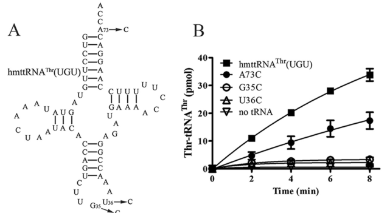

## Question

# Gene Research for Functional Annotation

## ⚠️ CRITICAL: Gene/Protein Identification Context

**BEFORE YOU BEGIN RESEARCH:** You MUST verify you are researching the CORRECT gene/protein. Gene symbols can be ambiguous, especially for less well-characterized genes from non-model organisms.

### Target Gene/Protein Identity (from UniProt):
- **UniProt Accession:** Q9BW92
- **Protein Description:** RecName: Full=Threonine--tRNA ligase, mitochondrial; EC=6.1.1.3 {ECO:0000269|PubMed:26811336}; AltName: Full=Threonyl-tRNA synthetase; Short=ThrRS; AltName: Full=Threonyl-tRNA synthetase-like 1; Flags: Precursor;
- **Gene Information:** Name=TARS2; Synonyms=TARSL1;
- **Organism (full):** Homo sapiens (Human).
- **Protein Family:** Belongs to the class-II aminoacyl-tRNA synthetase family.
- **Key Domains:** aa-tRNA-synt_IIb. (IPR002314); aa-tRNA-synth_II. (IPR006195); aa-tRNA-synth_II/BPL/LPL. (IPR045864); Anticodon-bd. (IPR004154); Anticodon-bd_dom_sf. (IPR036621)

### MANDATORY VERIFICATION STEPS:

1. **Check if the gene symbol "TARS2" matches the protein description above**
2. **Verify the organism is correct:** Homo sapiens (Human).
3. **Check if protein family/domains align with what you find in literature**
4. **If you find literature for a DIFFERENT gene with the same or similar symbol, STOP**

### If Gene Symbol is Ambiguous or You Cannot Find Relevant Literature:

**DO NOT PROCEED WITH RESEARCH ON A DIFFERENT GENE.** Instead:
- State clearly: "The gene symbol 'TARS2' is ambiguous or literature is limited for this specific protein"
- Explain what you found (e.g., "Found extensive literature on a different gene with the same symbol in a different organism")
- Describe the protein based ONLY on the UniProt information provided above
- Suggest that the protein function can be inferred from domain/family information

### Research Target:

Please provide a comprehensive research report on the gene **TARS2** (gene ID: TARS2, UniProt: Q9BW92) in human.

The research report should be a detailed narrative explaining the function, biological processes, and localization of the gene product. Citations should be given for all claims.

You should prioritize authoritative reviews and primary scientific literature when conducting research. You can supplement
this with annotations you find in gene/protein databases, but these can be outdated or inaccurate.

We are specifically interested in the primary function of the gene - for enzymes, what reaction is catalyzed, and what is the substrate specificity? For transporters, what is the substrate? For structural proteins or adapters, what is the broader structural role? For signaling molecules, what is the role in the pathway.

We are interested in where in or outside the cell the gene product carries out its function.

We are also interested in the signaling or biochemical pathways in which the gene functions. We are less interested in broad pleiotropic effects, except where these elucidate the precise role.

Include evidence where possible. We are interested in both experimental evidence as well as inference from structure, evolution, or bioinformatic analysis. Precise studies should be prioritized over high-throughput, where available.

## Output

Question: You are an expert researcher providing comprehensive, well-cited information.

Provide detailed information focusing on:
1. Key concepts and definitions with current understanding
2. Recent developments and latest research (prioritize 2023-2024 sources)
3. Current applications and real-world implementations
4. Expert opinions and analysis from authoritative sources
5. Relevant statistics and data from recent studies

Format as a comprehensive research report with proper citations. Include URLs and publication dates where available.
Always prioritize recent, authoritative sources and provide specific citations for all major claims.

# Gene Research for Functional Annotation

## ⚠️ CRITICAL: Gene/Protein Identification Context

**BEFORE YOU BEGIN RESEARCH:** You MUST verify you are researching the CORRECT gene/protein. Gene symbols can be ambiguous, especially for less well-characterized genes from non-model organisms.

### Target Gene/Protein Identity (from UniProt):
- **UniProt Accession:** Q9BW92
- **Protein Description:** RecName: Full=Threonine--tRNA ligase, mitochondrial; EC=6.1.1.3 {ECO:0000269|PubMed:26811336}; AltName: Full=Threonyl-tRNA synthetase; Short=ThrRS; AltName: Full=Threonyl-tRNA synthetase-like 1; Flags: Precursor;
- **Gene Information:** Name=TARS2; Synonyms=TARSL1;
- **Organism (full):** Homo sapiens (Human).
- **Protein Family:** Belongs to the class-II aminoacyl-tRNA synthetase family.
- **Key Domains:** aa-tRNA-synt_IIb. (IPR002314); aa-tRNA-synth_II. (IPR006195); aa-tRNA-synth_II/BPL/LPL. (IPR045864); Anticodon-bd. (IPR004154); Anticodon-bd_dom_sf. (IPR036621)

### MANDATORY VERIFICATION STEPS:

1. **Check if the gene symbol "TARS2" matches the protein description above**
2. **Verify the organism is correct:** Homo sapiens (Human).
3. **Check if protein family/domains align with what you find in literature**
4. **If you find literature for a DIFFERENT gene with the same or similar symbol, STOP**

### If Gene Symbol is Ambiguous or You Cannot Find Relevant Literature:

**DO NOT PROCEED WITH RESEARCH ON A DIFFERENT GENE.** Instead:
- State clearly: "The gene symbol 'TARS2' is ambiguous or literature is limited for this specific protein"
- Explain what you found (e.g., "Found extensive literature on a different gene with the same symbol in a different organism")
- Describe the protein based ONLY on the UniProt information provided above
- Suggest that the protein function can be inferred from domain/family information

### Research Target:

Please provide a comprehensive research report on the gene **TARS2** (gene ID: TARS2, UniProt: Q9BW92) in human.

The research report should be a detailed narrative explaining the function, biological processes, and localization of the gene product. Citations should be given for all claims.

You should prioritize authoritative reviews and primary scientific literature when conducting research. You can supplement
this with annotations you find in gene/protein databases, but these can be outdated or inaccurate.

We are specifically interested in the primary function of the gene - for enzymes, what reaction is catalyzed, and what is the substrate specificity? For transporters, what is the substrate? For structural proteins or adapters, what is the broader structural role? For signaling molecules, what is the role in the pathway.

We are interested in where in or outside the cell the gene product carries out its function.

We are also interested in the signaling or biochemical pathways in which the gene functions. We are less interested in broad pleiotropic effects, except where these elucidate the precise role.

Include evidence where possible. We are interested in both experimental evidence as well as inference from structure, evolution, or bioinformatic analysis. Precise studies should be prioritized over high-throughput, where available.

# Human TARS2: functional annotation and research report

## Identity and principal function

**Identity check.** The specified human protein, UniProt **Q9BW92**, is the product of **TARS2** (the supplied synonym is *TARSL1*). Primary research independently identifies human TARS2 as the nuclear gene encoding **mitochondrial threonyl-tRNA synthetase** (mtThrRS), a class-II aminoacyl-tRNA synthetase. This is **not** cytoplasmic TARS1, nor the separate threonyl-tRNA-synthetase-like gene *TARSL2*. The Q9BW92 accession and *TARSL1* synonym are supplied identification metadata; the literature examined establishes the TARS2 protein identity but does not independently verify that accession–synonym mapping. (wang2016ahumandiseasecausing pages 4-5, zeng2023lossofthreonyltrna pages 1-2, barai2024beyondproteinsynthesis pages 1-2)

**Primary reaction.** TARS2 charges *mitochondrial tRNA^Thr* with **L-threonine**, using ATP. It first forms threonyl-AMP and pyrophosphate, then transfers threonine to the tRNA’s 3′-terminal adenosine: **L-threonine + ATP + mitochondrial tRNA^Thr → L-threonyl–tRNA^Thr + AMP + PPi**. The charged tRNA supplies threonine at Thr codons during mitochondrial protein synthesis. Purified human TARS2 performs threonine activation and mitochondrial tRNA^Thr aminoacylation directly; this assignment is therefore experimental, not merely inferred from its domain annotations. (wang2016ahumandiseasecausing pages 1-2, wang2016ahumandiseasecausing pages 4-5, zheng2020nitrosativestressinhibits pages 1-2)

Human mitochondrial tRNA^Thr has a **UGU anticodon**. In substrate-mutagenesis experiments, replacing either anticodon nucleotide **G35** or **U36** eliminated charging, whereas changing discriminator nucleotide **A73** partially impaired it. Amino-acid selection favors threonine over the similar, noncognate amino acid serine by approximately **383-fold** in the measured activation assay; measured *K*m values were **2.5 ± 0.1 mM** for threonine and **180 ± 14 mM** for serine. These are *in-vitro activation parameters*, not estimates of the cellular mistranslation rate. The study also found limited charging of some nonmitochondrial tRNAs in vitro, so physiological specificity is best stated as **preferential charging of mitochondrial tRNA^Thr in its mitochondrial compartment**, not absolute inability to recognize every other tRNA. (wang2016ahumandiseasecausing pages 5-6, wang2016ahumandiseasecausing media 18f44078)

TARS2 also **proofreads serine misactivation and mischarging**. Human enzyme assays detected both pre-transfer editing and hydrolysis of incorrectly formed **Ser–tRNA^Thr**. Substituting editing-site **His133 and His137** abolished the latter, post-transfer deacylation and increased Ser–tRNA^Thr accumulation. Although tRNA-dependent pre-transfer editing contributed strongly to measured AMP production, post-transfer editing was the decisive final protection against detectable mischarged tRNA in these assays. (wang2016ahumandiseasecausing pages 1-2, wang2016ahumandiseasecausing pages 6-8)

## Structure, site of action and pathways

The **718-residue precursor** is made from a nuclear gene in the cytosol and imported into mitochondria using an N-terminal targeting sequence. Human-cell microscopy supports mitochondrial localization. Its organization comprises an N-terminal region, an **N2 editing domain**, a class-II **aminoacylation catalytic core**, and a **C-terminal anticodon-binding/tRNA-binding domain**; the catalytic-core and anticodon-binding annotations in the question align with this experimentally studied architecture. The N-terminal cleavage position has **not** been definitively established: a computational prediction and the N-terminal deletion yielding a soluble active recombinant enzyme gave different indications. (wang2016ahumandiseasecausing pages 4-5, wang2016ahumandiseasecausing pages 9-11, zhang2024tars2c.470c pages 1-2)

Within mitochondria, native mtThrRS forms foci that colocalize with the **GRSF1-marked mitochondrial RNA granules**. Deleting its C-terminal tRNA-binding region markedly reduced enrichment at those granules, consistent with local organization of tRNA charging near mitochondrial RNA metabolism; colocalization does not prove that every charging event occurs inside a granule. A 2022 interaction study also identified mitochondrial ArgRS among TARS2-associated synthetases, without establishing that this interaction is required for TARS2 catalysis. (peng2022rnagranuleclusteredmitochondrial pages 5-6, peng2022rnagranuleclusteredmitochondrial pages 6-7, peng2022rnagranuleclusteredmitochondrial pages 1-2)

The principal biochemical pathway is **mitochondrial gene expression → translation of mitochondrially encoded respiratory-chain subunits → oxidative phosphorylation (OXPHOS)**. Human mitochondrial DNA specifies 13 proteins; insufficient correctly charged mitochondrial tRNA^Thr or defective proofreading can consequently compromise respiratory-chain production and function. In a **2023 mouse Tars2 editing-deficiency model**, Ser–tRNA^Thr and Thr-to-Ser substitutions accumulated, mitochondrial translation and OXPHOS declined, and reactive oxygen species increased. Heart-restricted editing deficiency caused impaired cardiomyocyte proliferation, contractile dysfunction, dilated cardiomyopathy and fibrosis. This model establishes the importance of *editing fidelity* in vivo, but a mouse editing-site mutation should not be treated as the measured effect of every human TARS2 allele. (zheng2023mammalianmitochondrialtranslation pages 1-2, accogli2023clinicalneuroradiologicaland pages 1-3)

**Additional signaling role.** Research reviewed in **2024** reports that TARS2 participates in **threonine-sensitive mTORC1 signaling**, physically engaging the Rag amino-acid-sensing machinery and favoring RagA GTP loading, lysosomal mTORC1 recruitment and activation after threonine stimulation. This is a function distinct from supplying mitochondrial ribosomes with threonyl–tRNA^Thr; how TARS2 drives RagA nucleotide exchange remains unresolved. A **2023** disease study found that TARS2 residues **301–381** are important for Rag interaction. Four variants in this region had diminished protein abundance and reduced co-immunoprecipitation with RagA and RagC, so impaired signaling is plausible, although reduced stability complicates attributing each binding defect solely to an altered interface. A review reports a cytosolic TARS2 fraction of roughly **10–15%**; that figure must not be interpreted as a measured lysosomal fraction. The review also cautions that the precise mechanistic link between Rag binding and nucleotide loading is unknown. (barai2024beyondproteinsynthesis pages 4-6, accogli2023clinicalneuroradiologicaland pages 10-11, tyynismaa2023diseasemodelsof pages 2-3)

## Recent human evidence and applications

**Inherited disease and variant interpretation.** Biallelic pathogenic TARS2 variants cause the recessive mitochondrial encephalomyopathy termed **combined oxidative phosphorylation deficiency 21 (COXPD21)**. In a **2023 Genetics in Medicine** study, **18 newly identified individuals from 15 families** were assessed using sequencing, clinical evaluation, protein-interaction assays and zebrafish experiments. Across its expanded case series, axial hypotonia was reported in **24/27**, elevated blood lactate in **17/20**, and seizures in **14/28** individuals assessed for those features; denominators vary because observations were incomplete. In the newly described cohort, cerebellar atrophy occurred in **12/16** with evaluated imaging. These findings support TARS2 sequencing and careful variant assessment in compatible early-onset neurodevelopmental or mitochondrial presentations, rather than making any single feature diagnostic. (accogli2023clinicalneuroradiologicaland pages 1-3, accogli2023clinicalneuroradiologicaland pages 11-12, accogli2023clinicalneuroradiologicaland pages 8-10)

The same **2023** study found that zebrafish *tars2* knockdown disrupted brain, heart, myelin and muscle development; supplying **wild-type human TARS2 mRNA** rescued major phenotypes. The fish also showed changes in mTORC1-associated readouts, while tested human variants often failed to rescue or rescued only partially. These assays strengthen pathogenicity assessments but do not, by themselves, determine whether each human allele primarily damages tRNA charging, editing, protein stability or Rag signaling. (accogli2023clinicalneuroradiologicaland pages 10-11)

A **2024 Orphanet Journal of Rare Diseases** report added **four affected individuals from three unrelated Chinese families** and two previously unreported TARS2 variants. The recurrent **c.470C>G, p.Thr157Arg** allele was reported in **six Chinese affected individuals** overall; the authors proposed a Chinese-specific founder mutation and its relevance to population-aware carrier screening. The report principally supplies genetic and clinical evidence, **not direct enzyme assays** proving what that allele does to TARS2 catalysis. (zhang2024tars2c.470c pages 2-4, zhang2024tars2c.470c pages 4-6, zhang2024tars2c.470c pages 1-2)

**Other experimental implications.** In human cells, S-nitrosation of mtThrRS was detectable, and experimental nitrosative stress reduced its aminoacylation and editing activities; this identifies a potential regulatory mechanism, not an established treatment target. A lung-adenocarcinoma study associated higher TARS2 expression with poorer survival and found that knockdown suppressed proliferation and xenograft growth. The **2024 expert review** explicitly notes that the lung-cancer experiments did **not** test whether mTORC1 signaling mediated those effects. Neither observation changes mitochondrial tRNA charging and proofreading as the best-established primary function. (zheng2020nitrosativestressinhibits pages 1-2, barai2024beyondproteinsynthesis pages 6-8)

The following evidence map separates direct biochemical findings, disease-model results and more qualified interpretations:

| Process/site | TARS2-specific experimental result and representative data | Evidence level | Citation |
|---|---|---|---|
| Mitochondrial tRNA^Thr charging | Purified human mitochondrial ThrRS activated threonine and charged mitochondrial tRNA^Thr(UGU). It discriminated threonine over serine by **383-fold**; G35C or U36C abolished charging, whereas A73C partially reduced it. | Direct human in-vitro biochemistry and tRNA identity-element mutagenesis | (wang2016ahumandiseasecausing pages 5-6, wang2016ahumandiseasecausing media 18f44078) |
| Translational proofreading | Human TARS2 can misactivate serine. Mutating editing-site **His133/His137** eliminated deacylation of Ser-tRNA^Thr and increased mischarging, establishing post-transfer editing as the critical final safeguard. | Direct human enzyme mutagenesis and biochemical assays | (wang2016ahumandiseasecausing pages 6-8) |
| Editing fidelity in vivo | Disabling the corresponding mouse Tars2 editing residues caused Ser-tRNA^Thr accumulation and Thr→Ser mistranslation, impaired mitochondrial translation/OXPHOS, increased ROS, and induced G0/G1 arrest. Heart-restricted editing deficiency produced contractile dysfunction, dilated cardiomyopathy, and fibrosis. | 2023 primary study using mammalian cells and a genetically engineered mouse model | (zheng2023mammalianmitochondrialtranslation pages 1-2) |
| Mitochondrial localization and RNA granules | TARS2 is synthesized as a nuclear-encoded precursor with an N-terminal targeting sequence and imported into mitochondria. Native mitochondrial ThrRS formed foci that colocalized with the mitochondrial RNA-granule marker GRSF1; deleting its C-terminal tRNA-binding region markedly reduced enrichment at GRSF1 foci. | Human-cell localization, microscopy, and domain-deletion evidence | (wang2016ahumandiseasecausing pages 4-5, peng2022rnagranuleclusteredmitochondrial pages 5-6, peng2022rnagranuleclusteredmitochondrial pages 6-7) |
| Cytosolic pool | A 2023 review reports that approximately **10–15%** of TARS2 is cytosolic. This estimate should **not** be interpreted as showing that 10–15% is lysosomal; no quantitative lysosome-versus-mitochondrion partition was established in the cited excerpt. | Secondary-source estimate; compartmental interpretation limited | (tyynismaa2023diseasemodelsof pages 2-3) |
| Threonine-sensitive Rag–mTORC1 signaling | TARS2 residues **301–381** mediate Rag interaction. Four disease variants in this region had reduced abundance (**38.9–65.6% of wild type**) and reduced normalized binding to RagA (**41.3–48.2%**) and RagC (**20.4–50.5%**), supporting impaired amino-acid-dependent mTORC1 activation. | 2023 human-cell co-immunoprecipitation and disease-variant analysis; lower protein stability is a potential confounder | (accogli2023clinicalneuroradiologicaland pages 10-11) |
| Developmental and mTORC1-related effects | Zebrafish tars2 knockdown caused reduced head/cerebellar size, cardiac edema, apoptosis, impaired myelination, and muscle abnormalities; wild-type human TARS2 mRNA rescued major phenotypes. PGC1α decreased and PPARα increased, consistent with altered mTORC1-regulated signaling. | 2023 in-vivo morpholino/rescue model; supportive rather than definitive human-pathway proof | (accogli2023clinicalneuroradiologicaland pages 10-11) |
| Human recessive disease burden | In a 2023 cohort, **18 new individuals from 15 families** carried biallelic TARS2 variants. Across the expanded series, axial hypotonia occurred in **24/27**, elevated lactate in **17/20**, seizures in **14/28**, and cerebellar atrophy in **75%** of those assessed. | Multicenter human genetic/clinical study with functional variant testing | (accogli2023clinicalneuroradiologicaland pages 11-12, accogli2023clinicalneuroradiologicaland pages 1-3) |
| 2024 founder-allele development | Four affected individuals from three unrelated Chinese families carried biallelic TARS2 variants. **c.470C>G (p.Thr157Arg)** recurred in six Chinese cases; its estimated frequency was **3/251,430** East-Asian gnomAD alleles and **1.8 per 10,000** in a Chinese testing database. Direct functional testing of this allele was not reported. | 2024 clinical-genetic founder study; recurrence and population evidence, not biochemical validation | (zhang2024tars2c.470c pages 2-4, zhang2024tars2c.470c pages 4-6, zhang2024tars2c.470c pages 1-2) |

*Table: Concise evidence map for human TARS2 covering mitochondrial tRNA charging and proofreading, subcellular localization, Rag–mTORC1 signaling, animal models, and recent human genetic findings. It distinguishes direct experiments from secondary interpretations and clinical association evidence.*

### Selected sources, publication dates and URLs

- **Wang et al., 18 March 2016**, *Journal of Biological Chemistry*: purified human TARS2, tRNA specificity, editing and P282L characterization. https://doi.org/10.1074/jbc.M115.700849 (wang2016ahumandiseasecausing pages 1-2, wang2016ahumandiseasecausing pages 5-6, wang2016ahumandiseasecausing pages 8-9)
- **Peng et al., December 2022**, *Nucleic Acids Research*: mitochondrial RNA-granule localization and synthetase interactions. https://doi.org/10.1093/nar/gkac1141 (peng2022rnagranuleclusteredmitochondrial pages 5-6, peng2022rnagranuleclusteredmitochondrial pages 6-7)
- **Zheng et al., 5 September 2023**, *PNAS*: mammalian Tars2 editing-fidelity and cardiac model. https://doi.org/10.1073/pnas.2309714120 (zheng2023mammalianmitochondrialtranslation pages 1-2)
- **Accogli et al., November 2023**; available online **13 July 2023**, *Genetics in Medicine*: human cohort, Rag interactions and zebrafish functional testing. https://doi.org/10.1016/j.gim.2023.100938 (accogli2023clinicalneuroradiologicaland pages 1-3, accogli2023clinicalneuroradiologicaland pages 10-11)
- **Barai and Chen, March 2024**, *Biochemical Society Transactions*: expert synthesis distinguishing TARS1, TARS2 and TARSL2 and assessing noncanonical signaling. https://doi.org/10.1042/BST20230506 (barai2024beyondproteinsynthesis pages 6-8, barai2024beyondproteinsynthesis pages 4-6)
- **Zhang et al., October 2024**, *Orphanet Journal of Rare Diseases*: Chinese families and recurrent p.Thr157Arg. https://doi.org/10.1186/s13023-024-03365-w (zhang2024tars2c.470c pages 2-4, zhang2024tars2c.470c pages 1-2)

**Functional-annotation conclusion:** Human **TARS2/Q9BW92** is primarily a **mitochondrial, class-II threonyl-tRNA synthetase** that uses threonine and ATP to charge mitochondrial tRNA^Thr and edits erroneous serine charging. Its experimentally supported consequences are accurate mitochondrial translation and maintenance of OXPHOS; threonine-responsive Rag–mTORC1 signaling is an additional, mechanistically less fully resolved role. (wang2016ahumandiseasecausing pages 1-2, wang2016ahumandiseasecausing pages 5-6, zheng2023mammalianmitochondrialtranslation pages 1-2, barai2024beyondproteinsynthesis pages 4-6)

References

1. (wang2016ahumandiseasecausing pages 4-5): Yong Wang, Xiao-Long Zhou, Zhi-Rong Ruan, Ru-Juan Liu, Gilbert Eriani, and En-Duo Wang. A human disease-causing point mutation in mitochondrial threonyl-trna synthetase induces both structural and functional defects. Journal of Biological Chemistry, 291:6507-6520, Mar 2016. URL: https://doi.org/10.1074/jbc.m115.700849, doi:10.1074/jbc.m115.700849. This article has 52 citations and is from a domain leading peer-reviewed journal.

2. (zeng2023lossofthreonyltrna pages 1-2): Qi-Yu Zeng, Fan Zhang, Jian-Hui Zhang, Zhoufei Hei, Zi-Han Li, Meng-Han Huang, Pengfei Fang, En-Duo Wang, Xiao-Jian Sun, and Xiao-Long Zhou. Loss of threonyl-trna synthetase-like protein tarsl2 has little impact on protein synthesis but affects mouse development. Journal of Biological Chemistry, 299:104704, May 2023. URL: https://doi.org/10.1016/j.jbc.2023.104704, doi:10.1016/j.jbc.2023.104704. This article has 8 citations and is from a domain leading peer-reviewed journal.

3. (barai2024beyondproteinsynthesis pages 1-2): Pallob Barai and Jie Chen. Beyond protein synthesis: non-translational functions of threonyl-trna synthetases. Biochemical Society Transactions, 52:661-670, Mar 2024. URL: https://doi.org/10.1042/bst20230506, doi:10.1042/bst20230506. This article has 15 citations and is from a peer-reviewed journal.

4. (wang2016ahumandiseasecausing pages 1-2): Yong Wang, Xiao-Long Zhou, Zhi-Rong Ruan, Ru-Juan Liu, Gilbert Eriani, and En-Duo Wang. A human disease-causing point mutation in mitochondrial threonyl-trna synthetase induces both structural and functional defects. Journal of Biological Chemistry, 291:6507-6520, Mar 2016. URL: https://doi.org/10.1074/jbc.m115.700849, doi:10.1074/jbc.m115.700849. This article has 52 citations and is from a domain leading peer-reviewed journal.

5. (zheng2020nitrosativestressinhibits pages 1-2): Wen-Qiang Zheng, Yuying Zhang, Qin Yao, Yuzhe Chen, Xinhua Qiao, En-Duo Wang, Chang Chen, and Xiao-Long Zhou. Nitrosative stress inhibits aminoacylation and editing activities of mitochondrial threonyl-trna synthetase by s-nitrosation. Nucleic Acids Research, 48:6799-6810, Jun 2020. URL: https://doi.org/10.1093/nar/gkaa471, doi:10.1093/nar/gkaa471. This article has 15 citations and is from a highest quality peer-reviewed journal.

6. (wang2016ahumandiseasecausing pages 5-6): Yong Wang, Xiao-Long Zhou, Zhi-Rong Ruan, Ru-Juan Liu, Gilbert Eriani, and En-Duo Wang. A human disease-causing point mutation in mitochondrial threonyl-trna synthetase induces both structural and functional defects. Journal of Biological Chemistry, 291:6507-6520, Mar 2016. URL: https://doi.org/10.1074/jbc.m115.700849, doi:10.1074/jbc.m115.700849. This article has 52 citations and is from a domain leading peer-reviewed journal.

7. (wang2016ahumandiseasecausing media 18f44078): Yong Wang, Xiao-Long Zhou, Zhi-Rong Ruan, Ru-Juan Liu, Gilbert Eriani, and En-Duo Wang. A human disease-causing point mutation in mitochondrial threonyl-trna synthetase induces both structural and functional defects. Journal of Biological Chemistry, 291:6507-6520, Mar 2016. URL: https://doi.org/10.1074/jbc.m115.700849, doi:10.1074/jbc.m115.700849. This article has 52 citations and is from a domain leading peer-reviewed journal.

8. (wang2016ahumandiseasecausing pages 6-8): Yong Wang, Xiao-Long Zhou, Zhi-Rong Ruan, Ru-Juan Liu, Gilbert Eriani, and En-Duo Wang. A human disease-causing point mutation in mitochondrial threonyl-trna synthetase induces both structural and functional defects. Journal of Biological Chemistry, 291:6507-6520, Mar 2016. URL: https://doi.org/10.1074/jbc.m115.700849, doi:10.1074/jbc.m115.700849. This article has 52 citations and is from a domain leading peer-reviewed journal.

9. (wang2016ahumandiseasecausing pages 9-11): Yong Wang, Xiao-Long Zhou, Zhi-Rong Ruan, Ru-Juan Liu, Gilbert Eriani, and En-Duo Wang. A human disease-causing point mutation in mitochondrial threonyl-trna synthetase induces both structural and functional defects. Journal of Biological Chemistry, 291:6507-6520, Mar 2016. URL: https://doi.org/10.1074/jbc.m115.700849, doi:10.1074/jbc.m115.700849. This article has 52 citations and is from a domain leading peer-reviewed journal.

10. (zhang2024tars2c.470c pages 1-2): Shujie Zhang, Haisong Qin, Qingming Wang, Yingfei Wang, Yanhui Liu, Qi Yang, Jingsi Luo, Zailong Qin, Xiang Ji, Lijuan Kan, Guoxing Geng, Jing Huang, Shengkai Wei, Qiuli Chen, Yiping Shen, Haiming Yuan, and Baoling Lai. Tars2 c.470 c > g is a chinese-specific founder mutation in three unrelated families with mitochondrial encephalomyopathy. Orphanet Journal of Rare Diseases, Oct 2024. URL: https://doi.org/10.1186/s13023-024-03365-w, doi:10.1186/s13023-024-03365-w. This article has 3 citations and is from a peer-reviewed journal.

11. (peng2022rnagranuleclusteredmitochondrial pages 5-6): Gui-Xin Peng, Xue-Ling Mao, Yating Cao, Shi-Ying Yao, Qing-Run Li, Xin Chen, En-Duo Wang, and Xiao-Long Zhou. Rna granule-clustered mitochondrial aminoacyl-trna synthetases form multiple complexes with the potential to fine-tune trna aminoacylation. Nucleic Acids Research, 50:12951-12968, Dec 2022. URL: https://doi.org/10.1093/nar/gkac1141, doi:10.1093/nar/gkac1141. This article has 20 citations and is from a highest quality peer-reviewed journal.

12. (peng2022rnagranuleclusteredmitochondrial pages 6-7): Gui-Xin Peng, Xue-Ling Mao, Yating Cao, Shi-Ying Yao, Qing-Run Li, Xin Chen, En-Duo Wang, and Xiao-Long Zhou. Rna granule-clustered mitochondrial aminoacyl-trna synthetases form multiple complexes with the potential to fine-tune trna aminoacylation. Nucleic Acids Research, 50:12951-12968, Dec 2022. URL: https://doi.org/10.1093/nar/gkac1141, doi:10.1093/nar/gkac1141. This article has 20 citations and is from a highest quality peer-reviewed journal.

13. (peng2022rnagranuleclusteredmitochondrial pages 1-2): Gui-Xin Peng, Xue-Ling Mao, Yating Cao, Shi-Ying Yao, Qing-Run Li, Xin Chen, En-Duo Wang, and Xiao-Long Zhou. Rna granule-clustered mitochondrial aminoacyl-trna synthetases form multiple complexes with the potential to fine-tune trna aminoacylation. Nucleic Acids Research, 50:12951-12968, Dec 2022. URL: https://doi.org/10.1093/nar/gkac1141, doi:10.1093/nar/gkac1141. This article has 20 citations and is from a highest quality peer-reviewed journal.

14. (zheng2023mammalianmitochondrialtranslation pages 1-2): Wen-Qiang Zheng, Jian-Hui Zhang, Zi-Han Li, Xiuxiu Liu, Yong Zhang, Shuo Huang, Jinsong Li, Bin Zhou, Gilbert Eriani, En-Duo Wang, and Xiao-Long Zhou. Mammalian mitochondrial translation infidelity leads to oxidative stress–induced cell cycle arrest and cardiomyopathy. Proceedings of the National Academy of Sciences of the United States of America, Sep 2023. URL: https://doi.org/10.1073/pnas.2309714120, doi:10.1073/pnas.2309714120. This article has 40 citations and is from a highest quality peer-reviewed journal.

15. (accogli2023clinicalneuroradiologicaland pages 1-3): Andrea Accogli, Sheng-Jia Lin, Mariasavina Severino, Sung-Hoon Kim, Kevin Huang, Clarissa Rocca, Megan Landsverk, Maha S. Zaki, Almundher Al-Maawali, Varunvenkat M. Srinivasan, Khalid Al-Thihli, G. Bradly Schaefer, Monica Davis, Davide Tonduti, Chiara Doneda, Lara M. Marten, Chris Mühlhausen, Maria Gomez, Eleonora Lamantea, Rafael Mena, Mathilde Nizon, Vincent Procaccio, Amber Begtrup, Aida Telegrafi, Hong Cui, Heidi L. Schulz, Julia Mohr, Saskia Biskup, Mariana Amina Loos, Hilda Verónica Aráoz, Vincenzo Salpietro, Laura Davis Keppen, Manali Chitre, Cassidy Petree, Lucy Raymond, Julie Vogt, Lindsey B. Sawyer, Alice A. Basinger, Signe Vandal Pedersen, Toni S. Pearson, Dorothy K. Grange, Lokesh Lingappa, Paige McDunnah, Rita Horvath, Benjamin Cognè, Bertrand Isidor, Andreas Hahn, Karen W. Gripp, Seyed Mehdi Jafarnejad, Elsebet Østergaard, Carlos E. Prada, Daniele Ghezzi, Vykuntaraju K. Gowda, Robert W. Taylor, Nahum Sonenberg, Henry Houlden, Marie Sissler, Gaurav K. Varshney, and Reza Maroofian. Clinical, neuroradiological, and molecular characterization of mitochondrial threonyl-trna-synthetase (tars2)-related disorder. Genetics in Medicine, 25:100938, Nov 2023. URL: https://doi.org/10.1016/j.gim.2023.100938, doi:10.1016/j.gim.2023.100938. This article has 16 citations and is from a highest quality peer-reviewed journal.

16. (barai2024beyondproteinsynthesis pages 4-6): Pallob Barai and Jie Chen. Beyond protein synthesis: non-translational functions of threonyl-trna synthetases. Biochemical Society Transactions, 52:661-670, Mar 2024. URL: https://doi.org/10.1042/bst20230506, doi:10.1042/bst20230506. This article has 15 citations and is from a peer-reviewed journal.

17. (accogli2023clinicalneuroradiologicaland pages 10-11): Andrea Accogli, Sheng-Jia Lin, Mariasavina Severino, Sung-Hoon Kim, Kevin Huang, Clarissa Rocca, Megan Landsverk, Maha S. Zaki, Almundher Al-Maawali, Varunvenkat M. Srinivasan, Khalid Al-Thihli, G. Bradly Schaefer, Monica Davis, Davide Tonduti, Chiara Doneda, Lara M. Marten, Chris Mühlhausen, Maria Gomez, Eleonora Lamantea, Rafael Mena, Mathilde Nizon, Vincent Procaccio, Amber Begtrup, Aida Telegrafi, Hong Cui, Heidi L. Schulz, Julia Mohr, Saskia Biskup, Mariana Amina Loos, Hilda Verónica Aráoz, Vincenzo Salpietro, Laura Davis Keppen, Manali Chitre, Cassidy Petree, Lucy Raymond, Julie Vogt, Lindsey B. Sawyer, Alice A. Basinger, Signe Vandal Pedersen, Toni S. Pearson, Dorothy K. Grange, Lokesh Lingappa, Paige McDunnah, Rita Horvath, Benjamin Cognè, Bertrand Isidor, Andreas Hahn, Karen W. Gripp, Seyed Mehdi Jafarnejad, Elsebet Østergaard, Carlos E. Prada, Daniele Ghezzi, Vykuntaraju K. Gowda, Robert W. Taylor, Nahum Sonenberg, Henry Houlden, Marie Sissler, Gaurav K. Varshney, and Reza Maroofian. Clinical, neuroradiological, and molecular characterization of mitochondrial threonyl-trna-synthetase (tars2)-related disorder. Genetics in Medicine, 25:100938, Nov 2023. URL: https://doi.org/10.1016/j.gim.2023.100938, doi:10.1016/j.gim.2023.100938. This article has 16 citations and is from a highest quality peer-reviewed journal.

18. (tyynismaa2023diseasemodelsof pages 2-3): Henna Tyynismaa. Disease models of mitochondrial aminoacyl‐<scp>trna</scp> synthetase defects. Journal of Inherited Metabolic Disease, 46:817-823, Jul 2023. URL: https://doi.org/10.1002/jimd.12652, doi:10.1002/jimd.12652. This article has 8 citations and is from a peer-reviewed journal.

19. (accogli2023clinicalneuroradiologicaland pages 11-12): Andrea Accogli, Sheng-Jia Lin, Mariasavina Severino, Sung-Hoon Kim, Kevin Huang, Clarissa Rocca, Megan Landsverk, Maha S. Zaki, Almundher Al-Maawali, Varunvenkat M. Srinivasan, Khalid Al-Thihli, G. Bradly Schaefer, Monica Davis, Davide Tonduti, Chiara Doneda, Lara M. Marten, Chris Mühlhausen, Maria Gomez, Eleonora Lamantea, Rafael Mena, Mathilde Nizon, Vincent Procaccio, Amber Begtrup, Aida Telegrafi, Hong Cui, Heidi L. Schulz, Julia Mohr, Saskia Biskup, Mariana Amina Loos, Hilda Verónica Aráoz, Vincenzo Salpietro, Laura Davis Keppen, Manali Chitre, Cassidy Petree, Lucy Raymond, Julie Vogt, Lindsey B. Sawyer, Alice A. Basinger, Signe Vandal Pedersen, Toni S. Pearson, Dorothy K. Grange, Lokesh Lingappa, Paige McDunnah, Rita Horvath, Benjamin Cognè, Bertrand Isidor, Andreas Hahn, Karen W. Gripp, Seyed Mehdi Jafarnejad, Elsebet Østergaard, Carlos E. Prada, Daniele Ghezzi, Vykuntaraju K. Gowda, Robert W. Taylor, Nahum Sonenberg, Henry Houlden, Marie Sissler, Gaurav K. Varshney, and Reza Maroofian. Clinical, neuroradiological, and molecular characterization of mitochondrial threonyl-trna-synthetase (tars2)-related disorder. Genetics in Medicine, 25:100938, Nov 2023. URL: https://doi.org/10.1016/j.gim.2023.100938, doi:10.1016/j.gim.2023.100938. This article has 16 citations and is from a highest quality peer-reviewed journal.

20. (accogli2023clinicalneuroradiologicaland pages 8-10): Andrea Accogli, Sheng-Jia Lin, Mariasavina Severino, Sung-Hoon Kim, Kevin Huang, Clarissa Rocca, Megan Landsverk, Maha S. Zaki, Almundher Al-Maawali, Varunvenkat M. Srinivasan, Khalid Al-Thihli, G. Bradly Schaefer, Monica Davis, Davide Tonduti, Chiara Doneda, Lara M. Marten, Chris Mühlhausen, Maria Gomez, Eleonora Lamantea, Rafael Mena, Mathilde Nizon, Vincent Procaccio, Amber Begtrup, Aida Telegrafi, Hong Cui, Heidi L. Schulz, Julia Mohr, Saskia Biskup, Mariana Amina Loos, Hilda Verónica Aráoz, Vincenzo Salpietro, Laura Davis Keppen, Manali Chitre, Cassidy Petree, Lucy Raymond, Julie Vogt, Lindsey B. Sawyer, Alice A. Basinger, Signe Vandal Pedersen, Toni S. Pearson, Dorothy K. Grange, Lokesh Lingappa, Paige McDunnah, Rita Horvath, Benjamin Cognè, Bertrand Isidor, Andreas Hahn, Karen W. Gripp, Seyed Mehdi Jafarnejad, Elsebet Østergaard, Carlos E. Prada, Daniele Ghezzi, Vykuntaraju K. Gowda, Robert W. Taylor, Nahum Sonenberg, Henry Houlden, Marie Sissler, Gaurav K. Varshney, and Reza Maroofian. Clinical, neuroradiological, and molecular characterization of mitochondrial threonyl-trna-synthetase (tars2)-related disorder. Genetics in Medicine, 25:100938, Nov 2023. URL: https://doi.org/10.1016/j.gim.2023.100938, doi:10.1016/j.gim.2023.100938. This article has 16 citations and is from a highest quality peer-reviewed journal.

21. (zhang2024tars2c.470c pages 2-4): Shujie Zhang, Haisong Qin, Qingming Wang, Yingfei Wang, Yanhui Liu, Qi Yang, Jingsi Luo, Zailong Qin, Xiang Ji, Lijuan Kan, Guoxing Geng, Jing Huang, Shengkai Wei, Qiuli Chen, Yiping Shen, Haiming Yuan, and Baoling Lai. Tars2 c.470 c > g is a chinese-specific founder mutation in three unrelated families with mitochondrial encephalomyopathy. Orphanet Journal of Rare Diseases, Oct 2024. URL: https://doi.org/10.1186/s13023-024-03365-w, doi:10.1186/s13023-024-03365-w. This article has 3 citations and is from a peer-reviewed journal.

22. (zhang2024tars2c.470c pages 4-6): Shujie Zhang, Haisong Qin, Qingming Wang, Yingfei Wang, Yanhui Liu, Qi Yang, Jingsi Luo, Zailong Qin, Xiang Ji, Lijuan Kan, Guoxing Geng, Jing Huang, Shengkai Wei, Qiuli Chen, Yiping Shen, Haiming Yuan, and Baoling Lai. Tars2 c.470 c > g is a chinese-specific founder mutation in three unrelated families with mitochondrial encephalomyopathy. Orphanet Journal of Rare Diseases, Oct 2024. URL: https://doi.org/10.1186/s13023-024-03365-w, doi:10.1186/s13023-024-03365-w. This article has 3 citations and is from a peer-reviewed journal.

23. (barai2024beyondproteinsynthesis pages 6-8): Pallob Barai and Jie Chen. Beyond protein synthesis: non-translational functions of threonyl-trna synthetases. Biochemical Society Transactions, 52:661-670, Mar 2024. URL: https://doi.org/10.1042/bst20230506, doi:10.1042/bst20230506. This article has 15 citations and is from a peer-reviewed journal.

24. (wang2016ahumandiseasecausing pages 8-9): Yong Wang, Xiao-Long Zhou, Zhi-Rong Ruan, Ru-Juan Liu, Gilbert Eriani, and En-Duo Wang. A human disease-causing point mutation in mitochondrial threonyl-trna synthetase induces both structural and functional defects. Journal of Biological Chemistry, 291:6507-6520, Mar 2016. URL: https://doi.org/10.1074/jbc.m115.700849, doi:10.1074/jbc.m115.700849. This article has 52 citations and is from a domain leading peer-reviewed journal.

## Artifacts

- [Edison artifact artifact-00](TARS2-deep-research-falcon_artifacts/artifact-00.md)

## Citations

1. accogli2023clinicalneuroradiologicaland pages 10-11
2. wang2016ahumandiseasecausing pages 6-8
3. zheng2023mammalianmitochondrialtranslation pages 1-2
4. tyynismaa2023diseasemodelsof pages 2-3
5. wang2016ahumandiseasecausing pages 4-5
6. zeng2023lossofthreonyltrna pages 1-2
7. barai2024beyondproteinsynthesis pages 1-2
8. wang2016ahumandiseasecausing pages 1-2
9. zheng2020nitrosativestressinhibits pages 1-2
10. wang2016ahumandiseasecausing pages 5-6
11. wang2016ahumandiseasecausing pages 9-11
12. peng2022rnagranuleclusteredmitochondrial pages 5-6
13. peng2022rnagranuleclusteredmitochondrial pages 6-7
14. peng2022rnagranuleclusteredmitochondrial pages 1-2
15. accogli2023clinicalneuroradiologicaland pages 1-3
16. barai2024beyondproteinsynthesis pages 4-6
17. accogli2023clinicalneuroradiologicaland pages 11-12
18. accogli2023clinicalneuroradiologicaland pages 8-10
19. barai2024beyondproteinsynthesis pages 6-8
20. wang2016ahumandiseasecausing pages 8-9
21. https://doi.org/10.1074/jbc.M115.700849
22. https://doi.org/10.1093/nar/gkac1141
23. https://doi.org/10.1073/pnas.2309714120
24. https://doi.org/10.1016/j.gim.2023.100938
25. https://doi.org/10.1042/BST20230506
26. https://doi.org/10.1186/s13023-024-03365-w
27. https://doi.org/10.1074/jbc.m115.700849,
28. https://doi.org/10.1016/j.jbc.2023.104704,
29. https://doi.org/10.1042/bst20230506,
30. https://doi.org/10.1093/nar/gkaa471,
31. https://doi.org/10.1186/s13023-024-03365-w,
32. https://doi.org/10.1093/nar/gkac1141,
33. https://doi.org/10.1073/pnas.2309714120,
34. https://doi.org/10.1016/j.gim.2023.100938,
35. https://doi.org/10.1002/jimd.12652,