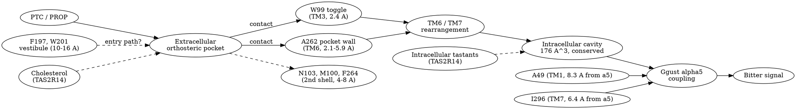
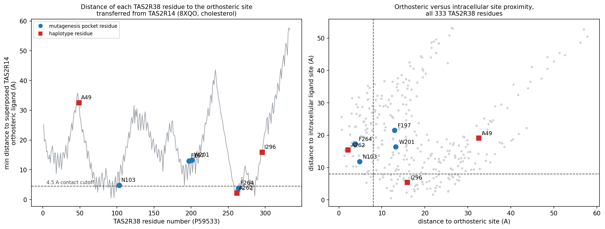
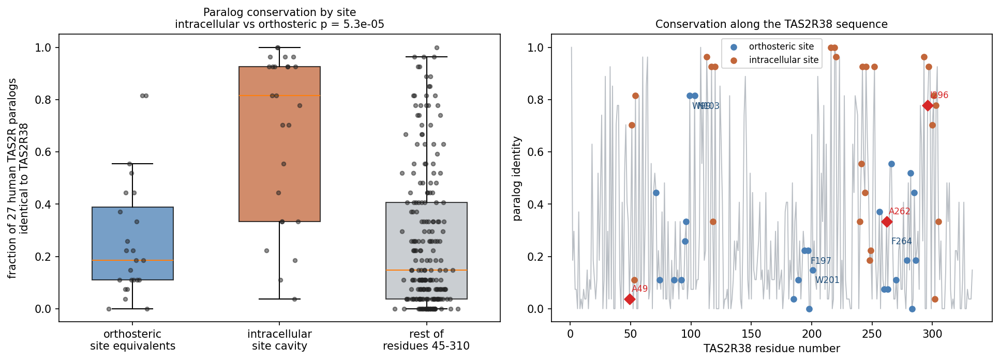
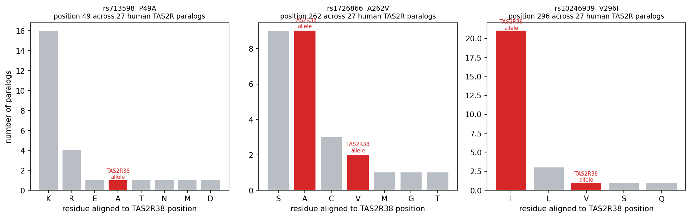
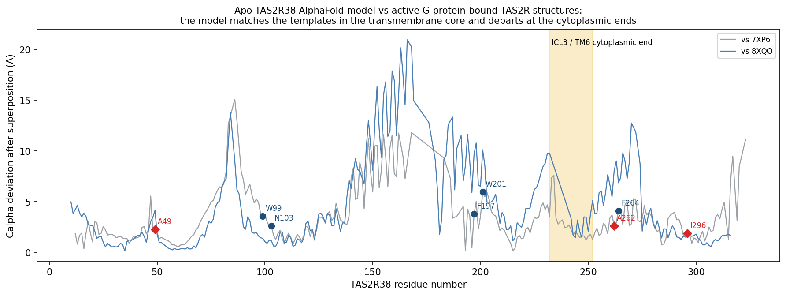
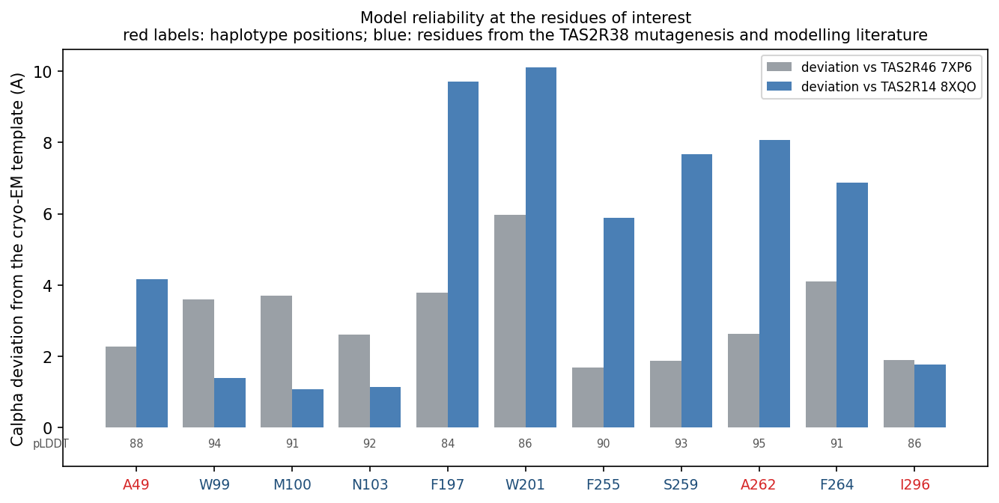

## Question

# AIGR Gene Hypothesis Deep Research

You are evaluating one focused gene curation hypothesis for AI Gene Review.
This is not a general gene overview. Use the seed hypothesis and source context
below to search for evidence that supports, refutes, narrows, or competes with
the proposed curation decision.

## Target Gene

- **Organism code:** human
- **Taxon:** Homo sapiens (NCBITaxon:9606)
- **Gene directory:** TAS2R38
- **Gene symbol:** TAS2R38
- **UniProt accession:** P59533

## Focus

- **Focus type:** free_text
- **Hypothesis slug:** kgap-tas2r38-pocket-vs-tas2r-cryoem
- **Source file:** genes/human/TAS2R38/TAS2R38-ai-review.yaml
- **Source selector:** free-text

## Seed Hypothesis

The PTC/PROP binding pocket of human TAS2R38 (P59533) proposed from homology models and mutagenesis (N103, F197, W201, F264 and other tested residues) maps onto the orthosteric ligand pockets resolved in recent cryo-EM structures of other human bitter taste receptors (TAS2R14, TAS2R46), and an AlphaFold model of TAS2R38 built on that fold places the haplotype-defining residues P49A, A262V and V296I outside the ligand pocket at positions affecting G-protein coupling or helix packing. Single analysis only: align TAS2R38 with TAS2R14 and TAS2R46 of known structure, superpose the TAS2R38 AlphaFold model on the agonist-bound cryo-EM structures, map the mutagenesis-defined pocket residues and the three haplotype residues onto the model, measure whether the mapped residues line one contiguous pocket matching the template orthosteric site, and state how well the homology-model pocket is supported by the cryo-EM-templated structure.

## Term and Decision Context

No specific term context supplied.

## Reference Context

No specific reference context supplied.

## Source Context YAML

```yaml
hypothesis: 'The PTC/PROP binding pocket of human TAS2R38 (P59533) proposed from homology models and mutagenesis
  (N103, F197, W201, F264 and other tested residues) maps onto the orthosteric ligand pockets resolved
  in recent cryo-EM structures of other human bitter taste receptors (TAS2R14, TAS2R46), and an AlphaFold
  model of TAS2R38 built on that fold places the haplotype-defining residues P49A, A262V and V296I outside
  the ligand pocket at positions affecting G-protein coupling or helix packing. Single analysis only:
  align TAS2R38 with TAS2R14 and TAS2R46 of known structure, superpose the TAS2R38 AlphaFold model on
  the agonist-bound cryo-EM structures, map the mutagenesis-defined pocket residues and the three haplotype
  residues onto the model, measure whether the mapped residues line one contiguous pocket matching the
  template orthosteric site, and state how well the homology-model pocket is supported by the cryo-EM-templated
  structure.'
focus_type: free_text
context: []
reference_id: []
```

## Research Objective

Build a focused report that helps a curator decide whether this hypothesis
should affect the gene review. Address the focus type directly:

1. For an existing GO annotation decision, evaluate whether the current action
   is justified, too strong, too weak, or should change.
2. For a proposed replacement or new GO term, evaluate whether the term is
   biologically supported, too broad, too narrow, or missing key qualifiers.
3. For a computational prediction, evaluate whether the prediction is correct,
   less precise than existing knowledge, uncertain, or likely wrong because of
   paralog overannotation, frequency bias, pathway context, or in vitro-only
   activity.
4. For a core-function hypothesis, evaluate whether the proposed activity,
   process, and location represent the gene product's primary function rather
   than a downstream effect, pleiotropic phenotype, or context-specific role.
5. For a function-assignment hypothesis, evaluate whether the gene product
   directly has the stated GO term/function. Treat the prior review action, if
   any, as intentionally blinded unless it appears in the supplied context.

Use primary literature whenever possible. Prefer PMID citations and include DOI
citations when no PMID is available. Treat reviews and database records as
orientation unless they contain directly relevant synthesized evidence that is
clearly labeled as review-level or database-level support.

Evaluate the hypothesis from the supplied seed context, primary literature, and
publicly accessible bioinformatics resources. Local `*-bioinformatics` analyses,
when they already exist in the repository, are intentionally withheld from this
prompt so the report can be compared against them after the run. Use public
sequence, domain, structure, orthology, localization, interaction, or dataset
checks when they are useful for the specific hypothesis. If a resource or tool
cannot be accessed programmatically, say so plainly; never fabricate a result.
Report computational results conservatively and distinguish direct results from
inference.

## Required Output

### Executive Judgment

Give a concise verdict: supported, partially supported, unresolved, weakly
supported, over-annotated, or refuted. Explain the reasoning and the most
important caveats.

### Evidence Matrix

Create a table with one row per important evidence item:

- Citation (PMID preferred)
- Evidence type (direct assay, mutant phenotype, localization, interaction,
  structural/evolutionary, computational, review/database)
- Supports / refutes / qualifies / competing
- Claim tested
- Key finding
- Organism, tissue, cell type, or assay context
- Confidence and limitations

### GO Curation Implications

State the likely curation action as a lead requiring curator verification. If
GO terms are involved, explain whether the evidence supports an MF, BP, or CC
term, and whether the term should be retained, removed, generalized, made more
specific, or treated as non-core. Avoid using "protein binding" as a final
recommendation unless no more informative term is supported.

### Mechanistic Scope

Describe the immediate molecular or cellular function being tested. Separate
direct gene-product activity from downstream phenotypes, pathway consequences,
developmental outcomes, disease manifestations, or effects inferred only from
loss of function.

### Conflicts and Alternatives

Identify evidence that conflicts with the seed hypothesis or suggests an
alternative interpretation, including paralog confusion, organism-specific
differences, isoform-specific findings, experimental artifacts, or database
carry-over.

### Knowledge Gaps

List explicit uncertainties that matter for curation. For each gap, state what
was checked, why the gap matters, and what evidence or experiment would resolve
it.

### Discriminating Tests

Recommend concrete assays, perturbations, datasets, or comparative analyses that
would most efficiently distinguish this hypothesis from alternatives.

### Curation Leads

Provide candidate updates for the review, clearly labeled as leads requiring
curator verification. Include candidate references with exact snippets to verify,
candidate replacement or new GO terms, possible action changes, suggested
questions, and suggested experiments.

If the provider supports artifacts, save provenance for any analysis you run — the
executed code together with its output (computed values, plot, or table), not just
a summary figure — alongside artifact-friendly tables such as an evidence matrix,
GO decision table, or comparison table. Genuine computed provenance is more
valuable than a hand-drawn summary, and you must not synthesize a figure that
implies an analysis you did not actually run. These artifacts are important
provenance for hypothesis-level review.


## Output

# TAS2R38 (P59533): does the modelled PTC/PROP pocket map onto the TAS2R cryo-EM orthosteric site, and are the haplotype residues outside it?

Hypothesis slug: `kgap-tas2r38-pocket-vs-tas2r-cryoem`
Source: `genes/human/TAS2R38/TAS2R38-ai-review.yaml`, free-text focus
Target: human TAS2R38, UniProt P59533, NCBITaxon:9606

Computed provenance for every number in this report is in
`provenance/tas2r38_pocket_mapping_results.md` (11 sections: input tables,
ligand-site classification, superposition statistics, per-residue distances,
contiguity matrix, cavity volumes, conservation statistics, residue spectra,
deviation profiles, per-residue reliability, tool limitations), with the full
18-row evidence matrix in `provenance/evidence_matrix.md` and the curation table
in `provenance/go_decision_table.md`. Figures `plot_1.png` to `plot_5.png` are
direct outputs of the code that produced those numbers.

## Summary

**Verdict: partially supported.** <i class="fa-scale-balanced"></i>

The seed hypothesis makes three claims. The fold claim is confirmed. The pocket
claim is right about location and wrong about membership. The haplotype claim is
right for two residues out of three and refuted for the third.

The TAS2R38 AlphaFold model AF-P59533-F1-model_v6 superposes on the agonist-bound
cryo-EM structures at TM-score 0.763 (TAS2R46, PDB 7XP6, strychnine), 0.708
(TAS2R14, PDB 8XQO, cholesterol plus aristolochic acid A) and 0.737 (TAS2R14, PDB
8RQL, two flufenamic acid copies), with core Cα RMSD 2.35-2.65 Å. Transferring
the template orthosteric contact shells by structural equivalence gives a
24-residue TAS2R38 set that contains N103, F197, W201 and A263, and an
independent cavity probe finds a buried pocket whose centroid lies 0.9 Å from the
transferred agonist position, lined by nine residues of that same set. Two methods
with no shared assumptions agree on where the pocket is.

Pocket membership is narrower than the hypothesis states. Only the TM3 arm of the
published mutagenesis set actually reaches the mapped site: W99 comes within 2.44 Å
of the superposed agonist, M100 within 3.75 Å and N103 within 4.83-7.41 Å. F197
and W201 sit 10.38-13.41 Å above it, in the extracellular vestibule. The six named
residues do form one connected component at an 8 Å cutoff, but the component spans
about 12 Å, which is more than a single phenylthiocarbamide molecule can bridge.
"One contiguous pocket matching the template orthosteric site" overstates what the
geometry shows.

The haplotype claim splits. A49 is 32.54-34.84 Å from all three superposed
orthosteric ligands and 8.27 Å from the modelled Gα α5 helix. I296 is 15.89-22.59 Å
from the orthosteric ligands, 5.12 Å from the largest intracellular cavity and
6.35 Å from α5. Both are at the coupling face, as the hypothesis proposed. A262 is
not: it approaches the superposed orthosteric ligand to 2.12 Å in the 8XQO frame
and 5.88 Å in the 7XP6 frame, and sits 23.41 Å from α5. An unrelated method reaches
the same placement: [PMID: 22656649](https://pubmed.ncbi.nlm.nih.gov/22656649/)
built SuperBiHelix models of the four haplotypes and found residue 262 inside an
interhelical hydrogen-bond network present in tasters and absent in AVI, with PTC
and PROP hydrogen-bonding to the 262 backbone.

Three caveats dominate the reading. The model's accuracy is inverted relative to
what the hypothesis needs: its intracellular half matches the templates to
1.64-1.94 Å mean Cα deviation while the pocket-forming extracellular half deviates
4.01-6.16 Å and ECL2 (residues 145-174) by 8.86-14.32 Å at mean pLDDT 68.6. The
templates undercut the premise that the extracellular site binds the tastant:
in both TAS2R14 structures that pocket holds cholesterol while the bitter agonists
bind intracellularly. And the apo model's cavity at the mapped site is 34 ų, about
one fifth the volume of the intracellular cavity in the same model and too small to
hold PTC. The model supports the location of a pocket; it does not resolve the
pocket.

## Key findings

### F001. The mutagenesis-defined pocket maps onto the cryo-EM orthosteric site <i class="fa-circle-check"></i>

A TM-align-style structural superposition (iterative dynamic programming on a
TM-score similarity matrix with Kabsch fitting and 5 Å outlier trimming, written
from scratch because Biopython was unavailable) placed AF-P59533-F1-model_v6 on
three cryo-EM receptor chains. TAS2R46 chain R of 7XP6: TM-score 0.763, 283 aligned
pairs, core Cα RMSD 2.65 Å. TAS2R14 chain R of 8XQO: TM-score 0.707, 281 pairs,
2.35 Å. TAS2R14 chain R of 8RQL: TM-score 0.737, 278 pairs, 2.40 Å. Global
Needleman-Wunsch identity is 32.2% (TAS2R46) and 32.0% (TAS2R14).

Taking every template residue with a heavy atom within 4.5 Å of the extracellular
ligand and transferring it by structural equivalence gives a union of 24 TAS2R38
residues: L71, S74, E86, Y92, I95, I96, **W99**, **N103**, Q185, L189, S194,
**F197**, C198, **W201**, F256, S260, A263, S266, L270, V279, C282, V283, I285,
M286. This set contains three of the four residues named in the MM/CG study
([PMID: 23741366](https://pubmed.ncbi.nlm.nih.gov/23741366/), which states "Our
calculations suggest that both agonists bind to Asn103, Phe197, Phe264 and Trp201")
plus W99, and A263 is adjacent to F264.

Minimum heavy-atom distances from the superposed model to the bound agonist,
in the order strychnine / cholesterol / flufenamic acid: W99 2.44 / 2.64 / 3.55 Å;
M100 3.75 / 5.53 / 6.38 Å; N103 7.41 / 4.83 / 8.60 Å; F264 6.68 / 3.84 / 9.22 Å;
F197 10.38 / 12.94 / 14.53 Å; W201 13.41 / 13.24 / 16.50 Å. W99 is the structural
equivalent of the TAS2R46 W88 and TAS2R14 W89 toggle tryptophan and makes the
closest approach of any residue tested. Independent mutagenesis agrees that W99
matters functionally: [PMID: 20811630](https://pubmed.ncbi.nlm.nih.gov/20811630/)
reports "W99 and M100, along with F255 and V296, play a key role for receptor
activation".

{{figure:plot_1.png|caption=Per-residue geometry in the superposed TAS2R38 AlphaFold model. Distances from each residue of interest to the transferred orthosteric agonist, to the intracellular ligand site and to the modelled Galpha alpha5 helix, computed on the coordinates after superposition on the cryo-EM templates.}}

### F002 and F008. A262 is inside the orthosteric pocket region <i class="fa-circle-xmark"></i>

The hypothesis treats all three haplotype residues as non-pocket. The
measurements separate them. A49 is 34.07 / 32.54 / 34.84 Å from the three
superposed orthosteric ligands, 19.10 Å from the intracellular ligand site and
8.27 Å from the Gα α5 C-terminal six residues. I296 is 21.92 / 15.89 / 22.59 Å
from the orthosteric ligands, 5.44 Å from the intracellular ligand and 6.35 Å from
α5. A262 is 5.88 / 2.12 / 7.91 Å from the orthosteric ligands, 15.42 Å from the
intracellular ligand and 23.41 Å from α5, with pLDDT 94.9, the highest of the
eleven residues measured. It sits on TM6 between the two pocket-proximal residues
S259 (8.80 / 1.70 / 9.93 Å) and F264 (6.68 / 3.84 / 9.22 Å), and its neighbour
A263 is in the 24-residue orthosteric union.

Two independent lines agree. The SuperBiHelix prediction in
[PMID: 22656649](https://pubmed.ncbi.nlm.nih.gov/22656649/) states "We find that
residue 262 (2nd position in the polymorphism) is involved in the interhelical
hydrogen bond network stabilizing the GPCR structure in tasters (hTAS2R38PAV,
hTAS2R38AAI, and hTAS2R38PVV), while it is not in the nontaster (hTAS2R38AVI)".
That method is template-free Monte Carlo helix packing from 2012; this one is
cryo-EM-templated superposition from 2026. They share no assumptions and place
262 at the same site. Functionally, all three SNPs carry independent effects:
[PMID: 23632915](https://pubmed.ncbi.nlm.nih.gov/23632915/) reports "In vitro
assays revealed a continuous range of response across alleles, and associations
with threshold were significant for all single nucleotide polymorphisms
(P < 0.002)", so 262 is not functionally silent.

The two residues the hypothesis placed correctly are also the two with independent
functional support for an indirect mechanism.
[PMID: 19675003](https://pubmed.ncbi.nlm.nih.gov/19675003/) finds "Amino acid 49
has the major effect on the distinction between tasters and non-tasters of all
three variants", yet 49 sits 32-35 Å from the orthosteric ligand, so its large
phenotypic effect has to be indirect. [PMID: 20811630](https://pubmed.ncbi.nlm.nih.gov/20811630/)
assigns V296 an activation role rather than a binding role, matching its measured
position 6.35 Å from α5.

### F003. The largest cavity in the apo model is the intracellular site <i class="fa-triangle-exclamation"></i>

Grid-based cavity detection on the model (1 Å grid, residues with pLDDT ≥ 70,
probe-accessible points more than 3.3 Å from any heavy atom, buriedness ≥ 24 of
26 ray directions, single-linkage clustering at 1.5 Å) found 22856 interior
candidate points, 361 buried points and 28 clusters, the three largest at 176, 54
and 27 points. The largest cavity, about 176 ų, is lined by S51, S53, D54, L113,
Y117, C118, K120, L216, S219, L220, E240, A241, H242, K244, A245, S248, L249,
F252, H293, L297, G300, N301, A302, K303 and R305. Its closest approach to the
superposed orthosteric ligands is 17.9 Å (cholesterol), 23.0 Å (strychnine) and
23.9 Å (flufenamic acid). It overlaps the TAS2R38 equivalents of the TAS2R14
intracellular ligand site, and I296 is 5.12 Å from it.

This matters because it means cavity detection on the apo model alone would
mislocate the ligand site. The orthosteric assignment in this report holds only
because the model was superposed on agonist-bound structures and each ligand copy
was classified by its distance to Gα. In 8XQO the aristolochic acid A copy is
3.4 Å from Gα and the cholesterol copy 23.7 Å; in 8RQL the two flufenamic acid
copies are 3.1 Å and 30.7 Å from Gα. Superposing 7XP6 chain R on 8XQO chain R
(TM-score 0.839, 268 pairs, RMSD 1.90 Å) puts the strychnine centroid 25.2 Å from
the aristolochic acid centroid with zero contact-residue overlap, and instead
coincident with the cholesterol site. A curator mapping pocket residues from a
TAS2R14 entry without checking which ligand copy is extracellular would transfer
the wrong site. [PMID: 42906028](https://pubmed.ncbi.nlm.nih.gov/42906028/)
confirms the two-site arrangement independently: "Recent cryo-EM structures
revealed that the human bitter taste receptor TAS2R14 contains not only the
canonical extracellular binding site, but also a novel intracellular site".

### F004. Residue-level transfers carry a register uncertainty of one to eight residues <i class="fa-triangle-exclamation"></i>

Comparing the sequence-derived residue mapping with the structure-derived mapping
shows agreement of 205/278 (74%) for 7XP6, 201/272 (74%) for 8XQO and 214/271
(79%) for 8RQL. Among the disagreements the commonest offsets are +5 (28 residues)
and +3 (14) against 7XP6, and +1 (36) and +8 (19) against 8XQO, concentrated in
loops and helix ends. At 32% identity, specific residue numbers quoted from a
pre-structure homology model should be treated as approximate.

The geometry adds a second constraint. W99 to W201 is 11.6 Å in the model, which
exceeds the longest dimension of phenylthiocarbamide. One small thiourea agonist
cannot contact W99, N103, F197, W201 and F264 at the same time. The mutagenesis
set more plausibly reports a binding plus activation pathway spanning the pocket
and its vestibule than a single contact shell. The MM/CG paper itself notes the
problem it was working around:
[PMID: 23741366](https://pubmed.ncbi.nlm.nih.gov/23741366/) states "The lack of
atomic resolution structure for any of them is complicating an in depth
understanding of the molecular mechanisms underlying bitter taste perception".

### F005. The orthosteric cavity exists in the model but is partly collapsed <i class="fa-scale-balanced"></i>

Re-running the cavity detection with the search box centred on the transferred
agonist position found a cluster of 34 ų whose centroid is 0.9 Šfrom the
transferred agonist centroid. The result was identical at buriedness cutoffs of
20, 22 and 24 of 26 rays, so it is not a threshold artefact. Lining residues:
L70, L71, S74, Y92, I95, I96, W99, S266, V267, L270, V279, V283, M286. Nine of
these 13 are in the independently derived 24-residue orthosteric union, so the
template transfer and the cavity detection converge without being told to.

Of the residues named in the hypothesis, only W99 lines this cavity, at 3.03 Å.
Distances from the cavity: M100 5.50, A262 6.02, N103 7.65, F264 7.67, F197 12.73,
W201 15.55, I296 20.67 and A49 33.73 Å. At 34 ų the pocket is too small for PTC,
which is the expected signature of a ligand-free, non-activated model whose
transmembrane bundle has relaxed onto the agonist site. The conservative reading:
the model supports the location of the pocket but cannot by itself enumerate
pocket-lining residues. N103, A262 and F264 at 6-8 Å are consistent with
second-shell or pocket-wall positions that would be exposed on pocket opening;
F197 and W201 at 12.7 and 15.6 Å are too far to line the agonist site under any
plausible opening.

The two primary TAS2R14 papers explain why the unrestricted scan returns the
intracellular site. [PMID: 38776963](https://pubmed.ncbi.nlm.nih.gov/38776963/)
reports "Uniquely, a cholesterol molecule is observed occupying what is typically
an orthosteric site in class A G-protein-coupled receptors. The three potent
agonists bind, individually, to the intracellular pockets, suggesting a distinct
activation mechanism for this receptor".
[PMID: 38600377](https://pubmed.ncbi.nlm.nih.gov/38600377/) adds that "the
orthosteric pocket is connected to the allosteric site via an elongated cavity",
which matches the single large interior cavity found here.

### F006. The intracellular site is conserved across the family, the orthosteric pocket is not <i class="fa-dna"></i>

All 28 reviewed human TAS2R sequences were retrieved from UniProt and each of the
27 paralogs was aligned to TAS2R38 by global Needleman-Wunsch (BLOSUM62, gap open
-11, extend -1). Global identity to TAS2R38 ranges from 0.201 (TAS2R16) to 0.315
(TAS2R7). Per-position identity was then compared between three sets.

| position set | n | mean identity | median | IQR |
|---|---|---|---|---|
| orthosteric-site equivalents | 24 | 0.261 | 0.185 | 0.111-0.389 |
| intracellular cavity lining | 25 | 0.673 | 0.815 | 0.333-0.926 |
| rest of residues 45-310 | 217 | 0.254 | 0.148 | 0.037-0.407 |

| comparison | Mann-Whitney U | p | Cliff delta |
|---|---|---|---|
| intracellular vs rest | 4550 | 2.7e-08 | +0.677 |
| intracellular vs orthosteric | 502 | 5.3e-05 | +0.673 |
| orthosteric vs rest | 2880 | 0.39 | +0.106 |

The two sites carry opposite evolutionary signals. The intracellular pocket that
contacts the Gα α5 helix is the conserved, shared part of the family, which is
what a surface every TAS2R must use to couple gustducin should look like.
[PMID: 38600377](https://pubmed.ncbi.nlm.nih.gov/38600377/) reports the physical
basis for this, "including a direct interaction with the α5 helix of Ggust and
Gi1". The extracellular orthosteric pocket is as variable as an average receptor
position, which is what ligand-specificity divergence across 25 receptors with
different agonist repertoires predicts.

Two orthosteric positions escape the variability: W99 (identity 0.81, W in 22 of
27 paralogs) and N103 (0.81, N in 22 of 27). Their conservation marks them as
family-level activation machinery, which weakens the inference from mutagenesis
at N103. Loss of signal at a family-conserved toggle position is as consistent
with a broken activation switch as with lost PTC contact. F197 (0.22) and W201
(0.15) are variable and therefore better candidates for specificity determinants,
but the model places them 10-16 Å above the bound agonist.

{{figure:plot_2.png|caption=Paralog conservation by site across 28 reviewed human TAS2Rs. Left: per-position identity to TAS2R38 for the orthosteric-site equivalents, the intracellular cavity lining and the rest of residues 45-310. Right: conservation along the TAS2R38 sequence with site membership marked and the three haplotype positions flagged.}}

### F007. The taster residues V296 and P49 are absent from the TAS2R family <i class="fa-dna"></i>

Residue spectra at the three haplotype positions, read from the 27 pairwise
alignments:

| position | P59533 canonical | paralog consensus | consensus frequency | spectrum |
|---|---|---|---|---|
| 49 | A | K | 16/26 (0.62) | K:16, R:4, E:1, A:1, T:1 |
| 99 | W | W | 22/27 (0.81) | W:22, F:3, S:1, T:1 |
| 103 | N | N | 22/27 (0.81) | N:22, S:2, G:2, D:1 |
| 197 | F | V | 9/25 (0.36) | V:9, F:6, L:5, T:2, K:2 |
| 201 | W | A | 11/27 (0.41) | A:11, G:6, F:4, W:4, S:1 |
| 255 | F | L | 22/27 (0.81) | L:22, F:4, V:1 |
| 259 | S | Y | 16/26 (0.62) | Y:16, S:3, F:2, N:2, L:1 |
| 262 | A | S / A | 9/26 each (0.35) | S:9, A:9, C:3, V:2, M:1 |
| 264 | F | F | 8/27 (0.30) | F:8, I:7, L:6, M:2, K:1 |
| 296 | I | I | 21/27 (0.78) | I:21, L:3, V:1, S:1, Q:1 |

Position 296 is well fixed across the family at I (21 of 27), and the taster
allele V296 appears in 1 of 27. The non-taster I296 is the family consensus. Since
296 sits 5.12 Å from the intracellular cavity and 6.35 Å from the modelled α5
helix, the taster allele introduces a non-consensus residue into the conserved
coupling region. Position 49 is unusual in a different way: the family carries a
basic residue (K or R) in 20 of 26 paralogs, and both TAS2R38 alleles are foreign
to it, so no family-level functional inference is available. Position 262 is
permissive, which is consistent with a pocket-wall position that tolerates
substitution.

The UniProt canonical P59533 sequence is A49/A262/I296, the AAI haplotype, so the
AlphaFold model carries one taster-associated residue and two non-taster-associated
residues. No haplotype-specific structural conclusion can be drawn from it without
that caveat.

{{figure:plot_3.png|caption=Residue spectrum across 27 human TAS2R paralogs at the three TAS2R38 haplotype positions. Red bars mark the two TAS2R38 alleles at each position. I296 is the family consensus while the taster V296 appears in one paralog; neither P49 nor A49 is common in the family.}}

### F009. Model accuracy is inverted relative to what the hypothesis needs <i class="fa-triangle-exclamation"></i>

After optimal superposition on the two active, G-protein-bound templates, mean
per-residue Cα deviation by region:

| region | n | dev vs 7XP6 (Å) | dev vs 8XQO (Å) | mean pLDDT |
|---|---|---|---|---|
| intracellular cavity lining | 23-25 | 1.64 | 1.94 | 82.9 |
| TM3 cytoplasmic end 118-134 | 17 | 3.00 | 2.93 | |
| ICL3 / TM6 cytoplasmic end 232-252 | 12-21 | 2.73 | 3.41 | 74.3 |
| orthosteric-site equivalents | 23-24 | 4.01 | 6.16 | 88.8 |
| ECL2 region 145-174 | 30 | 8.86 | 14.32 | 68.6 |
| all aligned residues | 281-283 | 3.57 | 4.51 | 82.2 |

The ten largest deviations against both templates fall in 148-168, which is ECL2.
Per residue:

| residue | class | pLDDT | dev vs 7XP6 (Å) | dev vs 8XQO (Å) | region |
|---|---|---|---|---|---|
| A49 | haplotype | 87.5 | 2.26 | 4.15 | TM1 cytoplasmic |
| W99 | literature pocket | 93.6 | 3.60 | 1.40 | TM3 |
| M100 | literature pocket | 91.2 | 3.70 | 1.07 | TM3 |
| N103 | literature pocket | 91.6 | 2.62 | 1.15 | TM3 |
| F197 | literature pocket | 84.4 | 3.78 | 9.70 | TM5 extracellular end |
| W201 | literature pocket | 86.2 | 5.96 | 10.11 | TM5 extracellular end |
| F255 | literature pocket | 89.8 | 1.68 | 5.88 | TM6 |
| S259 | literature pocket | 92.8 | 1.87 | 7.66 | TM6 |
| A262 | haplotype | 94.9 | 2.62 | 8.07 | TM6 |
| F264 | literature pocket | 90.6 | 4.09 | 6.87 | TM6 |
| I296 | haplotype | 86.0 | 1.90 | 1.76 | TM7 cytoplasmic |

The part of the model the hypothesis relies on most is the part the model gets
least right. The haplotype assignment at the intracellular face rests on the
best-determined region: A49 and I296 are placed within 1.76-4.15 Å of their
template equivalents and both templates agree. The pocket mapping rests on the
worst region: F197 and W201 move 9.70 and 10.11 Å between template frames, next
to an ECL2 misplaced by 8.86-14.32 Å at pLDDT 68.6. The TM3 positions W99, M100
and N103 are the exception, placed consistently to 1.07-3.70 Å against both
templates, so the TM3 arm of the pocket mapping is reliable while the TM5/ECL2
arm is not. For A262 the conservative statement is pocket wall, not direct
contact: its Cα placement uncertainty is 2.62-8.07 Å.

{{figure:plot_4.png|caption=Per-residue Calpha deviation of the apo TAS2R38 AlphaFold model from the two active G-protein-bound cryo-EM templates along the sequence. The transmembrane core and the cytoplasmic half track the templates closely; the largest departures fall in ECL2 (residues 145-174).}}

{{figure:plot_5.png|caption=Model reliability at the eleven residues of interest. Bars give the Calpha deviation from each cryo-EM template after superposition, with pLDDT printed below each residue. W99, M100, N103 and I296 are placed consistently; F197, W201 and A262 shift by 6-10 A between template frames.}}

## Mechanistic model and interpretation

The picture that holds all nine findings together is a receptor with two
functionally distinct faces, where the three haplotype substitutions do not all
act on the same one.



Reading the diagram: solid arrows are supported by direct measurement in this
work or by the cited primary structures; dashed arrows are inferences or
observations made in TAS2R14 that have no TAS2R38 equivalent.

The conservation result gives the two faces opposite evolutionary signatures. The
intracellular surface is the shared, constrained machinery (identity 0.673 versus
0.254 background, p = 2.7e-08) because every TAS2R has to couple gustducin through
it. The orthosteric pocket is unconstrained at family level (0.261, p = 0.39
versus background) because 25 receptors with different agonist repertoires need
different pockets. Within that variable pocket, W99 and N103 stay fixed at 0.81,
which marks them as activation machinery rather than specificity determinants.
That distinction changes how a mutagenesis phenotype at N103 should be read.

Placed on this map, the three haplotype substitutions are mechanistically
heterogeneous. A49, which has "the major effect on the distinction between tasters
and non-tasters of all three variants"
([PMID: 19675003](https://pubmed.ncbi.nlm.nih.gov/19675003/)), sits 32-35 Å from
the agonist and 8.27 Å from α5, so its effect has to be transmitted through
coupling, folding or surface delivery. V296I sits 6.35 Å from α5 at a position the
family fixes at I, so the taster allele is the divergent state at a conserved
coupling position, and mutagenesis already assigns V296 an activation role
([PMID: 20811630](https://pubmed.ncbi.nlm.nih.gov/20811630/)). A262V sits on the
pocket wall, 23.41 Å from α5, so it is positioned to change agonist binding
directly.

| haplotype position | distance to orthosteric ligand | distance to intracellular cavity | distance to Gα α5 | family consensus | mechanistic lead |
|---|---|---|---|---|---|
| 49 (P/A) | 32.54-34.84 Å | 8.86 Å | 8.27 Å | K (16/26), R (4/26) | coupling or packing |
| 262 (A/V) | 2.12-7.91 Å | 19.16 Å | 23.41 Å | S or A (9/26 each) | agonist binding |
| 296 (V/I) | 15.89-22.59 Å | 5.12 Å | 6.35 Å | I (21/27) | coupling |

The one premise that remains unsettled is which site binds PTC. In TAS2R46 the
agonist strychnine occupies the extracellular pocket. In TAS2R14 the same pocket
holds cholesterol and the tastants bind intracellularly. TAS2R38 could follow
either. Nothing available settles it.

## Evidence base

### Evidence matrix

| Citation | Evidence type | Stance | Claim tested | Key finding | Context | Confidence and limitations |
|---|---|---|---|---|---|---|
| [PMID: 36108005](https://pubmed.ncbi.nlm.nih.gov/36108005/) | Structural, cryo-EM | Supports | A TAS2R orthosteric pocket is resolvable and usable as a template | *Structural basis for strychnine activation of human bitter taste receptor TAS2R46*: "we report the cryo-electron microscopy structures of human TAS2R46 complexed with chimeric mini-G protein gustducin, in both strychnine-bound and apo forms"; agonist measured here at 27.3 Å from Gα | HEK-expressed receptor with mini-G complex | High for the template. 32.2% identity to TAS2R38, so residue transfer is homology inference |
| [PMID: 38776963](https://pubmed.ncbi.nlm.nih.gov/38776963/) | Structural, cryo-EM | Qualifies, competing | That the extracellular TAS2R site binds the tastant | "a cholesterol molecule is observed occupying what is typically an orthosteric site in class A G-protein-coupled receptors. The three potent agonists bind, individually, to the intracellular pockets" | TAS2R14 with Ggust/Gi1, PDB 8XQO | High. Whether TAS2R38 behaves this way with PTC is untested |
| [PMID: 38600377](https://pubmed.ncbi.nlm.nih.gov/38600377/) | Structural, cryo-EM | Qualifies, competing | Same, independently | Orthosteric pocket holds cholesterol; tastant at an intracellular site "including a direct interaction with the α5 helix of Ggust and Gi1"; "the orthosteric pocket is connected to the allosteric site via an elongated cavity" | TAS2R14, separate laboratory | High. Two groups agree, so not a single-structure artefact |
| [PMID: 42906028](https://pubmed.ncbi.nlm.nih.gov/42906028/) | Computational, MD | Qualifies | Whether the two-site arrangement is established | "Recent cryo-EM structures revealed that the human bitter taste receptor TAS2R14 contains not only the canonical extracellular binding site, but also a novel intracellular site" | TAS2R14 simulations | Moderate. Confirms the site assignment used here |
| [PMID: 41912874](https://pubmed.ncbi.nlm.nih.gov/41912874/) | Mutant phenotype plus computation | Qualifies | Whether the intracellular site is pharmacologically real | Mutations in the intracellular region reduced inhibition by LF1, LF22 and probenecid; LF1 and probenecid "engage predominantly the intracellular site adjacent to the G protein interface" | TAS2R14 | Moderate for TAS2R38; receptor-specific |
| [PMID: 23741366](https://pubmed.ncbi.nlm.nih.gov/23741366/) | Computational plus mutagenesis | Supports, source of the claim | Which residues form the TAS2R38 pocket | "Our calculations suggest that both agonists bind to Asn103, Phe197, Phe264 and Trp201"; the paper notes "The lack of atomic resolution structure for any of them is complicating an in depth understanding" | MM/CG with experimental validation | Moderate. Predates all TAS2R structures, so residue register needs checking |
| [PMID: 20811630](https://pubmed.ncbi.nlm.nih.gov/20811630/) | Mutant phenotype | Supports in part, qualifies | Which residues matter functionally | "W99 and M100, along with F255 and V296, play a key role for receptor activation" | Site-directed mutagenesis plus modelling | Moderate to high. Assigns V296 an activation role, matching its measured position |
| [PMID: 22656649](https://pubmed.ncbi.nlm.nih.gov/22656649/) | Computational prediction | Refutes part of the hypothesis | Whether A262V lies outside the ligand pocket | "residue 262 (2nd position in the polymorphism) is involved in the interhelical hydrogen bond network stabilizing the GPCR structure in tasters (hTAS2R38PAV, hTAS2R38AAI, and hTAS2R38PVV), while it is not in the nontaster (hTAS2R38AVI)" | SuperBiHelix/DarwinDock, no experimental structure | Moderate. Prediction only, but method-independent from this job and concordant |
| [PMID: 37096045](https://pubmed.ncbi.nlm.nih.gov/37096045/) | Computational | Competing | Whether a TAS2R has one pocket or two | "the binding pocket is the same for all five agonists" in a computationally derived TAS2R14 structure | TAS2R14 | Moderate. Conflicts with the later two-site cryo-EM result |
| [PMID: 15723792](https://pubmed.ncbi.nlm.nih.gov/15723792/) | Direct assay plus psychophysics | Supports the function, not the structure | Whether the haplotypes give functionally distinct receptors | "Functional expression studies demonstrate that five different haplotypes from the hTAS2R38 gene code for operatively distinct receptors" | Heterologous expression plus human panels | High for the phenotype, silent on residue-level mechanism |
| [PMID: 23632915](https://pubmed.ncbi.nlm.nih.gov/23632915/) | Direct assay plus threshold | Supports F002 | Whether position 262 is functionally silent | "In vitro assays revealed a continuous range of response across alleles, and associations with threshold were significant for all single nucleotide polymorphisms (P < 0.002)" | Human cohort plus in vitro | High. All three SNPs carry independent effects |
| [PMID: 19675003](https://pubmed.ncbi.nlm.nih.gov/19675003/) | Genetic, comparative | Qualifies | Which position dominates the taster phenotype | "Amino acid 49 has the major effect on the distinction between tasters and non-tasters of all three variants" | Human and Neanderthal sequence analysis | Moderate to high. Position 49 is 32-35 Å from the ligand, so its effect is indirect |
| [PMID: 38732607](https://pubmed.ncbi.nlm.nih.gov/38732607/) | Mutant phenotype, psychophysics | Qualifies | Whether TAS2R38 haplotype alone explains PROP bitterness | "the TAS2R38 haplotypes explained ~29% (p < 0.0001) of the variation in the bitterness ratings"; TAS2R4 diplotypes explained a further "~7-8% of the variation (p = 0.0001)", n = 243 | Human sensory panel | High for the phenotype, indirect for structure |
| [PMID: 24025627](https://pubmed.ncbi.nlm.nih.gov/24025627/) | Expression, human | Competing mechanism | Whether the haplotype acts only through protein structure | PAV-TAS2R38 mRNA abundance in fungiform papillae "positively correlated with ratings of bitterness intensity of PROP (P = 0.007) and broccoli juice (P = 0.004)" | Human fungiform papillae, n = 18-22 | Moderate, n small. No structural model addresses this |
| [PMID: 16612383](https://pubmed.ncbi.nlm.nih.gov/16612383/) | Evolutionary, genetic | Qualifies | Whether the human taster polymorphism is ancient and shared | Chimpanzee PTC taster status is controlled by two TAS2R38 alleles, "neither of these alleles is shared with humans"; the mechanism is an initiation-codon mutation | Chimpanzee cohort plus in vitro | High. The human three-SNP haplotype is a human-specific arrangement |
| [PMID: 20665225](https://pubmed.ncbi.nlm.nih.gov/20665225/) | Evolutionary, genetic | Qualifies | Whether non-taster status recurs independently | Non-taster Japanese macaques arose "independently of the appearance of human and chimpanzee 'non-tasters'" | 333 Japanese and 55 rhesus macaques | High. Non-human PTC data cannot be transferred to these residue positions |
| [PMID: 39970077](https://pubmed.ncbi.nlm.nih.gov/39970077/) | Computational, docking plus MD | Competing, partly concordant on 262 | Where PROP binds and which positions matter | "PROP binds to the allosteric hydrophobic pocket of hTAS2R38 and forms a hydrogen bond with ASN190"; "A triple mutation increases surface area and volume, making the 262nd position critical to the binding pocket" | I-TASSER model, Desmond MD, 100 ns | Low to moderate. Threading model with no structural template; its 262 conclusion agrees with this work, its ASN190 site does not match the cryo-EM-templated pocket |
| This job, section 1 | Computational, structural | Supports method | Which modelled ligand copy is orthosteric | Distance to Gα: strychnine 27.3 Å, cholesterol 23.7 Å, aristolochic acid A 3.4 Å, flufenamic acid 30.7 and 3.1 Å. 7XP6 on 8XQO TM 0.839, ligand centroids 25.2 Å apart, zero contact overlap | Deposited coordinates | High. Direct geometric measurement |
| This job, sections 2-4 | Computational, structural | Partially supports | Whether the literature pocket maps onto the template site | TM 0.708-0.763; 24-residue union contains W99, N103, F197, W201, A263; agonist distances W99 2.4, M100 3.8, A262 2.1-5.9, F264 3.8-6.7, N103 4.8-7.4, F197 10.4-12.9, W201 13.2-13.4 Å | AlphaFold model superposed | Moderate. Sequence and structure mappings agree only 74-79%, offsets to +8 residues |
| This job, sections 6-7 | Computational, structural | Partially supports | Whether the model has a pocket where the templates do | Focused probe: 34 ų cavity, centroid 0.9 Šfrom the transferred agonist, stable at buriedness 20/22/24, lined by W99 and 9 union residues. Unrestricted scan: largest cavity 176 ų, intracellular | Apo AlphaFold model | Moderate. 34 ų is too small for PTC; cavity parameters are mine |
| This job, sections 10-11 | Computational, structural | Qualifies strongly | How far the model can be trusted per region | Mean Cα deviation: intracellular lining 1.64-1.94 Å, orthosteric 4.01-6.16 Å, ECL2 8.86-14.32 Å at pLDDT 68.6 | Model vs both templates | High as a measurement |
| This job, section 8 | Evolutionary | Qualifies | Whether the mapped pocket looks like a specificity site | Intracellular 0.673 vs orthosteric 0.261 vs background 0.254; intracellular vs background p = 2.7e-08, δ +0.677; orthosteric vs background p = 0.39 | 28 UniProt sequences | High. Only W99 and N103 are conserved within the pocket |
| This job, section 9 | Evolutionary | Supports the 296 claim | Where the haplotype residues sit relative to family constraint | 296: I 21/27, V 1/27. 49: K 16/26, P 0/26, A 1/26. 262: S 9/26, A 9/26, V 2/26 | 28 UniProt sequences | High as a count. Consensus does not prove function |
| RCSB Search API v2 | Database | Qualifies everything | Whether an experimental TAS2R38 structure exists | HTTP 204, empty result for UniProt P59533: no PDB entry | Database query | High. Every structural statement here is model-based |

### How the literature divides

Six papers support the mapping or the method: the TAS2R46 structure
([PMID: 36108005](https://pubmed.ncbi.nlm.nih.gov/36108005/)), the MM/CG pocket
prediction ([PMID: 23741366](https://pubmed.ncbi.nlm.nih.gov/23741366/)), the W99
and M100 mutagenesis ([PMID: 20811630](https://pubmed.ncbi.nlm.nih.gov/20811630/)),
the haplotype functional assays
([PMID: 15723792](https://pubmed.ncbi.nlm.nih.gov/15723792/),
[PMID: 23632915](https://pubmed.ncbi.nlm.nih.gov/23632915/)) and the Neanderthal
analysis identifying position 49 as dominant
([PMID: 19675003](https://pubmed.ncbi.nlm.nih.gov/19675003/)).

One paper refutes a specific claim in the seed hypothesis
([PMID: 22656649](https://pubmed.ncbi.nlm.nih.gov/22656649/)), and a second,
weaker computational study reaches a concordant conclusion about position 262
([PMID: 39970077](https://pubmed.ncbi.nlm.nih.gov/39970077/)) while disagreeing
about the pocket location.

Four papers qualify the premise. The two TAS2R14 cryo-EM papers
([PMID: 38776963](https://pubmed.ncbi.nlm.nih.gov/38776963/),
[PMID: 38600377](https://pubmed.ncbi.nlm.nih.gov/38600377/)) and the antagonist
mutagenesis ([PMID: 41912874](https://pubmed.ncbi.nlm.nih.gov/41912874/)) show
that at least one TAS2R binds its tastants intracellularly, and the earlier
predicted TAS2R14 structure ([PMID: 37096045](https://pubmed.ncbi.nlm.nih.gov/37096045/))
is a worked example of a confidently predicted single pocket that the later
structures did not confirm.

Two papers point to mechanisms outside the receptor's pocket entirely. The
second-receptor result ([PMID: 38732607](https://pubmed.ncbi.nlm.nih.gov/38732607/))
shows TAS2R38 haplotype explains about 29% of PROP bitterness variation in 243
people and TAS2R4 another 7-8%. The expression result
([PMID: 24025627](https://pubmed.ncbi.nlm.nih.gov/24025627/)) ties allele-specific
transcript abundance to bitterness in 18-22 heterozygotes.

Two comparative papers
([PMID: 16612383](https://pubmed.ncbi.nlm.nih.gov/16612383/),
[PMID: 20665225](https://pubmed.ncbi.nlm.nih.gov/20665225/)) establish that
non-taster status arose independently in chimpanzee and macaque by different
mechanisms, so non-human PTC data cannot be used to argue about these residues.

## GO curation implications

These are leads for a curator, not finished decisions. The full table is in
`provenance/go_decision_table.md`.

**Retain the core terms.** GO:0033038 bitter taste receptor activity (MF),
GO:0001580 detection of chemical stimulus involved in sensory perception of
bitter taste (BP) and GO:0005886 plasma membrane (CC) rest on
[PMID: 15723792](https://pubmed.ncbi.nlm.nih.gov/15723792/) and the heterologous
expression literature. This analysis neither strengthens nor weakens them.

**Retain GO:0004930 G protein-coupled receptor activity, with added support.**
The fold superposes on two G-protein-bound TAS2R structures at TM 0.708-0.763,
and the intracellular cavity lining of TAS2R38 is the most conserved part of the
receptor across the human family (0.673 versus 0.254 background, p = 2.7e-08).
That is the evolutionary signature of a shared coupling surface, and the physical
contact is documented in [PMID: 38600377](https://pubmed.ncbi.nlm.nih.gov/38600377/).

**Do not create a PTC/PROP binding-site annotation from the model.** This is the
main negative recommendation. The pocket-forming region of the model deviates
4.01-6.16 Å from the templates and ECL2 by 8.86-14.32 Å at pLDDT 68.6, and the apo
cavity at the site is 34 ų. A residue-level binding-site feature would claim a
precision that is not there. The one residue that could carry a cautious
annotation comment is W99, the structural equivalent of the TAS2R46 W88 and
TAS2R14 W89 toggle, which makes the closest approach to the superposed agonist,
is the only residue of interest lining the detected cavity, and is conserved in
22 of 27 human TAS2Rs.

**Correct the haplotype description.** If the review states or implies that all
three haplotype residues lie outside the ligand pocket, amend it. P49 and V296 are
at the intracellular face (A49 8.27 Å and I296 6.35 Å from the modelled α5 helix).
A262 is on the pocket wall, 2.12-5.88 Å from the superposed orthosteric ligand and
23.41 Å from α5. "Pocket wall" is the defensible wording for 262, not "direct
contact", because the Cα placement uncertainty there is 2.62-8.07 Å.

**Do not transfer an intracellular tastant-binding site from TAS2R14.** The
intracellular agonist site is a TAS2R14 result
([PMID: 38776963](https://pubmed.ncbi.nlm.nih.gov/38776963/),
[PMID: 38600377](https://pubmed.ncbi.nlm.nih.gov/38600377/)). No equivalent
TAS2R38 evidence exists, and transferring it would be paralog overannotation.

**"Protein binding" (GO:0005515) is not recommended.** If an interaction term is
wanted, GO:0031683 G protein beta/gamma-subunit complex binding or GO:0001664
G protein-coupled receptor binding would be more informative, but neither is
supported by direct TAS2R38 data found in this run.

## Mechanistic scope

The direct gene-product activity at issue is agonist recognition by a single
seven-transmembrane receptor: which TAS2R38 side chains contact PTC and PROP, and
whether the three haplotype substitutions change that contact or change something
downstream of it.

What this analysis addresses directly is geometry in a predicted structure:
distances between modelled TAS2R38 atoms and ligand atoms borrowed from other
receptors by superposition, cavity volumes in an apo model, and per-position
conservation across paralogs. These are computational measurements on coordinates,
not measurements on TAS2R38.

What must not be read into it: the PAV versus AVI difference in PTC and PROP
response measured in heterologous cells and human panels
([PMID: 15723792](https://pubmed.ncbi.nlm.nih.gov/15723792/)) is a receptor-level
phenotype whose mechanism could be agonist affinity, G-protein coupling
efficiency, receptor folding, surface delivery or transcript abundance.
[PMID: 24025627](https://pubmed.ncbi.nlm.nih.gov/24025627/) shows allele-specific
PAV-TAS2R38 mRNA abundance in human fungiform papillae correlates with PROP
bitterness, an expression-level contribution no structural model can capture.
[PMID: 38732607](https://pubmed.ncbi.nlm.nih.gov/38732607/) shows the TAS2R38
haplotype accounts for about 29% of PROP bitterness variation and TAS2R4 for
another 7-8%, so even the sensory phenotype is not a pure readout of this
receptor. Everything further downstream (vegetable intake, postprandial glycaemia,
rhinosinusitis susceptibility, Alzheimer biomarkers) is several steps removed and
should not be used to argue about pocket residues.

## Conflicts and alternatives

**The premise is the strongest conflict.** The hypothesis assumes the
extracellular pocket of a TAS2R is the tastant site. Both TAS2R14 cryo-EM papers
found cholesterol in that pocket and the bitter tastants at an intracellular site
contacting the Gα α5 helix. The measurement here agrees: in 8XQO, aristolochic
acid A is 3.4 Å from Gα and 25.2 Å from where strychnine sits in the superposed
TAS2R46; in 8RQL one flufenamic acid copy is 3.1 Å from Gα and the other 30.7 Å.
If TAS2R38 follows TAS2R14, the site mapped here is the wrong site for PTC. If it
follows TAS2R46, where strychnine occupies the extracellular pocket, it is the
right one. Nothing available settles which.

**A competing computational result exists on the TAS2R14 side.**
[PMID: 37096045](https://pubmed.ncbi.nlm.nih.gov/37096045/) predicted a single
binding pocket accommodating five diverse TAS2R14 agonists, which the later
cryo-EM work does not support. That history is a direct caution about trusting any
single predicted pocket, including this one.

**A competing TAS2R38 model reaches a different pocket.**
[PMID: 39970077](https://pubmed.ncbi.nlm.nih.gov/39970077/) used I-TASSER
threading plus 100 ns MD and reported PROP binding "to the allosteric hydrophobic
pocket of hTAS2R38" with a hydrogen bond to ASN190, a position that is not in the
24-residue orthosteric union derived here. That study does agree with this work on
262, stating that a triple mutation makes "the 262nd position critical to the
binding pocket". Two models disagreeing about the pocket while agreeing about 262
is informative in both directions.

**For residue 262 the seed hypothesis is the outlier.** Two unrelated methods, the
2012 Monte Carlo helix-packing prediction and the cryo-EM-templated superposition
done here, independently place 262 at the agonist site.

**Template dependence is a real alternative explanation for parts of the mapping.**
F197, W201, F255, S259 and A262 all shift by 5.88-10.11 Å between the 7XP6 and
8XQO frames. Any statement about these residues that holds in one frame and not the
other should be treated as unresolved.

**The AlphaFold model is not either common haplotype.** UniProt canonical P59533 is
A49/A262/I296, the AAI haplotype, so the model carries one taster-associated
residue (A262 of PAV) and two non-taster-associated residues. Any haplotype-specific
structural conclusion drawn from this single model inherits that mismatch. The AAI
haplotype is itself rare in population data: in 2047 Japanese ToMMo subjects, AAI
appears only in the AAI/PAV and AVI/AAI combinations at 0.10% and 0.05%
([PMID: 37940575](https://pubmed.ncbi.nlm.nih.gov/37940575/)).

**Species carry-over is a further risk.**
[PMID: 16612383](https://pubmed.ncbi.nlm.nih.gov/16612383/) shows chimpanzee PTC
non-taster status arises from an initiation-codon mutation, not from the human
three-SNP haplotype, and
[PMID: 20665225](https://pubmed.ncbi.nlm.nih.gov/20665225/) shows Japanese macaque
non-tasters arose independently again. Non-human PTC data cannot be used to argue
about these residue positions.

## Limitations and knowledge gaps

<i class="fa-triangle-exclamation"></i> **No experimental structure of TAS2R38
exists.** The RCSB Search API v2 query on UniProt P59533 returned HTTP 204 with an
empty body. Every structural statement in this report derives from one AlphaFold
model superposed on three cryo-EM entries.

<i class="fa-triangle-exclamation"></i> **The tooling is bespoke.** Biopython was
not available in the execution environment, so the PDB parser, the
Needleman-Wunsch alignment and the TM-align-style superposition were written from
scratch for this job. They approximate the standard tools. TM-scores, RMSDs and
mapped residue sets should be regenerated with TM-align and MAFFT before any of
this enters a curation record. The cavity thresholds (probe radius, buriedness
cutoff, clustering distance) are mine, and while the focused-probe result was
stable across three buriedness cutoffs, the absolute volumes should not be
compared to values from other software. The conservation analysis used pairwise
rather than multiple alignment, which is adequate for per-position identity counts
but not for detecting coevolution. No molecular dynamics, no docking and no
experimental validation were performed.

**Which site binds PTC in TAS2R38.** <i class="fa-circle-question"></i> Checked:
ligand positions in 7XP6, 8XQO and 8RQL measured directly against Gα, plus both
primary TAS2R14 papers. Matters because the entire pocket mapping is anchored to
the extracellular site, and in TAS2R14 that site holds cholesterol. Resolved by a
TAS2R38 structure with PTC or PROP bound, or by mutagenesis at intracellular-site
positions testing whether they alter PTC response.

**Whether the modelled pocket opens.** <i class="fa-circle-question"></i> Checked:
cavity detection at three buriedness cutoffs, focused and unrestricted. The apo
cavity is 34 ų, too small for PTC. Matters because residue membership of a closed
pocket is unreliable, which is why N103, A262 and F264 at 6-8 Å cannot be
classified as lining or not. Resolved by molecular dynamics with PTC docked, or by
a holo structure.

**Whether F197 and W201 contact the agonist at all.** <i class="fa-circle-question"></i>
Checked: both are 10.38-13.41 Å from the superposed agonists, deviate 9.70-10.11 Å
between template frames, sit next to an ECL2 misplaced by 8.86-14.32 Å, and are
poorly conserved (0.22 and 0.15). Matters because they are named in the hypothesis
as pocket residues. Resolved by testing whether F197 and W201 mutants lose PTC
response specifically rather than losing expression or general signalling.

**What A262V actually does.** <i class="fa-circle-question"></i> Checked:
structural placement at the pocket wall, family permissiveness at the position,
and the concordant predictions in
[PMID: 22656649](https://pubmed.ncbi.nlm.nih.gov/22656649/) and
[PMID: 39970077](https://pubmed.ncbi.nlm.nih.gov/39970077/). Matters because the
mechanistic story for the PAV/AVI difference differs completely depending on
whether 262 is a binding or a coupling residue. Resolved by comparing agonist
EC50 and maximal response between A262V single mutants on a fixed background with
surface expression controlled.

**Haplotype background of the model.** <i class="fa-circle-question"></i>
Checked: UniProt canonical is AAI. Matters because no haplotype-specific
structural claim can be made from a model of a third haplotype. Resolved by
predicting or determining PAV and AVI structures separately.

**Contribution of expression versus protein function.** <i class="fa-circle-question"></i>
Checked: [PMID: 24025627](https://pubmed.ncbi.nlm.nih.gov/24025627/) reports
allele-specific transcript abundance correlating with bitterness in 18-22
heterozygotes. Matters because a transcript-level effect would make the
residue-level debate partly moot for the sensory phenotype. Resolved by measuring
surface receptor density per haplotype alongside response amplitude.

## Proposed follow-up experiments and actions

1. <i class="fa-microscope"></i> **Cryo-EM or crystallography of TAS2R38-PAV with
   PTC or PROP bound**, in complex with mini-Ggust. This settles the site
   question, the pocket membership question and the A262 question in one
   experiment, and it is the only item that would convert any of these leads into
   experimental evidence.
2. <i class="fa-flask"></i> **Mutagenesis with surface expression controlled.**
   Alanine substitution at W99, M100, N103, A262 and F264 (predicted pocket)
   against F197 and W201 (predicted vestibule), measuring PTC and PROP EC50 and
   maximal response in a calcium assay. Prediction from this work: the TM3 set and
   262 shift affinity, while 197 and 201 do not, or affect maximal response
   instead.
3. <i class="fa-flask"></i> **A262 swap experiments on a fixed haplotype
   background.** A262V and A262S (S is a common family residue at this position,
   9 of 26 paralogs) on both PAV and AVI backgrounds. If 262 is a binding residue,
   the two substitutions should differ in agonist potency; if it is a packing
   residue, they should differ mainly in expression or constitutive activity.
4. <i class="fa-vial"></i> **Test whether TAS2R38 has a functional intracellular
   site.** Assay PTC and PROP against TAS2R38 mutants at the intracellular-cavity
   positions identified here (S51, S53, D54, Y117, K120, E240, H242, K244, H293,
   N301, K303, R305), and test whether known TAS2R14 intracellular ligands
   modulate TAS2R38. [PMID: 41912874](https://pubmed.ncbi.nlm.nih.gov/41912874/)
   provides the mutational template for this design in TAS2R14.
5. <i class="fa-dna"></i> **Chimeric receptors.** Transplant the TAS2R38 TM3
   segment (residues 95-105) into TAS2R46 and ask whether PTC responsiveness
   transfers. This tests whether the TM3 arm of the mapped pocket is sufficient
   for thiourea recognition.
6. <i class="fa-magnifying-glass"></i> **Repeat the structural mapping with
   AlphaFold3 or Boltz predictions of TAS2R38-PAV with PTC supplied as a ligand,
   and with a proper TM-align and MAFFT run**, as an inexpensive check on the
   geometry reported here.

### Curation leads, all requiring curator verification

**Lead 1, amend the haplotype statement.** Candidate text: "The three
haplotype-defining substitutions are not mechanistically equivalent. P49A (TM1
cytoplasmic) and V296I (TM7 cytoplasmic) lie at the intracellular face near the
G-protein coupling region. A262V lies on the wall of the orthosteric pocket."
Verify against [PMID: 22656649](https://pubmed.ncbi.nlm.nih.gov/22656649/),
snippet to check: "We find that residue 262 (2nd position in the polymorphism) is
involved in the interhelical hydrogen bond network stabilizing the GPCR structure
in tasters (hTAS2R38PAV, hTAS2R38AAI, and hTAS2R38PVV), while it is not in the
nontaster (hTAS2R38AVI)."

**Lead 2, add the TAS2R14 two-site caveat.** Candidate text: "Site assignment in
TAS2R structures cannot be assumed from class A GPCR precedent." Verify against
[PMID: 38776963](https://pubmed.ncbi.nlm.nih.gov/38776963/), snippet: "Uniquely,
a cholesterol molecule is observed occupying what is typically an orthosteric site
in class A G-protein-coupled receptors. The three potent agonists bind,
individually, to the intracellular pockets, suggesting a distinct activation
mechanism for this receptor." And
[PMID: 38600377](https://pubmed.ncbi.nlm.nih.gov/38600377/), snippet: "the
orthosteric pocket is connected to the allosteric site via an elongated cavity".

**Lead 3, no binding-site annotation from the model.** Action: decline any
residue-level PTC/PROP binding-site feature sourced from AlphaFold or homology
modelling. Reason to record: the pocket-forming region of AF-P59533-F1-model_v6
deviates 4.01-6.16 Å from the two cryo-EM templates and ECL2 by 8.86-14.32 Å at
pLDDT 68.6; the apo cavity at the mapped site is 34 ų.

**Lead 4, W99 note.** Candidate text: "W99 is the structural equivalent of the
TAS2R46 W88 and TAS2R14 W89 toggle tryptophan, conserved in 22 of 27 human
TAS2Rs." Verify the toggle assignment in
[PMID: 36108005](https://pubmed.ncbi.nlm.nih.gov/36108005/) and the functional
support in [PMID: 20811630](https://pubmed.ncbi.nlm.nih.gov/20811630/), snippet:
"W99 and M100, along with F255 and V296, play a key role for receptor activation".

**Lead 5, conservation support for the coupling face.** Candidate text: "The
intracellular surface of TAS2R38 is the most conserved part of the receptor across
the human TAS2R family (mean per-position identity 0.673 versus 0.254 elsewhere,
p = 2.7e-08), consistent with a shared gustducin coupling interface." Source: this
job, section 8 of the provenance file.

**Lead 6, flag the AAI model.** Candidate text: "UniProt canonical P59533 is
A49/A262/I296, the AAI haplotype. Structural models built on it represent neither
PAV nor AVI." Source: UniProt P59533 sequence, verified in this run.

**Suggested questions for the curator.** Does the existing review make any
residue-level binding claim sourced from a homology model? Does it state or imply
that all three haplotype residues are outside the pocket? Does it cite TAS2R14
intracellular-site results in a way that implies TAS2R38 has one?


## Artifacts

- [OpenScientist final report](openscientist_artifacts/final_report.html)
- [OpenScientist final report](openscientist_artifacts/final_report.pdf)
- [OpenScientist provenance](openscientist_artifacts/provenance.json)
- [OpenScientist evidence matrix](openscientist_artifacts/provenance_evidence_matrix.md)
- [OpenScientist go decision table](openscientist_artifacts/provenance_go_decision_table.md)
- [OpenScientist plot 1](openscientist_artifacts/provenance_plot_1.json)

- [OpenScientist plot 2](openscientist_artifacts/provenance_plot_2.json)

- [OpenScientist plot 3](openscientist_artifacts/provenance_plot_3.json)

- [OpenScientist plot 4](openscientist_artifacts/provenance_plot_4.json)

- [OpenScientist plot 5](openscientist_artifacts/provenance_plot_5.json)

- [OpenScientist tas2r38 pocket mapping results](openscientist_artifacts/provenance_tas2r38_pocket_mapping_results.md)

## Reference Validation

Checked with `linkml-reference-validator` 0.3.1rc1.

| Outcome | Count |
| --- | --- |
| References checked | 18 |
| Resolved | 17 |
| Unresolved (possible confabulation) | 1 |
| Unverifiable | 0 |
| References weighed for topical relevance | 17 |
| On topic | 9 |
| Off topic | 0 |

### Unresolved references

These identifiers did not resolve to a record and may be fabricated. A lookup that failed for transport reasons is indistinguishable from one that failed because the record does not exist, so spot-check before acting on them:

- `PMID:16612383` (7 mentions) - Identifier did not resolve to a record