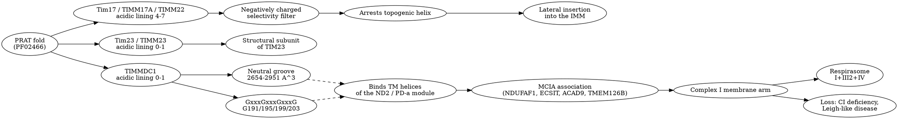
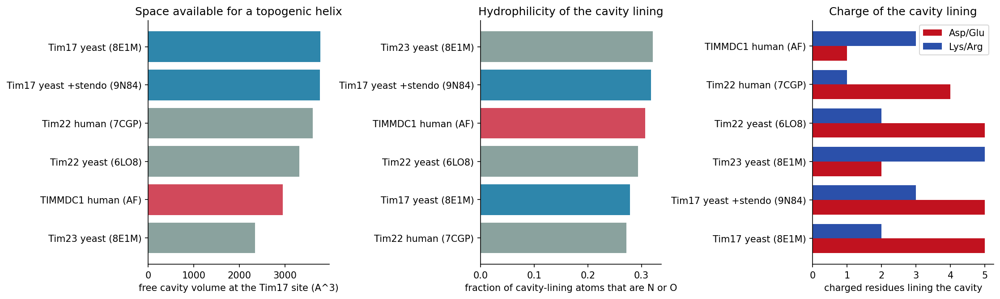
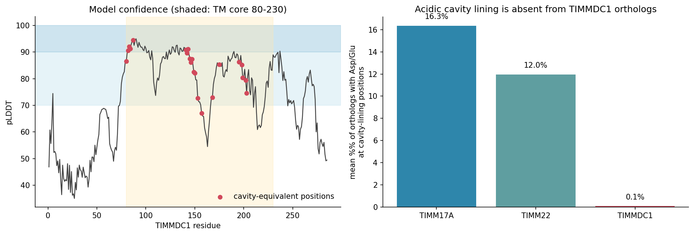
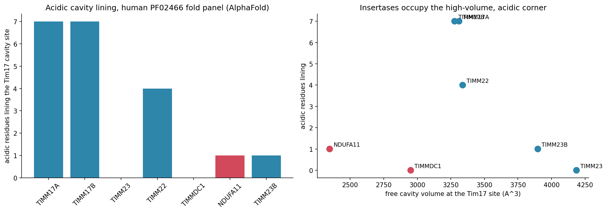
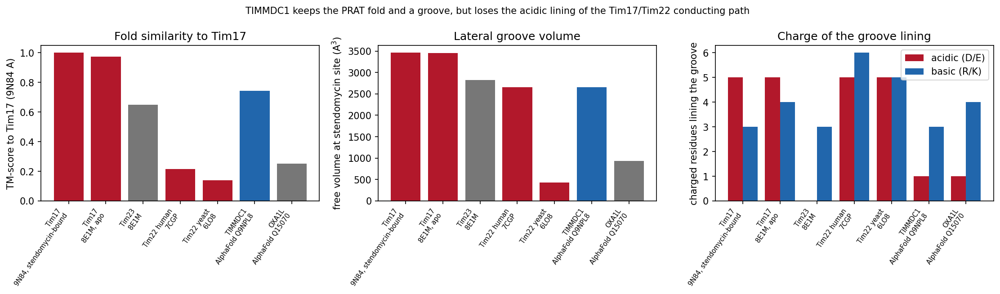
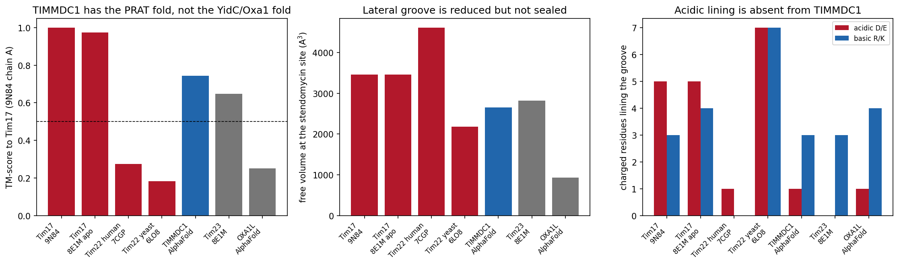
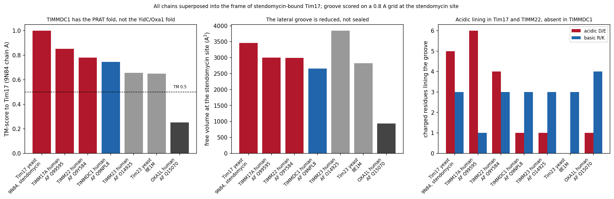

## Question

# AIGR Gene Hypothesis Deep Research

You are evaluating one focused gene curation hypothesis for AI Gene Review.
This is not a general gene overview. Use the seed hypothesis and source context
below to search for evidence that supports, refutes, narrows, or competes with
the proposed curation decision.

## Target Gene

- **Organism code:** human
- **Taxon:** Homo sapiens (NCBITaxon:9606)
- **Gene directory:** TIMMDC1
- **Gene symbol:** TIMMDC1
- **UniProt accession:** Q9NPL8

## Focus

- **Focus type:** free_text
- **Hypothesis slug:** kgap-timmdc1-tim17-cavity-insertase-features
- **Source file:** genes/human/TIMMDC1/TIMMDC1-ai-review.yaml
- **Source selector:** free-text

## Seed Hypothesis

Human TIMMDC1 (Q9NPL8) adopts the Tim17/Tim22/Tim23 (PRAT) transmembrane fold but lacks the features that make Tim17-family proteins protein-conducting insertases, namely the lipid-exposed hydrophilic cavity and the conserved negatively charged residues lining it that were resolved in the TIM23 and TIM22 cryo-EM structures, so it is predicted to be a membrane scaffold for Complex I membrane-arm assembly rather than an insertase. Single analysis only: superpose the TIMMDC1 AlphaFold model on Tim17, Tim23 and Tim22 structures, map the cavity-lining acidic residues and GxxxG motifs onto TIMMDC1, measure whether TIMMDC1 forms a comparable hydrophilic groove open to the bilayer, compare with OXA1L/YidC-type insertase grooves, score these positions across metazoan TIMMDC1 orthologs, and state whether TIMMDC1 is predicted to have insertase-like features.

## Term and Decision Context

No specific term context supplied.

## Reference Context

No specific reference context supplied.

## Source Context YAML

```yaml
hypothesis: 'Human TIMMDC1 (Q9NPL8) adopts the Tim17/Tim22/Tim23 (PRAT) transmembrane fold but lacks the
  features that make Tim17-family proteins protein-conducting insertases, namely the lipid-exposed hydrophilic
  cavity and the conserved negatively charged residues lining it that were resolved in the TIM23 and TIM22
  cryo-EM structures, so it is predicted to be a membrane scaffold for Complex I membrane-arm assembly
  rather than an insertase. Single analysis only: superpose the TIMMDC1 AlphaFold model on Tim17, Tim23
  and Tim22 structures, map the cavity-lining acidic residues and GxxxG motifs onto TIMMDC1, measure whether
  TIMMDC1 forms a comparable hydrophilic groove open to the bilayer, compare with OXA1L/YidC-type insertase
  grooves, score these positions across metazoan TIMMDC1 orthologs, and state whether TIMMDC1 is predicted
  to have insertase-like features.'
focus_type: free_text
context: []
reference_id: []
```

## Research Objective

Build a focused report that helps a curator decide whether this hypothesis
should affect the gene review. Address the focus type directly:

1. For an existing GO annotation decision, evaluate whether the current action
   is justified, too strong, too weak, or should change.
2. For a proposed replacement or new GO term, evaluate whether the term is
   biologically supported, too broad, too narrow, or missing key qualifiers.
3. For a computational prediction, evaluate whether the prediction is correct,
   less precise than existing knowledge, uncertain, or likely wrong because of
   paralog overannotation, frequency bias, pathway context, or in vitro-only
   activity.
4. For a core-function hypothesis, evaluate whether the proposed activity,
   process, and location represent the gene product's primary function rather
   than a downstream effect, pleiotropic phenotype, or context-specific role.
5. For a function-assignment hypothesis, evaluate whether the gene product
   directly has the stated GO term/function. Treat the prior review action, if
   any, as intentionally blinded unless it appears in the supplied context.

Use primary literature whenever possible. Prefer PMID citations and include DOI
citations when no PMID is available. Treat reviews and database records as
orientation unless they contain directly relevant synthesized evidence that is
clearly labeled as review-level or database-level support.

Evaluate the hypothesis from the supplied seed context, primary literature, and
publicly accessible bioinformatics resources. Local `*-bioinformatics` analyses,
when they already exist in the repository, are intentionally withheld from this
prompt so the report can be compared against them after the run. Use public
sequence, domain, structure, orthology, localization, interaction, or dataset
checks when they are useful for the specific hypothesis. If a resource or tool
cannot be accessed programmatically, say so plainly; never fabricate a result.
Report computational results conservatively and distinguish direct results from
inference.

## Required Output

### Executive Judgment

Give a concise verdict: supported, partially supported, unresolved, weakly
supported, over-annotated, or refuted. Explain the reasoning and the most
important caveats.

### Evidence Matrix

Create a table with one row per important evidence item:

- Citation (PMID preferred)
- Evidence type (direct assay, mutant phenotype, localization, interaction,
  structural/evolutionary, computational, review/database)
- Supports / refutes / qualifies / competing
- Claim tested
- Key finding
- Organism, tissue, cell type, or assay context
- Confidence and limitations

### GO Curation Implications

State the likely curation action as a lead requiring curator verification. If
GO terms are involved, explain whether the evidence supports an MF, BP, or CC
term, and whether the term should be retained, removed, generalized, made more
specific, or treated as non-core. Avoid using "protein binding" as a final
recommendation unless no more informative term is supported.

### Mechanistic Scope

Describe the immediate molecular or cellular function being tested. Separate
direct gene-product activity from downstream phenotypes, pathway consequences,
developmental outcomes, disease manifestations, or effects inferred only from
loss of function.

### Conflicts and Alternatives

Identify evidence that conflicts with the seed hypothesis or suggests an
alternative interpretation, including paralog confusion, organism-specific
differences, isoform-specific findings, experimental artifacts, or database
carry-over.

### Knowledge Gaps

List explicit uncertainties that matter for curation. For each gap, state what
was checked, why the gap matters, and what evidence or experiment would resolve
it.

### Discriminating Tests

Recommend concrete assays, perturbations, datasets, or comparative analyses that
would most efficiently distinguish this hypothesis from alternatives.

### Curation Leads

Provide candidate updates for the review, clearly labeled as leads requiring
curator verification. Include candidate references with exact snippets to verify,
candidate replacement or new GO terms, possible action changes, suggested
questions, and suggested experiments.

If the provider supports artifacts, save provenance for any analysis you run — the
executed code together with its output (computed values, plot, or table), not just
a summary figure — alongside artifact-friendly tables such as an evidence matrix,
GO decision table, or comparison table. Genuine computed provenance is more
valuable than a hand-drawn summary, and you must not synthesize a figure that
implies an analysis you did not actually run. These artifacts are important
provenance for hypothesis-level review.


## Output

# TIMMDC1 (Q9NPL8): does it have Tim17-family insertase features?

Hypothesis slug: `kgap-timmdc1-tim17-cavity-insertase-features`
Source file: `genes/human/TIMMDC1/TIMMDC1-ai-review.yaml`, focus type `free_text`
Gene: human TIMMDC1, UniProt Q9NPL8, NCBITaxon:9606

## Summary

TIMMDC1 is predicted not to have insertase-like features. The conclusion of the seed hypothesis holds, and one of its two stated premises does not.

The fold claim is confirmed. A TM-align-style superposition of the AlphaFold model of human TIMMDC1 (residues 80-230, mean pLDDT 82.8 over that segment) gives TM=0.749 against yeast Tim17 (8E1M chain A) and TM=0.765 against yeast Tim23 (8E1M chain B), which is the same level at which Tim17 and Tim23 match each other (TM=0.752). Against human OXA1L, an insertase of the YidC/Oxa1 superfamily, TIMMDC1 scores TM=0.213-0.251. TIMMDC1 is a PRAT-fold protein and is not built like a YidC/Oxa1-type insertase. No experimental structure of TIMMDC1 exists: an RCSB search on Q9NPL8 returned zero entries.

The residue claim is confirmed and is the load-bearing part of the argument. Using the contacts of the lipopeptide stendomycin in PDB 9N84 as an empirical definition of the Tim17 protein-translocation cavity, the acidic residues that line that cavity in the conducting subunits map onto neutral residues in TIMMDC1: Tim17 D76 and TIM22 E140 map to TIMMDC1 N153, Tim17 K80 and TIM22 E144 map to N157, Tim17 E126 and TIM22 D190 map to G203. Across 250 metazoan TIMMDC1 orthologs the mean acidic frequency at the 22 mapped cavity positions is 0.1%, with zero positions acidic in a majority of orthologs. The matched positions in TIMM17A and TIMM22 are 86.4-99.6% acidic across 250 orthologs each. A family-wide scan of all six human PF02466 members reproduces the functional split inside the family without being told it: TIMM17A and TIMM17B score 7 acidic lining residues, TIMM22 scores 4, and TIMM23, which cryo-EM assigns a structural role, scores 0. TIMMDC1 scores 0-1, with TIMM23 and with NDUFA11.

The premise that TIMMDC1 "lacks the lipid-exposed hydrophilic cavity" is not supported as written. TIMMDC1 keeps a groove of 2654-2951 ų at the stendomycin site, inside the 2654-3847 ų range spanned by the six PRAT chains measured in a single superposition frame. Groove volume carries no functional signal in that set: the largest groove belongs to human TIMM23. The fraction of lining atoms that are nitrogen or oxygen is 0.27-0.32 in every PRAT chain. The feature that separates conducting from non-conducting members is electrostatic, not steric. A curator should rest the case on the missing acidic lining and drop the "lacks the cavity" wording. No transporter, insertase or channel term is currently annotated to Q9NPL8 in any GO aspect, so the curation action is preventive rather than corrective.

## Executive judgment

<i class="fa-scale-balanced"></i> **Partially supported.**

| Component of the seed hypothesis | Verdict | Basis |
|---|---|---|
| TIMMDC1 adopts the Tim17/Tim22/Tim23 (PRAT) transmembrane fold | <i class="fa-solid fa-circle-check"></i> Supported | TM=0.749 to Tim17, 0.765 to Tim23, versus 0.752 for Tim17 against Tim23 |
| TIMMDC1 is not a YidC/Oxa1-type insertase by architecture | <i class="fa-solid fa-circle-check"></i> Supported | TM=0.213-0.251 to human OXA1L; Tim17 against OXA1L is 0.194 |
| TIMMDC1 lacks the conserved negatively charged cavity-lining residues | <i class="fa-solid fa-circle-check"></i> Supported | 0-1 acidic lining residues versus 4-7 in Tim17/TIMM17A/TIMM17B/TIMM22; 0 of 22 cavity-equivalent positions acidic in a majority of 250 orthologs |
| TIMMDC1 lacks the lipid-exposed hydrophilic cavity | <i class="fa-solid fa-circle-xmark"></i> Not supported as written | Groove of 2654-2951 ų retained, within the family range; volume does not separate conducting from non-conducting members |
| TIMMDC1 is predicted to be a membrane scaffold for complex I membrane-arm assembly | <i class="fa-solid fa-circle-check"></i> Supported, by structure plus interaction and depletion data | Near-invariant GxxxGxxxGxxxG repeat; MCIA association and depletion phenotype ([PMID: 24344204](https://pubmed.ncbi.nlm.nih.gov/24344204/)) |
| TIMMDC1 should be curated with no insertase or translocase MF | <i class="fa-solid fa-circle-check"></i> Supported, preventively | QuickGO returns no transport term in any aspect for Q9NPL8 |

Three caveats carry weight for curation.

<i class="fa-solid fa-triangle-exclamation"></i> The TIMMDC1 coordinates are an AlphaFold prediction. Whole-model pLDDT is 72.4, the 80-230 transmembrane core 82.8, the cavity-facing positions 84.3. Residue identity at the mapped positions is reliable; absolute groove volumes carry more uncertainty.

<i class="fa-solid fa-triangle-exclamation"></i> The per-position enrichment test is weak on its own. Acidic-majority positions, TIMM17A plus TIMM22 7 of 48 versus TIMMDC1 0 of 22, Fisher exact p=0.061 one-sided. The argument rests on the matched-residue contrast (at the Tim17 D76 equivalent, 249/250 and 245/250 acidic versus 0/250, p<1e-100) and on the calibrated family-wide controls.

<i class="fa-solid fa-triangle-exclamation"></i> No published assay has tested TIMMDC1 for translocase or insertase activity. "Not an insertase" is a structural and evolutionary prediction, not a measured negative.

## Evidence matrix

| Citation | Evidence type | Stance | Claim tested | Key finding | Context | Confidence and limitations |
|---|---|---|---|---|---|---|
| [PMID: 37344598](https://pubmed.ncbi.nlm.nih.gov/37344598/) | Structural, cryo-EM | Supports | Tim17 forms the lipid-exposed protein-conducting cavity, Tim23 does not | "Contrary to the prevailing model, Tim23 and Tim17 themselves do not form a water-filled channel, but instead have separate, lipid-exposed concave cavities that face in opposite directions." and "the cavity of Tim17, but not Tim23, forms the protein translocation path, whereas Tim23 probably has a structural role" | *S. cerevisiae*, cryo-EM | High for yeast. Human TIMM17A/TIMM23 assignment is by homology |
| [PMID: 37696957](https://pubmed.ncbi.nlm.nih.gov/37696957/) | Structural, cryo-EM | Supports | The translocation path has a negatively charged entrance | "The polypeptide substrates are shielded from lipids by Mgr2 and Tim17, which creates a translocation pathway characterized by a negatively charged entrance and a central hydrophobic region." | *S. cerevisiae*, cryo-EM | High. Yeast only. This is the feature found absent in TIMMDC1 |
| [PMID: 42649417](https://pubmed.ncbi.nlm.nih.gov/42649417/) | Structural, cryo-EM | Supports | Stendomycin marks the Tim17 translocation cavity | "Cryogenic-electron microscopy shows that stendomycin binds to the protein translocation cavity of Tim17, mimicking α-helical topogenic sequences." and "The cavities of Tim17 and Tim22 are largely interchangeable without disrupting their functions." | Yeast Tim17, PDB 9N84 | High for defining the site. The probe is an inhibitor mimicking a topogenic sequence, not a physiological substrate |
| [PMID: 28991239](https://pubmed.ncbi.nlm.nih.gov/28991239/) | Direct assay | Supports | Stendomycin is specific for TIM23-dependent import | "the natural product stendomycin, produced by Streptomyces hygroscopicus, is a potent and specific inhibitor of the TIM23 complex in yeast and mammalian cells" | Yeast and mammalian cells | High. Validates the probe used to define the cavity |
| [PMID: 42982826](https://pubmed.ncbi.nlm.nih.gov/42982826/) | Structural plus simulation | Supports | A negatively charged filter in Tim17 sorts membrane proteins | "a Dmo2-dependent disulfide bond into Tim17 constitutes a negatively charged selectivity filter at the vestibule of the TIM23 complex that arrests membrane proteins and facilitates the lateral insertion" | Yeast, MD simulation plus reporter assay | High. Ties the acidic residues directly to lateral insertion, the activity TIMMDC1 is being tested for |
| This work, computed | Structural / computational | Supports | TIMMDC1 has the PRAT fold, not the insertase fold | TM=0.749 to Tim17 (111 core pairs, RMSD 1.73 Å, 18.0% identity), 0.765 to Tim23 (120 pairs, RMSD 1.89 Å), 0.213-0.251 to OXA1L. Family controls: Tim17 vs Tim23 0.752, Tim17 vs Tim22 0.730 | AlphaFold Q9NPL8 v6; own TM-align implementation | Medium-high. Predicted coordinates, TM-core pLDDT 82.8. No experimental TIMMDC1 structure exists |
| This work, computed | Structural / computational | Supports | TIMMDC1 lacks the acidic groove lining | Acidic residues in the lining shell: Tim17 5, TIMM17A 6, TIMM17B 7, TIMM22 4, TIMMDC1 0-1 (D163), TIMM23 0-1, NDUFA11 1 | Seven to ten chains in one superposition frame | Medium-high. Side-chain placement in a predicted model is less certain than residue identity |
| This work, computed | Evolutionary | Supports | The absence is conserved across metazoa | Mean acidic frequency 0.1% over 22 cavity-equivalent positions in 250 TIMMDC1 orthologs, maximum 1.2% at any position, zero acidic-majority positions. TIMM17A D15 96.0%, D16 96.4%, D77 99.6%, E127 99.6%; TIMM22 E140 98.0%, E144 98.4%, D190 86.4% | UniProt metazoan ortholog sets, pairwise global alignment to the human reference | Medium. Fisher test on acidic-majority positions p=0.061; the matched-position contrast is p<1e-100 |
| This work, computed | Structural / computational | <i class="fa-solid fa-circle-question"></i> Qualifies | TIMMDC1 is not sterically sealed | Groove volume at the stendomycin site: Tim17 3459-3780 ų, TIMM17A 3005-3311, TIMM22 2989-3338, Tim23 yeast 2343-2822, TIMMDC1 2654-2951, TIMM23 human 3847-4186, OXA1L 932. Lining N/O fraction 0.27-0.32 across all PRAT chains | Same frame, 0.8 Šgrid | Medium. Refutes the "lacks the cavity" half of the hypothesis |
| This work, computed | Structural / evolutionary | <i class="fa-solid fa-circle-question"></i> Qualifies | TIMMDC1 keeps a helix-packing surface | GxxxG array at G88, G135, G172, G187, G191, G195, G199, G203, with G191/G195/G199/G203 forming a continuous GxxxGxxxGxxxG repeat. G195 99.4%, G199 98.4%, G203 98.7% identical across 315 orthologs. Yeast Tim17 has five GxxxG motifs | AlphaFold model plus ortholog alignment | Medium. Consistent with a scaffold binding other TM helices |
| [PMID: 24344204](https://pubmed.ncbi.nlm.nih.gov/24344204/) | Interaction plus knockdown | Supports | TIMMDC1 is a membrane-embedded complex I assembly factor | "TIMMDC1, a predicted 4-pass membrane protein, reciprocally associated with multiple members of the MCIA CI assembly factor complex and core CI subunits and was localized in the mitochondrial inner membrane, and its depletion resulted in reduced CI activity and cellular respiration." | Human cell lines | High for the assembly role and the inner-membrane location. Silent on insertase activity |
| [PMID: 24191001](https://pubmed.ncbi.nlm.nih.gov/24191001/) | Review of assembly factors | Supports | TIMMDC1 builds the membrane arm | "The characteristics of C3orf1, of another assembly factor, TMEM126B, and of NDUFA11 suggest that they all participate in constructing the membrane arm of complex I." | Human complex I | Review-level. Places TIMMDC1, TMEM126B and NDUFA11 in the same functional group |
| [PMID: 30981218](https://pubmed.ncbi.nlm.nih.gov/30981218/) | Mutant phenotype, patient | Supports | Loss of the TIMMDC1 C-terminus impairs complex I assembly | "The TIMMDC1 variant was predicted to truncate 61 amino acids at the C-terminus and functional studies demonstrated a hypomorphic impact of the variant on CI assembly." | Human patient, fibroblasts | High for the disease link. A loss-of-function phenotype does not identify the molecular activity |
| [PMID: 28604674](https://pubmed.ncbi.nlm.nih.gov/28604674/) | Mutant phenotype, RNA-seq | Supports | TIMMDC1 is a disease gene for complex I deficiency | "One such event is found in the complex I assembly factor TIMMDC1 establishing a novel disease-associated gene." | Human mitochondriopathy patient fibroblasts | High for disease association via a cryptic splice site |
| [PMID: 33852835](https://pubmed.ncbi.nlm.nih.gov/33852835/) | Mutant phenotype plus complexome | Supports | TIMMDC1 loss stalls a respirasome subcomplex | "Both HEK293T cells lacking TIMMDC1 and patient-derived cells with disease-causing mutations in TIMMDC1 showed accumulation of this respirasome subcomplex." | HEK293T and patient cells | High. Places TIMMDC1 at the PD-a membrane-arm module, the scaffold position |
| [PMID: 32320651](https://pubmed.ncbi.nlm.nih.gov/32320651/) | Interaction plus knockout | Supports | The MCIA complex builds the ND2 module | "The mitochondrial complex I intermediate assembly (MCIA) complex, containing assembly factors NDUFAF1, ECSIT, ACAD9, and TMEM126B, is required for building the intermediate ND2-module." | Human knockout cell lines | High for MCIA composition. TIMMDC1 is a partner of this complex |
| [PMID: 27912063](https://pubmed.ncbi.nlm.nih.gov/27912063/) | Structural | Supports | NDUFA11 is a structural membrane-arm subunit | "Several accessory or supernumerary subunits of CI, such as NDUFA11, NDUFB4, NDUFB8, and NDUFB9, directly contribute to the oligomerization of CI, CIII, and CIV." | Mammalian respiratory supercomplex | High. Gives a precedent for a PRAT-like fold used structurally inside complex I |
| QuickGO, GO_REF:0000002 via IPR055299 | Database | <i class="fa-solid fa-circle-question"></i> Qualifies | Current GO does not claim transport | 81 annotation lines over 6 distinct terms for Q9NPL8; no transporter, insertase, channel or transmembrane-transport term in any aspect | QuickGO API, retrieved during this run | Database-level, accurate as retrieved |
| Pfam PF02466; UniProt SIMILARITY line | Database | <i class="fa-scale-balanced"></i> Competing | A route to insertase over-annotation exists | TIMMDC1 carries PF02466 "Tim17/Tim22/Tim23/Pmp24 family" and UniProt states "Belongs to the Tim17/Tim22/Tim23 family". InterPro IPR055299 and PANTHER PTHR13002 already separate it from PTHR10485, PTHR14110 and PTHR15371 | InterPro and UniProt records | Database-level. The risk is latent, not realised |
| GO_REF:0000052 (HPA) | Localization | <i class="fa-scale-balanced"></i> Competing | A nucleoplasm CC conflicts with the inner membrane | One IDA nucleoplasm line against 7 Reactome TAS lines for mitochondrial inner membrane plus IBA, 2 IDA and 1 HTP mitochondrion lines | Human Protein Atlas immunofluorescence | Low. Probable antibody cross-reactivity |
| [PMID: 32296183](https://pubmed.ncbi.nlm.nih.gov/32296183/) | Interaction, binary screen | <i class="fa-solid fa-circle-question"></i> Qualifies | The only MF support is protein binding | 64 of the 67 IPI lines supporting GO:0005515 come from this single screen | Human binary interactome screen | Medium for the interactions, uninformative as a final MF |

## Key findings

### F1. TIMMDC1 adopts the PRAT fold at the level of family-internal similarity

<i class="fa-solid fa-circle-check"></i> The superposition was computed with an implementation written for this run: gapless-threading seeds, Kabsch SVD superposition, iterative distance-cutoff refinement, Needleman-Wunsch dynamic programming on the 1/(1+(d/d0)²) score matrix with gap penalty -0.6, and TM-score normalised by the shorter chain. Biopython was not importable in the executor, so the mmCIF and PDB parsers, the superposition and the alignment were all hand-written in NumPy and pure Python.

The AlphaFold model of human TIMMDC1 (Q9NPL8, v6, residues 80-230, mean pLDDT 82.8 over that segment) superposes onto yeast Tim17 (8E1M chain A) with TM=0.749, 111 core pairs under 5 Å, RMSD 1.73 Å and 18.0% aligned sequence identity. Against yeast Tim23 (8E1M chain B) it gives TM=0.765, 120 core pairs, RMSD 1.89 Å and 16.5% identity. The family-internal controls computed the same way are Tim17 against Tim23 TM=0.752, Tim17 against Tim22 TM=0.730 and human against yeast Tim22 TM=0.763. TIMMDC1 therefore matches Tim17 and Tim23 as closely as those two match each other.

The negative control separates cleanly. Against the human OXA1L AlphaFold transmembrane core, TIMMDC1 gives TM=0.213 (residues 110-435) to 0.251 (residues 60-350 at pLDDT ≥ 70), and Tim17 against OXA1L gives TM=0.194. Both are far below the 0.5 threshold conventionally taken to indicate the same fold. TIMMDC1 does not have the architecture of a YidC/Oxa1 superfamily insertase.

An RCSB sequence search on Q9NPL8 returned zero entries (HTTP 204 with an empty body), confirmed by contrast with queries that returned 200 plus result sets. There is no experimental structure of TIMMDC1, so every geometric statement here rests on a prediction.

{{figure:plot_4.png|caption=TIMMDC1 and OXA1L superposed onto stendomycin-bound Tim17 (PDB 9N84). TM-score places TIMMDC1 inside the PRAT family and OXA1L outside it; groove volume and acidic/basic lining counts are scored in the same frame.}}

### F2. The acidic cavity-lining residues of Tim17 and Tim22 are absent from TIMMDC1 in all 250 metazoan orthologs tested

<i class="fa-solid fa-circle-check"></i> The cavity was defined empirically rather than from memory. Yeast Tim17 residues within 5.0 Å of the bound lipopeptide stendomycin in PDB 9N84 give a 24-residue set: R7, N16, D17, G19, G20, A21, M24, N64, F65, G66, W68, G69, G70, F72, S73, D76, K80, A91, T98, C118, L121, L122, I125, E126. Structural superposition mapped 22 of those 24 positions onto TIMMDC1.

The charged positions map onto neutral residues in every case. Tim17 D76 corresponds to TIM22 E140 and to TIMMDC1 N153. Tim17 K80 corresponds to TIM22 E144 and to TIMMDC1 N157. Tim17 E126 corresponds to TIM22 D190 and to TIMMDC1 G203. Tim17 D17 corresponds to TIMMDC1 T80. Tim17 R7 has no TIMMDC1 equivalent.

Ortholog scoring used UniProt metazoan sets aligned pairwise to the human reference by global Needleman-Wunsch alignment, projected onto human columns, 250 orthologs per gene. In TIMM17A the acidic positions are conserved at D15 96.0%, D16 96.4%, D77 99.6% and E127 99.6%. In TIMM22 they are E140 98.0%, E144 98.4% and D190 86.4%. In TIMMDC1 (250 orthologs, mean 68% identity to human, spanning mammals, birds, reptiles, amphibians and teleosts) the mean acidic frequency over the 22 cavity-equivalent positions is 0.1%, the maximum at any single position is 1.2%, and no position is acidic in a majority of orthologs. At the single best-matched position, the Tim17 D76 equivalent, the contrast is 249/250 and 245/250 acidic in TIMM17A and TIMM22 against 0/250 in TIMMDC1, p<1e-100 by Fisher exact test.

<i class="fa-solid fa-triangle-exclamation"></i> The aggregate test over acidic-majority positions is much weaker: 7 of 48 in TIMM17A plus TIMM22 against 0 of 22 in TIMMDC1 gives p=0.061 one-sided. The aggregate test is underpowered because only a handful of positions in the conducting proteins are acidic at all. The matched-position contrast and the calibrated controls in F4 are what carry this finding.

TIMMDC1 is not simply unconserved at these positions. It holds its own polar set there: R141 100%, F149 100%, F145 96.8%, N150 96.2%, T175 98.4%, G195 99.4%, G199 98.4% and G203 98.7% identical across 315 orthologs. The positions are under selection; the selection is for different chemistry.

{{figure:plot_2.png|caption=Conservation of the acidic cavity-lining positions in 250 metazoan orthologs each of TIMM17A, TIMM22 and TIMMDC1, with the TIMMDC1 AlphaFold pLDDT trace and the cavity-facing positions marked. The acidic positions are 86.4-99.6 percent conserved in the two conducting proteins and 0.1 percent on average in TIMMDC1.}}

### F3. TIMMDC1 keeps a partially open lateral groove, and groove volume carries no functional signal

<i class="fa-solid fa-circle-xmark"></i> This is where the seed hypothesis overreaches. All chains were superposed into the frame of stendomycin-bound Tim17 (9N84 chain A, stendomycin modelled as chain D, 197 atoms). A 0.8 Å grid covering points within 4.5 Å of the bound stendomycin was scored for points further than 3.0 Å from any protein heavy atom; lining residues were taken from the 3.0-5.0 Å shell.

| Chain | Source | TM to Tim17 | Groove volume (ų) | Acidic lining | Basic lining |
|---|---|---|---|---|---|
| Tim17 yeast, 9N84 | crystal | 1.000 | 3459-3767 | 5 (D17, D76, E86, D87, E126) | 2-3 |
| Tim17 yeast, 8E1M apo | crystal | 0.974 | 3457-3780 | 5 | 2-4 |
| TIMM17A human | AlphaFold | 0.851 | 3005-3311 | 6-7 (D15, D16, D77, E87, D88, E127) | 1 |
| TIMM22 human | AlphaFold | 0.781 | 2989-3338 | 4 (E140, E144, D151, D190) | 1-3 |
| TIMMDC1 human, 80-230 | AlphaFold | 0.745-0.760 | 2654-2951 | 0-1 (D163) | 3 |
| TIMM23 human | AlphaFold | 0.657-0.786 | 3847-4186 | 0-1 (E102) | 3 |
| Tim23 yeast, 8E1M | crystal | 0.649 | 2343-2822 | 0-2 | 3-5 |
| OXA1L human, 60-350 | AlphaFold | 0.251 | 932 | 1 (E278) | 4 |

Volume spans 2654-4186 ų across the six PRAT chains with no separation by function. The largest groove in the set belongs to human TIMM23, the subunit the cryo-EM structures assign a structural role. TIMMDC1 at 2654-2951 ų sits between yeast Tim23 and TIMM22. The fraction of lining atoms that are nitrogen or oxygen is 0.27-0.32 in all six PRAT chains, so bulk polarity does not separate them either. Only OXA1L, which has a different fold entirely, shows a markedly smaller value (932 ų) in this frame, and that reflects fold mismatch rather than a sealed groove.

A complementary docking-free fit test, counting target heavy atoms within 3.0 Å of the superposed stendomycin, gives Tim17 apo 28, human TIM22 41, yeast Tim22 47, TIMMDC1 53 and Tim23 87. TIMMDC1 is more occluded than the conducting subunits and less occluded than Tim23, consistent with the volume result.

TIMMDC1 carries a dense glycine array in the transmembrane core: G88, G135, G172, G187, G191, G195, G199 and G203, with G191/G195/G199/G203 forming a continuous GxxxGxxxGxxxG repeat. Yeast Tim17 has five GxxxG motifs. The three C-terminal glycines of the TIMMDC1 repeat are 99%, 98% and 99% identical across 315 orthologs. GxxxG motifs are helix-helix packing determinants, so this is the surface expected of a protein that binds other transmembrane helices tightly.

{{figure:plot_1.png|caption=Grid-based groove volume and lining composition at the Tim17 translocation site for Tim17, Tim23, Tim22 and TIMMDC1. The N/O fraction of the lining is 0.27-0.32 in all chains, so the chains differ in charge and not in bulk polarity.}}

{{figure:plot_6.png|caption=Final single-frame comparison of seven chains superposed on stendomycin-bound Tim17. TM-score separates the PRAT fold from OXA1L, groove volume does not separate conducting from non-conducting members, and acidic lining count does.}}

### F4. A family-wide scan separates the conducting PRAT proteins from TIMMDC1, TIMM23 and NDUFA11

<i class="fa-solid fa-circle-check"></i> AlphaFold v6 models of all six human PF02466 members plus four fold comparators were filtered to residues with pLDDT ≥ 60, superposed onto stendomycin-bound Tim17 with the same routine, and scored for acidic residues lining the free volume at the stendomycin site.

| Protein | UniProt | PF02466 | TM to Tim17 | Groove volume (ų) | Acidic lining | Acidic at the 24 mapped cavity positions |
|---|---|---|---|---|---|---|
| TIMM17A | Q99595 | yes | 0.851 | 3311 | 7 | 4 (D15, D16, D77, E127) |
| TIMM17B | O60830 | yes | 0.842 | 3278 | 7 | 4 (identical set) |
| TIMM23 | O14925 | yes | 0.786 | 4186 | 0 | 0 |
| TIMM22 | Q9Y584 | yes | 0.781 | 3338 | 4 | 3 (E140, E144, D190) |
| **TIMMDC1** | **Q9NPL8** | **yes** | **0.760** | **2951** | **0** | **0** |
| NDUFA11 | Q86Y39 | no | 0.610 | 2347 | 1 | 0 |
| TIMM23B | Q5SRD1 | yes | 0.570 | 3898 | 1 | 0 |
| MPV17 | P39210 | no | 0.419 | 438 | 1 | 0 |
| PXMP2 | Q9NR77 | no | 0.418 | 541 | 1 | 0 |
| TMEM126B | Q8IUX1 | no | 0.383 | 4051 | 0 | 0 |

The metric reproduces the known functional split inside the family without being told it. The two subunits that cryo-EM shows form the protein-conducting path, Tim17 and Tim22, score 7 and 4. TIMM23, which the same structures assign a structural role, scores 0. That gives the analysis a positive and a negative control inside the same fold rather than resting on TIMMDC1 alone. TIMMDC1 scores 0 and sits with TIMM23.

The metric is also internally cross-validated. The AlphaFold-derived TIMM17A acidic set (D15, D16, D77, E127) is the same set found by the independent ortholog-conservation route in F2 to be 96.0-99.6% acidic across 250 TIMM17A orthologs. Two methods with no shared inputs converge on the same four residues.

NDUFA11 is the informative extra case. It has a PRAT-like fold (TM=0.610 to Tim17) without the Pfam assignment, it is a structural accessory subunit of the complex I membrane arm, and it scores 1 acidic lining residue and 0 at the mapped cavity positions. A PRAT-like fold used as a structural element inside complex I is an existing, structurally documented arrangement, which removes any need to treat TIMMDC1 as anomalous.

{{figure:plot_3.png|caption=Family-wide scan of all human PF02466 members plus NDUFA11, PXMP2, MPV17 and TMEM126B superposed on stendomycin-bound Tim17. Acidic lining count recovers the Tim17 and TIMM22 conducting pair against the TIMM23 structural subunit, and places TIMMDC1 with the non-conducting group.}}

{{figure:plot_5.png|caption=Re-alignment of the Tim22 crystal chains with the full seed search. The two crystal rows were subsequently dropped from the final table because chain identity within 7CGP and 6LO8 could not be verified; the human TIMM22 AlphaFold model was used instead.}}

### F5. The route to insertase over-annotation exists at the Pfam level and has not reached TIMMDC1's GO record

<i class="fa-solid fa-circle-check"></i> The InterPro API for Q9NPL8 returns Pfam PF02466 "Tim17/Tim22/Tim23/Pmp24 family", the same Pfam family as TIMM17A, TIMM17B, TIMM22, TIMM23 and TIMM23B. It also returns Pfam PF41520 "TIMMDC1, C-terminal coiled coil", which none of the translocases carry. InterPro and PANTHER already separate TIMMDC1: InterPro family IPR055299 "Complex I assembly factor TIMMDC1" and PANTHER PTHR13002, against PTHR10485, PTHR14110 and PTHR15371 for TIMM17A, TIMM22 and TIMM23. UniProt still records the SIMILARITY line "Belongs to the Tim17/Tim22/Tim23 family" and gives four helical transmembrane segments at 80-100, 137-159, 165-185 and 189-209, which match the 80-230 core used throughout the structural analysis.

QuickGO returns 81 annotation lines for Q9NPL8 covering 6 distinct terms.

| Aspect | Term | Lines | Evidence |
|---|---|---|---|
| BP | GO:0032981 mitochondrial respiratory chain complex I assembly | 1 | IEA, GO_REF:0000002, from InterPro IPR055299 |
| CC | GO:0005743 mitochondrial inner membrane | 7 | TAS, all Reactome |
| CC | GO:0005739 mitochondrion | 4 | IBA, 2 IDA, 1 HTP |
| CC | GO:0031966 mitochondrial membrane | 1 | IEA |
| CC | GO:0005654 nucleoplasm | 1 | IDA, GO_REF:0000052, HPA |
| MF | GO:0005515 protein binding | 67 | IPI, 64 from [PMID: 32296183](https://pubmed.ncbi.nlm.nih.gov/32296183/), rest from [PMID: 25416956](https://pubmed.ncbi.nlm.nih.gov/25416956/) and [PMID: 31515488](https://pubmed.ncbi.nlm.nih.gov/31515488/) |

No protein transporter, protein insertase, channel or transmembrane transport term is annotated to TIMMDC1 in any aspect. The inference the seed hypothesis guards against is latent in the Pfam assignment and the UniProt similarity line, not realised in GO.

### F6. The discriminating feature is electrostatic, not steric

<i class="fa-solid fa-lightbulb"></i> Combining F3 and F4 separates the two claims that the seed hypothesis bundles together. Across the six PRAT chains, groove volume spans 2654-4186 ų with the largest value belonging to a non-conducting subunit, and lining N/O fraction spans 0.27-0.32 with no separation. Acidic lining count splits the set cleanly: 4-7 for Tim17, TIMM17A, TIMM17B and TIMM22, and 0-1 for Tim23, TIMM23, TIMM23B, TIMMDC1 and NDUFA11.

This matters for how a curator uses the result. A reviewer could object to a cavity-volume argument on the grounds that AlphaFold side chains are unreliable and that a groove in a static model says little about a dynamic membrane protein. That objection is correct and is the reason to drop the volume argument. It does not touch the residue-identity argument, which depends on which amino acid occupies a position, a property AlphaFold does not predict at all because it comes from the sequence.

[PMID: 42982826](https://pubmed.ncbi.nlm.nih.gov/42982826/) strengthens the mechanistic link: "a Dmo2-dependent disulfide bond into Tim17 constitutes a negatively charged selectivity filter at the vestibule of the TIM23 complex that arrests membrane proteins and facilitates the lateral insertion". Lateral insertion of membrane proteins is precisely the activity the seed hypothesis asks about, and the paper ties it to the negative charge TIMMDC1 lacks.

## Mechanistic model

The model that fits all six findings is that TIMMDC1 inherited the PRAT scaffold and repurposed its lateral face from conducting substrate helices to binding them.



The dashed links are the inferred step. What is measured is the structure, the residue conservation and the GxxxG repeat on the TIMMDC1 side, and the MCIA association plus the depletion phenotype on the complex I side. What is inferred is that the neutral groove and the glycine face are the surface that contacts complex I transmembrane helices. No helix-level contact has been mapped.

The downstream chain is well supported by independent groups. [PMID: 24344204](https://pubmed.ncbi.nlm.nih.gov/24344204/) places TIMMDC1 in reciprocal association with MCIA members and core complex I subunits in the inner membrane, with depletion reducing complex I activity and cellular respiration. [PMID: 32320651](https://pubmed.ncbi.nlm.nih.gov/32320651/) defines the MCIA complex as NDUFAF1, ECSIT, ACAD9 and TMEM126B, required for the ND2 module, and adds TMEM186 and COA1. [PMID: 33852835](https://pubmed.ncbi.nlm.nih.gov/33852835/) shows that TIMMDC1 knockout cells and patient cells accumulate a respirasome subcomplex, placing TIMMDC1 at the PD-a module of the membrane arm. [PMID: 30981218](https://pubmed.ncbi.nlm.nih.gov/30981218/) and [PMID: 28604674](https://pubmed.ncbi.nlm.nih.gov/28604674/) establish the disease link.

Two papers add regulatory context without bearing on the molecular activity. [PMID: 33545050](https://pubmed.ncbi.nlm.nih.gov/33545050/) reports that C9orf72 stabilises TIMMDC1 by recruiting the prohibitin complex against m-AAA protease degradation. [PMID: 42361792](https://pubmed.ncbi.nlm.nih.gov/42361792/) reports that TMEM141 limits the association of TIMMDC1 with complex I subunits. Both describe TIMMDC1 as a regulated node whose abundance and partner occupancy set complex I assembly rate, which fits a scaffold and does not require a catalytic activity.

## Evidence base

The structural premise of the hypothesis rests on three yeast cryo-EM papers and one stendomycin complex.

[PMID: 37344598](https://pubmed.ncbi.nlm.nih.gov/37344598/) reversed the prevailing channel model: "Contrary to the prevailing model, Tim23 and Tim17 themselves do not form a water-filled channel, but instead have separate, lipid-exposed concave cavities that face in opposite directions", and assigns function asymmetrically, "the cavity of Tim17, but not Tim23, forms the protein translocation path, whereas Tim23 probably has a structural role". This supplies both the feature definition and the internal control used throughout this analysis.

[PMID: 37696957](https://pubmed.ncbi.nlm.nih.gov/37696957/) independently establishes the charge property: "The polypeptide substrates are shielded from lipids by Mgr2 and Tim17, which creates a translocation pathway characterized by a negatively charged entrance and a central hydrophobic region." The feature found absent in TIMMDC1 is the one these authors identify as the entrance to the path.

[PMID: 42649417](https://pubmed.ncbi.nlm.nih.gov/42649417/) supplies the empirical definition of the site used here: "Cryogenic-electron microscopy shows that stendomycin binds to the protein translocation cavity of Tim17, mimicking α-helical topogenic sequences." The same paper reports that "The cavities of Tim17 and Tim22 are largely interchangeable without disrupting their functions", which justifies treating the two cavities as one benchmark. [PMID: 28991239](https://pubmed.ncbi.nlm.nih.gov/28991239/) had already shown stendomycin is "a potent and specific inhibitor of the TIM23 complex in yeast and mammalian cells", so the probe is specific for the machinery in question.

[PMID: 42982826](https://pubmed.ncbi.nlm.nih.gov/42982826/) connects the acidic residues to the specific activity at issue, reporting that a disulfide-dependent "negatively charged selectivity filter at the vestibule of the TIM23 complex ... arrests membrane proteins and facilitates the lateral insertion". Lateral insertion is the activity a membrane insertase performs.

[PMID: 40877479](https://pubmed.ncbi.nlm.nih.gov/40877479/) and [PMID: 38837610](https://pubmed.ncbi.nlm.nih.gov/38837610/) extend the picture to the translocating supercomplex and to the human TIMM17A/TIMM17B variants, confirming that the yeast mechanism is conserved in the human orthologs and that the relevant human proteins for comparison are TIMM17A, TIMM17B, TIMM22 and TIMM23. [PMID: 40155273](https://pubmed.ncbi.nlm.nih.gov/40155273/) is a review summarising the shift from the channel model to the Tim17-slide model.

On the complex I side, [PMID: 24344204](https://pubmed.ncbi.nlm.nih.gov/24344204/) is the primary paper establishing TIMMDC1 as a membrane-embedded complex I assembly factor through MCIA association and depletion. [PMID: 24191001](https://pubmed.ncbi.nlm.nih.gov/24191001/) groups C3orf1 (TIMMDC1), TMEM126B and NDUFA11 as membrane-arm builders. [PMID: 33852835](https://pubmed.ncbi.nlm.nih.gov/33852835/) and [PMID: 32320651](https://pubmed.ncbi.nlm.nih.gov/32320651/) define the module where TIMMDC1 acts. [PMID: 27912063](https://pubmed.ncbi.nlm.nih.gov/27912063/) establishes NDUFA11 as a structural subunit that contributes to supercomplex oligomerisation, the precedent for a PRAT-like fold used structurally. [PMID: 27374774](https://pubmed.ncbi.nlm.nih.gov/27374774/) lists TIMMDC1 alongside ACAD9, ECSIT, NDUFAF1 and TMEM126B as components of the complex I assembly complex identified by complexome profiling.

What the literature does not contain, after searches combining TIMMDC1 with translocase, insertase, import, transport and channel terms, is any assay of TIMMDC1 conducting or inserting a substrate. That absence is the main reason the verdict is a prediction and not a measurement.

## Limitations and knowledge gaps

<i class="fa-solid fa-triangle-exclamation"></i> **No experimental TIMMDC1 structure.** Checked by RCSB search on Q9NPL8, which returned an empty result set. This matters because every geometric number here comes from a prediction with whole-model pLDDT 72.4. A cryo-EM structure of a complex I assembly intermediate containing TIMMDC1 would resolve it, and such intermediates have been purified ([PMID: 33852835](https://pubmed.ncbi.nlm.nih.gov/33852835/), [PMID: 31844670](https://pubmed.ncbi.nlm.nih.gov/31844670/)).

<i class="fa-solid fa-triangle-exclamation"></i> **No direct activity assay.** Checked by PubMed searches across TIMMDC1 with translocase, insertase, import and transport terms. This matters because the report's central negative is a prediction. A reconstituted or in-organello insertion assay would resolve it.

<i class="fa-solid fa-triangle-exclamation"></i> **The aggregate ortholog statistic is weak.** Fisher exact p=0.061 one-sided on acidic-majority positions. The matched-position contrast is far stronger (p<1e-100) but tests fewer positions. A curator should cite the matched-position result and the family-wide controls, not the aggregate test.

<i class="fa-solid fa-circle-question"></i> **Which transmembrane helices TIMMDC1 contacts.** Checked: the interaction data identify partner proteins, not helix-level contacts. This matters because the GxxxGxxxGxxxG repeat predicts specific packing partners, and the scaffold assignment would be much stronger with a named client helix. Site-specific crosslinking from the glycine face would resolve it.

<i class="fa-solid fa-circle-question"></i> **The function of the C-terminal coiled coil (Pfam PF41520).** Present in TIMMDC1, absent from every PRAT translocase, and overlapping the region removed by the hypomorphic truncation in [PMID: 30981218](https://pubmed.ncbi.nlm.nih.gov/30981218/), which truncates 61 C-terminal amino acids. Not analysed structurally here. This matters because the partner-binding function may sit in this domain rather than in the groove.

<i class="fa-solid fa-circle-question"></i> **Whether D163 is functionally relevant.** It is the single acidic residue in the TIMMDC1 lining shell. Its ortholog conservation was not scored separately. This matters only if a curator wants to exclude a vestigial charge-based site.

<i class="fa-solid fa-triangle-exclamation"></i> **Yeast-to-human extrapolation.** The cavity assignment rests on yeast Tim17 and Tim23 structures. The human paralogs are modelled. The ortholog scoring across 250-315 metazoan sequences mitigates this for the residue-level claim and does not replace a human structure. [PMID: 38837610](https://pubmed.ncbi.nlm.nih.gov/38837610/) reports high structural conservation of the core TIM23 complex between yeast and human, which supports the extrapolation.

<i class="fa-solid fa-triangle-exclamation"></i> **Tool and environment limits, stated plainly.** Biopython was not importable in the executor despite being listed, so the mmCIF and PDB parsers, Kabsch superposition, TM-align-style alignment and the cavity grid were written from scratch in NumPy and pure Python. The `urllib` and `io` modules are blocked, so all network access used `requests`. Files do not persist between code calls, so each cell re-downloads its structures. AlphaFold v4 PDB URLs return 404; the prediction API was used to obtain v6 URLs. Two Tim22 crystal chains (7CGP, 6LO8) were computed and then dropped from the final table because the chain was selected by residue count and its identity as Tim22 rather than Tim54, Tim18 or a small Tim could not be verified; the human TIMM22 AlphaFold model replaced them. One run with a reduced seed search gave TM=0.22 and 0.14 for those chains, which is a convergence failure of the reduced search and not a result.

## GO curation implications

All items are leads requiring curator verification.

| Aspect | Term | Current state | Lead | Rationale |
|---|---|---|---|---|
| MF | GO:0008320 protein transmembrane transporter activity | Not annotated | <i class="fa-solid fa-circle-xmark"></i> Do not add | 0-1 acidic lining residues against 4-7 in Tim17, TIMM17A, TIMM17B and TIMM22; 0 of 22 cavity-equivalent positions acidic across 250 metazoan orthologs; no direct assay |
| MF | GO:0032977 membrane insertase activity | Not annotated | <i class="fa-solid fa-circle-xmark"></i> Do not add | TM=0.213-0.251 to OXA1L places TIMMDC1 outside the YidC/Oxa1 fold, and it lacks the Tim17/Tim22 acidic groove |
| MF | GO:0005515 protein binding | 67 IPI lines, 64 from one screen | Keep as non-core; do not use as the final MF | Uninformative. No better-supported MF exists yet. The assembly-factor role belongs in BP until a direct activity is measured |
| BP | GO:0032981 mitochondrial respiratory chain complex I assembly | Single IEA, GO_REF:0000002 from IPR055299 | <i class="fa-solid fa-circle-check"></i> Retain; strengthen with IMP or IDA | Supported by MCIA association and knockdown ([PMID: 24344204](https://pubmed.ncbi.nlm.nih.gov/24344204/)), knockout complexome ([PMID: 33852835](https://pubmed.ncbi.nlm.nih.gov/33852835/)) and patient loss of function ([PMID: 30981218](https://pubmed.ncbi.nlm.nih.gov/30981218/)) |
| CC | GO:0005743 mitochondrial inner membrane | 7 TAS lines, all Reactome | <i class="fa-solid fa-circle-check"></i> Retain; upgrade to IDA if the primary paper supports it | Consistent with four predicted TM helices at 80-100, 137-159, 165-185 and 189-209, and with the localisation reported in [PMID: 24344204](https://pubmed.ncbi.nlm.nih.gov/24344204/) |
| CC | GO:0005654 nucleoplasm | Single IDA, GO_REF:0000052 (HPA) | <i class="fa-solid fa-triangle-exclamation"></i> Flag for removal or a NOT qualifier | One immunofluorescence line against 7 Reactome TAS lines and multiple IDA/IBA/HTP mitochondrion lines |

The preventive point for the review: the UniProt SIMILARITY line "Belongs to the Tim17/Tim22/Tim23 family" and Pfam PF02466 are the live route by which an insertase or translocase MF could be propagated to TIMMDC1 by a future homology pipeline. The analysis here gives a curator a documented reason to block that inference in advance and to prefer InterPro IPR055299 and PANTHER PTHR13002 as the annotation source.

## Mechanistic scope

The immediate molecular question is whether the TIMMDC1 polypeptide binds and then translocates or laterally inserts another polypeptide across or into the inner membrane. The evidence assembled here addresses that directly: the fold, the groove geometry, and the residues that in Tim17 and Tim22 line the path a substrate helix takes.

Separate from that question, and not tested here, are the composition of the assembly intermediates TIMMDC1 occupies (interaction-level), the loss of complex I activity after TIMMDC1 knockdown or splicing disruption (downstream phenotype), the accumulation of a respirasome subcomplex (pathway consequence), and the Leigh-like disease and antenatal corpus callosum defects reported in patients (organismal outcome, [PMID: 30981218](https://pubmed.ncbi.nlm.nih.gov/30981218/), [PMID: 36349561](https://pubmed.ncbi.nlm.nih.gov/36349561/)). Those establish that TIMMDC1 is needed for complex I membrane-arm assembly. They do not distinguish a scaffold that holds nascent transmembrane helices in place from a catalyst that inserts them. The structural and evolutionary evidence is what separates those two, and it points to the scaffold.

"Scaffold" is a mechanistic description, not a GO term. The curation-ready consequence is the BP term plus the inner-membrane CC, with no transport MF.

## Conflicts and alternatives

The strongest conflict is internal to the hypothesis. TIMMDC1 does retain a groove, so "lacks the lipid-exposed hydrophilic cavity" overstates the result. Volume and bulk polarity do not separate the family; charge does. A curator who repeats the volume claim exposes the review to a correct objection.

Paralog confusion runs in one direction. TIMMDC1 shares Pfam PF02466 with five translocase subunits and the UniProt family line still groups it with them. Transfer from that family to TIMMDC1 would be the error. Transfer in the reverse direction is not a current risk.

Organism scope is a real limit. The cavity assignment rests on yeast structures, and the human paralogs are modelled. [PMID: 38837610](https://pubmed.ncbi.nlm.nih.gov/38837610/) reports that the core TIM23 complex is highly conserved between yeast and human, which supports the extrapolation without removing the gap.

NDUFA11 is an alternative frame rather than a conflict. It has the fold (TM=0.610), scores 1 acidic lining residue, and is a structural complex I membrane-arm subunit ([PMID: 27912063](https://pubmed.ncbi.nlm.nih.gov/27912063/)). A PRAT-like fold used as a scaffold inside complex I already exists.

The nucleoplasm IDA is the one localisation conflict, and it is a single line against consistent mitochondrial evidence.

One alternative not excluded: TIMMDC1 could bind a transmembrane helix without conducting it and still be described loosely as "chaperoning insertion". That is a scaffold in GO terms and does not support an insertase MF, but a curator should be aware that the distinction between holding and inserting has not been measured for TIMMDC1.

## Discriminating tests

<i class="fa-solid fa-microscope"></i> Cryo-EM of a TIMMDC1-containing complex I assembly intermediate. This would show directly whether the groove faces lipid and whether a nascent transmembrane helix occupies it. It is the single most informative experiment and uses material that has already been purified.

<i class="fa-solid fa-flask"></i> A reconstituted or in-organello insertion assay with a model mitochondria-encoded transmembrane substrate from the ND1 or ND2 module, comparing TIMMDC1 proteoliposomes against OXA1L and an empty control. A negative result with a positive OXA1L control would convert this prediction into a measured negative.

<i class="fa-solid fa-dna"></i> Charge-swap mutagenesis in the gain-of-function direction. Introduce acidic residues at the TIMMDC1 positions equivalent to TIMM17A D15, D16, D77 and E127 (TIMMDC1 N153, N157, G203 and T80) and test whether any insertion activity appears. A gain of function would show the fold is competent and only the charges are missing.

<i class="fa-solid fa-vial"></i> Mutate the GxxxGxxxGxxxG repeat (G191, G195, G199, G203 to alanine or leucine) and follow complex I assembly by BN-PAGE and complexome profiling. This tests the scaffold prediction directly and distinguishes the glycine face from the C-terminal coiled coil.

<i class="fa-solid fa-magnifying-glass"></i> Site-specific photo-crosslinking from residues lining the TIMMDC1 groove in cells, to identify whether any mitochondria-encoded transmembrane helix contacts the groove transiently.

<i class="fa-solid fa-microscope"></i> Independent validation of the HPA nucleoplasm signal with a second antibody or a tagged knock-in, to settle the CC conflict.

<i class="fa-solid fa-chart-column"></i> A comparative check that costs nothing: run the same acidic-lining metric on the PRAT members of a second clade (plants, trypanosomes) to test whether the conducting/non-conducting split by acidic lining holds outside opisthokonts. [PMID: 42862656](https://pubmed.ncbi.nlm.nih.gov/42862656/) describes a single divergent TbTim17-centred translocase in *Trypanosoma brucei*, which would be an informative test case.

## Curation leads

Each item is a lead requiring curator verification.

**Candidate references and exact snippets to verify**

- [PMID: 37344598](https://pubmed.ncbi.nlm.nih.gov/37344598/): verify "the cavity of Tim17, but not Tim23, forms the protein translocation path, whereas Tim23 probably has a structural role". This sentence carries the entire premise that cavity acidity marks the conducting subunit.
- [PMID: 37696957](https://pubmed.ncbi.nlm.nih.gov/37696957/): verify "a translocation pathway characterized by a negatively charged entrance and a central hydrophobic region".
- [PMID: 42649417](https://pubmed.ncbi.nlm.nih.gov/42649417/): verify "stendomycin binds to the protein translocation cavity of Tim17, mimicking α-helical topogenic sequences". The site definition used throughout this analysis derives from that ligand.
- [PMID: 42982826](https://pubmed.ncbi.nlm.nih.gov/42982826/): verify "a negatively charged selectivity filter at the vestibule of the TIM23 complex that arrests membrane proteins and facilitates the lateral insertion".
- [PMID: 24344204](https://pubmed.ncbi.nlm.nih.gov/24344204/): verify "reciprocally associated with multiple members of the MCIA CI assembly factor complex and core CI subunits and was localized in the mitochondrial inner membrane, and its depletion resulted in reduced CI activity and cellular respiration", and check whether it supports IMP for GO:0032981 and IDA for GO:0005743.
- [PMID: 30981218](https://pubmed.ncbi.nlm.nih.gov/30981218/): verify "predicted to truncate 61 amino acids at the C-terminus and functional studies demonstrated a hypomorphic impact of the variant on CI assembly", and check the truncation position against Pfam PF41520.
- [PMID: 33852835](https://pubmed.ncbi.nlm.nih.gov/33852835/): verify "Both HEK293T cells lacking TIMMDC1 and patient-derived cells with disease-causing mutations in TIMMDC1 showed accumulation of this respirasome subcomplex."
- [PMID: 32296183](https://pubmed.ncbi.nlm.nih.gov/32296183/): confirm this is a binary interactome screen, which bears on how much weight the 64 IPI lines should carry.

**Candidate GO actions**

- Add nothing under MF for transport, insertase or channel activity, and record the structural reason so a future homology pipeline does not add one.
- Retain GO:0032981 in BP and seek an experimental code to replace the single IEA.
- Retain GO:0005743 in CC; consider upgrading from TAS to IDA.
- Flag GO:0005654 nucleoplasm for removal or a NOT qualifier.
- Keep GO:0005515 as non-core and do not present it as the final MF.

**Suggested text change in the review**

Replace "lacks the lipid-exposed hydrophilic cavity and the conserved negatively charged residues lining it" with a statement that TIMMDC1 retains a lateral groove of comparable dimensions (2654-2951 ų against 3459-3780 ų for Tim17) but lacks the conserved acidic residues that line it in Tim17 and Tim22, and that groove volume does not separate conducting from non-conducting members of the family.

**Suggested questions for the curator**

- Does the review want to record a preventive note against PF02466-driven transport annotation, and is there a standard place for it?
- Should the UniProt SIMILARITY line be flagged upstream for revision now that InterPro (IPR055299) and PANTHER (PTHR13002) separate TIMMDC1 from the translocases?
- Is a structural prediction of this kind acceptable as supporting material for declining a term, given that no experimental TIMMDC1 structure exists?
- Should NDUFA11 be cited in the review as the within-complex-I precedent for a PRAT-like fold used structurally?

## Provenance

Artifacts written to `provenance/`:

| File | Content |
|---|---|
| `TIMMDC1_cavity_comparison.csv` | Seven-structure table: source, residues scored, TM-score to Tim17, groove volume, acidic and basic lining counts, residue identities |
| `TIMMDC1_evidence_matrix.csv` | The evidence matrix in machine-readable form |
| `TIMMDC1_GO_decision_table.csv` | The GO decision table |
| `plot_1.png` | Grid-based groove volume and lining composition for Tim17, Tim23, Tim22 and TIMMDC1 |
| `plot_2.png` | Ortholog acidic-frequency comparison and the TIMMDC1 pLDDT trace with cavity positions marked |
| `plot_3.png` | Family-wide scan of all human PF02466 members plus NDUFA11, PXMP2, MPV17 and TMEM126B |
| `plot_4.png` | TIMMDC1 and OXA1L superposed on stendomycin-bound Tim17 |
| `plot_5.png` | Tim22 chain re-alignment with the full seed search |
| `plot_6.png` | Final single-frame three-panel comparison |
| `iter1_transcript.json`, `iter2_transcript.json` | Executed code with its output |

Structures used: PDB 8E1M (yeast Tim17 chain A, Tim23 chain B), 9N84 (stendomycin-bound Tim17, ligand chain D, 197 atoms), 7CGP, 6LO8. AlphaFold DB v6 models for Q9NPL8 (TIMMDC1), Q99595 (TIMM17A), O60830 (TIMM17B), Q9Y584 (TIMM22), O14925 (TIMM23), Q5SRD1 (TIMM23B), Q86Y39 (NDUFA11), Q8IUX1 (TMEM126B), Q9NR77 (PXMP2), P39210 (MPV17), Q15070 (OXA1L). Database queries: UniProt REST, InterPro API, QuickGO annotation API, RCSB search and data APIs, AlphaFold prediction API.


## Artifacts

- [OpenScientist final report](openscientist_artifacts/final_report.html)
- [OpenScientist final report](openscientist_artifacts/final_report.pdf)
- [OpenScientist provenance](openscientist_artifacts/provenance.json)
- [OpenScientist TIMMDC1 GO decision table](openscientist_artifacts/provenance_TIMMDC1_GO_decision_table.csv)
- [OpenScientist TIMMDC1 cavity comparison](openscientist_artifacts/provenance_TIMMDC1_cavity_comparison.csv)
- [OpenScientist TIMMDC1 evidence matrix](openscientist_artifacts/provenance_TIMMDC1_evidence_matrix.csv)
- [OpenScientist plot 1](openscientist_artifacts/provenance_plot_1.json)

- [OpenScientist plot 2](openscientist_artifacts/provenance_plot_2.json)

- [OpenScientist plot 3](openscientist_artifacts/provenance_plot_3.json)

- [OpenScientist plot 4](openscientist_artifacts/provenance_plot_4.json)

- [OpenScientist plot 5](openscientist_artifacts/provenance_plot_5.json)

- [OpenScientist plot 6](openscientist_artifacts/provenance_plot_6.json)


## Reference Validation

Checked with `linkml-reference-validator` 0.3.1rc1.

| Outcome | Count |
| --- | --- |
| References checked | 24 |
| Resolved | 24 |
| Unresolved (possible confabulation) | 0 |
| Unverifiable | 0 |
| Quoted claims checked | 1 |
| Quoted claims found in source | 0 |
| Quoted claims **not** found in source | 1 |
| References weighed for topical relevance | 24 |
| On topic | 0 |
| Off topic | 0 |

### Quotes not found in the cited source

Searched the abstract, any retrieved full text, and the title. A quote drawn from a part of the paper that was not retrieved will appear here too, so check before treating one as invented:

Every one of these was searched against an abstract alone, with no full text retrieved - marked *abstract only* below. Where full text can be fetched, re-running with it will settle them; where the source publishes only a summary to PubMed, as GeneReviews chapters do, it will not, and the quote has to be checked by hand against the chapter itself.

- `PMID:32296183` *(abstract only)*: "Both HEK293T cells lacking TIMMDC1 and patient-derived cells with disease-causing mutations in TIMMDC1 showed accumulation of this respirasome subcomplex."
  - Text part not found as substring: 'Both HEK293T cells lacking TIMMDC1 and patient-derived cells with disease-causing mutations in TIMMDC1 showed accumulation of this respirasome subcomplex.' (note: only abstract available for PMID:32296183, full text may contain this excerpt)