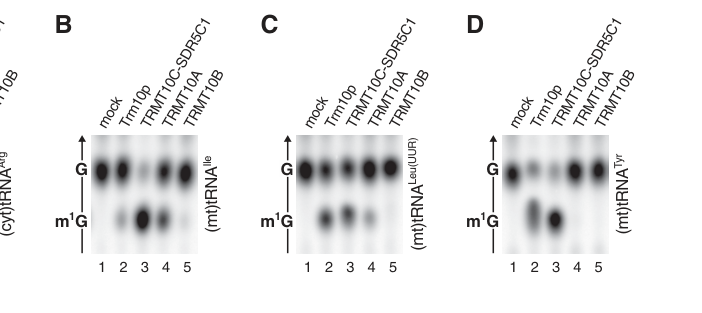

## Question

# Gene Research for Functional Annotation

## ⚠️ CRITICAL: Gene/Protein Identification Context

**BEFORE YOU BEGIN RESEARCH:** You MUST verify you are researching the CORRECT gene/protein. Gene symbols can be ambiguous, especially for less well-characterized genes from non-model organisms.

### Target Gene/Protein Identity (from UniProt):
- **UniProt Accession:** Q7L0Y3
- **Protein Description:** RecName: Full=tRNA methyltransferase 10 homolog C {ECO:0000305}; AltName: Full=HBV pre-S2 trans-regulated protein 2 {ECO:0000303|PubMed:12546731}; AltName: Full=Mitochondrial ribonuclease P protein 1 {ECO:0000303|PubMed:18984158}; Short=Mitochondrial RNase P protein 1 {ECO:0000303|PubMed:18984158}; AltName: Full=RNA (guanine-9-)-methyltransferase domain-containing protein 1; AltName: Full=Renal carcinoma antigen NY-REN-49 {ECO:0000303|PubMed:10508479}; AltName: Full=mRNA methyladenosine-N(1)-methyltransferase {ECO:0000303|PubMed:29072297}; EC=2.1.1.- {ECO:0000269|PubMed:29072297}; AltName: Full=tRNA (adenine(9)-N(1))-methyltransferase; EC=2.1.1.218 {ECO:0000269|PubMed:23042678}; AltName: Full=tRNA (guanine(9)-N(1))-methyltransferase; EC=2.1.1.221 {ECO:0000269|PubMed:23042678}; Flags: Precursor;
- **Gene Information:** Name=TRMT10C {ECO:0000312|HGNC:HGNC:26022}; Synonyms=MRPP1 {ECO:0000303|PubMed:18984158}, RG9MTD1;
- **Organism (full):** Homo sapiens (Human).
- **Protein Family:** Belongs to the class IV-like SAM-binding methyltransferase
- **Key Domains:** MT_TRM10-typ. (IPR028564); MT_TRM10-typ_sf. (IPR038459); Trm10_C_MTase_dom. (IPR025812); tRNA_m1G_MeTrfase_euk. (IPR007356); TRM10_TRM10A (PF27710)

### MANDATORY VERIFICATION STEPS:

1. **Check if the gene symbol "TRMT10C" matches the protein description above**
2. **Verify the organism is correct:** Homo sapiens (Human).
3. **Check if protein family/domains align with what you find in literature**
4. **If you find literature for a DIFFERENT gene with the same or similar symbol, STOP**

### If Gene Symbol is Ambiguous or You Cannot Find Relevant Literature:

**DO NOT PROCEED WITH RESEARCH ON A DIFFERENT GENE.** Instead:
- State clearly: "The gene symbol 'TRMT10C' is ambiguous or literature is limited for this specific protein"
- Explain what you found (e.g., "Found extensive literature on a different gene with the same symbol in a different organism")
- Describe the protein based ONLY on the UniProt information provided above
- Suggest that the protein function can be inferred from domain/family information

### Research Target:

Please provide a comprehensive research report on the gene **TRMT10C** (gene ID: TRMT10C, UniProt: Q7L0Y3) in human.

The research report should be a detailed narrative explaining the function, biological processes, and localization of the gene product. Citations should be given for all claims.

You should prioritize authoritative reviews and primary scientific literature when conducting research. You can supplement
this with annotations you find in gene/protein databases, but these can be outdated or inaccurate.

We are specifically interested in the primary function of the gene - for enzymes, what reaction is catalyzed, and what is the substrate specificity? For transporters, what is the substrate? For structural proteins or adapters, what is the broader structural role? For signaling molecules, what is the role in the pathway.

We are interested in where in or outside the cell the gene product carries out its function.

We are also interested in the signaling or biochemical pathways in which the gene functions. We are less interested in broad pleiotropic effects, except where these elucidate the precise role.

Include evidence where possible. We are interested in both experimental evidence as well as inference from structure, evolution, or bioinformatic analysis. Precise studies should be prioritized over high-throughput, where available.

## Output

Question: You are an expert researcher providing comprehensive, well-cited information.

Provide detailed information focusing on:
1. Key concepts and definitions with current understanding
2. Recent developments and latest research (prioritize 2023-2024 sources)
3. Current applications and real-world implementations
4. Expert opinions and analysis from authoritative sources
5. Relevant statistics and data from recent studies

Format as a comprehensive research report with proper citations. Include URLs and publication dates where available.
Always prioritize recent, authoritative sources and provide specific citations for all major claims.

# Gene Research for Functional Annotation

## ⚠️ CRITICAL: Gene/Protein Identification Context

**BEFORE YOU BEGIN RESEARCH:** You MUST verify you are researching the CORRECT gene/protein. Gene symbols can be ambiguous, especially for less well-characterized genes from non-model organisms.

### Target Gene/Protein Identity (from UniProt):
- **UniProt Accession:** Q7L0Y3
- **Protein Description:** RecName: Full=tRNA methyltransferase 10 homolog C {ECO:0000305}; AltName: Full=HBV pre-S2 trans-regulated protein 2 {ECO:0000303|PubMed:12546731}; AltName: Full=Mitochondrial ribonuclease P protein 1 {ECO:0000303|PubMed:18984158}; Short=Mitochondrial RNase P protein 1 {ECO:0000303|PubMed:18984158}; AltName: Full=RNA (guanine-9-)-methyltransferase domain-containing protein 1; AltName: Full=Renal carcinoma antigen NY-REN-49 {ECO:0000303|PubMed:10508479}; AltName: Full=mRNA methyladenosine-N(1)-methyltransferase {ECO:0000303|PubMed:29072297}; EC=2.1.1.- {ECO:0000269|PubMed:29072297}; AltName: Full=tRNA (adenine(9)-N(1))-methyltransferase; EC=2.1.1.218 {ECO:0000269|PubMed:23042678}; AltName: Full=tRNA (guanine(9)-N(1))-methyltransferase; EC=2.1.1.221 {ECO:0000269|PubMed:23042678}; Flags: Precursor;
- **Gene Information:** Name=TRMT10C {ECO:0000312|HGNC:HGNC:26022}; Synonyms=MRPP1 {ECO:0000303|PubMed:18984158}, RG9MTD1;
- **Organism (full):** Homo sapiens (Human).
- **Protein Family:** Belongs to the class IV-like SAM-binding methyltransferase
- **Key Domains:** MT_TRM10-typ. (IPR028564); MT_TRM10-typ_sf. (IPR038459); Trm10_C_MTase_dom. (IPR025812); tRNA_m1G_MeTrfase_euk. (IPR007356); TRM10_TRM10A (PF27710)

### MANDATORY VERIFICATION STEPS:

1. **Check if the gene symbol "TRMT10C" matches the protein description above**
2. **Verify the organism is correct:** Homo sapiens (Human).
3. **Check if protein family/domains align with what you find in literature**
4. **If you find literature for a DIFFERENT gene with the same or similar symbol, STOP**

### If Gene Symbol is Ambiguous or You Cannot Find Relevant Literature:

**DO NOT PROCEED WITH RESEARCH ON A DIFFERENT GENE.** Instead:
- State clearly: "The gene symbol 'TRMT10C' is ambiguous or literature is limited for this specific protein"
- Explain what you found (e.g., "Found extensive literature on a different gene with the same symbol in a different organism")
- Describe the protein based ONLY on the UniProt information provided above
- Suggest that the protein function can be inferred from domain/family information

### Research Target:

Please provide a comprehensive research report on the gene **TRMT10C** (gene ID: TRMT10C, UniProt: Q7L0Y3) in human.

The research report should be a detailed narrative explaining the function, biological processes, and localization of the gene product. Citations should be given for all claims.

You should prioritize authoritative reviews and primary scientific literature when conducting research. You can supplement
this with annotations you find in gene/protein databases, but these can be outdated or inaccurate.

We are specifically interested in the primary function of the gene - for enzymes, what reaction is catalyzed, and what is the substrate specificity? For transporters, what is the substrate? For structural proteins or adapters, what is the broader structural role? For signaling molecules, what is the role in the pathway.

We are interested in where in or outside the cell the gene product carries out its function.

We are also interested in the signaling or biochemical pathways in which the gene functions. We are less interested in broad pleiotropic effects, except where these elucidate the precise role.

Include evidence where possible. We are interested in both experimental evidence as well as inference from structure, evolution, or bioinformatic analysis. Precise studies should be prioritized over high-throughput, where available.

# Human TRMT10C (UniProt Q7L0Y3): functional annotation

**Identity and conclusion.** The specified human gene **TRMT10C** encodes the protein also called **MRPP1** or **RG9MTD1**. Its identity is not ambiguous in the literature examined: it is the mitochondrial member of the Trm10-family RNA methyltransferases, distinct from human TRMT10A and TRMT10B. TRMT10C is also distinct from its partner **SDR5C1/HSD17B10 (MRPP2)** and the mitochondrial RNase P nuclease **PRORP (MRPP3)**. Its best-established catalytic function is to methylate the **N1 atom of either guanosine or adenosine at position 9 of mitochondrial tRNAs**; an equally important, but *noncatalytic*, function is to present precursor tRNAs to mitochondrial processing enzymes. The 2024 structural study explicitly identifies its TRMT10C model as AF-Q7L0Y3. (plehn2023involvementofn1methyladenosine pages 54-56, metodiev2016recessivemutationsin pages 1-2, shao2014crystalstructureof pages 15-15, meynier2024structuralbasisfor pages 1-2)

## Reaction and substrate specificity

TRMT10C transfers a methyl group from **S-adenosyl-l-methionine (SAM)** to a tRNA position-9 purine: **tRNA-G9 + SAM → tRNA-m¹G9 + S-adenosyl-l-homocysteine (SAH)**, or **tRNA-A9 + SAM → tRNA-m¹A9 + SAH**. It functions efficiently as a complex with SDR5C1, which is required as a partner but does **not** contribute its dehydrogenase reaction to tRNA methylation. Recombinant-protein reconstitution, radiolabeled-SAM transfer, product identification by chromatography, and depletion of either protein in human cells establish this assignment. The associated mitochondrial RNase P complex is therefore multifunctional, but **TRMT10C does not catalyze its RNA-cleavage reaction**. (vilardo2012asubcomplexof pages 4-5, vilardo2012asubcomplexof pages 7-8)

Specific in-vitro examples include G9-containing mitochondrial tRNA-Ile, tRNA-Leu(UUR), and tRNA-Tyr and A9-containing mitochondrial tRNA-His and tRNA-Lys. In the original head-to-head experiments, only TRMT10C–SDR5C1 produced m¹A9 from the tested A9 tRNAs, whereas TRMT10A/B favored a cytosolic G9 tRNA and were less compatible with some mitochondrial G9 tRNAs. The original study’s Figure 5 directly illustrates these comparisons. A human cytosolic tRNA can also be methylated by TRMT10C–SDR5C1 **in vitro**; this does not establish that it is a physiological substrate of mitochondrial TRMT10C. (vilardo2012asubcomplexof pages 6-7, vilardo2012asubcomplexof pages 7-8, vilardo2012asubcomplexof media a65bd346)

Human mitochondria encode **22 tRNAs**. A 2024 analysis describes **19** as having a purine at position 9—five G9 and fourteen A9—making them candidate position-9 N1-methylation substrates; that sequence-based count should not be confused with demonstration of full modification occupancy in every tissue. An earlier comprehensive tRNA analysis mapped **18 types of modifications across 137 positions** in the 22 human mitochondrial tRNAs. Purified TRMT10C–SDR5C1 binds precursor tRNA-Ile and precursor tRNA-His with reported apparent dissociation constants of **88 ± 8 nM** and **143 ± 21 nM**, respectively; TRMT10C alone bound less tightly. (vilardo2012asubcomplexof pages 8-9, maharjan2024posttranscriptionalmethylationof pages 1-2, suzuki2020completechemicalstructures pages 7-7)

## Location and place in the biochemical pathway

The well-supported functional location is **inside mitochondria, at mitochondrial tRNA-containing RNA-processing assemblies**. The protein is nuclear encoded and described as possessing an N-terminal mitochondrial-targeting region; its isolation with mitochondrial RNase P, activity in mitochondrial extracts, and effects on mitochondrial transcripts strongly support that assignment. A **mitochondrial-matrix** location is consistent with processing mitochondrial transcripts, but the cited primary experiments do not themselves establish a precise submitochondrial topology by import or protease-protection assays. Reports associating the maturation machinery with mitochondrial RNA granules do not justify treating exclusive granule residence as established. No extracellular function is demonstrated. (plehn2023involvementofn1methyladenosine pages 54-56, vilardo2012asubcomplexof pages 2-3, metodiev2016recessivemutationsin pages 2-4, meynier2024structuralbasisfora pages 2-4)

The relevant pathway is **maturation of mitochondrial polycistronic transcripts and subsequent mitochondrial translation**. Mitochondrial tRNAs are excised from longer RNAs, so defects in their processing can also disrupt the release of neighboring mitochondrial mRNAs and rRNAs. The TRMT10C–SDR5C1 subcomplex binds these structurally unusual pre-tRNAs and provides a platform for successive maturation activities. Early work reconstituted human mitochondrial RNase P from **three proteins**, without a required catalytic RNA: TRMT10C/MRPP1, SDR5C1/MRPP2, and PRORP/MRPP3. **PRORP** performs Mg²⁺-dependent **5′-leader cleavage**; the other two proteins enable recognition and productive cleavage of substrates. (vuckovic2024themolecularmachinery pages 3-4, holzmann2008rnasepwithout pages 5-6)

Recent cryo-electron microscopy and functional studies clarify the distinction between catalysis and scaffolding. Structures published in **2024** show a platform containing an SDR5C1 tetramer and bound TRMT10C molecules, with TRMT10C engaging the pre-tRNA and contacting PRORP. They capture TRMT10C–SDR5C1 assemblies with PRORP, **ELAC2** or **TRNT1**, representing methylation, PRORP-mediated 5′ processing, ELAC2-mediated **3′-trailer cleavage**, and TRNT1-mediated **3′-CCA addition**. The reported overall reconstructions span approximately **2.7–3.2 Å**. The 5′ leader obstructs productive ELAC2 binding, providing a structural explanation for predominantly **5′-before-3′** processing; already-added CCA helps protect mature tRNA against ELAC2 recleavage. TRMT10C catalyzes neither ELAC2’s cleavage nor TRNT1’s nucleotide addition. (meynier2024structuralbasisfora pages 4-6, meynier2024structuralbasisfor pages 4-5, gese2024structuralbasisof pages 2-3, gese2024structuralbasisof pages 5-7)

The 2024 structures show position-9 A or G flipped into TRMT10C’s methyltransferase pocket. Substitution of conserved **Q226** or **D314** abolishes methylation in reported assays, supporting a specific catalytic mechanism rather than assignment from sequence homology alone. TRMT10C’s RNA-binding and PRORP-contacting regions are separately important for processing. Crucially, methylation is **not an obligatory prerequisite for 5′ cleavage**: experiments separated the reactions, and catalytic activity of the methyltransferase partner is not required for the complex’s PRORP-supporting role. Independent 2024 RNase Z work demonstrated direct ELAC2–TRMT10C contacts; disruption of an ELAC2 interface removes the processing enhancement supplied by the platform. That assistance is substrate-dependent, rather than an absolute requirement for ELAC2 to act on every tRNA. (meynier2024structuralbasisfor pages 9-10, meynier2024structuralbasisfor pages 5-8, gese2024structuralbasisof pages 2-3, gese2024structuralbasisof pages 1-2, vilardo2012asubcomplexof pages 6-7)

The following table separates TRMT10C’s own reaction from steps performed by other enzymes and from a less-established secondary substrate.

| Function or step | Exact substrate and catalytic actor | Direct evidence, prioritizing 2024 | Physiological caveat |
|---|---|---|---|
| Purine-9 N1 methylation | **Substrate:** A9 or G9 in mitochondrial pre-tRNAs. **Actor:** TRMT10C–SDR5C1 transfers a methyl group from SAM, producing m¹A9 or m¹G9 and SAH. TRMT10C contains the active site; SDR5C1 is an activating partner whose dehydrogenase activity is dispensable. | 2024 cryo-EM captured A9 and G9 flipped into the TRMT10C active site and identified catalytic D314; mutating D314 abolished activity. Earlier reconstitution, TLC, and RNAi established SAM dependence and dual specificity. Nineteen of 22 human mt-tRNAs have a purine at position 9. (meynier2024structuralbasisfor pages 9-10, vilardo2012asubcomplexof pages 4-5, meynier2024structuralbasisfor pages 8-9, vuckovic2024themolecularmachinery pages 3-4) | Cytosolic tRNA can be methylated **in vitro**, but the established physiological substrates are mitochondrial RNAs. Methylation and 5′ cleavage are separable rather than obligatorily coupled. (vilardo2012asubcomplexof pages 6-7) |
| 5′-leader removal by mitochondrial RNase P | **Substrate:** mitochondrial pre-tRNA embedded in polycistronic RNA. **Actor:** PRORP/MRPP3 is the Mg²⁺-dependent endonuclease; TRMT10C–SDR5C1 binds, folds, and positions the substrate but does not catalyze phosphodiester cleavage. | Recombinant TRMT10C/MRPP1, SDR5C1/MRPP2, and PRORP/MRPP3 reconstituted protein-only RNase P; no individual subunit or pair cleaved pre-tRNA. 2024 structures show TRMT10C contacting PRORP and clamping it onto pre-tRNA; disrupting this interface prevents processing, whereas SAM is not required for cleavage. (meynier2024structuralbasisfor pages 5-8, meynier2024structuralbasisfor pages 1-2, meynier2024structuralbasisfora pages 7-9, holzmann2008rnasepwithout pages 5-6) | TRMT10C is not the RNase catalytic subunit: its role in cleavage is essential but **noncatalytic and scaffolding**. Patient variants can impair cleavage while preserving m¹R9 methylation. (metodiev2016recessivemutationsin pages 1-2, metodiev2016recessivemutationsin pages 4-6) |
| 3′-trailer removal by mitochondrial RNase Z | **Substrate:** 5′-processed mitochondrial pre-tRNA. **Actor:** ELAC2 cleaves the 3′ trailer; TRMT10C–SDR5C1 presents and stabilizes substrates and contacts ELAC2 directly. | 2024 cryo-EM and mutagenesis identified a TRMT10C–ELAC2 hydrophobic interface and showed that disrupting it removes the platform-mediated enhancement. The platform substantially improves processing for 17 of 22 mt-tRNAs; a 5′ leader sterically impedes ELAC2, explaining the 5′-before-3′ order. (meynier2024structuralbasisfor pages 4-5, gese2024structuralbasisof pages 2-3, gese2024structuralbasisof pages 1-2) | TRMT10C–SDR5C1 is not the 3′ nuclease and is not universally obligatory. ELAC2 may recognize canonical substrates directly, whereas structurally degenerate mt-tRNAs depend more strongly on the platform. (sikarwar2025advancesinhuman pages 8-9, sikarwar2025advancesinhuman pages 5-8) |
| 3′-CCA addition | **Substrate:** end-processed mitochondrial tRNA lacking encoded CCA. **Actor:** TRNT1, not TRMT10C, adds CCA template-independently; TRMT10C–SDR5C1 retains or presents the tRNA during maturation. | A 2024 cryo-EM assembly captured TRNT1 with TRMT10C–SDR5C1-bound tRNA and nucleotide substrate, supporting a persistent maturation-platform model. ELAC2 structures show that an existing CCA acts as an antideterminant against recleavage. (meynier2024structuralbasisfora pages 4-6, meynier2024structuralbasisfor pages 2-4, gese2024structuralbasisof pages 5-7, meynier2024structuralbasisfora pages 11-13) | TRMT10C has no demonstrated nucleotidyltransferase activity. Platform binding did not enhance TRNT1 activity in the reported assay, and product release and multiple-turnover mechanisms remain unresolved. (meynier2024structuralbasisfor pages 2-4, sikarwar2025advancesinhuman pages 5-8) |
| MT-ND5 mRNA methylation | **Substrate:** mitochondrial MT-ND5 mRNA A1374. **Attributed actor:** TRMT10C installs m¹A1374. | Single-nucleotide mapping identified one mitochondrial mRNA m¹A site attributed to TRMT10C; a 2024 expert review describes its abundance as tissue-specific and developmentally regulated. Reverse-transcription signatures suggested approximately 25% modification in one analysis and near-complete modification during early development, but these are method-dependent estimates. (safra2017them1alandscape pages 6-8, smoczynski2024advancesinthe pages 2-3, plehn2023involvementofn1methyladenosine pages 54-56) | This activity is less firmly mechanized than mt-tRNA methylation. SDR5C1 dependence has not been demonstrated, and a causal physiological role in ND5 translation or respiration remains unproven; it should be annotated as a qualified secondary function. (safra2017them1alandscape pages 6-8, smoczynski2024advancesinthe pages 2-3, plehn2023involvementofn1methyladenosine pages 54-56) |

*Table: This table separates TRMT10C’s catalytic purine-9 methyltransferase activity from its noncatalytic maturation-platform roles and reactions catalyzed by PRORP, ELAC2, or TRNT1. It also identifies MT-ND5 methylation as a less firmly established secondary function.*

## Physiological and clinical evidence

A **2016 human genetic study** identified **two affected individuals from unrelated families** with biallelic TRMT10C variants: one with p.Arg181Leu and p.Thr272Ala, the other homozygous for p.Arg181Leu. Both had severe early-onset mitochondrial disease, with lactic acidosis and combined respiratory-chain deficiencies. Their fibroblasts had reduced MRPP1 abundance, accumulated mitochondrial RNA-processing intermediates, and showed defective mitochondrial protein synthesis. Introducing wild-type TRMT10C restored processing, protein synthesis, and respiratory-complex assembly. Importantly, measured **position-9 methylation was preserved** in these patients: their disease-associated defects chiefly demonstrated impairment of TRMT10C’s *processing-platform* role, not loss of its methyltransferase reaction. These observations support including **TRMT10C in molecular diagnosis of combined oxidative-phosphorylation deficiency**, while not establishing a treatment. (metodiev2016recessivemutationsin pages 6-7, metodiev2016recessivemutationsin pages 1-2, metodiev2016recessivemutationsin pages 4-6)

A **2024 mechanistic study** illustrates why the tRNA modification cannot simply be labeled uniformly beneficial. For mitochondrial tRNA-Leu(UUR), m¹G9 improved the wild-type transcript’s fast aminoacylation phase from **2.4 ± 0.2 to 5.4 ± 0.4 min⁻¹** in the reported assay, but reduced that phase to **0.71 ± 0.06 min⁻¹** in an m¹G9-containing **A3243G MELAS-associated variant**. In cybrid cells, reducing MRPP1 lowered m¹G9 and improved some measures of variant tRNA stability or respiration, while harming wild-type mitochondrial function. These are biochemical and cell-model observations, **not** evidence for a clinically validated strategy to inhibit TRMT10C: reducing the protein also perturbs tRNA processing and other substrates. (maharjan2024posttranscriptionalmethylationof pages 5-7, maharjan2024posttranscriptionalmethylationof pages 8-9, maharjan2024posttranscriptionalmethylationof pages 2-2)

## Additional activity and limits of annotation

Single-nucleotide mRNA-mapping work attributed an **m¹A modification of mitochondrial MT-ND5 mRNA**, reported at **A1374**, to TRMT10C. This is a plausible **secondary mitochondrial RNA substrate**, with reported tissue- and development-dependent modification. Nevertheless, its physiological effect on ND5 expression is less firmly established than TRMT10C’s tRNA and RNase P roles; reverse-transcription-based modification estimates are method-dependent, and whether SDR5C1 is required for ND5 methylation has not been experimentally established in the cited analysis. ND5 modification should therefore **not displace tRNA purine-9 methylation and tRNA-maturation scaffolding as the primary functional annotation**. (safra2017them1alandscape pages 6-8, smoczynski2024advancesinthe pages 2-3, plehn2023involvementofn1methyladenosine pages 54-56)

**Expert synthesis.** A 2024 review and independent structural studies converge on TRMT10C–SDR5C1 as an adaptation to the unusual, structurally variable mitochondrial tRNA repertoire: it both modifies purine 9 and supplies an RNA-recognition platform for enzymes that carry out subsequent cuts and CCA addition. A proposed folding-quality-control role is consistent with these structures, but should be distinguished from an experimentally proven checkpoint for every tRNA substrate. (vuckovic2024themolecularmachinery pages 3-4, meynier2024structuralbasisfor pages 9-10, sikarwar2025advancesinhuman pages 8-9)

### Principal sources and publication dates

- Meynier **et al.**, *Nature Communications*, **June 2024**, structural analysis of mitochondrial tRNA maturation: https://doi.org/10.1038/s41467-024-49132-0. (meynier2024structuralbasisfor pages 4-5)
- Gesé and Hällberg, *The EMBO Journal*, **2024**, mitochondrial RNase Z structures: https://doi.org/10.1038/s44318-024-00297-w. (gese2024structuralbasisof pages 2-3)
- Maharjan **et al.**, *Nature Communications*, **October 2024**, variant-dependent effects of tRNA m¹G9: https://doi.org/10.1038/s41467-024-53318-x. (maharjan2024posttranscriptionalmethylationof pages 5-7)
- Vučković **et al.**, *Human Molecular Genetics*, **2024**, expert review of mitochondrial transcript maturation: https://doi.org/10.1093/hmg/ddae023. (vuckovic2024themolecularmachinery pages 3-4)
- Vilardo **et al.**, *Nucleic Acids Research*, **2012**, direct reconstitution of dual-specificity tRNA methylation: https://doi.org/10.1093/nar/gks910. (vilardo2012asubcomplexof pages 4-5)
- Holzmann **et al.**, *Cell*, **October 2008**, protein-only mitochondrial RNase P reconstitution: https://doi.org/10.1016/j.cell.2008.09.013. (holzmann2008rnasepwithout pages 5-6)
- Metodiev **et al.**, *American Journal of Human Genetics*, **2016**, recessive human TRMT10C disease and complementation: https://doi.org/10.1016/j.ajhg.2016.06.013. (metodiev2016recessivemutationsin pages 1-2)
- Safra **et al.**, *Nature*, **October 2017**, mapping of mitochondrial mRNA m¹A: https://doi.org/10.1038/nature24456. (safra2017them1alandscape pages 6-8)

References

1. (plehn2023involvementofn1methyladenosine pages 54-56): Johanna Eleonore Plehn. Involvement of n1-methyladenosine (m1a) in the mitochondrial nd5 mrna and the corresponding writer enzyme trmt10c in alzheimer's disease. Text, Jan 2023. URL: https://doi.org/10.25358/openscience-9319, doi:10.25358/openscience-9319. This article has 0 citations and is from a peer-reviewed journal.

2. (metodiev2016recessivemutationsin pages 1-2): Metodi D. Metodiev, Kyle Thompson, Charlotte L. Alston, Andrew A.M. Morris, Langping He, Zarah Assouline, Marlène Rio, Nadia Bahi-Buisson, Angela Pyle, Helen Griffin, Stefan Siira, Aleksandra Filipovska, Arnold Munnich, Patrick F. Chinnery, Robert McFarland, Agnès Rötig, and Robert W. Taylor. Recessive mutations in trmt10c cause defects in mitochondrial rna processing and multiple respiratory chain deficiencies. American journal of human genetics, 99 1:246, Jul 2016. URL: https://doi.org/10.1016/j.ajhg.2016.06.013, doi:10.1016/j.ajhg.2016.06.013. This article has 150 citations and is from a highest quality peer-reviewed journal.

3. (shao2014crystalstructureof pages 15-15): Zhenhua Shao, Wei Yan, Junhui Peng, Xiaobing Zuo, Yang Zou, Fudong Li, Deshun Gong, Rongsheng Ma, Jihui Wu, Yunyu Shi, Zhiyong Zhang, Maikun Teng, Xu Li, and Qingguo Gong. Crystal structure of trna m1g9 methyltransferase trm10: insight into the catalytic mechanism and recognition of trna substrate. Nucleic Acids Research, 42:509-525, Sep 2014. URL: https://doi.org/10.1093/nar/gkt869, doi:10.1093/nar/gkt869. This article has 67 citations and is from a highest quality peer-reviewed journal.

4. (meynier2024structuralbasisfor pages 1-2): Vincent Meynier, Steven W. Hardwick, Marjorie Catala, Johann J. Roske, Stephanie Oerum, Dimitri Y. Chirgadze, Pierre Barraud, Wyatt W. Yue, Ben F. Luisi, and Carine Tisné. Structural basis for human mitochondrial trna maturation. Nature Communications, Jun 2024. URL: https://doi.org/10.1038/s41467-024-49132-0, doi:10.1038/s41467-024-49132-0. This article has 48 citations and is from a highest quality peer-reviewed journal.

5. (vilardo2012asubcomplexof pages 4-5): Elisa Vilardo, Christa Nachbagauer, Aurélie Buzet, Andreas Taschner, Johann Holzmann, and Walter Rossmanith. A subcomplex of human mitochondrial rnase p is a bifunctional methyltransferase—extensive moonlighting in mitochondrial trna biogenesis. Nucleic Acids Research, 40:11583-11593, Oct 2012. URL: https://doi.org/10.1093/nar/gks910, doi:10.1093/nar/gks910. This article has 321 citations and is from a highest quality peer-reviewed journal.

6. (vilardo2012asubcomplexof pages 7-8): Elisa Vilardo, Christa Nachbagauer, Aurélie Buzet, Andreas Taschner, Johann Holzmann, and Walter Rossmanith. A subcomplex of human mitochondrial rnase p is a bifunctional methyltransferase—extensive moonlighting in mitochondrial trna biogenesis. Nucleic Acids Research, 40:11583-11593, Oct 2012. URL: https://doi.org/10.1093/nar/gks910, doi:10.1093/nar/gks910. This article has 321 citations and is from a highest quality peer-reviewed journal.

7. (vilardo2012asubcomplexof pages 6-7): Elisa Vilardo, Christa Nachbagauer, Aurélie Buzet, Andreas Taschner, Johann Holzmann, and Walter Rossmanith. A subcomplex of human mitochondrial rnase p is a bifunctional methyltransferase—extensive moonlighting in mitochondrial trna biogenesis. Nucleic Acids Research, 40:11583-11593, Oct 2012. URL: https://doi.org/10.1093/nar/gks910, doi:10.1093/nar/gks910. This article has 321 citations and is from a highest quality peer-reviewed journal.

8. (vilardo2012asubcomplexof media a65bd346): Elisa Vilardo, Christa Nachbagauer, Aurélie Buzet, Andreas Taschner, Johann Holzmann, and Walter Rossmanith. A subcomplex of human mitochondrial rnase p is a bifunctional methyltransferase—extensive moonlighting in mitochondrial trna biogenesis. Nucleic Acids Research, 40:11583-11593, Oct 2012. URL: https://doi.org/10.1093/nar/gks910, doi:10.1093/nar/gks910. This article has 321 citations and is from a highest quality peer-reviewed journal.

9. (vilardo2012asubcomplexof pages 8-9): Elisa Vilardo, Christa Nachbagauer, Aurélie Buzet, Andreas Taschner, Johann Holzmann, and Walter Rossmanith. A subcomplex of human mitochondrial rnase p is a bifunctional methyltransferase—extensive moonlighting in mitochondrial trna biogenesis. Nucleic Acids Research, 40:11583-11593, Oct 2012. URL: https://doi.org/10.1093/nar/gks910, doi:10.1093/nar/gks910. This article has 321 citations and is from a highest quality peer-reviewed journal.

10. (maharjan2024posttranscriptionalmethylationof pages 1-2): Sunita Maharjan, Howard Gamper, Yuka Yamaki, T. Christian, Robert Y. Henley, Nan-Sheng Li, Takeo Suzuki, Tsutomu Suzuki, J. Piccirilli, M. Wanunu, Erin Seifert, Douglas C. Wallace, and Ya-Ming Hou. Post-transcriptional methylation of mitochondrial-trna differentially contributes to mitochondrial pathology. Nature Communications, Oct 2024. URL: https://doi.org/10.1038/s41467-024-53318-x, doi:10.1038/s41467-024-53318-x. This article has 9 citations and is from a highest quality peer-reviewed journal.

11. (suzuki2020completechemicalstructures pages 7-7): Takeo Suzuki, Yuka Yashiro, Ittoku Kikuchi, Yuma Ishigami, Hironori Saito, Ikuya Matsuzawa, Shunpei Okada, Mari Mito, Shintaro Iwasaki, Ding Ma, Xuewei Zhao, Kana Asano, Huan Lin, Yohei Kirino, Yuriko Sakaguchi, and Tsutomu Suzuki. Complete chemical structures of human mitochondrial trnas. Nature Communications, Aug 2020. URL: https://doi.org/10.1038/s41467-020-18068-6, doi:10.1038/s41467-020-18068-6. This article has 342 citations and is from a highest quality peer-reviewed journal.

12. (vilardo2012asubcomplexof pages 2-3): Elisa Vilardo, Christa Nachbagauer, Aurélie Buzet, Andreas Taschner, Johann Holzmann, and Walter Rossmanith. A subcomplex of human mitochondrial rnase p is a bifunctional methyltransferase—extensive moonlighting in mitochondrial trna biogenesis. Nucleic Acids Research, 40:11583-11593, Oct 2012. URL: https://doi.org/10.1093/nar/gks910, doi:10.1093/nar/gks910. This article has 321 citations and is from a highest quality peer-reviewed journal.

13. (metodiev2016recessivemutationsin pages 2-4): Metodi D. Metodiev, Kyle Thompson, Charlotte L. Alston, Andrew A.M. Morris, Langping He, Zarah Assouline, Marlène Rio, Nadia Bahi-Buisson, Angela Pyle, Helen Griffin, Stefan Siira, Aleksandra Filipovska, Arnold Munnich, Patrick F. Chinnery, Robert McFarland, Agnès Rötig, and Robert W. Taylor. Recessive mutations in trmt10c cause defects in mitochondrial rna processing and multiple respiratory chain deficiencies. American journal of human genetics, 99 1:246, Jul 2016. URL: https://doi.org/10.1016/j.ajhg.2016.06.013, doi:10.1016/j.ajhg.2016.06.013. This article has 150 citations and is from a highest quality peer-reviewed journal.

14. (meynier2024structuralbasisfora pages 2-4): Vincent Meynier, Steven W. Hardwick, Marjorie Catala, Jonas Roske, Stephanie Oerum, Dimitri Y. Chirgadze, Pierre Barraud, Wyatt Yu, Ben F. Luisi, and Carine Tisné. Structural basis for human mitochondrial trna maturation. BioRxiv, Dec 2024. URL: https://doi.org/10.1101/2023.12.19.572246, doi:10.1101/2023.12.19.572246. This article has 48 citations.

15. (vuckovic2024themolecularmachinery pages 3-4): Ana Vučković, Christoph Freyer, Anna Wredenberg, and Hauke S Hillen. The molecular machinery for maturation of primary mtdna transcripts. Human Molecular Genetics, 33:R19-R25, May 2024. URL: https://doi.org/10.1093/hmg/ddae023, doi:10.1093/hmg/ddae023. This article has 18 citations and is from a domain leading peer-reviewed journal.

16. (holzmann2008rnasepwithout pages 5-6): Johann Holzmann, Peter Frank, Esther Löffler, Keiryn L. Bennett, Christopher Gerner, and Walter Rossmanith. Rnase p without rna: identification and functional reconstitution of the human mitochondrial trna processing enzyme. Cell, 135:462-474, Oct 2008. URL: https://doi.org/10.1016/j.cell.2008.09.013, doi:10.1016/j.cell.2008.09.013. This article has 801 citations and is from a highest quality peer-reviewed journal.

17. (meynier2024structuralbasisfora pages 4-6): Vincent Meynier, Steven W. Hardwick, Marjorie Catala, Jonas Roske, Stephanie Oerum, Dimitri Y. Chirgadze, Pierre Barraud, Wyatt Yu, Ben F. Luisi, and Carine Tisné. Structural basis for human mitochondrial trna maturation. BioRxiv, Dec 2024. URL: https://doi.org/10.1101/2023.12.19.572246, doi:10.1101/2023.12.19.572246. This article has 48 citations.

18. (meynier2024structuralbasisfor pages 4-5): Vincent Meynier, Steven W. Hardwick, Marjorie Catala, Johann J. Roske, Stephanie Oerum, Dimitri Y. Chirgadze, Pierre Barraud, Wyatt W. Yue, Ben F. Luisi, and Carine Tisné. Structural basis for human mitochondrial trna maturation. Nature Communications, Jun 2024. URL: https://doi.org/10.1038/s41467-024-49132-0, doi:10.1038/s41467-024-49132-0. This article has 48 citations and is from a highest quality peer-reviewed journal.

19. (gese2024structuralbasisof pages 2-3): Genís Valentín Gesé and B. Martin Hällberg. Structural basis of 3′-trna maturation by the human mitochondrial rnase z complex. The EMBO Journal, 43:6573-6590, May 2024. URL: https://doi.org/10.1038/s44318-024-00297-w, doi:10.1038/s44318-024-00297-w. This article has 24 citations.

20. (gese2024structuralbasisof pages 5-7): Genís Valentín Gesé and B. Martin Hällberg. Structural basis of 3′-trna maturation by the human mitochondrial rnase z complex. The EMBO Journal, 43:6573-6590, May 2024. URL: https://doi.org/10.1038/s44318-024-00297-w, doi:10.1038/s44318-024-00297-w. This article has 24 citations.

21. (meynier2024structuralbasisfor pages 9-10): Vincent Meynier, Steven W. Hardwick, Marjorie Catala, Johann J. Roske, Stephanie Oerum, Dimitri Y. Chirgadze, Pierre Barraud, Wyatt W. Yue, Ben F. Luisi, and Carine Tisné. Structural basis for human mitochondrial trna maturation. Nature Communications, Jun 2024. URL: https://doi.org/10.1038/s41467-024-49132-0, doi:10.1038/s41467-024-49132-0. This article has 48 citations and is from a highest quality peer-reviewed journal.

22. (meynier2024structuralbasisfor pages 5-8): Vincent Meynier, Steven W. Hardwick, Marjorie Catala, Johann J. Roske, Stephanie Oerum, Dimitri Y. Chirgadze, Pierre Barraud, Wyatt W. Yue, Ben F. Luisi, and Carine Tisné. Structural basis for human mitochondrial trna maturation. Nature Communications, Jun 2024. URL: https://doi.org/10.1038/s41467-024-49132-0, doi:10.1038/s41467-024-49132-0. This article has 48 citations and is from a highest quality peer-reviewed journal.

23. (gese2024structuralbasisof pages 1-2): Genís Valentín Gesé and B. Martin Hällberg. Structural basis of 3′-trna maturation by the human mitochondrial rnase z complex. The EMBO Journal, 43:6573-6590, May 2024. URL: https://doi.org/10.1038/s44318-024-00297-w, doi:10.1038/s44318-024-00297-w. This article has 24 citations.

24. (meynier2024structuralbasisfor pages 8-9): Vincent Meynier, Steven W. Hardwick, Marjorie Catala, Johann J. Roske, Stephanie Oerum, Dimitri Y. Chirgadze, Pierre Barraud, Wyatt W. Yue, Ben F. Luisi, and Carine Tisné. Structural basis for human mitochondrial trna maturation. Nature Communications, Jun 2024. URL: https://doi.org/10.1038/s41467-024-49132-0, doi:10.1038/s41467-024-49132-0. This article has 48 citations and is from a highest quality peer-reviewed journal.

25. (meynier2024structuralbasisfora pages 7-9): Vincent Meynier, Steven W. Hardwick, Marjorie Catala, Jonas Roske, Stephanie Oerum, Dimitri Y. Chirgadze, Pierre Barraud, Wyatt Yu, Ben F. Luisi, and Carine Tisné. Structural basis for human mitochondrial trna maturation. BioRxiv, Dec 2024. URL: https://doi.org/10.1101/2023.12.19.572246, doi:10.1101/2023.12.19.572246. This article has 48 citations.

26. (metodiev2016recessivemutationsin pages 4-6): Metodi D. Metodiev, Kyle Thompson, Charlotte L. Alston, Andrew A.M. Morris, Langping He, Zarah Assouline, Marlène Rio, Nadia Bahi-Buisson, Angela Pyle, Helen Griffin, Stefan Siira, Aleksandra Filipovska, Arnold Munnich, Patrick F. Chinnery, Robert McFarland, Agnès Rötig, and Robert W. Taylor. Recessive mutations in trmt10c cause defects in mitochondrial rna processing and multiple respiratory chain deficiencies. American journal of human genetics, 99 1:246, Jul 2016. URL: https://doi.org/10.1016/j.ajhg.2016.06.013, doi:10.1016/j.ajhg.2016.06.013. This article has 150 citations and is from a highest quality peer-reviewed journal.

27. (sikarwar2025advancesinhuman pages 8-9): Juhi Sikarwar, Vincent Meynier, and Carine Tisné. Advances in human pre-trna maturation : trmt10c and elac2 in focus. Journal of molecular biology, pages 168989, Feb 2025. URL: https://doi.org/10.1016/j.jmb.2025.168989, doi:10.1016/j.jmb.2025.168989. This article has 8 citations and is from a domain leading peer-reviewed journal.

28. (sikarwar2025advancesinhuman pages 5-8): Juhi Sikarwar, Vincent Meynier, and Carine Tisné. Advances in human pre-trna maturation : trmt10c and elac2 in focus. Journal of molecular biology, pages 168989, Feb 2025. URL: https://doi.org/10.1016/j.jmb.2025.168989, doi:10.1016/j.jmb.2025.168989. This article has 8 citations and is from a domain leading peer-reviewed journal.

29. (meynier2024structuralbasisfor pages 2-4): Vincent Meynier, Steven W. Hardwick, Marjorie Catala, Johann J. Roske, Stephanie Oerum, Dimitri Y. Chirgadze, Pierre Barraud, Wyatt W. Yue, Ben F. Luisi, and Carine Tisné. Structural basis for human mitochondrial trna maturation. Nature Communications, Jun 2024. URL: https://doi.org/10.1038/s41467-024-49132-0, doi:10.1038/s41467-024-49132-0. This article has 48 citations and is from a highest quality peer-reviewed journal.

30. (meynier2024structuralbasisfora pages 11-13): Vincent Meynier, Steven W. Hardwick, Marjorie Catala, Jonas Roske, Stephanie Oerum, Dimitri Y. Chirgadze, Pierre Barraud, Wyatt Yu, Ben F. Luisi, and Carine Tisné. Structural basis for human mitochondrial trna maturation. BioRxiv, Dec 2024. URL: https://doi.org/10.1101/2023.12.19.572246, doi:10.1101/2023.12.19.572246. This article has 48 citations.

31. (safra2017them1alandscape pages 6-8): Modi Safra, Aldema Sas-Chen, Ronit Nir, Roni Winkler, Aharon Nachshon, Dan Bar-Yaacov, Matthias Erlacher, Walter Rossmanith, Noam Stern-Ginossar, and Schraga Schwartz. The m1a landscape on cytosolic and mitochondrial mrna at single-base resolution. Nature, 551:251-255, Oct 2017. URL: https://doi.org/10.1038/nature24456, doi:10.1038/nature24456. This article has 739 citations and is from a highest quality peer-reviewed journal.

32. (smoczynski2024advancesinthe pages 2-3): Jakub Smoczynski, Marcel-Joseph Yared, Vincent Meynier, Pierre Barraud, and Carine Tisné. Advances in the structural and functional understanding of m1a rna modification. Accounts of Chemical Research, 57:429-438, Feb 2024. URL: https://doi.org/10.1021/acs.accounts.3c00568, doi:10.1021/acs.accounts.3c00568. This article has 44 citations and is from a domain leading peer-reviewed journal.

33. (metodiev2016recessivemutationsin pages 6-7): Metodi D. Metodiev, Kyle Thompson, Charlotte L. Alston, Andrew A.M. Morris, Langping He, Zarah Assouline, Marlène Rio, Nadia Bahi-Buisson, Angela Pyle, Helen Griffin, Stefan Siira, Aleksandra Filipovska, Arnold Munnich, Patrick F. Chinnery, Robert McFarland, Agnès Rötig, and Robert W. Taylor. Recessive mutations in trmt10c cause defects in mitochondrial rna processing and multiple respiratory chain deficiencies. American journal of human genetics, 99 1:246, Jul 2016. URL: https://doi.org/10.1016/j.ajhg.2016.06.013, doi:10.1016/j.ajhg.2016.06.013. This article has 150 citations and is from a highest quality peer-reviewed journal.

34. (maharjan2024posttranscriptionalmethylationof pages 5-7): Sunita Maharjan, Howard Gamper, Yuka Yamaki, T. Christian, Robert Y. Henley, Nan-Sheng Li, Takeo Suzuki, Tsutomu Suzuki, J. Piccirilli, M. Wanunu, Erin Seifert, Douglas C. Wallace, and Ya-Ming Hou. Post-transcriptional methylation of mitochondrial-trna differentially contributes to mitochondrial pathology. Nature Communications, Oct 2024. URL: https://doi.org/10.1038/s41467-024-53318-x, doi:10.1038/s41467-024-53318-x. This article has 9 citations and is from a highest quality peer-reviewed journal.

35. (maharjan2024posttranscriptionalmethylationof pages 8-9): Sunita Maharjan, Howard Gamper, Yuka Yamaki, T. Christian, Robert Y. Henley, Nan-Sheng Li, Takeo Suzuki, Tsutomu Suzuki, J. Piccirilli, M. Wanunu, Erin Seifert, Douglas C. Wallace, and Ya-Ming Hou. Post-transcriptional methylation of mitochondrial-trna differentially contributes to mitochondrial pathology. Nature Communications, Oct 2024. URL: https://doi.org/10.1038/s41467-024-53318-x, doi:10.1038/s41467-024-53318-x. This article has 9 citations and is from a highest quality peer-reviewed journal.

36. (maharjan2024posttranscriptionalmethylationof pages 2-2): Sunita Maharjan, Howard Gamper, Yuka Yamaki, T. Christian, Robert Y. Henley, Nan-Sheng Li, Takeo Suzuki, Tsutomu Suzuki, J. Piccirilli, M. Wanunu, Erin Seifert, Douglas C. Wallace, and Ya-Ming Hou. Post-transcriptional methylation of mitochondrial-trna differentially contributes to mitochondrial pathology. Nature Communications, Oct 2024. URL: https://doi.org/10.1038/s41467-024-53318-x, doi:10.1038/s41467-024-53318-x. This article has 9 citations and is from a highest quality peer-reviewed journal.

## Artifacts

- [Edison artifact artifact-00](TRMT10C-deep-research-falcon_artifacts/artifact-00.md)

## Citations

1. vilardo2012asubcomplexof pages 6-7
2. meynier2024structuralbasisfor pages 4-5
3. gese2024structuralbasisof pages 2-3
4. maharjan2024posttranscriptionalmethylationof pages 5-7
5. vuckovic2024themolecularmachinery pages 3-4
6. vilardo2012asubcomplexof pages 4-5
7. holzmann2008rnasepwithout pages 5-6
8. metodiev2016recessivemutationsin pages 1-2
9. shao2014crystalstructureof pages 15-15
10. meynier2024structuralbasisfor pages 1-2
11. vilardo2012asubcomplexof pages 7-8
12. vilardo2012asubcomplexof pages 8-9
13. maharjan2024posttranscriptionalmethylationof pages 1-2
14. suzuki2020completechemicalstructures pages 7-7
15. vilardo2012asubcomplexof pages 2-3
16. metodiev2016recessivemutationsin pages 2-4
17. meynier2024structuralbasisfora pages 2-4
18. meynier2024structuralbasisfora pages 4-6
19. gese2024structuralbasisof pages 5-7
20. meynier2024structuralbasisfor pages 9-10
21. meynier2024structuralbasisfor pages 5-8
22. gese2024structuralbasisof pages 1-2
23. meynier2024structuralbasisfor pages 8-9
24. meynier2024structuralbasisfora pages 7-9
25. metodiev2016recessivemutationsin pages 4-6
26. sikarwar2025advancesinhuman pages 8-9
27. sikarwar2025advancesinhuman pages 5-8
28. meynier2024structuralbasisfor pages 2-4
29. meynier2024structuralbasisfora pages 11-13
30. smoczynski2024advancesinthe pages 2-3
31. metodiev2016recessivemutationsin pages 6-7
32. maharjan2024posttranscriptionalmethylationof pages 8-9
33. maharjan2024posttranscriptionalmethylationof pages 2-2
34. https://doi.org/10.1038/s41467-024-49132-0.
35. https://doi.org/10.1038/s44318-024-00297-w.
36. https://doi.org/10.1038/s41467-024-53318-x.
37. https://doi.org/10.1093/hmg/ddae023.
38. https://doi.org/10.1093/nar/gks910.
39. https://doi.org/10.1016/j.cell.2008.09.013.
40. https://doi.org/10.1016/j.ajhg.2016.06.013.
41. https://doi.org/10.1038/nature24456.
42. https://doi.org/10.25358/openscience-9319,
43. https://doi.org/10.1016/j.ajhg.2016.06.013,
44. https://doi.org/10.1093/nar/gkt869,
45. https://doi.org/10.1038/s41467-024-49132-0,
46. https://doi.org/10.1093/nar/gks910,
47. https://doi.org/10.1038/s41467-024-53318-x,
48. https://doi.org/10.1038/s41467-020-18068-6,
49. https://doi.org/10.1101/2023.12.19.572246,
50. https://doi.org/10.1093/hmg/ddae023,
51. https://doi.org/10.1016/j.cell.2008.09.013,
52. https://doi.org/10.1038/s44318-024-00297-w,
53. https://doi.org/10.1016/j.jmb.2025.168989,
54. https://doi.org/10.1038/nature24456,
55. https://doi.org/10.1021/acs.accounts.3c00568,