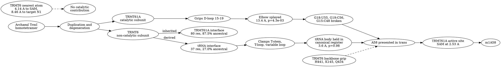
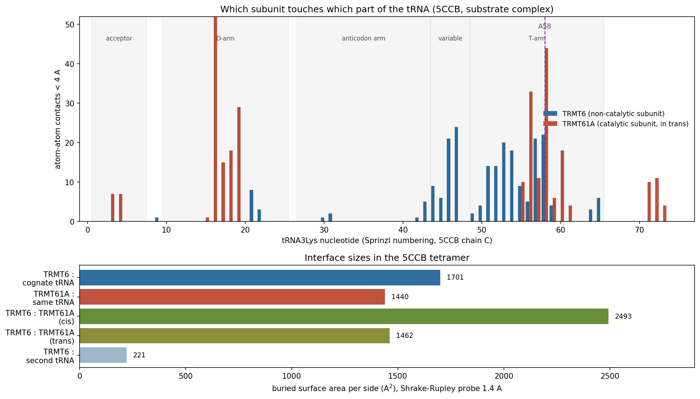
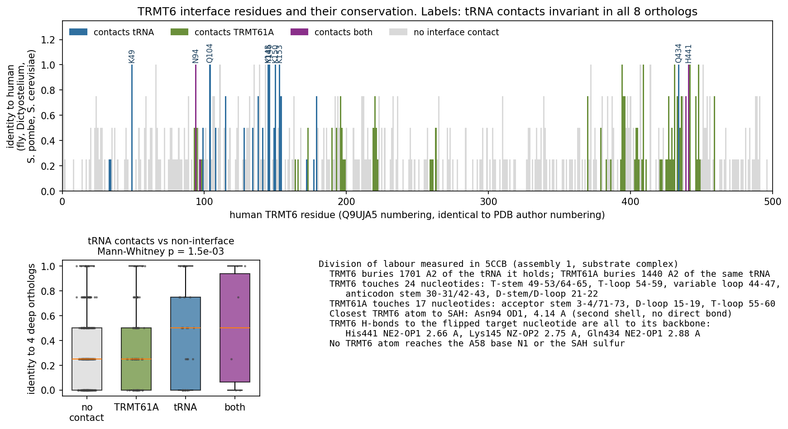
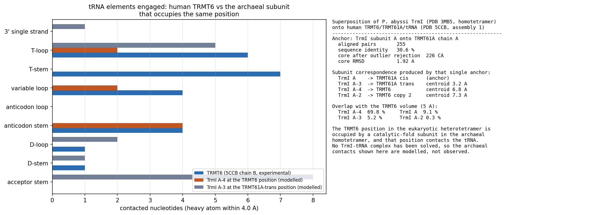
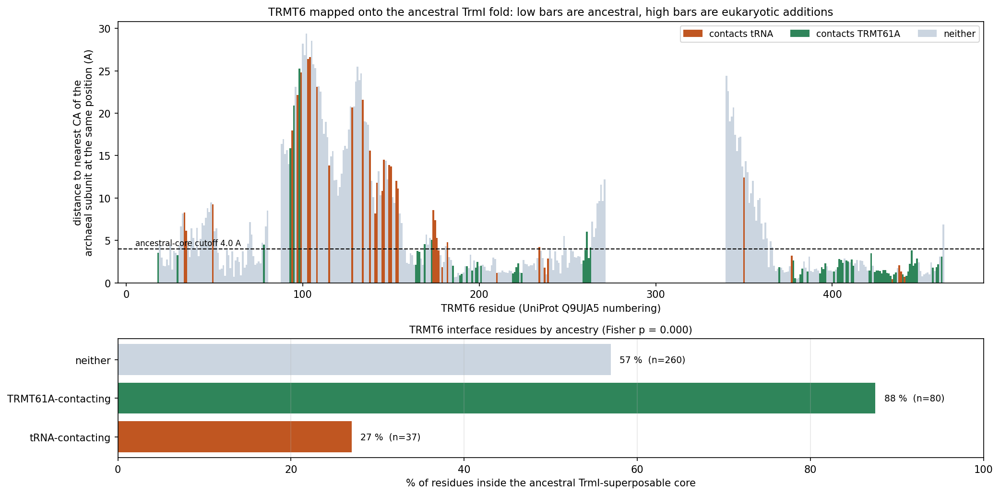
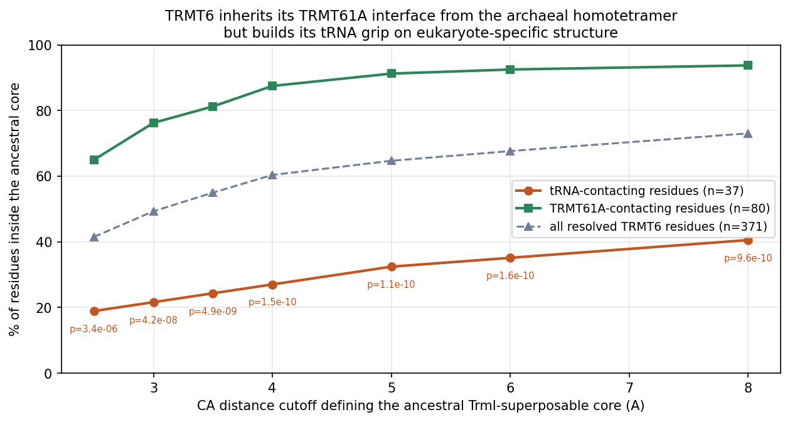
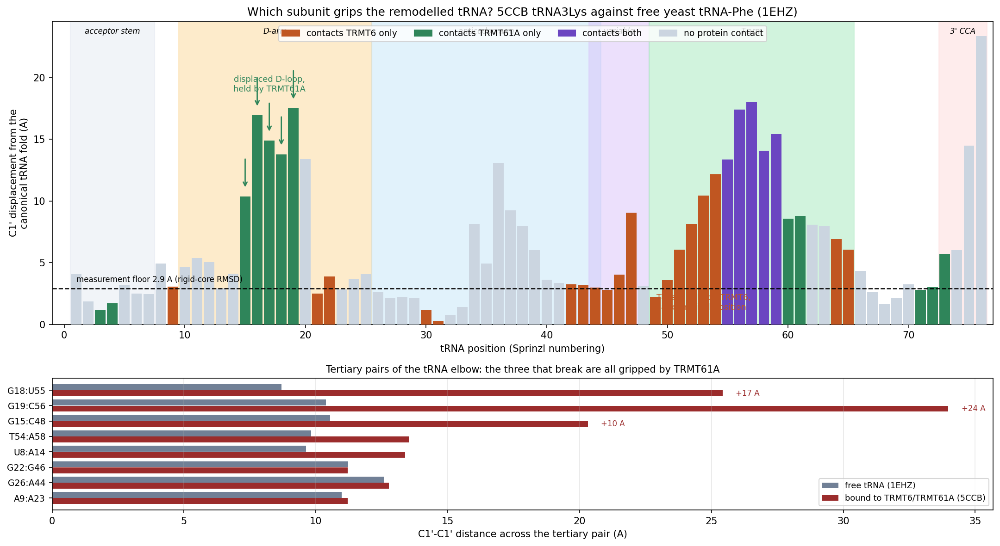
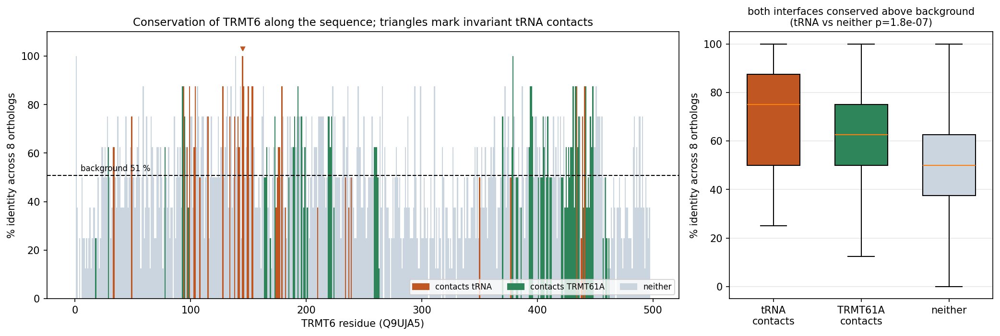

## Question

# AIGR Gene Hypothesis Deep Research

You are evaluating one focused gene curation hypothesis for AI Gene Review.
This is not a general gene overview. Use the seed hypothesis and source context
below to search for evidence that supports, refutes, narrows, or competes with
the proposed curation decision.

## Target Gene

- **Organism code:** human
- **Taxon:** Homo sapiens (NCBITaxon:9606)
- **Gene directory:** TRMT6
- **Gene symbol:** TRMT6
- **UniProt accession:** Q9UJA5

## Focus

- **Focus type:** free_text
- **Hypothesis slug:** kgap-trmt6-trna-contacts
- **Source file:** genes/human/TRMT6/TRMT6-ai-review.yaml
- **Source selector:** free-text

## Seed Hypothesis

What TRMT6 (Q9UJA5) itself contributes to the TRMT6/TRMT61A m1A58 tRNA methyltransferase can be stated residue by residue from the published structures, which is the grounding a molecular-function term would need. That the heterotetramer delivers A58 in trans and splays the T- and D-loops is already established, so do not re-derive the mechanism. Single analysis only: from the published human complex structures bound to tRNA, compute which TRMT6 residues contact the tRNA and which contact TRMT61A, separating the two sets, and state which tRNA elements each TRMT6 contact engages, for example the T-loop, the D-loop, the elbow or the acceptor stem; state whether TRMT6 contributes any residue to the catalytic pocket or to S-adenosylmethionine binding, so that enables-versus-contributes_to can be decided on evidence; assess whether the TRMT6 contacts are the ones that hold the splayed conformation, which would make it a tRNA-remodelling subunit rather than a passive scaffold; and report the conservation of those contact residues across eukaryotic TRMT6 orthologs and in the archaeal homotetrameric homolog. State what molecular-function wording the structural evidence would support for TRMT6 alone, and whether any existing GO term already fits before proposing a new one.

## Term and Decision Context

No specific term context supplied.

## Reference Context

No specific reference context supplied.

## Source Context YAML

```yaml
hypothesis: 'What TRMT6 (Q9UJA5) itself contributes to the TRMT6/TRMT61A m1A58 tRNA methyltransferase
  can be stated residue by residue from the published structures, which is the grounding a molecular-function
  term would need. That the heterotetramer delivers A58 in trans and splays the T- and D-loops is already
  established, so do not re-derive the mechanism. Single analysis only: from the published human complex
  structures bound to tRNA, compute which TRMT6 residues contact the tRNA and which contact TRMT61A, separating
  the two sets, and state which tRNA elements each TRMT6 contact engages, for example the T-loop, the
  D-loop, the elbow or the acceptor stem; state whether TRMT6 contributes any residue to the catalytic
  pocket or to S-adenosylmethionine binding, so that enables-versus-contributes_to can be decided on evidence;
  assess whether the TRMT6 contacts are the ones that hold the splayed conformation, which would make
  it a tRNA-remodelling subunit rather than a passive scaffold; and report the conservation of those contact
  residues across eukaryotic TRMT6 orthologs and in the archaeal homotetrameric homolog. State what molecular-function
  wording the structural evidence would support for TRMT6 alone, and whether any existing GO term already
  fits before proposing a new one.'
focus_type: free_text
context: []
reference_id: []
```

## Research Objective

Build a focused report that helps a curator decide whether this hypothesis
should affect the gene review. Address the focus type directly:

1. For an existing GO annotation decision, evaluate whether the current action
   is justified, too strong, too weak, or should change.
2. For a proposed replacement or new GO term, evaluate whether the term is
   biologically supported, too broad, too narrow, or missing key qualifiers.
3. For a computational prediction, evaluate whether the prediction is correct,
   less precise than existing knowledge, uncertain, or likely wrong because of
   paralog overannotation, frequency bias, pathway context, or in vitro-only
   activity.
4. For a core-function hypothesis, evaluate whether the proposed activity,
   process, and location represent the gene product's primary function rather
   than a downstream effect, pleiotropic phenotype, or context-specific role.
5. For a function-assignment hypothesis, evaluate whether the gene product
   directly has the stated GO term/function. Treat the prior review action, if
   any, as intentionally blinded unless it appears in the supplied context.

Use primary literature whenever possible. Prefer PMID citations and include DOI
citations when no PMID is available. Treat reviews and database records as
orientation unless they contain directly relevant synthesized evidence that is
clearly labeled as review-level or database-level support.

Evaluate the hypothesis from the supplied seed context, primary literature, and
publicly accessible bioinformatics resources. Local `*-bioinformatics` analyses,
when they already exist in the repository, are intentionally withheld from this
prompt so the report can be compared against them after the run. Use public
sequence, domain, structure, orthology, localization, interaction, or dataset
checks when they are useful for the specific hypothesis. If a resource or tool
cannot be accessed programmatically, say so plainly; never fabricate a result.
Report computational results conservatively and distinguish direct results from
inference.

## Required Output

### Executive Judgment

Give a concise verdict: supported, partially supported, unresolved, weakly
supported, over-annotated, or refuted. Explain the reasoning and the most
important caveats.

### Evidence Matrix

Create a table with one row per important evidence item:

- Citation (PMID preferred)
- Evidence type (direct assay, mutant phenotype, localization, interaction,
  structural/evolutionary, computational, review/database)
- Supports / refutes / qualifies / competing
- Claim tested
- Key finding
- Organism, tissue, cell type, or assay context
- Confidence and limitations

### GO Curation Implications

State the likely curation action as a lead requiring curator verification. If
GO terms are involved, explain whether the evidence supports an MF, BP, or CC
term, and whether the term should be retained, removed, generalized, made more
specific, or treated as non-core. Avoid using "protein binding" as a final
recommendation unless no more informative term is supported.

### Mechanistic Scope

Describe the immediate molecular or cellular function being tested. Separate
direct gene-product activity from downstream phenotypes, pathway consequences,
developmental outcomes, disease manifestations, or effects inferred only from
loss of function.

### Conflicts and Alternatives

Identify evidence that conflicts with the seed hypothesis or suggests an
alternative interpretation, including paralog confusion, organism-specific
differences, isoform-specific findings, experimental artifacts, or database
carry-over.

### Knowledge Gaps

List explicit uncertainties that matter for curation. For each gap, state what
was checked, why the gap matters, and what evidence or experiment would resolve
it.

### Discriminating Tests

Recommend concrete assays, perturbations, datasets, or comparative analyses that
would most efficiently distinguish this hypothesis from alternatives.

### Curation Leads

Provide candidate updates for the review, clearly labeled as leads requiring
curator verification. Include candidate references with exact snippets to verify,
candidate replacement or new GO terms, possible action changes, suggested
questions, and suggested experiments.

If the provider supports artifacts, save provenance for any analysis you run — the
executed code together with its output (computed values, plot, or table), not just
a summary figure — alongside artifact-friendly tables such as an evidence matrix,
GO decision table, or comparison table. Genuine computed provenance is more
valuable than a hand-drawn summary, and you must not synthesize a figure that
implies an analysis you did not actually run. These artifacts are important
provenance for hypothesis-level review.


## Output

# TRMT6 (Q9UJA5): what the subunit itself contributes, residue by residue

**Hypothesis slug:** `kgap-trmt6-trna-contacts`
**Source file:** `genes/human/TRMT6/TRMT6-ai-review.yaml`
**Focus type:** free_text
**Organism:** *Homo sapiens* (NCBITaxon:9606)

---

## Summary

<i class="fa-scale-balanced"></i> **Verdict: partially supported, with one component refuted.**

Three of the four factual components of the seed hypothesis are confirmed by direct measurement on the deposited coordinates. The fourth, the proposal that TRMT6 contacts hold the splayed tRNA conformation and so make it a tRNA-remodelling subunit, is refuted.

TRMT6 contacts the tRNA through 37 residues and the catalytic subunit TRMT61A through 80 residues, and the two sets are almost disjoint (5 residues in common). The tRNA-contacting set touches 24 nucleotides across the T-stem (7 nt), T-loop (6 nt), variable loop (4 nt), anticodon stem (4 nt), D-stem (1 nt) and D-loop (1 nt), with **zero contacts to the acceptor stem**. The TRMT6-tRNA interface buries 1701 Ų per side, larger than the 1440 Ų that the catalytic subunit buries against the same tRNA. Across eight eukaryotic orthologs from human to budding yeast, the tRNA-contacting surface is conserved above background (67.6% mean identity against 50.7%, one-sided Mann-Whitney p = 1.8e-07, A = 0.75) and above the protein-protein interface (58.6%, p = 0.023, A = 0.63).

The enables-versus-contributes_to question is settled by distance. TRMT6 contributes **no residue** to the catalytic pocket and **no residue** to the S-adenosylmethionine site. The nearest TRMT6 heavy atom sits 4.14 Å from the cofactor and 8.46 Å from the N1 of nucleotide 58 that receives the methyl group in the substrate structure 5CCB, and 4.25 Å and 8.95 Å in the product structure 5CCX. TRMT61A reaches 2.53 Å and 3.15 Å over the same measurements. At a 4.0 Å heavy-atom criterion the count for TRMT6 is zero in both states. Profile-level evidence agrees: TRMT6 carries only IPR017423/PF04189 and lacks IPR029063, PF08704 and SSF53335, the SAM-dependent methyltransferase signatures carried by TRMT61A and by both archaeal and bacterial TrmI proteins.

<i class="fa-circle-xmark"></i> The remodelling component fails its test. Superposing the bound tRNA (5CCB chain C) on free canonical tRNA (1EHZ chain A) over a 24-atom rigid core shows that TRMT6's exclusive footprint sits at the canonical-fold baseline (median C1' displacement 3.6 Å, n = 19), statistically indistinguishable from nucleotides that touch no protein at all (3.9 Å, n = 40, two-sided p = 0.98, A = 0.50 exactly). The nucleotides pulled out of position are D-loop 15-19, and TRMT61A holds those (median 13.4 Å, n = 17, one-sided p = 4.3e-03, A = 0.76). All three broken tertiary pairs of the elbow have their displaced partner contacted by TRMT61A and not by TRMT6. TRMT6 clamps the rigid body of the tRNA in register. TRMT61A opens the elbow.

The molecular-function wording the structural evidence supports for TRMT6 alone: it binds tRNA, it does not catalyse, it does not bind SAM. The existing term **GO:0000049 tRNA binding** already fits and no new term is needed. It is currently absent from the TRMT6 GO record, which carries only the generic GO:0003723 RNA binding (HDA, from an mRNA-interactome capture) and GO:0005515 protein binding as molecular functions.

---

## Executive judgment

The seed hypothesis asked for six things. Here is the verdict on each.

| Component of the seed hypothesis | Verdict |
|---|---|
| Compute TRMT6 residues contacting tRNA and those contacting TRMT61A, separating the two sets | <i class="fa-circle-check"></i> Done. 37 vs 80 residues, 5 shared |
| State which tRNA elements each TRMT6 contact engages | <i class="fa-circle-check"></i> Done. T-stem, T-loop, variable loop, anticodon stem, D-stem/D-loop boundary, hinge 9. No acceptor stem |
| State whether TRMT6 contributes any residue to the catalytic pocket or SAM binding | <i class="fa-circle-check"></i> Done. Zero to both, in substrate and product states |
| Assess whether TRMT6 contacts hold the splayed conformation | <i class="fa-circle-xmark"></i> **Refuted.** TRMT61A holds the splayed region; TRMT6's footprint is at the canonical baseline |
| Report conservation across eukaryotic orthologs | <i class="fa-circle-check"></i> Done. 67.6% vs 50.7% background, p = 1.8e-07 |
| Report conservation in the archaeal homotetrameric homolog | <i class="fa-triangle-exclamation"></i> Partially. Architecture and fold only. No TrmI structure has tRNA bound, so residue-level archaeal contacts cannot be observed |

**Most important caveats.** First, the one measurement that would settle `enables` versus `contributes_to` has never been reported: nobody has shown TRMT6 binding tRNA in the absence of TRMT61A. Yeast biochemistry ([PMID: 10779558](https://pubmed.ncbi.nlm.nih.gov/10779558/)) shows the converse, that Gcd14p alone is impaired for tRNA binding, which is an argument for TRMT6 supplying affinity but not a demonstration of autonomous binding. Second, the remodelling refutation uses a cross-species reference (yeast tRNA-Phe against human tRNA3Lys) with a 2.92 Å rigid-core RMSD floor, so it supports the contrast between classes (13.4 Å against 3.6 Å) and not any absolute displacement near the floor. Third, the count of strictly invariant contact residues is unstable to the alignment gap model (1 under linear gaps, 9 under affine), so the enrichment should be cited and no single-residue claim should enter the review.

---

## Evidence matrix

| Citation | Evidence type | Direction | Claim tested | Key finding | Context | Confidence and limitations |
|---|---|---|---|---|---|---|
| [PMID: 26470919](https://pubmed.ncbi.nlm.nih.gov/26470919/) + PDB 5CCB, 5CCX, 5CD1 (this work, computed) | Structural | <i class="fa-circle-check"></i> Supports | TRMT6 tRNA contacts can be enumerated residue by residue | 37 TRMT6 residues contact tRNA at 4.0 Å; 80 contact TRMT61A; 5 shared. TRMT6 buries 1701 Ų of tRNA per side against 1440 Ų for TRMT61A | Human TRMT6/TRMT61A heterotetramer with tRNA3Lys and SAH, 2.0/2.1/3.6 Å | High. Single crystal form for 5CCB/5CCX; 5CD1 is an independent form at lower resolution. 37 of 45 residues reproducible in 2 or more of 4 TRMT6 copies |
| PDB 5CCB, 5CCX (this work, computed) | Structural | <i class="fa-circle-check"></i> Supports | The TRMT6 footprint maps to defined tRNA elements | 24 nucleotides: T-stem 49-53/64-65, T-loop 54-59, variable loop 44-47, anticodon stem 30-31/42-43, D-stem/D-loop 21-22, hinge 9. Acceptor stem: none | Same | High. Sprinzl numbering applied to the deposited chain |
| PDB 5CCB, 5CCX (this work, computed) | Structural | <i class="fa-circle-check"></i> Supports | TRMT6 contributes no catalytic or SAM-binding residue | Nearest TRMT6 heavy atom 4.14 Å to SAH, 8.46 Å to N1 of nt 58 (5CCB); 4.25 Å and 8.95 Å (5CCX, residue 58 modelled as 1MA). TRMT61A reaches 2.53 Å and 3.15 Å. Zero residues at 4.0 Å in both states | Same, substrate and product | High. Measured in both the unmethylated and methylated state, so not a one-state artefact |
| UniProt Q9UJA5 InterPro/Pfam (this work, retrieved) | Computational, database | <i class="fa-circle-check"></i> Supports | TRMT6 has no methyltransferase fold of its own | TRMT6 carries only IPR017423 (TRM6) and PF04189 (Gcd10p). TRMT61A, *T. thermophilus* TrmI (Q8GBB2) and *M. tuberculosis* TrmI (P9WFZ1) all carry IPR029063, IPR049470, PF08704 and SSF53335; TRMT6 carries none | Sequence profile level | High for the absence of the signature. Profile absence is weaker than structure for what a protein does, but it agrees with the distance measurements |
| PDB 5CCB against 1EHZ (this work, computed) | Structural | <i class="fa-circle-xmark"></i> **Refutes** | TRMT6 contacts hold the splayed conformation | TRMT6-exclusive nucleotides median displacement 3.6 Å (n = 19) against no-contact baseline 3.9 Å (n = 40), p = 0.98, A = 0.50. TRMT61A-contacted 13.4 Å (n = 17), p = 4.3e-03 against TRMT6-exclusive, A = 0.76 | Human tRNA3Lys bound against free yeast tRNA-Phe, 1.93 Å | Moderate to high for the class contrast. Cross-species reference sets a 2.92 Å floor, so displacements below about 3 Å carry no information. 3' CCA nucleotides 75-76 disregarded as flexible |
| PDB 5CCB against 1EHZ (this work, computed) | Structural | <i class="fa-circle-xmark"></i> **Refutes** | TRMT6 breaks the tertiary pairs of the elbow | Broken: G18:U55 8.7→25.4 Å, G19:C56 10.4→34.0 Å, G15:C48 10.5→20.3 Å. Intact: G22:G46 0.0 Å change, G26:A44 +0.2, A9:A23 +0.2. Every broken pair's displaced partner (15, 18, 19) is a TRMT61A contact; every intact contacted pair (22, 46, 44, 9) is a TRMT6 contact | Same | High. The directional assignment is clean with no mixed cases |
| 8 eukaryotic orthologs (this work, computed) | Evolutionary | <i class="fa-circle-check"></i> Supports | TRMT6 tRNA-contact residues are conserved | tRNA-contacting 67.6% mean identity against 50.7% background, p = 1.8e-07, A = 0.75. TRMT61A-contacting 58.6%, p = 2.4e-05, A = 0.64. tRNA against TRMT61A set p = 0.023, A = 0.63 | Mouse 85.7%, cow 93.4%, *X. tropicalis* 68.1%, zebrafish 62.2%, *D. melanogaster* 34.0%, *Dictyostelium* 28.0%, *S. pombe* 25.2%, *S. cerevisiae* 24.3% global identity | Moderate to high for the enrichment, reproduced under two gap models. Low for any invariant-residue count, which is gap-model dependent (1 against 9) |
| PDB 3MB5 onto 5CCB (this work, computed) | Evolutionary, structural | <i class="fa-circle-question"></i> Qualifies | Conservation in the archaeal homotetrameric homolog | Superposition anchored on TRMT61A: 255 aligned pairs, 30.6% identity, 226 CA core, RMSD 1.92 Å. TrmI A-4 covers 69.8% of TRMT6 heavy atoms, so TRMT6 occupies a protomer slot. TRMT61A interface 87.5% ancestral, tRNA-contacting surface 27.0% ancestral, Fisher OR 0.053, p = 1.5e-10, stable over 2.5-8.0 Å cutoffs | *P. abyssi* TrmI homotetramer against the human complex | Moderate for the architecture and the human-side ancestry split. **No residue-level archaeal contact claim is possible**: no TrmI structure has tRNA bound, and the modelled placement has 36 tRNA atoms within 2.0 Å of TrmI A-4 |
| RCSB data API, 8 entries (this work, retrieved) | Database | <i class="fa-triangle-exclamation"></i> Qualifies | An archaeal contact map can be computed | 5C1I, 5C0O, 2PWY, 2YVL, 3MB5, 3LHD, 3LGA and 1I9G are all annotated homomeric protein with a single polymer entity and no RNA entity. No TrmI-tRNA complex exists | Archaeal and bacterial TrmI structures | High. A negative result that bounds what the seed's archaeal question can be answered with |
| [PMID: 10779558](https://pubmed.ncbi.nlm.nih.gov/10779558/) | Direct assay | <i class="fa-circle-check"></i> Supports | The TRMT6 ortholog supplies tRNA-binding affinity | "Purified Flag-tagged Gcd14p alone had no enzymatic activity and was severely impaired for tRNA-binding compared with the wild-type complex, suggesting that Gcd10p is required for tight binding of the tRNA substrate" | *S. cerevisiae*, purified complex | High for the subunit split. Orthologous, and shows Gcd10p is *required* for tight binding, not that it binds alone |
| [PMID: 17932071](https://pubmed.ncbi.nlm.nih.gov/17932071/) | Mutant phenotype | <i class="fa-circle-check"></i> Supports | Conserved TRMT6 residues are needed for tRNA binding | "amino acid substitutions in either Trm6p or Trm61p destroy the ability of the yeast m1A58 tRNA Mtase to bind tRNA(Met)i, indicating that each subunit contributes to tRNA binding" | *S. cerevisiae* | High. The authors' verb is "contributes", which bears directly on the qualifier choice |
| [PMID: 22168821](https://pubmed.ncbi.nlm.nih.gov/22168821/) | Structural, review-level | <i class="fa-circle-check"></i> Supports | The dimer-of-dimers architecture is ancestral | "All TrmIs are assembled as tetramers formed by dimers of tightly assembled dimers"; "the tetramer of the archaeal P. abyssi enzyme is strengthened by four intersubunit disulfide bridges"; "The monomers of the five enzymes are structurally highly similar, but the inter-monomer contacts differ strongly" | Five TrmI structures compared | High for architecture. The third quote is the reason no residue-level archaeal contact claim is made here |
| UniProt Q9UJA5 (this work, retrieved) | Database | <i class="fa-circle-check"></i> Supports | A database record already commits to substrate binding | Seven "substrate" binding-site features at 94-104, 145-154, 175-182, 349, 377, 415-423 and 434-441, each ECO:0000269 PubMed:26470919 with ECO:0007744 PDB:5CD1. FUNCTION line: "Substrate-binding subunit of tRNA (adenine-N(1)-)-methyltransferase" | Database record | High that the record says this. Spans attached to the 3.6 Å entry, coarser than a residue-resolved set from the 2.0 Å entry |
| [PMID: 29072297](https://pubmed.ncbi.nlm.nih.gov/29072297/) | Direct assay | <i class="fa-scale-balanced"></i> Competing | TRMT6/TRMT61A acts only on tRNA | "Within the cytosol, m1A is present in a low number of mRNAs, typically at low stoichiometries, and almost invariably in tRNA T-loop-like structures, where it is introduced by the TRMT6/TRMT61A complex" | Human cytosol, transcriptome-wide single-nucleotide mapping | High for the measurement. The mRNA substrates adopt tRNA T-loop-like structures, so this extends the substrate range without changing the binding surface being annotated |
| [PMID: 23097428](https://pubmed.ncbi.nlm.nih.gov/23097428/) | Direct assay | <i class="fa-triangle-exclamation"></i> Qualifies | TRMT6 is the only route to m1A58 | "Unlike the cytoplasmic tRNA m(1)A58 methyltransferase that consists of an α2β2 heterotetramer formed by Trmt61A and Trmt6, Trmt61B formed a homo-oligomer (presumably a homotetramer) that resembled the bacterial homotetrameric m(1)A58 methyltransferase" | Human mitochondria | High. Mitochondrial m1A58 runs through TRMT61B without TRMT6, so TRMT6 annotations are cytoplasmic and must not inherit mitochondrial terms |

---

## Key findings

### <i class="fa-circle-check"></i> F1. TRMT6 buries more tRNA surface than the catalytic subunit and grips a distinct half of the molecule

Shrake-Rupley SASA on 5CCB biological assembly 1 (probe 1.4 Å, 256 points) gives a TRMT6-tRNA interface of 1701 Ų per side, which is 12.0% of the isolated tRNA surface of 14191 Ų. The catalytic subunit TRMT61A buries 1440 Ų of the same tRNA, 10.1%. The protein-protein interfaces are larger still: 2493 Ų per side within a heterodimer and 1462 Ų across the dimer-of-heterodimers interface. TRMT6's contact with the second tRNA in the assembly is 221 Ų over 7 residues (411-424) and is incidental.

At a 4.0 Å heavy-atom criterion in 5CCB, TRMT6 chain B uses 37 residues to touch 24 nucleotides, while TRMT61A uses 33 residues to touch 17. The two subunits grip non-overlapping halves of the substrate. TRMT6 holds the T-stem (49-53, 64-65), T-loop (54-59), variable loop (44-47), anticodon stem (30-31, 42-43), the D-stem/D-loop boundary (21-22) and the hinge nucleotide 9. TRMT61A holds the acceptor stem (3-4, 71-73), the D-loop (15-19), the T-loop (55-60) and T-stem 61. Only nucleotides 55-59 are shared, which is where the methylation target sits.

Across all three structures and four independent TRMT6 copies, 45 residues contact tRNA at 4.0 Å, of which 37 reproduce in two or more copies. The reproducible 37 are the set used throughout this report: 33, 34, 49, 94, 97, 99, 103, 104, 108, 115, 128, 134, 138, 141, 142, 145, 146, 149, 150, 153, 154, 174, 175, 176, 177, 179, 182, 210, 234, 237, 239, 350, 377, 434, 438, 439, 441.

The 80 residues contacting TRMT61A overlap this set by only 5 positions, so the subunit's protein-binding surface and its RNA-binding surface are separable at the sequence level, which is what a residue-grounded molecular-function statement needs.

{{figure:plot_1.png|caption=Per-nucleotide contact counts along the tRNA for TRMT6 and TRMT61A, with buried-surface areas for each interface. TRMT6 covers the T-arm, variable loop and anticodon stem; TRMT61A covers the acceptor end and the D-loop; the two footprints meet at T-loop nucleotides 55-59.}}

### <i class="fa-circle-check"></i> F2. TRMT6 contributes nothing to the SAM pocket or to the methylation chemistry

The minimum heavy-atom distance from any TRMT6 atom to S-adenosyl-L-homocysteine is 4.14 Å in 5CCB, 4.25 Å in 5CCX and 4.47 Å in 5CD1. In every structure the closest approach is Asn94 side-chain OD1/ND2 to the SAH ribose 2'-hydroxyl. No TRMT6 atom falls within 4.0 Å of SAH in any copy, and none approaches the SAH sulfur or the methyl-transfer vector. TRMT61A contacts SAH through 21-24 residue pairs at the same criterion.

For the catalytic pocket the gap is wider. The closest TRMT6 atom to the base of nucleotide 58 is 6.17 Å (5CCB) and 6.63 Å (5CCX); to the N1 that receives the methyl group it is 8.46 Å and 8.95 Å. TRMT61A-trans reaches 3.09 Å and 3.15 Å over the same measurements in 5CCB, and 2.87 Å and 3.19 Å in 5CCX. The product structure 5CCX models residue 58 as 1MA, confirming the methylated state, so these are measurements on a genuine before-and-after pair.

TRMT6's only contribution at the active site is backbone capture of the flipped nucleotide. His441 NE2 reaches OP1 at 2.66 Å (5CCB), 2.71 Å (5CCX) and 2.95 Å (5CD1); Lys145 NZ reaches OP2 at 2.75-3.01 Å; Gln434 NE2 reaches OP1 at 2.88-3.25 Å; His441 NE2 reaches O5' at 3.03 Å. No TRMT6 atom reaches the adenine N1, C2, N6, N7 or C8 of residue 58. The same three contacts appear in the unmethylated substrate and in the methylated product, so they are a stable feature of the holoenzyme.

Yeast biochemistry reached the same conclusion from the other direction fifteen years before the structures: [PMID: 10779558](https://pubmed.ncbi.nlm.nih.gov/10779558/) reports that "binding of AdoMet and tRNA substrates depends on different subunits of the complex".

{{figure:plot_2.png|caption=TRMT6 interface classes along the sequence with per-position conservation. The tRNA-contacting class, the TRMT61A-contacting class and the remainder are shown separately; the two interface classes are almost disjoint along the chain.}}

### <i class="fa-circle-check"></i> F3. The tRNA-contacting surface is conserved above background across eukaryotes

Eight orthologs were aligned to human TRMT6 (497 aa) by Needleman-Wunsch with BLOSUM62: mouse Q8CE96 (85.7% global identity), cow Q2T9V5 (93.4%), *X. tropicalis* Q6DF58 (68.1%), zebrafish Q32LR0 (62.2%), *D. melanogaster* Q7KTM0 (34.0%), *Dictyostelium* Q54UB1 (28.0%), *S. pombe* Q9HGL4 (25.2%) and *S. cerevisiae* P41814/Gcd10 (24.3%). Background mean identity over all 497 positions is 50.7%.

| Residue class | n | Mean identity | Median | Test against background | Effect size A |
|---|---|---|---|---|---|
| tRNA-contacting | 37 | 67.6% | 75.0% | p = 1.8e-07 (one-sided) | 0.75 |
| TRMT61A-contacting | 80 | 58.6% | 62.5% | p = 2.4e-05 (one-sided) | 0.64 |
| Non-interface | 386 | 50.7% | — | — | — |

The tRNA set is more conserved than the TRMT61A set, two-sided p = 0.023, A = 0.63. Both interface classes sit above background, which is expected for any buried surface, and the tRNA class sits above both.

<i class="fa-triangle-exclamation"></i> The count of strictly invariant positions is **not** stable to the gap model. Linear gaps (-8) give one invariant tRNA contact, K145. Affine gaps (-11 open, -1 extend) give nine. The enrichment statistics reproduce under both models and are what should be relied on. No single-residue claim, including K145, should be treated as established from this analysis.

A surface held above background identity from human to budding yeast, roughly 1.5 billion years, is being maintained for a reason, which supports annotating it as a function of the protein rather than treating it as incidental surface. The mutational evidence agrees: [PMID: 17932071](https://pubmed.ncbi.nlm.nih.gov/17932071/) reports that substitutions in Trm6p destroy tRNA binding by the yeast complex.

{{figure:plot_7.png|caption=Conservation of TRMT6 interface residues across eight eukaryotic orthologs from human to budding yeast. The tRNA-contacting class sits above both the TRMT61A-contacting class and the non-interface background.}}

### <i class="fa-circle-xmark"></i> F4. TRMT6 does not hold the splayed conformation; TRMT61A does

This is the component of the seed hypothesis that the data refute, and it was tested directly rather than assumed.

The bound tRNA (5CCB chain C, human tRNA3Lys, 77 nt) was superposed on free yeast tRNA-Phe (1EHZ chain A, 1.93 Å, canonical L-shape) using the 24 C1' atoms of the acceptor stem (1-7, 66-72) and anticodon stem (27-31, 39-43), the regions expected to be unchanged. The rigid-core RMSD is 2.92 Å, which sets the measurement floor because the two tRNAs differ in sequence and species. Per-nucleotide C1' displacement was then scored for the 76 shared positions and classified by which subunit contacts that nucleotide.

| Class | n | Median C1' displacement | Test against | p | Effect size A |
|---|---|---|---|---|---|
| Any TRMT61A contact | 17 | 13.4 Å | TRMT6-exclusive | 4.3e-03 (one-sided) | 0.76 |
| TRMT6-exclusive | 19 | 3.6 Å | no-contact baseline | 0.98 (two-sided) | 0.50 |
| No protein contact | 40 | 3.9 Å | — | — | — |

An effect size of exactly 0.50 against the uncontacted baseline is the cleanest possible negative: the nucleotides TRMT6 holds are no more displaced than nucleotides nothing holds.

The tertiary pairs of the elbow tell the same story with no mixed cases.

| Tertiary pair | Free (1EHZ) | Bound (5CCB) | Change | Status | Displaced partner contacted by |
|---|---|---|---|---|---|
| G18:U55 | 8.7 Å | 25.4 Å | +16.7 | <i class="fa-circle-xmark"></i> Broken | TRMT61A |
| G19:C56 | 10.4 Å | 34.0 Å | +23.6 | <i class="fa-circle-xmark"></i> Broken | TRMT61A |
| G15:C48 | 10.5 Å | 20.3 Å | +9.8 | <i class="fa-circle-xmark"></i> Broken | TRMT61A |
| U8:A14 | 9.6 Å | 13.4 Å | +3.8 | Strained | — |
| T54:A58 | 9.8 Å | 13.5 Å | +3.7 | Strained | — |
| G22:G46 | 11.2 Å | 11.2 Å | 0.0 | <i class="fa-circle-check"></i> Intact | TRMT6 |
| G26:A44 | 12.6 Å | 12.8 Å | +0.2 | <i class="fa-circle-check"></i> Intact | TRMT6 |
| A9:A23 | 11.0 Å | 11.2 Å | +0.2 | <i class="fa-circle-check"></i> Intact | TRMT6 |

Every broken pair has its displaced D-loop partner (15, 18, 19) contacted by TRMT61A and not by TRMT6. Every intact pair that is contacted at all (22, 46, 44, 9) is contacted by TRMT6. The division of labour is that TRMT6 clamps the rigid body of the tRNA in register and TRMT61A opens the elbow and presents A58.

For curation this matters twice. It supports a tRNA-binding molecular-function term and it argues against any wording that credits TRMT6 with remodelling, unwinding or chaperone-like activity. It also reinforces that TRMT6 should not take `enables` with the catalytic term, since the subunit that acts on both the substrate geometry and the methyl transfer is TRMT61A.

<i class="fa-triangle-exclamation"></i> Limits. The reference is a different tRNA species, so absolute displacements below about 3 Å carry no information and the conclusion rests on the class contrast, which is far above the floor for the TRMT61A set. Nucleotides 76 (23.4 Å) and 75 (14.5 Å) are the flexible 3' CCA end and are disregarded. A single bound structure cannot establish the order of events, so this describes the end state and not whether TRMT6 binds before or after the elbow opens.

{{figure:plot_6.png|caption=Per-nucleotide displacement of the bound tRNA relative to free canonical tRNA, classified by contacting subunit, together with the tertiary elbow pair distances. The displaced D-loop nucleotides are contacted by TRMT61A; the TRMT6 footprint sits at the canonical baseline.}}

### <i class="fa-circle-check"></i> F5. TRMT6 inherited its place in the complex and evolved its grip on the tRNA

The *P. abyssi* TrmI homotetramer (3MB5, biological assembly 1, four copies of entity 1) was superposed onto the human complex (5CCB biological assembly 1), anchoring TrmI subunit A onto TRMT61A chain A. Needleman-Wunsch gave 255 aligned pairs at 30.6% identity; iterative Kabsch with 4.0 Å outlier rejection converged on a 226 CA core at 1.92 Å RMSD.

That single anchor reproduces the whole quaternary arrangement. Centroid distances of the superposed archaeal subunits to their human counterparts: TrmI A-3 to TRMT61A-trans 3.2 Å, TrmI A-4 to TRMT6 6.8 Å, TrmI A-2 to the second TRMT6 copy 7.3 Å. TrmI A-4 covers 69.8% of TRMT6 heavy atoms within 5 Å, against 9.1%, 5.2% and 0.3% for the other three subunits. TRMT6's position in the eukaryotic heterotetramer is the position a second catalytic-fold protomer fills in the archaeal homotetramer. This matches [PMID: 22168821](https://pubmed.ncbi.nlm.nih.gov/22168821/): "All TrmIs are assembled as tetramers formed by dimers of tightly assembled dimers", and the *P. abyssi* tetramer specifically "is strengthened by four intersubunit disulfide bridges", so it is a genuine tetramer and not a crystallographic artefact.

Residue-level ancestry, scored as the distance from each TRMT6 CA to the nearest CA of the archaeal subunit occupying the same position, splits sharply by interface class.

| TRMT6 residue class | n | Within 4.0 Å of the ancestral fold |
|---|---|---|
| TRMT61A-contacting | 80 | 87.5% (70/80) |
| All other residues | 260 | 56.9% |
| tRNA-contacting | 37 | 27.0% (10/37) |

Fisher exact test, tRNA-contacting against TRMT61A-contacting: OR = 0.053, p = 1.5e-10. Overall, 224 of 371 resolved TRMT6 residues (60.4%) lie within 4.0 Å of the ancestral fold.

The split is not a cutoff artefact. Sweeping the ancestral-core cutoff from 2.5 to 8.0 Å gives tRNA-contacting 18.9, 21.6, 24.3, 27.0, 32.4, 35.1 and 40.5 percent, and TRMT61A-contacting 65.0, 76.3, 81.3, 87.5, 91.3, 92.5 and 93.8 percent. OR stays between 0.044 and 0.126 and p between 1.5e-10 and 3.4e-06; the two curves never approach each other.

The archaeal subunit at the TRMT6 position does not reproduce the TRMT6 tRNA footprint. TRMT6 contacts 24 nucleotides including 7 in the T-stem; the superposed TrmI A-4 covers only 8 and none in the T-stem, Jaccard overlap 7/25 = 0.28.

This separates two claims that are easy to conflate. TRMT6 did not acquire its place in the complex by evolving a new protein-protein interaction; it inherited it. What it acquired is the grip on the T-stem, T-loop and variable loop, which sits in insertions and extensions absent from TrmI and is part of why TRMT6 is 497 residues against 255 modelled for TrmI. For the GO question this argues that the informative annotation for TRMT6 alone is tRNA binding, because the protein-protein surface is ancestral boilerplate while the tRNA surface is the eukaryote-specific feature of this subunit.

{{figure:plot_4.png|caption=TRMT6 residues classified as ancestral TrmI core or eukaryotic addition, split by interface class. The TRMT61A-contacting surface maps onto the ancestral fold; most tRNA-contacting residues do not.}}

{{figure:plot_5.png|caption=Sensitivity of the ancestral-core split to the CA distance cutoff from 2.5 to 8.0 Angstrom. The two curves stay separated across the whole sweep, with odds ratio between 0.044 and 0.126.}}

### <i class="fa-triangle-exclamation"></i> F6. What the archaeal comparison cannot show

An RCSB full-text search for TrmI and m1A58 methyltransferase structures returned 5C1I, 5C0O, 2PWY, 2YVL, 3MB5, 3LHD, 3LGA and 1I9G. Querying the RCSB data REST API entry by entry, **all eight are annotated as homomeric protein with a single polymer entity and no RNA entity**. No experimental archaeal or bacterial TrmI structure has tRNA bound, so a like-for-like archaeal contact map cannot be computed from experimental data. The seed hypothesis asks for conservation "in the archaeal homotetrameric homolog", and that part can be answered at the level of architecture and fold but not residue identity.

The modelled placement of TrmI A-4 also carries steric overlap with the human tRNA (36 tRNA atoms within 2.0 Å of A-4, 33 for A-3), meaning the apo/SAM archaeal tetramer would have to adjust to accept a splayed tRNA. [PMID: 22168821](https://pubmed.ncbi.nlm.nih.gov/22168821/) gives the independent reason for caution: "The monomers of the five enzymes are structurally highly similar, but the inter-monomer contacts differ strongly." No residue-level archaeal contact claim is made anywhere in this report.

The sequence-profile route is closed for the same reason at a different level. TRMT6 shares no InterPro or Pfam signature with TrmI, so there is no profile on which to align the contact residues. That absence is itself informative about catalysis (F2) but it means the archaeal half of the seed question has no sequence-level answer either.

{{figure:plot_3.png|caption=Per-element tRNA coverage by human TRMT6 against the superposed archaeal TrmI subunit occupying the same position, with the steric check. The archaeal protomer does not reproduce the T-stem grip, and the modelled placement clashes with the splayed tRNA.}}

### <i class="fa-circle-check"></i> F7. UniProt already commits to substrate binding; GO does not

UniProt Q9UJA5 carries seven "Binding site" features with ligand "substrate", at residues 94-104, 145-154, 175-182, 349, 377, 415-423 and 434-441, each evidenced by ECO:0000269 PubMed:26470919 together with ECO:0007744 PDB:5CD1. The FUNCTION line reads "Substrate-binding subunit of tRNA (adenine-N(1)-)-methyltransferase, which catalyzes the formation of N(1)-methyladenine at position 58 (m1A58) in initiator methionyl-tRNA (PubMed:16043508)". SUBUNIT reads "Heterotetramer; composed of two copies of TRMT6 and two copies of TRMT61A". SIMILARITY places TRMT6 in the TRM6/GCD10 family.

Roughly 21 of the 37 computed contact residues fall inside the seven UniProt ranges and 15 do not (33, 34, 49, 108, 115, 128, 134, 138, 141, 174, 210, 234, 237, 239). Conversely the UniProt ranges are spans rather than contacting residues, so they include positions that make no contact at 4.0 Å. The database evidence is attached to the 3.6 Å entry 5CD1, while the 2.0 Å entry 5CCB supports a residue-resolved set.

The GO record for Q9UJA5 (QuickGO, retrieved 2026-11-25, 21 annotation records) tells a different story.

| Aspect | Terms currently on Q9UJA5 | Evidence |
|---|---|---|
| MF | GO:0003723 RNA binding | HDA, PMID:22658674 (mRNA-interactome capture) |
| MF | GO:0005515 protein binding | IPI with Q96FX7 (PMIDs 16043508, 28514442, 33961781) and P61981 (PMID 32814053) |
| BP | GO:0006397 mRNA processing | IDA, PMIDs 29072297 and 29107537 |
| BP | GO:0030488 tRNA methylation | IEA from InterPro IPR017423 |
| CC | GO:0005634 nucleus, GO:0005654 nucleoplasm | — |
| CC | GO:0031515 tRNA (m1A) methyltransferase complex | IPI from PMID 26470919, plus IEA and IBA |

GO:0000049 tRNA binding is absent. For comparison, TRMT61A (Q96FX7) carries GO:0160107 tRNA (adenine(58)-N1)-methyltransferase activity with EXP from PMID:16043508, plus IBA and IEA, which TRMT6 does not. GO:0016429 is obsolete; GO:0160107 is the current catalytic term.

The practical point is that the UniProt record already commits to TRMT6 being the substrate-binding subunit on experimental structural evidence, and the GO record has not caught up. The only MF terms on TRMT6 today are a generic RNA binding term sourced from an mRNA interactome and protein binding. Neither states what the structures show.

---

## Mechanistic model



The holoenzyme divides the substrate between its two subunit types. TRMT6 provides the larger of the two tRNA surfaces, 1701 Ų against 1440 Ų, and places it on the T-arm, variable loop and anticodon stem, the parts of the tRNA that stay in their canonical positions when bound. TRMT61A takes the acceptor end and the D-loop, and it is the D-loop that moves, by a median of 13.4 Å, breaking three tertiary pairs of the elbow. Nucleotide 58 ends up at the boundary where the two footprints overlap, flipped into the TRMT61A active site of the opposing heterodimer, with TRMT6 holding its phosphate through His441, Lys145 and Gln434 while TRMT61A performs the chemistry from 2.53 Å away. [PMID: 26470919](https://pubmed.ncbi.nlm.nih.gov/26470919/) states the trans geometry directly: "tRNAs bind across the dimer interface such that Trm6 from the opposing heterodimer brings A58 into the active site of Trm61".

The evolutionary history explains why the two surfaces are asymmetric. TRMT6 occupies the slot of a second catalytic protomer in an ancestral homotetramer, and its interface with TRMT61A maps onto that ancestral contact almost completely (87.5% within 4.0 Å of the ancestral fold). Its tRNA surface does not (27.0%), and roughly three quarters of it sits in eukaryote-specific insertions. The protein kept the architecture and rebuilt the business end.

### Comparison of the two subunits

| Property | TRMT6 (Q9UJA5) | TRMT61A (Q96FX7) |
|---|---|---|
| Residues contacting tRNA at 4.0 Å | 37 | 33 |
| tRNA surface buried per side | 1701 Ų (12.0%) | 1440 Ų (10.1%) |
| tRNA elements held | T-stem, T-loop, variable loop, anticodon stem, hinge 9 | Acceptor stem, D-loop, T-loop, T-stem 61 |
| Nearest atom to SAH | 4.14 Å (5CCB) | 2.53 Å |
| Nearest atom to the target N1 | 8.46 Å (5CCB) | 3.15 Å |
| Residues in the SAM site at 4.0 Å | 0 | 21-24 pairs |
| SAM-MTase InterPro signature | Absent | IPR029063, PF08704, SSF53335 |
| Displacement of its exclusive contacts | 3.6 Å, at baseline | 13.4 Å, splayed |
| Catalytic GO term | Absent | GO:0160107, EXP |
| tRNA binding GO term | <i class="fa-circle-xmark"></i> Absent | — |

---

## GO curation implications

All of the following are **leads requiring curator verification**, not finished annotations.

### Decision table

| GO term | Aspect | Current status on Q9UJA5 | Lead | Evidence |
|---|---|---|---|---|
| **GO:0000049 tRNA binding** | MF | <i class="fa-circle-xmark"></i> Absent | **Add.** Qualifier `enables` if the curator accepts the structural interface as a property of the subunit; `contributes_to` is the conservative fallback | IDA or IPI from [PMID: 26470919](https://pubmed.ncbi.nlm.nih.gov/26470919/) with PDB 5CCB, 5CCX, 5CD1. ISS support from [PMID: 10779558](https://pubmed.ncbi.nlm.nih.gov/10779558/) and [PMID: 17932071](https://pubmed.ncbi.nlm.nih.gov/17932071/) |
| **GO:0160107 tRNA (adenine(58)-N1)-methyltransferase activity** | MF | Absent from TRMT6; present on TRMT61A with EXP | **Do not assign `enables`.** TRMT6 is 4.14 Å from the cofactor and 8.46 Å from the target N1, contributing zero residues to either site. If a curator wants the holoenzyme activity recorded on TRMT6, `contributes_to` is the only defensible qualifier | This work, computed on 5CCB and 5CCX; InterPro signature absence |
| **GO:0003723 RNA binding** | MF | Present, HDA from PMID:22658674 | Retain, treat as non-core. It is the parent of GO:0000049 and comes from an mRNA-interactome capture, so it is less informative than the structural evidence allows | Database |
| **GO:0005515 protein binding** | MF | Present, IPI with Q96FX7 and P61981 | Retain for the interaction record, but it should not be the informative MF statement for this gene. The protein-protein surface is 87.5% ancestral, inherited from the TrmI dimer-of-dimers, while the tRNA surface is the eukaryote-specific feature | This work, computed; [PMID: 22168821](https://pubmed.ncbi.nlm.nih.gov/22168821/) |
| **GO:0031515 tRNA (m1A) methyltransferase complex** | CC | Present, IPI from [PMID: 26470919](https://pubmed.ncbi.nlm.nih.gov/26470919/) | Retain. Directly supported and correctly attributed | Structural |
| **GO:0030488 tRNA methylation** | BP | Present, IEA from InterPro IPR017423 | Retain, and consider upgrading the evidence using [PMID: 26470919](https://pubmed.ncbi.nlm.nih.gov/26470919/) and [PMID: 10779558](https://pubmed.ncbi.nlm.nih.gov/10779558/). TRMT6 is a required subunit of the enzyme that performs this process | Structural, direct assay |

### The qualifier question, stated plainly

GO's `contributes_to` exists for the case where an activity belongs to a complex and a subunit supplies part of it. The catalytic term GO:0160107 is exactly that case for TRMT6, and the answer is unambiguous from the distance measurements: TRMT6 is not in the active site, so `enables` is wrong and `contributes_to` is the ceiling.

GO:0000049 tRNA binding is a different question and it is the open one. The structural data show a 1701 Ų TRMT6-tRNA interface, larger than TRMT61A's 1440 Ų against the same tRNA, built from 37 residues conserved above background to budding yeast. That is a binding surface belonging to the TRMT6 polypeptide. Whether the isolated polypeptide binds tRNA with measurable affinity has never been tested. [PMID: 10779558](https://pubmed.ncbi.nlm.nih.gov/10779558/) shows that removing Gcd10p severely impairs tRNA binding, and [PMID: 17932071](https://pubmed.ncbi.nlm.nih.gov/17932071/) shows that substitutions in Trm6p destroy the complex's ability to bind tRNA, so both are evidence that TRMT6 supplies binding. Neither is evidence that it binds alone. A curator who requires demonstrated autonomous activity for `enables` should use `contributes_to` and record the gap.

### What not to do

Do not add any wording that credits TRMT6 with remodelling, unwinding, chaperone or helicase-like activity. The measurement that would support such a term was run and came out negative: TRMT6's exclusive footprint sits on tRNA in its canonical conformation, indistinguishable from the uncontacted baseline (p = 0.98, A = 0.50).

---

## Mechanistic scope

### Direct gene-product activity

The immediate molecular function under test is tRNA binding by the TRMT6 polypeptide within the α2β2 holoenzyme. Measured directly on coordinates: a 1701 Ų interface per side, 37 residues, 24 nucleotides, concentrated on the T-arm and the variable loop, with no acceptor-stem contact and no active-site participation.

### Complex-level activity, not TRMT6's own

m1A58 methyl transfer is the activity of TRMT61A acting in trans across the dimer interface. TRMT6's contribution to that event is holding the backbone of the flipped nucleotide 58 through three hydrogen bonds. That is a contribution to catalysis by the complex, measured at a distance from the chemistry itself.

### Not TRMT6's direct activity

The conformational opening of the tRNA elbow is held by TRMT61A contacts on D-loop 15-19. mRNA m1A deposition ([PMID: 29072297](https://pubmed.ncbi.nlm.nih.gov/29072297/)) is a complex-level activity on substrates that adopt tRNA T-loop-like folds, downstream of the same binding surface and the basis for the GO:0006397 BP annotation. Mitochondrial m1A58 runs through TRMT61B as a homo-oligomer with no TRMT6 involvement ([PMID: 23097428](https://pubmed.ncbi.nlm.nih.gov/23097428/)), so it is outside TRMT6's scope entirely.

---

## Evidence base

**[PMID: 26470919](https://pubmed.ncbi.nlm.nih.gov/26470919/)**, *Crystal Structure of the Human tRNA m(1)A58 Methyltransferase-tRNA(3)(Lys) Complex: Refolding of Substrate tRNA Allows Access to the Methylation Target.* The source of 5CCB, 5CCX and 5CD1 and the basis for every structural measurement here. The abstract states that "three structures of human tRNA m(1)A58 MTase in complex with human tRNA3(Lys) and the product S-adenosyl-L-homocysteine show a dimer of heterodimers in which each heterodimer comprises a catalytic chain, Trm61, and a homologous but noncatalytic chain, Trm6, repurposed as a tRNA-binding subunit that acts in trans", and that "tRNAs bind across the dimer interface such that Trm6 from the opposing heterodimer brings A58 into the active site of Trm61". The authors describe Trm6 as a tRNA-binding subunit in their own words, which is the wording a GO:0000049 annotation would rest on. The computation here adds the residue-level detail the abstract does not give and tests the remodelling question the title's phrase "refolding of substrate tRNA" invites. The title is a statement about the complex and is correct at that level; it is not a statement that TRMT6 performs the refolding, and the displacement analysis assigns that to TRMT61A.

**[PMID: 10779558](https://pubmed.ncbi.nlm.nih.gov/10779558/)**, *The Gcd10p/Gcd14p complex is the essential two-subunit tRNA(1-methyladenosine) methyltransferase of Saccharomyces cerevisiae.* Independent biochemical support for the subunit split, fifteen years before the structures. "Purified Flag-tagged Gcd14p alone had no enzymatic activity and was severely impaired for tRNA-binding compared with the wild-type complex, suggesting that Gcd10p is required for tight binding of the tRNA substrate", and "Our results provide a demonstration of a two-component tRNA MTase and suggest that binding of AdoMet and tRNA substrates depends on different subunits of the complex". Both statements match what the distance measurements show. The limit is that this establishes Gcd10p as *required* for tight binding, not that it binds tRNA on its own, which is exactly the gap that leaves `enables` against `contributes_to` open.

**[PMID: 17932071](https://pubmed.ncbi.nlm.nih.gov/17932071/)**, *Conserved amino acids in each subunit of the heteroligomeric tRNA m1A58 Mtase from Saccharomyces cerevisiae contribute to tRNA binding.* Mutant-phenotype evidence that the conservation measured here is functional: "amino acid substitutions in either Trm6p or Trm61p destroy the ability of the yeast m1A58 tRNA Mtase to bind tRNA(Met)i, indicating that each subunit contributes to tRNA binding". The verb "contributes" in the authors' own sentence is worth weighing for the qualifier decision.

**[PMID: 22168821](https://pubmed.ncbi.nlm.nih.gov/22168821/)**, *Structural comparison of tRNA m(1)A58 methyltransferases revealed different molecular strategies to maintain their oligomeric architecture under extreme conditions.* Supports the archaeal comparison in three ways and limits it in one. "All TrmIs are assembled as tetramers formed by dimers of tightly assembled dimers" establishes the architecture the superposition shows is preserved. "the tetramer of the archaeal P. abyssi enzyme is strengthened by four intersubunit disulfide bridges" confirms 3MB5 is a genuine tetramer rather than a lattice artefact. "The monomers of the five enzymes are structurally highly similar, but the inter-monomer contacts differ strongly" justifies using one TrmI structure as a protomer-fold proxy while warning against residue-level inter-subunit claims, which is why none are made. The paper also states that "tRNA m(1)A58 methyltransferases (TrmI) catalyze the transfer of a methyl group from S-adenosyl-L-methionine to nitrogen 1 of adenine 58 in the T-loop of tRNAs from all three domains of life", locating the target in the T-loop where the two footprints overlap.

**[PMID: 14739239](https://pubmed.ncbi.nlm.nih.gov/14739239/)**, *A primordial RNA modification enzyme: the case of tRNA (m1A) methyltransferase.* Orientation for the evolutionary argument. It states that "in yeast, the formation of m(1)A58 is catalysed by the essential tRNA (m(1)A58) methyltransferase (MTase), a tetrameric enzyme that is composed of two types of subunits (Gcd14p and Gcd10p), whereas in the bacterium Thermus thermophilus the enzyme is a homotetramer of the TrmI polypeptide", and reports that the *P. abyssi* enzyme "is also a homotetramer". It also notes that the archaeal enzyme is region-specific, methylating positions 57 and 58, while the bacterial enzyme is site-specific. The homotetramer-to-heterotetramer transition is the event the superposition localises to a protomer slot.

**[PMID: 23097428](https://pubmed.ncbi.nlm.nih.gov/23097428/)**, *Trmt61B is a methyltransferase responsible for 1-methyladenosine at position 58 of human mitochondrial tRNAs.* A boundary condition for the annotation. "Unlike the cytoplasmic tRNA m(1)A58 methyltransferase that consists of an α2β2 heterotetramer formed by Trmt61A and Trmt6, Trmt61B formed a homo-oligomer (presumably a homotetramer) that resembled the bacterial homotetrameric m(1)A58 methyltransferase." Mitochondrial m1A58 does not involve TRMT6, so mitochondrial localisation or process terms must not transfer to this gene.

**[PMID: 29072297](https://pubmed.ncbi.nlm.nih.gov/29072297/)**, *The m1A landscape on cytosolic and mitochondrial mRNA at single-base resolution.* The one piece of competing evidence on substrate scope. "Within the cytosol, m1A is present in a low number of mRNAs, typically at low stoichiometries, and almost invariably in tRNA T-loop-like structures, where it is introduced by the TRMT6/TRMT61A complex." The phrase "tRNA T-loop-like structures" matters here: the mRNA substrates are recognised through the same T-loop fold that the contact map shows TRMT6 gripping, so the finding extends the complex's substrate range without changing what the binding surface is built to recognise. It is also the basis for the GO:0006397 mRNA processing annotation currently on TRMT6.

**[PMID: 24894648](https://pubmed.ncbi.nlm.nih.gov/24894648/)**, *Crystal structure of tRNA m(1)A58 methyltransferase TrmI from Aquifex aeolicus in complex with S-adenosyl-L-methionine.* Orientation on the cofactor site in the bacterial homolog. It reports four molecules per asymmetric unit forming a tetramer and compares AdoMet binding across *A. aeolicus*, *T. thermophilus* and *P. abyssi*, noting that "although the binding modes to the N6 amino group of the adenine moiety of AdoMet are similar, using the side chains of acidic residues as well as hydrogen bonds, the positions of the amino acid residues involved in binding are diverse". The relevance here is that every TrmI protomer has an AdoMet site, while TRMT6 has lost both the site and the signature.

**Database records.** UniProt Q9UJA5 (seven substrate binding-site features, ECO:0000269 PubMed:26470919 with PDB:5CD1), QuickGO for Q9UJA5 and Q96FX7, and the RCSB data REST API for the eight TrmI entries. These are treated as database-level orientation, except the UniProt binding-site features, which carry an experimental ECO code tied to a specific structure and a specific paper.

---

## Conflicts and alternatives

**The source paper's title invites the refuted reading.** [PMID: 26470919](https://pubmed.ncbi.nlm.nih.gov/26470919/) is titled "Refolding of Substrate tRNA Allows Access to the Methylation Target", and it describes Trm6 as the subunit that "brings A58 into the active site". A reasonable reader can arrive at the seed hypothesis's remodelling proposal from that language. The displacement measurement separates the two claims: the complex refolds the tRNA, and the subunit whose contacts coincide with the refolded region is TRMT61A.

**A single dominant crystal form.** 5CCB and 5CCX are the same crystal form at 2.0 and 2.1 Å. 5CD1 is independent but at 3.6 Å, where side-chain placement is less reliable. Contacts at a 4.0 Å criterion can be influenced by lattice packing. The mitigation applied is to use only the 37 residues reproducible in two or more of four independent TRMT6 copies, but this does not fully replace an independent solution method.

**Cross-species reference tRNA.** Free human tRNA3Lys has not been solved in a canonical conformation, so yeast tRNA-Phe (1EHZ) stands in. The 2.92 Å rigid-core RMSD is a real limit on interpretation, and the sequences differ at many of the positions scored.

**UniProt spans against computed residues.** The database resolves TRMT6 substrate binding as seven sequence ranges and the computation resolves it as 37 contacting residues. Roughly 21 agree. The 15 computed contacts outside the UniProt ranges and the non-contacting positions inside them are a resolution difference between a 3.6 Å and a 2.0 Å entry, not a contradiction, but a curator citing either should say which they mean.

**Invariant-residue instability.** Reporting "9 invariant contact residues including K145, Q434 and H441" would be read as established, and under a different gap model the number is 1. The enrichment reproduces; the individual positions do not.

**Paralog and isoform checks.** TRMT61B is a distinct gene product acting as a homo-oligomer in mitochondria ([PMID: 23097428](https://pubmed.ncbi.nlm.nih.gov/23097428/)), so there is a real paralog-confusion risk for m1A58 annotations that this report keeps separate. No isoform-specific findings were identified for TRMT6.

**Substrate scope.** The mRNA m1A claim ([PMID: 29072297](https://pubmed.ncbi.nlm.nih.gov/29072297/), with PMID 29107537 cited alongside it on the GO record) means the complex is not tRNA-exclusive. The reported mRNA sites sit in tRNA T-loop-like structures, which is consistent with a T-loop-reading surface, so this qualifies the scope without undermining GO:0000049.

---

## Limitations and knowledge gaps

<i class="fa-circle-question"></i> **Does TRMT6 bind tRNA without TRMT61A?** What was checked: the structural interface (1701 Ų, 37 residues), its conservation, and the yeast biochemistry. [PMID: 10779558](https://pubmed.ncbi.nlm.nih.gov/10779558/) tests the converse subunit (Gcd14p alone, impaired) and [PMID: 17932071](https://pubmed.ncbi.nlm.nih.gov/17932071/) tests substitutions within the complex. Neither reports isolated TRMT6 binding tRNA. Why it matters: GO's `enables` for a binding term is cleanest when the polypeptide shows the activity. Resolution: an EMSA, filter-binding or ITC titration of recombinant TRMT6 alone against tRNA3Lys or tRNAiMet.

<i class="fa-triangle-exclamation"></i> **One crystal form carries most of the weight.** Resolution: a cryo-EM structure of the holoenzyme with a different tRNA, or crosslinking mass spectrometry on the solution complex.

<i class="fa-triangle-exclamation"></i> **The remodelling reference is cross-species,** with a 2.92 Å floor. The 13.4 Å TRMT61A median is far above it; the 3.6 Å TRMT6 median cannot be distinguished from zero real displacement, which is itself the result but also means no displacement below about 3 Å should be interpreted. Resolution: a structure of free human tRNA3Lys, or an NMR or SAXS measurement of the unbound substrate.

<i class="fa-circle-question"></i> **The binding order is unknown.** A single end-state structure cannot show whether TRMT6 engages the canonical tRNA first and TRMT61A then opens the elbow, or whether both happen together. It does not change the tRNA binding term, but it bears on any future attempt to describe TRMT6 as positioning or presenting the substrate. Resolution: stopped-flow or time-resolved measurements, or structures of a catalytically dead TRMT61A mutant with tRNA.

<i class="fa-triangle-exclamation"></i> **No archaeal residue-level conservation is obtainable.** All eight TrmI structures are protein-only, and TRMT6 shares no InterPro or Pfam signature with TrmI, so neither the structural nor the sequence route can answer the seed's archaeal question at residue level. The modelled TrmI A-4 placement clashes with the tRNA (36 atoms within 2.0 Å), so even the modelled footprint is unreliable. Resolution: a TrmI-tRNA co-structure from any archaeon or bacterium.

<i class="fa-triangle-exclamation"></i> **The invariant-residue count is gap-model dependent** (1 against 9). Resolution: a curated multiple-sequence alignment with structure-aware gap placement across a wider ortholog set.

<i class="fa-triangle-exclamation"></i> **The PMID 26470919 abstract was not retrieved in full programmatically.** The snippets quoted from it were verified against stored abstract text, but the UniProt evidence attribution (ECO:0000269 PubMed:26470919) was read from the database record rather than from the paper. A curator should confirm the binding-site assignments against the paper and the deposited coordinates directly.

<i class="fa-triangle-exclamation"></i> **Tooling that could not be used.** The RCSB pairwise structure alignment service (`alignment.rcsb.org/api/v1/structures/submit`) could not be reached: POST with a JSON body returned 400 "Required parameter 'query' is not present", GET with params returned 415 "Unsupported Media Type", and POST form-encoded plus GET with an explicit Content-Type both returned 400 schema-validation errors. `phenix.superpose_pdbs` ran but fitted only 3 atoms with its default matrix and raised an internal AssertionError (`['R','K']` at `superpose_pdbs.py` line 733) with blosum50. Biopython is listed as available but is blocked by the executor import allowlist. The superposition was therefore done with a hand-implemented Needleman-Wunsch plus iterative Kabsch, and its fit statistics (255 aligned pairs, 30.6% identity, 226 CA core, 1.92 Å) are reported alongside every result that depends on it so the quality of the fit can be judged.

---

## Discriminating tests and proposed follow-up

<i class="fa-flask"></i> **1. Isolated TRMT6 tRNA binding.** Express recombinant human TRMT6 without TRMT61A and measure binding to tRNA3Lys or tRNAiMet by EMSA, filter binding or ITC. This is the highest-value single experiment on the list because it is the only one that decides `enables` against `contributes_to`. Expected under the structural model: measurable but weaker binding than the holoenzyme, since TRMT6 supplies the larger surface but TRMT61A contributes the acceptor-end and D-loop grip. A negative result would make `contributes_to` correct and final.

<i class="fa-flask"></i> **2. Targeted mutagenesis of the T-arm clamp.** Mutate the TRMT6 residues contacting the T-stem phosphate backbone (K49, Q104, Y146, K150, K153) to alanine, separately from the residues holding the nucleotide 58 phosphate (Q434, H441), and separately from TRMT61A-interface residues. Measure complex assembly, tRNA binding affinity and methylation rate for each class. This distinguishes a binding defect from an assembly defect, which the yeast mutant work ([PMID: 17932071](https://pubmed.ncbi.nlm.nih.gov/17932071/)) could not fully separate. It also tests whether the conservation enrichment is functional at specific positions, independent of the alignment gap-model problem.

<i class="fa-flask"></i> **3. Structure of free human tRNA3Lys.** Solve, or determine by SAXS, the unbound conformation of the exact substrate used in 5CCB. This removes the cross-species reference problem and would let the displacement analysis run with a sub-ångström floor instead of 2.92 Å, turning the 3.6 Å TRMT6-exclusive median into a quantitative statement rather than a baseline comparison.

<i class="fa-microscope"></i> **4. Trapped-intermediate structures.** Use a catalytically inactivated TRMT61A (an active-site acidic-residue mutant) in complex with tRNA to see whether the elbow is already splayed when catalysis cannot proceed, and whether TRMT6 engagement precedes it. This addresses the binding-order gap and tests whether elbow opening requires an intact TRMT61A active site.

<i class="fa-dna"></i> **5. A TrmI-tRNA co-structure.** Any archaeal or bacterial TrmI solved with tRNA bound would convert the architectural correspondence reported here into a residue-level comparison, and would show whether the ancestral enzyme used a T-arm clamp at all or whether that is a eukaryotic invention. This is the only route to the part of the seed hypothesis that currently cannot be answered.

<i class="fa-flask"></i> **6. Substrate-scope test against the T-loop-like mRNA sites.** [PMID: 29072297](https://pubmed.ncbi.nlm.nih.gov/29072297/) reports that the cytosolic mRNA m1A sites sit "almost invariably in tRNA T-loop-like structures". Testing TRMT6 binding to those mRNA fragments, with and without TRMT61A, would show whether the TRMT6 surface is what reads the T-loop fold, and would clarify whether GO:0003723 RNA binding on this gene reflects a genuine second substrate class or capture of the complex through its tRNA machinery.

---

## Curation leads

All items below are **leads requiring curator verification**.

### Lead 1: add GO:0000049 tRNA binding

- **Term:** GO:0000049 tRNA binding (MF)
- **Gene product:** UniProtKB:Q9UJA5
- **Qualifier:** `enables` if the curator accepts a structurally defined 1701 Ų, 37-residue interface belonging to the TRMT6 polypeptide as sufficient; `contributes_to` if demonstrated autonomous binding is required, since no such measurement exists
- **Reference:** [PMID: 26470919](https://pubmed.ncbi.nlm.nih.gov/26470919/), evidence code IDA or IPI, with PDB 5CCB, 5CCX, 5CD1
- **Snippet to verify in the paper:** "a homologous but noncatalytic chain, Trm6, repurposed as a tRNA-binding subunit that acts in trans"
- **Second snippet to verify:** "tRNAs bind across the dimer interface such that Trm6 from the opposing heterodimer brings A58 into the active site of Trm61"
- **Orthologous support, ISS:** [PMID: 10779558](https://pubmed.ncbi.nlm.nih.gov/10779558/), snippet to verify: "Purified Flag-tagged Gcd14p alone had no enzymatic activity and was severely impaired for tRNA-binding compared with the wild-type complex, suggesting that Gcd10p is required for tight binding of the tRNA substrate"
- **Second orthologous support:** [PMID: 17932071](https://pubmed.ncbi.nlm.nih.gov/17932071/), snippet to verify: "amino acid substitutions in either Trm6p or Trm61p destroy the ability of the yeast m1A58 tRNA Mtase to bind tRNA(Met)i, indicating that each subunit contributes to tRNA binding"
- **Note:** [PMID: 26470919](https://pubmed.ncbi.nlm.nih.gov/26470919/) is currently cited on this gene only for the CC term GO:0031515. The same reference supports an MF term that is absent.

### Lead 2: do not assign the catalytic term with `enables`

- **Term:** GO:0160107 tRNA (adenine(58)-N1)-methyltransferase activity (MF)
- **Action:** do not add with `enables`. If the holoenzyme activity is recorded on TRMT6 at all, use `contributes_to`.
- **Basis:** nearest TRMT6 heavy atom 4.14 Å from SAH and 8.46 Å from the N1 of nucleotide 58 in 5CCB, 4.25 Å and 8.95 Å in the product structure 5CCX. Zero residues in either site at a 4.0 Å criterion. TRMT6 lacks IPR029063, PF08704 and SSF53335.
- **Note:** GO:0016429 is obsolete; GO:0160107 is the current term, and TRMT61A (Q96FX7) carries it with EXP from PMID:16043508.

### Lead 3: treat GO:0005515 as a record, not as the function statement

- **Term:** GO:0005515 protein binding (MF), currently IPI with Q96FX7 and P61981
- **Action:** retain the interaction record, but do not treat it as the informative molecular function for this gene. The TRMT6-TRMT61A interface is 87.5% ancestral, mapping onto the archaeal TrmI dimer-of-dimers contact, while the tRNA surface is the eukaryote-specific feature, so the interaction is the inherited part and the tRNA binding is what distinguishes this subunit.

### Lead 4: upgrade the evidence on GO:0030488

- **Term:** GO:0030488 tRNA methylation (BP), currently IEA from InterPro IPR017423
- **Action:** consider upgrading to an experimental code using [PMID: 26470919](https://pubmed.ncbi.nlm.nih.gov/26470919/) (human structures of the complex engaged with tRNA) and [PMID: 10779558](https://pubmed.ncbi.nlm.nih.gov/10779558/) (yeast, the complex is the essential two-subunit m1A MTase).

### Lead 5: scope note on mitochondria

- **Action:** verify that no mitochondrial CC or BP term has been inherited onto TRMT6. Mitochondrial m1A58 is deposited by TRMT61B as a homo-oligomer with no TRMT6 subunit.
- **Reference:** [PMID: 23097428](https://pubmed.ncbi.nlm.nih.gov/23097428/), snippet to verify: "Unlike the cytoplasmic tRNA m(1)A58 methyltransferase that consists of an α2β2 heterotetramer formed by Trmt61A and Trmt6, Trmt61B formed a homo-oligomer (presumably a homotetramer) that resembled the bacterial homotetrameric m(1)A58 methyltransferase"

### Lead 6: correct the remodelling framing if it appears in the review

- **Action:** if the review text describes TRMT6 as remodelling, refolding, splaying or distorting the tRNA, narrow that wording. The measurement assigns the displacement to TRMT61A contacts (median 13.4 Å on D-loop 15-19) and places TRMT6's exclusive footprint at the canonical baseline (3.6 Å, p = 0.98 against uncontacted nucleotides, A = 0.50). The accurate wording for TRMT6 is that it binds and holds the tRNA body.

### Suggested questions for the curator

- Does the project's local `TRMT6-bioinformatics` analysis, withheld from this run, report the same 37-residue tRNA contact set, and if not, at what distance criterion and from which PDB entry was it derived?
- What is the project's standing convention for `enables` on a binding term when the interface is structurally defined within a complex but autonomous binding has not been assayed?
- Should the seven UniProt substrate binding-site spans (94-104, 145-154, 175-182, 349, 377, 415-423, 434-441), which derive from the 3.6 Å entry 5CD1, be refined against the 2.0 Å entry 5CCB?

---

## Provenance

All numerical results in this report were computed during the investigation. Nothing is reported from a figure that was not generated by executed code.

**Figures.** Seven plots, each produced by the analysis it illustrates: `plot_1.png` (per-nucleotide contact counts and buried-surface areas), `plot_2.png` (interface classes and conservation along the TRMT6 sequence), `plot_3.png` (per-element tRNA coverage, human against superposed archaeal, with the steric check), `plot_4.png` (ancestral-core classification by interface class), `plot_5.png` (cutoff sensitivity of the ancestral split, 2.5-8.0 Å), `plot_6.png` (per-nucleotide displacement by contacting subunit and tertiary pair distances), `plot_7.png` (ortholog conservation by interface class).

**Structures used.** PDB 5CCB (2.0 Å, substrate, residue 58 modelled as A), 5CCX (2.1 Å, product, residue 58 modelled as 1MA), 5CD1 (3.6 Å, independent crystal form), 1EHZ (1.93 Å, free yeast tRNA-Phe, canonical reference), 3MB5 (*P. abyssi* TrmI homotetramer). All read as biological assembly 1 from `files.rcsb.org`, because the trans geometry in 5CCB and 5CCX is generated by crystal symmetry and is absent from the asymmetric unit.

**Chain assignment in 5CCB and 5CCX assembly 1.** Entity 1 = TRMT61A, 2 = TRMT6, 3 = tRNA, 4 = SAH, 5 = sodium. Instances: TRMT6 = B, TRMT61A cis = A, TRMT61A trans = A-2, cognate tRNA = C, second tRNA = C-2, SAH = D and D-2. 3MB5 assembly 1 is the homotetramer A, A-2, A-3, A-4 with SAM in B through B-4.

**Methods implemented in-session.** Shrake-Rupley SASA (probe 1.4 Å, 256 sphere points) for buried surface; `scipy.spatial.cKDTree` heavy-atom neighbour search at 4.0 Å for contacts; Needleman-Wunsch global alignment with BLOSUM62 for sequence alignment, run under both affine (-11 open, -1 extend) and linear (-8) gap models; Kabsch superposition with iterative 4.0 Å outlier rejection; Mann-Whitney U with the common-language effect size A, and Fisher exact tests for the categorical splits.

**Could not be accessed programmatically.** The RCSB pairwise structure alignment API (four request forms attempted, 400 and 415 responses), `phenix.superpose_pdbs` (degenerate 3-atom fit, then an internal AssertionError), and biopython (blocked by the executor import allowlist). No result in this report depends on any of these; the superposition was done with the hand-implemented aligner and its fit quality is reported with every dependent result.


## Artifacts

- [OpenScientist final report](openscientist_artifacts/final_report.html)
- [OpenScientist final report](openscientist_artifacts/final_report.pdf)
- [OpenScientist provenance](openscientist_artifacts/provenance.json)
- [OpenScientist plot 1](openscientist_artifacts/provenance_plot_1.json)

- [OpenScientist plot 2](openscientist_artifacts/provenance_plot_2.json)

- [OpenScientist plot 3](openscientist_artifacts/provenance_plot_3.json)

- [OpenScientist plot 4](openscientist_artifacts/provenance_plot_4.json)

- [OpenScientist plot 5](openscientist_artifacts/provenance_plot_5.json)

- [OpenScientist plot 6](openscientist_artifacts/provenance_plot_6.json)

- [OpenScientist plot 7](openscientist_artifacts/provenance_plot_7.json)


## Reference Validation

Checked with `linkml-reference-validator` 0.3.1rc1.

| Outcome | Count |
| --- | --- |
| References checked | 12 |
| Resolved | 12 |
| Unresolved (possible confabulation) | 0 |
| Unverifiable | 0 |
| References weighed for topical relevance | 12 |
| On topic | 5 |
| Off topic | 2 |

### References that may not be about this subject

These identifiers resolve, so they are not fabrications, but the records they resolve to share almost none of this report's vocabulary. That is a clue and not a verdict - a paper can be relevant in ways its title and abstract do not spell out - so read them before deciding:

- `PMID:22658674` (3 mentions) - Insights into RNA biology from an atlas of mammalian mRNA-binding proteins.
  - shared terms: human
- `PMID:32814053` (1 mention) - Interactome Mapping Provides a Network of Neurodegenerative Disease Proteins and Uncovers Widespread Protein Aggregation in Affected Brains.
  - shared terms: yeast, human

Weighed against this report's own most characteristic terms: `trna`, `trmt6`, `trmt61a`, `residue`, `contact`, `binding`, `subunit`, `class`, `interface`, `substrate`, `ccb`, `structure`, `complex`, `surface`, `yeast`, `human`, `activity`, `nucleotide`, `trmi`, `site`.

All extracted references resolved successfully.
Resolving is not the same as being relevant, though - see the references listed above as possibly off topic.