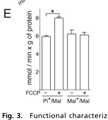

## Question

# Gene Research for Functional Annotation

## ⚠️ CRITICAL: Gene/Protein Identification Context

**BEFORE YOU BEGIN RESEARCH:** You MUST verify you are researching the CORRECT gene/protein. Gene symbols can be ambiguous, especially for less well-characterized genes from non-model organisms.

### Target Gene/Protein Identity (from UniProt):
- **UniProt Accession:** P55851
- **Protein Description:** RecName: Full=Dicarboxylate carrier SLC25A8 {ECO:0000305|PubMed:24395786}; AltName: Full=Mitochondrial uncoupling protein 2; Short=UCP 2; AltName: Full=Solute carrier family 25 member 8; AltName: Full=UCPH;
- **Gene Information:** Name=UCP2; Synonyms=SLC25A8 {ECO:0000303|PubMed:33798544};
- **Organism (full):** Homo sapiens (Human).
- **Protein Family:** Belongs to the mitochondrial carrier (TC 2.A.29) family.
- **Key Domains:** MCP. (IPR002067); MCP_dom_sf. (IPR023395); MCP_transmembrane. (IPR018108); Mito_Metabolite_Transporter. (IPR050391); Mito_carr (PF00153)

### MANDATORY VERIFICATION STEPS:

1. **Check if the gene symbol "UCP2" matches the protein description above**
2. **Verify the organism is correct:** Homo sapiens (Human).
3. **Check if protein family/domains align with what you find in literature**
4. **If you find literature for a DIFFERENT gene with the same or similar symbol, STOP**

### If Gene Symbol is Ambiguous or You Cannot Find Relevant Literature:

**DO NOT PROCEED WITH RESEARCH ON A DIFFERENT GENE.** Instead:
- State clearly: "The gene symbol 'UCP2' is ambiguous or literature is limited for this specific protein"
- Explain what you found (e.g., "Found extensive literature on a different gene with the same symbol in a different organism")
- Describe the protein based ONLY on the UniProt information provided above
- Suggest that the protein function can be inferred from domain/family information

### Research Target:

Please provide a comprehensive research report on the gene **UCP2** (gene ID: UCP2, UniProt: P55851) in human.

The research report should be a detailed narrative explaining the function, biological processes, and localization of the gene product. Citations should be given for all claims.

You should prioritize authoritative reviews and primary scientific literature when conducting research. You can supplement
this with annotations you find in gene/protein databases, but these can be outdated or inaccurate.

We are specifically interested in the primary function of the gene - for enzymes, what reaction is catalyzed, and what is the substrate specificity? For transporters, what is the substrate? For structural proteins or adapters, what is the broader structural role? For signaling molecules, what is the role in the pathway.

We are interested in where in or outside the cell the gene product carries out its function.

We are also interested in the signaling or biochemical pathways in which the gene functions. We are less interested in broad pleiotropic effects, except where these elucidate the precise role.

Include evidence where possible. We are interested in both experimental evidence as well as inference from structure, evolution, or bioinformatic analysis. Precise studies should be prioritized over high-throughput, where available.

## Output

Question: You are an expert researcher providing comprehensive, well-cited information.

Provide detailed information focusing on:
1. Key concepts and definitions with current understanding
2. Recent developments and latest research (prioritize 2023-2024 sources)
3. Current applications and real-world implementations
4. Expert opinions and analysis from authoritative sources
5. Relevant statistics and data from recent studies

Format as a comprehensive research report with proper citations. Include URLs and publication dates where available.
Always prioritize recent, authoritative sources and provide specific citations for all major claims.

# Gene Research for Functional Annotation

## ⚠️ CRITICAL: Gene/Protein Identification Context

**BEFORE YOU BEGIN RESEARCH:** You MUST verify you are researching the CORRECT gene/protein. Gene symbols can be ambiguous, especially for less well-characterized genes from non-model organisms.

### Target Gene/Protein Identity (from UniProt):
- **UniProt Accession:** P55851
- **Protein Description:** RecName: Full=Dicarboxylate carrier SLC25A8 {ECO:0000305|PubMed:24395786}; AltName: Full=Mitochondrial uncoupling protein 2; Short=UCP 2; AltName: Full=Solute carrier family 25 member 8; AltName: Full=UCPH;
- **Gene Information:** Name=UCP2; Synonyms=SLC25A8 {ECO:0000303|PubMed:33798544};
- **Organism (full):** Homo sapiens (Human).
- **Protein Family:** Belongs to the mitochondrial carrier (TC 2.A.29) family.
- **Key Domains:** MCP. (IPR002067); MCP_dom_sf. (IPR023395); MCP_transmembrane. (IPR018108); Mito_Metabolite_Transporter. (IPR050391); Mito_carr (PF00153)

### MANDATORY VERIFICATION STEPS:

1. **Check if the gene symbol "UCP2" matches the protein description above**
2. **Verify the organism is correct:** Homo sapiens (Human).
3. **Check if protein family/domains align with what you find in literature**
4. **If you find literature for a DIFFERENT gene with the same or similar symbol, STOP**

### If Gene Symbol is Ambiguous or You Cannot Find Relevant Literature:

**DO NOT PROCEED WITH RESEARCH ON A DIFFERENT GENE.** Instead:
- State clearly: "The gene symbol 'UCP2' is ambiguous or literature is limited for this specific protein"
- Explain what you found (e.g., "Found extensive literature on a different gene with the same symbol in a different organism")
- Describe the protein based ONLY on the UniProt information provided above
- Suggest that the protein function can be inferred from domain/family information

### Research Target:

Please provide a comprehensive research report on the gene **UCP2** (gene ID: UCP2, UniProt: P55851) in human.

The research report should be a detailed narrative explaining the function, biological processes, and localization of the gene product. Citations should be given for all claims.

You should prioritize authoritative reviews and primary scientific literature when conducting research. You can supplement
this with annotations you find in gene/protein databases, but these can be outdated or inaccurate.

We are specifically interested in the primary function of the gene - for enzymes, what reaction is catalyzed, and what is the substrate specificity? For transporters, what is the substrate? For structural proteins or adapters, what is the broader structural role? For signaling molecules, what is the role in the pathway.

We are interested in where in or outside the cell the gene product carries out its function.

We are also interested in the signaling or biochemical pathways in which the gene functions. We are less interested in broad pleiotropic effects, except where these elucidate the precise role.

Include evidence where possible. We are interested in both experimental evidence as well as inference from structure, evolution, or bioinformatic analysis. Precise studies should be prioritized over high-throughput, where available.

# Human UCP2 (SLC25A8): functional-annotation research report

## Identity and principal function

**Identity check.** The requested protein is human **UCP2**, also called **SLC25A8**; the supplied UniProt accession is **P55851** ([UniProt entry](https://www.uniprot.org/uniprotkb/P55851/entry)). Published carrier-family classifications explicitly pair SLC25A8 with UCP2, and the defining biochemical study expressed UCP2 from **human** cDNA. Its SLC25 mitochondrial-carrier architecture—three related repeats forming approximately six membrane-spanning helices—is consistent with the supplied mitochondrial-carrier domains. This report does **not** treat Arabidopsis *AtUCP2* or mammalian UCP3 as the human target. (cunningham202020000picometersunder pages 2-3, caggiano2024ucp2andpancreatic pages 2-4, vozza2014ucp2transportsc4 pages 5-6, monne2018uncouplingproteins1 pages 1-2)

**Best-supported molecular annotation:** UCP2 is a **mitochondrial inner-membrane C4-metabolite carrier**. It exchanges principally **matrix aspartate, malate and oxaloacetate** for **cytosolic inorganic phosphate (Pi), imported with H⁺**. This is a transport reaction, not an enzyme-catalyzed chemical conversion. Although the historic name suggests UCP1-like uncoupling, a constitutive, physiologically important UCP2 proton leak is less firmly established than its measured metabolite-transport activity. (vozza2014ucp2transportsc4 pages 1-2, vozza2014ucp2transportsc4 pages 2-2, vozza2014ucp2transportsc4 pages 2-4, bertholet2022mitochondrialh+leak pages 9-11)

The table distinguishes directly measured functions from their physiological interpretation and clinical implications. (vozza2014ucp2transportsc4 pages 1-2, ferrara2017novelhypoglycemiaphenotype pages 1-1)

| Function / evidence in human UCP2 | Inference / limits | Dated source and URL |
|---|---|---|
| Purified, bacterially expressed human UCP2 reconstituted into liposomes exchanged mitochondrial C4 metabolites—**aspartate, malate and oxaloacetate**—for phosphate plus H⁺. The in-vitro substrate profile also included malonate, sulfate and phosphate; smaller substrate efflux without a counter-ion indicated limited uniport. (vozza2014ucp2transportsc4 pages 1-2, vozza2014ucp2transportsc4 pages 2-4, vozza2014ucp2transportsc4 pages 2-2, vozza2014ucp2transportsc4 media bdfc4cb5) | Strongest direct biochemical evidence for annotation as an H⁺-assisted C4-metabolite/phosphate carrier. The broader substrate panel is derived from artificial proteoliposomes; physiological flux is expected principally toward C4 export under the mitochondrial ΔpH and membrane potential. | Vozza et al., *PNAS*, **21 Jan 2014**. [doi:10.1073/pnas.1317400111](https://doi.org/10.1073/pnas.1317400111) |
| In human HepG2 cells, siRNA lowered UCP2 expression by approximately **85%**. Knockdown increased matrix TCA-cycle intermediates and reduced cytosolic aspartate and malate; glucose-grown cells showed higher mitochondrial membrane potential and ATP:ADP ratio with less lactate, whereas glutamine-grown cells showed the opposite energetic pattern. (vozza2014ucp2transportsc4 pages 1-2, vozza2014ucp2transportsc4 pages 2-2) | Cell-level evidence supports C4 cataplerosis: UCP2 limits complete glucose oxidation while enabling glutamine-derived C4 export. HepG2 is a transformed hepatocellular-carcinoma model, so the magnitude and direction of effects may depend on nutrient and cell context. | Vozza et al., *PNAS*, **21 Jan 2014**. [doi:10.1073/pnas.1317400111](https://doi.org/10.1073/pnas.1317400111) |
| In PDAC models, UCP2 knockdown reduced glutaminolysis, NADPH/NADP⁺ and GSH/GSSG ratios and increased ROS. Growth suppression occurred mainly in **KRAS-mutant** cells, and knockdown reduced KRAS-mutant xenograft size; aspartate or glutamate supplementation rescued selected growth defects. (lauria2023roleofmitochondrial pages 8-10) | Supports a model in which exported aspartate feeds the cytosolic GOT1–malate–malic-enzyme pathway and redox maintenance. Details here are **secondary corroboration** from a 2023 review of Raho et al.; the evidence is preclinical and does not establish UCP2 inhibition as a patient-ready therapy. | Raho et al., *Nature Metabolism*, **Nov 2020**. [doi:10.1038/s42255-020-00315-1](https://doi.org/10.1038/s42255-020-00315-1); Lauria et al., *Cancers*, **9 Jan 2023**. [doi:10.3390/cancers15020411](https://doi.org/10.3390/cancers15020411) |
| Among **211** children with diazoxide-responsive congenital hyperinsulinism, **5 (2.4%)** unrelated cases carried four UCP2 variants. Three tested missense variants reduced reconstituted phosphate/aspartate exchange by **30–75%**; wild-type activity was 3.2 ± 0.51 versus 0.85–2.27 µmol·min⁻¹·g protein⁻¹ for variants. (ferrara2017novelhypoglycemiaphenotype pages 3-4, ferrara2017novelhypoglycemiaphenotype pages 1-1, ferrara2017novelhypoglycemiaphenotype pages 2-3) | Human genotype–function evidence links impaired UCP2 transport to dysregulated insulin secretion and glucose-provoked hypoglycaemia. The cohort was selected for diazoxide-responsive disease, variant frequencies were low, and the modest sample precludes population-wide prevalence estimates. | Ferrara et al., *J Clin Endocrinol Metab*, **1 Mar 2017**. [doi:10.1210/jc.2016-3164](https://doi.org/10.1210/jc.2016-3164) |
| Recombinant UCP2 can support long-chain-fatty-acid-dependent proton conductance in defined bilayers/proteoliposomes. However, intact-mitochondrial and mitoplast studies found no loss of fatty-acid-induced H⁺ leak in UCP2-null preparations and instead implicated the ADP/ATP carrier; β-cell-specific Ucp2 loss likewise did not alter uncoupling respiration. (caggiano2024ucp2andpancreatic pages 4-5, caggiano2024ucp2andpancreatic pages 5-6, bertholet2022mitochondrialh+leak pages 9-11) | A conditional protonophoric activity is biophysically plausible, but its quantitative physiological importance remains disputed. Current evidence supports C4-metabolite transport more securely than constitutive UCP1-like uncoupling; artificial-membrane conductance should not be equated automatically with whole-mitochondrion function. | Bertholet & Kirichok, *Annu Rev Physiol*, **10 Feb 2022**. [doi:10.1146/annurev-physiol-021119-034405](https://doi.org/10.1146/annurev-physiol-021119-034405); Caggiano & Taniguchi, *Cancer Metastasis Rev*, **23 Jan 2024**. [doi:10.1007/s10555-023-10157-4](https://doi.org/10.1007/s10555-023-10157-4) |

*Table: Direct biochemical, cellular, disease-model and clinical evidence defining human UCP2 as a C4-metabolite carrier, with explicit limitations around proton uncoupling and therapeutic interpretation.*

## Substrates, mechanism and cellular location

**Direct transport experiments.** In a [2014 *PNAS* study](https://doi.org/10.1073/pnas.1317400111), Vozza and colleagues purified recombinant human UCP2 and incorporated it into lipid vesicles. Radiolabeled Pi, l-malate and l-aspartate underwent robust counter-exchange; UCP1 tested as a comparator did not show comparable substrate transport. The broader *in-vitro* exchange panel included oxaloacetate, malonate, sulfate and Pi. Aspartate, malate and oxaloacetate are the key substrates in the authors’ physiological C4-export model; identifying malonate and sulfate as assay substrates does not establish that they are major physiological cargoes. Some substrate efflux occurred without an opposing counter-substrate, but exchange was the more prominent activity. Figure 4A of the primary study shows the substrate panel, and Figure 4B compares aspartate/Pi exchange in control and UCP2-silenced human-cell mitochondrial preparations. (vozza2014ucp2transportsc4 pages 1-2, vozza2014ucp2transportsc4 pages 2-2, vozza2014ucp2transportsc4 pages 2-4, vozza2014ucp2transportsc4 media bdfc4cb5, vozza2014ucp2transportsc4 media dc70cb3c)

**Coupling and direction.** Yeast mitochondrial swelling and reconstituted-vesicle experiments supported **H⁺-coupled Pi movement**, whereas malate did not show analogous H⁺ symport. Adding the protonophore FCCP stimulated Pi/malate exchange but not malate/malate exchange, consistent with Pi/H⁺ import supplying the counter-flux for C4 export. The authors infer that the inward-negative membrane potential and physiological pH gradient favor export of C4 metabolites **from mitochondrial matrix toward cytosol** while importing Pi/H⁺. That preferred *in-vivo* direction is an inference supported by transport and cellular-metabolite data, not an irreversible property of the carrier. (vozza2014ucp2transportsc4 pages 2-2, vozza2014ucp2transportsc4 pages 2-4, vozza2014ucp2transportsc4 media e1818395)

UCP2 therefore acts **within the inner mitochondrial membrane**, linking the matrix to the intermembrane-space/cytosolic side; it is not a plasma-membrane glutamine importer. SLC25-family topology and alternating-access carrier behavior support this localization and mechanism, while the exact atomic structure and transport cycle of native human UCP2 remain less secure than the functional reconstitution evidence. (caggiano2024ucp2andpancreatic pages 2-4, vozza2014ucp2transportsc4 pages 1-2, vozza2014ucp2transportsc4 pages 2-4)

## Pathways established by functional perturbation

**Glucose oxidation versus glutamine-supported cataplerosis.** Exporting matrix oxaloacetate or related C4 compounds can restrict the oxaloacetate available to condense with acetyl-CoA and can provide cytosolic carbon and aspartate for biosynthesis. In human HepG2 cells, approximately **85% UCP2 silencing** increased mitochondrial tricarboxylic-acid-cycle intermediates. With glucose as the principal substrate, silencing increased mitochondrial membrane potential and ATP:ADP and reduced lactate release; with glutamine, the energetic effects were reversed. Cytosolic aspartate and malate fell when UCP2 was silenced in glutamine-grown cells. These nutrient-dependent, opposite effects support metabolite transport as a stronger explanation than a simple, invariant proton-leak model, although HepG2 is a transformed cell model rather than normal liver. (vozza2014ucp2transportsc4 pages 1-2, vozza2014ucp2transportsc4 pages 2-2, vozza2014ucp2transportsc4 pages 4-5)

**KRAS-dependent pancreatic-cancer metabolism.** The established pathway model is mitochondrial glutamine metabolism → oxaloacetate/aspartate formation → **UCP2-dependent aspartate export** → cytosolic GOT1-dependent oxaloacetate production → malate → malic-enzyme-associated **NADPH** production, helping maintain reduced glutathione. A [2023 specialist review](https://doi.org/10.3390/cancers15020411) reports that, in the underlying [2020 *Nature Metabolism* study](https://doi.org/10.1038/s42255-020-00315-1), UCP2 silencing lowered glutaminolysis and NADPH/NADP⁺ and GSH/GSSG ratios and raised ROS; proliferation and xenograft-growth suppression were especially evident in **KRAS-mutant**, rather than KRAS-wild-type, pancreatic ductal adenocarcinoma models. Glutaminolysis itself fell in both KRAS backgrounds. These are preclinical, genotype- and nutrient-context-dependent findings; the details of that study are corroborated here through the 2023 review because its full primary text was unavailable for direct inspection. (lauria2023roleofmitochondrial pages 8-10, caggiano2024ucp2andpancreatic pages 4-5)

UCP2 abundance cannot reliably be inferred from its transcript alone: the 2023 review describes **glutamine-stimulated translation**, a rapid decline in protein after glutamine withdrawal and rapid protein turnover. Consequently, assays of UCP2 protein and substrate flux are preferable to RNA expression alone when testing pathway activity. (lauria2023roleofmitochondrial pages 8-10, luby2022ucp2asa pages 4-5)

## Alternative biochemical activities: what remains disputed

Reconstituted UCP2 can display **fatty-acid-dependent proton conductance**, and fatty acids and purine nucleotides affect this activity in artificial membranes. This does not prove that UCP2 is the dominant proton-leak pathway in intact non-thermogenic mitochondria. An expert [2022 review of mitochondrial H⁺ leak](https://doi.org/10.1146/annurev-physiol-021119-034405) describes mitoplast experiments in which fatty-acid-induced leak persisted after **Ucp2** deletion and was instead attributable principally to the ADP/ATP carrier. A [2024 UCP2 review](https://doi.org/10.1007/s10555-023-10157-4) also notes β-cell-specific Ucp2 deletion experiments without a change in uncoupled respiration. Thus, **conditional protonophoric capacity** and **its quantitative physiological contribution** should be distinguished; ROS changes after UCP2 perturbation cannot, on their own, prove proton uncoupling. (caggiano2024ucp2andpancreatic pages 5-6, bertholet2022mitochondrialh+leak pages 9-11, caggiano2024ucp2andpancreatic pages 4-5)

The two activities respond differently in at least one important test: Vozza and colleagues found that **genipin, coenzyme Q, retinoic acid and laurate did not alter UCP2 Pi/Pi exchange**, despite reported effects on protonophoric behavior. GDP inhibited substrate transport competitively, but its measured **Kᵢ was 7.68 ± 0.4 mM**, prompting the authors to question physiological regulation of this transport reaction by GDP. Moreover, a [2019 biochemical study](https://doi.org/10.1016/j.bpj.2019.10.021) found that genipin also affected UCP1, UCP3, the dicarboxylate carrier and respiratory complex III: **genipin is neither a selective UCP2 probe nor demonstrated here to block UCP2’s C4/Pi exchange**. (vozza2014ucp2transportsc4 pages 2-4, kreiter2019molecularmechanismsresponsible pages 1-5)

UCP2 has additionally been implicated in **regulation of mitochondrial Ca²⁺ uptake**. The [2024 review](https://doi.org/10.1007/s10555-023-10157-4) describes evidence that UCP2 associates with **PRMT1-methylated MICU1** and influences the mitochondrial calcium uniporter complex, particularly after endoplasmic-reticulum Ca²⁺ release. This suggests a *modulatory* role; it does **not** establish Ca²⁺ as the directly transported substrate of UCP2 or replace its experimentally demonstrated C4/Pi carrier annotation. (caggiano2024ucp2andpancreatic pages 5-6)

## Human disease evidence and current applications

**Congenital hyperinsulinism provides a human genotype–function link.** In a [March 2017 clinical and biochemical study](https://doi.org/10.1210/jc.2016-3164), **5 of 211 children (2.4%)** selected for diazoxide-responsive hyperinsulinism had UCP2 variants. Three tested missense proteins showed approximately **30–75% lower** reconstituted Pi/aspartate exchange than wild-type; reported activities were **3.2 ± 0.51** for wild-type versus **0.85 ± 0.11, 1.57 ± 0.25 and 2.27 ± 0.41** for the respective variants, in the study’s reported mmol·min⁻¹·g protein⁻¹ units. The affected children showed heightened susceptibility to glucose-provoked hypoglycemia, and some required ongoing diazoxide. The **2.4% figure applies to this selected clinical cohort**, not all hyperinsulinism or the general population; individual variant interpretation also requires clinical context. (ferrara2017novelhypoglycemiaphenotype pages 1-1, ferrara2017novelhypoglycemiaphenotype pages 3-4, ferrara2017novelhypoglycemiaphenotype pages 1-2)

**Research and translational use.** Functional phosphate/aspartate-exchange assays offer a mechanistically relevant way to assess candidate UCP2 variants. In oncology, UCP2-dependent aspartate export is a **candidate metabolic vulnerability** in glutamine-dependent, KRAS-mutant pancreatic-cancer models, not a validated patient treatment or universal cancer biomarker. The [2023 pancreatic-carrier review](https://doi.org/10.3390/cancers15020411) and [2024 pancreatic-cancer review](https://doi.org/10.1007/s10555-023-10157-4) emphasize context-specific dependence; the pharmacological non-specificity of genipin makes genetic perturbation and direct transport measurements especially important for target validation. (ferrara2017novelhypoglycemiaphenotype pages 3-4, lauria2023roleofmitochondrial pages 8-10, caggiano2024ucp2andpancreatic pages 9-11, kreiter2019molecularmechanismsresponsible pages 1-5)

**Recent comparative development.** A paper published **22 December 2023**, appearing in a **2024** issue, showed that **murine UCP3** also exchanges C4-related substrates in reconstituted vesicles ([Kreiter et al.](https://doi.org/10.3390/biom14010021)). It strengthens the family-level plausibility of metabolite transport, but its substrate preferences and measured rates belong to **mouse UCP3, not human UCP2** and should not be copied into the human annotation. Likewise, plant AtUCP2 has experimentally characterized transport but represents a different organism and protein. (kreiter2023uncouplingprotein3 pages 1-3, monne2018uncouplingproteins1 pages 1-2, monne2018uncouplingproteins1 pages 2-3)

**Bottom line.** For **human UCP2/P55851**, annotate a **mitochondrial inner-membrane, H⁺-assisted C4-metabolite/Pi exchanger**, emphasizing **aspartate, malate and oxaloacetate export**, glutamine-linked cataplerosis and context-dependent redox metabolism. Record fatty-acid-dependent proton conductance and MCU-associated Ca²⁺ regulation as **conditional or indirect activities whose physiological significance remains unresolved**, rather than replacing the directly demonstrated transporter function. (vozza2014ucp2transportsc4 pages 1-2, vozza2014ucp2transportsc4 pages 2-4, bertholet2022mitochondrialh+leak pages 9-11, caggiano2024ucp2andpancreatic pages 5-6)

References

1. (cunningham202020000picometersunder pages 2-3): Corey N Cunningham and Jared Rutter. 20,000 picometers under the omm: diving into the vastness of mitochondrial metabolite transport. EMBO reports, Apr 2020. URL: https://doi.org/10.15252/embr.202050071, doi:10.15252/embr.202050071. This article has 49 citations and is from a highest quality peer-reviewed journal.

2. (caggiano2024ucp2andpancreatic pages 2-4): Emily G. Caggiano and Cullen M. Taniguchi. Ucp2 and pancreatic cancer: conscious uncoupling for therapeutic effect. Cancer Metastasis Reviews, 43:777-794, Jan 2024. URL: https://doi.org/10.1007/s10555-023-10157-4, doi:10.1007/s10555-023-10157-4. This article has 13 citations.

3. (vozza2014ucp2transportsc4 pages 5-6): Angelo Vozza, Giovanni Parisi, Francesco De Leonardis, Francesco M. Lasorsa, Alessandra Castegna, Daniela Amorese, Raffaele Marmo, Valeria M. Calcagnile, Luigi Palmieri, Daniel Ricquier, Eleonora Paradies, Pasquale Scarcia, Ferdinando Palmieri, Frédéric Bouillaud, and Giuseppe Fiermonte. Ucp2 transports c4 metabolites out of mitochondria, regulating glucose and glutamine oxidation. Proceedings of the National Academy of Sciences, 111:960-965, Jan 2014. URL: https://doi.org/10.1073/pnas.1317400111, doi:10.1073/pnas.1317400111. This article has 467 citations and is from a highest quality peer-reviewed journal.

4. (monne2018uncouplingproteins1 pages 1-2): Magnus Monné, Lucia Daddabbo, David Gagneul, Toshihiro Obata, Björn Hielscher, Luigi Palmieri, Daniela Valeria Miniero, Alisdair R. Fernie, Andreas P.M. Weber, and Ferdinando Palmieri. Uncoupling proteins 1 and 2 (ucp1 and ucp2) from arabidopsis thaliana are mitochondrial transporters of aspartate, glutamate, and dicarboxylates. Journal of Biological Chemistry, 293:4213-4227, Mar 2018. URL: https://doi.org/10.1074/jbc.ra117.000771, doi:10.1074/jbc.ra117.000771. This article has 106 citations and is from a domain leading peer-reviewed journal.

5. (vozza2014ucp2transportsc4 pages 1-2): Angelo Vozza, Giovanni Parisi, Francesco De Leonardis, Francesco M. Lasorsa, Alessandra Castegna, Daniela Amorese, Raffaele Marmo, Valeria M. Calcagnile, Luigi Palmieri, Daniel Ricquier, Eleonora Paradies, Pasquale Scarcia, Ferdinando Palmieri, Frédéric Bouillaud, and Giuseppe Fiermonte. Ucp2 transports c4 metabolites out of mitochondria, regulating glucose and glutamine oxidation. Proceedings of the National Academy of Sciences, 111:960-965, Jan 2014. URL: https://doi.org/10.1073/pnas.1317400111, doi:10.1073/pnas.1317400111. This article has 467 citations and is from a highest quality peer-reviewed journal.

6. (vozza2014ucp2transportsc4 pages 2-2): Angelo Vozza, Giovanni Parisi, Francesco De Leonardis, Francesco M. Lasorsa, Alessandra Castegna, Daniela Amorese, Raffaele Marmo, Valeria M. Calcagnile, Luigi Palmieri, Daniel Ricquier, Eleonora Paradies, Pasquale Scarcia, Ferdinando Palmieri, Frédéric Bouillaud, and Giuseppe Fiermonte. Ucp2 transports c4 metabolites out of mitochondria, regulating glucose and glutamine oxidation. Proceedings of the National Academy of Sciences, 111:960-965, Jan 2014. URL: https://doi.org/10.1073/pnas.1317400111, doi:10.1073/pnas.1317400111. This article has 467 citations and is from a highest quality peer-reviewed journal.

7. (vozza2014ucp2transportsc4 pages 2-4): Angelo Vozza, Giovanni Parisi, Francesco De Leonardis, Francesco M. Lasorsa, Alessandra Castegna, Daniela Amorese, Raffaele Marmo, Valeria M. Calcagnile, Luigi Palmieri, Daniel Ricquier, Eleonora Paradies, Pasquale Scarcia, Ferdinando Palmieri, Frédéric Bouillaud, and Giuseppe Fiermonte. Ucp2 transports c4 metabolites out of mitochondria, regulating glucose and glutamine oxidation. Proceedings of the National Academy of Sciences, 111:960-965, Jan 2014. URL: https://doi.org/10.1073/pnas.1317400111, doi:10.1073/pnas.1317400111. This article has 467 citations and is from a highest quality peer-reviewed journal.

8. (bertholet2022mitochondrialh+leak pages 9-11): Ambre M. Bertholet and Yuriy Kirichok. Mitochondrial h+ leak and thermogenesis. Annual Review of Physiology, 84:381-407, Feb 2022. URL: https://doi.org/10.1146/annurev-physiol-021119-034405, doi:10.1146/annurev-physiol-021119-034405. This article has 102 citations and is from a highest quality peer-reviewed journal.

9. (ferrara2017novelhypoglycemiaphenotype pages 1-1): Christine T. Ferrara, Kara E. Boodhansingh, Eleonora Paradies, Fiermonte Giuseppe, Linda J. Steinkrauss, Lisa Swartz Topor, Jose Bernardo Quintos, Arupa Ganguly, Diva D. De Leon, Ferdinando Palmieri, and Charles A. Stanley. Novel hypoglycemia phenotype in congenital hyperinsulinism due to dominant mutations of uncoupling protein 2. The Journal of clinical endocrinology and metabolism, 102 3:942-949, Mar 2017. URL: https://doi.org/10.1210/jc.2016-3164, doi:10.1210/jc.2016-3164. This article has 60 citations.

10. (vozza2014ucp2transportsc4 media bdfc4cb5): Angelo Vozza, Giovanni Parisi, Francesco De Leonardis, Francesco M. Lasorsa, Alessandra Castegna, Daniela Amorese, Raffaele Marmo, Valeria M. Calcagnile, Luigi Palmieri, Daniel Ricquier, Eleonora Paradies, Pasquale Scarcia, Ferdinando Palmieri, Frédéric Bouillaud, and Giuseppe Fiermonte. Ucp2 transports c4 metabolites out of mitochondria, regulating glucose and glutamine oxidation. Proceedings of the National Academy of Sciences, 111:960-965, Jan 2014. URL: https://doi.org/10.1073/pnas.1317400111, doi:10.1073/pnas.1317400111. This article has 467 citations and is from a highest quality peer-reviewed journal.

11. (lauria2023roleofmitochondrial pages 8-10): Graziantonio Lauria, Rosita Curcio, Paola Lunetti, Stefano Tiziani, Vincenzo Coppola, Vincenza Dolce, Giuseppe Fiermonte, and Amer Ahmed. Role of mitochondrial transporters on metabolic rewiring of pancreatic adenocarcinoma: a comprehensive review. Cancers, 15:411, Jan 2023. URL: https://doi.org/10.3390/cancers15020411, doi:10.3390/cancers15020411. This article has 24 citations.

12. (ferrara2017novelhypoglycemiaphenotype pages 3-4): Christine T. Ferrara, Kara E. Boodhansingh, Eleonora Paradies, Fiermonte Giuseppe, Linda J. Steinkrauss, Lisa Swartz Topor, Jose Bernardo Quintos, Arupa Ganguly, Diva D. De Leon, Ferdinando Palmieri, and Charles A. Stanley. Novel hypoglycemia phenotype in congenital hyperinsulinism due to dominant mutations of uncoupling protein 2. The Journal of clinical endocrinology and metabolism, 102 3:942-949, Mar 2017. URL: https://doi.org/10.1210/jc.2016-3164, doi:10.1210/jc.2016-3164. This article has 60 citations.

13. (ferrara2017novelhypoglycemiaphenotype pages 2-3): Christine T. Ferrara, Kara E. Boodhansingh, Eleonora Paradies, Fiermonte Giuseppe, Linda J. Steinkrauss, Lisa Swartz Topor, Jose Bernardo Quintos, Arupa Ganguly, Diva D. De Leon, Ferdinando Palmieri, and Charles A. Stanley. Novel hypoglycemia phenotype in congenital hyperinsulinism due to dominant mutations of uncoupling protein 2. The Journal of clinical endocrinology and metabolism, 102 3:942-949, Mar 2017. URL: https://doi.org/10.1210/jc.2016-3164, doi:10.1210/jc.2016-3164. This article has 60 citations.

14. (caggiano2024ucp2andpancreatic pages 4-5): Emily G. Caggiano and Cullen M. Taniguchi. Ucp2 and pancreatic cancer: conscious uncoupling for therapeutic effect. Cancer Metastasis Reviews, 43:777-794, Jan 2024. URL: https://doi.org/10.1007/s10555-023-10157-4, doi:10.1007/s10555-023-10157-4. This article has 13 citations.

15. (caggiano2024ucp2andpancreatic pages 5-6): Emily G. Caggiano and Cullen M. Taniguchi. Ucp2 and pancreatic cancer: conscious uncoupling for therapeutic effect. Cancer Metastasis Reviews, 43:777-794, Jan 2024. URL: https://doi.org/10.1007/s10555-023-10157-4, doi:10.1007/s10555-023-10157-4. This article has 13 citations.

16. (vozza2014ucp2transportsc4 media dc70cb3c): Angelo Vozza, Giovanni Parisi, Francesco De Leonardis, Francesco M. Lasorsa, Alessandra Castegna, Daniela Amorese, Raffaele Marmo, Valeria M. Calcagnile, Luigi Palmieri, Daniel Ricquier, Eleonora Paradies, Pasquale Scarcia, Ferdinando Palmieri, Frédéric Bouillaud, and Giuseppe Fiermonte. Ucp2 transports c4 metabolites out of mitochondria, regulating glucose and glutamine oxidation. Proceedings of the National Academy of Sciences, 111:960-965, Jan 2014. URL: https://doi.org/10.1073/pnas.1317400111, doi:10.1073/pnas.1317400111. This article has 467 citations and is from a highest quality peer-reviewed journal.

17. (vozza2014ucp2transportsc4 media e1818395): Angelo Vozza, Giovanni Parisi, Francesco De Leonardis, Francesco M. Lasorsa, Alessandra Castegna, Daniela Amorese, Raffaele Marmo, Valeria M. Calcagnile, Luigi Palmieri, Daniel Ricquier, Eleonora Paradies, Pasquale Scarcia, Ferdinando Palmieri, Frédéric Bouillaud, and Giuseppe Fiermonte. Ucp2 transports c4 metabolites out of mitochondria, regulating glucose and glutamine oxidation. Proceedings of the National Academy of Sciences, 111:960-965, Jan 2014. URL: https://doi.org/10.1073/pnas.1317400111, doi:10.1073/pnas.1317400111. This article has 467 citations and is from a highest quality peer-reviewed journal.

18. (vozza2014ucp2transportsc4 pages 4-5): Angelo Vozza, Giovanni Parisi, Francesco De Leonardis, Francesco M. Lasorsa, Alessandra Castegna, Daniela Amorese, Raffaele Marmo, Valeria M. Calcagnile, Luigi Palmieri, Daniel Ricquier, Eleonora Paradies, Pasquale Scarcia, Ferdinando Palmieri, Frédéric Bouillaud, and Giuseppe Fiermonte. Ucp2 transports c4 metabolites out of mitochondria, regulating glucose and glutamine oxidation. Proceedings of the National Academy of Sciences, 111:960-965, Jan 2014. URL: https://doi.org/10.1073/pnas.1317400111, doi:10.1073/pnas.1317400111. This article has 467 citations and is from a highest quality peer-reviewed journal.

19. (luby2022ucp2asa pages 4-5): Angèle Luby and Marie-Clotilde Alves-Guerra. Ucp2 as a cancer target through energy metabolism and oxidative stress control. International Journal of Molecular Sciences, 23:15077, Dec 2022. URL: https://doi.org/10.3390/ijms232315077, doi:10.3390/ijms232315077. This article has 59 citations.

20. (kreiter2019molecularmechanismsresponsible pages 1-5): Jürgen Kreiter, Anne Rupprecht, Lars Zimmermann, Michael Moschinger, Tatyana I. Rokitskaya, Yuri N. Antonenko, Lars Gille, Maria Fedorova, and Elena E. Pohl. Molecular mechanisms responsible for pharmacological effects of genipin on mitochondrial proteins. Biophysical Journal, 117:1845-1857, Nov 2019. URL: https://doi.org/10.1016/j.bpj.2019.10.021, doi:10.1016/j.bpj.2019.10.021. This article has 36 citations and is from a domain leading peer-reviewed journal.

21. (ferrara2017novelhypoglycemiaphenotype pages 1-2): Christine T. Ferrara, Kara E. Boodhansingh, Eleonora Paradies, Fiermonte Giuseppe, Linda J. Steinkrauss, Lisa Swartz Topor, Jose Bernardo Quintos, Arupa Ganguly, Diva D. De Leon, Ferdinando Palmieri, and Charles A. Stanley. Novel hypoglycemia phenotype in congenital hyperinsulinism due to dominant mutations of uncoupling protein 2. The Journal of clinical endocrinology and metabolism, 102 3:942-949, Mar 2017. URL: https://doi.org/10.1210/jc.2016-3164, doi:10.1210/jc.2016-3164. This article has 60 citations.

22. (caggiano2024ucp2andpancreatic pages 9-11): Emily G. Caggiano and Cullen M. Taniguchi. Ucp2 and pancreatic cancer: conscious uncoupling for therapeutic effect. Cancer Metastasis Reviews, 43:777-794, Jan 2024. URL: https://doi.org/10.1007/s10555-023-10157-4, doi:10.1007/s10555-023-10157-4. This article has 13 citations.

23. (kreiter2023uncouplingprotein3 pages 1-3): Jürgen Kreiter, Tatyana Tyschuk, and Elena E Pohl. Uncoupling protein 3 catalyzes the exchange of c4 metabolites similar to ucp2. Biomolecules, Dec 2023. URL: https://doi.org/10.3390/biom14010021, doi:10.3390/biom14010021. This article has 18 citations.

24. (monne2018uncouplingproteins1 pages 2-3): Magnus Monné, Lucia Daddabbo, David Gagneul, Toshihiro Obata, Björn Hielscher, Luigi Palmieri, Daniela Valeria Miniero, Alisdair R. Fernie, Andreas P.M. Weber, and Ferdinando Palmieri. Uncoupling proteins 1 and 2 (ucp1 and ucp2) from arabidopsis thaliana are mitochondrial transporters of aspartate, glutamate, and dicarboxylates. Journal of Biological Chemistry, 293:4213-4227, Mar 2018. URL: https://doi.org/10.1074/jbc.ra117.000771, doi:10.1074/jbc.ra117.000771. This article has 106 citations and is from a domain leading peer-reviewed journal.

## Artifacts

- [Edison artifact artifact-00](UCP2-deep-research-falcon_artifacts/artifact-00.md)

## Citations

1. lauria2023roleofmitochondrial pages 8-10
2. ferrara2017novelhypoglycemiaphenotype pages 1-1
3. ferrara2017novelhypoglycemiaphenotype pages 3-4
4. ferrara2017novelhypoglycemiaphenotype pages 2-3
5. kreiter2019molecularmechanismsresponsible pages 1-5
6. ferrara2017novelhypoglycemiaphenotype pages 1-2
7. UniProt entry
8. doi:10.1073/pnas.1317400111
9. doi:10.1038/s42255-020-00315-1
10. doi:10.3390/cancers15020411
11. doi:10.1210/jc.2016-3164
12. doi:10.1146/annurev-physiol-021119-034405
13. doi:10.1007/s10555-023-10157-4
14. 2014 *PNAS* study
15. 2023 specialist review
16. 2020 *Nature Metabolism* study
17. 2022 review of mitochondrial H⁺ leak
18. 2024 UCP2 review
19. 2019 biochemical study
20. 2024 review
21. March 2017 clinical and biochemical study
22. 2023 pancreatic-carrier review
23. 2024 pancreatic-cancer review
24. Kreiter et al.
25. https://www.uniprot.org/uniprotkb/P55851/entry
26. https://doi.org/10.1073/pnas.1317400111
27. https://doi.org/10.1038/s42255-020-00315-1
28. https://doi.org/10.3390/cancers15020411
29. https://doi.org/10.1210/jc.2016-3164
30. https://doi.org/10.1146/annurev-physiol-021119-034405
31. https://doi.org/10.1007/s10555-023-10157-4
32. https://doi.org/10.1016/j.bpj.2019.10.021
33. https://doi.org/10.3390/biom14010021
34. https://doi.org/10.15252/embr.202050071,
35. https://doi.org/10.1007/s10555-023-10157-4,
36. https://doi.org/10.1073/pnas.1317400111,
37. https://doi.org/10.1074/jbc.ra117.000771,
38. https://doi.org/10.1146/annurev-physiol-021119-034405,
39. https://doi.org/10.1210/jc.2016-3164,
40. https://doi.org/10.3390/cancers15020411,
41. https://doi.org/10.3390/ijms232315077,
42. https://doi.org/10.1016/j.bpj.2019.10.021,
43. https://doi.org/10.3390/biom14010021,