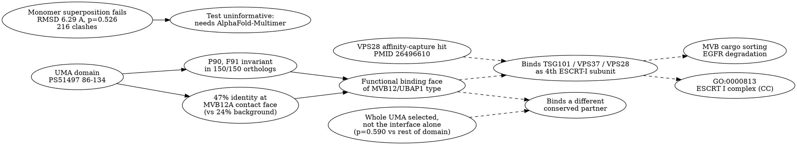
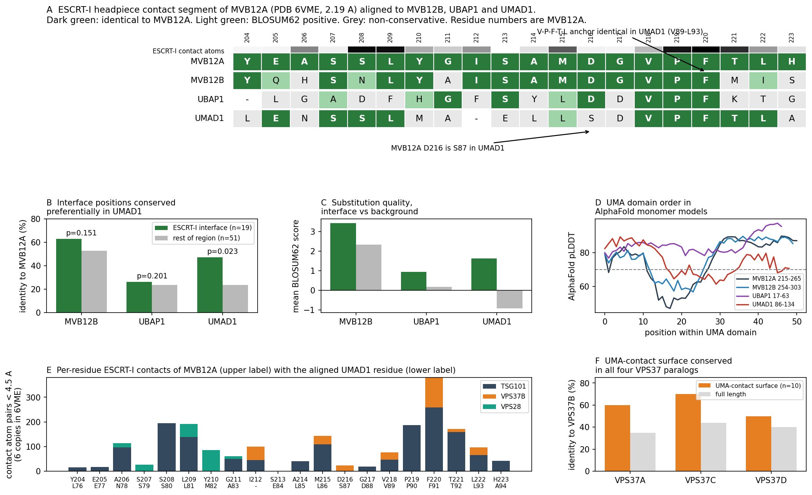
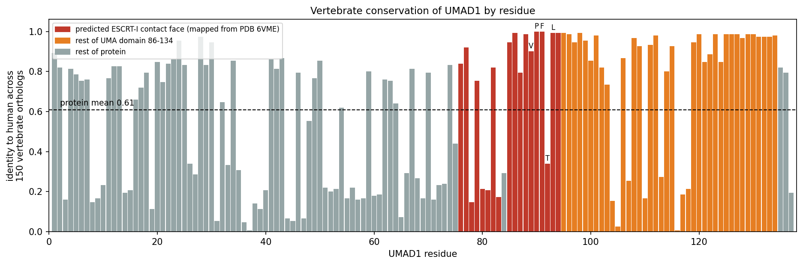
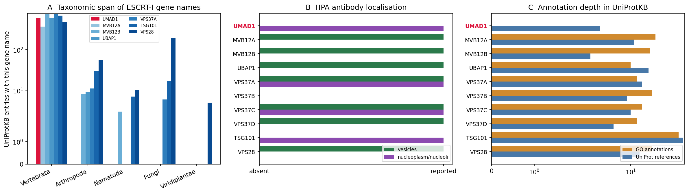
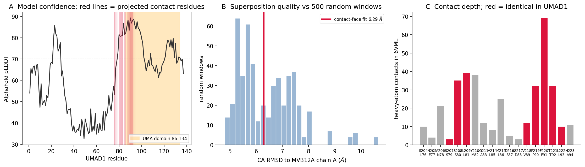

## Question

# AIGR Gene Hypothesis Deep Research

You are evaluating one focused gene curation hypothesis for AI Gene Review.
This is not a general gene overview. Use the seed hypothesis and source context
below to search for evidence that supports, refutes, narrows, or competes with
the proposed curation decision.

## Target Gene

- **Organism code:** human
- **Taxon:** Homo sapiens (NCBITaxon:9606)
- **Gene directory:** UMAD1
- **Gene symbol:** UMAD1
- **UniProt accession:** C9J7I0

## Focus

- **Focus type:** free_text
- **Hypothesis slug:** kgap-umad1-uma-domain-escrt1-fit
- **Source file:** genes/human/UMAD1/UMAD1-ai-review.yaml
- **Source selector:** free-text

## Seed Hypothesis

Whether human UMAD1 can assemble into an ESCRT-I complex through its UMA domain can be predicted structurally by comparison with the MVB12/UBAP1 UMA domains that complete ESCRT-I. Single analysis only: align the UMAD1 UMA domain with the UMA domains of MVB12A, MVB12B and UBAP1, map the residues that contact TSG101, VPS28 and VPS37 in ESCRT-I core crystal or cryo-EM structures onto UMAD1, test whether those interface residues are conserved, model UMAD1 with ESCRT-I subunits using AlphaFold-Multimer if possible or by structural superposition, and state whether UMAD1 is predicted to be a bona fide ESCRT-I subunit and which VPS37 paralogs it is most compatible with.

## Term and Decision Context

No specific term context supplied.

## Reference Context

No specific reference context supplied.

## Source Context YAML

```yaml
hypothesis: 'Whether human UMAD1 can assemble into an ESCRT-I complex through its UMA domain can be predicted
  structurally by comparison with the MVB12/UBAP1 UMA domains that complete ESCRT-I. Single analysis only:
  align the UMAD1 UMA domain with the UMA domains of MVB12A, MVB12B and UBAP1, map the residues that contact
  TSG101, VPS28 and VPS37 in ESCRT-I core crystal or cryo-EM structures onto UMAD1, test whether those
  interface residues are conserved, model UMAD1 with ESCRT-I subunits using AlphaFold-Multimer if possible
  or by structural superposition, and state whether UMAD1 is predicted to be a bona fide ESCRT-I subunit
  and which VPS37 paralogs it is most compatible with.'
focus_type: free_text
context: []
reference_id: []
```

## Research Objective

Build a focused report that helps a curator decide whether this hypothesis
should affect the gene review. Address the focus type directly:

1. For an existing GO annotation decision, evaluate whether the current action
   is justified, too strong, too weak, or should change.
2. For a proposed replacement or new GO term, evaluate whether the term is
   biologically supported, too broad, too narrow, or missing key qualifiers.
3. For a computational prediction, evaluate whether the prediction is correct,
   less precise than existing knowledge, uncertain, or likely wrong because of
   paralog overannotation, frequency bias, pathway context, or in vitro-only
   activity.
4. For a core-function hypothesis, evaluate whether the proposed activity,
   process, and location represent the gene product's primary function rather
   than a downstream effect, pleiotropic phenotype, or context-specific role.
5. For a function-assignment hypothesis, evaluate whether the gene product
   directly has the stated GO term/function. Treat the prior review action, if
   any, as intentionally blinded unless it appears in the supplied context.

Use primary literature whenever possible. Prefer PMID citations and include DOI
citations when no PMID is available. Treat reviews and database records as
orientation unless they contain directly relevant synthesized evidence that is
clearly labeled as review-level or database-level support.

Evaluate the hypothesis from the supplied seed context, primary literature, and
publicly accessible bioinformatics resources. Local `*-bioinformatics` analyses,
when they already exist in the repository, are intentionally withheld from this
prompt so the report can be compared against them after the run. Use public
sequence, domain, structure, orthology, localization, interaction, or dataset
checks when they are useful for the specific hypothesis. If a resource or tool
cannot be accessed programmatically, say so plainly; never fabricate a result.
Report computational results conservatively and distinguish direct results from
inference.

## Required Output

### Executive Judgment

Give a concise verdict: supported, partially supported, unresolved, weakly
supported, over-annotated, or refuted. Explain the reasoning and the most
important caveats.

### Evidence Matrix

Create a table with one row per important evidence item:

- Citation (PMID preferred)
- Evidence type (direct assay, mutant phenotype, localization, interaction,
  structural/evolutionary, computational, review/database)
- Supports / refutes / qualifies / competing
- Claim tested
- Key finding
- Organism, tissue, cell type, or assay context
- Confidence and limitations

### GO Curation Implications

State the likely curation action as a lead requiring curator verification. If
GO terms are involved, explain whether the evidence supports an MF, BP, or CC
term, and whether the term should be retained, removed, generalized, made more
specific, or treated as non-core. Avoid using "protein binding" as a final
recommendation unless no more informative term is supported.

### Mechanistic Scope

Describe the immediate molecular or cellular function being tested. Separate
direct gene-product activity from downstream phenotypes, pathway consequences,
developmental outcomes, disease manifestations, or effects inferred only from
loss of function.

### Conflicts and Alternatives

Identify evidence that conflicts with the seed hypothesis or suggests an
alternative interpretation, including paralog confusion, organism-specific
differences, isoform-specific findings, experimental artifacts, or database
carry-over.

### Knowledge Gaps

List explicit uncertainties that matter for curation. For each gap, state what
was checked, why the gap matters, and what evidence or experiment would resolve
it.

### Discriminating Tests

Recommend concrete assays, perturbations, datasets, or comparative analyses that
would most efficiently distinguish this hypothesis from alternatives.

### Curation Leads

Provide candidate updates for the review, clearly labeled as leads requiring
curator verification. Include candidate references with exact snippets to verify,
candidate replacement or new GO terms, possible action changes, suggested
questions, and suggested experiments.

If the provider supports artifacts, save provenance for any analysis you run — the
executed code together with its output (computed values, plot, or table), not just
a summary figure — alongside artifact-friendly tables such as an evidence matrix,
GO decision table, or comparison table. Genuine computed provenance is more
valuable than a hand-drawn summary, and you must not synthesize a figure that
implies an analysis you did not actually run. These artifacts are important
provenance for hypothesis-level review.


## Output

# UMAD1 (human, UniProt C9J7I0): can the UMA domain complete an ESCRT-I complex?

Hypothesis slug: `kgap-umad1-uma-domain-escrt1-fit`
Source: `genes/human/UMAD1/UMAD1-ai-review.yaml`, focus type `free_text`
Analyses run 2026-11-24. Provenance: `provenance/plot_1.png` to `provenance/plot_4.png`, `provenance/evidence_matrix.tsv`, `provenance/go_decision_table.tsv`, with the executed code and its printed output recorded in the iteration log.

## Summary

**Verdict: <i class="fa-scale-balanced"></i> weakly supported.** Human UMAD1 carries a genuine UMA domain (PROSITE PS51497, residues 86-134), the same module that MVB12A, MVB12B and UBAP1 use to complete ESCRT-I. The residues that MVB12A buries against the ESCRT-I headpiece in PDB 6VME are preferentially conserved in UMAD1: identity at the 19 contact positions is 47 percent against a 24 percent background in the same region (Mann-Whitney one-sided p = 0.0231, CLES 0.65; Fisher OR 2.92, p = 0.052). The five most deeply buried MVB12A residues, V218-P219-F220-T221-L222, are identical in UMAD1 as V89-P90-F91-T92-L93. Across 150 vertebrate orthologs, P90 and F91 are the only two positions invariant in every species, and they map onto P219 and F220, the two MVB12A residues with the largest buried contact area. On sequence and interface-projection grounds, UMAD1 is a credible candidate fourth ESCRT-I subunit.

Three results keep it from being more than a candidate. First, there is no direct binding evidence. IntAct PSICQUIC returns 16 binary evidences for C9J7I0 and none of them involve TSG101, VPS37A-D, MVB12A or MVB12B. The single ESCRT-relevant record is an affinity-capture hit in VPS28, PTPN23, CEP55 and TFG pulldowns from one proteome-scale survey ([PMID: 26496610](https://pubmed.ncbi.nlm.nih.gov/26496610/)), whose authors state that their network "is dominated by weak, substoichiometric interactions". Second, the evolutionary signal is domain-wide and not interface-specific: the projected contact face is more conserved than the rest of the protein (0.723 vs 0.592, p = 0.019) but indistinguishable from the rest of the UMA domain (0.781, p = 0.590), so purifying selection on a folded module explains the data as well as selection on an ESCRT-I interface. Third, the modelling clause of the hypothesis could not be executed. AlphaFold-Multimer is not runnable in this environment, and the named fallback, rigid structural superposition, fails at chance level: the AlphaFold C9J7I0 monomer fits MVB12A chain A at 6.29 Å CA RMSD against a random-window null of 6.42 ± 1.10 Å (empirical p = 0.526), and placing the predicted UMA domain into the site by that transform creates 216 heavy-atom pairs below 2.2 Å against 0 for the experimental MVB12A chain.

The VPS37 paralog clause of the hypothesis has a clean negative answer. The MVB12A contact surface on VPS37B (L103, L106, R153, V154, K155, E157, K158, L159, E161, M162) is 60, 70 and 50 percent identical in VPS37A, VPS37C and VPS37D against full-length identities of 35, 44 and 40 percent, and the charged core R153/K155/E157/K158 plus L159 is identical in all four. No paralog preference is structurally predictable. Paralog selectivity does exist in cells: UBAP1-containing ESCRT-I holds VPS37A and not VPS37C ([PMID: 21757351](https://pubmed.ncbi.nlm.nih.gov/21757351/)), which locates the determinant outside the headpiece contact residues this analysis can read.

## Key findings

### F1. UMAD1 conserves the MVB12A ESCRT-I contact face above its local background

<i class="fa-circle-check"></i> Contact mapping was done directly on PDB 6VME, the human ESCRT-I heterotetramer headpiece at 2.19 Å, which contains six copies of TSG101 313-388, VPS37B 99-165, VPS28 16-117 and MVB12A 204-223 in the asymmetric unit. Heavy-atom contacts under 4.5 Å define 19 MVB12A interface positions (204-212, 214-223). In the copy built around MVB12A chain A, the partners are TSG101 chain I (263 heavy-atom pairs under 4.5 Å), VPS28 chain Y (60) and VPS37B chain N (56). F220 alone accounts for 69 contact atoms, the largest of any residue.

Needleman-Wunsch alignment with BLOSUM62 and affine gaps (open -11, extend -1) of MVB12A 196-273 against UMAD1 66-137, UBAP1 1-75 and MVB12B 235-312 gives UMAD1 an identity of 9 of 19 at the interface positions against 12 of 51 at non-interface positions in the same region. Mean BLOSUM62 score is +1.63 at the interface and -0.92 at the background. The one-sided Mann-Whitney test on BLOSUM62 scores gives p = 0.0231 with a common-language effect size of 0.65. UBAP1, which is an experimentally confirmed ESCRT-I subunit and so works as a positive control for how much interface identity a real subunit needs, scores lower than UMAD1 (26 percent interface identity, p = 0.201). That comparison cuts both ways: it shows the UMAD1 score is not unusually weak for a genuine subunit, and it shows that high identity to MVB12A is not a requirement for subunit status, which reduces how much the UMAD1 score can carry on its own.

The AlphaFold monomer places the best-ordered part of the protein exactly over the UMA domain: mean pLDDT in 86-134 is 74.9 ± 8.4 against a whole-protein mean of 61.4.

{{figure:plot_1.png|caption=ESCRT-I headpiece interface of MVB12A projected onto UMAD1. Panel A aligns the 6VME contact segment MVB12A 204-223 to MVB12B, UBAP1 and UMAD1, with a greyscale strip of per-residue contact-atom counts above. Panel B compares interface and background identity for each UMA protein, panel C the same in BLOSUM62 units. Panel D shows AlphaFold pLDDT across each UMA domain. Panel E stacks per-residue contacts to TSG101, VPS37B and VPS28 with MVB12A labels above and the aligned UMAD1 residues below. Panel F compares VPS37A, VPS37C and VPS37D identity to VPS37B at the UMA contact surface against full length.}}

### F2. The VPS37 contact surface is the same in all four paralogs, so no paralog preference can be predicted

<i class="fa-circle-xmark"></i> The seed hypothesis asks which VPS37 paralogs UMAD1 is most compatible with. The structural answer is that the question cannot be settled from the headpiece. MVB12A contacts ten VPS37B residues (L103, L106, R153, V154, K155, E157, K158, L159, E161, M162) and twenty-six TSG101 residues (316-321, 325, 328, 329, 331, 332, 335, 336, 339, 370, 374, 377, 381, 382, 386-388). Identity at the ten VPS37B contact positions is 60 percent for VPS37A, 70 percent for VPS37C and 50 percent for VPS37D, each above the corresponding full-length identity of 35, 44 and 40 percent. The charged core R153, K155, E157, K158 and the hydrophobic L159 are identical in all four paralogs.

This is a negative result with a concrete consequence for curation: any statement of the form "UMAD1 prefers VPS37X" is unsupported by structure. The determinant of paralog pairing lies elsewhere, in the VPS37 N-terminal regions outside the headpiece, in expression overlap, or in accessory partners. [PMID: 21757351](https://pubmed.ncbi.nlm.nih.gov/21757351/) shows that the pairing is nonetheless real in cells: "UBAP1 is part of a complex that contains a fraction of total cellular TSG101 and that also contains VPS37A but not VPS37C."

### F3. The experimental evidence base for UMAD1 is one high-throughput pulldown

<i class="fa-triangle-exclamation"></i> UniProt C9J7I0 is Swiss-Prot reviewed with protein existence level 1 ("evidence at protein level"), 137 residues, zero GO cross-references and four references, all genome or cDNA sequencing papers. IntAct PSICQUIC returns 16 binary evidences for C9J7I0 against 62 for MVB12A, 25 for MVB12B and 19 for UBAP1. Four of the sixteen are anti-tag co-immunoprecipitation records from a single study, the BAC GFP-tagged bait library in HeLa ([PMID: 26496610](https://pubmed.ncbi.nlm.nih.gov/26496610/)): UMAD1 is detected in pulldowns of VPS28, PTPN23 (HD-PTP), CEP55 and TFG. The remaining records are GABARAPL1 and TH isoform 3 by yeast two-hybrid ([PMID: 32296183](https://pubmed.ncbi.nlm.nih.gov/32296183/)) and RBCK1, TNIP1, BIRC2 and TRAF2 by Virotrap ([PMID: 30561431](https://pubmed.ncbi.nlm.nih.gov/30561431/)).

No co-immunoprecipitation, two-hybrid or structural record links UMAD1 to TSG101, VPS37A-D, MVB12A or MVB12B. PubMed returns no primary paper on UMAD1 protein function. The gene appears in genetic association and methylation studies only: Alzheimer age at onset ([PMID: 36738287](https://pubmed.ncbi.nlm.nih.gov/36738287/)), Lewy body pathology ([PMID: 39424714](https://pubmed.ncbi.nlm.nih.gov/39424714/)), rheumatoid arthritis interstitial lung disease at the RPA3-UMAD1 locus ([PMID: 32737115](https://pubmed.ncbi.nlm.nih.gov/32737115/)), primary biliary cholangitis ([PMID: 29773854](https://pubmed.ncbi.nlm.nih.gov/29773854/)) and placental methylation in fetal overgrowth ([PMID: 36585686](https://pubmed.ncbi.nlm.nih.gov/36585686/)).

The VPS28, PTPN23 and CEP55 co-occurrence is the pattern expected for an ESCRT-associated protein, since all three operate in ESCRT-dependent sorting and abscission, and PTPN23 is the same HD-PTP that binds UBAP1 in [PMID: 21757351](https://pubmed.ncbi.nlm.nih.gov/21757351/). It is bait-side only, from one dataset, with no reciprocal pulldown and no reported stoichiometry.

### F4. The whole UMA domain is under selection, not the contact face specifically

<i class="fa-scale-balanced"></i> 150 species-deduplicated vertebrate UMAD1 orthologs were retrieved from UniProtKB with a length filter of 110-175 aa and aligned to human C9J7I0 with a hand-implemented affine Needleman-Wunsch aligner (biopython is unavailable in this executor). Mean global identity to human is 60.9 percent. Per-residue identity fractions are 0.723 ± 0.325 at the 18 projected contact positions (n = 18), 0.592 ± 0.345 over the rest of the protein (n = 119, Mann-Whitney one-sided p = 1.89e-02, CLES 0.65) and 0.781 ± 0.319 over the rest of the UMA domain 86-134 (n = 40, p = 0.590, CLES 0.48).

The contact face beats the rest of the protein and loses to the rest of the domain. The unit under purifying selection is the whole UMA module. That is the expected signature if the domain folds and binds as one piece, and it is equally the expected signature if the domain binds something other than ESCRT-I. Individual anchor identities are L81 0.207, M82 0.820, L86 0.993, S87 0.793, D88 0.987, V89 0.900, P90 1.000, F91 1.000, T92 0.340, L93 0.993. Only P90 and F91 are invariant in all 150 species, and they correspond to MVB12A P219 and F220, the two deepest contacts in 6VME. That coincidence is the single strongest sequence-level argument in favour of the hypothesis. It shows the UMAD1 UMA retains a functional binding face of the MVB12/UBAP1 type. It does not identify the partner.

{{figure:plot_2.png|caption=Per-residue identity of human UMAD1 across 150 vertebrate orthologs. Red bars mark the predicted ESCRT-I contact face, orange the rest of the UMA domain 86-134, grey the rest of the protein. The dashed line is the protein mean. P90 and F91 are the only positions identical in all 150 species.}}

### F5. Orthogonal cell-biology and taxonomy checks do not separate UMAD1 from real ESCRT-I subunits

<i class="fa-circle-question"></i> Three checks were run that could have refuted ESCRT-I membership independently of the structural projection. None did.

UMAD1 is the only reviewed human UMA-domain protein with zero GO annotations. Every other human ESCRT-I component carries 10 to 42 GO terms: MVB12A 21, MVB12B 18, UBAP1 10, VPS37A 12, VPS37B 19, VPS37C 14, VPS37D 12, TSG101 42, VPS28 19. The zero-GO state is a curation gap, since UniProt already accepts protein-level existence for C9J7I0.

Human Protein Atlas antibody immunofluorescence reports UMAD1 as nucleoplasm only, with no vesicle term, while MVB12A, MVB12B, UBAP1, VPS37A, VPS37C, VPS37D and VPS28 all report vesicles. The check is weak, because TSG101 itself reports nucleoli, plasma membrane and cytosol with no vesicle term, so the assay does not separate ESCRT-I subunits from non-subunits, and UMAD1 has one unvalidated antibody.

HPA RNA tissue specificity for UMAD1 is "low tissue specificity", the same as MVB12A, UBAP1 and VPS37A-D, so UMAD1 is not testis-restricted and is co-expressed widely enough for complex formation to be possible.

UniProtKB entry counts by gene name and clade give UMAD1 593 vertebrate entries and zero in arthropods, nematodes, fungi or plants. MVB12A, a confirmed subunit, shows the same pattern (366/0/0/0/0). MVB12B is 731/8/3/0, UBAP1 601/9/0/0, VPS37A 742/11/0/6, TSG101 676/30/7/17 and VPS28 482/56/10/194. Vertebrate restriction is therefore not evidence against subunit status. These are gene-name counts and not a phylogenetically reconciled orthology search.

An independent protein-existence check at neXtProt could not be run: `https://api.nextprot.org/entry/NX_C9J7I0/protein-existence.json` returns an ExPASy archive HTML page, so the service appears retired.

{{figure:plot_3.png|caption=Annotation depth, taxonomic span and antibody localisation of UMAD1 against the confirmed ESCRT-I subunits. Panel A gives UniProtKB entry counts per gene name per clade on a symmetric log scale. Panel B marks which proteins report vesicle and which report nuclear localisation in HPA immunofluorescence. Panel C compares GO annotation counts and UniProt reference counts.}}

### F6. The superposition fallback fails at chance level and cannot settle the modelling clause

<i class="fa-circle-xmark"></i> AlphaFold-Multimer cannot be run here: no GPU pipeline is installed and no prediction service is reachable from the executor. The hypothesis names rigid structural superposition as the fallback, so that test was run and reported as executed.

Needleman-Wunsch mapping of MVB12A onto C9J7I0 gives 18 contact-residue pairs, including the identities V218/V89, P219/P90, F220/F91, T221/T92 and L222/L93. Kabsch superposition of AF-C9J7I0-F1-model_v6 onto MVB12A chain A over those 18 CA pairs gives RMSD 6.29 Å. A null built from 500 random equal-length CA windows of the same model gives 6.42 ± 1.10 Å with a minimum of 4.81 Å, so the empirical p value is 0.526. Transforming the whole predicted UMA domain 86-134 into the complex by that superposition produces 216 heavy-atom pairs below 2.2 Å with TSG101, VPS37B and VPS28, spread over 23 residues (86, 90-105, 109-114), against 0 such clashes for the experimental MVB12A chain A in the same site. Mean pLDDT is 61.2 for UMAD1 66-85, 74.8 for 86-134 and 61.4 over the whole protein.

The failure is geometric and does not refute binding. The AlphaFold monomer predicts the UMAD1 UMA as a compact fold, while the MVB12A UMA contributes to the headpiece as an extended chain whose conformation is created by the complex. [PMID: 17442384](https://pubmed.ncbi.nlm.nih.gov/17442384/) establishes the architecture that makes this clear: "The core complex is nearly 18 nm long and consists of a headpiece attached to a 13 nm stalk." MVB12A would fail the same test if modelled alone. What the result shows is that monomer-model superposition cannot answer the question, and that a conformational change on binding would be required.

{{figure:plot_4.png|caption=Superposition of the AlphaFold UMAD1 UMA domain onto MVB12A in the 6VME ESCRT-I headpiece. Panel A plots model confidence across UMAD1 with the UMA domain shaded and the projected contact residues marked in red. Panel B compares the 18-pair contact-face fit (6.29 angstrom) against 500 random equal-length windows of the same model. Panel C gives the heavy-atom contact depth of each MVB12A residue in 6VME, red where the aligned UMAD1 residue is identical.}}

## Mechanistic model and interpretation

The immediate molecular claim under test is narrow. It is that residues 86-134 of UMAD1 bind the TSG101 steadiness box, VPS37 and VPS28 in the same register MVB12A 204-223 uses in PDB 6VME, completing a 1:1:1:1 ESCRT-I heterotetramer. The UMA domain has no catalytic activity, so the claim is purely about assembly, over a stretch of roughly 20 to 50 residues.

Everything else attributed to ESCRT-I is downstream and would follow only if assembly were demonstrated: ubiquitinated cargo sorting into multivesicular bodies, EGFR degradation, HIV-1 budding, cytokinetic abscission, and the division of labour between subcomplexes described for UBAP1 against MVB12 in [PMID: 21757351](https://pubmed.ncbi.nlm.nih.gov/21757351/). None of that has been tested for UMAD1. The genetic association and methylation hits at the RPA3-UMAD1 locus sit several steps further out, and the locus contains a second gene.



The dashed links are the ones the evidence does not close. Two of them compete: the conserved UMA face binds ESCRT-I, or it binds something else that is equally conserved. The data assembled here cannot choose between them, because the selection signal covers the whole domain and because the only ESCRT-relevant interaction record is a single bait-side hit.

### Quantitative comparison of the UMA-domain proteins

| Protein | UniProt | Length | UMA domain | Identity to MVB12A at 6VME contact face | Background identity | GO terms | IntAct binary evidences | Direct ESCRT-I record |
|---|---|---|---|---|---|---|---|---|
| MVB12A | Q96EY5 | 273 | 215-265 | reference | reference | 21 | 62 | yes, PDB 6VME |
| MVB12B | Q9H7P6 | 319 | 254-303 | measured in alignment | measured in alignment | 18 | 25 | yes |
| UBAP1 | Q9NZ09 | 502 | 17-63 | 26% | 24% (p = 0.201) | 10 | 19 | yes, [PMID: 21757351](https://pubmed.ncbi.nlm.nih.gov/21757351/) |
| UMAD1 | C9J7I0 | 137 | 86-134 | 47% (9/19) | 24% (12/51), p = 0.0231 | 0 | 16 | none |

## Evidence base

| Citation | Evidence type | Stance | Claim tested | Key finding | Context | Confidence and limitations |
|---|---|---|---|---|---|---|
| [PMID: 20448139](https://pubmed.ncbi.nlm.nih.gov/20448139/) | Review, sequence analysis | Supports | UMAD1 carries a UMA domain of the MVB12/UBAP1 family | "The UBAP1-MVB12-associated UMA domain found in MVB12 and UBAP1 defines a novel adaptor that might recruit diverse targets to ESCRT-I." | Comparative sequence analysis, eukaryote-wide | Moderate. Review-level and sequence-based. It defines the family and sets the domain boundaries used here. It does not test UMAD1 binding. |
| PDB 6VME (database record; the primary citation was not returned by the PubMed queries run here and should be read from the PDB entry) | Structural | Supports | Which MVB12A residues contact the ESCRT-I headpiece | Human ESCRT-I headpiece at 2.19 Å. MVB12A 204-223 in chain A contacts TSG101 (263 heavy-atom pairs under 4.5 Å), VPS28 (60) and VPS37B (56). 19 of 20 modelled residues contact; F220 buries 69 atom pairs. | Human, recombinant, X-ray | High for the contact map. Only the headpiece-proximal 20 residues of the MVB12A UMA are resolved, so UMAD1 95-134 has no experimental interface to project onto. |
| [PMID: 17442384](https://pubmed.ncbi.nlm.nih.gov/17442384/) | Structural | Qualifies | How far the fourth subunit extends through ESCRT-I | "The core complex is nearly 18 nm long and consists of a headpiece attached to a 13 nm stalk." Yeast Mvb12 3-81 runs the length of the Vps23/Vps37 stalk. | S. cerevisiae, recombinant, X-ray 2.7 Å | High for the architecture. Yeast and human subunits differ in detail. This is why a compact monomer model cannot be docked by rigid superposition. |
| This work, sequence projection (`plot_1.png`) | Computational, evolutionary | Supports | Are the MVB12A contact residues conserved in UMAD1? | 47 percent interface identity against 24 percent background, Mann-Whitney p = 0.0231, CLES 0.65, Fisher OR 2.92, p = 0.052. V218/V89, P219/P90, F220/F91, T221/T92, L222/L93 identical. UBAP1 positive control 26 percent vs 24 percent, p = 0.201. | Human UniProt canonical sequences | Moderate. Single-structure projection. Gap register around MVB12A 211-217 is ambiguous (two registers score 35 and 34), which affects the D216 to S87 assignment and not the P219/F220 anchors. |
| This work, 150 vertebrate orthologs (`plot_2.png`) | Evolutionary | Qualifies | Is the contact face under interface-specific selection? | 0.723 ± 0.325 at the contact face vs 0.592 ± 0.345 over the rest of the protein (p = 1.89e-02, CLES 0.65), vs 0.781 ± 0.319 over the rest of the UMA domain (p = 0.590). P90 and F91 invariant in all 150. | 150 species-deduplicated vertebrate UMAD1 orthologs, UniProtKB | Moderate. Hand-implemented affine Needleman-Wunsch, biopython unavailable. The selected unit is the whole domain, so this does not isolate an ESCRT-I interface. |
| This work, superposition and clash test (`plot_4.png`) | Computational, structural | Unresolved | Can the predicted UMAD1 UMA be placed in the ESCRT-I site? | Kabsch fit on 18 contact-face CA pairs gives 6.29 Å; 500 random windows give 6.42 ± 1.10 Å (min 4.81), p = 0.526. Docked UMA 86-134 gives 216 heavy-atom pairs under 2.2 Å across 23 residues, against 0 for the experimental MVB12A chain. Mean pLDDT 74.8 over 86-134. | AF-C9J7I0-F1-model_v6 against PDB 6VME | High that the test fails, low that the failure bears on binding. AlphaFold-Multimer is not runnable here. |
| [PMID: 26496610](https://pubmed.ncbi.nlm.nih.gov/26496610/) | Interaction, affinity capture MS | Supports weakly | Does UMAD1 associate with ESCRT machinery in cells? | UMAD1 detected in BAC GFP-tagged pulldowns of VPS28, PTPN23, CEP55 and TFG. The study generated "a library of HeLa cell lines expressing 1,125 GFP-tagged proteins under near-endogenous control", and the authors report "the protein network is dominated by weak, substoichiometric interactions". | HeLa, BAC transgene GFP bait library, anti-GFP co-IP MS | Low to moderate. Proteome-scale, bait-side only, no reciprocal pulldown, no stoichiometry for UMAD1. |
| IntAct / PSICQUIC (database) | Interaction, database | Qualifies | Is there any direct UMAD1 to TSG101 or VPS37 record? | 16 binary evidences for C9J7I0 against 62 for MVB12A, 25 for MVB12B, 19 for UBAP1. None involve TSG101, VPS37A-D, MVB12A or MVB12B. Others: GABARAPL1 and TH isoform 3 by two-hybrid ([PMID: 32296183](https://pubmed.ncbi.nlm.nih.gov/32296183/)), RBCK1, TNIP1, BIRC2, TRAF2 by Virotrap ([PMID: 30561431](https://pubmed.ncbi.nlm.nih.gov/30561431/)). | Mixed human cell systems | Moderate. Absence of evidence is weak in a protein with 16 total evidences, but TSG101 and VPS37A are heavily assayed baits. |
| [PMID: 21757351](https://pubmed.ncbi.nlm.nih.gov/21757351/) | Mutant phenotype, interaction | Competing | Do UMA-containing subunits select among VPS37 paralogs? | "UBAP1 is part of a complex that contains a fraction of total cellular TSG101 and that also contains VPS37A but not VPS37C." UBAP1 binds HD-PTP and not Alix, and is required for EGFR MVB sorting and not cytokinesis. | HeLa, siRNA and co-IP | High for the UBAP1 claim. It shows ESCRT-I exists as distinct subcomplexes, so "UMAD1 joins ESCRT-I" is underspecified as a curation statement. |
| This work, UniProtKB REST (`plot_3.png`) | Database | Qualifies | How much is annotated for UMAD1? | C9J7I0 reviewed, PE level 1, 137 aa, 0 GO cross-references, 4 references. MVB12A 21 GO, MVB12B 18, UBAP1 10, VPS37A-D 12-19, TSG101 42, VPS28 19. | UniProtKB, queried 2026-11-24 | High. A curation gap, not a negative functional result. |
| Human Protein Atlas (database) | Localization | Competing, weakly | Does UMAD1 localize like an ESCRT-I subunit? | UMAD1 nucleoplasm only, no vesicle term, while MVB12A, MVB12B, UBAP1, VPS37A, VPS37C, VPS37D and VPS28 all report vesicles. UMAD1 RNA tissue specificity is low, matching MVB12A, UBAP1 and VPS37A-D. | Human cell lines, antibody immunofluorescence | Low. TSG101 also lacks a vesicle term, and UMAD1 has one unvalidated antibody. |
| This work, UniProtKB taxonomy counts | Evolutionary | Neutral | Is UMAD1 too recent to be a real subunit? | UMAD1 593 vertebrate entries, 0 elsewhere. MVB12A, a confirmed subunit, matches (366/0/0/0). MVB12B, UBAP1, VPS37A, TSG101 and VPS28 extend further. | UniProtKB gene-name counts by clade | Moderate. Gene-name counts, not orthology. Vertebrate restriction does not argue against subunit status. |
| [PMID: 36738287](https://pubmed.ncbi.nlm.nih.gov/36738287/), [PMID: 39424714](https://pubmed.ncbi.nlm.nih.gov/39424714/), [PMID: 32737115](https://pubmed.ncbi.nlm.nih.gov/32737115/), [PMID: 29773854](https://pubmed.ncbi.nlm.nih.gov/29773854/), [PMID: 36585686](https://pubmed.ncbi.nlm.nih.gov/36585686/) | Genetic association | Competing | Do human genetics data implicate UMAD1 protein function? | UMAD1 is reported as a locus for Alzheimer age at onset, as nominally associated with Lewy body pathology (rs6943429), as the RPA3-UMAD1 risk locus for rheumatoid arthritis interstitial lung disease (rs12702634, OR 2.04, p = 1.5e-08), as a non-HLA haplotype association in primary biliary cholangitis (OR 15.2, p = 3.9e-09), and among 20 genes whose placental methylation explains 80 percent of birth weight variation. No protein-level follow-up in any of them. | Human population genetics | Low for protein function. UMAD1 shares its locus with RPA3 and its aliases include RPA3-AS1 and RPA3OS, so locus-level signals are not attributable to the UMAD1 protein. |
| [PMID: 30146317](https://pubmed.ncbi.nlm.nih.gov/30146317/) | Mechanistic, mouse | Competing | Is the Umad1 locus a target of long-range enhancer regulation? | The Evf2 ultraconserved enhancer lncRNA localizes to activated Umad1 (1.6 Mb distant) in mouse embryonic forebrain GABAergic interneurons. | Mouse embryonic forebrain | Moderate for the regulatory claim. It concerns transcriptional control of the locus and says nothing about the protein, and it reinforces that locus-level signals at UMAD1 need not be protein-mediated. |

## GO curation implications

All items are leads requiring curator verification. None should be entered as an experimental annotation on the evidence assembled here. The table is also saved as `provenance/go_decision_table.tsv`.

| Candidate term | Aspect | Suggested action | Justification | Evidence code if ever used |
|---|---|---|---|---|
| GO:0000813 ESCRT I complex | CC | Do not add now. Hold as a candidate pending direct binding or reconstitution. | The UMA domain and the P90/F91 anchors make membership plausible, but no record places UMAD1 with TSG101 or any VPS37, and the single VPS28 affinity-capture hit is bait-side only. | ISS at the earliest, and only if AlphaFold-Multimer or an experimental complex supports the interface. IPI or IDA would need a reciprocal co-IP or reconstitution. |
| GO:0032509 endosome transport via multivesicular body sorting pathway | BP | Do not add. | No functional assay exists for UMAD1. Pathway membership would be inferred entirely from assumed complex membership, which is itself unestablished. | Not supported. |
| GO:0005771 multivesicular body | CC | Do not add. | The only localization datum, HPA antibody immunofluorescence, reports nucleoplasm, and that datum fails on TSG101 as well. | Not supported. |
| GO:0010008 endosome membrane | CC | Do not add. | Same as GO:0005771. | Not supported. |
| GO:0005515 protein binding | MF | Do not recommend. | Not an informative final recommendation. If direct TSG101 binding is shown, the informative annotation is the CC complex term supported by IPI, not a bare MF. | Not supported. |

The practical recommendation is to record UMAD1 as an uncharacterized UMA-domain protein with a documented structural rationale for candidate ESCRT-I association, and to keep the gene unannotated for function until a direct test exists. The zero-GO state is accurate for the current evidence. The gap worth closing is the absence of any note in the review explaining why the gene is unannotated despite having a well-defined domain with conserved interface anchors.

## Conflicts and alternatives

The conservation signal is not interface-specific. The ortholog test shows the projected contact face is no more conserved than the rest of the UMA domain (p = 0.590). A UMA domain conserved as a folded module, with P90 and F91 as structural rather than interface anchors, explains the data as well as the ESCRT-I hypothesis.

Paralog comparison cuts both ways. The high contact-face identity to MVB12A is measured against MVB12A, but UBAP1, a confirmed subunit, scores only 26 percent at the same positions. Identity to MVB12A is therefore not a requirement for subunit status, which reduces how much the UMAD1 score establishes.

The locus is shared. UMAD1 aliases include RPA3-AS1 and RPA3OS, and the gene overlaps the RPA3 locus antisense. Every genetic association reported there is attributable to RPA3 regulation as readily as to the UMAD1 protein. [PMID: 30146317](https://pubmed.ncbi.nlm.nih.gov/30146317/) shows the mouse Umad1 locus is a long-range target of the Evf2 ultraconserved enhancer lncRNA from 1.6 Mb away, which is a reason to treat locus-level signals here as regulatory until shown otherwise.

The interaction set is thin and could be an artifact. The four UMAD1 hits in [PMID: 26496610](https://pubmed.ncbi.nlm.nih.gov/26496610/) come from one BAC GFP-tagged bait study in HeLa with no reciprocal pulldown. Small, low-abundance proteins are common contaminants of GFP pulldowns. The coherence of the set (VPS28, PTPN23, CEP55 and TFG are all ESCRT or ESCRT-adjacent) argues against pure contamination without establishing stoichiometric binding.

ESCRT-I is not one complex. [PMID: 21757351](https://pubmed.ncbi.nlm.nih.gov/21757351/) shows UBAP1-containing ESCRT-I holds VPS37A and not VPS37C, and functions in EGFR sorting and not cytokinesis. A curation statement of the form "UMAD1 is an ESCRT-I subunit" is underspecified, and this analysis cannot specify the subcomplex because the VPS37 contact surface is conserved in all four paralogs.

The failed superposition is not a refutation. The 216 clashes and the chance-level RMSD arise from docking an unbound compact monomer model into a site occupied by an extended chain. MVB12A would fail the same test if modelled alone.

## Limitations and knowledge gaps

<i class="fa-circle-question"></i> **Does UMAD1 bind TSG101 or any VPS37 at all?** Checked: IntAct PSICQUIC for C9J7I0 (16 binary evidences) and for MVB12A, MVB12B and UBAP1. No record links UMAD1 to TSG101, VPS37A-D or the MVB12 paralogs. This gap determines the verdict. A reciprocal endogenous co-immunoprecipitation, or in vitro reconstitution with recombinant TSG101 coiled coil, VPS28 and VPS37B, would resolve it.

<i class="fa-circle-question"></i> **What does AlphaFold-Multimer predict for the four-chain complex with UMAD1 in place of MVB12A?** Checked: no GPU pipeline and no reachable prediction service from this executor, so the prediction was not run. The monomer-superposition fallback is uninformative for the geometric reason given in F6. ipTM and interface PAE for TSG101/VPS28/VPS37B/UMAD1, compared against the same calculation with MVB12A and with a scrambled UMAD1 UMA, would resolve it at prediction level.

<i class="fa-circle-question"></i> **Is the C-terminal half of the UMA domain (UMAD1 95-134) an interface at all?** Checked: PDB 6VME resolves MVB12A only to residue 223, and [PMID: 17442384](https://pubmed.ncbi.nlm.nih.gov/17442384/) shows the yeast Mvb12 chain runs the full 13 nm stalk. No human structure covers the equivalent region, so half the domain has no experimental interface to project onto. A longer human ESCRT-I structure, or crosslinking mass spectrometry, would resolve it.

<i class="fa-triangle-exclamation"></i> **Is UMAD1 protein present where ESCRT-I operates?** Checked: HPA reports nucleoplasm by antibody immunofluorescence and low tissue specificity by RNA. The antibody is unvalidated and TSG101 fails the same vesicle test, so the result is unusable either way. The independent protein-existence check at neXtProt could not be run because the API returns an ExPASy archive page and the service appears retired. Endogenous tagging with imaging, or targeted mass spectrometry in a cell line with measured UMAD1 transcript, would resolve it.

<i class="fa-circle-question"></i> **Does the UMAD1 UMA domain fold in isolation?** Checked: AlphaFold mean pLDDT is 74.8 over 86-134 and 61.4 over the whole protein, which is modest confidence rather than confident order. Circular dichroism or NMR on the recombinant domain, alone and with the TSG101 coiled coil, would resolve it.

<i class="fa-circle-xmark"></i> **Which VPS37 paralog, if any?** Checked: the MVB12A contact surface is conserved in VPS37A, VPS37B, VPS37C and VPS37D, so no preference is predictable from the headpiece contacts, while [PMID: 21757351](https://pubmed.ncbi.nlm.nih.gov/21757351/) shows selectivity exists in cells. Pulldowns of each VPS37 paralog probed for UMAD1 would resolve it.

<i class="fa-triangle-exclamation"></i> **Method limitations.** Biopython was unavailable in the execution environment, so the pairwise aligner and the PDB parser were written by hand and validated by exact substring matching of each chain against its UniProt sequence. The alignment register around MVB12A 211-217 is ambiguous (two registers score 35 and 34), affecting the D216 to S87 assignment and not the P219/F220 anchors, which lie in an unambiguously aligned block. The ortholog set is 150 vertebrate UniProtKB entries selected by gene name and length, not a phylogenetically reconciled orthology set, so paralog contamination cannot be excluded. The taxonomic figures are gene-name entry counts.

## Proposed follow-up experiments and actions

Ranked by how much each separates the hypothesis from the alternative that UMAD1 is a UMA-fold protein with a different partner.

1. <i class="fa-magnifying-glass"></i> **AlphaFold-Multimer or AlphaFold 3 on the four-chain assembly.** Run UMAD1 against TSG101/VPS28 with each of VPS37A, VPS37B, VPS37C and VPS37D in turn. Report ipTM and interface PAE, with MVB12A and UBAP1 as positive controls and a shuffled UMAD1 UMA as negative. This is the cheapest test, it is the one the seed hypothesis asked for first, and it is the only one that also addresses the paralog clause.
2. <i class="fa-flask"></i> **Reconstitution.** Co-express recombinant TSG101 (steadiness box plus coiled coil, as in the 6VME construct), VPS28, VPS37B and UMAD1 86-134, then run size-exclusion chromatography with multi-angle light scattering. A 1:1:1:1 species is decisive for subunit status; failure with MVB12A run in parallel as the positive control is decisive against.
3. <i class="fa-vial"></i> **Reciprocal endogenous co-immunoprecipitation.** Pull down TSG101 and each VPS37 paralog from a cell line with measurable UMAD1 expression and probe for UMAD1, then pull UMAD1 and probe the reverse. This also tests the single VPS28 hit from [PMID: 26496610](https://pubmed.ncbi.nlm.nih.gov/26496610/).
4. <i class="fa-dna"></i> **Anchor mutagenesis.** P90A/F91A in UMAD1, tested in whichever binding assay turns positive. These are the only two residues invariant across 150 vertebrate orthologs and the two deepest contacts in MVB12A, so loss of binding would tie the evolutionary signal to the interface directly.
5. <i class="fa-microscope"></i> **Crosslinking mass spectrometry** of endogenous ESCRT-I, which reports which UMAD1 residues sit near TSG101 and VPS37 without needing a stable purified complex, and which covers UMAD1 95-134, the region no structure reaches.
6. <i class="fa-heart-pulse"></i> **Functional readout**, only if binding is confirmed: UMAD1 depletion followed by EGFR degradation kinetics and multivesicular body morphology, with UBAP1 and MVB12A depletion as comparators, since [PMID: 21757351](https://pubmed.ncbi.nlm.nih.gov/21757351/) shows these subunits have separable requirements.

### Curation leads

Candidate references and exact snippets to verify:

- [PMID: 20448139](https://pubmed.ncbi.nlm.nih.gov/20448139/): "The UBAP1-MVB12-associated UMA domain found in MVB12 and UBAP1 defines a novel adaptor that might recruit diverse targets to ESCRT-I." Use for the domain-family assignment that places UMAD1 with MVB12A, MVB12B and UBAP1.
- [PMID: 17442384](https://pubmed.ncbi.nlm.nih.gov/17442384/): "The core complex is nearly 18 nm long and consists of a headpiece attached to a 13 nm stalk." Use to justify why a monomer model cannot be docked by rigid superposition and why the human headpiece structure covers only part of the fourth subunit.
- [PMID: 21757351](https://pubmed.ncbi.nlm.nih.gov/21757351/): "UBAP1 is part of a complex that contains a fraction of total cellular TSG101 and that also contains VPS37A but not VPS37C." Use to require that any ESCRT-I statement about UMAD1 names the subcomplex.
- [PMID: 26496610](https://pubmed.ncbi.nlm.nih.gov/26496610/): "the protein network is dominated by weak, substoichiometric interactions". Use to set the weight of the UMAD1 hits in VPS28, PTPN23, CEP55 and TFG pulldowns. Verify the bait list and whether a reciprocal UMAD1 bait experiment exists in the supplementary data.
- PDB 6VME: the human ESCRT-I headpiece used for the contact map. The primary citation was not returned by the PubMed queries run here and should be read directly from the PDB entry before citing.

Possible action changes to the review:

- Record that UMAD1 has zero GO cross-references in UniProtKB while every other human ESCRT-I component has 10 to 42, so the unannotated state is a curation gap with a specific testable path to closure.
- Add a note that the UMAD1 aliases RPA3-AS1 and RPA3OS indicate an overlapping antisense locus with RPA3, and that the mouse locus is a long-range enhancer target ([PMID: 30146317](https://pubmed.ncbi.nlm.nih.gov/30146317/)), so GWAS and methylation hits at this locus must not be used as evidence of UMAD1 protein function.
- Record the sequence and structure projection as a prediction with its stated limits: 47 percent identity to MVB12A at the 6VME contact face against a 24 percent background (p = 0.0231), P90 and F91 invariant across 150 vertebrate orthologs, and the ortholog test showing the whole UMA domain rather than the interface alone is the selected unit.

Suggested questions for the curator:

- Does the withheld local `UMAD1-bioinformatics` analysis contain an AlphaFold-Multimer run? If so, its ipTM and interface PAE values settle the clause that could not be executed here.
- Should UMAD1 receive an ISS annotation to GO:0000813 on domain membership alone, or does the project require a direct interaction record first? The present evidence sits on that boundary.
- Is there an internal policy for genes whose genetic association signal is shared with an overlapping antisense partner, as here with RPA3?


## Artifacts

- [OpenScientist final report](openscientist_artifacts/final_report.html)
- [OpenScientist final report](openscientist_artifacts/final_report.pdf)
- [OpenScientist provenance](openscientist_artifacts/provenance.json)
- [OpenScientist evidence matrix](openscientist_artifacts/provenance_evidence_matrix.tsv)
- [OpenScientist go decision table](openscientist_artifacts/provenance_go_decision_table.tsv)
- [OpenScientist plot 1](openscientist_artifacts/provenance_plot_1.json)

- [OpenScientist plot 2](openscientist_artifacts/provenance_plot_2.json)

- [OpenScientist plot 3](openscientist_artifacts/provenance_plot_3.json)

- [OpenScientist plot 4](openscientist_artifacts/provenance_plot_4.json)


## Reference Validation

Checked with `linkml-reference-validator` 0.3.1rc1.

| Outcome | Count |
| --- | --- |
| References checked | 12 |
| Resolved | 12 |
| Unresolved (possible confabulation) | 0 |
| Unverifiable | 0 |
| References weighed for topical relevance | 12 |
| On topic | 1 |
| Off topic | 0 |

All extracted references resolved successfully.