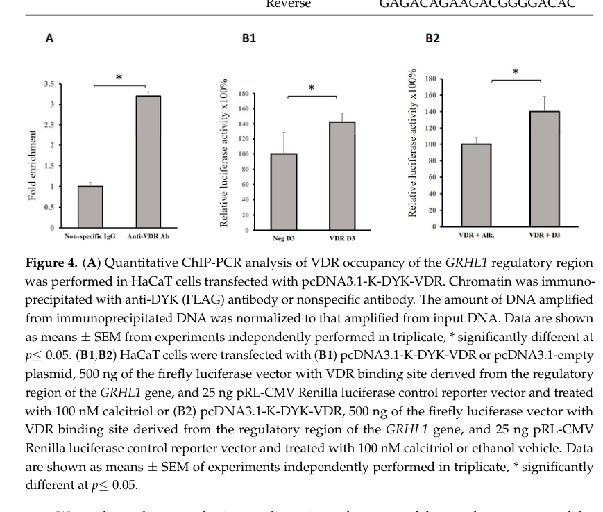

## Question

# Gene Research for Functional Annotation

## ⚠️ CRITICAL: Gene/Protein Identification Context

**BEFORE YOU BEGIN RESEARCH:** You MUST verify you are researching the CORRECT gene/protein. Gene symbols can be ambiguous, especially for less well-characterized genes from non-model organisms.

### Target Gene/Protein Identity (from UniProt):
- **UniProt Accession:** P11473
- **Protein Description:** RecName: Full=Vitamin D3 receptor; Short=VDR; AltName: Full=1,25-dihydroxyvitamin D3 receptor; AltName: Full=Nuclear receptor subfamily 1 group I member 1;
- **Gene Information:** Name=VDR {ECO:0000312|HGNC:HGNC:12679}; Synonyms=NR1I1;
- **Organism (full):** Homo sapiens (Human).
- **Protein Family:** Belongs to the nuclear hormone receptor family. NR1
- **Key Domains:** DBD_VDR. (IPR042153); NHR-like_dom_sf. (IPR035500); Nucl_hrmn_rcpt_lig-bd. (IPR000536); Nuclear_hormone_rcpt_NR1. (IPR050234); Nuclear_hrmn_rcpt. (IPR001723)

### MANDATORY VERIFICATION STEPS:

1. **Check if the gene symbol "VDR" matches the protein description above**
2. **Verify the organism is correct:** Homo sapiens (Human).
3. **Check if protein family/domains align with what you find in literature**
4. **If you find literature for a DIFFERENT gene with the same or similar symbol, STOP**

### If Gene Symbol is Ambiguous or You Cannot Find Relevant Literature:

**DO NOT PROCEED WITH RESEARCH ON A DIFFERENT GENE.** Instead:
- State clearly: "The gene symbol 'VDR' is ambiguous or literature is limited for this specific protein"
- Explain what you found (e.g., "Found extensive literature on a different gene with the same symbol in a different organism")
- Describe the protein based ONLY on the UniProt information provided above
- Suggest that the protein function can be inferred from domain/family information

### Research Target:

Please provide a comprehensive research report on the gene **VDR** (gene ID: VDR, UniProt: P11473) in human.

The research report should be a detailed narrative explaining the function, biological processes, and localization of the gene product. Citations should be given for all claims.

You should prioritize authoritative reviews and primary scientific literature when conducting research. You can supplement
this with annotations you find in gene/protein databases, but these can be outdated or inaccurate.

We are specifically interested in the primary function of the gene - for enzymes, what reaction is catalyzed, and what is the substrate specificity? For transporters, what is the substrate? For structural proteins or adapters, what is the broader structural role? For signaling molecules, what is the role in the pathway.

We are interested in where in or outside the cell the gene product carries out its function.

We are also interested in the signaling or biochemical pathways in which the gene functions. We are less interested in broad pleiotropic effects, except where these elucidate the precise role.

Include evidence where possible. We are interested in both experimental evidence as well as inference from structure, evolution, or bioinformatic analysis. Precise studies should be prioritized over high-throughput, where available.

## Output

Question: You are an expert researcher providing comprehensive, well-cited information.

Provide detailed information focusing on:
1. Key concepts and definitions with current understanding
2. Recent developments and latest research (prioritize 2023-2024 sources)
3. Current applications and real-world implementations
4. Expert opinions and analysis from authoritative sources
5. Relevant statistics and data from recent studies

Format as a comprehensive research report with proper citations. Include URLs and publication dates where available.
Always prioritize recent, authoritative sources and provide specific citations for all major claims.

# Gene Research for Functional Annotation

## ⚠️ CRITICAL: Gene/Protein Identification Context

**BEFORE YOU BEGIN RESEARCH:** You MUST verify you are researching the CORRECT gene/protein. Gene symbols can be ambiguous, especially for less well-characterized genes from non-model organisms.

### Target Gene/Protein Identity (from UniProt):
- **UniProt Accession:** P11473
- **Protein Description:** RecName: Full=Vitamin D3 receptor; Short=VDR; AltName: Full=1,25-dihydroxyvitamin D3 receptor; AltName: Full=Nuclear receptor subfamily 1 group I member 1;
- **Gene Information:** Name=VDR {ECO:0000312|HGNC:HGNC:12679}; Synonyms=NR1I1;
- **Organism (full):** Homo sapiens (Human).
- **Protein Family:** Belongs to the nuclear hormone receptor family. NR1
- **Key Domains:** DBD_VDR. (IPR042153); NHR-like_dom_sf. (IPR035500); Nucl_hrmn_rcpt_lig-bd. (IPR000536); Nuclear_hormone_rcpt_NR1. (IPR050234); Nuclear_hrmn_rcpt. (IPR001723)

### MANDATORY VERIFICATION STEPS:

1. **Check if the gene symbol "VDR" matches the protein description above**
2. **Verify the organism is correct:** Homo sapiens (Human).
3. **Check if protein family/domains align with what you find in literature**
4. **If you find literature for a DIFFERENT gene with the same or similar symbol, STOP**

### If Gene Symbol is Ambiguous or You Cannot Find Relevant Literature:

**DO NOT PROCEED WITH RESEARCH ON A DIFFERENT GENE.** Instead:
- State clearly: "The gene symbol 'VDR' is ambiguous or literature is limited for this specific protein"
- Explain what you found (e.g., "Found extensive literature on a different gene with the same symbol in a different organism")
- Describe the protein based ONLY on the UniProt information provided above
- Suggest that the protein function can be inferred from domain/family information

### Research Target:

Please provide a comprehensive research report on the gene **VDR** (gene ID: VDR, UniProt: P11473) in human.

The research report should be a detailed narrative explaining the function, biological processes, and localization of the gene product. Citations should be given for all claims.

You should prioritize authoritative reviews and primary scientific literature when conducting research. You can supplement
this with annotations you find in gene/protein databases, but these can be outdated or inaccurate.

We are specifically interested in the primary function of the gene - for enzymes, what reaction is catalyzed, and what is the substrate specificity? For transporters, what is the substrate? For structural proteins or adapters, what is the broader structural role? For signaling molecules, what is the role in the pathway.

We are interested in where in or outside the cell the gene product carries out its function.

We are also interested in the signaling or biochemical pathways in which the gene functions. We are less interested in broad pleiotropic effects, except where these elucidate the precise role.

Include evidence where possible. We are interested in both experimental evidence as well as inference from structure, evolution, or bioinformatic analysis. Precise studies should be prioritized over high-throughput, where available.

# Human VDR (UniProt P11473): functional annotation research report

## Identity and primary function

**Identity verified before interpretation.** A study explicitly retrieved the **427-amino-acid human vitamin D receptor (VDR)** sequence under UniProt **P11473**. This matches the supplied *Homo sapiens VDR* identity and its **NR1I1** synonym; the literature also confirms the expected nuclear-receptor architecture: a two-zinc-finger DNA-binding domain, hinge, and C-terminal ligand-binding domain. The receptor is **not an enzyme or a vitamin D transporter**. Its principal molecular function is to sense the active vitamin D hormone **1α,25-dihydroxyvitamin D₃ (calcitriol)** and regulate transcription of responsive genes. (muthusamy2018vitamindreceptor pages 7-11, powała2024structureandthe pages 6-8, powała2024structureandthe pages 8-10, giustina2024consensusstatementon pages 20-21)

Vitamin D₃ and its circulating 25-hydroxylated form are upstream precursors, whereas calcitriol is the principal natural ligand for canonical VDR signaling. Structural studies of human VDR show that calcitriol occupies the ligand-binding pocket through specific hydroxyl-group interactions; the receptor’s C-terminal **AF-2** surface responds to ligand binding by changing co-regulator recruitment. Thus the relevant molecular specificity is **ligand recognition and DNA/cofactor selection**, not enzymatic substrate specificity. [Powała *et al.*, published 16 June 2024, https://doi.org/10.3390/ijms25126624](powała2024structureandthe pages 6-8, powała2024structureandthe pages 8-10, powała2024structureandthe pages 1-2)

## Where and how VDR acts

**The nucleus is the established site of its principal action.** VDR associates predominantly with retinoid X receptor (RXR), and the complex occupies vitamin-D-responsive regulatory DNA. A classical vitamin D response element comprises two receptor-binding half-sites separated by three bases (**DR3**). Ligand-dependent AF-2 activity favors recruitment of NCOA-family coactivators, histone acetyltransferases and Mediator, linking chromatin regulation to RNA-polymerase-II transcription; VDR can also participate in transcriptional repression. This is not exclusively a promoter-based mechanism: responsive elements can be distant enhancers, and a 2024 review reports that canonical DR3 sites account for only **10–20%** of observed VDR genomic binding sites across the ChIP-seq studies it discusses. Occupancy alone therefore does not establish that a nearby gene is regulated. [Powała *et al.*, June 2024, https://doi.org/10.3390/ijms25126624](powała2024structureandthe pages 6-8, powała2024structureandthe pages 8-10)

VDR also occurs in the **cytoplasm**, and nuclear accumulation depends on ligand, RXR and cell context; it is incorrect to assume that every VDR molecule resides in the nucleus or that nuclear entry always requires ligand. In polarized **mouse** Th2 cells, investigators observed cytoplasmic VDR without calcitriol and strong nuclear translocation after adding it. An expert review describes RXR-dependent nuclear transport of some unliganded VDR. Cytoplasmic or membrane-associated rapid signaling has been proposed, but it should not displace the substantially better-established nuclear transcriptional annotation, nor should signaling ascribed to the separate membrane-associated protein PDIA3 automatically be assigned to VDR itself. [Kilic *et al.*, eLife article published 2024, https://doi.org/10.7554/eLife.89270; Bikle, 2021, https://doi.org/10.1002/jbm4.10578](kilic2024vitamindconstrains pages 5-8, bikle2021ligand‐independentactionsof pages 1-2, cazaresordonez2026ionchannelsas pages 2-4)

At the tissue level, particularly relevant sites include **intestinal epithelial cells** for mineral absorption, **parathyroid** cells for PTH control, and **kidney** for participation in mineral/vitamin-D feedback; VDR is also functionally studied in skin epithelium and immune cells. These are intracellular actions in cells that receive circulating calcitriol or generate it locally, **not functions of a secreted VDR protein**. [Li *et al.*, published online November 2020/in journal January 2021, https://doi.org/10.1128/MCB.00372-20; Giustina *et al.*, April 2024, https://doi.org/10.1210/endrev/bnae009](li2021analysisof125dihydroxyvitamin pages 1-3, li2021analysisof125dihydroxyvitamin pages 10-11, giustina2024consensusstatementon pages 20-21, powała2024structureandthe pages 5-6)

## Core biological pathway and causal evidence

The clearest physiological assignment is **calcitriol → VDR-dependent gene regulation → intestinal calcium absorption → calcium/phosphate availability for skeletal mineralization**. Calcitriol is produced from 25-hydroxyvitamin D by **CYP27B1**; VDR is the downstream receptor, not the hydroxylating enzyme. Intestinal VDR-responsive components include the apical calcium-channel gene *TRPV6*, calcium-binding *S100G* and calcium-extrusion *ATP2B1*. Crucially, the pathway is a **network**, not a claim that TRPV6 alone accounts for all vitamin-D-dependent calcium uptake: absorption persists to some extent in mice lacking individual proposed components. [Christakos, October 2021, https://doi.org/10.1002/jbm4.10554; Li *et al.*, January 2021, https://doi.org/10.1128/MCB.00372-20](christakos2021vitamindacritical pages 1-2, li2021analysisof125dihydroxyvitamin pages 1-3)

In a decisive tissue-rescue experiment, expressing VDR **only in the distal intestine** of VDR-null mice normalized circulating calcium and rescued rickets. Calcitriol induced *Trpv6*, *S100g* and *Atp2b1* there; experiments with **human intestinal enteroids** found conserved vitamin-D-responsive programs in both crypt-like and villus-like epithelia. The rescue establishes causality **in mice**; enteroids provide human epithelial corroboration but are not proof of an identical quantitative contribution to human whole-body absorption. [Li *et al.*, January 2021, https://doi.org/10.1128/MCB.00372-20](li2021analysisof125dihydroxyvitamin pages 1-3, li2021analysisof125dihydroxyvitamin pages 10-11)

VDR additionally participates in feedback limiting its own hormonal stimulus: calcitriol-induced **CYP24A1** promotes vitamin-D-metabolite catabolism, whereas ligand action in parathyroid tissue suppresses PTH. A 2024 experimental study observed induction of intestinal mouse *Cyp24a1* and its approximately **55-kDa mitochondrial enzyme** after calcitriol exposure. **CYP24A1**, not VDR, performs the hydroxylation/catabolic reaction. [Uga *et al.*, June 2024, https://doi.org/10.3390/biom14060717; Giustina *et al.*, April 2024, https://doi.org/10.1210/endrev/bnae009](uga2024theroleof pages 1-2, giustina2024consensusstatementon pages 20-21)

**Human genetics supports the receptor assignment.** Loss-of-function *VDR* variants cause hereditary vitamin-D-resistant rickets, also termed vitamin-D-dependent rickets type 2A: impaired receptor responses lead to disordered calcium homeostasis and rickets, sometimes with alopecia. This differs from type 1A rickets caused by defective **CYP27B1-mediated calcitriol synthesis**. Hair-follicle biology also distinguishes the processes: experimental VDR unable to bind calcitriol can still restore hair cycling in VDR-deficient mice, indicating a **ligand-independent** VDR role that does not substitute for its ligand-dependent intestinal calcium function. Alopecia is consequently mutation-dependent, not an inevitable effect of every variant that impairs ligand binding. [Yao *et al.*, January 2024, https://doi.org/10.3389/fphar.2024.1298181; Bikle, 2021, https://doi.org/10.1002/jbm4.10578](yao2024modulationofthe pages 2-3, bikle2021ligand‐independentactionsof pages 1-2, lee2016thevitamind pages 1-2)

## What recent research adds

A **2024 AF-2 deletion study** tested the receptor mechanism beyond a simple VDR knockout. Systemic mice expressing VDR lacking its coactivator-recruiting AF-2 region developed **more severe rickets than VDR-null mice**; unlike null mice, their skeletal phenotype was not corrected by a calcium/phosphate/lactose-enriched diet. Bone-cell-restricted AF-2 deletion did not reproduce the full phenotype, and intestinal and renal expression studies implicated mineral-handling tissues. This establishes that an altered receptor retaining coactivator-independent interactions can be biologically different from no receptor at all, although the newly implicated downstream genes need further validation. [Doms *et al.*, August 2024, https://doi.org/10.1038/s41413-024-00343-7](doms2024coactivatorindependentvitamind pages 1-2, doms2024coactivatorindependentvitamind pages 8-9)

**Direct human-cell transcriptional evidence** comes from a 2024 HaCaT keratinocyte study: ChIP detected VDR occupancy at a *GRHL1* regulatory region, and VDR overexpression with calcitriol reduced endogenous *GRHL1* mRNA by **42%** relative to the tested controls (**p < 0.05**). An isolated *GRHL1* promoter reporter instead showed increased activity with VDR or calcitriol. The opposing directions caution that a short reporter fragment cannot predict the intact gene’s response in its chromatin context. [Taracha-Wisniewska *et al.*, July 2024, https://doi.org/10.3390/ijms25147913](tarachawisniewska2024vitamindreceptor pages 5-7, tarachawisniewska2024vitamindreceptor media b728d587)

A further **2024 immune-pathway study**, chiefly in mice, connected VDR signaling in Th2 cells with induction of **IKZF3/Aiolos** and attenuation of the **IL-2–STAT5** inflammatory program; calcitriol suppressed *Stat5a* and *Stat5b* expression in the reported polarized-cell experiments. Associated human regulatory-locus and cord-blood analyses offer translational leads, **not proof** that this mouse mechanism prevents human asthma. [Kilic *et al.*, April 2024, https://doi.org/10.7554/eLife.89270](kilic2024vitamindconstrains pages 14-15, kilic2024vitamindconstrains pages 3-5, kilic2024vitamindconstrains pages 5-8)

The following evidence map separates direct molecular tests from animal rescue and clinical pharmacology; in particular, drug outcomes should not be read as effects of a specific *VDR* genotype. (li2021analysisof125dihydroxyvitamin pages 1-3, doms2024coactivatorindependentvitamind pages 1-2, tarachawisniewska2024vitamindreceptor pages 5-7, cozzolino2021activevitamind pages 1-3)

| Evidence / biological setting | Molecular or clinical observation | What it supports / important limitation | Study date, DOI, URL |
|---|---|---|---|
| Human VDR sequence; computational modeling | Retrieved a 427-aa **human VDR** sequence from UniProt **P11473** and modeled calcitriol binding to variants. (muthusamy2018vitamindreceptor pages 7-11) | Directly verifies the requested accession, species, protein length, and receptor identity. Computational analysis only; not functional annotation by experiment. | May 2018; [10.1016/j.jmgm.2018.02.004](https://doi.org/10.1016/j.jmgm.2018.02.004) |
| Distal-intestine VDR rescue in mice; human intestinal enteroids | Distal-intestine-restricted VDR expression in VDR-null mice normalized serum calcium and rescued rickets; calcitriol induced *Trpv6*, *S100g*, and *Atp2b1*. RNA-seq showed conserved responses in human enteroids. (li2021analysisof125dihydroxyvitamin pages 1-3, li2021analysisof125dihydroxyvitamin pages 10-11) | Supports VDR as a nuclear transcriptional regulator of intestinal mineral transport and identifies intestine as a principal functional site. Human evidence is ex vivo; rescue evidence is from mice. | Jan. 2021; [10.1128/MCB.00372-20](https://doi.org/10.1128/MCB.00372-20) |
| Systemic or cell-specific AF-2 deletion in mice | VDRΔAF2 could not recruit coactivators. Systemic mutants developed more severe rickets than VDR-null mice and were not rescued by a calcium/phosphate/lactose-rich diet; osteoblast- or osteoclast-specific deletion did not reproduce the phenotype. (doms2024coactivatorindependentvitamind pages 8-9, doms2024coactivatorindependentvitamind pages 1-2) | Demonstrates that the ligand-binding-domain AF-2 surface and tissue-extrinsic mineral-handling pathways are functionally important. Mouse evidence; newly implicated intestinal/renal targets require validation. | Aug. 2024; [10.1038/s41413-024-00343-7](https://doi.org/10.1038/s41413-024-00343-7) |
| Human HaCaT keratinocyte line; *GRHL1* regulation | FLAG–VDR ChIP showed occupancy at a *GRHL1* regulatory region. VDR overexpression plus 100 nM calcitriol reduced endogenous *GRHL1* mRNA by **42%** (*p*<0.05), while the isolated promoter reporter increased. (tarachawisniewska2024vitamindreceptor pages 5-7, tarachawisniewska2024vitamindreceptor media b728d587) | Direct human-cell evidence for VDR DNA occupancy and context-dependent transcriptional regulation. Opposite endogenous and reporter directions caution against assuming simple activation. | Jul. 2024; [10.3390/ijms25147913](https://doi.org/10.3390/ijms25147913) |
| Allergic-airway and polarized Th2 mouse models; human genetic analyses | Calcitriol caused strong VDR nuclear translocation in Th2 cells, induced *Ikzf3*, suppressed *Stat5a/Stat5b*, and constrained IL-2/Th2 inflammation. Human VDR-binding-site/GWAS and cord-blood analyses linked this axis to asthma-associated loci. (kilic2024vitamindconstrains pages 3-5, kilic2024vitamindconstrains pages 5-8) | Supports ligand-dependent nuclear localization and a cell-specific VDR–IKZF3–IL-2/STAT5 immune pathway. Mechanistic experiments were mainly murine; human genomic associations are suggestive, not causal. | Apr. 2024; [10.7554/eLife.89270](https://doi.org/10.7554/eLife.89270) |
| Plaque psoriasis; fixed topical calcipotriol plus betamethasone | A post-hoc meta-analysis of **1,534 patients** found mean four-week PASI reductions of **67.2%–71.2%**; the fixed product contained calcipotriol 50 µg/g plus betamethasone 0.5 mg/g. (kedra2024clinicalutilityof pages 2-4) | Real-world pharmacologic implementation of a VDR agonist. Clinical efficacy cannot be assigned solely to VDR because this was combination therapy with a corticosteroid. | Dec. 2024; [10.2147/DDDT.S240867](https://doi.org/10.2147/DDDT.S240867) |
| Non-dialysis CKD with secondary hyperparathyroidism; active-vitamin-D trials | Six placebo-controlled trials (**799 patients**) found hypercalcemia in 1.1%–43.3% with active vitamin D versus 0%–3.4% with placebo: pooled **OR 6.63** (95% CI 2.37–18.55; *p*<0.001). (cozzolino2021activevitamind pages 1-3) | Quantifies a key safety trade-off of systemic VDR activation while suppressing PTH. Drug-class evidence—mostly paricalcitol, plus alfacalcidol—not evidence about endogenous VDR variation. | May 2021; [10.1093/ckj/sfab091](https://doi.org/10.1093/ckj/sfab091) |

*Table: Evidence linking human VDR P11473 identity and molecular mechanism to intestinal, epithelial, immune, and clinical outcomes. Model-system and combination-therapy limitations are shown to prevent overinterpretation.*

## Applications, expert assessment and limitations

**Established pharmacological implementation** includes the topical VDR agonist **calcipotriol/calcipotriene** for plaque psoriasis, commonly combined with betamethasone. A 2024 clinical review reported a post-hoc analysis of **1,534 patients** receiving the fixed combination, with **67.2–71.2% mean PASI reduction at four weeks** across the reported severity groups. This demonstrates performance of the **combination**, not a quantitatively separable effect of VDR activation alone. [Kędra and Reich, December 2024, https://doi.org/10.2147/DDDT.S240867](kedra2024clinicalutilityof pages 2-4)

Systemic calcitriol or active vitamin-D analogues can suppress PTH in selected mineral-metabolism disorders, including secondary hyperparathyroidism, but the calcemic mechanism imposes a safety limit. A pooled analysis of **six randomized trials, 799 participants** with non-dialysis chronic kidney disease found greater hypercalcemia with active vitamin D—predominantly paricalcitol—than placebo: **odds ratio 6.63, 95% confidence interval 2.37–18.55**. A 2024 *Endocrine Reviews* expert consensus accordingly distinguishes ordinary precursor supplementation from administering **calcitriol**, recommending that the active hormone be reserved for specific impaired-production settings with mineral monitoring rather than treated as a general-purpose supplement. [Cozzolino *et al.*, May 2021, https://doi.org/10.1093/ckj/sfab091; Giustina *et al.*, April 2024, https://doi.org/10.1210/endrev/bnae009](cozzolino2021activevitamind pages 1-3, giustina2024consensusstatementon pages 1-2, giustina2024consensusstatementon pages 20-21)

**Bottom line for functional annotation:** assign human **VDR/P11473** the experimentally established role of an **intracellular, chiefly nuclear, calcitriol-responsive transcriptional regulator**, generally acting with RXR and chromatin co-regulators. Its most strongly demonstrated systemic pathway controls **intestinal calcium absorption and mineral homeostasis**; renal/parathyroid feedback, epithelial differentiation and certain immune programs are important context-specific extensions. Interpret membrane-associated signaling, distant ChIP peaks, disease associations and proposed anticancer agonists according to their distinct—and generally weaker—levels of direct causal evidence. (powała2024structureandthe pages 6-8, powała2024structureandthe pages 8-10, li2021analysisof125dihydroxyvitamin pages 1-3, doms2024coactivatorindependentvitamind pages 1-2, powała2024structureandthe pages 1-2)

References

1. (muthusamy2018vitamindreceptor pages 7-11): Karthikeyan Muthusamy and Selvaraman Nagamani. Vitamin d receptor (vdr) non-synonymous single nucleotide polymorphisms (nssnps) affect the calcitriol drug response - a theoretical insight. Journal of Molecular Graphics and Modelling, 81:14-24, May 2018. URL: https://doi.org/10.1016/j.jmgm.2018.02.004, doi:10.1016/j.jmgm.2018.02.004. This article has 7 citations and is from a peer-reviewed journal.

2. (powała2024structureandthe pages 6-8): Agnieszka Powała, Teresa Żołek, Geoffrey Brown, and Andrzej Kutner. Structure and the anticancer activity of vitamin d receptor agonists. International Journal of Molecular Sciences, 25:6624, Jun 2024. URL: https://doi.org/10.3390/ijms25126624, doi:10.3390/ijms25126624. This article has 20 citations.

3. (powała2024structureandthe pages 8-10): Agnieszka Powała, Teresa Żołek, Geoffrey Brown, and Andrzej Kutner. Structure and the anticancer activity of vitamin d receptor agonists. International Journal of Molecular Sciences, 25:6624, Jun 2024. URL: https://doi.org/10.3390/ijms25126624, doi:10.3390/ijms25126624. This article has 20 citations.

4. (giustina2024consensusstatementon pages 20-21): Andrea Giustina, John P Bilezikian, Robert A Adler, Giuseppe Banfi, Daniel D Bikle, Neil C Binkley, Jens Bollerslev, Roger Bouillon, Maria Luisa Brandi, Felipe F Casanueva, Luigi di Filippo, Lorenzo M Donini, Peter R Ebeling, Ghada El-Hajj Fuleihan, Angelo Fassio, Stefano Frara, Glenville Jones, Claudio Marcocci, Adrian R Martineau, Salvatore Minisola, Nicola Napoli, Massimo Procopio, René Rizzoli, Anne L Schafer, Christopher T Sempos, Fabio Massimo Ulivieri, and Jyrki K Virtanen. Consensus statement on vitamin d status assessment and supplementation: whys, whens, and hows. Endocrine Reviews, 45:625-654, Apr 2024. URL: https://doi.org/10.1210/endrev/bnae009, doi:10.1210/endrev/bnae009. This article has 503 citations and is from a domain leading peer-reviewed journal.

5. (powała2024structureandthe pages 1-2): Agnieszka Powała, Teresa Żołek, Geoffrey Brown, and Andrzej Kutner. Structure and the anticancer activity of vitamin d receptor agonists. International Journal of Molecular Sciences, 25:6624, Jun 2024. URL: https://doi.org/10.3390/ijms25126624, doi:10.3390/ijms25126624. This article has 20 citations.

6. (kilic2024vitamindconstrains pages 5-8): Ayse Kilic, Arda Halu, Margherita De Marzio, Enrico Maiorino, Melody G Duvall, Thayse Regina Bruggemann, Joselyn J Rojas Quintero, Robert Chase, Hooman Mirzakhani, Ayse Özge Sungur, Janine Koepke, Taiji Nakano, Hong Yong Peh, Nandini Krishnamoorthy, Raja-Elie Abdulnour, Katia Georgopoulos, Augusto A Litonjua, Marie Demay, Harald Renz, Bruce D Levy, and Scott T Weiss. Vitamin d constrains inflammation by modulating the expression of key genes on chr17q12-21.1. eLife, Apr 2024. URL: https://doi.org/10.7554/elife.89270, doi:10.7554/elife.89270. This article has 25 citations and is from a domain leading peer-reviewed journal.

7. (bikle2021ligand‐independentactionsof pages 1-2): Daniel D. Bikle. Ligand‐independent actions of the vitamin d receptor: more questions than answers. JBMR Plus, Nov 2021. URL: https://doi.org/10.1002/jbm4.10578, doi:10.1002/jbm4.10578. This article has 19 citations and is from a peer-reviewed journal.

8. (cazaresordonez2026ionchannelsas pages 2-4): Verna Cázares-Ordoñez, Ramiro José González-Duarte, Michiyasu Ishizawa, Luis A. Pardo, and Makoto Makishima. Ion channels as targets of the vitamin d receptor: a long journey with a promising future. Receptors, Mar 2026. URL: https://doi.org/10.3390/receptors5020010, doi:10.3390/receptors5020010. This article has 1 citations.

9. (li2021analysisof125dihydroxyvitamin pages 1-3): Shanshan Li, Jessica De La Cruz, Steven Hutchens, Somshuvra Mukhopadhyay, Zachary K. Criss, Rohit Aita, Oscar Pellon-Cardenas, Joseph Hur, Patricia Soteropoulos, Seema Husain, Puneet Dhawan, Lieve Verlinden, Geert Carmeliet, James C. Fleet, Noah F. Shroyer, Michael P. Verzi, and Sylvia Christakos. Analysis of 1,25-dihydroxyvitamin d3 genomic action reveals calcium-regulating and calcium-independent effects in mouse intestine and human enteroids. Molecular and Cellular Biology, Jan 2021. URL: https://doi.org/10.1128/mcb.00372-20, doi:10.1128/mcb.00372-20. This article has 35 citations and is from a domain leading peer-reviewed journal.

10. (li2021analysisof125dihydroxyvitamin pages 10-11): Shanshan Li, Jessica De La Cruz, Steven Hutchens, Somshuvra Mukhopadhyay, Zachary K. Criss, Rohit Aita, Oscar Pellon-Cardenas, Joseph Hur, Patricia Soteropoulos, Seema Husain, Puneet Dhawan, Lieve Verlinden, Geert Carmeliet, James C. Fleet, Noah F. Shroyer, Michael P. Verzi, and Sylvia Christakos. Analysis of 1,25-dihydroxyvitamin d3 genomic action reveals calcium-regulating and calcium-independent effects in mouse intestine and human enteroids. Molecular and Cellular Biology, Jan 2021. URL: https://doi.org/10.1128/mcb.00372-20, doi:10.1128/mcb.00372-20. This article has 35 citations and is from a domain leading peer-reviewed journal.

11. (powała2024structureandthe pages 5-6): Agnieszka Powała, Teresa Żołek, Geoffrey Brown, and Andrzej Kutner. Structure and the anticancer activity of vitamin d receptor agonists. International Journal of Molecular Sciences, 25:6624, Jun 2024. URL: https://doi.org/10.3390/ijms25126624, doi:10.3390/ijms25126624. This article has 20 citations.

12. (christakos2021vitamindacritical pages 1-2): Sylvia Christakos. Vitamin<scp>d</scp>: a critical regulator of intestinal physiology. JBMR Plus, Oct 2021. URL: https://doi.org/10.1002/jbm4.10554, doi:10.1002/jbm4.10554. This article has 32 citations and is from a peer-reviewed journal.

13. (uga2024theroleof pages 1-2): Minori Uga, Ichiro Kaneko, Yuji Shiozaki, Megumi Koike, Naoko Tsugawa, Peter W. Jurutka, Ken-Ichi Miyamoto, and Hiroko Segawa. The role of intestinal cytochrome p450s in vitamin d metabolism. Biomolecules, 14:717, Jun 2024. URL: https://doi.org/10.3390/biom14060717, doi:10.3390/biom14060717. This article has 8 citations.

14. (yao2024modulationofthe pages 2-3): Minghe Yao, Patrick Kwabena Oduro, Ayomide M. Akintibu, and Haifeng Yan. Modulation of the vitamin d receptor by traditional chinese medicines and bioactive compounds: potential therapeutic applications in vdr-dependent diseases. Frontiers in Pharmacology, Jan 2024. URL: https://doi.org/10.3389/fphar.2024.1298181, doi:10.3389/fphar.2024.1298181. This article has 35 citations.

15. (lee2016thevitamind pages 1-2): Seong Min Lee and J. Wesley Pike. The vitamin d receptor functions as a transcription regulator in the absence of 1,25-dihydroxyvitamin d3. The Journal of Steroid Biochemistry and Molecular Biology, 164:265-270, Nov 2016. URL: https://doi.org/10.1016/j.jsbmb.2015.08.018, doi:10.1016/j.jsbmb.2015.08.018. This article has 49 citations.

16. (doms2024coactivatorindependentvitamind pages 1-2): Stefanie Doms, Lieve Verlinden, Iris Janssens, Justine Vanhevel, Roy Eerlings, René Houtman, Shigeaki Kato, Chantal Mathieu, Brigitte Decallonne, Geert Carmeliet, and Annemieke Verstuyf. Coactivator-independent vitamin d receptor signaling causes severe rickets in mice, that is not prevented by a diet high in calcium, phosphate, and lactose. Bone Research, Aug 2024. URL: https://doi.org/10.1038/s41413-024-00343-7, doi:10.1038/s41413-024-00343-7. This article has 8 citations and is from a domain leading peer-reviewed journal.

17. (doms2024coactivatorindependentvitamind pages 8-9): Stefanie Doms, Lieve Verlinden, Iris Janssens, Justine Vanhevel, Roy Eerlings, René Houtman, Shigeaki Kato, Chantal Mathieu, Brigitte Decallonne, Geert Carmeliet, and Annemieke Verstuyf. Coactivator-independent vitamin d receptor signaling causes severe rickets in mice, that is not prevented by a diet high in calcium, phosphate, and lactose. Bone Research, Aug 2024. URL: https://doi.org/10.1038/s41413-024-00343-7, doi:10.1038/s41413-024-00343-7. This article has 8 citations and is from a domain leading peer-reviewed journal.

18. (tarachawisniewska2024vitamindreceptor pages 5-7): Agnieszka Taracha-Wisniewska, Emma G. C. Parks, Michal Miller, Lidia Lipinska-Zubrycka, Sebastian Dworkin, and Tomasz Wilanowski. Vitamin d receptor regulates the expression of the grainyhead-like 1 gene. International Journal of Molecular Sciences, 25:7913, Jul 2024. URL: https://doi.org/10.3390/ijms25147913, doi:10.3390/ijms25147913. This article has 4 citations.

19. (tarachawisniewska2024vitamindreceptor media b728d587): Agnieszka Taracha-Wisniewska, Emma G. C. Parks, Michal Miller, Lidia Lipinska-Zubrycka, Sebastian Dworkin, and Tomasz Wilanowski. Vitamin d receptor regulates the expression of the grainyhead-like 1 gene. International Journal of Molecular Sciences, 25:7913, Jul 2024. URL: https://doi.org/10.3390/ijms25147913, doi:10.3390/ijms25147913. This article has 4 citations.

20. (kilic2024vitamindconstrains pages 14-15): Ayse Kilic, Arda Halu, Margherita De Marzio, Enrico Maiorino, Melody G Duvall, Thayse Regina Bruggemann, Joselyn J Rojas Quintero, Robert Chase, Hooman Mirzakhani, Ayse Özge Sungur, Janine Koepke, Taiji Nakano, Hong Yong Peh, Nandini Krishnamoorthy, Raja-Elie Abdulnour, Katia Georgopoulos, Augusto A Litonjua, Marie Demay, Harald Renz, Bruce D Levy, and Scott T Weiss. Vitamin d constrains inflammation by modulating the expression of key genes on chr17q12-21.1. eLife, Apr 2024. URL: https://doi.org/10.7554/elife.89270, doi:10.7554/elife.89270. This article has 25 citations and is from a domain leading peer-reviewed journal.

21. (kilic2024vitamindconstrains pages 3-5): Ayse Kilic, Arda Halu, Margherita De Marzio, Enrico Maiorino, Melody G Duvall, Thayse Regina Bruggemann, Joselyn J Rojas Quintero, Robert Chase, Hooman Mirzakhani, Ayse Özge Sungur, Janine Koepke, Taiji Nakano, Hong Yong Peh, Nandini Krishnamoorthy, Raja-Elie Abdulnour, Katia Georgopoulos, Augusto A Litonjua, Marie Demay, Harald Renz, Bruce D Levy, and Scott T Weiss. Vitamin d constrains inflammation by modulating the expression of key genes on chr17q12-21.1. eLife, Apr 2024. URL: https://doi.org/10.7554/elife.89270, doi:10.7554/elife.89270. This article has 25 citations and is from a domain leading peer-reviewed journal.

22. (cozzolino2021activevitamind pages 1-3): Mario Cozzolino, Laurence Bernard, and Philipp A Csomor. Active vitamin d increases the risk of hypercalcaemia in non-dialysis chronic kidney disease patients with secondary hyperparathyroidism: a systematic review and meta-analysis. Clinical Kidney Journal, 14:2437-2443, May 2021. URL: https://doi.org/10.1093/ckj/sfab091, doi:10.1093/ckj/sfab091. This article has 30 citations and is from a peer-reviewed journal.

23. (kedra2024clinicalutilityof pages 2-4): Kamila Kędra and Adam Reich. Clinical utility of various formulations of calcipotriene and betamethasone dipropionate for the treatment of plaque psoriasis in patients aged 12 years or older. Drug Design, Development and Therapy, 18:5827-5839, Dec 2024. URL: https://doi.org/10.2147/dddt.s240867, doi:10.2147/dddt.s240867. This article has 3 citations.

24. (giustina2024consensusstatementon pages 1-2): Andrea Giustina, John P Bilezikian, Robert A Adler, Giuseppe Banfi, Daniel D Bikle, Neil C Binkley, Jens Bollerslev, Roger Bouillon, Maria Luisa Brandi, Felipe F Casanueva, Luigi di Filippo, Lorenzo M Donini, Peter R Ebeling, Ghada El-Hajj Fuleihan, Angelo Fassio, Stefano Frara, Glenville Jones, Claudio Marcocci, Adrian R Martineau, Salvatore Minisola, Nicola Napoli, Massimo Procopio, René Rizzoli, Anne L Schafer, Christopher T Sempos, Fabio Massimo Ulivieri, and Jyrki K Virtanen. Consensus statement on vitamin d status assessment and supplementation: whys, whens, and hows. Endocrine Reviews, 45:625-654, Apr 2024. URL: https://doi.org/10.1210/endrev/bnae009, doi:10.1210/endrev/bnae009. This article has 503 citations and is from a domain leading peer-reviewed journal.

## Artifacts

- [Edison artifact artifact-00](VDR-deep-research-falcon_artifacts/artifact-00.md)

## Citations

1. muthusamy2018vitamindreceptor pages 7-11
2. kedra2024clinicalutilityof pages 2-4
3. cozzolino2021activevitamind pages 1-3
4. giustina2024consensusstatementon pages 20-21
5. kilic2024vitamindconstrains pages 5-8
6. cazaresordonez2026ionchannelsas pages 2-4
7. christakos2021vitamindacritical pages 1-2
8. uga2024theroleof pages 1-2
9. yao2024modulationofthe pages 2-3
10. lee2016thevitamind pages 1-2
11. doms2024coactivatorindependentvitamind pages 1-2
12. doms2024coactivatorindependentvitamind pages 8-9
13. tarachawisniewska2024vitamindreceptor pages 5-7
14. kilic2024vitamindconstrains pages 14-15
15. kilic2024vitamindconstrains pages 3-5
16. giustina2024consensusstatementon pages 1-2
17. Powała *et al.*, published 16 June 2024, https://doi.org/10.3390/ijms25126624
18. Powała *et al.*, June 2024, https://doi.org/10.3390/ijms25126624
19. Kilic *et al.*, eLife article published 2024, https://doi.org/10.7554/eLife.89270; Bikle, 2021, https://doi.org/10.1002/jbm4.10578
20. Li *et al.*, published online November 2020/in journal January 2021, https://doi.org/10.1128/MCB.00372-20; Giustina *et al.*, April 2024, https://doi.org/10.1210/endrev/bnae009
21. Christakos, October 2021, https://doi.org/10.1002/jbm4.10554; Li *et al.*, January 2021, https://doi.org/10.1128/MCB.00372-20
22. Li *et al.*, January 2021, https://doi.org/10.1128/MCB.00372-20
23. Uga *et al.*, June 2024, https://doi.org/10.3390/biom14060717; Giustina *et al.*, April 2024, https://doi.org/10.1210/endrev/bnae009
24. Yao *et al.*, January 2024, https://doi.org/10.3389/fphar.2024.1298181; Bikle, 2021, https://doi.org/10.1002/jbm4.10578
25. Doms *et al.*, August 2024, https://doi.org/10.1038/s41413-024-00343-7
26. Taracha-Wisniewska *et al.*, July 2024, https://doi.org/10.3390/ijms25147913
27. Kilic *et al.*, April 2024, https://doi.org/10.7554/eLife.89270
28. 10.1016/j.jmgm.2018.02.004
29. 10.1128/MCB.00372-20
30. 10.1038/s41413-024-00343-7
31. 10.3390/ijms25147913
32. 10.7554/eLife.89270
33. 10.2147/DDDT.S240867
34. 10.1093/ckj/sfab091
35. Kędra and Reich, December 2024, https://doi.org/10.2147/DDDT.S240867
36. Cozzolino *et al.*, May 2021, https://doi.org/10.1093/ckj/sfab091; Giustina *et al.*, April 2024, https://doi.org/10.1210/endrev/bnae009
37. https://doi.org/10.3390/ijms25126624](powała2024structureandthe
38. https://doi.org/10.7554/eLife.89270;
39. https://doi.org/10.1002/jbm4.10578](kilic2024vitamindconstrains
40. https://doi.org/10.1128/MCB.00372-20;
41. https://doi.org/10.1210/endrev/bnae009](li2021analysisof125dihydroxyvitamin
42. https://doi.org/10.1002/jbm4.10554;
43. https://doi.org/10.1128/MCB.00372-20](christakos2021vitamindacritical
44. https://doi.org/10.1128/MCB.00372-20](li2021analysisof125dihydroxyvitamin
45. https://doi.org/10.3390/biom14060717;
46. https://doi.org/10.1210/endrev/bnae009](uga2024theroleof
47. https://doi.org/10.3389/fphar.2024.1298181;
48. https://doi.org/10.1002/jbm4.10578](yao2024modulationofthe
49. https://doi.org/10.1038/s41413-024-00343-7](doms2024coactivatorindependentvitamind
50. https://doi.org/10.3390/ijms25147913](tarachawisniewska2024vitamindreceptor
51. https://doi.org/10.7554/eLife.89270](kilic2024vitamindconstrains
52. https://doi.org/10.1016/j.jmgm.2018.02.004
53. https://doi.org/10.1128/MCB.00372-20
54. https://doi.org/10.1038/s41413-024-00343-7
55. https://doi.org/10.3390/ijms25147913
56. https://doi.org/10.7554/eLife.89270
57. https://doi.org/10.2147/DDDT.S240867
58. https://doi.org/10.1093/ckj/sfab091
59. https://doi.org/10.2147/DDDT.S240867](kedra2024clinicalutilityof
60. https://doi.org/10.1093/ckj/sfab091;
61. https://doi.org/10.1210/endrev/bnae009](cozzolino2021activevitamind
62. https://doi.org/10.1016/j.jmgm.2018.02.004,
63. https://doi.org/10.3390/ijms25126624,
64. https://doi.org/10.1210/endrev/bnae009,
65. https://doi.org/10.7554/elife.89270,
66. https://doi.org/10.1002/jbm4.10578,
67. https://doi.org/10.3390/receptors5020010,
68. https://doi.org/10.1128/mcb.00372-20,
69. https://doi.org/10.1002/jbm4.10554,
70. https://doi.org/10.3390/biom14060717,
71. https://doi.org/10.3389/fphar.2024.1298181,
72. https://doi.org/10.1016/j.jsbmb.2015.08.018,
73. https://doi.org/10.1038/s41413-024-00343-7,
74. https://doi.org/10.3390/ijms25147913,
75. https://doi.org/10.1093/ckj/sfab091,
76. https://doi.org/10.2147/dddt.s240867,