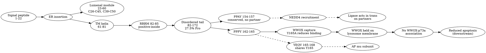
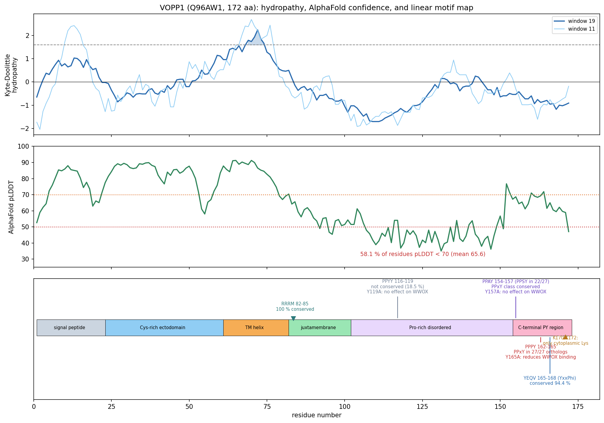
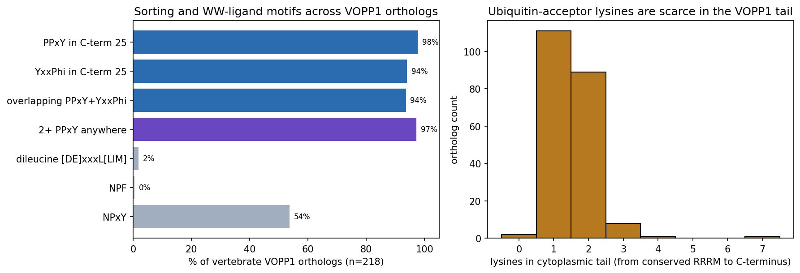
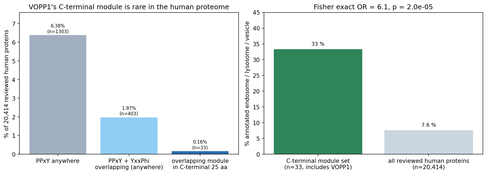
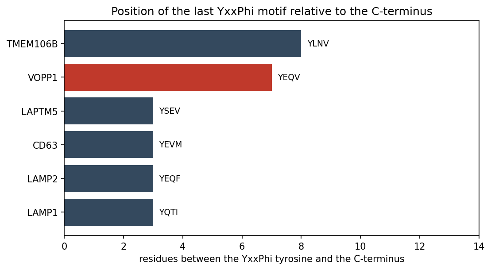

## Question

# AIGR Gene Hypothesis Deep Research

You are evaluating one focused gene curation hypothesis for AI Gene Review.
This is not a general gene overview. Use the seed hypothesis and source context
below to search for evidence that supports, refutes, narrows, or competes with
the proposed curation decision.

## Target Gene

- **Organism code:** human
- **Taxon:** Homo sapiens (NCBITaxon:9606)
- **Gene directory:** VOPP1
- **Gene symbol:** VOPP1
- **UniProt accession:** Q96AW1

## Focus

- **Focus type:** free_text
- **Hypothesis slug:** kgap-vopp1-scaffold-determinants
- **Source file:** genes/human/VOPP1/VOPP1-ai-review.yaml
- **Source selector:** free-text

## Seed Hypothesis

Whether human VOPP1 (Q96AW1) has scaffolding determinants beyond its PPPY motif may be predictable from sequence and structure. Single analysis only: from the Q96AW1 sequence and its AlphaFold model, map the signal peptide or signal anchor, every transmembrane or hydrophobic segment and the resulting membrane topology, and state which face each region lies on; enumerate every PPxY and PY-like motif, every proline-rich segment, and all short linear interaction motifs for endolysosomal sorting, including dileucine, tyrosine-based YxxPhi, NPF or PI(3)P-related signals, ubiquitination acceptor lysines and predicted phosphosites in or near each motif; identify the ordered regions, if any, against the predicted disordered fraction; and score motif conservation across vertebrate orthologs. State which determinants besides the PPPY motif are predicted to specify VOPP1's compartment and complex composition, and whether the protein is predicted to be a single-motif adaptor or a multivalent scaffold.

## Term and Decision Context

No specific term context supplied.

## Reference Context

No specific reference context supplied.

## Source Context YAML

```yaml
hypothesis: 'Whether human VOPP1 (Q96AW1) has scaffolding determinants beyond its PPPY motif may be predictable
  from sequence and structure. Single analysis only: from the Q96AW1 sequence and its AlphaFold model,
  map the signal peptide or signal anchor, every transmembrane or hydrophobic segment and the resulting
  membrane topology, and state which face each region lies on; enumerate every PPxY and PY-like motif,
  every proline-rich segment, and all short linear interaction motifs for endolysosomal sorting, including
  dileucine, tyrosine-based YxxPhi, NPF or PI(3)P-related signals, ubiquitination acceptor lysines and
  predicted phosphosites in or near each motif; identify the ordered regions, if any, against the predicted
  disordered fraction; and score motif conservation across vertebrate orthologs. State which determinants
  besides the PPPY motif are predicted to specify VOPP1''s compartment and complex composition, and whether
  the protein is predicted to be a single-motif adaptor or a multivalent scaffold.'
focus_type: free_text
context: []
reference_id: []
```

## Research Objective

Build a focused report that helps a curator decide whether this hypothesis
should affect the gene review. Address the focus type directly:

1. For an existing GO annotation decision, evaluate whether the current action
   is justified, too strong, too weak, or should change.
2. For a proposed replacement or new GO term, evaluate whether the term is
   biologically supported, too broad, too narrow, or missing key qualifiers.
3. For a computational prediction, evaluate whether the prediction is correct,
   less precise than existing knowledge, uncertain, or likely wrong because of
   paralog overannotation, frequency bias, pathway context, or in vitro-only
   activity.
4. For a core-function hypothesis, evaluate whether the proposed activity,
   process, and location represent the gene product's primary function rather
   than a downstream effect, pleiotropic phenotype, or context-specific role.
5. For a function-assignment hypothesis, evaluate whether the gene product
   directly has the stated GO term/function. Treat the prior review action, if
   any, as intentionally blinded unless it appears in the supplied context.

Use primary literature whenever possible. Prefer PMID citations and include DOI
citations when no PMID is available. Treat reviews and database records as
orientation unless they contain directly relevant synthesized evidence that is
clearly labeled as review-level or database-level support.

Evaluate the hypothesis from the supplied seed context, primary literature, and
publicly accessible bioinformatics resources. Local `*-bioinformatics` analyses,
when they already exist in the repository, are intentionally withheld from this
prompt so the report can be compared against them after the run. Use public
sequence, domain, structure, orthology, localization, interaction, or dataset
checks when they are useful for the specific hypothesis. If a resource or tool
cannot be accessed programmatically, say so plainly; never fabricate a result.
Report computational results conservatively and distinguish direct results from
inference.

## Required Output

### Executive Judgment

Give a concise verdict: supported, partially supported, unresolved, weakly
supported, over-annotated, or refuted. Explain the reasoning and the most
important caveats.

### Evidence Matrix

Create a table with one row per important evidence item:

- Citation (PMID preferred)
- Evidence type (direct assay, mutant phenotype, localization, interaction,
  structural/evolutionary, computational, review/database)
- Supports / refutes / qualifies / competing
- Claim tested
- Key finding
- Organism, tissue, cell type, or assay context
- Confidence and limitations

### GO Curation Implications

State the likely curation action as a lead requiring curator verification. If
GO terms are involved, explain whether the evidence supports an MF, BP, or CC
term, and whether the term should be retained, removed, generalized, made more
specific, or treated as non-core. Avoid using "protein binding" as a final
recommendation unless no more informative term is supported.

### Mechanistic Scope

Describe the immediate molecular or cellular function being tested. Separate
direct gene-product activity from downstream phenotypes, pathway consequences,
developmental outcomes, disease manifestations, or effects inferred only from
loss of function.

### Conflicts and Alternatives

Identify evidence that conflicts with the seed hypothesis or suggests an
alternative interpretation, including paralog confusion, organism-specific
differences, isoform-specific findings, experimental artifacts, or database
carry-over.

### Knowledge Gaps

List explicit uncertainties that matter for curation. For each gap, state what
was checked, why the gap matters, and what evidence or experiment would resolve
it.

### Discriminating Tests

Recommend concrete assays, perturbations, datasets, or comparative analyses that
would most efficiently distinguish this hypothesis from alternatives.

### Curation Leads

Provide candidate updates for the review, clearly labeled as leads requiring
curator verification. Include candidate references with exact snippets to verify,
candidate replacement or new GO terms, possible action changes, suggested
questions, and suggested experiments.

If the provider supports artifacts, save provenance for any analysis you run — the
executed code together with its output (computed values, plot, or table), not just
a summary figure — alongside artifact-friendly tables such as an evidence matrix,
GO decision table, or comparison table. Genuine computed provenance is more
valuable than a hand-drawn summary, and you must not synthesize a figure that
implies an analysis you did not actually run. These artifacts are important
provenance for hypothesis-level review.


## Output

# VOPP1 (Q96AW1): scaffolding determinants beyond the PPPY motif

**Hypothesis slug:** `kgap-vopp1-scaffold-determinants`
**Source file:** `genes/human/VOPP1/VOPP1-ai-review.yaml`, focus type `free_text`
**Target:** human VOPP1, UniProt Q96AW1, NCBITaxon:9606
**Verdict:** <i class="fa-scale-balanced"></i> **Partially supported**

All computations reported here were executed during the investigation. Code, output tables and figures are saved under `provenance/`: `table1_VOPP1_Q96AW1_motif_scan.tsv`, `table2_VOPP1_plddt_hydropathy.tsv`, `table3_VOPP1_ortholog_motif_census.tsv`, `table4_VOPP1_conservation_summary.tsv`, `table5_human_Cterminal_PPxY_YxxPhi_module.tsv`, `table6_VOPP1_vs_PY_motif_endolysosomal_proteins.tsv`, `table7_YxxPhi_cterminal_spacing.tsv`, `evidence_matrix.tsv`, `go_decision_table.tsv`, and `plot_1.png` to `plot_4.png`.

## Summary

VOPP1 does have determinants besides the PPPY motif, and the topology question the seed hypothesis asks can be answered cleanly from sequence and the AlphaFold model. VOPP1 is a type I single-pass membrane protein: a cleaved signal peptide at 1-22, a cysteine-rich lumenal domain at 23-60 that AlphaFold models as folded (mean pLDDT 82.0) and stapled by two disulfides, a transmembrane helix at 61-81 (mean pLDDT 83.6, Kyte-Doolittle maximum 2.24 at residue 72), and a 91-residue cytoplasmic tail at 82-172 that is 27.5% proline and largely disordered (mean pLDDT 46.7 across the proline-rich core, 58.1% of all residues below pLDDT 70). Every candidate interaction motif except one lies on the cytoplasmic face. The four determinants beyond PPPY 162-165, ranked by the support behind them, are a second PPxY at 154-157 (PPAY in human, PPSY in most orthologs, PPxY class in 27/27 aligned vertebrates), a 100% conserved RRRM juxtamembrane basic patch at 82-85, a disulfide-stapled lumenal module at 23-60 with no N-glycosylation sequon, and a YxxPhi at 165-168 (YEQV, 94.4% conserved).

The hypothesis fails in two specific ways, which is why the verdict is partial. First, the YxxPhi is not an independent determinant: YEQV 165-168 overlaps PPPY 162-165 and shares the single tyrosine Y165, so WW-domain occupancy and AP mu-subunit recognition are mutually exclusive uses of one residue. A positional benchmark computed in iteration 3 weakens it further. In LAMP1 (GYQTI), LAMP2 (GYEQF), CD63 (GYEVM), LAPTM5 (PPPYSEV) and TSPAN6 (QYEIV) the signal tyrosine sits exactly 3 residues from the C-terminus, and the three classical LAMP-type signals carry glycine at the -1 position. VOPP1's Y165 has 7 residues after it and is preceded by proline. It fails both positional requirements of the canonical lysosomal tyrosine signal. Second, the only mutagenesis available says single-motif adaptor: in [PMID: 30285739](https://pubmed.ncbi.nlm.nih.gov/30285739/), reaching UniProt as a curated mutagenesis series, Y119A and Y157A leave WWOX binding unchanged and only Y165A reduces it.

The multivalent-scaffold reading survives in a weaker, architecture-level form. VOPP1 presents a conserved two-PPxY array on a membrane-anchored, disordered, proline-rich tail, which is the construction of a WW-domain display platform. That construction is rare and compartment-specific: the overlapping C-terminal PPxY+YxxPhi module occurs in only 33 of 20,414 reviewed human proteins (0.16%, binomial one-sided p = 7.3e-04 for C-terminal placement), and that set is 6.10-fold enriched for endosome, lysosome and cytoplasmic-vesicle annotation (Fisher one-sided p = 1.96e-05) and 3.95-fold enriched for transmembrane proteins (p = 9.63e-05), with LAPTM5, ARRDC3, ARRDC4, TMEM207 and ATP9A among its members. Multivalency is a prediction from architecture and conservation. It is not yet an experimental observation.

## Key findings

### F1. VOPP1 is a type I membrane protein with one folded lumenal module and a fully disordered cytoplasmic tail

<i class="fa-dna"></i> Per-residue pLDDT across all 172 residues of AF-Q96AW1-F1 (model v6) gives a mean of 65.6, with 58.1% of residues below 70 and 24.4% below 50. The segment means separate the protein cleanly: signal peptide 1-22 at 74.5, cysteine-rich lumenal domain 23-60 at 82.0, TM helix 61-81 at 83.6, juxtamembrane 82-101 at 56.2, proline-rich region 102-153 at 46.7, and the C-terminal PY region 154-172 at 64.0. Kyte-Doolittle hydropathy with a window of 19 produces exactly two hydrophobic peaks: 1.03 centred at residue 13 (signal-peptide h-region, core ALLLGL at 10-15) and 2.24 centred at residue 72 (TM core LLMMGVLFCCGA at 66-77). The cytoplasmic region 86-172 peaks at only 0.25, so there is no second membrane-embedded segment. The cytoplasmic tail 82-172 contains 27.5% proline with a single leucine and a single isoleucine.

The topology assignment is supported by a juxtamembrane basic cluster RRRM at 82-85, 100% identical across all 27 aligned vertebrate orthologs, which satisfies the positive-inside rule for a cytoplasmic C-terminus. Six of the eleven cysteines (C26, C39, C45, C46, C50, C51) lie in the lumenal domain 23-60, which InterPro and Pfam define as a distinct module (PF27964 VOPP1_N, IPR060429).

The consequence for the hypothesis is that the only folded part of VOPP1 is the lumenal module plus the TM helix. Every candidate scaffolding motif sits in an intrinsically disordered cytoplasmic tail, which is the architecture expected of a short-linear-motif hub and not of a globular adaptor. The single strong hydrophobic peak at 66-77, with a weaker N-terminal peak, supports a cleaved signal peptide plus one TM helix (type I), not a signal anchor with two TMs.

{{figure:plot_1.png|caption=VOPP1 hydropathy, AlphaFold pLDDT and annotated motif map. Kyte-Doolittle hydropathy (windows 19 and 11) gives two peaks, at residue 13 (signal peptide) and residue 72 (TM helix). The pLDDT profile is high across 23-81 and falls below 50 through the proline-rich tail. The motif track places all three PPxY motifs and the single cytosolic YxxPhi on the cytoplasmic face.}}

### F2. Three PPxY motifs, two deeply conserved, but only the C-terminal PPPY is required for WWOX binding

<i class="fa-scale-balanced"></i> A regex scan of Q96AW1 finds three PPxY matches, all cytoplasmic: PPYY at 116-119, PPAY at 154-157 and PPPY at 162-165. Global alignment of human VOPP1 to 26 vertebrate orthologs (mean identity 78.0%, range 58.1-100%) gives mean per-residue identity of 95.4% for PPPY 162-165, with the exact sequence PPPY in 22/27 and the remainder PPSY, so the PPxY class is retained in 27/27. PPAY 154-157 scores 77.8% per-residue identity (PPSY in 22/27), again with the PPxY class retained in 27/27. PPYY at 116-119 scores only 64.8%, and the first proline is lost in 22/27 orthologs (MPYY, VPYY, LPYY, MQYY).

A wider census of 218 vertebrate VOPP1 entries shows 213/218 (97.7%) have at least one PPxY in the C-terminal 25 residues and 212/218 (97.2%) have two or more PPxY motifs in the full sequence. Only 27/218 (12.4%) have three or more, so the human PPYY is an uncommon extra match rather than a conserved third site.

Against this, the UniProt-curated mutagenesis from [PMID: 30285739](https://pubmed.ncbi.nlm.nih.gov/30285739/) reports that Y119A does not affect WWOX binding, Y157A does not affect WWOX binding, and Y165A reduces, without abolishing, WWOX binding. Conservation and mutagenesis agree on PPYY 116-119: it is both the least conserved and the one shown not to matter. They disagree on PPAY 154-157, which is PPxY-class in 27/27 orthologs yet dispensable for WWOX. The resolution the data support is that VOPP1 is a single-motif adaptor for WWOX specifically, and that the conserved but WWOX-dispensable PPAY at 154-157 is a candidate docking site for a different WW-domain protein.

### F3. The C-terminal PPPY overlaps a conserved YxxPhi, which is the protein's only classical endolysosomal sorting motif

<i class="fa-lightbulb"></i> The tyrosine of the PPPY motif (Y165) is also the tyrosine of a YxxPhi signal: Y165-E166-Q167-V168, embedded in the C-terminus PPPPYEQVVKAK. Across 27 aligned orthologs the YEQV window scores 94.4% mean per-residue identity, with variants YEQI, YEQL, YDQV and YEQA. In the 218-entry census, 205/218 (94.0%) carry a YxxPhi in the C-terminal 25 residues and 204/218 (93.6%) carry the overlapping dual module PP.Y..[LIVMF].

A full motif scan of human VOPP1 returned zero dileucine signals ([DE]xxxL[LIM] or DxxLL), zero NPxY, zero NPF, zero FYVE-type PI(3)P cores, zero class-II WW or SH3 ligands (PPLP, PPxR) and no R/KxxPxxP or PxxPxR SH3 consensus. The only other YxxPhi in the protein, YFWF at 62-65, lies inside the TM helix and is not exposed on the cytoplasmic face. Dileucine motifs occur in 4/218 orthologs and NPF in 1/218, so their absence in human VOPP1 is the vertebrate norm.

VOPP1 therefore has exactly one candidate adaptor-protein sorting signal, and it is superimposed on the WW-domain ligand. Because WW-domain engagement of PPxY buries the same tyrosine that mu-subunit recognition of YxxPhi requires, the two uses are mutually exclusive, and phosphorylation of Y165 would block both. This is a concrete, testable alternative to the seed hypothesis's expectation of separable determinants.

{{figure:plot_2.png|caption=Ortholog motif census and cytoplasmic lysine distribution across 218 vertebrate VOPP1 entries. At least one C-terminal PPxY is present in 97.7% and at least one C-terminal YxxPhi in 94.0%, while dileucine motifs appear in 1.8% and NPF in 0.5%. Cytoplasmic tails carry a median of one lysine.}}

### F4. The cytoplasmic tail is a poor ubiquitin acceptor, and the empty phosphosite record is a detection artifact

<i class="fa-triangle-exclamation"></i> Human VOPP1 has five lysines in total (K7, K23, K24, K170, K172). Only two (K170, K172) are cytoplasmic, and both sit in the last three residues. The KAK window is exact in only 29.6% of 27 aligned orthologs (61.7% mean per-residue identity). Across 218 vertebrate orthologs the cytoplasmic tail contains a median of 1 lysine, distributed as 0 in 2 entries, 1 in 111, 2 in 89, 3 in 8 and 4 or more in 2.

Trypsin cleavage sites in Q96AW1 fall at residues 2, 3, 7, 23, 24, 40, 49, 53, 59, 82, 83, 84, 102, 170 and 172. The entire motif-bearing region therefore forms a single 68-residue tryptic peptide from R102 to K170, 27.5% proline, with no internal K or R. EBI Proteins API large-scale proteomics coverage for Q96AW1 is 43/172 residues (25%) with zero coverage of positions 150-172, and the proteomics-PTM endpoint returns HTTP 404 with no PTM features.

Two conclusions follow. VOPP1 is unlikely to act as a ubiquitinated cargo through its own tail, which favours a model where it recruits a ubiquitin ligase to act on partners rather than on itself. The empty phosphosite record for the PPxY/YxxPhi region is explained by an undetectable tryptic peptide, so the absence of annotated phosphorylation at Y157, Y165, T160 or S148 is not evidence against regulation. Resolving it needs a targeted assay, not a database lookup.

### F5. VOPP1 co-purifies with NEDD4 as well as WWOX

<i class="fa-database"></i> IntAct via PSICQUIC returns 24 interactions for Q96AW1 from two sources. Eight are affinity-purification mass spectrometry associations from [PMID: 33961781](https://pubmed.ncbi.nlm.nih.gov/33961781/): NEDD4, WWOX, EPHA2, TMEM259, ZER1, LRRC15, GBF1 and MLST8. Sixteen are yeast two-hybrid physical associations from [PMID: 16169070](https://pubmed.ncbi.nlm.nih.gov/16169070/), including the endolysosomal proteins SNAPIN (BLOC-1/BORC) and LAMTOR5 (Ragulator), plus MTF2, CRIP1, MAP7D1, GLYAT, HMOX2, STMN2, TFG, SMPD3, PBK, OFD1, PFDN1 and TAC3.

NEDD4 is a HECT E3 ligase whose three to four WW domains bind PPxY ligands, the same motif class as VOPP1's PPAY 154-157 and PPPY 162-165, which lie 8 residues apart (Y157 to P162 separated by C-N-T-P). Two independent high-throughput datasets therefore place a second WW-domain protein and lysosome/endosome machinery in the VOPP1 interactome. The evidence is association-level, not direct binding, and NEDD4 binding to VOPP1 has not been mapped to a motif.

Current GO annotation for human VOPP1 (QuickGO, 14 annotations) carries no biological process term at all. MF is limited to protein binding (IPI, PMID:30285739 and PMID:33961781), enzyme binding (IPI, PMID:30285739) and protein sequestering activity GO:0140311 (IDA, MGI, PMID:30285739).

### F6. The overlapping C-terminal module occurs in 33 of 20,414 human proteins and that set is 6-fold enriched for endolysosomal membranes

<i class="fa-chart-column"></i> A scan of the full reviewed human proteome (UP000005640, 20,414 sequences) finds PPxY anywhere in 1,303 proteins (6.38%), the overlapping module PP.Y..[LIVMF] anywhere in 403 (1.97%), and the same module inside the C-terminal 25 residues in only 33 (0.16%), VOPP1 among them. With a mean protein length of 559 aa, uniform placement predicts 18.0 C-terminal occurrences against 33 observed, a 1.8-fold positional enrichment at binomial one-sided p = 7.3e-04.

Of those 33 proteins, 11 carry an endosome, lysosome or cytoplasmic-vesicle subcellular location in UniProt, against 1,556/20,414 in the background: Fisher exact one-sided OR = 6.10, p = 1.96e-05. Nineteen of 33 are transmembrane proteins against 25.6% background: OR = 3.95, p = 9.63e-05. The endolysosomal members are LAPTM5, ARRDC3, ARRDC4, TMEM207, ATP9A, ACP2, FLT1, NTRK1, SCNN1B, RNASE2 and VOPP1.

| Protein | C-terminus | Compartment |
|---|---|---|
| VOPP1 | PPPPYEQVVKAK | late endosome and lysosome membrane |
| LAPTM5 | GPAPPPYSEV | lysosome membrane |
| TMEM207 | SPPPYEEIVKTT | early endosome membrane |
| ATP9A | LKYLRRRFSPPSYSKLTS | early endosome membrane |
| ARRDC3, ARRDC4 | module within last 25 residues | early endosome, NEDD4 adaptors |

The architecture is not a chance coincidence of two common motifs. A PPxY immediately followed by a YxxPhi at the extreme C-terminus of a single-pass membrane protein is a rare and compartment-specific design shared with established NEDD4-family adaptors. This is convergent-architecture evidence that VOPP1's C-terminal module is a functional endolysosomal targeting and WW-recruitment unit, independent of the WWOX experiments. The limitation is that compartment labels come from UniProt subcellular-location annotation, so the enrichment inherits any bias in that annotation, and architecture similarity is not a functional test.

{{figure:plot_3.png|caption=Proteome-wide rarity of the C-terminal PPxY+YxxPhi module and its compartment bias. The module appears in 0.16% of reviewed human proteins when restricted to the last 25 residues, and that set is 6.10-fold enriched for endosome, lysosome and vesicle annotation (Fisher one-sided p = 1.96e-05).}}

### F7. LAPTM5 shows PY-dependent NEDD4 sorting without cargo ubiquitination, resolving the lysine-scarcity problem

<i class="fa-circle-check"></i> LAPTM5 (Q13571) carries three PY motifs at 117 (LPAY), 236 (LPSY) and 256 (PPPY), the last ending the protein as GPAPPPYSEV, 7 residues from the C-terminus. VOPP1 carries three PPxY motifs at 116, 154 and 162, the last ending the protein as PPPPYEQVVKAK, 8 residues from the C-terminus. [PMID: 17116753](https://pubmed.ncbi.nlm.nih.gov/17116753/) states that "LAPTM5 contains three PY motifs (L/PPxY), which bind Nedd4-WW domains", that PY-mutant or Nedd4-knockdown LAPTM5 is retained in the Golgi, and that "ubiquitination-impaired LAPTM5 can still traffic to the lysosome, suggesting that Nedd4 binding to LAPTM5, not LAPTM5 ubiquitination, is required for targeting". [PMID: 22096579](https://pubmed.ncbi.nlm.nih.gov/22096579/) extends the PY-motif dependence of Nedd4-mediated lysosomal sorting to LAPTM4a and LAPTM4b, reporting "an interaction that is dependent on LAPTM4 PY motifs and plays a role in membrane sorting".

The scarcity of ubiquitin-acceptor lysines in VOPP1 therefore does not argue against a NEDD4-family mechanism. The precedent shows PY-dependent ligase recruitment can direct lysosomal delivery with the cargo itself unubiquitinated. For VOPP1 this predicts that the PPxY motifs act as a ligase-recruitment surface, with the ligase acting in trans on captured partners such as WWOX.

VOPP1 differs from LAPTM5 in its acidic content: the 91-residue tail has D=1 and E=3, which argues against the acidic UIM block that LAPTM5 uses to recruit ubiquitinated GGA3. <i class="fa-triangle-exclamation"></i> A UIM-consensus regex scan returned no match in VOPP1, but the same regex also failed on LAPTM5, which is annotated to contain a UIM. The regex test is uninformative and is reported as such; only the acidic-residue scarcity argues against a UIM in VOPP1.

### F8. AlphaFold predicts a disulfide-stapled lumenal module, and the signal-peptide-less isoforms leave tail topology unresolved

<i class="fa-microscope"></i> In AF-Q96AW1-F1 (model v6) the SG-SG distances among the eleven cysteines give two disulfide-compatible pairs: C26-C45 at 2.02 Å and C39-C50 at 2.03 Å. The remaining lumenal pair C46-C51 is 3.60 Å apart and is not modelled as bonded. The intramembrane pair C74-C75 is 6.87 Å apart. The lumenal domain 23-60 has mean pLDDT 82.0 and matches Pfam PF27964 (VOPP1_N, IPR060429). It contains no NxS/NxT sequon. The only sequon in the protein, NVS at 97-99, is cytoplasmic and so cannot be glycosylated.

The lumenal face carries a small folded module stabilised by two predicted disulfides, a second candidate interaction surface distinct from the cytoplasmic motifs, though no lumenal partner is known. The absence of N-glycosylation in a 38-residue lumenal domain is unusual for a lysosomal membrane protein, where the LAMPs use a heavily glycosylated lumenal domain for protection against lumenal hydrolases. VOPP1 is probably not a structural component of the lysosomal glycocalyx.

<i class="fa-triangle-exclamation"></i> Isoforms 2, 3 and 4 delete residues within 1-18 and lose the hydrophobic h-region: the maximum Kyte-Doolittle value (window 11) in the first 25 residues falls from 2.43 in isoform 1 to 0.32, 1.37 and 0.32 respectively, while all four isoforms retain all three PPxY motifs and the identical C-terminus PPPPYEQVVKAK. A positive-inside charge test around TM 61-81 gives net +2 on both the 30-residue N-flank and the 30-residue C-flank in every isoform, so charge bias does not predict the orientation of the signal-anchor-only isoforms. Every scaffolding conclusion in this report is anchored to isoform 1.

### F9. YEQV is positionally non-canonical for a lysosomal tyrosine signal

<i class="fa-circle-xmark"></i> Direct comparison of the last YxxPhi motif in validated or annotated tyrosine-signal membrane proteins, computed from UniProt sequences, places VOPP1 outside the canonical class.

| Protein | C-terminal 12 residues | Last YxxPhi | Residues after the tyrosine | Residue at -1 |
|---|---|---|---|---|
| LAMP1 (P11279) | GRKRSHAGYQTI | YQTI | 3 | G |
| LAMP2 (P13473) | GLKHHHAGYEQF | YEQF | 3 | G |
| CD63 (P08962) | LVKSIRSGYEVM | YEVM | 3 | G |
| LAPTM5 (Q13571) | EGGPAPPPYSEV | YSEV | 3 | P |
| TSPAN6 (O43657) | SRAITNNQYEIV | YEIV | 3 | Q |
| TMEM106B (Q9NUM4) | QSEYLNVLQPQQ | YLNV | 8 | E |
| **VOPP1 (Q96AW1)** | **PPPPYEQVVKAK** | **YEQV** | **7** | **P** |

In all five validated or annotated signals the tyrosine sits exactly 3 residues from the C-terminus, so the motif occupies the final four positions, and all three classical LAMP-type signals carry glycine at -1. VOPP1's Y165 has 7 residues after it, with VKAK following the motif, and is preceded by proline. Ten control proteins (SCARB2/LIMP2, CPE, ELOVL1, STOM, VPS37B, ITGB1, CD74, AXL, MRC2, CD14) carry no YxxPhi within their last 30 residues, confirming the scan is not matching indiscriminately.

This weakens the claim that YEQV 165-168 is a second independent sorting determinant acting by the LAMP mechanism. [PMID: 11139587](https://pubmed.ncbi.nlm.nih.gov/11139587/) reports that "mu4 recognized the tyrosine signal from the human lysosomal protein LAMP-2, HTGYEQF", so the YEQ-Phi sequence class is genuinely read by an AP medium subunit, but VOPP1 matches the sequence without matching the position. Internal YxxPhi motifs can still bind AP mu subunits (TGN38's YQRL is internal), so the motif is weakened, not excluded. The conservation of YEQV at 94.4% is then better explained by the overlap with PPPY 162-165, since Y165 is shared between the two motifs and the PY motif is what mutagenesis implicates.

{{figure:plot_4.png|caption=Position of the last YxxPhi motif relative to the C-terminus. LAMP1, LAMP2, CD63, LAPTM5 and TSPAN6 all place the signal tyrosine 3 residues from the end. VOPP1 places it 7 residues from the end, with proline rather than glycine at the -1 position.}}

### F10. VOPP1 has no human paralog

<i class="fa-circle-check"></i> A UniProt search for the VOPP1_N lumenal domain family (InterPro IPR060429, Pfam PF27964) returns only three Homo sapiens entries: Q96AW1 (reviewed, 172 aa) plus A0ACI8T482 (171 aa) and C9JVH1, which are unreviewed TrEMBL entries of the same locus rather than distinct genes. Reviewed entries carrying the VOPP1 gene name number 7 and are all one-to-one vertebrate orthologs: Q96AW1 human, Q8R1C3 mouse, B5DEK8 rat, A6QNZ8 bovine, Q5RDG5 orangutan, Q5XGS4 Xenopus laevis and Q0V9A8 Xenopus tropicalis, all 167-172 aa. The family is single-copy across vertebrates with no detected human expansion.

Sequence-similarity-based transfer of function from a paralog cannot explain any VOPP1 annotation, so the main overannotation risk raised in the research objective is removed. Mouse and rat orthologs are the same length as the human protein, so the MGI-sourced GO:0140311 protein sequestering activity annotation can be treated as a legitimate ortholog transfer and not a cross-family artifact. The remaining carry-over risk is vertical, from the UniProt FUNCTION line about NF-kB citing [PMID: 15735698](https://pubmed.ncbi.nlm.nih.gov/15735698/), not horizontal from paralogs.

## Evidence matrix

Full version with context and limitation columns: `provenance/evidence_matrix.tsv` (14 rows).

| Citation | Evidence type | Stance | Claim tested | Key finding | Context | Confidence and limitations |
|---|---|---|---|---|---|---|
| [PMID: 30285739](https://pubmed.ncbi.nlm.nih.gov/30285739/) | mutant phenotype, interaction | qualifies | Which tyrosine is required for WWOX binding | Y165A reduces binding; Y119A and Y157A have no effect | human breast cancer cells, co-IP | single study; reduction not abolition; combined mutants untested |
| [PMID: 30285739](https://pubmed.ncbi.nlm.nih.gov/30285739/) | localization, direct assay | supports | VOPP1 is on the late endosome and lysosome membrane and sequesters WWOX | VOPP1 sequesters WWOX in lysosomes, blocks WWOX-p73α association and WWOX-dependent apoptosis | human breast cancer cell lines | basis of current IDA CC terms and of GO:0140311; overexpression component not separable |
| [PMID: 33961781](https://pubmed.ncbi.nlm.nih.gov/33961781/) | interaction, AP-MS | supports | Does VOPP1 co-purify with more than one WW-domain protein | interactors include NEDD4 and WWOX, plus EPHA2, TMEM259, ZER1, LRRC15, GBF1, MLST8 | human cells, AP-MS via IntAct | co-purification only; no direct binding or motif mapping |
| [PMID: 16169070](https://pubmed.ncbi.nlm.nih.gov/16169070/) | interaction, Y2H | qualifies | Does VOPP1 associate with endolysosomal machinery | SNAPIN and LAMTOR5 among 16 Y2H partners | yeast two-hybrid | Y2H false-positive rate; no cellular validation |
| [PMID: 17116753](https://pubmed.ncbi.nlm.nih.gov/17116753/) | mutant phenotype, orthologous system | supports by precedent | Can a C-terminal PY array drive lysosomal targeting without cargo ubiquitination | LAPTM5 PY motifs bind Nedd4 WW domains; PY-mutant or Nedd4-knockdown LAPTM5 is Golgi-retained; ubiquitination-impaired LAPTM5 still reaches the lysosome | mouse and human cells, LAPTM5 | different protein; precedent only |
| [PMID: 22096579](https://pubmed.ncbi.nlm.nih.gov/22096579/) | interaction, mutant, orthologous | supports by precedent | Generality of PY-dependent Nedd4 sorting | LAPTM4 Nedd4 interaction depends on LAPTM4 PY motifs and functions in membrane sorting | human cells, LAPTM4 family | indirect for VOPP1 |
| [PMID: 11139587](https://pubmed.ncbi.nlm.nih.gov/11139587/) | direct assay, binding specificity | supports motif plausibility | Is a YEQ-Phi tyrosine signal read by an AP mu subunit | mu4 recognises the LAMP-2 signal HTGYEQF | in vitro and Y2H, LAMP-2 peptide | shows the class is recognised, not that VOPP1 is |
| [PMID: 23885125](https://pubmed.ncbi.nlm.nih.gov/23885125/) | direct assay | competing | Can tyrosine motifs in a cytoplasmic tail act as AP-2 sites | two tyrosine motifs function cooperatively as AP-2 binding sites | human cells, connexin-43 | different protein; raises AP-2 as an alternative to AP-3/AP-4 for Y165 |
| [PMID: 9545228](https://pubmed.ncbi.nlm.nih.gov/9545228/) | direct assay | qualifies | Are dileucine and tyrosine signals read at separate adaptor sites | dileucine binds the beta1 subunit of AP-1, YXXphi binds mu1, at physically separate and independently regulated sites | in vitro peptide binding | background for the motif-class assignment; VOPP1 has no dileucine signal |
| [PMID: 15735698](https://pubmed.ncbi.nlm.nih.gov/15735698/) | overexpression phenotype | qualifies | Is NF-kB activation a core function | VOPP1 increases NFKB1 transcriptional activity when overexpressed | human cells, overexpression | overexpression-dependent; should not drive a core BP annotation |
| This work | computational, sequence and structure | supports | Topology and ordered/disordered partition | SP 1-22; lumenal 23-60 pLDDT 82.0 with C26-C45 (2.02 Å) and C39-C50 (2.03 Å); TM 61-81 pLDDT 83.6; cytoplasmic 82-172, 27.5% Pro, 58.1% of residues pLDDT<70 | Q96AW1 and AF-Q96AW1-F1 v6 | prediction; boundaries not experimentally mapped |
| This work | computational, motif census | qualifies | Enumeration of endolysosomal SLiMs on the cytoplasmic face | three cytoplasmic PPxY (116, 154, 162); exactly one cytosolic YxxPhi (YEQV 165), overlapping the PPPY; zero dileucine, DxxLL, NPxY, NPF, FYVE-core, SH3 class I/II; only 2 cytoplasmic lysines | regex scan with topology assignment | UIM regex failed its LAPTM5 positive control, so UIM absence is unresolved |
| This work | structural and evolutionary | supports | Conservation ranking of determinants | 27-ortholog alignment, mean identity 78.0%: PPPY 162-165 at 95.4% and PPxY-class 27/27; YEQV 94.4%; PPAY 154-157 77.8% but PPxY-class 27/27; PPYY 116-119 64.8% with first Pro lost in 22/27; RRRM 82-85 and C158 at 100%; C151 at 11.1% | curated vertebrate orthologs | custom Needleman-Wunsch aligner (Biopython unavailable in the executor) |
| This work | computational, proteome background | supports | Is the C-terminal module unusual and compartment-specific | module in last 25 aa of 33/20,414 proteins; C-terminal placement p = 7.3e-04; 6.10-fold endolysosomal enrichment p = 1.96e-05; 3.95-fold TM enrichment p = 9.63e-05 | UniProt UP000005640 reviewed | annotation-based compartment labels; architecture, not function |
| This work | computational, positional benchmark | refutes the YxxPhi-as-LAMP-signal reading | Does YEQV match the position of real lysosomal tyrosine signals | LAMP1, LAMP2, CD63, LAPTM5, TSPAN6 all place the tyrosine 3 residues from the end, with Gly at -1 in the LAMP-type cases; VOPP1 Y165 has 7 residues after it and Pro at -1 | UniProt sequences | internal YxxPhi can still bind AP mu subunits, so the motif is weakened, not excluded |
| This work | computational, family census | qualifies | Paralog overannotation risk | IPR060429/PF27964 returns one reviewed human entry plus two unreviewed entries of the same locus; 7 reviewed VOPP1 entries are one-to-one vertebrate orthologs of 167-172 aa | UniProt | single-copy family; horizontal transfer from a paralog is not possible |
| EBI Proteins API | database | qualifies | Does absent phosphosite annotation mean no phosphorylation | MS coverage 43/172 residues (25%) with zero peptides over 150-172; residues 102-170 form a single 68-residue tryptic peptide with no internal K/R | public peptide mapping | explains absence of evidence; does not establish phosphorylation |
| QuickGO | database | qualifies | Current GO coverage | 14 annotations, all CC or MF, zero BP. MF is protein binding, enzyme binding and GO:0140311 protein sequestering activity (IDA, MGI, PMID:30285739) | Q96AW1 annotation set | database state as retrieved |

## Mechanistic model

The findings assemble into a single chain. A membrane anchor places a disordered, proline-rich tail on the cytosolic face of the late endosome and lysosome. That tail displays two conserved PPxY motifs. One of them, the C-terminal PPPY, captures the WW domain of WWOX and holds it on the membrane, away from the nuclear pool where it would meet p73α. The second, PPAY 154-157, is conserved but has no assigned partner, and NEDD4 is the leading candidate by co-purification and by analogy with LAPTM5. The YEQV overlapping the C-terminal PY motif is a sequence match to the LAMP-2 class, but it sits in the wrong position for that mechanism and shares its tyrosine with the PY motif, so it is better treated as a contested residue than as a second determinant.



Dashed arrows mark links that are predicted and not experimentally established for VOPP1. The strongest untested link is NEDD4 recruitment through PPAY 154-157, which is where the multivalency question will be settled.

### Separating direct activity from downstream effect

| Layer | Statement | Support |
|---|---|---|
| Direct molecular activity | A PPxY motif on the cytosolic face captures a WW domain | PMID:30285739 mutagenesis; conservation at 95.4% |
| One step downstream | Captured WWOX is retained on the endolysosomal membrane and removed from the nuclear pool | PMID:30285739; basis of GO:0140311 |
| Two or more steps downstream | Reduced WWOX-dependent apoptosis in breast cancer cells | PMID:30285739 |
| Context-specific, not core | NF-kB activation on overexpression | PMID:15735698, overexpression only |
| Disease association, not function | 7p11.2 amplification, VOPP1::EGFR fusions, TKI resistance in LUAD | PMID:40234994, PMID:35004270, PMID:41605901 |
| Inferred, no VOPP1 data | NEDD4 recruitment through the PPxY array to act on captured partners | PMID:33961781 co-purification plus the PMID:17116753 precedent |

## GO curation implications

All items below are leads requiring curator verification. The machine-readable version is `provenance/go_decision_table.tsv` (11 rows).

| GO ID | Term | Aspect | Current state | Lead action | Rationale |
|---|---|---|---|---|---|
| GO:0005765 | lysosomal membrane | CC | present, IEA + EXP, PMID:30285739 | retain | experimental localization plus predicted type I topology with a cytoplasmic sorting module |
| GO:0031902 | late endosome membrane | CC | present, IEA + EXP, PMID:30285739 | retain | same experimental source; consistent with steady-state distribution |
| GO:0005764 | lysosome | CC | present, IDA, PMID:30285739 | retain, prefer the membrane child | VOPP1 is a predicted single-pass membrane protein, so GO:0005765 is more precise |
| GO:0031090 | organelle membrane | CC | present, IDA, PMID:20571887 | retain, superseded | parent of the specific terms already annotated |
| GO:0140311 | protein sequestering activity | MF | present, IDA, MGI, PMID:30285739 | retain as the core MF lead | matches the only direct mechanistic assay |
| GO:0005515 | protein binding | MF | present, IPI | treat as non-informative; not the final MF | a more specific MF is already supported |
| GO:0019899 | enzyme binding | MF | present, IPI, PMID:30285739 | retain, low information | true but uninformative |
| (no suitable term) | WW-domain ligand activity | MF | absent | flag as an ontology gap | the predicted activity is display of PPxY ligands for WW domains; GO has no clean child |
| GO:1903076 family | protein localization to lysosome | BP | absent (zero BP terms) | candidate new BP lead, verify first | PMID:30285739 shows VOPP1 changing WWOX localization; check the primary figures |
| GO:0043066 | negative regulation of apoptotic process | BP | absent | do not add as core | downstream phenotype of WWOX sequestration in one cancer cell context |
| GO:0051092 | positive regulation of NF-kB transcription factor activity | BP | absent | do not add | PMID:15735698 observed it only on overexpression; carry-over risk from the UniProt FUNCTION line |

The single most actionable observation is that VOPP1 has **no biological process annotation at all**. The honest curation position is that the evidence supports a BP lead, not a BP assertion. A term in the protein localization to lysosome family is the candidate, on the basis that PMID:30285739 shows VOPP1 changing WWOX localization, but a curator should check whether sequestration is then being annotated twice, once as MF GO:0140311 and once as BP.

## Conflicts and alternatives

**The two determinants compete for one residue.** YEQV 165-168 and PPPY 162-165 share Y165. A WW domain bound at the PY motif and an AP mu subunit bound at the YxxPhi cannot occupy the site at once. This turns the hypothesis from "two determinants specify compartment and complex" into "one tyrosine is contested between two readers", which the available data cannot settle.

**The YxxPhi is positionally wrong for the LAMP mechanism.** Validated lysosomal tyrosine signals sit at the extreme C-terminus with glycine at -1. VOPP1's sits 7 residues in with proline at -1. The 94.4% conservation of YEQV is therefore better explained by the overlap with PPPY than by independent selection on a sorting signal.

**Isoform-specific topology is unresolved.** Isoforms 2, 3 and 4 lose the hydrophobic signal-peptide core (maximum Kyte-Doolittle window 11 falls from 2.43 to 0.32, 1.37 and 0.32) while keeping all three PPxY motifs and the identical C-terminus. The positive-inside test gives net +2 on both TM flanks in every isoform, so charge bias does not resolve orientation. All conclusions here are anchored to isoform 1.

**Lysine scarcity, apparently a conflict, resolved by precedent.** Two cytoplasmic lysines in the last three residues, median 1 across 212 orthologs, and 4 acidic residues in 91 look incompatible with being a NEDD4 substrate. PMID:17116753 shows ubiquitination-impaired LAPTM5 still reaching the lysosome, so PY-dependent ligase recruitment works with the cargo unubiquitinated. The scarcity is compatible with VOPP1 acting as a recruitment platform for a ligase that works in trans.

**Paralog confusion is ruled out.** The VOPP1_N family has one reviewed human member, and the MGI-sourced GO:0140311 annotation is a one-to-one ortholog transfer from a 172-residue mouse protein.

**A competing reading of the lumenal domain.** The 38-residue lumenal module is disulfide-stapled but carries no N-glycosylation sequon, unlike the heavily glycosylated LAMP lumenal domains. VOPP1 is probably not a structural component of the lysosomal glycocalyx, and whether the module has a lumenal partner is unknown.

**The cancer literature does not test the molecular model.** Of the 26 papers reviewed, most treat VOPP1 as a prosurvival gene in a disease context: BET inhibitor resistance through BCL-2 ([PMID: 36001806](https://pubmed.ncbi.nlm.nih.gov/36001806/)), NAE inhibitor sensitivity through a VOPP1-E2F1-CDT1 axis ([PMID: 40651787](https://pubmed.ncbi.nlm.nih.gov/40651787/)), EMT and paclitaxel resistance in ovarian cancer ([PMID: 40949794](https://pubmed.ncbi.nlm.nih.gov/40949794/)), p38 MAPK signalling in rheumatoid arthritis synoviocytes ([PMID: 40771899](https://pubmed.ncbi.nlm.nih.gov/40771899/)), and TKI resistance in lung adenocarcinoma ([PMID: 41605901](https://pubmed.ncbi.nlm.nih.gov/41605901/)). None maps a motif or tests the topology. They are phenotype-level and should not be used to assign a core molecular function.

## Limitations and knowledge gaps

<i class="fa-triangle-exclamation"></i> The seed hypothesis asked for a single analysis from sequence and structure. That analysis can map topology, enumerate motifs and score conservation, and it did. It cannot determine which motif is used in a cell, whether motifs are used at the same time, or whether a predicted disulfide forms. Three of the computations rest on predictions: the AlphaFold model, the signal peptide and TM boundaries, and disorder inferred from pLDDT. The conservation analysis used a Needleman-Wunsch aligner written for this work because Biopython was not importable in the execution environment; it was validated only by the identity distribution it produced (mean 78.0%, range 58.1-100%). Compartment labels in the proteome enrichment come from UniProt subcellular-location annotation, so the 6.10-fold enrichment inherits any bias in that annotation. No wet-lab evidence was generated.

**<i class="fa-circle-question"></i> Does NEDD4 bind VOPP1 directly, and through which motif?** Checked: IntAct lists NEDD4 from AP-MS (PMID:33961781) with no motif mapping; PubMed searches returned no VOPP1-NEDD4 binding study. Why it matters: this determines whether PPAY 154-157 has a function distinct from the C-terminal motif, which is the central multivalency question. Resolution: pulldown of recombinant NEDD4 WW1-4 against VOPP1 tail peptides with PPAY and PPPY mutated singly and together.

**<i class="fa-circle-question"></i> Is Y165 phosphorylated?** Checked: the EBI proteomics-ptm endpoint returns 404 for Q96AW1; MS coverage is 25% with zero peptides over residues 150-172; the motif region 102-170 is one 68-residue tryptic peptide with no internal K or R. Why it matters: phosphorylation of Y165 blocks WW binding and could switch the site to a phosphotyrosine reader, and EPHA2 appears in the VOPP1 interactome. Resolution: targeted PRM with GluC or chymotrypsin, or a phospho-Y165 antibody with and without EPHA2 activation.

**<i class="fa-circle-question"></i> Does a WW domain and an AP complex actually compete at Y165?** Checked: no publication found addresses this. Why it matters: it distinguishes "second determinant" from "contested residue". Resolution: competition binding of a WWOX WW domain and an AP mu subunit for the same VOPP1 C-terminal peptide, with separation-of-function mutants (Q167A/V168A should kill the YxxPhi without touching the PY core).

**<i class="fa-circle-question"></i> What is the orientation of isoforms 2-4?** Checked: hydropathy and positive-inside tests, both uninformative. Why it matters: if those tails face the lumen, their PPxY motifs cannot engage cytosolic WW proteins and the annotation becomes isoform-restricted. Resolution: protease protection or glycosylation-site insertion on tagged isoform constructs.

**<i class="fa-circle-question"></i> Does VOPP1 have a UIM?** Checked: a UIM consensus regex returned nothing in VOPP1, but the same regex also failed on LAPTM5, which is annotated to carry a UIM, so the test is uninformative and is reported as such. Only the scarcity of acidic residues (D=1, E=3 in 91) argues against a UIM. Resolution: a profile-based UIM search or a ubiquitin binding assay.

**<i class="fa-circle-question"></i> Does the lumenal module bind anything?** Checked: no lumenal partner in IntAct; the AP-MS interactors are all cytosolic or membrane proteins. Why it matters: a second interaction surface would be a multivalency argument independent of the PY motifs. Resolution: lumenal-domain pulldown from lysosomal lumen fractions.

## Proposed follow-up experiments

1. <i class="fa-flask"></i> **Motif-swap WWOX binding panel.** Co-IP WWOX with VOPP1 carrying PPAY154AAAA, PPPY162AAAA, both, and the YxxPhi-only mutant Q167A/V168A. If only the PPPY mutant loses binding and the double mutant loses no more, VOPP1 is a single-motif adaptor for WWOX. If the double mutant is worse than either single, the motifs are additive and the scaffold reading gains support.
2. <i class="fa-flask"></i> **NEDD4 WW-domain array against VOPP1 tail peptides.** Peptide arrays spanning 150-172 and 148-160 against individual WW1-WW4 domains of NEDD4 and of WWOX. This tests directly whether different WW proteins read different motifs, which is the mechanistic core of multivalency.
3. <i class="fa-microscope"></i> **Localization of the PY-mutant protein.** If the PPxY motifs are a sorting determinant and not only a capture surface, PPxY-mutant VOPP1 should mislocalize, as PY-mutant LAPTM5 does to the Golgi (PMID:17116753). If VOPP1 reaches the lysosome normally without its PY motifs, the motifs are a capture surface only and the compartment is specified elsewhere, probably by the TM helix and the RRRM patch.
4. <i class="fa-flask"></i> **AP subunit knockdown.** Deplete AP1M1, AP2M1, AP3M1 or AP4M1 and score VOPP1 localization. A positional outlier YxxPhi should give no effect; an effect would rescue the YxxPhi determinant despite its non-canonical position.
5. <i class="fa-vial"></i> **Targeted PRM over the C-terminal region.** Non-tryptic digestion with GluC or chymotrypsin to obtain coverage of 150-172, with and without EPHA2 stimulation, to settle whether Y165 is phosphorylated.
6. <i class="fa-microscope"></i> **Isoform topology by glycosylation-site insertion.** Place an N-glycosylation reporter in the tail of isoforms 1 and 3. Glycosylation reports lumenal exposure and would make the annotation isoform-specific.

## Curation leads

All items below are leads requiring curator verification.

**Candidate references and snippets to verify.**

- [PMID: 30285739](https://pubmed.ncbi.nlm.nih.gov/30285739/), *VOPP1 promotes breast tumorigenesis by interacting with the tumor suppressor WWOX*. Verify the exact text "In breast cancer cells, VOPP1 sequestrates WWOX in lysosomes, impairs its ability to associate with p73α, and inhibits WWOX-dependent apoptosis." Verify the mutagenesis panel, which reaches UniProt as Y119A no effect, Y157A no effect, Y165A reduced WWOX binding. Confirm from the paper whether the reduction was partial and whether a combined mutant was tested.
- [PMID: 33961781](https://pubmed.ncbi.nlm.nih.gov/33961781/). Verify that NEDD4 and WWOX are both reported as VOPP1 AP-MS interactors, and record that no motif mapping accompanies them.
- [PMID: 17116753](https://pubmed.ncbi.nlm.nih.gov/17116753/), *Transport of LAPTM5 to lysosomes requires association with the ubiquitin ligase Nedd4, but not LAPTM5 ubiquitination*. Snippets to verify: "LAPTM5 contains three PY motifs (L/PPxY), which bind Nedd4-WW domains" and "ubiquitination-impaired LAPTM5 can still traffic to the lysosome, suggesting that Nedd4 binding to LAPTM5, not LAPTM5 ubiquitination, is required for targeting". Use as background precedent, not as VOPP1 evidence.
- [PMID: 22096579](https://pubmed.ncbi.nlm.nih.gov/22096579/), *A role for the ubiquitin ligase Nedd4 in membrane sorting of LAPTM4 proteins*. Snippet: "an interaction that is dependent on LAPTM4 PY motifs and plays a role in membrane sorting". Background only.
- [PMID: 11139587](https://pubmed.ncbi.nlm.nih.gov/11139587/), *Signal-binding specificity of the mu4 subunit of the adaptor protein complex AP-4*. Snippet: "mu4 recognized the tyrosine signal from the human lysosomal protein LAMP-2, HTGYEQF". Relevant to the YxxPhi class, and the comparison also shows why VOPP1's YEQV is positionally unlike LAMP-2's.
- [PMID: 23885125](https://pubmed.ncbi.nlm.nih.gov/23885125/), *Two tyrosine-based sorting signals in the Cx43 C-terminus cooperate to mediate gap junction endocytosis*. Snippet: "two of which function cooperatively as AP-2 binding sites". Raises AP-2 as the competing reader for Y165.
- [PMID: 15735698](https://pubmed.ncbi.nlm.nih.gov/15735698/). Verify that the NF-kB effect is overexpression-based before any BP term is considered.

**Candidate GO actions.** Retain GO:0005765 and GO:0031902 as the CC core. Promote GO:0140311 protein sequestering activity to the recommended MF, and do not leave GO:0005515 protein binding as the final MF statement. Record the absence of any BP annotation as an explicit gap, with a protein localization to lysosome style term as the lead pending verification of the primary figures. Do not add an NF-kB BP term from PMID:15735698. Note the ontology gap for WW-domain ligand activity.

**Free-text edit suggested for the review.** The hypothesis statement should be narrowed. The defensible version: VOPP1 presents a conserved two-PPxY array on a disordered, proline-rich cytoplasmic tail anchored at the late endosome and lysosome membrane. The C-terminal PPPY is the only motif with experimental support, and the overlapping YEQV is a positional outlier relative to canonical lysosomal tyrosine signals. VOPP1 is best described as a membrane-anchored PPxY display platform that has so far been shown to act as a single-motif adaptor for WWOX.

**Questions for the curator.** Does PMID:30285739 test a PPAY/PPPY double mutant, and was Y165A a partial or a complete loss? Is the MGI GO:0140311 annotation based on mouse data or transferred from the human study? Should sequestration be annotated once as MF or twice, as MF and BP?


## Artifacts

- [OpenScientist final report](openscientist_artifacts/final_report.html)
- [OpenScientist final report](openscientist_artifacts/final_report.pdf)
- [OpenScientist provenance](openscientist_artifacts/provenance.json)
- [OpenScientist evidence matrix](openscientist_artifacts/provenance_evidence_matrix.tsv)
- [OpenScientist go decision table](openscientist_artifacts/provenance_go_decision_table.tsv)
- [OpenScientist plot 1](openscientist_artifacts/provenance_plot_1.json)

- [OpenScientist plot 2](openscientist_artifacts/provenance_plot_2.json)

- [OpenScientist plot 3](openscientist_artifacts/provenance_plot_3.json)

- [OpenScientist plot 4](openscientist_artifacts/provenance_plot_4.json)

- [OpenScientist table1 VOPP1 Q96AW1 motif scan](openscientist_artifacts/provenance_table1_VOPP1_Q96AW1_motif_scan.tsv)
- [OpenScientist table2 VOPP1 plddt hydropathy](openscientist_artifacts/provenance_table2_VOPP1_plddt_hydropathy.tsv)
- [OpenScientist table3 VOPP1 ortholog motif census](openscientist_artifacts/provenance_table3_VOPP1_ortholog_motif_census.tsv)
- [OpenScientist table4 VOPP1 conservation summary](openscientist_artifacts/provenance_table4_VOPP1_conservation_summary.tsv)
- [OpenScientist table5 human Cterminal PPxY YxxPhi module](openscientist_artifacts/provenance_table5_human_Cterminal_PPxY_YxxPhi_module.tsv)
- [OpenScientist table6 VOPP1 vs PY motif endolysosomal proteins](openscientist_artifacts/provenance_table6_VOPP1_vs_PY_motif_endolysosomal_proteins.tsv)
- [OpenScientist table7 YxxPhi cterminal spacing](openscientist_artifacts/provenance_table7_YxxPhi_cterminal_spacing.tsv)

## Reference Validation

Checked with `linkml-reference-validator` 0.3.1rc1.

| Outcome | Count |
| --- | --- |
| References checked | 17 |
| Resolved | 16 |
| Unresolved (possible confabulation) | 1 |
| Unverifiable | 0 |
| References weighed for topical relevance | 16 |
| On topic | 2 |
| Off topic | 0 |

### Unresolved references

These identifiers did not resolve to a record and may be fabricated. A lookup that failed for transport reasons is indistinguishable from one that failed because the record does not exist, so spot-check before acting on them:

- `PMID:40651787` (3 mentions) - Identifier did not resolve to a record