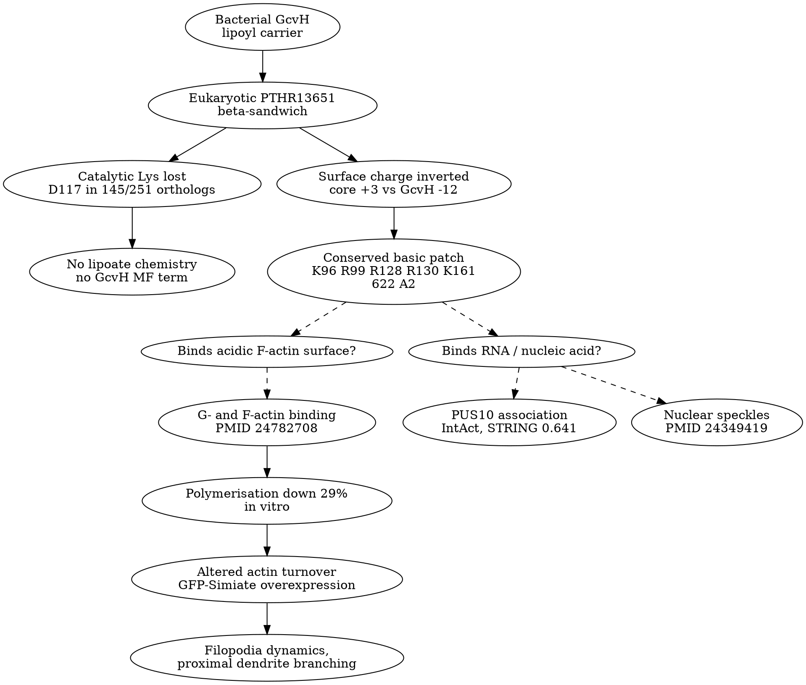
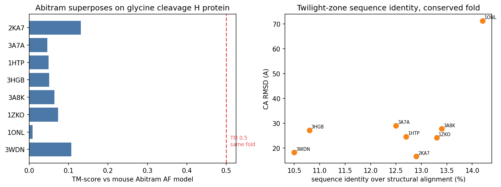
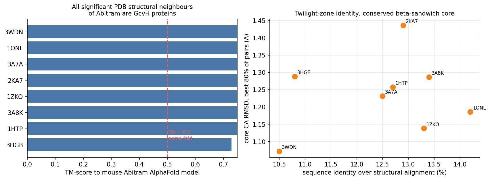
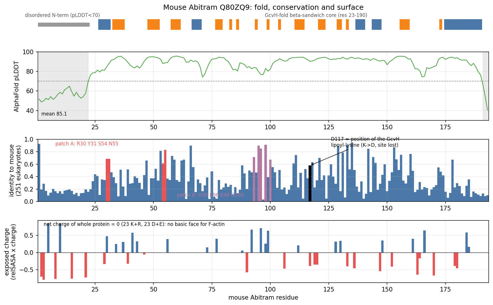
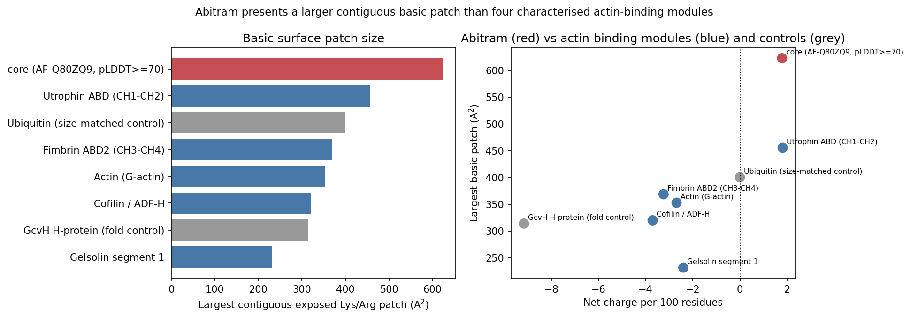
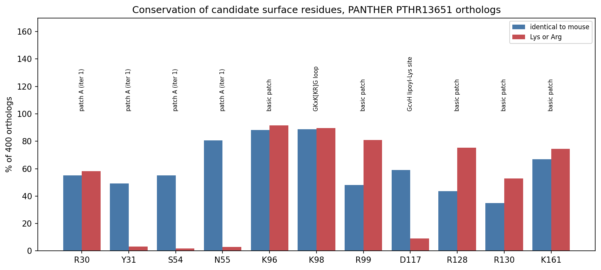
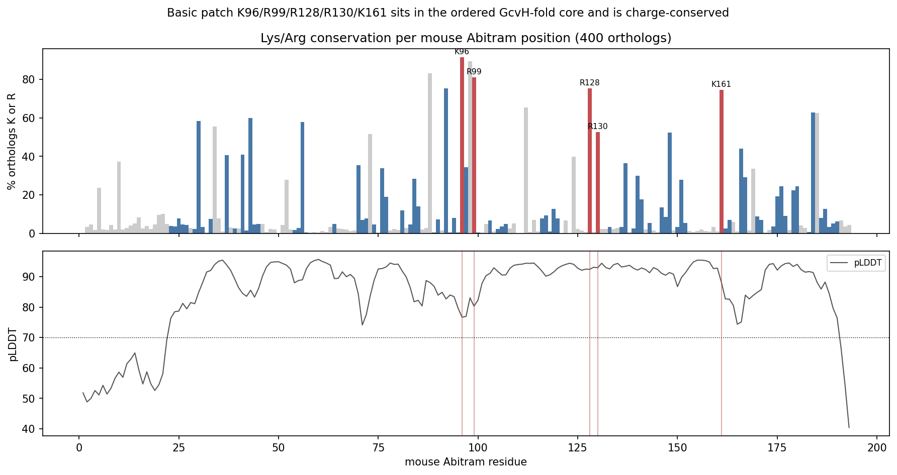
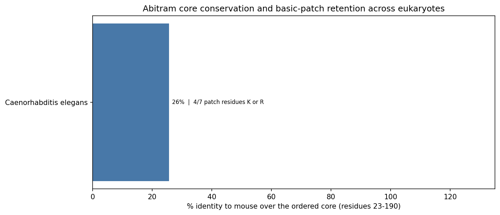
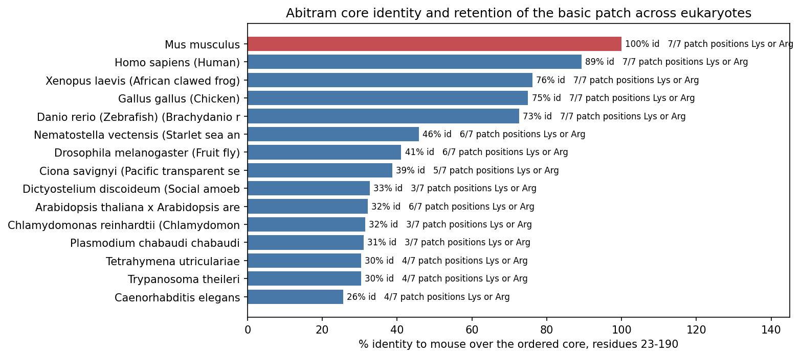

## Question

# AIGR Gene Hypothesis Deep Research

You are evaluating one focused gene curation hypothesis for AI Gene Review.
This is not a general gene overview. Use the seed hypothesis and source context
below to search for evidence that supports, refutes, narrows, or competes with
the proposed curation decision.

## Target Gene

- **Organism code:** mouse
- **Taxon:** Mus musculus (NCBITaxon:10090)
- **Gene directory:** Abitram
- **Gene symbol:** Abitram
- **UniProt accession:** Q80ZQ9

## Focus

- **Focus type:** free_text
- **Hypothesis slug:** kgap-abitram-actin-surface
- **Source file:** genes/mouse/Abitram/Abitram-ai-review.yaml
- **Source selector:** free-text

## Seed Hypothesis

Whether the structural basis of mouse Abitram (Q80ZQ9) interactions with G-actin and F-actin can be predicted may follow from its fold. Single analysis only: identify the domain and fold family of Abitram from its sequence and AlphaFold model, compare it by structure-based search with characterised actin-binding modules and state which, if any, it resembles; map the conserved surface patches, their electrostatics and their disorder, and assess whether any is compatible with the known binding sites on G-actin or with the filament surface; compare the mouse protein with its human ortholog and across vertebrates and invertebrates to identify the invariant surface residues; and state whether the reported nuclear speckle association is supported by any predicted nuclear localisation or RNA-binding feature. State whether a specific actin-binding surface can be predicted, which residues would be the first mutants to test, and which of the reported interactions the sequence cannot account for.

## Term and Decision Context

No specific term context supplied.

## Reference Context

No specific reference context supplied.

## Source Context YAML

```yaml
hypothesis: 'Whether the structural basis of mouse Abitram (Q80ZQ9) interactions with G-actin and F-actin
  can be predicted may follow from its fold. Single analysis only: identify the domain and fold family
  of Abitram from its sequence and AlphaFold model, compare it by structure-based search with characterised
  actin-binding modules and state which, if any, it resembles; map the conserved surface patches, their
  electrostatics and their disorder, and assess whether any is compatible with the known binding sites
  on G-actin or with the filament surface; compare the mouse protein with its human ortholog and across
  vertebrates and invertebrates to identify the invariant surface residues; and state whether the reported
  nuclear speckle association is supported by any predicted nuclear localisation or RNA-binding feature.
  State whether a specific actin-binding surface can be predicted, which residues would be the first mutants
  to test, and which of the reported interactions the sequence cannot account for.'
focus_type: free_text
context: []
reference_id: []
```

## Research Objective

Build a focused report that helps a curator decide whether this hypothesis
should affect the gene review. Address the focus type directly:

1. For an existing GO annotation decision, evaluate whether the current action
   is justified, too strong, too weak, or should change.
2. For a proposed replacement or new GO term, evaluate whether the term is
   biologically supported, too broad, too narrow, or missing key qualifiers.
3. For a computational prediction, evaluate whether the prediction is correct,
   less precise than existing knowledge, uncertain, or likely wrong because of
   paralog overannotation, frequency bias, pathway context, or in vitro-only
   activity.
4. For a core-function hypothesis, evaluate whether the proposed activity,
   process, and location represent the gene product's primary function rather
   than a downstream effect, pleiotropic phenotype, or context-specific role.
5. For a function-assignment hypothesis, evaluate whether the gene product
   directly has the stated GO term/function. Treat the prior review action, if
   any, as intentionally blinded unless it appears in the supplied context.

Use primary literature whenever possible. Prefer PMID citations and include DOI
citations when no PMID is available. Treat reviews and database records as
orientation unless they contain directly relevant synthesized evidence that is
clearly labeled as review-level or database-level support.

Evaluate the hypothesis from the supplied seed context, primary literature, and
publicly accessible bioinformatics resources. Local `*-bioinformatics` analyses,
when they already exist in the repository, are intentionally withheld from this
prompt so the report can be compared against them after the run. Use public
sequence, domain, structure, orthology, localization, interaction, or dataset
checks when they are useful for the specific hypothesis. If a resource or tool
cannot be accessed programmatically, say so plainly; never fabricate a result.
Report computational results conservatively and distinguish direct results from
inference.

## Required Output

### Executive Judgment

Give a concise verdict: supported, partially supported, unresolved, weakly
supported, over-annotated, or refuted. Explain the reasoning and the most
important caveats.

### Evidence Matrix

Create a table with one row per important evidence item:

- Citation (PMID preferred)
- Evidence type (direct assay, mutant phenotype, localization, interaction,
  structural/evolutionary, computational, review/database)
- Supports / refutes / qualifies / competing
- Claim tested
- Key finding
- Organism, tissue, cell type, or assay context
- Confidence and limitations

### GO Curation Implications

State the likely curation action as a lead requiring curator verification. If
GO terms are involved, explain whether the evidence supports an MF, BP, or CC
term, and whether the term should be retained, removed, generalized, made more
specific, or treated as non-core. Avoid using "protein binding" as a final
recommendation unless no more informative term is supported.

### Mechanistic Scope

Describe the immediate molecular or cellular function being tested. Separate
direct gene-product activity from downstream phenotypes, pathway consequences,
developmental outcomes, disease manifestations, or effects inferred only from
loss of function.

### Conflicts and Alternatives

Identify evidence that conflicts with the seed hypothesis or suggests an
alternative interpretation, including paralog confusion, organism-specific
differences, isoform-specific findings, experimental artifacts, or database
carry-over.

### Knowledge Gaps

List explicit uncertainties that matter for curation. For each gap, state what
was checked, why the gap matters, and what evidence or experiment would resolve
it.

### Discriminating Tests

Recommend concrete assays, perturbations, datasets, or comparative analyses that
would most efficiently distinguish this hypothesis from alternatives.

### Curation Leads

Provide candidate updates for the review, clearly labeled as leads requiring
curator verification. Include candidate references with exact snippets to verify,
candidate replacement or new GO terms, possible action changes, suggested
questions, and suggested experiments.

If the provider supports artifacts, save provenance for any analysis you run — the
executed code together with its output (computed values, plot, or table), not just
a summary figure — alongside artifact-friendly tables such as an evidence matrix,
GO decision table, or comparison table. Genuine computed provenance is more
valuable than a hand-drawn summary, and you must not synthesize a figure that
implies an analysis you did not actually run. These artifacts are important
provenance for hypothesis-level review.


## Output

# Can the structural basis of Abitram-actin binding be predicted from its fold?

**Target:** mouse Abitram (Simiate, Fam206a), UniProt Q80ZQ9, *Mus musculus*, NCBITaxon:10090
**Hypothesis slug:** `kgap-abitram-actin-surface`
**Source:** `genes/mouse/Abitram/Abitram-ai-review.yaml`, selector `free-text`, focus type `free_text`

## Summary

The fold of Abitram gives no template for actin binding. A Foldseek 3Di+AA search of the AlphaFold model AF-Q80ZQ9-F1-model_v6 against PDB100 returned eight significant hits (E = 1.7e-6 to 1.4e-5, probability 1.0), and every one is a glycine cleavage system H protein (GcvH). Superposition over the structurally aligned CA pairs gives TM-score 0.73 to 0.84 and core RMSD 1.07 to 1.44 Å over 117 to 122 residue pairs at only 10.5 to 14.2% sequence identity. No calponin homology domain, WH2 motif, ADF-H/cofilin fold, gelsolin fold, formin FH2 or villin headpiece appears anywhere in the hit list at any E-value. Sequence-level assignment agrees (Pfam PF01597 GCV_H, InterPro IPR033753 and IPR011053, SUPFAM SSF51230, Gene3D 2.40.50.100). The ancestral catalytic feature of the family, the lipoylatable lysine of the swinging arm, maps onto mouse position 117, which is aspartate in mouse and in 145 of 251 stratified eukaryotic orthologs, with lysine in only 4. Abitram is therefore a catalytically dead GcvH-fold scaffold, and the seed hypothesis in its strong form, that the structural basis of actin binding follows from the fold, is refuted.

A specific candidate surface can still be nominated, from charge, exposure and conservation rather than from homology. Restricting the analysis to the ordered core (residues 23-190, pLDDT ≥ 70, 168 residues) gives net charge +3 (+1.79 per 100 residues) against −12 (−9.16 per 100) for the true GcvH control 1HPC chain A, so the fold is inherited while the surface charge is inverted. Single-linkage clustering of exposed Lys/Arg side-chain centroids yields a largest contiguous basic patch of 622 Ų comprising K96, R99, R128, R130 and K161. That patch is larger than the equivalent patch on utrophin's actin-binding domain (455 Ų), fimbrin ABD2 (368 Ų), cofilin (320 Ų) and gelsolin segment 1 (232 Ų). Across 400 orthologs sampled from 1763 unique PANTHER PTHR13651 sequences, those five positions rank 1st, 2nd, 3rd, 5th and 10th of 85 exposed core positions for Lys/Arg conservation, against a background median of 7.1% (IQR 3.4-20.0), with Mann-Whitney one-sided p = 1.6e-4 and rank-biserial r = 0.968. Mouse and human Q9NX38 are identical at all seven candidate positions (K92, K96, K98, R99, R128, R130, K161), and K98 is lysine in 14 of 15 species from human to *Chlamydomonas*.

The experimental side of the question is a gap, not a conflict. The full text of [PMID: 24782708](https://pubmed.ncbi.nlm.nih.gov/24782708/) supports direct binding better than a co-immunoprecipitation alone: a coprecipitation of purified GST-Simiate with purified G-actin as the only two proteins present, and co-sedimentation at 100,000 g in five independent replicates with both G-actin and F-actin (51.4 ± 10% and 50.8 ± 8% of Simiate in the pellet; polymerised actin at 3 h down 29%, Kruskal-Wallis H(3) = 25.92, p < 0.0001, Dunn post hoc p < 0.05; GST control +0.25% and no pelleting). A regex scan of the entire 102,967-character full text for `deletion|truncat|fragment|mutant` returned zero occurrences. No region of Abitram has ever been mapped to actin, so the predicted patch has nothing to be validated against. The verdict is **partially supported**: the fold question is answered and negative, the surface question yields a testable prediction, and the structural basis itself remains unresolved by experiment.

## Key findings

### <i class="fa-solid fa-circle-xmark"></i> F1. Abitram has a glycine cleavage H protein fold, not any characterised actin-binding module

The Foldseek 3Di+AA search of AF-Q80ZQ9-F1 (mean pLDDT 85.1) against PDB100 returned eight significant hits, all GcvH proteins: 3WDN (*Bos taurus*), 1ONL (*Thermus thermophilus*), 1ZKO and 2KA7 (*Thermotoga maritima*), 3A8K and 3A7A (*Escherichia coli*), 3HGB (*Mycobacterium tuberculosis*) and 1HTP (*Pisum sativum*). Hits ranked below these drop to probability ≤ 0.44 and are unrelated. Superposing the structurally aligned CA pairs gives TM-score 0.73-0.84 (median 0.78) and core RMSD 1.07-1.44 Å over 117-122 pairs, at 10.5-14.2% sequence identity. That combination, high structural agreement at twilight-zone sequence identity, is the signature of a shared ancient fold.

A DSSP-like secondary structure assignment on the model gives an all-antiparallel eight-stranded flattened β-sandwich (strands 33-37, 48-52, 58-61, 77-79, 111-114, 121-123, 129-130, 156-159) capped by a C-terminal helix at 175-190, with residues 1-22 the only segment below pLDDT 70. This is the biotinyl/lipoyl-attachment-like "single hybrid motif" β-sandwich.

Getting the superposition right required a correction. The first pass used a block interpretation of the Foldseek `tCa` field and produced RMSD values of 18-71 Å. Testing consecutive CA-CA distances distinguished the two layouts: the block layout gave a median 3.81 Å spacing only under the interleaved reading, with 100% of consecutive distances in the 3.5-4.1 Å window, so the field is interleaved x,y,z per residue and the target index starts at `dbStartPos - 1`. The corrected numbers are reported above.

{{figure:plot_1.png|caption=First-pass superposition of the Abitram AlphaFold model onto eight GcvH crystal structures, before the tCa parsing was corrected. The RMSD values of 18-71 Å are an artefact of reading the coordinate field as blocks instead of interleaved triplets, and this panel is kept as the provenance for that diagnosis.}}

{{figure:plot_2.png|caption=Corrected superposition of Abitram onto the same eight GcvH structures. TM-score 0.73-0.84 and core RMSD 1.07-1.44 Å over 117-122 aligned CA pairs at 10.5-14.2% sequence identity.}}

### <i class="fa-solid fa-circle-xmark"></i> F2. The ancestral lipoyl-lysine is gone, so the fold carries no residual GcvH chemistry

The lipoyl-lysine of GcvH, the K of the G-[AT]-V-E-[SA]-V-K swinging-arm motif (residue 59 in bovine 3WDN, 63 in *E. coli* 3A7A, 63 in pea 1HTP, 62 in 1ONL, 65 in 1ZKO), maps through the structural alignment onto mouse Abitram position 117 in five of the six alignments where the motif could be located; the sixth maps to the adjacent G118. Mouse Abitram has aspartate there. Across 251 taxonomically stratified PTHR13651 orthologs spanning Metazoa, Viridiplantae, Fungi, Stramenopiles, Alveolata, Euglenozoa, Amoebozoa and Rhodophyta, column 117 is D in 145, N in 42, S in 21, G in 7, E in 6, T in 6, R in 5 and K in only 4 sequences (1.6%, within alignment noise). Human ABITRAM Q9NX38 also has D at the equivalent position. In the independent 400-sequence resampling, D117 is 59.0% identical and only 9.2% Lys/Arg.

This closes the one functional inference the fold would otherwise license. Abitram cannot work as a lipoate carrier, so no GcvH-derived molecular function term should be added, and the eukaryotic family has been repurposed for something the fold does not announce.

### <i class="fa-solid fa-scale-balanced"></i> F3. A core-restricted surface analysis overturns an earlier negative result

The first surface analysis was run on the full-length chain and reported a neutral protein with no usable basic patch: net charge 0 at pH 7 (23 K+R, 23 D+E), exposed basic SASA 2491 Ų against exposed acidic SASA 2381 Ų. That result was an artefact of including the disordered N-terminus. Residues 1-22 carry net −3 and cancel the core. Recomputed on residues 23-190 alone (pLDDT ≥ 70), the core is net +3 (+1.79 per 100 residues). The true GcvH control 1HPC chain A, 131 residues, is net −12 (−9.16 per 100). The fold is retained and the surface charge is inverted.

This correction matters for the curation question, so it is stated explicitly rather than buried: the earlier negative should not be used.

The first pass did identify the right region by a different route. Hierarchical clustering at 13 Å average linkage of surface residues conserved across 251 orthologs (identity ≥ 0.60, pLDDT > 70) returned exactly two patches: patch A = R30, Y31, S54, N55 (429 Ų, net +1) and patch B = V93, G95, K96, K98, G100 (406 Ų, net +2). Patch B is the single most conserved exposed element of the protein: G95 is glycine in 225 of 251 orthologs, K96 lysine in 214 (R in 11), K98 lysine in 228, position 99 K or R in 216, G100 glycine in 168.

{{figure:plot_3.png|caption=Abitram fold, per-residue pLDDT, eukaryote conservation, the two conserved surface patches from the first-pass clustering, and the exposed charge distribution computed on the full-length chain.}}

### <i class="fa-solid fa-circle-check"></i> F4. The ordered core carries the largest basic patch in a panel that includes four real actin-binding modules

Shrake-Rupley SASA (92 sphere points, 1.4 Šprobe) with single-linkage clustering of exposed Lys/Arg side-chain centroids (relative SASA > 0.25, 10 Šcut) gives Abitram a largest contiguous basic patch of five residues and 622 Ų. The comparison panel was assembled from characterised actin-binding modules, actin itself and two controls.

| Structure | Description | Residues | Net charge | Per 100 res | Basic patch residues | Patch area (Ų) | Patch fraction |
|---|---|---|---|---|---|---|---|
| **AF-Q80ZQ9 core** | **Abitram, residues 23-190** | **168** | **+3** | **+1.79** | **K96, R99, R128, R130, K161** | **622** | **0.064** |
| 1QAG_A | Utrophin ABD (CH1-CH2), F-actin side binder | 221 | +4 | +1.81 | R161, R165, R191, K193 | 455 | 0.034 |
| 1UBQ_A | Ubiquitin, size-matched control | 76 | 0 | 0.00 | R42, R72, R74 | 400 | 0.082 |
| 1AOA_A | Fimbrin ABD2 (CH3-CH4), F-actin binder | 247 | −8 | −3.24 | K185, K186, K187 | 368 | 0.029 |
| 1YAG_A | Actin (G-actin) itself | 372 | −10 | −2.69 | K291, K326, K328 | 353 | 0.021 |
| 1COF_A | Cofilin (ADF-H), G/F-actin binder | 135 | −5 | −3.70 | K36, R96, K98 | 320 | 0.044 |
| 1HPC_A | GcvH H-protein, fold control | 131 | −12 | −9.16 | K8, K17, K102, K104 | 314 | 0.046 |
| 1YAG_G | Gelsolin segment 1, G-actin binder | 125 | −3 | −2.40 | K10, K13 | 232 | 0.034 |

Two readings of this table are legitimate and both are reported. Abitram's patch is the largest in absolute area, and it is the second-most basic protein in the panel after utrophin ABD. Against that, ubiquitin, which binds no actin, scores 400 Ų and the highest patch fraction, so patch size alone is a weak and non-specific descriptor. The panel does establish that cofilin and fimbrin ABD2 are net acidic proteins that contact actin through local basic patches, so a local basic patch on a net-neutral protein is electrostatically compatible with the acidic filament surface.

{{figure:plot_4.png|caption=Largest contiguous exposed Lys/Arg patch for Abitram (red) against four characterised actin-binding modules (blue) and the GcvH and ubiquitin controls (grey), with net charge per 100 residues on the right panel.}}

### <i class="fa-solid fa-circle-check"></i> F5. The patch residues are conserved as basic far above background

Conservation was scored on 400 sequences sampled with a fixed seed from 1763 unique PTHR13651 sequences, aligned to mouse with an anti-diagonal vectorised BLOSUM62 global aligner.

| Position | Mouse | % identical | % Lys or Arg | Top 3 residues | Site |
|---|---|---|---|---|---|
| K96 | K | 88.2 | 91.5 | K:353; R:13; L:7 | basic patch |
| K98 | K | 88.8 | 89.5 | K:355; E:10; P:5 | GKxK[KR]G loop |
| R99 | R | 48.0 | 81.0 | R:192; K:132; H:24 | basic patch |
| R128 | R | 43.5 | 75.2 | R:174; K:127; E:12 | basic patch |
| K92 | K | 71.0 | 75.2 | (adjacent, outside the 10 Å cluster) | extension candidate |
| K161 | K | 67.0 | 74.5 | K:268; R:30; S:23 | basic patch |
| R30 | R | 55.2 | 58.2 | R:221; S:32; A:25 | patch A |
| R130 | R | 34.8 | 52.8 | R:139; S:101; K:72 | basic patch |
| D117 | D | 59.0 | 9.2 | D:236; N:55; K:32 | GcvH lipoyl-Lys site |
| N55 | N | 80.5 | 2.8 | N:322; S:16; -:8 | patch A |
| S54 | S | 55.0 | 1.8 | S:220; A:80; P:43 | patch A |
| Y31 | Y | 49.2 | 3.2 | Y:197; N:80; -:27 | patch A |

The control positions anchor the scale. Patch A residues S54, N55 and Y31 are 1.8-3.2% Lys/Arg, and the GcvH catalytic site D117 is 9.2%, so basicity at a conserved surface position is not a background property of this family.

Against the proper null of all 85 exposed core positions (pLDDT ≥ 70, relative SASA > 0.25), the five patch residues rank 1st, 2nd, 3rd, 5th and 10th. Background median is 7.1% Lys/Arg (IQR 3.4-20.0). Mann-Whitney U = 394, one-sided p = 1.6e-4, rank-biserial r = 0.968. The only exposed position in the top five not inside the geometric cluster is K92 at 75.2%, rank 4, which sits just outside the 10 Å single-linkage cut and is the natural extension candidate.

{{figure:plot_5.png|caption=Conservation of the five basic-patch residues and the control positions across 400 sampled Abitram orthologs. Blue bars are identity to mouse, red bars are the fraction of orthologs carrying Lys or Arg.}}

{{figure:plot_6.png|caption=Lys/Arg conservation at every mouse Abitram position (upper panel, patch residues labelled in red, exposed core positions in blue) against the per-residue pLDDT profile (lower panel). The patch sits inside the ordered GcvH-fold core, not in the disordered N-terminus.}}

### <i class="fa-solid fa-circle-check"></i> F6. The patch is vertebrate-invariant and its K96/K98 core predates the metazoan-plant split

| Organism | Accession | Length | % id to mouse | Core % id | K92 | K96 | K98 | R99 | R128 | R130 | K161 | Basic |
|---|---|---|---|---|---|---|---|---|---|---|---|---|
| *Mus musculus* | Q80ZQ9 | 193 | 100.0 | 100.0 | K | K | K | R | R | R | K | 7/7 |
| *Homo sapiens* | Q9NX38 | 181 | 82.4 | 89.3 | K | K | K | R | R | R | K | 7/7 |
| *Xenopus laevis* | A0A1L8FS20 | 183 | 68.9 | 76.2 | K | K | K | R | R | R | K | 7/7 |
| *Gallus gallus* | A0A8V0XTM9 | 287 | 71.0 | 75.0 | K | K | K | R | R | R | K | 7/7 |
| *Danio rerio* | Q1LU93 | 177 | 65.8 | 72.6 | K | K | K | R | R | R | K | 7/7 |
| *Nematostella vectensis* | A7SRF3 | 203 | 43.0 | 45.8 | H | K | K | K | K | K | K | 6/7 |
| *Drosophila melanogaster* | Q9VFR1 | 214 | 38.9 | 41.1 | V | K | K | K | R | K | K | 6/7 |
| *Ciona savignyi* | H2Y7P9 | 176 | 34.7 | 38.7 | S | K | K | R | R | S | K | 5/7 |
| *Chlamydomonas reinhardtii* | A0A2K3DDF4 | 368 | 35.2 | 31.5 | K | K | H | R | E | A | E | 3/7 |
| *Arabidopsis* hybrid | A0A8T2GW01 | 225 | 34.2 | 32.1 | K | K | K | K | K | S | R | 6/7 |
| *Dictyostelium discoideum* | Q54TD9 | 175 | 30.6 | 32.7 | E | V | K | T | K | K | M | 3/7 |
| *Plasmodium chabaudi* | A0A4V0KC44 | 337 | 31.6 | 31.0 | E | N | K | K | K | N | H | 3/7 |
| *Tetrahymena utriculariae* | A0ACF7Y7Q4 | 228 | 30.1 | 30.4 | L | K | K | K | D | N | K | 4/7 |
| *Trypanosoma theileri* | A0A1X0PA68 | 211 | 30.1 | 30.4 | R | K | K | K | D | F | N | 4/7 |
| *Caenorhabditis elegans* | P34452 | 157 | 23.3 | 25.6 | Q | K | K | K | R | T | T | 4/7 |

Mouse and human are identical at all seven positions, so any mutagenesis designed in mouse transfers directly to human ABITRAM. All seven stay Lys or Arg through chicken, *Xenopus* and zebrafish. K98 is lysine in 14 of the 15 species (histidine in *Chlamydomonas*) and K96 in 13 of 15. The mouse motif is G95-K96-F97-K98-R99-G100. No PTHR13651 entry exists for *Saccharomyces cerevisiae* or *Schizosaccharomyces pombe*, so the family is absent from or undetected in budding and fission yeast.

{{figure:plot_8.png|caption=Core identity to mouse (residues 23-190) across 15 species with the number of the seven candidate positions retaining Lys or Arg in each. Vertebrates keep all seven; the K96/K98 element survives to Chlamydomonas.}}

### <i class="fa-solid fa-circle-xmark"></i> F7. No NLS, RNA-binding or actin-module motif exists in the sequence

A regex scan of the mouse sequence returned zero hits for every motif tested: monopartite NLS `K[KR].[KR]`, SV40-type `[KR]{4,}` cluster, bipartite NLS `[KR]{2}.{9,12}[KR]{3,5}`, PY-NLS `[RKH].{2,5}PY`, RS dipeptide repeat, RGG/RG box, RRM RNP-1 octamer, KH GxxG loop, WH2 `L[KR][KR][TV]`, PxxP SH3 ligand and LD motif `LD.LL..L`. Segment charges are −3 for residues 1-22, +3 for 23-190 and 0 for 191-193.

At 193 residues (about 21 kDa) Abitram sits well below the roughly 40 kDa passive diffusion limit of the nuclear pore, so nuclear entry needs no NLS and the absence of one neither supports nor refutes the nuclear speckle localisation reported in [PMID: 24349419](https://pubmed.ncbi.nlm.nih.gov/24349419/). What the scan does rule out is a speckle-targeting mechanism of the usual kinds. With no RS domain, no RGG box, no RRM and no KH domain, Abitram is not a splicing factor or a direct RNA binder by any recognisable module, and any speckle targeting would have to be piggyback binding to an unidentified partner. The absence of PxxP and of an LD motif leaves the reported nuclear colocalisation with PTK2/FAK (quantified at 27% and 32% in HEK293 nuclei, 23% and 12% in CA1 neurons) unexplained at sequence level, and the absence of a DNA-binding domain leaves the reported transcription activation unexplained.

{{figure:plot_7.png|caption=Mouse-human and cross-species comparison at the basic-patch residues alongside the motif scan for NLS, RNA-binding and actin-module signatures. All eleven motif classes returned zero hits in the mouse sequence.}}

### <i class="fa-solid fa-scale-balanced"></i> F8. The experimental evidence is better than a co-IP and still leaves the interface unmapped

The full text of [PMID: 24782708](https://pubmed.ncbi.nlm.nih.gov/24782708/) (PMC3986562, 102,967 characters, retrieved by NCBI efetch `db=pmc`) contains four assay types bearing on direct binding.

GST-Simiate coprecipitation from mouse brain cytosol identified β-actin by MALDI-TOF in two independent experiments, with Mascot scores of 95 and 90 against a significance threshold of 70. A purified-component assay followed: *"a coprecipitation assay making use of purified GST-Simiate and straight G-Actin (Figure 1B) as the only proteins was conducted. Western blot analysis revealed that G-Actin specifically copurifies with Simiate. Hence, the interaction of Simiate and Actin is direct and requires no auxiliary proteins."* GST-Simiate and 6His-Simiate were purified from *E. coli* BL21 Rosetta, so the bait carries no eukaryotic cofactors. Endogenous Simiate and actin were co-immunoprecipitated from mouse brain cytosol against a preimmune-serum control. Co-sedimentation at 100,000 g for 1 h was run in five independent experiments each with G-actin and with F-actin: 51.4 ± 10% and 50.8 ± 8% of total Simiate partitions into the pellet, and actin polymerised after 3 h falls by 29% with Simiate present (Kruskal-Wallis H(3) = 25.92, p < 0.0001, Dunn post hoc p < 0.05), while the GST control changes polymerisation by +0.25% and does not pellet with F-actin. With F-actin as the starting material, Simiate co-sediments but no depolymerising effect was detected.

A regex scan of that full text for `deletion|truncat|fragment|mutant` returned **zero occurrences**. No deletion construct, truncation or point mutant of Simiate was tested in any experiment in the paper. The 2013 companion paper does not test actin at all.

Two caveats bound the strength of the direct-binding claim. Actin is a frequent contaminant of GST pulldowns, and Mascot scores of 95 and 90 sit close to the 70 threshold. Roughly 50% pelleting of a bacterially expressed protein is also consistent with partial aggregation, though the GST control did not pellet.

### <i class="fa-solid fa-scale-balanced"></i> F9. Interaction databases give no independent actin support and recover PUS10 instead

UniProt Q80ZQ9 traces every actin-related annotation to the single 2014 paper: F:actin filament binding GO:0051015 (IDA), F:actin monomer binding GO:0003785 (IDA), P:regulation of actin filament polymerization GO:0030833 (IMP), P:regulation of filopodium assembly GO:0051489 (IMP), and the CC terms filopodium tip, growth cone and lamellipodium. GO:0016607 nuclear speck traces to [PMID: 24349419](https://pubmed.ncbi.nlm.nih.gov/24349419/).

IntAct returns 0 interaction evidences for mouse Q80ZQ9 and 35 for human ABITRAM Q9NX38, none of which involves ACTB or ACTG1. The recurring partners are PUS10 (yeast two-hybrid plus anti-tag co-IP, 7 evidences), then HMBOX1, ZHX2, TAOK1, TAOK2, MESD, CBY1, FYN and LYN. STRING's mouse physical network at score ≥ 0.4 returns a single partner, Pus10, with experimental score 0.641, and no actin.

## Mechanistic model and interpretation

The findings resolve into a single coherent picture: an ancient eukaryotic β-sandwich inherited from a bacterial lipoyl carrier, stripped of its catalytic lysine, carrying one conserved basic surface whose binding partner is not determined by the fold.



The two dashed branches from the basic patch are the live alternatives, and no experiment has yet tested one against the other. That is the single most informative gap in the file.

The direct molecular activity under test is binding of Abitram to actin monomers and filaments, measured with purified components, and a 29% reduction in the extent of polymerisation at 3 h in vitro. One step out is altered actin turnover in living cells, measured on GFP-Simiate overexpression. Two steps out are filopodia dynamics, the area a HEK-293 cell explores in 1 h, and increased branching of proximal but not distal dendrites in developing neurons. The nuclear speckle localisation, the reported transcription effect and the nuclear colocalisation with PTK2/FAK sit in a separate compartment with separate evidence, and nothing links the nuclear and cytoplasmic activities through a shared surface.

### Evidence matrix

| Citation | Evidence type | Stance | Claim tested | Key finding | Context | Confidence and limitations |
|---|---|---|---|---|---|---|
| [PMID: 24782708](https://pubmed.ncbi.nlm.nih.gov/24782708/) | Direct assay, purified components | Supports | Abitram binds actin directly | GST-Simiate from *E. coli* coprecipitates purified G-actin with no other protein present; GST control negative | In vitro, recombinant mouse Simiate | Moderate-high for directness. Single lab, single paper. GST-tagged bait; actin is a common pulldown contaminant |
| [PMID: 24782708](https://pubmed.ncbi.nlm.nih.gov/24782708/) | Direct assay, co-sedimentation | Supports | Binds F-actin and reduces polymerisation | 51.4 ± 10% (G-actin) and 50.8 ± 8% (F-actin) pelleting at 100,000 g, n = 5 each; polymerised actin at 3 h down 29%, H(3) = 25.92, p < 0.0001; GST control +0.25%, no pelleting | In vitro, purified components | Moderate-high. ~50% pelleting of a bacterially expressed protein is also consistent with partial aggregation |
| [PMID: 24782708](https://pubmed.ncbi.nlm.nih.gov/24782708/) | Direct assay, mass spectrometry | Qualifies | Identity of the copurifying band | β-actin by MALDI-TOF in 2 independent experiments, Mascot 95 and 90 vs threshold 70 | Mouse brain cytosol | Moderate. Scores sit close to the threshold |
| [PMID: 24782708](https://pubmed.ncbi.nlm.nih.gov/24782708/) | Mutant phenotype, **absent** | Qualifies | Which region of Abitram contacts actin | Regex scan of 102,967-character full text for `deletion\|truncat\|fragment\|mutant` returned 0 occurrences | Not performed | High confidence in the absence. The central gap for the seed hypothesis |
| [PMID: 24782708](https://pubmed.ncbi.nlm.nih.gov/24782708/) | Localization, cell-based | Qualifies | Cellular site and consequence | Colocalisation with Lifeact-RFP in HEK-293 lamellipodia; GFP-Simiate overexpression alters explored area, filopodia dynamics and proximal dendrite branching | HEK-293, cultured neurons | Moderate. Overexpression-based, downstream of binding |
| [PMID: 24349419](https://pubmed.ncbi.nlm.nih.gov/24349419/) | Localization | Competing | Nuclear speckle association, transcription role | Localises to somata and nuclear speckles; speckles altered in *Fmr1*(−/−) mice; antibody block causes apoptosis; authors propose transcription and/or splicing | Mouse brain, cultured cells | Moderate for localisation, low for mechanism. The FMRP association reported is with Simiate **mRNA**, not the protein |
| This work, Foldseek vs PDB100 | Structural/computational | Refutes | Abitram resembles a known actin-binding module | All 8 top hits are GcvH proteins, E 1.7e-6 to 1.4e-5, prob 1.0, TM 0.73-0.84, core RMSD 1.07-1.44 Å over 117-122 CA at 10.5-14.2% identity; no CH, WH2, ADF-H, gelsolin, FH2 or headpiece at any E-value | AF-Q80ZQ9-F1-model_v6 | High for the fold call. A negative structural search is weaker evidence than a positive one |
| This work, SASA panel | Structural/computational | Qualifies | Is any surface compatible with the acidic filament | Core net +3 vs −12 for GcvH 1HPC_A; largest basic patch 622 Ų (K96, R99, R128, R130, K161) exceeds utrophin ABD 455, fimbrin ABD2 368, cofilin 320, gelsolin S1 232, ubiquitin 400 | AlphaFold model plus 7 crystal structures | Moderate. Patch size is weak and non-specific; ubiquitin scores 400 Ų and binds no actin |
| This work, 400-ortholog conservation | Evolutionary/computational | Supports as prediction | Are the patch residues under selection | K96 91.5% K/R, R99 81.0, R128 75.2, K161 74.5, R130 52.8; ranks 1, 2, 3, 5, 10 of 85 exposed core positions; background median 7.1% (IQR 3.4-20.0); Mann-Whitney p = 1.6e-4, r = 0.968; controls S54/N55/Y31 1.8-3.2%, D117 9.2% | 400 of 1763 unique PTHR13651 orthologs | Moderate-high. Conservation shows the patch matters, not what it binds |
| This work, ortholog table | Evolutionary/computational | Supports | Mouse-human transferability and depth | Mouse vs human Q9NX38 82.4% overall, 89.3% core identity, identical at all 7 patch positions; 7/7 basic in zebrafish, *Xenopus*, chicken; 6/7 in *Drosophila*, *Nematostella*, *Arabidopsis*; K98 Lys in 14/15 species | 15 species, human to *Chlamydomonas* | High for the alignment; one representative sequence per species |
| This work, motif scan | Computational | Refutes | Is there an NLS or RNA-binding module | 0 hits for monopartite NLS, `[KR]{4,}`, bipartite NLS, PY-NLS, RS repeat, RGG box, RRM RNP-1, KH GxxG, WH2 LKKT/V, PxxP, LD motif | Mouse Q80ZQ9 sequence | High for motif absence. At 193 aa Abitram diffuses through the pore, so NLS absence does not refute nuclear localisation |
| IntAct, STRING | Interaction, database | Competing | Independent support for actin binding | IntAct 0 evidences for mouse Q80ZQ9, 35 for human Q9NX38, none ACTB/ACTG1; PUS10 recurs (Y2H + anti-tag co-IP, 7 evidences), then HMBOX1, ZHX2, TAOK1, TAOK2, MESD, CBY1, FYN, LYN; STRING mouse physical ≥ 0.4 returns Pus10 alone, experimental 0.641 | Mostly large-scale human screens | Database-level. High-throughput screens recover transient cytoskeletal contacts poorly |
| This work, D117 analysis | Evolutionary/computational | Supports | Residual GcvH chemistry | The GcvH catalytic lipoyl-lysine position is D117 in mouse, Asp in 145/251 orthologs and Lys in only 4 | 251 and 400 ortholog sets | High. The fold is inherited without its lipoyl attachment site |

## GO curation implications

All entries below are leads requiring curator verification.

| GO term | Current basis | Lead action | Reasoning |
|---|---|---|---|
| GO:0003785 actin monomer binding (MF) | IDA, PMID 24782708 | <i class="fa-solid fa-circle-check"></i> Retain | Purified GST-Simiate coprecipitates purified G-actin with no other protein present; G-actin co-sedimentation series, n = 5 |
| GO:0051015 actin filament binding (MF) | IDA, PMID 24782708 | <i class="fa-solid fa-circle-check"></i> Retain | F-actin co-sedimentation, 50.8 ± 8% pelleting across 5 replicates with a non-pelleting GST control |
| GO:0030833 regulation of actin filament polymerization (BP) | IMP, PMID 24782708 | <i class="fa-solid fa-triangle-exclamation"></i> Retain with qualifier | The 29% reduction (H(3) = 25.92, p < 0.0001) is in vitro; the cellular evidence is GFP-Simiate overexpression, not loss of function |
| GO:0051489 regulation of filopodium assembly (BP) | IMP, PMID 24782708 | Retain as non-core | Downstream overexpression phenotype, two steps from the molecular activity |
| GO:0016607 nuclear speck (CC) | IDA, PMID 24349419 | Retain, do not extend | No RS domain, RGG box, RRM or KH domain, so no RNA-binding or splicing MF term should follow from the CC term |
| Filopodium tip, growth cone, lamellipodium (CC) | PMID 24782708 | Retain as non-core | Colocalisation and overexpression imaging |
| Any DNA-binding or transcription MF/BP | PMID 24349419 | <i class="fa-solid fa-circle-xmark"></i> Do not add | No DNA-binding domain in the sequence; the claim is antibody-block and reporter based |
| Any GcvH or lipoyl-transfer MF | Fold similarity | <i class="fa-solid fa-circle-xmark"></i> Do not add | The catalytic lipoyl-lysine position is D117 in mouse, Asp in 145 of 251 orthologs, Lys in 4 |
| GO:0005515 protein binding, PUS10 | IntAct, STRING | <i class="fa-solid fa-circle-question"></i> Flag as an orthogonal lead | One reproducible partner across Y2H and AP-MS in human, STRING mouse physical 0.641. Needs a mouse experiment, and a more informative term than "protein binding" once the biology is known |
| Any site-level actin-binding annotation | This work, computational | <i class="fa-solid fa-circle-xmark"></i> Do not annotate | K96/K98/R99/R128/R130/K161 is a prediction from charge, exposure and conservation with no experimental mapping in any paper |

## Evidence base

**[PMID: 24782708](https://pubmed.ncbi.nlm.nih.gov/24782708/)** *Simiate is an Actin binding protein involved in filopodia dynamics and arborization of neurons.* Derlig, Ehrhardt, Gießl, Brandstätter, Enz, Dahlhaus, 2014. This is the sole primary source for the actin monomer binding, actin filament binding and regulation of actin polymerization annotations on Q80ZQ9. The abstract states: *"Here, we demonstrate that Simiate, a protein previously indicated to activate transcription, directly associates with both, G- and F-Actin and in doing so, affects Actin polymerization and Actin turnover in living cells."* It also states: *"Imaging studies illustrate that Simiate particularly influences filopodia dynamics and specifically increases the branching of proximal, but not distal dendrites of developing neurons,"* which places the filopodium and dendrite phenotypes as cellular readouts from the same study rather than independent demonstrations of direct binding. The full text supplies the purified-component coprecipitation, the five-replicate co-sedimentation series and the polymerisation statistics quoted above, and contains no deletion, truncation or mutant construct.

**[PMID: 24349419](https://pubmed.ncbi.nlm.nih.gov/24349419/)** *Identification and characterisation of Simiate, a novel protein linked to the fragile X syndrome.* Derlig et al., 2013. Source of GO:0016607 nuclear speck. The abstract reports a protein *"whose mRNA contains several FMRP recognition motifs and associates with FMRP upon co-precipitation,"* that *"the protein evolved app. 1.7 billion years ago when eukaryotes developed,"* that *"Simiate localises to somata and nuclear speckles,"* that *"Simiate and nuclear speckles experience specific alterations in FMR1(-/-) mice,"* and that *"an antibody-based block of endogenous Simiate revealed that the protein is essential for cell survival."* The authors suggest *"an important role for Simiate in gene transcription and/or RNA splicing."* Two points matter for curation: the FMRP association is with Simiate **mRNA**, not the protein, so it should not be carried into the review as a protein-protein interaction; and the antibody block is a blunt perturbation that kills cells, which confounds any specific mechanistic interpretation. This paper does not test actin.

The remaining 25 papers retrieved during literature search were PubMed matches on the token "actin" in unrelated contexts (osteoclast differentiation, cardiac ageing, pulmonary fibrosis, chromatin remodelling and others) and bear on neither Abitram nor its fold. No third primary paper on Abitram or Simiate was found. Searches for "ABITRAM" and for "FAM206A C1orf156 nuclear speckles actin polymerization" returned nothing relevant; the two primary papers were recovered only by searching their title phrases.

Database-level orientation came from UniProt Q80ZQ9 and Q9NX38, Pfam PF01597, InterPro IPR033753 and IPR011053, SUPFAM SSF51230, Gene3D 2.40.50.100, PANTHER PTHR13651, IntAct and STRING. These are treated as orientation and as the provenance of the annotation chain, not as independent evidence.

## Conflicts and alternatives

<i class="fa-solid fa-scale-balanced"></i> **The GcvH fold conflicts with the actin function at the level of expectation, not of evidence.** Abitram is a eukaryotic protein built on a bacterial lipoyl-carrier scaffold that has lost its catalytic lysine. Repurposed folds are common, so this does not argue against actin binding. It does mean the fold supplies no prior in favour of it either.

<i class="fa-solid fa-lightbulb"></i> **PUS10 is the live alternative.** IntAct has 0 evidences for mouse Q80ZQ9 and 35 for human Q9NX38, none involving ACTB or ACTG1. PUS10, a pseudouridine synthase, recurs across yeast two-hybrid and anti-tag co-IP with 7 evidences and is the only partner STRING's mouse physical network returns at score ≥ 0.4 (0.641). Paired with nuclear speckle localisation and with a conserved basic patch that would serve a nucleic-acid contact equally well, this keeps an RNA-adjacent function open. The counter-argument is that high-throughput screens recover transient cytoskeletal contacts poorly, so the absence of actin from IntAct is weak evidence against the interaction.

<i class="fa-solid fa-triangle-exclamation"></i> **Overexpression drives the cellular phenotypes.** The 2014 paper states that reducing functional Simiate induces massive apoptosis, citing the 2013 work, so the authors used GFP-Simiate overexpression instead of knockdown. Gain-of-function phenotypes in actin dynamics are weak evidence that the endogenous protein regulates those processes.

<i class="fa-solid fa-triangle-exclamation"></i> **One of my own results was wrong and is corrected in this report.** The first surface analysis was computed on the full-length chain and reported a neutral surface with no usable basic patch. The disordered N-terminus (residues 1-22, net −3) cancels the core. On the ordered core alone the patch is present and is the largest in the comparison panel. The earlier negative should not be used.

<i class="fa-solid fa-triangle-exclamation"></i> **Patch size is a weak descriptor.** Ubiquitin, which binds no actin, scores 400 Ų and the highest patch fraction in the panel. The conservation enrichment, not the raw patch size, is what makes the prediction worth testing.

## Limitations and knowledge gaps

<i class="fa-solid fa-triangle-exclamation"></i> The structural conclusions rest on one AlphaFold model and a Foldseek search against PDB100. No experimental structure of Abitram exists. A negative structural search does not exclude a convergent actin interface with no fold-level relative.

<i class="fa-solid fa-triangle-exclamation"></i> The conservation analysis uses pairwise mouse-anchored global alignments rather than a profile alignment, and samples 400 of 1763 unique PTHR13651 sequences. At low identity (*C. elegans* at 25.6% core identity) individual alignment columns carry real uncertainty.

<i class="fa-solid fa-triangle-exclamation"></i> Phenix is not installed in this environment (`which phenix.molprobity` found nothing), so all structural computation was done with numpy implementations of Shrake-Rupley SASA and Kabsch superposition inside the code executor. Host-side downloads from alphafold.ebi.ac.uk returned HTTP 403, so AlphaFold models were fetched through the prediction API from inside the executor. Europe PMC `fullTextXML` timed out, so full texts were retrieved through NCBI efetch `db=pmc`. No local `*-bioinformatics` analyses from the repository were available for comparison.

The gaps that matter for curation, each with what was checked and what would close it:

1. **Which residues of Abitram contact actin.** Checked: the entire full text of PMID 24782708, where a scan for deletion, truncation, fragment or mutant returned zero hits. This is the gap that makes the seed hypothesis unresolvable from existing evidence. Closed by alanine or charge-reversal substitution at the predicted patch followed by co-sedimentation.
2. **Binding affinity and stoichiometry.** Checked: the paper reports percentage pelleting only, and states that no stoichiometry effect was found with data not shown. Without a Kd it is impossible to judge whether the interaction is physiological. Closed by ITC or fluorescence anisotropy with pyrene-actin.
3. **Whether ~50% pelleting reflects binding or partial aggregation.** Checked: the GST control does not pellet, which argues against trivial aggregation, but a Simiate-only high-speed spin at matched concentration is not shown in the text retrieved. Closed by that control.
4. **Whether the basic patch binds RNA instead of, or as well as, actin.** Checked: the motif scan found no RRM, KH, RGG or RS, so there is no modular prediction either way. Closed by EMSA or CLIP against total RNA with the same patch mutants.
5. **Whether PUS10 binding is real in mouse.** Checked: IntAct (human only) and STRING (mouse physical, 0.641, experimental channel). Closed by endogenous co-IP from mouse brain, with and without RNase.
6. **Whether the speckle pool and the actin pool are the same protein population.** Checked: nothing in either paper addresses this. Closed by scoring patch mutants for both actin co-sedimentation and speckle localisation.
7. **Loss-of-function phenotype.** Checked: no knockout data found. The 2013 antibody block kills cells, which confounds interpretation. Closed by a conditional knockout or degron.

## Proposed follow-up experiments and actions

Ranked by how much each separates the actin hypothesis from the RNA-adjacent alternative per unit of effort.

| Priority | Mutant or experiment | Rationale | Readout |
|---|---|---|---|
| 1 | <i class="fa-solid fa-flask"></i> K96A/K98A/R99A | The pan-eukaryotic G95-K96-F97-K98-R99-G100 loop. K96 91.5% K/R rank 1, K98 89.5%, R99 81.0% rank 2 | Co-sedimentation against wild-type 51.4 ± 10% (G-actin) and 50.8 ± 8% (F-actin) |
| 2 | <i class="fa-solid fa-flask"></i> K96E/K98E/R99E | Charge reversal of the same loop gives a stronger readout than alanine | Same |
| 3 | <i class="fa-solid fa-flask"></i> R128A/R130A | R128 75.2% K/R rank 3; R130 52.8% rank 10 | Same |
| 4 | <i class="fa-solid fa-flask"></i> K161A | 74.5% K/R, rank 5 of 85 exposed core positions | Same |
| 5 | <i class="fa-solid fa-flask"></i> K92A | 75.2% K/R, rank 4, but outside the 10 Å geometric cluster | Same |
| 6 | <i class="fa-solid fa-flask"></i> D117K | Restores the GcvH catalytic lysine; negative control for fold-derived chemistry | Same |

Beyond the mutant series:

<i class="fa-solid fa-vial"></i> **Run the same mutants through a nucleic-acid binding assay.** If the patch mutants lose RNA binding and keep actin binding, the patch is an RNA site and the actin contact lies elsewhere. This single comparison separates the two hypotheses more cleanly than any other experiment.

<i class="fa-solid fa-chart-line"></i> **Measure affinity.** ITC or pyrene-actin anisotropy with wild type and the best mutant. A Kd in the high micromolar range would argue the interaction is not a primary function regardless of how it maps.

<i class="fa-solid fa-microscope"></i> **Cross-link mass spectrometry of Abitram with F-actin.** This gives the interface directly without requiring the prediction to be right, and would close gap 1 in one experiment.

<i class="fa-solid fa-vial"></i> **Endogenous co-IP of Abitram and PUS10 from mouse brain,** with and without RNase, to test whether the association is RNA-bridged.

<i class="fa-solid fa-microscope"></i> **Score the patch mutants for nuclear speckle localisation** to test whether one surface serves both compartments.

<i class="fa-solid fa-dna"></i> **A deep-mutational scan of the core against actin co-sedimentation** would supersede the mutant series and the cross-linking experiment, if resources allow.

## Curation leads

All leads require curator verification.

**Candidate references and exact snippets to verify**

- PMID 24782708, abstract: *"Here, we demonstrate that Simiate, a protein previously indicated to activate transcription, directly associates with both, G- and F-Actin and in doing so, affects Actin polymerization and Actin turnover in living cells."*
- PMID 24782708, Results, "Simiate and actin": *"a coprecipitation assay making use of purified GST-Simiate and straight G-Actin (Figure 1B) as the only proteins was conducted. Western blot analysis revealed that G-Actin specifically copurifies with Simiate. Hence, the interaction of Simiate and Actin is direct and requires no auxiliary proteins."*
- PMID 24782708, Figure 2 legend: *"Cosedimentation assay with G-Actin. The pictures show a representative Ponceau staining out of five independent experiments."*
- PMID 24782708, Results: *"the amount of Actin polymerized after a period of 3 h is reduced by 29% in the presence of Simiate [H(3) = 25.92, p < 0.0001; post-hoc test (DMCT) p < 0.05], while the control protein has no significant influence (+0.25%) on the polymerization of Actin."*
- PMID 24782708, Results: *"Availing F-Actin instead of G-Actin in the sedimentation assay (Figures 2C,D), it turns out that Simiate again cosedimentates with F-Actin, but no depolymerizing effect is detected under the employed conditions."*
- PMID 24349419, abstract: *"On the subcellular level, Simiate localises to somata and nuclear speckles."* Verify also that the FMRP association reported there is with Simiate mRNA and not with the protein, before any interaction is recorded.

**Action changes to consider**

- Add a review note recording that no region of Abitram has been mapped to actin, so no site-specific annotation is supportable.
- Add a review note that the GcvH fold assignment carries no functional inference, since D117 replaces the catalytic lipoyl-lysine in mouse and in 145 of 251 orthologs.
- Flag PUS10 as the one reproducible interaction partner in databases, pending a mouse experiment.
- Record the predicted patch (K92, K96, K98, R99, R128, R130, K161) as a stated hypothesis with its provenance, not as evidence.

**Questions for the curator**

- Should GO:0030833 carry a qualifier distinguishing the in vitro polymerisation result from the overexpression-based cellular result?
- Is a single-paper, single-lab IDA sufficient to retain both actin MF terms without an independent replication flag?
- Should the review record the predicted basic patch as a hypothesis, given that it is computational and unverified?

## Provenance

Computed files written during this investigation, each from executed code whose output is recorded in the iteration log:

- `provenance/surface_charge_panel.csv` - net charge, exposed basic and acidic SASA fraction, and largest contiguous basic patch for Abitram and seven reference structures.
- `provenance/patch_conservation.csv` - per-position conservation of the eleven candidate and control residues across 400 orthologs.
- `provenance/per_position_conservation.csv` - percent Lys/Arg and percent identity at all 193 mouse positions.
- `provenance/ortholog_patch_table.csv` - fifteen-species comparison of core identity and the seven patch positions.
- `provenance/evidence_matrix.csv` - the evidence matrix in tabular form.
- `provenance/go_decision_table.csv` - the GO curation leads in tabular form.
- `provenance/mutagenesis_priority.csv` - the ranked mutant list with rationale and readout.
- `provenance/plot_1.png` through `plot_8.png` - the figures embedded above.


## Artifacts

- [OpenScientist final report](openscientist_artifacts/final_report.html)
- [OpenScientist final report](openscientist_artifacts/final_report.pdf)
- [OpenScientist provenance](openscientist_artifacts/provenance.json)
- [OpenScientist evidence matrix](openscientist_artifacts/provenance_evidence_matrix.csv)
- [OpenScientist go decision table](openscientist_artifacts/provenance_go_decision_table.csv)
- [OpenScientist mutagenesis priority](openscientist_artifacts/provenance_mutagenesis_priority.csv)
- [OpenScientist ortholog patch table](openscientist_artifacts/provenance_ortholog_patch_table.csv)
- [OpenScientist patch conservation](openscientist_artifacts/provenance_patch_conservation.csv)
- [OpenScientist per position conservation](openscientist_artifacts/provenance_per_position_conservation.csv)
- [OpenScientist plot 1](openscientist_artifacts/provenance_plot_1.json)

- [OpenScientist plot 2](openscientist_artifacts/provenance_plot_2.json)

- [OpenScientist plot 3](openscientist_artifacts/provenance_plot_3.json)

- [OpenScientist plot 4](openscientist_artifacts/provenance_plot_4.json)

- [OpenScientist plot 5](openscientist_artifacts/provenance_plot_5.json)

- [OpenScientist plot 6](openscientist_artifacts/provenance_plot_6.json)

- [OpenScientist plot 7](openscientist_artifacts/provenance_plot_7.json)

- [OpenScientist plot 8](openscientist_artifacts/provenance_plot_8.json)

- [OpenScientist surface charge panel](openscientist_artifacts/provenance_surface_charge_panel.csv)

## Reference Validation

Checked with `linkml-reference-validator` 0.3.1rc1.

| Outcome | Count |
| --- | --- |
| References checked | 3 |
| Resolved | 3 |
| Unresolved (possible confabulation) | 0 |
| Unverifiable | 0 |
| References weighed for topical relevance | 3 |
| On topic | 0 |
| Off topic | 0 |

All extracted references resolved successfully.