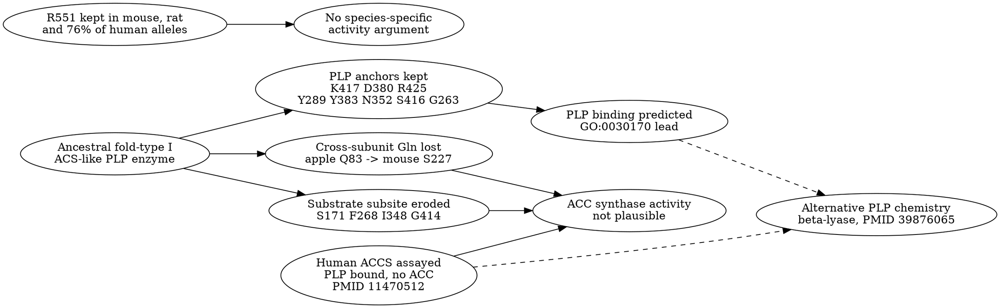
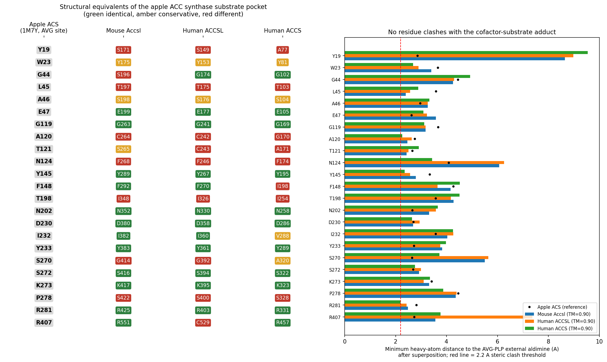
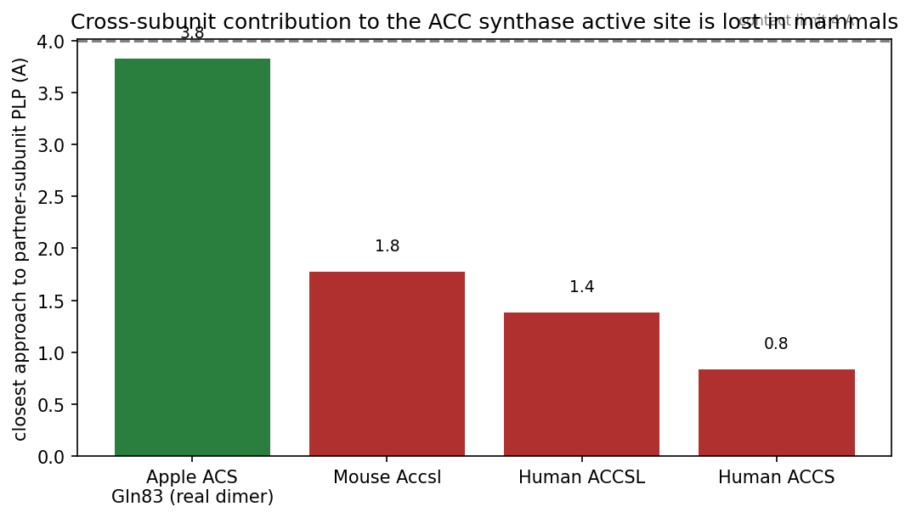
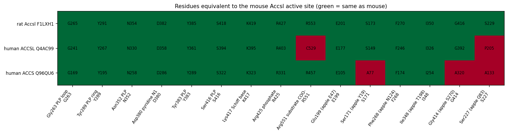

## Question

# AIGR Gene Hypothesis Deep Research

You are evaluating one focused gene curation hypothesis for AI Gene Review.
This is not a general gene overview. Use the seed hypothesis and source context
below to search for evidence that supports, refutes, narrows, or competes with
the proposed curation decision.

## Target Gene

- **Organism code:** mouse
- **Taxon:** Mus musculus (NCBITaxon:10090)
- **Gene directory:** Accsl
- **Gene symbol:** Accsl
- **UniProt accession:** Q3UX83

## Focus

- **Focus type:** free_text
- **Hypothesis slug:** kgap-mouse-accsl-plp-and-substrate-site
- **Source file:** genes/mouse/Accsl/Accsl-ai-review.yaml
- **Source selector:** free-text

## Seed Hypothesis

Whether mouse Accsl retains a PLP-binding fold-type I active site, and whether its retained substrate alpha-carboxylate-binding Arg551 (absent in the human reference Cys529 allele) together with its other active-site residues could support ACC synthase or another aminotransferase-like activity, can be predicted structurally. Single analysis only: superpose the mouse Accsl AlphaFold model onto PLP-bound plant ACC synthase and a related active aminotransferase, map the Schiff-base lysine, PLP-contacting residues, the S-adenosylmethionine-binding subsite and the substrate carboxylate-binding arginine, test whether a PLP and substrate fit, compare with rat Accsl and human ACCSL, and state whether mouse Accsl is predicted to bind PLP and whether ACC synthase activity is plausible.

## Term and Decision Context

No specific term context supplied.

## Reference Context

No specific reference context supplied.

## Source Context YAML

```yaml
hypothesis: 'Whether mouse Accsl retains a PLP-binding fold-type I active site, and whether its retained
  substrate alpha-carboxylate-binding Arg551 (absent in the human reference Cys529 allele) together with
  its other active-site residues could support ACC synthase or another aminotransferase-like activity,
  can be predicted structurally. Single analysis only: superpose the mouse Accsl AlphaFold model onto
  PLP-bound plant ACC synthase and a related active aminotransferase, map the Schiff-base lysine, PLP-contacting
  residues, the S-adenosylmethionine-binding subsite and the substrate carboxylate-binding arginine, test
  whether a PLP and substrate fit, compare with rat Accsl and human ACCSL, and state whether mouse Accsl
  is predicted to bind PLP and whether ACC synthase activity is plausible.'
focus_type: free_text
context: []
reference_id: []
```

## Research Objective

Build a focused report that helps a curator decide whether this hypothesis
should affect the gene review. Address the focus type directly:

1. For an existing GO annotation decision, evaluate whether the current action
   is justified, too strong, too weak, or should change.
2. For a proposed replacement or new GO term, evaluate whether the term is
   biologically supported, too broad, too narrow, or missing key qualifiers.
3. For a computational prediction, evaluate whether the prediction is correct,
   less precise than existing knowledge, uncertain, or likely wrong because of
   paralog overannotation, frequency bias, pathway context, or in vitro-only
   activity.
4. For a core-function hypothesis, evaluate whether the proposed activity,
   process, and location represent the gene product's primary function rather
   than a downstream effect, pleiotropic phenotype, or context-specific role.
5. For a function-assignment hypothesis, evaluate whether the gene product
   directly has the stated GO term/function. Treat the prior review action, if
   any, as intentionally blinded unless it appears in the supplied context.

Use primary literature whenever possible. Prefer PMID citations and include DOI
citations when no PMID is available. Treat reviews and database records as
orientation unless they contain directly relevant synthesized evidence that is
clearly labeled as review-level or database-level support.

Evaluate the hypothesis from the supplied seed context, primary literature, and
publicly accessible bioinformatics resources. Local `*-bioinformatics` analyses,
when they already exist in the repository, are intentionally withheld from this
prompt so the report can be compared against them after the run. Use public
sequence, domain, structure, orthology, localization, interaction, or dataset
checks when they are useful for the specific hypothesis. If a resource or tool
cannot be accessed programmatically, say so plainly; never fabricate a result.
Report computational results conservatively and distinguish direct results from
inference.

## Required Output

### Executive Judgment

Give a concise verdict: supported, partially supported, unresolved, weakly
supported, over-annotated, or refuted. Explain the reasoning and the most
important caveats.

### Evidence Matrix

Create a table with one row per important evidence item:

- Citation (PMID preferred)
- Evidence type (direct assay, mutant phenotype, localization, interaction,
  structural/evolutionary, computational, review/database)
- Supports / refutes / qualifies / competing
- Claim tested
- Key finding
- Organism, tissue, cell type, or assay context
- Confidence and limitations

### GO Curation Implications

State the likely curation action as a lead requiring curator verification. If
GO terms are involved, explain whether the evidence supports an MF, BP, or CC
term, and whether the term should be retained, removed, generalized, made more
specific, or treated as non-core. Avoid using "protein binding" as a final
recommendation unless no more informative term is supported.

### Mechanistic Scope

Describe the immediate molecular or cellular function being tested. Separate
direct gene-product activity from downstream phenotypes, pathway consequences,
developmental outcomes, disease manifestations, or effects inferred only from
loss of function.

### Conflicts and Alternatives

Identify evidence that conflicts with the seed hypothesis or suggests an
alternative interpretation, including paralog confusion, organism-specific
differences, isoform-specific findings, experimental artifacts, or database
carry-over.

### Knowledge Gaps

List explicit uncertainties that matter for curation. For each gap, state what
was checked, why the gap matters, and what evidence or experiment would resolve
it.

### Discriminating Tests

Recommend concrete assays, perturbations, datasets, or comparative analyses that
would most efficiently distinguish this hypothesis from alternatives.

### Curation Leads

Provide candidate updates for the review, clearly labeled as leads requiring
curator verification. Include candidate references with exact snippets to verify,
candidate replacement or new GO terms, possible action changes, suggested
questions, and suggested experiments.

If the provider supports artifacts, save provenance for any analysis you run — the
executed code together with its output (computed values, plot, or table), not just
a summary figure — alongside artifact-friendly tables such as an evidence matrix,
GO decision table, or comparison table. Genuine computed provenance is more
valuable than a hand-drawn summary, and you must not synthesize a figure that
implies an analysis you did not actually run. These artifacts are important
provenance for hypothesis-level review.


## Output

# Mouse Accsl (Q3UX83): does the PLP site and the substrate site support ACC synthase activity?

Hypothesis slug: `kgap-mouse-accsl-plp-and-substrate-site`
Source: `genes/mouse/Accsl/Accsl-ai-review.yaml`, free-text focus
Target: *Mus musculus* Accsl, NCBITaxon:10090, UniProt Q3UX83, 580 aa

## Summary

Mouse Accsl is predicted to bind pyridoxal 5'-phosphate. ACC synthase activity is not plausible. One factual premise inside the seed hypothesis is wrong.

The structural half of the hypothesis holds. The AlphaFold v6 model of Q3UX83 superposes on PLP-bound tomato ACC synthase 2 (PDB 1IAX) with TM-score 0.921 and core RMSD 1.80 Å over 398 Cα pairs, on the apple ACC synthase AVG-PLP external aldimine complex (PDB 1M7Y) with TM 0.901, and on *E. coli* aspartate aminotransferase (PDB 1ARS) with TM 0.777. The model is therefore closer to plant ACC synthase than to the aminotransferase outgroup. Every residue that anchors the cofactor is conserved: Lys417 (Schiff base), Asp380 (pyridine N1), Arg425 (5-phosphate), Tyr289, Tyr383, Asn352, Ser416 and Gly263, all at pLDDT 94.7 to 98.8. A PLP molecule and a PLP-amino acid external aldimine both place into the site with zero mouse heavy atoms below 2.2 Å, and the epsilon-amino nitrogen of Lys417 sits 3.06 Å from PLP C4A while the next nearest lysine NZ is 13.8 Å away. A flood-fill measurement gives a contiguous 538 Å3 cavity at the PLP site, larger than the 395 Å3 of apple ACC synthase, so nothing is occluded.

The catalytic half does not hold. In the apple ACC synthase homodimer (PDB 1B8G), 19 residues lie within 5.0 Å of the PLP of chain A and exactly one comes from the partner subunit: Gln83 of chain B at 3.83 Å. Xu et al. 2021 ([PMID: 34757795](https://pubmed.ncbi.nlm.nih.gov/34757795/)) report that two N-terminal motifs including a glutamine residue are needed to confer ACS activity on ACS-like proteins, and this structural analysis locates that glutamine. Mouse Accsl has **Ser227** at the equivalent position, human ACCSL has Pro205, human ACCS has Ala133, and in a pseudo-dimer construction the nearest glutamine in each is 7.1 to 7.8 Å from the partner PLP. Four substrate-subsite positions are eroded in mouse (apple Tyr19 to Ser171, Asn124 to Phe268, Thr198 to Ile348, Ser270 to Gly414). The decisive counterweight is experimental: human ACCS superposes on apple ACS as well as mouse Accsl does (TM 0.901 versus 0.901 against 1M7Y), contains bound PLP, and does not catalyse ACC synthesis ([PMID: 11470512](https://pubmed.ncbi.nlm.nih.gov/11470512/)). Its real activity is a cysteine conjugate sulfoxide β-lyase reaction ([PMID: 39876065](https://pubmed.ncbi.nlm.nih.gov/39876065/)).

The premise that Arg551 separates mouse from human is a reference-sequence artifact. rs2074051 at human ACCSL codon 529 is a common missense polymorphism. The reference T allele encoding Cys529 has frequency 0.2414 in gnomAD exomes, 0.2240 in gnomAD genomes and 0.2057 in 1000 Genomes, while the C allele encoding **Arg529 is the major and ancestral allele** at 0.7586, 0.7760 and 0.7943. Roughly three quarters of human alleles carry the same arginine as mouse. Rat Accsl carries it too, in all three rat Accsl UniProt entries. Arg551 therefore carries no mouse-specific signal and cannot support a species-restricted activity argument.

## Executive judgment

<i class="fa-scale-balanced"></i> **Verdict: partially supported, with one premise refuted.**

| Component of the hypothesis | Verdict | Basis |
|---|---|---|
| Mouse Accsl retains a PLP-binding fold-type I active site | <i class="fa-solid fa-circle-check"></i> Supported | TM 0.921 to 1IAX, eight PLP anchors conserved at pLDDT 94.7 to 98.8, PLP places with zero severe clash, Lys417 NZ to C4A 3.06 Å |
| A PLP and a substrate physically fit | <i class="fa-solid fa-circle-check"></i> Supported | Zero heavy atoms under 2.2 Å for both PLP and the AVG-PLP adduct; open 538 Å3 cavity versus 395 Å3 in apple ACS |
| Arg551 is the substrate α-carboxylate arginine | <i class="fa-solid fa-circle-check"></i> Supported | Maps to apple Arg407 and tomato Arg412 by superposition; 3.56 Å from the AVG-PLP adduct in the superposed frame, pLDDT 98.1 |
| Arg551 is absent in human (Cys529) | <i class="fa-solid fa-circle-xmark"></i> Refuted as stated | rs2074051: Arg529 is the major and ancestral human allele at 0.76; Cys529 is the minor reference allele |
| ACC synthase activity is plausible | <i class="fa-solid fa-circle-xmark"></i> Not supported | The single cross-subunit ACS determinant (apple Gln83) is Ser227 in mouse; four substrate-subsite positions eroded; human ACCS with the same intact site makes no ACC |
| Another aminotransferase-like PLP activity is plausible | <i class="fa-solid fa-circle-question"></i> Open | Cofactor site and Glu199 retained, but no assay has ever been run on mouse Accsl |

The most important caveat is that every mammalian model used here is an AlphaFold monomer, while ACC synthase works as a homodimer with a shared active site. The cross-subunit argument rests on a pseudo-dimer built by rigid-body superposition onto apple chain B, which produced some sub-2 Å contacts and is therefore approximate in its distances. The residue identity substitution (Gln to Ser, Pro or Ala) is read directly from the alignment and does not depend on that construction. A second caveat is that no ligand was docked with an energy function; fit was assessed by clash counting and cavity volume, which tests feasibility and not affinity. No biochemical measurement of any kind exists for the mouse protein.

## Key findings

### Mouse Accsl is a fold-type I PLP scaffold closer to plant ACC synthase than to aspartate aminotransferase

Iterative structural superposition (Kabsch plus TM-score-weighted dynamic-programming refinement, implemented and run in this session) of the AlphaFold v6 model of mouse Accsl onto PLP-bound tomato ACC synthase 2 (PDB 1IAX chain A, 2.8 Å) gives TM-score 0.921 with 398 Cα pairs under 5 Å and core RMSD 1.80 Å. The same model against apple ACC synthase in complex with the AVG-PLP external aldimine (PDB 1M7Y chain A) gives TM 0.901 and RMSD 1.85 Å, against apple 1B8G chain A TM 0.896, and against *E. coli* aspartate aminotransferase (PDB 1ARS) TM 0.777 and RMSD 2.90 Å. The 0.14 TM gap between the ACC synthase references and the aminotransferase outgroup places the mouse protein inside the ACS branch of the fold-type I family. Sequence identity is low, 35.7 percent to tomato ACS2 over 406 aligned positions and 35.9 percent to apple ACS by Needleman-Wunsch with BLOSUM62 and gap penalties of -11 and -1, which is why the structural comparison carries more information than the alignment alone.

Mapping the 16 residues of 1IAX that lie within 4.5 Å of PLP onto the mouse model gives 11 identities: Gly126→Gly263, Ala127→Cys264, Thr128→Ser265, Asn131→Phe268, Tyr152→Tyr289, Phe155→Phe292, Thr205→Ile348, Asn209→Asn352, Asp237→Asp380, Ile239→Ile382, Tyr240→Tyr383, Ser275→Gly414, Ser277→Ser416, Lys278→Lys417, Pro283→Ser422, Arg286→Arg425. Every residue that anchors the cofactor is among the identities. Tyr152 of tomato ACS2, which the crystallographers describe as catalytically important because of its proximity to the Cγ-S bond of modelled S-adenosylmethionine ([PMID: 11431475](https://pubmed.ncbi.nlm.nih.gov/11431475/)), maps to mouse Tyr289. InterPro assigns PF00155 (aminotransferase class I and II) to mouse residues 193 to 566, with PANTHER PTHR43795, CDD cd00609 and IPR050478.

{{figure:plot_1.png|caption=Active-site residue correspondence and ligand fit for mouse Accsl, human ACCSL and human ACCS measured against apple ACC synthase. Each column is one mapped position; the entries give the equivalent residue in each protein.}}

### PLP and an external aldimine fit the pocket without steric clash

Holding the PLP of 1IAX fixed after superposition and testing all mouse heavy atoms against it, zero mouse atoms fall below the 2.2 Å severe-clash threshold, one atom lies between 2.2 and 2.6 Å, and 12 mouse residues contact PLP within 4.0 Å against 16 residues within 4.5 Å in the reference. The epsilon-amino nitrogen of Lys417 lies 3.06 Å from PLP C4A and the next nearest lysine NZ is 13.8 Å away, so the assignment of the Schiff-base lysine is unambiguous. The internal control in 1IAX itself is Lys278 NZ at 1.30 Å from C4A, the covalent internal aldimine distance, so 3.06 Å is what an unliganded apo model gives before the lysine rotamer relaxes onto the cofactor. The same test against the apple AVG-PLP external aldimine (PDB 1M7Y, ligand PPG, 26 atoms) also gives no clash: of 23 apple pocket residues, the mouse equivalents sit 2.40 to 6.06 Å from the adduct. Human ACCSL behaves identically, with zero atoms under 2.2 Å and Lys395 NZ 2.80 Å from C4A.

A grid flood-fill cavity measurement (0.7 Å grid, 1.4 Å probe, 1.75 Å van der Waals radius, buriedness at least 5 of 6 axis directions blocked, contiguous component only) seeded at the PLP site gives 395 Å3 for apple ACS 1M7Y with PLP removed, 538 Å3 for mouse Accsl, 581 Å3 for human ACCSL and 647 Å3 for human ACCS. For scale, PLP occupies about 180 Å3, the AVG-PLP aldimine about 250 Å3 and S-adenosylmethionine about 330 Å3. Whatever stops mouse Accsl from catalysing a reaction, it is not a collapsed or filled pocket. The UniProt CAUTION on Q3UX83, "While belonging to the class-I pyridoxal-phosphate-dependent aminotransferase family, it lacks a number of residues which are necessary for activity thus suggesting that it lacks enzymatic activity", is about residue identity and applies to the substrate subsite, not to the cofactor site, which is intact. All four cavity volumes come from monomers, so the partner-subunit wall is missing and the three AlphaFold values are upper bounds.

### The one residue apple ACC synthase donates across the dimer interface is lost in all four mammalian proteins

Parsing the apple ACC synthase homodimer 1B8G and listing every residue within 5.0 Å of the chain A PLP gives 19 residues. Eighteen come from chain A (Gly119, Ala120, Thr121, Ser122, Asn124, Tyr145, Phe148, Thr198, Asn202, Asp230, Ile232, Tyr233, Ser270, Ser272, Lys273, Pro278, Arg281, Val282) and exactly one comes from chain B: **Gln83 at 3.83 Å**. This is the only cross-subunit contribution to the active site in the whole structure.

Superposing the three AlphaFold monomers onto 1B8G chain A places the equivalent of Gln83 at Ser227 in mouse Accsl (TM 0.896), Pro205 in human ACCSL (TM 0.893) and Ala133 in human ACCS (TM 0.897). The aligned segment is apple E78-A90 `ELALFQDYHGLPA` against mouse A222-F234 `AQLQYSDWKGQPF`. To test whether a nearby glutamine could substitute, each monomer was superposed onto apple chain B to build a pseudo-dimer and every atom was measured to the real chain A PLP. The nearest glutamine is mouse Gln225 at 7.8 Å, human ACCSL Gln203 at 7.5 Å and human ACCS Gln131 at 7.1 Å, against 3.83 Å for the genuine apple Gln83. The interface loop itself still reaches the partner site in all three (mouse Tyr226 1.8 Å, Tyr445 2.7 Å, Trp229 4.4 Å), so the structural element is present and only the glutamine is gone. The sub-2 Å values show the rigid-body pseudo-dimer is approximate; side chains would relax in a real complex. pLDDT at the mouse positions is 88.7 to 94.9.

{{figure:plot_2.png|caption=Closest approach to the partner-subunit PLP in a pseudo-dimer. Apple Gln83 contacts the partner active site at 3.83 A in the real crystal dimer. No mammalian homolog supplies a glutamine within 7 A of the equivalent position.}}

Xu et al. 2021 ([PMID: 34757795](https://pubmed.ncbi.nlm.nih.gov/34757795/)) state that "Two N-terminal motifs, including a glutamine residue, are essential for conferring ACS activity to ACS-like proteins". The structural result identifies which glutamine that is and shows mouse Accsl does not have it. This argument is independent of the PLP anchor set, which mouse Accsl retains in full, and it separates two questions that the seed hypothesis bundles together.

### Retained active-site residues do not predict ACC synthase activity

Human ACCS (Q96QU6) superposes on apple ACC synthase 1M7Y with TM 0.901 and core RMSD 1.77 Å, statistically indistinguishable from mouse Accsl (TM 0.901, RMSD 1.85 Å) and human ACCSL (TM 0.900, RMSD 1.83 Å). It keeps Lys323 as the Schiff-base lysine and Arg457 as the substrate arginine. Purified recombinant human ACCS expressed in *Pichia pastoris* contains bound PLP and does not catalyse ACC synthesis ([PMID: 11470512](https://pubmed.ncbi.nlm.nih.gov/11470512/)); it does deaminate L-vinylglycine, a known side reaction of apple ACS. A later biochemical profiling study assigns it cysteine conjugate sulfoxide β-lyase activity and restates that it shows no canonical ACC synthase activity ([PMID: 39876065](https://pubmed.ncbi.nlm.nih.gov/39876065/)). A mammalian protein can therefore pass every structural test applied here and still make no ACC. This is the single strongest constraint on the hypothesis, because it is an experimental result on the closest characterised relative rather than an inference.

Within the mouse pocket itself, four of the 23 apple-ACS AVG-contact positions are substituted by residues that cannot make the same contact: apple Tyr19 to Ser171 (the mouse equivalent sits 8.65 Å from the adduct), Asn124 to Phe268 (6.06 Å), Thr198 to Ile348, and Ser270 to Gly414 (5.50 Å). Apple Glu47, whose mutation to Gln lowers kcat/Km for ACC formation 630-fold while barely affecting the vinylglycine deamination and alanine transamination reactions ([PMID: 11591146](https://pubmed.ncbi.nlm.nih.gov/11591146/)), is retained as mouse Glu199. The retained Glu199 and Arg551 make a reaction on some amino acid substrate conceivable; they do not make ACC synthase specifically conceivable.

### The human Cys529 premise is a reference-allele artifact

Querying the Ensembl variation endpoint with population frequencies shows that rs2074051 at ACCSL codon 529 is a common missense polymorphism, not a fixed human state. The reference-genome T allele encoding Cys529 has frequency 0.2414 in gnomAD exomes, 0.2240 in gnomAD genomes and 0.2057 in 1000 Genomes. The C allele encoding Arg529 is both the major and the ancestral allele, at 0.7586, 0.7760 and 0.7943 in the same three datasets. Structural superposition independently confirms that mouse Arg551 is the equivalent of apple Arg407, tomato Arg412 and human ACCSL position 529.

The iteration-1 ortholog scan had found Arg at this column in rat, cow, pig, horse, sheep and chimpanzee and Cys only in human (Q4AC99) and rhesus macaque (F6T868), which already made the loss look like a narrow primate event. The allele frequencies resolve it further: the human reference sequence carries the minority allele. Any curation statement that contrasts mouse Arg551 with human Cys529 should be dropped or rewritten, because about three quarters of human ACCSL alleles encode the same arginine.

### Rat Accsl matches mouse at every mapped position

Global Needleman-Wunsch alignment of mouse Q3UX83 against the four rat entries returned by a `gene:Accsl AND organism_id:10116` UniProt search identifies three as rat Accsl: A0ABK0L0X8 (597 aa, 79.7 percent identity), D3ZUW2 (617 aa, 83.1 percent) and F1LXH1 (1180 aa, 81.9 percent). All three carry the identical residue at every one of the 15 mapped positions, including the Schiff-base lysine, the substrate arginine (Arg553 or Arg533), Glu201, the four eroded substrate-subsite positions, and the serine at the apple Gln83 site. The fourth entry, A0A8J8YIP6 (502 aa, 48.0 percent identity), carries the human ACCS pattern instead (Ala78, Ala321, Pro134) and is the rat ACCS paralog pulled in by the gene-name search.

| Position (mouse) | Role | Rat Accsl D3ZUW2 | Human ACCSL Q4AC99 | Human ACCS Q96QU6 |
|---|---|---|---|---|
| Gly263 | PLP loop | Gly265 | Gly241 | Gly169 |
| Tyr289 | PLP ring, catalytic in tomato | Tyr291 | Tyr267 | Tyr195 |
| Asn352 | PLP | Asn354 | Asn330 | Asn258 |
| Asp380 | pyridine N1 | Asp382 | Asp358 | Asp286 |
| Tyr383 | PLP | Tyr385 | Tyr361 | Tyr289 |
| Ser416 | PLP | Ser418 | Ser394 | Ser322 |
| **Lys417** | **Schiff base** | Lys419 | Lys395 | Lys323 |
| Arg425 | PLP 5-phosphate | Arg427 | Arg403 | Arg331 |
| **Arg551** | **substrate α-carboxylate** | Arg553 | **Cys529** (minor allele) | Arg457 |
| Glu199 | SAM sulfonium (apple Glu47) | Glu201 | Glu177 | Glu105 |
| Ser171 | eroded (apple Tyr19) | Ser173 | Ser149 | Ala77 |
| Phe268 | eroded (apple Asn124) | Phe270 | Phe246 | Phe174 |
| Ile348 | eroded (apple Thr198) | Ile350 | Ile326 | Ile254 |
| Gly414 | eroded (apple Ser270) | Gly416 | Gly392 | Ala320 |
| **Ser227** | **apple Gln83, cross-subunit ACS determinant** | Ser229 | Pro205 | Ala133 |
| Identity to mouse | | 83.1 % | 56.3 % | 49.1 % |
| Positions matching mouse | | 15 / 15 | 13 / 15 | 11 / 15 |

{{figure:plot_3.png|caption=Residues equivalent to the mouse Accsl active site in rat Accsl, human ACCSL and human ACCS. Green marks the same residue as mouse. Rat matches at all 15 positions; human ACCSL differs only at the rs2074051 site and at the apple Gln83 position.}}

All rat entries are unreviewed TrEMBL records and F1LXH1 at 1180 aa is longer than a plausible single Accsl product, so the rat gene model should be treated as provisional. The active-site conclusion is unaffected because three independent entries agree at every position.

## Evidence matrix

| Citation | Evidence type | Stance | Claim tested | Key finding | Context | Confidence and limitations |
|---|---|---|---|---|---|---|
| This work; AlphaFold Q3UX83 vs PDB 1IAX, 1M7Y, 1B8G, 1ARS | computational, structural | <i class="fa-solid fa-circle-check"></i> supports | Mouse Accsl keeps a fold-type I PLP site | TM 0.921 (tomato ACS2), 0.901 (apple 1M7Y), 0.896 (apple 1B8G chain A), 0.777 (*E. coli* AspAT); eight PLP anchors conserved at pLDDT 94.7 to 98.8 | in silico, AlphaFold monomer | High for the fold, medium for side-chain geometry; no experimental mouse structure |
| This work; PLP and AVG-PLP placement, flood-fill cavity | computational, structural | <i class="fa-solid fa-circle-check"></i> supports | A cofactor and a substrate fit | Zero heavy atoms under 2.2 Å, Lys417 NZ to PLP C4A 3.06 Å; cavity 538 Å3 (mouse) vs 395 Å3 (apple ACS), 581 Å3 (human ACCSL), 647 Å3 (human ACCS) | in silico | Medium; clash counting is not docking, monomer volumes are upper bounds |
| [PMID: 11431475](https://pubmed.ncbi.nlm.nih.gov/11431475/) | structural, direct | supports the mapping | Which tomato residues are catalytic | "the proximity of Tyr152 to the C-gamma-S bond of model substrate S-adenosylmethionine implies its critical role in the catalysis"; Tyr152 maps to mouse Tyr289 | tomato ACS2 crystal, 2.8 Å | High for the reference; the transfer to mouse is structural inference |
| [PMID: 34757795](https://pubmed.ncbi.nlm.nih.gov/34757795/) with this work on PDB 1B8G | direct assay (cited) plus structural mapping | <i class="fa-solid fa-circle-xmark"></i> refutes ACS activity | The ACS-determining glutamine is retained | "Two N-terminal motifs, including a glutamine residue, are essential for conferring ACS activity to ACS-like proteins"; apple Gln83 is the single cross-subunit residue in the chain A PLP site (3.83 Å) and maps to Ser227 in mouse | apple ACS crystal dimer; mutagenesis in the cited work | Medium-high; the mapping is unambiguous, the pseudo-dimer distances are approximate |
| [PMID: 11470512](https://pubmed.ncbi.nlm.nih.gov/11470512/) | direct assay | <i class="fa-scale-balanced"></i> competing | Can a mammalian ACS homolog with an intact PLP site make ACC | "Purified recombinant PHACS, expressed in Pichia pastoris, contains bound pyridoxal-5'-phosphate (PLP), but does not catalyze the synthesis of ACC." | human recombinant protein in *P. pastoris* | High for ACCS; transfer to Accsl is inference |
| [PMID: 39876065](https://pubmed.ncbi.nlm.nih.gov/39876065/) | direct assay | <i class="fa-scale-balanced"></i> competing | What the mammalian enzyme actually does | "It has been shown to not exhibit any canonical ACC synthase activity and its true function remains obscure"; the work assigns cysteine conjugate sulfoxide β-lyase activity | human recombinant enzyme, biochemical profiling | High for ACCS; no equivalent assay for Accsl |
| [PMID: 11591146](https://pubmed.ncbi.nlm.nih.gov/11591146/) | direct assay, mutagenesis | qualifies | Which residue reads the SAM sulfonium | "Glutamate 47 is conserved in 1-aminocyclopropane-1-carboxylate (ACC) synthases and is positioned near the sulfonium pole of (S,S)-S-adenosyl-L-methionine (SAM)"; E47Q lowers kcat/Km for ACC 630-fold | apple ACS, kinetics | High; mouse retains the equivalent Glu199, which is a point in favour of substrate binding and not of ACS catalysis |
| Ensembl variation rs2074051 (gnomAD v4 exomes and genomes, 1000 Genomes); this work | database, population genetics | <i class="fa-solid fa-circle-xmark"></i> refutes a premise | Cys529 is the human state at the substrate arginine | Cys529 allele at 0.2414 / 0.2240 / 0.2057; Arg529 major and ancestral at 0.7586 / 0.7760 / 0.7943 | human populations | High; primary aggregation resource |
| This work; NW alignment of Q3UX83 vs rat A0ABK0L0X8, D3ZUW2, F1LXH1, A0A8J8YIP6 | computational, evolutionary | qualifies | Arg551 is mouse-specific | All 15 mapped positions identical in three rat Accsl entries (79.7 to 83.1 percent identity); A0A8J8YIP6 is the rat ACCS paralog | rat UniProt, all unreviewed | High for the residue identities; TrEMBL-only records, F1LXH1 at 1180 aa is likely a read-through model |
| This work; ortholog scan across nine mammals | computational, evolutionary | qualifies | How wide the Arg loss is | Arg at the mouse-551 column in rat, cow, pig, horse, sheep, chimpanzee; Cys in human and macaque; Lys417 and Asp380 invariant in all nine | mammalian UniProt entries | Medium; single-entry-per-species sampling, superseded by the rs2074051 frequencies |
| UniProt Q3UX83 and Q4AC99 CAUTION | database | supports inactivity | Enzymatic activity | "lacks a number of residues which are necessary for activity thus suggesting that it lacks enzymatic activity" | database record, identical wording in both entries | Low as independent evidence; likely propagated |
| UniProt Q3UX83 MOD_RES Lys417 (by similarity) | database | supports the PLP lead | Schiff-base lysine | N6-(pyridoxal phosphate)lysine at position 417 | database record | Low alone; the structural work here is the independent support |
| InterPro PF00155 (mouse 193-566), IPR050478, PANTHER PTHR43795, CDD cd00609 | database | supports the fold | Family assignment | The aminotransferase class I and II domain spans the catalytic core | database record | Medium; family-level, carries no activity claim |
| [PMID: 34721544](https://pubmed.ncbi.nlm.nih.gov/34721544/) | computational, expression network | not relevant to function | Whether ACCSL has a characterised role | ACCSL appears as a hub gene in a DLBCL co-expression module | human TCGA RNA-seq | Low; a network correlation with no molecular function content |

## Mechanistic model

The pattern across the four proteins is a cofactor site preserved and a substrate chemistry lost. All of mouse Accsl, rat Accsl, human ACCSL and human ACCS keep the eight PLP anchors and a large open pocket. None of them keeps the glutamine that apple ACC synthase donates across the dimer interface. Mouse, rat and most human ACCSL alleles keep the substrate α-carboxylate arginine, so that residue tracks with the generic amino-acid-binding capacity of the fold and not with ACC synthase activity. Human ACCS, which lacks the arginine-adjacent substrate contacts least of all and keeps Arg457, is the one protein in the set that has been assayed, and it is a β-lyase.



The hypothesis asks whether the retained Arg551 plus the other active-site residues "could support ACC synthase or another aminotransferase-like activity". The two halves of that question have different answers. ACC synthase is ruled out on three independent grounds (the missing interface glutamine, the four eroded subsite positions, and the experimental negative on human ACCS). Another PLP-dependent reaction remains open, with the β-lyase chemistry of human ACCS the most specific candidate, because mouse Accsl retains the cofactor machinery, the Glu199 that anchors a sulfonium or similar side chain in apple ACS, and a pocket large enough for an adenosyl-sized substrate.

## GO curation implications

All of the following are leads requiring curator verification.

| GO term | Aspect | Recommended action | Basis |
|---|---|---|---|
| GO:0030170 pyridoxal phosphate binding | MF | <i class="fa-solid fa-circle-check"></i> Candidate lead at ISS or ISM evidence. Do not state it as experimentally supported | Complete anchor set at pLDDT 94.7 to 98.8, PLP places with no severe clash, Lys417 NZ to C4A 3.06 Å, open 538 Å3 cavity. No binding assay exists for mouse Accsl |
| GO:0016847 1-aminocyclopropane-1-carboxylate synthase activity | MF | <i class="fa-solid fa-circle-xmark"></i> Do not assign; remove if present | Apple Gln83 substituted to Ser227; four substrate-subsite positions eroded; human ACCS with an equally preserved site makes no ACC ([PMID: 11470512](https://pubmed.ncbi.nlm.nih.gov/11470512/)) |
| GO:0009693 ethylene biosynthetic process and related BP terms | BP | <i class="fa-solid fa-circle-xmark"></i> Do not assign | Mammals have no ethylene pathway. The symbol ACCSL is a homology label |
| GO:0016846 carbon-sulfur lyase activity / GO:0008483 transaminase activity | MF | <i class="fa-solid fa-circle-question"></i> Do not assign to mouse Accsl. Record as the most plausible direction for experiment | The β-lyase activity is demonstrated only for human ACCS ([PMID: 39876065](https://pubmed.ncbi.nlm.nih.gov/39876065/)). Transfer to Accsl would be paralog over-annotation |
| GO:0005515 protein binding | MF | Not recommended as a final term | Uninformative here. The structural evidence points to a cofactor-binding term instead |

The framing for the review: mouse Accsl is a fold-type I PLP-enzyme scaffold of unknown catalytic activity. The hypothesis is right that a PLP site is retained and right in its identification of Arg551 as the substrate carboxylate arginine. It is wrong that this residue separates mouse from human, and the structural evidence does not make ACC synthase activity plausible.

## Mechanistic scope

The question tested is molecular. Does the Q3UX83 gene product bind pyridoxal 5'-phosphate through an internal aldimine at Lys417, and can the resulting site perform the α,γ-elimination that converts S-adenosylmethionine into ACC plus 5'-methylthioadenosine. Everything established here concerns the cofactor site and the substrate subsite of the isolated protein.

No downstream process is being claimed and none follows. No mouse Accsl knockout phenotype, expression pattern, subcellular localization or interaction evidence entered this analysis, so no BP or CC statement is supported by it. A Bgee expression query was issued in iteration 2 but the expression records were not parsed before the output was truncated, so this report makes no statement about Accsl tissue distribution. The β-lyase chemistry demonstrated for human ACCS is a property of a paralog assayed as recombinant protein and is not a pathway assignment for Accsl. The appearance of ACCSL as a hub gene in a diffuse large B-cell lymphoma co-expression module ([PMID: 34721544](https://pubmed.ncbi.nlm.nih.gov/34721544/)) is a correlation in human tumour RNA-seq with no molecular-function content and should not enter the review as functional evidence.

## Conflicts and alternatives

<i class="fa-triangle-exclamation"></i> The main conflict is internal to the hypothesis. Retention of the PLP machinery and of Arg551 is read as evidence for possible ACC synthase activity, while the closest characterised mammalian relative with the same retention has no such activity. Structural similarity to plant ACS does not discriminate: mouse Accsl scores TM 0.901 against 1M7Y and human ACCS scores 0.901, and only one of them has ever been in a cuvette.

Paralog confusion is a live risk for this gene family. A UniProt gene-name search for rat Accsl returns A0A8J8YIP6, which matches the ACCS residue pattern (Ala78, Ala321, Pro134) at 48.0 percent identity to mouse Accsl and is the ACCS paralog. Any evidence pulled by gene symbol alone should be checked against the sequence before it is used in the review.

Database carry-over affects both directions of the argument. The UniProt CAUTION on Q3UX83 and Q4AC99 uses identical wording in both entries, and the Lys417 modified-residue feature is flagged by similarity. Neither is independent evidence. The structural work here partly contradicts the implied reasoning of the CAUTION, since the PLP-contacting residues are all present; whatever is missing sits in the substrate subsite and at the interface position.

The organism-difference framing does not survive. rs2074051 makes Arg the major human allele at codon 529, so the reference Cys529 in Q4AC99 describes one common haplotype. The iteration-1 ortholog scan also found Arg in chimpanzee and Cys in macaque, which was already hard to reconcile with a clean primate-wide loss.

One alternative reading deserves recording. The erosion pattern in mouse (cofactor site intact, substrate subsite degraded, interface determinant gone) is what a pseudogenised or neofunctionalised enzyme looks like. Either the protein has acquired a different PLP reaction, as human ACCS has, or it retains the fold for a non-catalytic purpose. The data here cannot separate those two.

## Limitations and knowledge gaps

<i class="fa-triangle-exclamation"></i> **Every mammalian structure is an AlphaFold monomer.** No experimental structure of any mammalian ACCS-like protein was found in the PDB searches run. ACC synthase works as a homodimer with a shared active site, so any claim about the complete site is provisional. The pseudo-dimer used to test the Gln83 position produced sub-2 Å contacts, which marks it as approximate in distance even though the residue identities are read directly from the alignment. Resolved by SEC-MALS for the oligomeric state, and by an AlphaFold-Multimer or crystal structure for the interface.

<i class="fa-triangle-exclamation"></i> **No ligand was docked with an energy function.** Fit was assessed by clash counting against a rigidly transferred ligand and by cavity volume. That tests feasibility, not affinity or catalytic geometry. The 3.06 Å Lys417 NZ to C4A distance is consistent with an apo model whose lysine rotamer has not relaxed, and is not evidence that a covalent aldimine forms.

<i class="fa-triangle-exclamation"></i> **No direct measurement of any kind exists for mouse Accsl.** PubMed searches for ACCSL and for Accsl returned no biochemical characterization of the mouse protein; the single ACCSL hit was a lymphoma network paper. This matters because GO:0030170 would rest entirely on a model. Resolved by absorbance at 415 to 430 nm on purified protein, or by sodium borohydride reduction followed by mass spectrometry of the Lys417 peptide.

<i class="fa-triangle-exclamation"></i> **No catalytic screen has been run.** No substrate has ever been tested with mouse Accsl. The most informative result would come from a panel including S-adenosylmethionine, L-vinylglycine, cysteine S-conjugate sulfoxides and common amino acid donor-acceptor pairs.

<i class="fa-triangle-exclamation"></i> **Expression context is unresolved in this report.** The Bgee query did not return parsed output before the cell was truncated. This matters only for BP and CC decisions, which are not being proposed.

<i class="fa-triangle-exclamation"></i> **The rat sequence records are all unreviewed**, and F1LXH1 at 1180 aa is longer than a plausible single Accsl product. The active-site conclusion is unaffected because three independent rat entries agree at all 15 positions, but the rat gene model itself should not be cited as settled.

<i class="fa-triangle-exclamation"></i> **The Xu 2021 mutagenesis was not read beyond the abstract snippet.** The claim that two N-terminal motifs including a glutamine confer ACS activity is taken from the abstract. Which glutamine the authors mutated, and in which protein, was not verified against the full text. The structural identification of apple Gln83 as the only cross-subunit active-site residue is an independent result from this session; the link between the two is an inference a curator should check.

## Discriminating tests

<i class="fa-flask"></i> Express mouse Accsl (Q3UX83) in *E. coli* or insect cells and record the UV-visible spectrum. A 420 to 430 nm band that shifts on addition of amino acids distinguishes a genuine PLP holoenzyme from an apo scaffold and settles GO:0030170 directly.

<i class="fa-vial"></i> Assay purified protein for ACC and 5'-methylthioadenosine formation from SAM by LC-MS, with apple or tomato ACS as the positive control. A negative result alongside confirmed PLP binding is the outcome this analysis predicts.

<i class="fa-vial"></i> Run the human ACCS assays on mouse Accsl: L-vinylglycine deamination ([PMID: 11470512](https://pubmed.ncbi.nlm.nih.gov/11470512/)) and cysteine S-conjugate sulfoxide β-lyase activity ([PMID: 39876065](https://pubmed.ncbi.nlm.nih.gov/39876065/)). This tests the most plausible surviving chemistry rather than the one the gene symbol names.

<i class="fa-dna"></i> Make the Ser227Gln substitution in mouse Accsl and test for gain of ACC synthase activity, the reciprocal of the Xu et al. 2021 experiment. Gain of activity would overturn the central argument of this report. No gain would show the mammalian loss involves more than one position.

<i class="fa-microscope"></i> Determine the oligomeric state and, if dimeric, a structure. This resolves whether any residue reaches the partner active site in the mammalian protein and removes the largest caveat on the cross-subunit analysis.

<i class="fa-dna"></i> Compare the Arg529 and Cys529 human ACCSL variants side by side in the same assays. This turns rs2074051 from a curation nuisance into an experiment about whether that arginine matters at all.

## Curation leads

Each item is a lead requiring curator verification.

**Lead 1.** Add GO:0030170 pyridoxal phosphate binding as an ISS or ISM annotation with the structural analysis as the basis, explicitly not as experimental evidence. Snippet to verify in UniProt Q3UX83: the modified-residue feature "N6-(pyridoxal phosphate)lysine" at position 417, flagged by similarity.

**Lead 2.** Do not add GO:0016847 or any ethylene-pathway BP term. Snippet to verify, [PMID: 11470512](https://pubmed.ncbi.nlm.nih.gov/11470512/) abstract: "Purified recombinant PHACS, expressed in Pichia pastoris, contains bound pyridoxal-5'-phosphate (PLP), but does not catalyze the synthesis of ACC."

**Lead 3.** Record the ACC synthase determinant argument in the review free text. Snippet to verify, [PMID: 34757795](https://pubmed.ncbi.nlm.nih.gov/34757795/) abstract: "Two N-terminal motifs, including a glutamine residue, are essential for conferring ACS activity to ACS-like proteins." Pair it with the computed mapping: apple Gln83 is the only cross-subunit residue within 5.0 Å of the chain A PLP in 1B8G (3.83 Å) and it maps to Ser227 in mouse Accsl.

**Lead 4.** Correct the hypothesis text. The claim that Arg551 is "absent in the human reference Cys529 allele" should be restated: Cys529 is the minor allele of rs2074051 (0.2414 gnomAD exomes, 0.2240 gnomAD genomes, 0.2057 1000 Genomes) and Arg529 is major and ancestral (0.7586, 0.7760, 0.7943). Verify at Ensembl rs2074051.

**Lead 5.** Flag the UniProt CAUTION wording for refinement. The structural analysis shows that the PLP-contacting residues are all present, so "lacks a number of residues which are necessary for activity" applies to the substrate subsite (Ser171, Phe268, Ile348, Gly414) and to the Ser227 interface position, not to the cofactor site.

**Lead 6.** Add a note that A0A8J8YIP6 is returned by a rat Accsl gene-name search but matches the ACCS paralog pattern at 48.0 percent identity, to prevent ortholog-based evidence transfer through the wrong protein.

**Lead 7.** Consider recording the β-lyase hypothesis as an explicit open question rather than leaving the function blank. Snippet to verify, [PMID: 39876065](https://pubmed.ncbi.nlm.nih.gov/39876065/) abstract: "It has been shown to not exhibit any canonical ACC synthase activity and its true function remains obscure." The same paper reports cysteine conjugate sulfoxide β-lyase activity for human ACCS and states that its structure-function work "provided insights into the function of other mammalian ACCS homologs", which a curator should check against the full text for anything said about ACCSL specifically.

Suggested review questions: is an ISM-level PLP-binding term acceptable for a protein with no biochemical data; should the review state an explicit "catalytic activity unknown" position so that the gene symbol does not imply a function by itself.

## Methods and provenance

No structural-biology library was available in the execution environment, so the pipeline was written from scratch in this session: a PDB parser handling altloc and MSE, Needleman-Wunsch global alignment with BLOSUM62 and affine gaps (-11 open, -1 extend) vectorized over the M and Ix rows, Kabsch superposition, TM-score with iterative dynamic-programming refinement using d0 = 1.24(L-15)^(1/3) - 1.8 and similarity 1/(1+(d/d0)^2), and a grid flood-fill cavity measurement with buriedness counting. Structures used: AlphaFold DB v6 models for Q3UX83 (mouse Accsl), Q4AC99 (human ACCSL) and Q96QU6 (human ACCS), fetched through the `/api/prediction/{accession}` endpoint; PDB entries 1B8G and 1M7Y (apple ACC synthase), 1IAX (tomato ACC synthase 2) and 1ARS (*E. coli* aspartate aminotransferase). Sequences came from the UniProt REST API, domain assignments from InterPro, and allele frequencies from the Ensembl REST variation endpoint.

The executed code and its output are in the session transcript. The executor saved three figures to `provenance/`: `plot_1.png` (active-site residue correspondence and ligand fit), `plot_2.png` (pseudo-dimer closest approach to the partner PLP) and `plot_3.png` (per-residue comparison across rat and human homologs). Two tables were written from the executor, `accsl_residue_comparison.csv` and `rat_accsl_active_site.csv`. Every figure corresponds to an analysis actually run in this session. Nothing was drawn to illustrate an analysis that was not executed.


## Artifacts

- [OpenScientist final report](openscientist_artifacts/final_report.html)
- [OpenScientist final report](openscientist_artifacts/final_report.pdf)
- [OpenScientist provenance](openscientist_artifacts/provenance.json)
- [OpenScientist accsl residue comparison](openscientist_artifacts/provenance_accsl_residue_comparison.csv)
- [OpenScientist plot 1](openscientist_artifacts/provenance_plot_1.json)

- [OpenScientist plot 2](openscientist_artifacts/provenance_plot_2.json)

- [OpenScientist plot 3](openscientist_artifacts/provenance_plot_3.json)

- [OpenScientist rat accsl active site](openscientist_artifacts/provenance_rat_accsl_active_site.csv)

## Reference Validation

Checked with `linkml-reference-validator` 0.3.1rc1.

| Outcome | Count |
| --- | --- |
| References checked | 6 |
| Resolved | 6 |
| Unresolved (possible confabulation) | 0 |
| Unverifiable | 0 |
| References weighed for topical relevance | 6 |
| On topic | 3 |
| Off topic | 1 |

### References that may not be about this subject

These identifiers resolve, so they are not fabrications, but the records they resolve to share almost none of this report's vocabulary. That is a clue and not a verdict - a paper can be relevant in ways its title and abstract do not spell out - so read them before deciding:

- `PMID:34721544` (5 mentions) - Agent Repurposing for the Treatment of Advanced Stage Diffuse Large B-Cell Lymphoma Based on Gene Expression and Network Perturbation Analysis.
  - shared terms: accsl

Weighed against this report's own most characteristic terms: `accsl`, `mouse`, `human`, `plp`, `apple`, `acc`, `residue`, `accs`, `synthase`, `site`, `position`, `activity`, `protein`, `acs`, `substrate`, `structural`, `rat`, `lys417`, `q3ux83`, `arg551`.

All extracted references resolved successfully.
Resolving is not the same as being relevant, though - see the references listed above as possibly off topic.