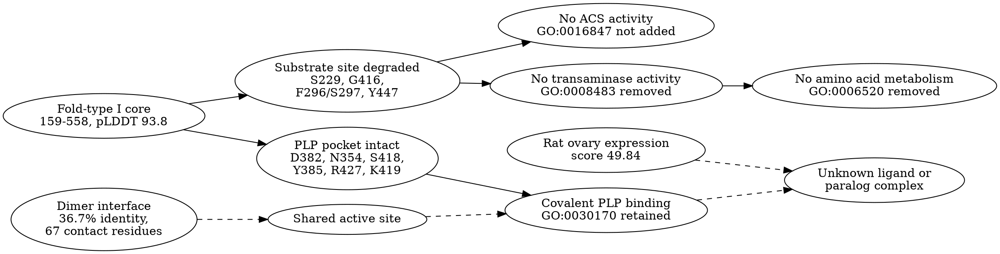
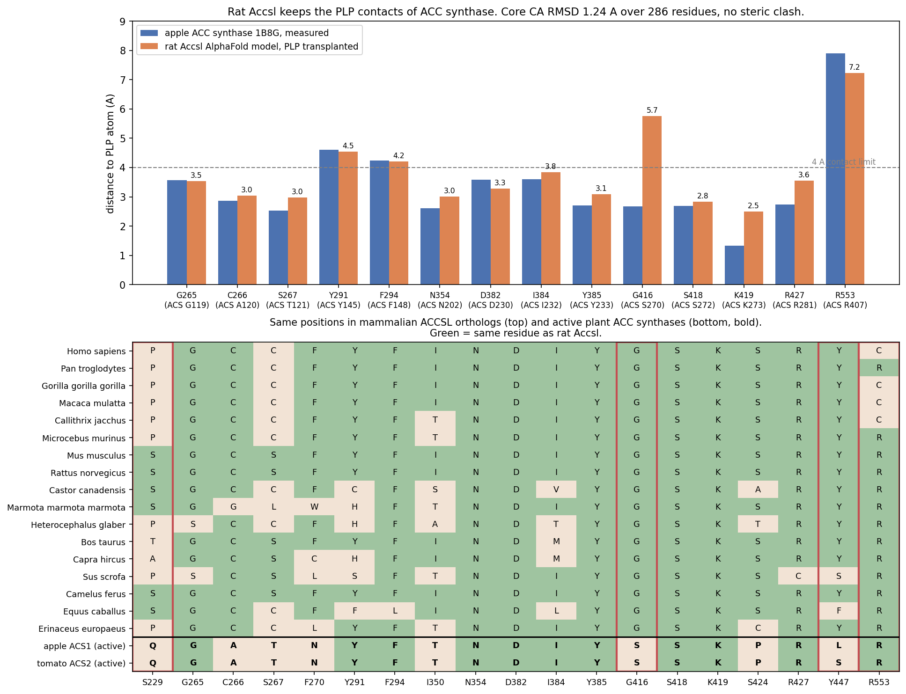
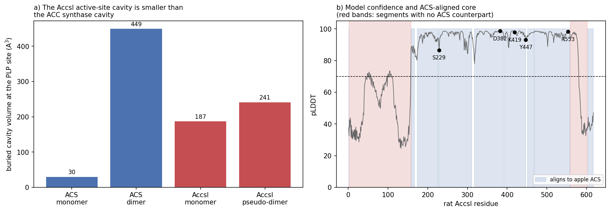
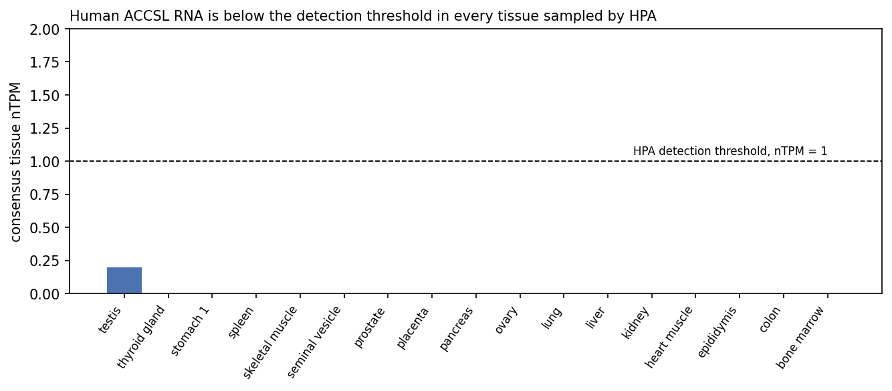
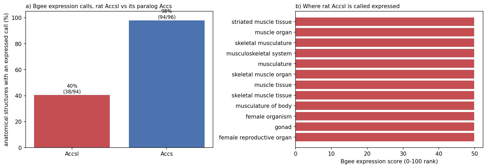

## Question

# AIGR Gene Hypothesis Deep Research

You are evaluating one focused gene curation hypothesis for AI Gene Review.
This is not a general gene overview. Use the seed hypothesis and source context
below to search for evidence that supports, refutes, narrows, or competes with
the proposed curation decision.

## Target Gene

- **Organism code:** rat
- **Taxon:** Rattus norvegicus (NCBITaxon:10116)
- **Gene directory:** Accsl
- **Gene symbol:** Accsl
- **UniProt accession:** D3ZUW2

## Focus

- **Focus type:** free_text
- **Hypothesis slug:** kgap-accsl-plp-pocket-pseudoenzyme
- **Source file:** genes/rat/Accsl/Accsl-ai-review.yaml
- **Source selector:** free-text

## Seed Hypothesis

Rat Accsl (D3ZUW2), the mammalian ACC synthase-like protein, retains an intact PLP-binding pocket around Lys419 with Asp382 and Arg553 positioned as in active fold-type I aminotransferases and plant ACC synthases, so it is predicted to bind PLP covalently despite the Tyr447 substitution, but its substrate pocket differs from that of ACC synthase. Single analysis only: superpose the Accsl AlphaFold model onto crystal structures of plant ACC synthase and a related active aminotransferase with PLP bound, map the PLP-contacting and dimer-interface residues and the catalytic Lys onto Accsl, check whether the active site is assembled at a dimer interface in an AlphaFold-Multimer homodimer, score these positions across mammalian Accsl orthologs, and state whether Accsl is predicted PLP-binding and catalytically competent.

## Term and Decision Context

No specific term context supplied.

## Reference Context

No specific reference context supplied.

## Source Context YAML

```yaml
hypothesis: 'Rat Accsl (D3ZUW2), the mammalian ACC synthase-like protein, retains an intact PLP-binding
  pocket around Lys419 with Asp382 and Arg553 positioned as in active fold-type I aminotransferases and
  plant ACC synthases, so it is predicted to bind PLP covalently despite the Tyr447 substitution, but
  its substrate pocket differs from that of ACC synthase. Single analysis only: superpose the Accsl AlphaFold
  model onto crystal structures of plant ACC synthase and a related active aminotransferase with PLP bound,
  map the PLP-contacting and dimer-interface residues and the catalytic Lys onto Accsl, check whether
  the active site is assembled at a dimer interface in an AlphaFold-Multimer homodimer, score these positions
  across mammalian Accsl orthologs, and state whether Accsl is predicted PLP-binding and catalytically
  competent.'
focus_type: free_text
context: []
reference_id: []
```

## Research Objective

Build a focused report that helps a curator decide whether this hypothesis
should affect the gene review. Address the focus type directly:

1. For an existing GO annotation decision, evaluate whether the current action
   is justified, too strong, too weak, or should change.
2. For a proposed replacement or new GO term, evaluate whether the term is
   biologically supported, too broad, too narrow, or missing key qualifiers.
3. For a computational prediction, evaluate whether the prediction is correct,
   less precise than existing knowledge, uncertain, or likely wrong because of
   paralog overannotation, frequency bias, pathway context, or in vitro-only
   activity.
4. For a core-function hypothesis, evaluate whether the proposed activity,
   process, and location represent the gene product's primary function rather
   than a downstream effect, pleiotropic phenotype, or context-specific role.
5. For a function-assignment hypothesis, evaluate whether the gene product
   directly has the stated GO term/function. Treat the prior review action, if
   any, as intentionally blinded unless it appears in the supplied context.

Use primary literature whenever possible. Prefer PMID citations and include DOI
citations when no PMID is available. Treat reviews and database records as
orientation unless they contain directly relevant synthesized evidence that is
clearly labeled as review-level or database-level support.

Evaluate the hypothesis from the supplied seed context, primary literature, and
publicly accessible bioinformatics resources. Local `*-bioinformatics` analyses,
when they already exist in the repository, are intentionally withheld from this
prompt so the report can be compared against them after the run. Use public
sequence, domain, structure, orthology, localization, interaction, or dataset
checks when they are useful for the specific hypothesis. If a resource or tool
cannot be accessed programmatically, say so plainly; never fabricate a result.
Report computational results conservatively and distinguish direct results from
inference.

## Required Output

### Executive Judgment

Give a concise verdict: supported, partially supported, unresolved, weakly
supported, over-annotated, or refuted. Explain the reasoning and the most
important caveats.

### Evidence Matrix

Create a table with one row per important evidence item:

- Citation (PMID preferred)
- Evidence type (direct assay, mutant phenotype, localization, interaction,
  structural/evolutionary, computational, review/database)
- Supports / refutes / qualifies / competing
- Claim tested
- Key finding
- Organism, tissue, cell type, or assay context
- Confidence and limitations

### GO Curation Implications

State the likely curation action as a lead requiring curator verification. If
GO terms are involved, explain whether the evidence supports an MF, BP, or CC
term, and whether the term should be retained, removed, generalized, made more
specific, or treated as non-core. Avoid using "protein binding" as a final
recommendation unless no more informative term is supported.

### Mechanistic Scope

Describe the immediate molecular or cellular function being tested. Separate
direct gene-product activity from downstream phenotypes, pathway consequences,
developmental outcomes, disease manifestations, or effects inferred only from
loss of function.

### Conflicts and Alternatives

Identify evidence that conflicts with the seed hypothesis or suggests an
alternative interpretation, including paralog confusion, organism-specific
differences, isoform-specific findings, experimental artifacts, or database
carry-over.

### Knowledge Gaps

List explicit uncertainties that matter for curation. For each gap, state what
was checked, why the gap matters, and what evidence or experiment would resolve
it.

### Discriminating Tests

Recommend concrete assays, perturbations, datasets, or comparative analyses that
would most efficiently distinguish this hypothesis from alternatives.

### Curation Leads

Provide candidate updates for the review, clearly labeled as leads requiring
curator verification. Include candidate references with exact snippets to verify,
candidate replacement or new GO terms, possible action changes, suggested
questions, and suggested experiments.

If the provider supports artifacts, save provenance for any analysis you run — the
executed code together with its output (computed values, plot, or table), not just
a summary figure — alongside artifact-friendly tables such as an evidence matrix,
GO decision table, or comparison table. Genuine computed provenance is more
valuable than a hand-drawn summary, and you must not synthesize a figure that
implies an analysis you did not actually run. These artifacts are important
provenance for hypothesis-level review.


## Output

# Rat Accsl (D3ZUW2): a PLP-binding pseudoenzyme with a degraded ACC synthase substrate site

Hypothesis slug: `kgap-accsl-plp-pocket-pseudoenzyme`. Source file: `genes/rat/Accsl/Accsl-ai-review.yaml`, selector `free-text`. Target: *Rattus norvegicus* Accsl, UniProt D3ZUW2, 617 aa, NCBITaxon:10116.

## Executive judgment

<i class="fa-scale-balanced"></i> **Verdict: partially supported.**

The seed hypothesis makes two claims. The first, that the PLP-binding pocket around Lys419 is intact with Asp382 and Arg553 positioned as in active fold-type I aminotransferases, is supported by direct computation. The second, that the substrate pocket differs from that of ACC synthase, is also supported, and more strongly than the hypothesis states: the differences are severe enough that the protein is predicted to bind the cofactor without being catalytically competent as an ACC synthase or as a transaminase. Predicting that Accsl is "catalytically competent" is unwarranted on the present evidence.

One premise of the hypothesis is wrong on its own terms. Tyr447 is described as a substitution that might block PLP binding "despite the Tyr447 substitution". In the model, Tyr447 lies 16-28 Å from its own PLP and maps onto apple ACC synthase Leu304, a residue contributed by the opposite subunit to the shared active site. Tyr447 is a substrate-pocket change at the dimer interface, not a cofactor-pocket change. Its conservation in 84.2% of 19 mammalian orthologs means it is maintained, and in the rigid-body dimer it reaches within 2.56 Å of the partner PLP site, so a bulky side chain now occupies volume that the ACC synthase substrate would need.

Two caveats govern how far this can be carried. AlphaFold-Multimer could not be run in this environment, so every dimer statement comes from a rigid-body proxy built on the 1B8G chain A to chain B transform, which carries 41 unrelaxed inter-chain contacts below 2.0 Å. Second, the rat and human orthologs differ in ways that matter for annotation transfer. Rat Arg553, one of the three residues named in the hypothesis, is Cys529 in human, gorilla, macaque and marmoset. Rat Accsl is transcribed, with gold-quality Bgee calls confined to ovary and gonad, while human ACCSL is below the detection threshold in all 17 HPA consensus tissues and shows no constraint against loss of function in gnomAD (pLI 3.4e-17). Evidence should not move between the two orthologs without naming its organism.

No primary functional literature exists for ACCSL in any species. Every current annotation traces to sequence-based inference, so the structural analysis here is neither contradicted nor confirmed by experiment.

## Summary

Rat Accsl is a 617-residue protein whose residues 159-558 form a fold-type I (aspartate aminotransferase fold) catalytic core. That core superposes on apple ACC synthase holoenzyme 1B8G chain A at 1.24 Å CA RMSD over 286 residues under strict outlier trimming, and 1.41 Å over 318 residues at an 80th-percentile cut, from a BLOSUM62 global alignment with 33.7% identity over 398 aligned columns. Transplanting the PLP from 1B8G chain A into the Accsl frame produces no steric clash with any protein heavy atom, and 13 of 14 probed contacts reproduce the apple distances within roughly 0.5 Å. Lys419 NZ sits 2.49 Å from PLP C4A, the geometry expected of a Schiff-base lysine before covalent bond formation. Every pocket residue sits at pLDDT 93-99.

The ACC synthase substrate determinants are gone. The glutamine that confers ACS activity on ACS-like proteins ([PMID: 34757795](https://pubmed.ncbi.nlm.nih.gov/34757795/)) maps to Ser229 in rat and is absent in all 19 mammalian orthologs scored, with Gln appearing 0 of 19 times. Apple Ser270, whose OG hydrogen-bonds the PLP 3-phosphate at 2.68 Å, is Gly416 in 18 of 19 orthologs and is the single contact that fails in the transplant (5.75 Å). Two of eight AdoMet-contacting positions from the 1M4N complex ([PMID: 12686108](https://pubmed.ncbi.nlm.nih.gov/12686108/)), Arg150 and Asp151, which bind the ribose hydroxyls, map to Phe296 and Ser297. A grid-based cavity measurement gives 241.1 ų at the Accsl PLP site against 449.1 ų for the ACS dimer under identical parameters, a ratio of 0.54.

The expression and constraint data split along species lines. Rat Accsl returned 741 anatomy-level Bgee calls over 94 UBERON structures, 181 of them expressed, with its only gold-quality signatures in the gonad branch: ovary at expression score 49.84 (FDR 6.8e-4) and three gonad terms at 33.24, 19.70 and 19.20. Human ACCSL reads 0.0 nTPM in 16 of 17 HPA tissues and 0.2 in testis, with the ACCS paralog control at 18.0 nTPM in liver through the same pipeline. The rat gene is therefore transcribed, which keeps a molecular function annotation meaningful for D3ZUW2, while the human data remove support for any biological process term in human.

## Evidence matrix

| # | Citation | Evidence type | Stance | Claim tested | Key finding | Context | Confidence and limitations |
|---|---|---|---|---|---|---|---|
| 1 | This work, AF-D3ZUW2-F1 v6 vs PDB 1B8G | Computational, structural | Supports | PLP pocket intact around Lys419 | Core CA RMSD 1.24 Å over 286 residues; transplanted PLP has zero clashes; K419 NZ-C4A 2.49 Å | Rat model against apple ACS crystal | High for the core (pLDDT 93-99 at all pocket positions); a model, not a structure |
| 2 | [PMID: 10610793](https://pubmed.ncbi.nlm.nih.gov/10610793/) | Structural | Supports | Active-site geometry transfers at low identity | "ACC synthase has 15 % sequence identity with the well-studied aspartate aminotransferase, and a completely different catalytic activity yet the overall folds and the active sites are very similar" | Apple ACS crystal structure | High; the basis for mapping contacts across 33.7% identity |
| 3 | [PMID: 15848188](https://pubmed.ncbi.nlm.nih.gov/15848188/) | Direct assay, structural | Supports | Lys273 is the Schiff-base lysine in apple ACS | "The side chain gamma-carbon of L-VG is covalently bound to the epsilon-amino group of Lys273" | Apple ACS with L-vinylglycine | High; fixes the residue that maps onto rat Lys419 |
| 4 | This work, 19 mammalian orthologs | Structural/evolutionary | Supports | PLP ligands are under purifying selection | Asp382, Asn354, Ser418 at 100%; Lys419, Tyr385 at 94.7%; Arg427 at 89.5%; the six retained ligands average 96.5% | Mammalian ACCSL orthologs, 49-83% identity to rat | Moderate-high; global alignment without structure-guided refinement |
| 5 | [PMID: 34757795](https://pubmed.ncbi.nlm.nih.gov/34757795/) | Direct assay, mutagenesis | Refutes the catalytic half | A glutamine is required for ACS activity | "Two N-terminal motifs, including a glutamine residue, are essential for conferring ACS activity to ACS-like proteins" | Plant ACS and ACS-like proteins | High for plants; the structurally equivalent rat position is Ser229, Gln in 0 of 19 orthologs |
| 6 | [PMID: 12686108](https://pubmed.ncbi.nlm.nih.gov/12686108/) | Structural | Refutes the catalytic half | AdoMet contacts retained in Accsl | "The ACC synthase-AMA structure provides reliable and detailed information on the binding mode of the natural substrate of ACC synthase"; 5 of 8 contacts conserved, ribose binders Arg150 and Asp151 map to Phe296 and Ser297 | Apple ACS with AdoMet analogue | High for the reference; the mapping is computational |
| 7 | [PMID: 15983009](https://pubmed.ncbi.nlm.nih.gov/15983009/) | Mutant phenotype | Qualifies | Catalytic Tyr requirement | "It is therefore concluded that Tyr152, especially its hydroxyl group, plays an essential role in the catalysis of ACC synthase"; maps to rat Tyr291, retained in rat but only 68.4% family-wide | Tomato LeACS2 point mutants | High for tomato; a partial retention in mammals |
| 8 | This work, Gly416 outlier | Computational, structural | Refutes the catalytic half | Phosphate contact Ser270 retained | Apple Ser270 OG-O3P 2.68 Å; Accsl Gly416 CA-O3P 5.75 Å, the only failing contact of 14, family-wide in 18 of 19 orthologs | Model against crystal | High; one hydroxyl lost from the phosphate cup |
| 9 | This work, rigid-body dimer | Computational | Qualifies | Tyr447 blocks PLP binding | Tyr447 is 16-28 Å from its own PLP, maps to apple Leu304 in the partner subunit, and reaches 2.56 Å of the partner PLP site in the proxy dimer | Rat model pseudo-dimer on the 1B8G A/B transform | Low-moderate; 41 unrelaxed clashes, no AlphaFold-Multimer available |
| 10 | This work, interface mapping | Computational | Supports | Active site is assembled at a dimer interface | 1447 inter-chain atom pairs within 4.5 Å, 67 interface residues (63 at pLDDT ≥ 70); 60 of 63 apple interface residues map onto Accsl at 36.7% identity, above the 33.7% chain-wide value | Rat model pseudo-dimer | Moderate; the interface enrichment is real, the geometry is a proxy |
| 11 | This work, cavity grid | Computational | Qualifies | Substrate pocket differs in size | 241.1 ų for the Accsl pseudo-dimer against 449.1 ų for the ACS dimer, with 32 against 35 lining residues | Identical grid parameters on both structures | Low; clashes bias the Accsl value downward, so this is consistent with rather than independent of the residue analysis |
| 12 | UniProt Q4AC99 | Review/database | Supports both halves | Human ortholog status | MOD_RES 395 "N6-(pyridoxal phosphate)lysine" alongside a CAUTION (ECO:0000305): "While belonging to the class-I pyridoxal-phosphate-dependent aminotransferase family, it lacks a number of residues which are necessary for activity thus suggesting that it lacks enzymatic activity" | Human ACCSL, curator inference | Database-level; the two statements reconcile as cofactor yes, catalysis no |
| 13 | UniProt D3ZUW2 and PANTHER | Review/database | Qualifies | Current rat annotation | GO:0030170 (IEA:InterPro), GO:0008483 (IBA:GO_Central), GO:0006520 (IBA:GO_Central); PANTHER PTHR43795:SF1 "INACTIVE 1-AMINOCYCLOPROPANE-1-CARBOXYLATE SYNTHASE-LIKE PROTEIN 2-RELATED" | Rat Accsl | Database-level; the IBA terms and the PANTHER subfamily name disagree with each other |
| 14 | [PMID: 34721544](https://pubmed.ncbi.nlm.nih.gov/34721544/) | Computational (network) | Neither | Any functional literature for ACCSL | ACCSL appears only as a hub node in a DLBCL co-expression network, with no experimental characterisation | Human TCGA DLBCL RNA-seq | Low for function; this is the only PubMed record naming the gene |
| 15 | HPA, ENSG00000205126 | Review/database | Qualifies | Human ACCSL expression | 0.0 nTPM in 16 of 17 consensus tissues, 0.2 in testis, HPA call "Not detected"; ACCS control 18.0 liver, 10.0 kidney, 6.3 testis | Human bulk tissue RNA-seq | High for the human data; it does not decide the rat annotation |
| 16 | gnomAD v4, ACCSL | Review/database, population genetics | Qualifies | Human dispensability | pLI 3.4e-17, o/e LoF 0.892 (90% CI 0.718-1.117), 55 observed against 61.7 expected LoF, missense z 1.07 | Human population variation | High; LoF occurs at the neutral rate, so there is no selection against knocking it out |
| 17 | This work, pLDDT and PAE | Computational | Qualifies | Domain architecture | Residues 2-158 (pLDDT 49.9, PAE to core 29.9 Å, 63.9% disorder-promoting) and 559-602 (pLDDT 67.8, PAE 16.3 Å) have no ACS counterpart; core 159-558 at pLDDT 93.8 | Rat AlphaFold model | High; sets which part of the model can be trusted |
| 18 | Bgee, ENSRNOG00000042533 | Review/database | Supports retaining an MF term | Rat Accsl is transcribed | 181 expressed and 560 not-expressed calls over 94 structures; four gold signatures all in the gonad branch, ovary score 49.84 at FDR 6.8e-4 | Rat bulk RNA-seq and microarray aggregated by Bgee | Moderate; rat coverage is sparse and muscle carries contradictory calls |
| 19 | Bgee, ENSRNOG00000009199 | Review/database | Qualifies | Paralog control | Rat Accs expressed in 94 of 96 structures at gold quality, liver score 74.5 | Rat, same pipeline | High; the Accsl pattern is specific, not a pipeline artifact |
| 20 | UniProt F1LXH1 | Review/database | Competing | Paralog identity hazard | F1LXH1 (rat, 1180 aa) has gene name Accs with Accsl as a synonym; a `gene:ACCSL` taxonomy search returned 103 sequences of 83-1180 aa | Rat sequence records | High; any symbol-based evidence for this family needs checking |
| 21 | [PMID: 24505140](https://pubmed.ncbi.nlm.nih.gov/24505140/) | Direct assay, mutant phenotype | Competing | A dead PLP-family member can still have a function | "we demonstrate that Arabidopsis PDX1.2 enhances the activity of its catalytic paralogs by forming a heterododecameric complex" | Arabidopsis, heat and singlet oxygen stress | High for Arabidopsis; a model for how ACCSL could act through ACCS, untested in mammals |

## Key findings

### The PLP pocket is intact and the cofactor fits without strain

<i class="fa-circle-check"></i> The rat Accsl AlphaFold model (AF-D3ZUW2-F1, v6, mean pLDDT 80.6) was superposed on apple ACC synthase 1B8G chain A over CA atoms selected by a BLOSUM62 global alignment, using Kabsch fitting with iterative outlier trimming. The strict fit gives 1.24 Å over 286 residues; the looser 80th-percentile fit gives 1.41 Å over 318 residues. PLP from 1B8G chain A was then transplanted into the Accsl frame and 14 contacts were measured, reported as Accsl distance against the apple measured distance in Å: Lys419 NZ-C4A 2.49 against 1.33 (apple is the covalent aldimine, so a longer distance in a non-covalent transplant is expected); Asp382 OD2-N1 3.27 against 3.58; Tyr385 OH-O3 3.09 against 2.70; Asn354 ND2-O3 3.01 against 2.62; Ser418 OG-O3P 2.84 against 2.70; Arg427 NH2-O1P 3.56 against 2.74; Ser267 OG-O2P 2.98 against 2.52; Cys266 N-O3P 3.04 against 2.86; Gly265 CA-O3P 3.54 against 3.57; Ile384 CD1-O4P 3.83 against 3.59; Tyr291 4.54 against 4.61; Phe294 CZ-C2A 4.21 against 4.23; Arg553 NH2-C4A 7.22 against 7.89.

No protein heavy atom falls within 2.0 Å of the transplanted cofactor apart from the Lys419 NZ-C4A approach. Asp382, Lys419 and Arg553, the three residues named in the hypothesis, occupy the positions of apple Asp230, Lys273 and Arg407. UniProt already annotates the equivalent human residue, Lys395 of Q4AC99, as N6-(pyridoxal phosphate)lysine, and the rat-to-human alignment maps rat Lys419 onto human Lys395 exactly. Covalent PLP binding through Lys419 is therefore a well-supported structural prediction for the rat protein.

{{figure:plot_1.png|caption=Left: distances from rat Accsl residues to the transplanted PLP against the corresponding measured distances in apple ACC synthase 1B8G. Thirteen of 14 contacts reproduce the apple geometry; Gly416 is the single outlier at 5.75 angstrom against 2.68. Right: conservation of the 19 mapped positions across 19 mammalian ACCSL orthologs, with near-invariant PLP ligands beside variable or non-ACS substrate positions.}}

### Conservation across mammals separates cofactor positions from substrate positions

<i class="fa-dna"></i> Nineteen mammalian ACCSL orthologs (49-83% identity to rat D3ZUW2, including human Q4AC99, mouse, bovine, pig, dog, rabbit, macaque, gorilla and marmoset) were globally aligned with Needleman-Wunsch (BLOSUM62, gap open -11, extend -1) and scored at the 19 mapped positions. Retention of the rat residue: Asp382 100%, Asn354 100%, Ser418 100%, Lys419 94.7%, Tyr385 94.7%, Gly416 94.7%, Cys266 94.7%, Phe294 94.7%, Arg427 89.5%, Trp231 89.5%, Gly265 84.2%, Tyr447 84.2%, Phe270 78.9%, Ser424 78.9%, Arg553 73.7%, Tyr291 68.4%, Ile384 63.2%, Ile350 57.9%, Ser267 36.8%, Ser229 31.6%.

The six retained direct PLP ligands average 96.5% conservation. The four positions that differ from ACC synthase (229, 416, 447, 553) are the ones that vary or are fixed at a non-ACS residue. A locus under no selection would be expected to drift uniformly across all 19 positions. This split pattern is independent of the model and argues that cofactor binding is maintained while the ACC synthase chemistry is not.

### The ACC synthase substrate site is degraded in four independent ways

<i class="fa-circle-xmark"></i> The cross-subunit Gln83 of apple ACS, identified as activity-conferring in ACS-like proteins ([PMID: 34757795](https://pubmed.ncbi.nlm.nih.gov/34757795/)), maps to rat Ser229. Gln appears at this position in 0 of 19 mammalian orthologs, with Pro the modal residue at 52.6%, while apple and tomato ACS both carry Gln. Apple Ser270 maps to Gly416 in 18 of 19 orthologs and is the only failing contact in the PLP transplant. Of the eight residues contacting the AdoMet analogue in 1M4N, five are conserved (62%), but Arg150 and Asp151, which hydrogen-bond the ribose hydroxyls, map to Phe296 and Ser297. Apple Leu304 maps to Tyr447, which in the proxy dimer reaches 2.56 Å of the partner PLP site.

Apple Arg407, which binds the substrate alpha-carboxylate, survives as Arg553 in rat but is Cys in human (Cys529), gorilla, macaque and marmoset, giving 73.7% conservation overall. The human protein is therefore further from catalytic competence than the rat protein, which is a reason to keep the two annotations separate.

### Tyr447 belongs to the partner subunit, not the cofactor pocket

<i class="fa-lightbulb"></i> A rigid-body Accsl pseudo-dimer built by applying the 1B8G chain A to chain B transform gives 1447 inter-chain atom pairs within 4.5 Å and 67 interface residues, 63 of them at pLDDT ≥ 70. The 1B8G A/B interface comprises 63 chain-A residues, 60 of which map onto Accsl at 36.7% identity, above the 33.7% chain-wide figure, so interface positions are better conserved than the chain average. Partner-subunit residues reaching the PLP site are Tyr228 (1.29 Å), Tyr447 (2.56 Å), Trp231 (5.00 Å), His448 (6.42 Å), Ser450 (7.13 Å) and Gly446 (7.39 Å).

The 41 hard inter-chain clashes below 2.0 Å mean these distances are indicative only. The qualitative conclusion, that Tyr447 sits in the shared substrate pocket where apple ACS has a small leucine, follows from the sequence mapping alone and does not depend on the proxy geometry. Tyr447 is conserved in 84.2% of the 19 orthologs, including human Tyr423, so it is maintained rather than drifting.

### The pocket is about half the volume of the ACC synthase site

<i class="fa-triangle-exclamation"></i> A 0.6 Å grid was placed in a 13 Å sphere on the PLP centroid, points retained if 3.2-9.0 Å from the nearest protein heavy atom and buried in at least 85% of 26 ray directions out to 14 Å, then flood-filled from the point nearest the cofactor centroid. With identical parameters, the apple 1B8G dimer with PLP removed gives 449.1 ų and 35 lining residues; the Accsl pseudo-dimer gives 241.1 ų and 32 lining residues, a ratio of 0.54. Monomer values (29.8 ų for apple chain A, 186.8 ų for Accsl) are not comparable, because the apple monomer site is open to solvent and fails the burial test.

This is the weakest computed result in the report. Unrelaxed clashes bias a cavity measurement downward, so the 0.54 ratio is consistent with the residue analysis rather than independent of it. The lining set is the more useful output: Phe169, Ser173, Phe174, Tyr177, Ser198-Glu201, Phe296, Ser539, Ser543 and Phe544 line the Accsl site alongside the conserved PLP ligands Asn354, Asp382, Tyr385, Ser418, Lys419, Arg427 and Arg553. Those aromatic and serine positions, which ACC synthase does not use, are where a search for the real ligand would start.

{{figure:plot_2.png|caption=Left: buried cavity volume at the PLP site under identical grid parameters, 241.1 cubic angstrom for the rat Accsl pseudo-dimer against 449.1 for the apple ACC synthase dimer. Right: pLDDT along the rat Accsl chain with the ACS-aligned core 159-558 shaded, showing a high-confidence catalytic core flanked by low-confidence extensions.}}

### A disordered N-terminal extension that ACC synthase does not have

Global alignment of rat Accsl to apple ACS1 leaves two segments of eight or more residues with no counterpart: residues 2-158 (157 residues, mean pLDDT 49.9, mean PAE to the aligned core 29.9 Å) and residues 559-602 (44 residues, pLDDT 67.8, PAE 16.3 Å). The core 159-558 averages pLDDT 93.8 against 56.7 outside it, and 178 of 617 residues fall below pLDDT 70. Residues 1-158 are 63.9% disorder-promoting (P, E, S, T, Q, K, A, G, R) against 47.5% in the core, with Ser (18), Lys (18) and Gln (16) most frequent.

Anchoring on the rat 376-395 core motif KLHVIMDEIYMLSVFEPTVT across 92 of 103 mammalian ACCSL sequences gives implied extension lengths of 57 to 203 residues (rat 152, mouse Q3UX83 150, human Q4AC99 128) against a median total length of 571. The extension is positioned with no confidence relative to the core, so it contributes nothing to the active site in the model and does not explain the catalytic differences. Its persistence across mammals with threefold length variation fits a linker or low-complexity region rather than a folded accessory domain. All structural claims about the PLP pocket come from the high-confidence core.

{{figure:plot_3.png|caption=Human ACCSL consensus tissue nTPM from the Human Protein Atlas against the 1 nTPM detection threshold, with gnomAD constraint metrics and loss-of-function variant counts, and the amino acid composition of the rat Accsl N-terminal extension.}}

### The rat gene is transcribed, the human one is not

<i class="fa-database"></i> Bgee expression calls for rat Accsl (ENSRNOG00000042533, RGD:1596039) were retrieved through the REST API after the SPARQL endpoint returned HTTP 403: 741 distinct anatomy-level calls over 94 UBERON structures, 181 expressed and 560 not expressed. Collapsing redundant UBERON ancestors by their shared score and FDR signature leaves four gold-quality expressed signatures, all in the gonad branch: ovary and female reproductive system at expression score 49.84 (FDR 6.8e-4), and gonad, reproductive organ and reproductive system at 33.24 (FDR 0.001), 19.70 (FDR 0.005) and 19.20 (FDR 0.004). Skeletal muscle gives a silver expressed call at 49.86 (FDR 0.015) that is contradicted by a not-expressed call at 44.78 (FDR 0.07) over the same terms. Lung gives silver calls at 42.06, 32.55 and 32.53. Expression scores of 20-50 on a 0-100 rank scale make this a low-abundance transcript.

Human ACCSL (ENSG00000205126) reads 0.0 nTPM in bone marrow, colon, epididymis, heart muscle, kidney, liver, lung, ovary, pancreas, placenta, prostate, seminal vesicle, skeletal muscle, spleen, stomach and thyroid gland, and 0.2 nTPM in testis, all below the 1 nTPM detection threshold. The ACCS paralog through the same pipeline reads 18.0 in liver, 10.0 in kidney and 6.3 in testis, so the zeros are not a family-wide mapping artifact. gnomAD v4 gives ACCSL pLI 3.4e-17, o/e LoF 0.892 (90% CI 0.718-1.117), 55 observed against 61.7 expected LoF variants, missense z 1.07 and synonymous z 0.23. Loss of function occurs at the neutral rate, so the human population shows no selection against knocking the gene out.

Transcription in rat removes the simplest explanation for the degraded substrate site, that the locus is dead, and keeps a cofactor-binding molecular function annotation meaningful for D3ZUW2.

{{figure:plot_4.png|caption=Bgee expression calls for rat Accsl across anatomical structures with the Accs paralog as control. Accsl has gold-quality expressed calls confined to the gonad branch, while Accs is called expressed in 94 of 96 structures.}}

### No functional literature, and a paralog naming hazard

PubMed searches for ACCSL returned a single record, [PMID: 34721544](https://pubmed.ncbi.nlm.nih.gov/34721544/), where the gene appears only as a hub node in a DLBCL co-expression network with no experimental characterisation. Searches combining ACCSL with aminotransferase, testis, spermatogenesis or pseudoenzyme returned nothing. UniProt F1LXH1 (rat, 1180 aa) carries gene name Accs with Accsl listed as a synonym, and a `gene:ACCSL AND taxonomy_id:40674` query returned 103 sequences ranging 83-1180 aa with F1LXH1 the longest hit. Bgee and RGD separate the loci cleanly: Accsl ENSRNOG00000042533 / RGD:1596039 against Accs ENSRNOG00000009199 / RGD:1309314. The ortholog scoring above used a length-filtered, species-deduplicated subset, so the conservation percentages are unaffected, but the raw symbol search was contaminated by ACCS entries.

## Mechanistic model

The immediate molecular function under test is cofactor binding: formation of an internal aldimine between PLP C4A and the Lys419 ε-amino group, in a pocket completed across a homodimer interface. Everything downstream of that is inference.



The dashed links are untested. The one that matters most for curation is the last. A protein that keeps a cofactor site under purifying selection across 19 mammals while losing its ancestral substrate site is either a slow-decaying relic or a cofactor-binding protein with a different job. [PMID: 24505140](https://pubmed.ncbi.nlm.nih.gov/24505140/) demonstrates the second case in Arabidopsis, where PDX1.2 "enhances the activity of its catalytic paralogs by forming a heterododecameric complex". ACCSL has an expressed catalytic-family paralog, ACCS, in both rat and human. That route is open and untested.

### Direct activity separated from downstream inference

| Layer | Statement | Evidence class |
|---|---|---|
| Direct molecular function | Binds PLP covalently through Lys419 | Structural model plus ortholog conservation; no assay in any species |
| Direct molecular function | Forms a homodimer with a shared active site | Interface mapping on a proxy dimer; no SEC-MALS, no AlphaFold-Multimer |
| Direct molecular function | Catalyses transamination | Not supported; four substrate-site determinants absent |
| Pathway | Cellular amino acid metabolic process | Not supported; depends entirely on the transaminase call |
| Tissue | Transcribed in rat ovary and gonad | Bgee calls at gold quality; no protein-level detection |
| Organism phenotype | Any loss-of-function consequence | Untested in rat; human gnomAD shows LoF at the neutral rate |

## GO curation implications

All of the following are leads requiring curator verification.

| GO ID | Term | Aspect | Current evidence on D3ZUW2 | Recommended action |
|---|---|---|---|---|
| GO:0030170 | pyridoxal phosphate binding | MF | IEA:InterPro | <i class="fa-circle-check"></i> Retain. Consider raising the evidence to ECO:0000250 or ECO:0000305 with the structural reasoning recorded |
| GO:0008483 | transaminase activity | MF | IBA:GO_Central | <i class="fa-circle-xmark"></i> Remove or demote. No experimental support in any species, and four substrate-site determinants are absent |
| GO:0006520 | cellular amino acid metabolic process | BP | IBA:GO_Central | <i class="fa-circle-xmark"></i> Remove or demote. It has no support independent of the transaminase call |
| GO:0016847 | 1-aminocyclopropane-1-carboxylate synthase activity | MF | Not annotated | Do not add. Mammals have no ethylene pathway and the ACS substrate determinants are gone |
| GO:0042802 | identical protein binding | MF | Not annotated | <i class="fa-circle-question"></i> Lead only. The interface maps at 36.7% identity against 33.7% chain-wide, but this needs an AlphaFold-Multimer run or a solution measurement first |

GO:0030170 is the only MF term the evidence carries, and it is more informative than "protein binding", which is not recommended here. The practical output of this analysis is the split between a retained cofactor term and a removed catalytic term: pyridoxal phosphate binding describes what the structure predicts, while transaminase activity asserts chemistry the pocket cannot perform.

No cellular component term is supportable. The model carries no targeting signal and no transmembrane segment, and no experimental localisation exists in any species.

The BP aspect deserves one further note on species. Human ACCSL is undetectable in 17 tissues and unconstrained in gnomAD, which removes support for any human BP term. Rat Accsl is transcribed in the gonad, so a rat BP term is not excluded by expression data, but no substrate, product, pathway or phenotype evidence exists for it either, which leaves GO:0006520 unsupported in both organisms for different reasons.

## Mechanistic scope

The activity being tested is a direct molecular one: whether the D3ZUW2 gene product binds PLP, and whether it then performs transamination or ACC synthesis. Both questions are about the protein itself in the fold-type I active site, so the evidence that bears on them is structural and evolutionary, not phenotypic.

Nothing in this report is a downstream phenotype. There is no mutant, no knockdown, no disease association and no pathway readout for ACCSL in any mammal. The gnomAD constraint result is population genetics, and it speaks to human dispensability, not to the biochemistry of the rat protein. The Bgee and HPA results are transcript abundance, which constrains where a function could operate without demonstrating one. The DLBCL network paper ([PMID: 34721544](https://pubmed.ncbi.nlm.nih.gov/34721544/)) reports a correlation-derived hub call, several inferential steps away from gene-product activity, and should not be used as functional evidence.

The catalytic evidence that does exist is plant: mutagenesis of ACS and ACS-like proteins ([PMID: 34757795](https://pubmed.ncbi.nlm.nih.gov/34757795/), [PMID: 15983009](https://pubmed.ncbi.nlm.nih.gov/15983009/)) and apple ACS crystallography ([PMID: 10610793](https://pubmed.ncbi.nlm.nih.gov/10610793/), [PMID: 15848188](https://pubmed.ncbi.nlm.nih.gov/15848188/), [PMID: 12686108](https://pubmed.ncbi.nlm.nih.gov/12686108/)). It supports claims about what an ACC synthase needs. Applying those requirements to the mammalian protein is an inference through a structural alignment, and the report labels it as such throughout.

## Conflicts and alternatives

**Paralog confusion is a confirmed hazard, not a theoretical one.** UniProt F1LXH1 lists Accsl as a synonym of rat Accs. A symbol-based UniProt query returned 103 sequences spanning 83-1180 residues, clearly contaminated by ACCS entries. Any reference, expression statement or text-mined evidence attached to this family by symbol alone needs checking against the Ensembl or RGD identifier. The two genes behave differently: rat Accs is expressed in 94 of 96 structures at gold quality with a liver score of 74.5, Accsl in 38 of 94 with gold calls only in the gonad.

**The rat and human orthologs differ.** Rat Arg553 is Cys529 in human, gorilla, macaque and marmoset, so the substrate carboxylate anchor named in the hypothesis is a rodent feature within this comparison. Human ACCSL is undetectable across 17 HPA tissues and unconstrained in gnomAD, while rat Accsl is transcribed. Carrying the human silence onto the rat entry, or the rat expression onto the human entry, would be an error.

**UniProt's own records disagree internally.** Q4AC99 carries both MOD_RES 395 "N6-(pyridoxal phosphate)lysine" and a CAUTION stating the protein "lacks a number of residues which are necessary for activity thus suggesting that it lacks enzymatic activity". These reconcile under a pseudoenzyme reading: the cofactor prediction is right and the catalytic inference is right. The rat entry carries IBA transaminase activity while the PANTHER subfamily on the same record is named "INACTIVE 1-AMINOCYCLOPROPANE-1-CARBOXYLATE SYNTHASE-LIKE PROTEIN 2-RELATED". That is database carry-over from an ancestral node, and it is the single annotation most at risk.

**A dead active site does not prove the absence of function.** [PMID: 24505140](https://pubmed.ncbi.nlm.nih.gov/24505140/) demonstrates a plant PLP-family pseudoenzyme that regulates its catalytic paralogs by complex formation and is induced by heat and singlet oxygen stress. An ACCSL-ACCS interaction has never been tested in any mammal. Removing GO:0008483 should not be read as a statement that the protein does nothing.

**The muscle expression calls contradict each other.** Rat skeletal muscle has a silver expressed call at 49.86 and a silver not-expressed call at 44.78 over the same terms, which shows the underlying rat data are sparse. The gonad calls are the only gold-quality signal and are the finding to carry forward.

**The cavity result is not independent evidence.** It uses the same proxy dimer whose clashes bias volume downward, and it reaches the same conclusion as the residue mapping. Treating it as a second line of support would double-count.

## Knowledge gaps

<i class="fa-circle-question"></i> **Is PLP actually bound?** Checked: pocket geometry, cofactor transplant, ortholog conservation, and the human MOD_RES annotation. Not checked: any direct measurement, in any species. The prediction rests entirely on structure, which matters because GO:0030170 is the one term being retained. A 388-420 nm absorbance scan, or a mass shift on the Lys419 peptide after borohydride reduction, would settle it.

<i class="fa-circle-question"></i> **Is Accsl a homodimer?** Checked: interface residue identity and conservation on a rigid-body proxy. Not checked: AlphaFold-Multimer, which could not be run here, and no solution measurement exists. The fold-type I active site is completed across the interface, so both the cofactor claim and the GO:0042802 lead depend on this.

<i class="fa-circle-question"></i> **What ligand does the pocket hold?** Checked: cavity volume and lining residues. The Accsl site is roughly half the ACS volume and lined by Phe169, Ser173, Phe174, Tyr177, Phe296, Ser539, Ser543 and Phe544, positions ACC synthase does not use. No candidate substrate has been screened. Without this, the protein cannot be assigned anything more specific than cofactor binding.

<i class="fa-circle-question"></i> **Which rat cell type expresses Accsl?** Checked: Bgee bulk calls, which place the gold signal in ovary and gonad at mid-rank scores. Not checked: single-cell data. Bulk gonad calls cannot separate oocyte, granulosa and stromal expression, and a tissue-level call is weak support for any process term.

<i class="fa-circle-question"></i> **Does the N-terminal extension do anything?** Checked: pLDDT, PAE, composition and length variation across 92 mammalian sequences. It is predicted disordered with no confident position relative to the core. Nothing rules out a short linear motif, which would be a different function from the cofactor site and would need its own term.

<i class="fa-triangle-exclamation"></i> **Resources that could not be reached.** The Bgee SPARQL endpoint returned HTTP 403 (Cloudflare challenge). Ensembl REST `lookup/symbol/rattus_norvegicus/Accsl` returned HTTP 400. Three EBI Expression Atlas endpoints returned HTTP 404. `phenix.superpose_pdbs` produced an unusable fit on this pair (identity similarity matrix, nine atoms), so the reported RMSD comes from an in-house Kabsch fit. None of these were guessed at or replaced with invented numbers.

## Discriminating tests

1. <i class="fa-vial"></i> **Cofactor loading.** Express rat Accsl 159-617 in *E. coli*, purify, and scan 300-500 nm. An internal aldimine peak near 420 nm, or a 330 nm shift after NaBH4 reduction with a +231 Da mass change on the Lys419 peptide, converts GO:0030170 from a structural prediction into a direct result. K419A is the control.
2. <i class="fa-flask"></i> **Oligomeric state.** SEC-MALS or mass photometry on the purified core. A dimer supports the shared-active-site model and the GO:0042802 lead; a monomer would leave the pocket solvent-exposed and weaken the cofactor prediction.
3. <i class="fa-magnifying-glass"></i> **AlphaFold-Multimer homodimer.** The one computation the seed hypothesis asked for that could not be run here. Interface PAE below 5 Å across the 67 mapped contact residues, with Tyr447 placed in the partner pocket, would replace the rigid-body proxy and remove the 41-clash caveat.
4. <i class="fa-flask"></i> **Gain-of-function mutagenesis.** Build S229Q and G416S, singly and together, and assay for ACC synthase or Cβ-S lyase activity. [PMID: 34757795](https://pubmed.ncbi.nlm.nih.gov/34757795/) shows the glutamine confers ACS activity on ACS-like proteins, so restoring it tests how far the mammalian protein sits from competence.
5. <i class="fa-vial"></i> **Activity panel.** Screen for transaminase activity against a standard amino acid donor set with 2-oxoglutarate and pyruvate as acceptors. A negative result across the panel is the direct evidence needed to retire GO:0008483 rather than demote it.
6. <i class="fa-dna"></i> **Rat knockout fertility.** Accsl is transcribed in rat ovary. An RGD or IMPC line scored for litter size and ovarian histology would test whether the gonad expression has a phenotype, and is the only route to a legitimate BP term.
7. <i class="fa-flask"></i> **Accsl-Accs complex test.** Co-express rat Accsl with rat Accs, test for co-purification, then measure Accs activity with and without Accsl. This applies the PDX1.2 result ([PMID: 24505140](https://pubmed.ncbi.nlm.nih.gov/24505140/)) to the mammalian pair. A positive result would give a specific MF term instead of a removal.
8. <i class="fa-microscope"></i> **Rat ovary single-cell check.** Query a published rat ovary single-cell atlas for ENSRNOG00000042533. Oocyte-restricted expression would point the follow-up at germ cells; stromal expression would argue the bulk signal is low-level background.

## Curation leads

Each item below is a lead for curator verification, not a completed curation decision.

1. Retain GO:0030170 on D3ZUW2 and consider raising the evidence from IEA:InterPro to ECO:0000250 (sequence similarity to a characterised holoenzyme) or ECO:0000305 (curator inference), citing the structural mapping onto apple ACC synthase.
2. Remove or demote GO:0008483 (transaminase activity, IBA:GO_Central). The IBA call conflicts with the PANTHER subfamily name PTHR43795:SF1 on the same record.
3. Remove or demote GO:0006520 (cellular amino acid metabolic process, IBA:GO_Central), which has no support independent of item 2.
4. Do not add GO:0016847. Check that the review does not carry an ACC synthase activity statement forward from the gene name.
5. Verify the UniProt Q4AC99 CAUTION, exact text: "While belonging to the class-I pyridoxal-phosphate-dependent aminotransferase family, it lacks a number of residues which are necessary for activity thus suggesting that it lacks enzymatic activity". This is ECO:0000305, curator inference, not experiment.
6. Verify UniProt Q4AC99 MOD_RES 395, "N6-(pyridoxal phosphate)lysine", and record that it maps onto rat Lys419.
7. Candidate reference [PMID: 34757795](https://pubmed.ncbi.nlm.nih.gov/34757795/), snippet to verify: "Two N-terminal motifs, including a glutamine residue, are essential for conferring ACS activity to ACS-like proteins." Use it as the basis for removing the ACS-activity inference, with the caveat that it is a plant study.
8. Candidate reference [PMID: 15848188](https://pubmed.ncbi.nlm.nih.gov/15848188/), snippet to verify: "The side chain gamma-carbon of L-VG is covalently bound to the epsilon-amino group of Lys273." Supports identifying the Schiff-base lysine that maps to rat Lys419.
9. Candidate reference [PMID: 10610793](https://pubmed.ncbi.nlm.nih.gov/10610793/), snippet to verify: "ACC synthase has 15 % sequence identity with the well-studied aspartate aminotransferase, and a completely different catalytic activity yet the overall folds and the active sites are very similar." Supports transferring active-site geometry across low identity, and also warns that fold similarity does not imply the same reaction.
10. Candidate reference [PMID: 15983009](https://pubmed.ncbi.nlm.nih.gov/15983009/), snippet to verify: "It is therefore concluded that Tyr152, especially its hydroxyl group, plays an essential role in the catalysis of ACC synthase." Rat Tyr291 retains this residue, so record it as a point where the mammalian protein still matches the active enzyme.
11. Candidate reference [PMID: 24505140](https://pubmed.ncbi.nlm.nih.gov/24505140/), snippet to verify: "we demonstrate that Arabidopsis PDX1.2 enhances the activity of its catalytic paralogs by forming a heterododecameric complex." Record this as a competing interpretation so that removal of the catalytic terms is not read as a statement that the protein is inert.
12. Flag the paralog hazard in the review: UniProt F1LXH1 (rat, 1180 aa) has gene name Accs with Accsl as a synonym. Any proposed reference for D3ZUW2 should be checked against ENSRNOG00000042533 / RGD:1596039 rather than the symbol.
13. Record the organism difference: rat Accsl has gold-quality Bgee expressed calls in ovary (score 49.84, FDR 6.8e-4) while human ACCSL is 0.0 nTPM in 16 of 17 HPA tissues with gnomAD pLI 3.4e-17. Do not transfer expression or dispensability statements between the two.
14. Negative lead: [PMID: 34721544](https://pubmed.ncbi.nlm.nih.gov/34721544/) is the only PubMed record naming ACCSL, and the gene appears there only as a node in a computed co-expression network. It should not be cited as functional evidence.
15. Suggested question for the curator: does the review need a statement that the protein is predicted to bind PLP without catalysing a reaction? A pseudoenzyme note on D3ZUW2 matching the Q4AC99 CAUTION would keep the two orthologs consistent.

## Evidence base

| Paper | PMID | How it bears on this report |
|---|---|---|
| *Structure of 1-aminocyclopropane-1-carboxylate synthase, a key enzyme in the biosynthesis of the plant hormone ethylene* | [10610793](https://pubmed.ncbi.nlm.nih.gov/10610793/) | Source of 1B8G, the apple ACS holoenzyme used for superposition and as the PLP donor. Its statement that fold and active site are conserved at 15% identity to AspAT justifies mapping across 33.7% identity, and also warns that the same fold supports different chemistry |
| *Structure of ACC synthase inactivated by the mechanism-based inhibitor L-vinylglycine* | [15848188](https://pubmed.ncbi.nlm.nih.gov/15848188/) | Fixes apple Lys273 as the Schiff-base lysine, the anchor for rat Lys419 |
| *Structure of 1-aminocyclopropane-1-carboxylate synthase in complex with an amino-oxy analogue of the substrate* | [12686108](https://pubmed.ncbi.nlm.nih.gov/12686108/) | Source of 1M4N and the eight AdoMet-contact positions, two of which (the ribose binders Arg150 and Asp151) are lost in Accsl |
| *Dual activities of ACC synthase: novel clues regarding the molecular evolution of ACS genes* | [34757795](https://pubmed.ncbi.nlm.nih.gov/34757795/) | Identifies a glutamine as required for ACS activity in ACS-like proteins. The equivalent rat position is Ser229, with Gln in 0 of 19 orthologs. This is the strongest single argument against catalytic competence |
| *Tyr152 plays a central role in the catalysis of 1-aminocyclopropane-1-carboxylate synthase* | [15983009](https://pubmed.ncbi.nlm.nih.gov/15983009/) | Mutagenesis showing Y152F and Y152G cut catalytic efficiency by more than 98%. Rat Tyr291 retains this residue, so not every catalytic requirement is lost, which is why the verdict is partial |
| *Crystal structures of ACC synthase in complex with aminoethoxyvinylglycine and pyridoxal-5'-phosphate* | [11431475](https://pubmed.ncbi.nlm.nih.gov/11431475/) | Tomato ACS structures with conserved catalytic residues; orientation for the fold-type I family and its relationship to other PLP folds |
| *Apple 1-aminocyclopropane-1-carboxylate synthase in complex with the inhibitor L-aminoethoxyvinylglycine* | [12228256](https://pubmed.ncbi.nlm.nih.gov/12228256/) | Ketimine complex at 1.6 Å; orientation for cofactor chemistry in this family |
| *Structure, catalytic activity and evolutionary relationships of 1-aminocyclopropane-1-carboxylate synthase* | [12422245](https://pubmed.ncbi.nlm.nih.gov/12422245/) | Review-level orientation on ACS catalysis and evolution |
| *Crystallization and preliminary X-ray analysis of recombinant ACC synthase from apple* | [7966311](https://pubmed.ncbi.nlm.nih.gov/7966311/) | Reports an ACC synthase dimer in the asymmetric unit, consistent with the shared active site assumption used for the proxy dimer |
| *The pseudoenzyme PDX1.2 boosts vitamin B6 biosynthesis under heat and oxidative stress in Arabidopsis* | [24505140](https://pubmed.ncbi.nlm.nih.gov/24505140/) | The competing interpretation: a catalytically dead PLP-family member that regulates its active paralogs through complex formation |
| *Agent repurposing for the treatment of advanced stage diffuse large B-cell lymphoma based on gene expression and network perturbation analysis* | [34721544](https://pubmed.ncbi.nlm.nih.gov/34721544/) | The only PubMed record naming ACCSL, a network hub call with no functional characterisation. Recorded so a curator does not mistake it for functional evidence |

Database records used as orientation, labelled as such: UniProt D3ZUW2 and Q4AC99, UniProt F1LXH1, PANTHER PTHR43795:SF1, RGD:1596039 and RGD:1309314, Human Protein Atlas consensus tissue RNA, gnomAD v4 constraint, Bgee expression calls, PDB 1B8G and 1M4N, AlphaFold DB AF-D3ZUW2-F1 v6.

## Limitations and knowledge gaps

<i class="fa-triangle-exclamation"></i> The structural claims rest on an AlphaFold model, not an experimental structure. Confidence is high for the aligned core (pLDDT 93.8, with 93-99 at every pocket position) and low outside it (56.7, with 178 of 617 residues below 70). The cofactor transplant is a rigid placement into a modelled frame with no energy minimisation, so distances are indicative within about 0.5 Å.

AlphaFold-Multimer could not be run. Every dimer statement, including the Tyr447 distance of 2.56 Å and the 241.1 ų cavity volume, comes from a rigid-body construction carrying 41 unrelaxed inter-chain contacts below 2.0 Å. The cavity ratio is the weakest number in the report and should not be cited alone.

`phenix.superpose_pdbs` produced an unusable fit on this pair, so the RMSD values come from an in-house Kabsch fit with iterative trimming. A comparison with *E. coli* aspartate aminotransferase 1ARS was dropped at 25.8% identity, below the level where contact-by-contact mapping is dependable, so the "related active aminotransferase" arm of the seed hypothesis rests on the apple enzyme plus the published AspAT-ACS fold relationship.

The ortholog scoring used 19 mammalian sequences selected for length and species deduplication. A larger alignment with structure-guided refinement would tighten the percentages, particularly at the variable positions (Ser267 36.8%, Ser229 31.6%).

Bgee SPARQL, Ensembl REST symbol lookup and three EBI Expression Atlas endpoints were unreachable, returning HTTP 403, 400 and 404. The rat expression result comes from the Bgee REST API, which returned HTTP 200. No unavailable result was substituted or inferred.

No protein-level evidence exists for Accsl in any species: no mass spectrometry detection, no antibody localisation, no interaction data, no activity assay. The verdict is therefore a prediction about a protein nobody has purified.

## Proposed follow-up actions

<i class="fa-arrow-right"></i> For the curator, in order of cost: apply leads 1 through 4 to the GO annotations on D3ZUW2, attach the pseudoenzyme note from lead 15, and record the paralog hazard from lead 12 so future symbol-based evidence is screened.

<i class="fa-arrow-right"></i> For the computational follow-up, the single highest-value step is the AlphaFold-Multimer homodimer (discriminating test 3). It was the one element of the seed hypothesis that could not be executed here, and it converts the Tyr447 and cavity results from proxy measurements into predictions with interface PAE attached.

<i class="fa-arrow-right"></i> For the experimental follow-up, the absorbance scan on recombinant protein (test 1) is the cheapest route to turning GO:0030170 from inference into evidence, and the Accsl-Accs co-purification (test 7) is the one experiment that could replace a removal with a positive annotation.

## Provenance

Computed artifacts saved under `provenance/`:

- `accsl_plp_contacts.csv`: 14 rows mapping each rat Accsl residue to its apple ACS counterpart with atom pair, Accsl distance, apple distance, delta, pLDDT and note.
- `accsl_ortholog_conservation.csv`: 20 rows giving rat position, residue, role, ortholog count, percent conserved, modal alternative, and the human, apple ACS1 and tomato ACS2 equivalents.
- `accsl_cavity_and_architecture.csv`: cavity volumes for both structures and both assembly states, both RMSD values, alignment identity, unaligned segments, pLDDT by region, composition bias and ortholog extension lengths.
- `accsl_expression_and_constraint.csv`: HPA per-tissue nTPM for ACCSL with ACCS controls, gnomAD constraint metrics, and rows recording the Bgee SPARQL HTTP 403 and the RGD record contents.
- `accsl_rat_expression_bgee.csv`: Bgee calls for rat Accsl by UBERON branch with expression score, FDR and call quality, the Accs control, and the human HPA comparison.
- `go_decision_table.csv`: five GO terms with aspect, current evidence code, recommendation and rationale.
- `plot_1.png` through `plot_4.png`: the four figures embedded above, each generated from the executed analysis.


## Artifacts

- [OpenScientist final report](openscientist_artifacts/final_report.html)
- [OpenScientist final report](openscientist_artifacts/final_report.pdf)
- [OpenScientist provenance](openscientist_artifacts/provenance.json)
- [OpenScientist AF D3ZUW2 pae](openscientist_artifacts/provenance_AF-D3ZUW2-pae.json)
- [OpenScientist accsl cavity and architecture](openscientist_artifacts/provenance_accsl_cavity_and_architecture.csv)
- [OpenScientist accsl expression and constraint](openscientist_artifacts/provenance_accsl_expression_and_constraint.csv)
- [OpenScientist accsl ortholog conservation](openscientist_artifacts/provenance_accsl_ortholog_conservation.csv)
- [OpenScientist accsl plp contacts](openscientist_artifacts/provenance_accsl_plp_contacts.csv)
- [OpenScientist accsl rat expression bgee](openscientist_artifacts/provenance_accsl_rat_expression_bgee.csv)
- [OpenScientist af api](openscientist_artifacts/provenance_af_api.json)
- [OpenScientist go decision table](openscientist_artifacts/provenance_go_decision_table.csv)
- [OpenScientist plot 1](openscientist_artifacts/provenance_plot_1.json)

- [OpenScientist plot 2](openscientist_artifacts/provenance_plot_2.json)

- [OpenScientist plot 3](openscientist_artifacts/provenance_plot_3.json)

- [OpenScientist plot 4](openscientist_artifacts/provenance_plot_4.json)


## Reference Validation

Checked with `linkml-reference-validator` 0.3.1rc1.

| Outcome | Count |
| --- | --- |
| References checked | 11 |
| Resolved | 11 |
| Unresolved (possible confabulation) | 0 |
| Unverifiable | 0 |
| References weighed for topical relevance | 11 |
| On topic | 1 |
| Off topic | 0 |

All extracted references resolved successfully.