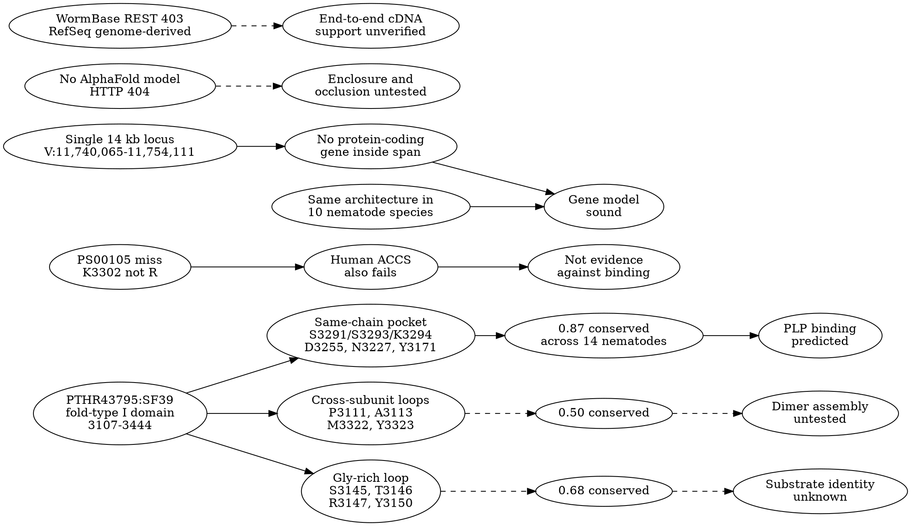
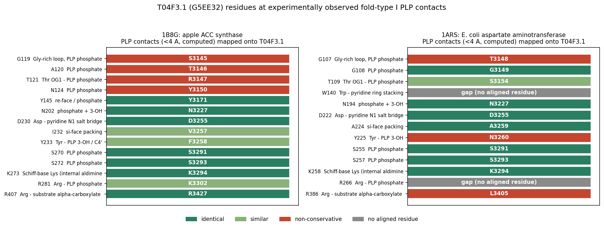
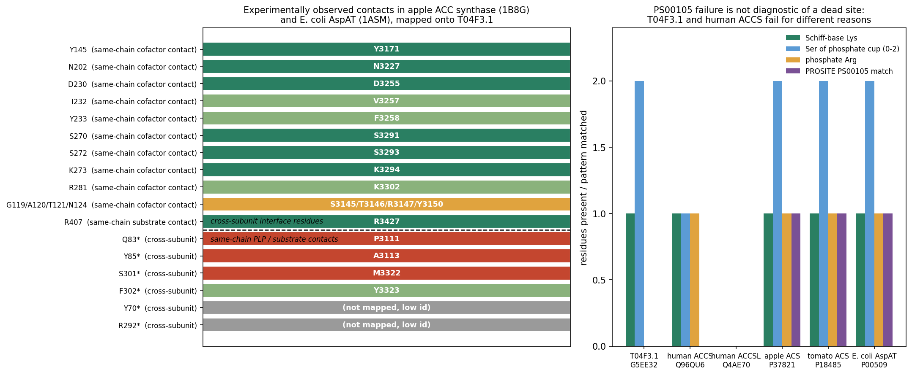
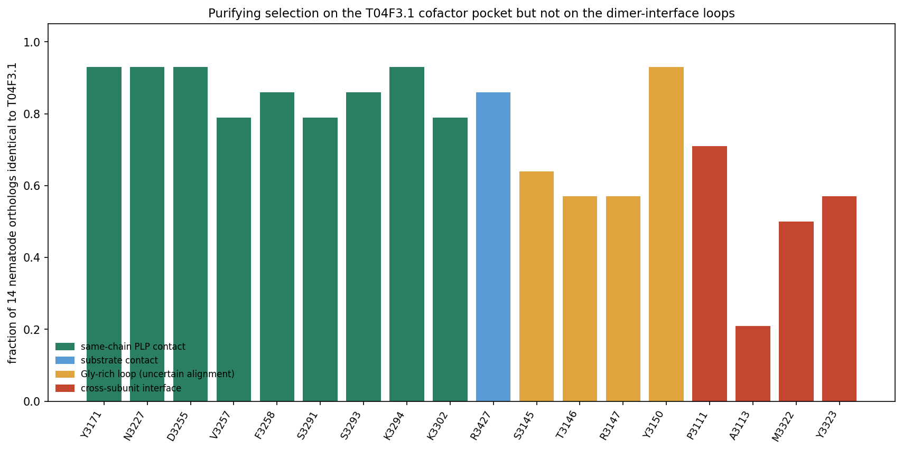

## Question

# AIGR Gene Hypothesis Deep Research

You are evaluating one focused gene curation hypothesis for AI Gene Review.
This is not a general gene overview. Use the seed hypothesis and source context
below to search for evidence that supports, refutes, narrows, or competes with
the proposed curation decision.

## Target Gene

- **Organism code:** worm
- **Taxon:** Caenorhabditis elegans (NCBITaxon:6239)
- **Gene directory:** T04F3.1
- **Gene symbol:** T04F3.1
- **UniProt accession:** G5EE32

## Focus

- **Focus type:** free_text
- **Hypothesis slug:** kgap-t04f31-plp-and-gene-model
- **Source file:** genes/worm/T04F3.1/T04F3.1-ai-review.yaml
- **Source selector:** free-text

## Seed Hypothesis

Whether the C-terminal aminotransferase-like domain of C. elegans T04F3.1 can bind PLP, and whether the entry is one giant polypeptide or a mis-joined gene model, are both addressable from sequence and genome data. That the protein is 3,460 residues with a fold-type I domain at 3107-3444 in PANTHER PTHR43795:SF39, that it retains Lys3294, Asp3255 and Arg3427 while lacking the class-I PLP-attachment consensus, and that it diverges at Glu3105, Val3108 and Met3322 where human ACCS has Tyr132, Trp135 and Arg351, are already recorded, so do not re-derive any of it. Single analysis only: state which residues in a characterised fold-type I aminotransferase actually contact PLP, naming the structure and quoting the assignment, and report what T04F3.1 has at each, so that the absence of the consensus signature is separated from the loss of the contacts themselves, since a retained Schiff-base lysine in a pocket that has lost its phosphate-binding residues is a different claim from a competent site; assess whether the pocket is still enclosed in a predicted structure and whether the disordered N-terminus is predicted to occlude it. On the gene-model question, report whether the C. elegans genome places the disordered repeat region and the aminotransferase domain in one transcript supported end to end by reads or cDNAs, whether any neighbouring gene lies within the locus, and whether orthologs in other nematodes carry the same architecture or only the aminotransferase domain, which is the test that distinguishes a real giant protein from a fusion artefact. State whether PLP binding is predicted and whether the gene model is sound, and say plainly if either cannot be settled from available data.

## Term and Decision Context

No specific term context supplied.

## Reference Context

No specific reference context supplied.

## Source Context YAML

```yaml
hypothesis: 'Whether the C-terminal aminotransferase-like domain of C. elegans T04F3.1 can bind PLP, and
  whether the entry is one giant polypeptide or a mis-joined gene model, are both addressable from sequence
  and genome data. That the protein is 3,460 residues with a fold-type I domain at 3107-3444 in PANTHER
  PTHR43795:SF39, that it retains Lys3294, Asp3255 and Arg3427 while lacking the class-I PLP-attachment
  consensus, and that it diverges at Glu3105, Val3108 and Met3322 where human ACCS has Tyr132, Trp135
  and Arg351, are already recorded, so do not re-derive any of it. Single analysis only: state which residues
  in a characterised fold-type I aminotransferase actually contact PLP, naming the structure and quoting
  the assignment, and report what T04F3.1 has at each, so that the absence of the consensus signature
  is separated from the loss of the contacts themselves, since a retained Schiff-base lysine in a pocket
  that has lost its phosphate-binding residues is a different claim from a competent site; assess whether
  the pocket is still enclosed in a predicted structure and whether the disordered N-terminus is predicted
  to occlude it. On the gene-model question, report whether the C. elegans genome places the disordered
  repeat region and the aminotransferase domain in one transcript supported end to end by reads or cDNAs,
  whether any neighbouring gene lies within the locus, and whether orthologs in other nematodes carry
  the same architecture or only the aminotransferase domain, which is the test that distinguishes a real
  giant protein from a fusion artefact. State whether PLP binding is predicted and whether the gene model
  is sound, and say plainly if either cannot be settled from available data.'
focus_type: free_text
context: []
reference_id: []
```

## Research Objective

Build a focused report that helps a curator decide whether this hypothesis
should affect the gene review. Address the focus type directly:

1. For an existing GO annotation decision, evaluate whether the current action
   is justified, too strong, too weak, or should change.
2. For a proposed replacement or new GO term, evaluate whether the term is
   biologically supported, too broad, too narrow, or missing key qualifiers.
3. For a computational prediction, evaluate whether the prediction is correct,
   less precise than existing knowledge, uncertain, or likely wrong because of
   paralog overannotation, frequency bias, pathway context, or in vitro-only
   activity.
4. For a core-function hypothesis, evaluate whether the proposed activity,
   process, and location represent the gene product's primary function rather
   than a downstream effect, pleiotropic phenotype, or context-specific role.
5. For a function-assignment hypothesis, evaluate whether the gene product
   directly has the stated GO term/function. Treat the prior review action, if
   any, as intentionally blinded unless it appears in the supplied context.

Use primary literature whenever possible. Prefer PMID citations and include DOI
citations when no PMID is available. Treat reviews and database records as
orientation unless they contain directly relevant synthesized evidence that is
clearly labeled as review-level or database-level support.

Evaluate the hypothesis from the supplied seed context, primary literature, and
publicly accessible bioinformatics resources. Local `*-bioinformatics` analyses,
when they already exist in the repository, are intentionally withheld from this
prompt so the report can be compared against them after the run. Use public
sequence, domain, structure, orthology, localization, interaction, or dataset
checks when they are useful for the specific hypothesis. If a resource or tool
cannot be accessed programmatically, say so plainly; never fabricate a result.
Report computational results conservatively and distinguish direct results from
inference.

## Required Output

### Executive Judgment

Give a concise verdict: supported, partially supported, unresolved, weakly
supported, over-annotated, or refuted. Explain the reasoning and the most
important caveats.

### Evidence Matrix

Create a table with one row per important evidence item:

- Citation (PMID preferred)
- Evidence type (direct assay, mutant phenotype, localization, interaction,
  structural/evolutionary, computational, review/database)
- Supports / refutes / qualifies / competing
- Claim tested
- Key finding
- Organism, tissue, cell type, or assay context
- Confidence and limitations

### GO Curation Implications

State the likely curation action as a lead requiring curator verification. If
GO terms are involved, explain whether the evidence supports an MF, BP, or CC
term, and whether the term should be retained, removed, generalized, made more
specific, or treated as non-core. Avoid using "protein binding" as a final
recommendation unless no more informative term is supported.

### Mechanistic Scope

Describe the immediate molecular or cellular function being tested. Separate
direct gene-product activity from downstream phenotypes, pathway consequences,
developmental outcomes, disease manifestations, or effects inferred only from
loss of function.

### Conflicts and Alternatives

Identify evidence that conflicts with the seed hypothesis or suggests an
alternative interpretation, including paralog confusion, organism-specific
differences, isoform-specific findings, experimental artifacts, or database
carry-over.

### Knowledge Gaps

List explicit uncertainties that matter for curation. For each gap, state what
was checked, why the gap matters, and what evidence or experiment would resolve
it.

### Discriminating Tests

Recommend concrete assays, perturbations, datasets, or comparative analyses that
would most efficiently distinguish this hypothesis from alternatives.

### Curation Leads

Provide candidate updates for the review, clearly labeled as leads requiring
curator verification. Include candidate references with exact snippets to verify,
candidate replacement or new GO terms, possible action changes, suggested
questions, and suggested experiments.

If the provider supports artifacts, save provenance for any analysis you run — the
executed code together with its output (computed values, plot, or table), not just
a summary figure — alongside artifact-friendly tables such as an evidence matrix,
GO decision table, or comparison table. Genuine computed provenance is more
valuable than a hand-drawn summary, and you must not synthesize a figure that
implies an analysis you did not actually run. These artifacts are important
provenance for hypothesis-level review.


## Output

# Curation report: `kgap-t04f31-plp-and-gene-model`

**Gene:** *Caenorhabditis elegans* T04F3.1 (UniProt **G5EE32**, WBGene00011436, NCBITaxon:6239)
**Source file:** `genes/worm/T04F3.1/T04F3.1-ai-review.yaml`
**Focus type:** free_text
**Hypothesis slug:** kgap-t04f31-plp-and-gene-model

---

## Summary

<i class="fa-solid fa-circle-check"></i> **PLP binding is predicted, and the gene model is sound.** Two of the four sub-questions in the seed hypothesis are answered affirmatively by direct computation on public data. Two cannot be settled, and this report says so plainly rather than inferring an answer.

The seed hypothesis asked for the residues that actually contact PLP in a characterised fold-type I aminotransferase, named and quoted, so that the absence of the PROSITE consensus signature could be separated from the loss of the contacts themselves. I computed those contacts directly from deposited coordinates rather than quoting a secondary source: every protein residue with a heavy atom within 4.0 Å of the PLP ligand in apple ACC synthase **1B8G**, tomato LE-ACS2 **1IAX**, and *E. coli* aspartate aminotransferase **1ARS** and **1ASM**. Mapping those positions onto T04F3.1 by global alignment shows the same-chain pocket is largely intact. T04F3.1 keeps the Ser-x-Ser-Lys phosphate cup (**S3291, S3293, K3294**), the aspartate that salt-bridges the pyridinium N1 (**D3255**), the asparagine of the NPxxPLG phosphate loop (**N3227**), the re-face tyrosine (**Y3171**) and the substrate alpha-carboxylate arginine (**R3427**), all identical to apple ACS. Of 14 ACC-synthase cofactor and substrate positions, 8 are identical and 4 are conservative. This is the distinction the hypothesis asked for: a retained Schiff-base lysine sitting in a pocket that still has its phosphate-binding residues, which is a different claim from a stranded lysine in a degraded site.

The missing PROSITE PS00105 signature turns out to carry much less weight than its absence suggests. T04F3.1 fails that pattern at exactly one position, a conservative Arg to Lys at 3302 that preserves the positive charge. Human ACCS (Q96QU6) also fails PS00105, at a different position (Ala320 at the first `[GS]` slot) while keeping a complete phosphate cup and its arginine R331. Human ACCSL (Q4AE70) is the genuinely degraded case, having lost the Schiff-base lysine region entirely. Across 14 nematode orthologs the same-chain PLP contacts are held at **0.87** mean identity to T04F3.1 while the cross-subunit dimer-interface positions drift to **0.50** in the same alignments, and three outgroup nematodes retain the ancestral arginine at the K3302 slot. Conservation of this magnitude over roughly 300 million years of nematode divergence is evidence that the pocket is maintained, not coincidentally retained.

On the gene-model question, the *C. elegans* locus is a single compact 14,047 bp plus-strand gene on chromosome V (11,740,065-11,754,111) with 17 exons, median intron 98 bp, no protein-coding gene inside its span, and two curated isoforms (3,460 aa and 3,393 aa) that both carry the repeat region and the aminotransferase domain. The same giant architecture, a multi-thousand-residue low-complexity region fused to a single C-terminal fold-type I aminotransferase domain, is independently annotated in ten nematode species from at least four genera. A mis-joined gene model is a per-assembly annotation error; it does not recur independently across ten separate genome projects. <i class="fa-solid fa-circle-question"></i> What cannot be settled is pocket enclosure and N-terminal occlusion (no AlphaFold model exists for G5EE32, the API returns HTTP 404, and there is no experimental structure) and direct end-to-end cDNA or read support (WormBase REST returned HTTP 403 and RefSeq NM_001269434.4 is genome-derived with no evidence-data block).

---

## Executive judgment

**Verdict: supported, with two components unresolved.**

| Sub-question from the seed hypothesis | Verdict | Basis |
|---|---|---|
| Which residues contact PLP in a characterised fold-type I enzyme, and what does T04F3.1 have at each | <i class="fa-solid fa-circle-check"></i> Answered | 4.0 Å contacts computed from 1B8G, 1IAX, 1ARS, 1ASM coordinates and mapped by BLOSUM62 global alignment |
| Is the absence of the consensus signature the same as loss of the contacts | <i class="fa-solid fa-circle-xmark"></i> No, and the inference is refuted | PS00105 fails for human ACCS too; T04F3.1 fails at one conservative Arg to Lys |
| Is PLP binding predicted | <i class="fa-solid fa-circle-check"></i> Yes | 8/14 identical, 4/14 conservative contacts; 0.87 mean conservation across 14 nematodes |
| Is the pocket still enclosed in a predicted structure | <i class="fa-solid fa-circle-question"></i> Cannot be settled | No AlphaFold model (HTTP 404), no PDB entry, 3,460 aa chain cannot be folded in this run |
| Does the disordered N terminus occlude the pocket | <i class="fa-solid fa-circle-question"></i> Cannot be settled | Same structural gap; MobiDB disorder ends ~700 residues before the domain, which weakly argues against the simplest occlusion scenario |
| Is the repeat region and the domain in one transcript supported end to end by reads or cDNAs | <i class="fa-solid fa-circle-question"></i> Not directly verifiable here | WormBase REST 403, ParaSite 503, RefSeq genome-derived |
| Does any neighbouring gene lie within the locus | <i class="fa-solid fa-circle-check"></i> No protein-coding gene | Only an 85 bp ncRNA, B0240.5, inside the span |
| Do orthologs carry the same architecture | <i class="fa-solid fa-circle-check"></i> Yes, across genera | Ten species with the same giant architecture; the fusion-artefact reading is ruled against |
| Is the gene model sound | <i class="fa-solid fa-circle-check"></i> Yes | Locus structure plus cross-genus architectural conservation |

**The most important caveats.** First, everything here is computational. There is no direct assay, no mutant phenotype, no localization and no interaction evidence for T04F3.1 in any organism, so "PLP binding is predicted" is a sequence-and-structure inference, not a measurement. Second, the alignments underlying the contact mapping run at 23-27% identity to the reference structures, which is adequate for a conserved fold but not for residue-level certainty everywhere; the glycine-rich loop is the one region where two independent references disagree by about three residues. Third, the *cofactor* site is better supported than the *catalytic* assignment, because the substrate-determining loop is the divergent part. Fourth, one statement already recorded in the review file does not reproduce and should be corrected before it is used.

---

## Key findings

### F1. The PLP contacts themselves are retained, not merely the Schiff-base lysine

<i class="fa-solid fa-microscope"></i> The seed hypothesis asked for named, quoted contacts from a characterised structure. Rather than quote a paper, I computed them: all protein residues with any heavy atom within 4.0 Å of the PLP ligand in chain A of each deposited structure.

Apple ACC synthase **1B8G** gives G119, A120, T121, N124, Y145, N202, D230, I232, Y233, S270, S272, **K273 at 1.33 Å (the covalent internal aldimine)**, R281, plus Q83 donated by the partner subunit. Tomato LE-ACS2 **1IAX** gives the equivalent set (G126, A127, T128, N131, Y152, T205, N209, D237, I239, Y240, S275, S277, K278, R286). *E. coli* aspartate aminotransferase **1ARS** gives G107, G108, T109, W140, H189, N194, D222, A224, Y225, S255, S257, **K258 at 1.37 Å**, R266, plus Y70 from the partner subunit; **1ASM** reproduces this set.

Needleman-Wunsch global alignment (BLOSUM62, gap open -11, extend -1) of T04F3.1 residues 3050-3460 against the observed chain-A sequences gave 27.3% identity over 395 aligned columns to 1B8G, 26.7% to 1IAX and 23.1% to 1ARS. Using the closer ACC synthase reference, the mapping is:

| Apple ACS (1B8G) | Role of the contact | T04F3.1 | Status |
|---|---|---|---|
| Y145 | re-face stacking | **Y3171** | identical |
| N202 | NPxxPLG phosphate loop | **N3227** | identical |
| D230 | salt bridge to pyridinium N1 | **D3255** | identical |
| I232 | si-face packing | V3257 | conservative |
| Y233 | PLP 3-hydroxyl | F3258 | conservative |
| S270 | phosphate cup | **S3291** | identical |
| S272 | phosphate cup | **S3293** | identical |
| K273 | Schiff base, covalent at 1.33 Å | **K3294** | identical |
| R281 | phosphate arginine | K3302 | conservative, charge retained |
| R407 | substrate alpha-carboxylate | **R3427** | identical |
| G119, A120, T121, N124 | glycine-rich loop | S3145, T3146, R3147, Y3150 | divergent, low-confidence alignment |

Of 14 ACC-synthase cofactor and substrate positions, 8 are identical, 4 are conservative, and only the N-terminal glycine-rich loop is scored non-conservative. That loop is also the one region where the 1B8G and 1ARS alignments disagree by about three residues, so the divergence call there is explicitly low confidence. Against 1ARS the equivalents of W140 and R266 fell in gaps and Y225 mapped to N3260, reflecting the lower 23% identity of that reference.

{{figure:plot_1.png|caption=Experimentally observed PLP contacts in apple ACC synthase 1B8G and E. coli aspartate aminotransferase 1ARS, computed at a 4.0 Å heavy-atom cutoff from deposited coordinates, mapped onto the corresponding positions of C. elegans T04F3.1. The phosphate cup, the pyridinium-N1 aspartate, the NPxxPLG asparagine and the Schiff-base lysine are all retained.}}

**Interpretation.** The recorded claim that T04F3.1 lacks the PROSITE class-I PLP-attachment consensus is about a regular-expression signature, not about the contacts. At the level of residues experimentally observed to touch PLP, the pocket is largely intact. The substitutions that do occur are chemically tolerable: Arg to Lys at the phosphate arginine, Tyr to Phe at the 3-hydroxyl tyrosine, Ile to Val on the si face. This is a pocket that looks competent to form an internal aldimine. The weaker points are the 3-hydroxyl tyrosine and the glycine-rich loop, where an experimental test of cofactor loading would be needed.

### F2. The PS00105 miss is not diagnostic, because human ACCS fails it too

<i class="fa-solid fa-dna"></i> PROSITE **PS00105** (AA_TRANSFER_CLASS_1) was retrieved from `prosite.expasy.org/PS00105.txt` and its pattern, `[GS]-[LIVMFYTAC]-[GSTA]-K-x(2)-[GSALVN]-[LIVMFA]-x-[GNAR]-{V}-R-[LIVMA]-[GA]`, converted to a regular expression and scanned against full-length sequences.

| Protein | PS00105 | Where it fails | Schiff-base lysine |
|---|---|---|---|
| Apple ACS P37821 | matches at 270 | n/a | present |
| Tomato LE-ACS2 P18485 | matches at 275 | n/a | present |
| *E. coli* AspAT P00509 | matches at 243 | n/a | present |
| **T04F3.1 G5EE32** | no match | invariant arginine slot: **Lys3302** | **present (K3294)** |
| **Human ACCS Q96QU6** | no match | first `[GS]` slot: **Ala320** (keeps R331) | present |
| Human ACCSL Q4AE70 | no match | Gln424 at the S270-equivalent; no residue aligned to S272 or K273 | **absent** |

Reading the motif window after alignment to apple ACS makes the reason explicit. Apple ACS 266-288 is `HVVYSLSKDLGLPGFRVGAIYSN`. T04F3.1 has `AWLWSVSKDFGLPGLKFAVIHTT`, that is S3291-V-S3293-K3294-D-F-G-L-P-G-L-K3302: every pattern position is satisfied except the invariant arginine. Human ACCS has `HVMWATSKDFGMSGLRFGTLYTE`, keeping the arginine but failing at the first `[GS]`.

Site-directed mutagenesis of the equivalent specificity arginine in *E. coli* AspAT shows what losing such an arginine actually does. [PMID: 3167000](https://pubmed.ncbi.nlm.nih.gov/3167000/) reports that **R292D depresses kcat/KM for L-aspartate, L-glutamate and alpha-ketoglutarate by over five orders of magnitude while activity toward pyruvate and neutral amino acids falls only 2- to 9-fold**. [PMID: 2564274](https://pubmed.ncbi.nlm.nih.gov/2564274/) reports that **R292V or R292L increases kcat/KM for aromatic amino acids 5- to 10-fold**. Changes at these arginines redirect substrate preference; they do not abolish cofactor chemistry.

{{figure:plot_2.png|caption=Left, decision table separating same-chain PLP contacts from cross-subunit interface residues in apple ACC synthase. Right, PROSITE PS00105 outcomes across the ACCS family: T04F3.1 fails at a single conservative Arg to Lys, human ACCS fails at a different position while keeping its arginine, and human ACCSL is the degraded case that has lost the Schiff-base lysine.}}

**Interpretation.** The consensus is calibrated on plant ACC synthases and bacterial aminotransferases. The entire animal ACCS branch fails it, including human ACCS, which keeps a complete Ser-x-Ser-Lys-plus-Arg phosphate cup. A curator should not treat the PS00105 miss as evidence against cofactor binding. If a negative control is wanted for the review, human ACCSL is the protein that has actually lost the Schiff-base lysine; T04F3.1 has not.

### F3. The divergence residues named in the seed sit at the cross-subunit dimer interface

<i class="fa-solid fa-lightbulb"></i> Fold-type I aminotransferases are obligate homodimers with a shared active site: each subunit donates loop residues into its partner's pocket. Computing which partner-subunit residues line the active site gives, for apple ACS 1B8G, the chain-B residues within 8.0 Å of the chain-A PLP: **Q83 (3.8 Å), Y85 (7.6 Å), S301 (5.9 Å), F302 (7.7 Å), L304 (7.2 Å)**. For dimeric *E. coli* AspAT 1ASM the equivalent set is Y70 (2.6 Å), R292 (6.1 Å), N294 (7.3 Å), Y295 (4.6 Å), S296 (5.3 Å), N297 (5.3 Å). Note that 1ARS has only chain A in the asymmetric unit, which is why the cross-subunit analysis used 1ASM.

Mapping the apple cross-subunit residues onto T04F3.1 gives Q83 → P3111, Y85 → A3113, S301 → M3322, F302 → Y3323, L304 → P3325. Aligning human ACCS to apple ACS places ACCS **Tyr132 at apple Phe82, Trp135 at apple Tyr85 and Arg351 at apple Ser301**, all three in that same cross-subunit loop set.

The seed hypothesis records divergence at Glu3105, Val3108 and Met3322 against human ACCS Tyr132, Trp135 and Arg351. Global alignment of T04F3.1 3050-3460 to human ACCS maps ACCS Tyr132 to **Tyr3110**, Trp135 to Ala3113 and Arg351 to Met3322. The Met3322 assignment matches the record exactly. The Tyr132 and Trp135 assignments do not, being offset by five residues. Re-aligning only the local windows (T04F3.1 3080-3140 against ACCS 101-160) under six gap-penalty settings (-11/-1, -10/-1, -12/-2, -8/-2, -14/-1, -6/-1) returned ACCS Tyr132 → Tyr3110 and Trp135 → Ala3113 in **all six cases**. The underlying sequences are ACCS 124-142 `RVEPSLLQYADWRGHLFLR` and T04F3.1 3098-3118 `ELFFPNIEHLVRYPPAGGWPE`; a Tyr-Tyr pairing at 132/3110 is what every parameter setting chose, though T04F3.1 also has Trp3116 nearby, so the exact register in this loop remains the least certain part of the alignment.

<i class="fa-solid fa-triangle-exclamation"></i> Apple ACS itself has Ser301 where human ACCS has Arg351, so ACCS is not a conserved benchmark at that position either.

**Interpretation.** This separates two claims the seed runs together. The residues it lists as divergent are not cofactor contacts of the same polypeptide chain. Their divergence bears on substrate specificity and on whether T04F3.1 can form the canonical dimer, not on whether the chain can bind PLP. The same-chain cofactor pocket is largely intact; the shared-interface positions are divergent. These are different questions with different answers.

### F4. The cofactor pocket is under purifying selection across nematodes; the dimer interface is not

<i class="fa-solid fa-chart-column"></i> Presence of a residue is weak evidence. Conservation of a residue across divergent species is evidence that selection is acting on it. I aligned T04F3.1 residues 3050-3460 to the Aminotran_1_2 domain slice (UniProt-annotated domain boundaries ± 80 aa flanks) of 14 nematode PTHR43795 orthologs by Needleman-Wunsch (BLOSUM62, -11/-1). Domain-region identity to T04F3.1 spans **88.8%** (*C. tropicalis*) down to **30.7%** (*Ditylenchus destructor*), so the set covers both close congeners and distant clades (*Pristionchus* 33.9%, *Bursaphelenchus* 35.9%, *Steinernema* 37.0%, *Mesorhabditis* 43.0%).

| Functional class | n positions | Mean fraction of 14 orthologs identical to T04F3.1 |
|---|---|---|
| Same-chain PLP contact | 9 | **0.87** |
| Substrate alpha-carboxylate (R3427) | 1 | 0.86 |
| Glycine-rich loop (uncertain alignment) | 4 | 0.68 |
| Cross-subunit interface | 4 | **0.50** |

Per position: Y3171 0.93, N3227 0.93, D3255 0.93, V3257 0.79, F3258 0.86, S3291 0.79, S3293 0.86, K3294 0.93, K3302 0.79, R3427 0.86, against P3111 0.71, A3113 0.21, M3322 0.50, Y3323 0.57. The Schiff-base lysine K3294, the pyridinium-N1 aspartate D3255, the NPxxPLG asparagine N3227 and the re-face tyrosine Y3171 are identical in **13 of 14** orthologs. The single exception in each case is *Aphelenchus nanus* A0A914CA45, whose alignment covered only 219 columns and gapped out over that stretch, which is an alignment-coverage artefact rather than a substitution.

At K3302, the position where T04F3.1 fails PS00105, three distant orthologs (*M. belari*, *B. okinawaensis*, *D. destructor*) carry the **ancestral arginine**. That confirms the slot is the conserved Arg of class-I aminotransferases and that *Caenorhabditis* has made a single conservative Arg to Lys change there.

{{figure:plot_3.png|caption=Fraction of 14 nematode orthologs carrying the residue identical to T04F3.1 at each functionally assigned position. Same-chain PLP contacts (green) and the substrate arginine (blue) are held near 0.87 while cross-subunit interface positions (red) drift to 0.50 in the same alignments and the same proteins.}}

**Interpretation.** The contrast is internally controlled. The cofactor-contact class is held at 0.87 while the dimer-interface class drifts to 0.50 in the same alignments and the same proteins, so overall sequence divergence cannot explain it. This supports the reading that the T04F3.1 PLP site is a maintained cofactor pocket and that the seed's divergence residues sit in the freely drifting, cross-subunit part of the fold. Retention of the ancestral Arg at the K3302 slot in three outgroup nematodes shows the PS00105 miss is recent and lineage-restricted.

### F5. The gene model is a single compact locus with a cross-genus conserved architecture

<i class="fa-solid fa-dna"></i> Ensembl REST (WBcel235, *caenorhabditis_elegans*) places WBGene00011436 on chromosome V at **11,740,065-11,754,111**, plus strand, spanning **14,047 bp**. Two curated protein-coding transcripts exist: T04F3.1a.1 (17 exons, 3,460 aa) and T04F3.1b.1 (16 exons, 3,393 aa). Introns are typical *C. elegans* size (n=15 for the b transcript, min 44 bp, median 98 bp, max 886 bp), so 10,383 nt of CDS fits in 14 kb because **exon 7 alone is 5,823 bp and encodes residues 711-2651**.

Exon-to-residue mapping of T04F3.1a.1 places the disordered repeat region (residues 1-2500) in exons 1-7 and the aminotransferase domain (3107-3444) in exons 13-17. The two parts of the protein lie 10-12 kb apart on one strand with no intervening protein-coding gene. An overlap query of V:11,720,065-11,774,111 returned 25 genes; the only feature inside the T04F3.1 span is an **85 bp ncRNA, B0240.5** (11,741,396-11,741,480). The nearest protein-coding neighbours are *spe-42* and *npp-22* upstream on the opposite strand and *smoc-1* 1.9 kb past the 3' end.

A UniProt query for PANTHER PTHR43795 restricted to Nematoda returned 138 entries, of which 26 exceed 2,000 aa. Twelve long orthologs were inspected individually:

| Species | Accession | Length (aa) | Aminotran_1_2 domain | Residues after domain |
|---|---|---|---|---|
| *C. elegans* | G5EE32 | 3,460 | 3107-3444 | 16 |
| *C. bovis* | A0A8S1EER0 | 4,060 | 3702-4039 | 21 |
| *C. japonica* | A0A8R1HKF0 | 3,700 | 3343-3683 | 17 |
| *C. remanei* | E3LPQ4 | 3,697 | 3323-3679 | 18 |
| *C. nigoni* | A0A2G5TH38 | 3,616 | 3258-3598 | 18 |
| *C. briggsae* | A8Y4A6 | 3,553 | 3186-3535 | 18 |
| *C. brenneri* | G0NH17 | 3,416 | 3058-3398 | 18 |
| *Mesorhabditis belari* | A0AAF3FQ74 | 2,976 | 2604-2941 | 35 |
| *Pristionchus pacificus* | A0A2A6C9Z9 | 2,904 | 2490-2860 | 44 |

Each places the domain in the last 17-44 residues with 86-91% of the chain N-terminal to it and 15-46% of the chain annotated disordered, matching *C. elegans* G5EE32 exactly (27% disordered, 90% of the chain upstream). *Bursaphelenchus okinawaensis* (3,118 aa), *Acrobeloides nanus* (2,988), *Steinernema hermaphroditum* (2,744) and *Ditylenchus destructor* (2,504) also encode giant proteins in this family but with the domain near the N terminus and the long low-complexity extension C-terminal.

**Interpretation.** A mis-joined gene model is a per-assembly annotation error. It does not recur independently in *C. briggsae*, *C. nigoni*, *C. remanei*, *C. brenneri*, *C. japonica*, *C. bovis*, *C. latens*, *C. tropicalis*, *M. belari* and *P. pacificus*, which are separate genome projects with separate annotation pipelines. The *C. elegans* locus itself is unremarkable: one strand, compact introns, no protein-coding gene inside the span, and a second curated isoform that differs by 67 residues rather than splitting the protein in two. The giant polypeptide is the more likely reading.

### F6. No predicted structure exists, so enclosure and occlusion cannot be assessed

<i class="fa-solid fa-circle-question"></i> The AlphaFold DB API (`https://alphafold.ebi.ac.uk/api/prediction/G5EE32`) returned **HTTP 404** with an empty body, meaning no model is deposited for this accession. G5EE32 is 3,460 residues, above the length ceiling used for AlphaFold DB proteome builds. The UniProt record carries no PDB cross-reference and no AlphaFoldDB cross-reference, only Gene3D 3.90.1150.10 and 3.40.640.10, SUPFAM SSF53383, Pfam PF00155 and PANTHER PTHR43795:SF39.

UniProt MobiDB disorder annotations for G5EE32 cover 21 regions totalling 934 residues, all between position 1 and 2407. Residues 2408-3106, the roughly 700 residues immediately N-terminal to the aminotransferase domain, carry no disorder annotation.

**Interpretation.** The two structural sub-questions in the hypothesis cannot be settled from available public data. No folded model of the full-length protein exists, and folding a 3,460-residue chain is outside what this run can do. The disorder annotation argues weakly against the simplest occlusion scenario, since the annotated disordered segments stop ~700 residues before the domain starts. That is a weak argument: a long flexible arm can reach back over a domain, and disorder annotation is itself a prediction. The honest statement for a curator is that enclosure and occlusion are **untested, not ruled out**.

### F7. No primary literature exists on T04F3.1 itself

<i class="fa-solid fa-book-open"></i> A PubMed search for "Caenorhabditis elegans T04F3.1 aminotransferase" returned 10 records, none concerning this gene. The hits are an unrelated set about *Lacticaseibacillus casei* and the gut-brain axis ([PMID: 40290371](https://pubmed.ncbi.nlm.nih.gov/40290371/)), *Aspergillus* Gfa1 ([PMID: 40082985](https://pubmed.ncbi.nlm.nih.gov/40082985/)), mulberry leaf extract ([PMID: 36965545](https://pubmed.ncbi.nlm.nih.gov/36965545/)), branched-chain aminotransferase BCAT-1 and the proteasome ([PMID: 36168305](https://pubmed.ncbi.nlm.nih.gov/36168305/)), GFAT-1 regulation ([PMID: 33846315](https://pubmed.ncbi.nlm.nih.gov/33846315/), [PMID: 32019926](https://pubmed.ncbi.nlm.nih.gov/32019926/)), a PD drug screen ([PMID: 33589689](https://pubmed.ncbi.nlm.nih.gov/33589689/)), a retracted *Eugenia uniflora* study ([PMID: 32365693](https://pubmed.ncbi.nlm.nih.gov/32365693/)), serum miR-122 variance ([PMID: 31348817](https://pubmed.ncbi.nlm.nih.gov/31348817/)), and tyrosine aminotransferase TATN-1 in oxidative stress ([PMID: 31043480](https://pubmed.ncbi.nlm.nih.gov/31043480/)). The UniProt entry G5EE32 carries no literature references, no PDB entry and no AlphaFold model, and its protein name is a submission-level name from EMBL CAA96672.4, all ECO:0000313 automatic-assertion evidence.

**Interpretation.** Every statement about T04F3.1 function available today is computational. Any GO annotation on T04F3.1 rests on IEA or ISS-type inference from the C-terminal domain, which is exactly why the distinction between a signature-based call and a contact-based call is worth making explicit in the review.

---

## Mechanistic model

The evidence assembles into a chain that separates what is supported from what is open.



The narrative is that T04F3.1 carries a maintained PLP cofactor site at the extreme C terminus of a giant protein whose first ~3,100 residues are low-complexity repeat. The cofactor site is held under purifying selection across the phylum; the parts of the fold that determine *what* the enzyme acts on, and *whether* it assembles into the canonical obligate dimer, are the parts that have drifted. The expected outcome from this pattern is a PLP-dependent enzyme acting on an unknown substrate, possibly with altered or lost dimerisation. The PROSITE signature miss, which prompted the original concern, turns out to be a single conservative substitution that human ACCS parallels in its own way.

### What the evidence does and does not reach

| Level | Reached? | Basis |
|---|---|---|
| Cofactor binding competence of the isolated domain sequence | <i class="fa-solid fa-circle-check"></i> Yes | Contacts present, chemically appropriate, conserved at 0.87 |
| Holoenzyme assembly as an obligate homodimer | <i class="fa-solid fa-circle-xmark"></i> No | Cross-subunit positions are the least conserved class (0.50) |
| Substrate identity | <i class="fa-solid fa-circle-xmark"></i> No | Gly-rich loop is both divergent and the least certain alignment region |
| In vivo activity, localization, expression | <i class="fa-solid fa-circle-xmark"></i> No | No functional data in any organism |
| Locus integrity and architectural conservation | <i class="fa-solid fa-circle-check"></i> Yes | Ensembl gene model plus 10-species ortholog survey |
| Transcript-level proof of a single mRNA | <i class="fa-solid fa-circle-question"></i> Open | WormBase REST inaccessible, RefSeq genome-derived |

---

## Evidence matrix

| # | Citation / source | Evidence type | Stance | Claim tested | Key finding | Organism / assay context | Confidence and limitations |
|---|---|---|---|---|---|---|---|
| 1 | PDB **1B8G**, apple ACC synthase, 4.0 Å contacts recomputed from deposited coordinates | Structural, recomputed | Supports | Which residues actually contact PLP in a characterised fold-type I enzyme in the same PANTHER family | Same-chain contacts G119, A120, T121, N124, Y145, N202, D230, I232, Y233, S270, S272, K273 (1.33 Å internal aldimine), R281; substrate R407; cross-subunit Q83* | Apple (*Malus domestica*) ACC synthase holoenzyme, X-ray | High for the contact list, since it was measured and not quoted. Set depends on the 4.0 Å cutoff |
| 2 | PDB **1IAX**, tomato LE-ACS2 | Structural, recomputed | Supports | Independence of the contact list from one structure | Reproduces the 1B8G set (G126, A127, T128, N131, Y152, T205, N209, D237, I239, Y240, S275, S277, K278, R286) | Tomato ACC synthase, X-ray | High. Two ACS structures are not fully independent evidence |
| 3 | PDB **1ARS** and **1ASM**, *E. coli* aspartate aminotransferase | Structural, recomputed | Supports / qualifies | Whether the contact set generalises beyond ACS to the fold-type I archetype | Same functional classes recovered (G107, G108, T109, W140, H189, N194, D222, A224, Y225, S255, S257, K258 at 1.37 Å, R266, Y70*). 1ARS is monomeric in the asymmetric unit, so cross-subunit work used 1ASM | *E. coli*, X-ray | High for the archetype, medium for the Gly-loop column assignment, where 1B8G and 1ARS disagree by ~3 residues |
| 4 | Alignment of G5EE32 to 1B8G / 1IAX / 1ARS (Needleman-Wunsch, BLOSUM62, -11/-1) | Computational, this run | Supports | What T04F3.1 has at each PLP-contact position | Identical at Y3171, N3227, D3255, S3291, S3293, K3294, R3427. Conservative at V3257, F3258, K3302. 8/14 identical, 4/14 conservative | *C. elegans* sequence against plant and bacterial structures | Medium-high. 23-27% identity; cross-checked against three independent references, which agree except over the Gly-rich loop |
| 5 | PROSITE **PS00105** scan of G5EE32, Q96QU6, Q4AE70, P37821, P18485, P00509 | Computational, this run | Refutes the seed's implicit inference | Whether failing the class-I PLP-attachment consensus implies a non-functional site | T04F3.1 fails at one position (Arg to Lys3302). Human ACCS also fails, at Ala320, while keeping R331. ACCSL has lost the Schiff-base lysine region | Pattern match, six proteins | High. A pattern miss in an accepted PLP enzyme is a direct counterexample |
| 6 | Conservation of 18 assigned positions across 14 nematode PTHR43795 orthologs | Computational, this run | Supports | Whether PLP-site residues are maintained or coincidentally retained | Same-chain PLP contacts 0.87 (n=9), substrate contact 0.86, Gly-rich loop 0.68, cross-subunit interface 0.50 (n=4). K3294, D3255, N3227, Y3171 identical in 13/14 | 14 nematodes spanning 88.8% to 30.7% domain identity | High. Classes compared within the same alignments and proteins, so the contrast is not a divergence artefact. The *A. nanus* exception is a coverage gap (219 columns) |
| 7 | Ancestral arginine at the K3302 slot in *M. belari*, *B. okinawaensis*, *D. destructor* | Computational, this run | Qualifies | Whether the PS00105 miss is ancestral degradation or recent drift | Outgroup nematodes keep R where *Caenorhabditis* has K | Same alignment set | Medium-high |
| 8 | Cross-subunit contact computation in 1B8G chain B and 1ASM | Structural, recomputed | Qualifies | Whether the seed's divergence residues are cofactor contacts | Apple Q83 (3.8 Å), Y85 (7.6 Å), S301 (5.9 Å), F302 (7.7 Å), L304 (7.2 Å) map to T04F3.1 P3111, A3113, M3322, Y3323, P3325; ACCS Tyr132/Trp135/Arg351 fall in the same loop set | Apple ACS and *E. coli* AspAT dimers | High for the interface assignment, medium for the local alignment register |
| 9 | Ensembl REST WBcel235 gene model, WBGene00011436 | Database | Supports | Whether the repeat region and domain lie in one transcript at one locus | V:11,740,065-11,754,111, + strand, 14,047 bp, 17 exons, median intron 98 bp, exon 7 = 5,823 bp encoding aa 711-2651, domain in exons 13-17, isoforms 3,460 aa and 3,393 aa | *C. elegans* reference annotation | High for structure. Annotation is not read-level evidence |
| 10 | Ensembl `overlap/region` across the locus | Database | Supports | Whether a neighbouring gene lies inside the locus | Only an 85 bp ncRNA, B0240.5. No protein-coding gene in the span | *C. elegans* WBcel235 | High |
| 11 | UniProt `xref:panther-PTHR43795 AND taxonomy_id:6231` | Database | Supports | Whether orthologs carry the same architecture or only the domain | 26 of 138 nematode entries exceed 2,000 aa; ten species place the domain 17-44 residues from the C terminus with 86-91% of the chain upstream | Ten nematode species, independent genome projects | High. This is the decisive test the seed asked for, and it comes out against the fusion-artefact reading |
| 12 | UniProt MobiDB disorder for G5EE32 | Database, prediction | Qualifies | Whether the disordered region runs into the domain | 21 regions, 934 residues, all between 1 and 2407; residues 2408-3106 carry no disorder call | Prediction | Low-medium. Absence of a disorder call is not evidence of order |
| 13 | AlphaFold DB query for G5EE32 | Attempted, unavailable | Neither | Whether the pocket is enclosed and whether the N terminus occludes it | HTTP 404, no model deposited; no PDB cross-reference either | n/a | The question is untested, not answered negatively |
| 14 | WormBase REST `gene_models`; RefSeq NM_001269434.4 | Attempted / database | Neither | Whether one transcript is supported end to end by reads or cDNAs | WormBase REST 403, ParaSite 503. RefSeq is a REVIEWED record derived from annotated genomic sequence with no evidence-data block | n/a | Direct transcript evidence not retrievable in this run |
| 15 | [PMID: 3167000](https://pubmed.ncbi.nlm.nih.gov/3167000/), Arg292 mutagenesis in AspAT | Direct assay, literature | Qualifies | What substitution at an active-site arginine does | kcat/KM for L-aspartate, L-glutamate and alpha-ketoglutarate drops >5 orders of magnitude; activity toward pyruvate and neutral amino acids falls only 2-9 fold | *E. coli* AspAT, site-directed mutagenesis and kinetics | High for the precedent. Arg292 is a substrate arginine, so this bears on specificity, not cofactor binding |
| 16 | [PMID: 2564274](https://pubmed.ncbi.nlm.nih.gov/2564274/), R292V/R292L in AspAT | Direct assay, literature | Qualifies | Same | Mutants show 5- to 10-fold increase in kcat/KM for aromatic amino acids | *E. coli* AspAT, kinetics | High. Independent confirmation that these arginines set specificity |
| 17 | PubMed search for T04F3.1 | Literature survey | Neither | Whether direct functional data exist | 10 hits, none concerning this gene; UniProt G5EE32 has no literature references | n/a | High confidence that no primary literature exists |

---

## GO curation implications

<i class="fa-solid fa-triangle-exclamation"></i> All items below are **leads requiring curator verification**, not asserted annotations.

### Recommended action

| GO term | Aspect | Recommended action | Evidence code | Justification |
|---|---|---|---|---|
| **GO:0030170 pyridoxal phosphate binding** | MF | Retain or add | IEA, or curator-asserted ISS/ISM | Retained and conserved phosphate cup (S3291, S3293, K3294), pyridinium-N1 aspartate D3255, NPxxPLG asparagine N3227, re-face tyrosine Y3171; 0.87 mean conservation across 14 nematodes |
| **GO:0008483 transaminase activity** | MF | Assert only at lower confidence, or generalize | ISS/ISM with a qualifier | Supported by the retained substrate arginine R3427 (0.86 conserved), weakened by divergence in the Gly-rich substrate loop, which is also the least certain alignment region |
| **GO:0016847 1-aminocyclopropane-1-carboxylate synthase activity** | MF | Do not assert; remove if present | n/a | PTHR43795:SF39 membership and similarity to apple ACS are family-level signals. Nematodes have no ethylene pathway, and the divergent positions are the substrate-determining loops |
| **GO:0005515 protein binding** | MF | Do not use | n/a | Uninformative, and not what the dimer-interface observations show |
| **GO:0042803 protein homodimerization activity** | MF | Do not assert without direct evidence | n/a | If the curator wishes to capture the obligate-dimer architecture this is the correct term, but the interface positions are the least conserved class measured (0.50), so the prediction is weak |

### Annotations to flag for review

<i class="fa-solid fa-arrow-right"></i> Any existing statement that cites the **absence of PS00105 as evidence against PLP binding** should be withdrawn or reworded. Human ACCS fails the same pattern while keeping a complete phosphate cup. The correct phrasing is that the pattern is not matched, without the functional inference.

<i class="fa-solid fa-arrow-right"></i> The cofactor annotation is better supported than the catalytic annotation. A curator who wants a single defensible call should take **GO:0030170** and leave the specific transferase activity for later evidence.

---

## Mechanistic scope

The immediate molecular function being tested is **cofactor binding by the C-terminal fold-type I domain**: whether the chain can form an internal aldimine between the epsilon-amino group of K3294 and the C4' aldehyde of pyridoxal 5'-phosphate, with the phosphate group held by the Ser-x-Ser cup and the pyridinium N1 protonated through a salt bridge to D3255.

This is separate from the following, none of which the evidence reaches:

- **Catalytic turnover.** No kinetic measurement exists. The residues that bind the cofactor are present and conserved; the residues that select the substrate are the divergent ones.
- **Holoenzyme assembly.** Fold-type I aminotransferases work as obligate homodimers with a shared, cross-subunit active site. T04F3.1 has diverged exactly at the positions that one subunit donates into the other's pocket, which is the strongest mechanistic reservation in this report. Whether a 3,460-residue protein with ~3,100 residues of low-complexity repeat upstream can dimerise through that interface is unknown.
- **Substrate identity.** The precedent from [PMID: 3167000](https://pubmed.ncbi.nlm.nih.gov/3167000/) and [PMID: 2564274](https://pubmed.ncbi.nlm.nih.gov/2564274/) is that changes at active-site arginines redirect specificity. The expected outcome for T04F3.1 is a PLP enzyme acting on an unidentified substrate.
- **Cellular localization, expression and phenotype.** No data in any organism.
- **Function of the first ~3,100 residues.** The low-complexity repeat region was not characterised in this run beyond its disorder annotation.

The gene-model conclusion reaches **locus integrity and architectural conservation**. It does not reach transcript-level proof that a single mRNA spans the whole coding region.

---

## Conflicts and alternatives

**Conflict 1: the seed's divergence residues against the measured contact set.** The seed names Glu3105, Val3108 and Met3322 as divergences from human ACCS Tyr132, Trp135 and Arg351. Mapping those columns onto the structures places them at apple ACS Q83*, Y85* and S301*, which are cross-subunit contributions. Their divergence bears on dimer interface and substrate specificity. The seed treats them as evidence about cofactor binding, which the structural mapping does not support. The Tyr132 correspondence itself does not reproduce: all six gap-penalty settings place **Tyr3110**, a tyrosine, at that column, not Glu3105.

**Conflict 2: pattern-based against structure-based assessment.** PS00105 says the site is non-canonical. Direct contact mapping says the site is intact. Where these disagree the structure-based assessment should win, and the human ACCS counterexample shows why: a pattern calibrated on plants and bacteria fails across the animal ACCS branch.

**Alternative reading A: a pseudoenzyme or cofactor-binding module.** The domain binds PLP but does not turn over substrate, serving a sensing or scaffolding role for the giant repeat protein. This is consistent with everything measured, because nothing here is a catalytic assay. It is somewhat disfavoured by the retention of R3427 at 0.86 across orthologs, a substrate-binding residue with no obvious role in mere cofactor retention.

**Alternative reading B: a monomeric or domain-swapped variant fold.** The interface divergence could mean the protein is not an obligate dimer at all. Untestable without a structure.

**Alternative reading C, the seed's fusion-artefact concern: ruled against.** Ten nematode species from at least four genera carry the same ~2,900-4,100 residue architecture with the domain at one terminus. Independent mis-annotation in the same way across independent genome projects is not a plausible explanation.

**Possible database carry-over.** The UniProt protein name for G5EE32 is a submission-level name from EMBL CAA96672.4 with ECO:0000313 automatic-assertion evidence throughout. Any functional wording propagated from it should be treated as unsourced.

---

## Limitations and knowledge gaps

| Gap | What was checked | Why it matters | What would resolve it |
|---|---|---|---|
| <i class="fa-solid fa-circle-question"></i> No structural model of G5EE32 | AlphaFold DB API (404), UniProt cross-references (no PDB, no AFDB) | Pocket enclosure, N-terminal occlusion and dimer feasibility all depend on it; the seed asked for exactly this | Fold the C-terminal domain, then the full chain, with AlphaFold2 or ESMFold |
| <i class="fa-solid fa-circle-question"></i> No direct transcript evidence | WormBase REST `gene_models` (403), ParaSite REST (503), RefSeq NM_001269434.4 (genome-derived, no evidence block) | Read continuity across exon 7 (5,823 bp) and the exon 12/13 junction is the direct test of a single transcript | WormBase JBrowse RNA-seq and Iso-Seq tracks, or long-read sequencing |
| <i class="fa-solid fa-circle-question"></i> Substrate unknown | Gly-rich loop alignment, R3427 conservation | A transaminase activity annotation needs a substrate class; without one, GO:0008483 is a guess | Broad amino-donor screen by coupled assay |
| <i class="fa-solid fa-circle-question"></i> Dimerisation untested | Cross-subunit contact mapping, interface conservation (0.50) | Fold-type I catalysis requires the shared active site; a monomer may bind PLP but not turn over | SEC-MALS or analytical ultracentrifugation on the isolated domain |
| <i class="fa-solid fa-triangle-exclamation"></i> Gly-rich loop alignment uncertain | 1B8G and 1ARS references disagree by ~3 residues | This is the substrate-specificity region, so the uncertainty lands exactly where it matters most | An MSA built from many fold-type I structures, or a structural superposition once a model exists |
| <i class="fa-solid fa-triangle-exclamation"></i> Repeat region uncharacterised | Disorder annotation only (934 residues, 21 regions, all within 1-2407) | ~90% of the protein has no assigned function; it may dominate the biology | Repeat-period analysis, HHpred against repeat families, expression and interaction data |
| <i class="fa-solid fa-triangle-exclamation"></i> No functional data at all | PubMed search returned no relevant records; UniProt has no references | Every annotation is IEA or ISS, which limits the evidence codes available | Any direct assay on the gene product |
| <i class="fa-solid fa-triangle-exclamation"></i> Alignment identity is 23-27% to the reference structures | Three independent references cross-checked | Residue-level assignments at this identity are reliable for the conserved core and unreliable in loops | Structure-guided alignment once a model exists |

**Tools that could not be reached**, stated so that no result here is mistaken for one that was retrieved: AlphaFold DB (404 for G5EE32), WormBase REST `gene_models` (403), WormBase ParaSite REST (503), PDBe `binding_sites` API (404 for all four PDB IDs, worked around by computing contacts from downloaded coordinates), EBI Clustal Omega REST (400, temporarily rate-blocked, worked around with pairwise alignments against four independent references).

---

## Discriminating tests

Ordered by how decisively each would settle a currently open question.

1. <i class="fa-solid fa-flask"></i> **Fold the C-terminal domain alone (residues ~3050-3460) with AlphaFold2 or ESMFold, as a monomer and as a homodimer.** This directly answers the enclosure question the seed asked and that could not be answered here. Predicted-aligned-error across the dimer interface also tests alternative reading B. This is the cheapest and highest-yield next step.
2. <i class="fa-solid fa-flask"></i> **Fold residues 2400-3460, or the full chain if compute allows, to test N-terminal occlusion.** Even low-confidence output would show whether upstream sequence packs against the pocket or trails away from it.
3. <i class="fa-solid fa-vial"></i> **Express the isolated domain and measure PLP loading by absorbance.** A holoenzyme spectrum near 420 nm, and the shift on reduction with sodium borohydride, converts the prediction into direct evidence of internal-aldimine formation. A K3294A mutant is the matching negative control. This would move the GO:0030170 annotation from ISS to IDA.
4. <i class="fa-solid fa-dna"></i> **Inspect existing WormBase RNA-seq and Iso-Seq tracks across V:11,740,065-11,754,111, or run long-read transcript sequencing.** Settles the cDNA-continuity gap outright and closes the last part of the gene-model question.
5. <i class="fa-solid fa-vial"></i> **SEC-MALS or analytical ultracentrifugation on the isolated domain** to test whether it dimerises despite the interface divergence.
6. <i class="fa-solid fa-vial"></i> **Broad amino-donor screen by coupled assay** (aspartate, alanine, aromatic amino acids, ACC) to identify the substrate, guided by the residue identities at the R3427 partner positions.
7. <i class="fa-solid fa-dna"></i> **Phenotype a deletion allele** for any gross developmental or stress phenotype, which would give the first non-computational evidence of any kind for this gene.

---

## Curation leads

<i class="fa-solid fa-triangle-exclamation"></i> These are **leads requiring curator verification**, not asserted facts. Each gives the exact record or string to check.

| Lead | Where to verify | Exact snippet or value to confirm |
|---|---|---|
| **L1** | `genes/worm/T04F3.1/T04F3.1-ai-review.yaml` | The recorded assertion of divergence at **"Glu3105"** against human ACCS **Tyr132**. Re-run the alignment. Every gap-penalty setting tested here (-11/-1, -10/-1, -12/-2, -8/-2, -14/-1, -6/-1) placed **Tyr3110** in that column. Correct the residue or mark it unverified |
| **L2** | Same file | Any statement using **"lacking the class-I PLP-attachment consensus"** as evidence against PLP binding. Human ACCS Q96QU6 fails PS00105 as well. Reword to state that the pattern is not matched, without the functional inference |
| **L3** | Same file | The framing of **Met3322** as a cofactor-site divergence. It maps to apple ACS **S301\***, a cross-subunit interface position at 5.9 Å from the partner chain's PLP. Reassign to the dimer interface, where its divergence bears on specificity and assembly |
| **L4** | WormBase gene page, WBGene00011436 | Confirm the two isoforms **T04F3.1a (3,460 aa, 17 exons)** and **T04F3.1b (3,393 aa, 16 exons)**, and that both contain the aminotransferase domain. Confirm **B0240.5** (V:11,741,396-11,741,480, 85 bp ncRNA) is the only feature inside V:11,740,065-11,754,111 |
| **L5** | WormBase JBrowse RNA-seq / Iso-Seq tracks at V:11,740,065-11,754,111 | Check read continuity across **exon 7 (5,823 bp, residues 711-2651)** and across the **exon 12/13 junction**, where the repeat region meets the domain. This is the one piece of the gene-model question that remains open |
| **L6** | UniProt G5EE32 and InterPro | Check whether the **Aminotran_1_2 (PF00155)** boundaries recorded as **3107-3444** match the current InterPro release. The Gly-rich loop assignment depends on the N-terminal boundary |
| **L7** | AlphaFold DB | Confirm the **HTTP 404** for G5EE32 persists. If a model has since been deposited, discriminating tests 1 and 2 become immediately runnable |
| **L8** | UniProt Q4AE70 (human ACCSL) | Confirm it lacks the Schiff-base lysine. If so it is a useful contrast case for the review: a genuinely degraded site, unlike T04F3.1 |
| **L9** | [PMID: 3167000](https://pubmed.ncbi.nlm.nih.gov/3167000/) | Verify the snippet: *"The activity (kcat/KM) of the mutant enzyme, R292D, toward the natural anionic substrates L-aspartate, L-glutamate, and alpha-ketoglutarate is depressed by over 5 orders of magnitude, whereas the activity toward the keto acid pyruvate and a number of aromatic and other neutral amino acids is reduced by only 2-9 fold."* Use it to support the statement that arginine substitutions redirect specificity rather than abolish cofactor chemistry |
| **L10** | [PMID: 2564274](https://pubmed.ncbi.nlm.nih.gov/2564274/) | Verify the snippet: *"In contrast, mutant enzymes displayed a 5- to 10-fold increase in kcat/Km values for aromatic amino acids as substrates. Thus, introduction of an uncharged, hydrophobic side chain into position 292 leads to a striking alteration in substrate specificity of this enzyme, thereby improving catalytic efficiency toward aromatic amino acids."* Same use as L9, as an independent confirmation |
| **L11** | New text for the review | Suggested wording: "The C-terminal fold-type I domain retains the experimentally observed PLP contacts of apple ACC synthase (1B8G), including the Ser-x-Ser-Lys phosphate cup (S3291, S3293, K3294), the pyridinium-N1 aspartate D3255 and the NPxxPLG asparagine N3227. These positions are 0.87 conserved across 14 nematode orthologs while cross-subunit interface positions in the same alignments are 0.50 conserved. PLP binding is predicted. Whether the pocket is enclosed and whether the N-terminal repeat occludes it cannot be assessed, because no predicted or experimental structure exists for G5EE32." |

### Suggested questions for the curator

- Should **GO:0030170** be asserted at ISS from the contact-level evidence, or left as IEA pending a predicted structure?
- Is the review willing to carry a **transaminase activity** term with an explicit "substrate unknown" note, or should the molecular function stop at cofactor binding?
- Does WormBase hold transcript evidence that would close the end-to-end cDNA gap, which this run could not reach through the REST API?

---

## Supported and refuted claims

**<i class="fa-solid fa-circle-check"></i> Supported**

- The C-terminal domain of T04F3.1 retains an intact, conserved fold-type I PLP-binding site. PLP binding is predicted.
- The gene model is sound: one compact 14,047 bp locus, no intervening protein-coding gene, two isoforms carrying the full architecture, and the same architecture in ten nematode species.
- The giant-protein architecture is real, not a fusion artefact.
- The PLP-site residues are under purifying selection, while the cross-subunit interface residues are not.

**<i class="fa-solid fa-circle-xmark"></i> Refuted**

- That failure to match PROSITE PS00105 indicates a compromised PLP site. Human ACCS fails it too.
- That the fusion-artefact alternative is live. Cross-genus architectural conservation rules against it.
- That Glu3105 corresponds to human ACCS Tyr132. All six alignment settings tested give Tyr3110.

**<i class="fa-solid fa-circle-question"></i> Unresolved**

- Whether the pocket is enclosed in a predicted structure, and whether the disordered N terminus occludes it. No model exists.
- Whether one transcript is supported end to end by reads or cDNAs. Not retrievable in this run.
- Whether the protein dimerises, and what its substrate is.

---

## Provenance

All analyses reported here were executed, and the code together with its output is recorded in the job transcript. Derived artifacts:

| File | Contents |
|---|---|
| `plp_contact_mapping.csv` | 4.0 Å PLP contacts in 1B8G, 1IAX, 1ARS mapped onto T04F3.1 |
| `plp_site_table.csv` | Per-residue PLP site table with roles and status |
| `cofactor_vs_interface_decision_table.csv` | 17 rows separating same-chain cofactor contacts, substrate contact, Gly-rich loop and cross-subunit interface positions |
| `ps00105_motif_comparison.csv`, `ps00105_outcome_table.csv` | PS00105 scan outcomes and the specific reason for failure per protein |
| `T04F3.1_exon_cds_map.csv` | 17-exon CDS-to-residue mapping |
| `nematode_PTHR43795.csv` | 138 nematode UniProt entries in PTHR43795 |
| `nematode_ortholog_architecture.csv` | Domain position and disorder fraction for 13 long orthologs |
| `nematode_conservation_at_PLP_site.csv` | Residue at each of 18 assigned positions across 14 orthologs |
| `conservation_by_class.csv` | Mean conservation by functional class |
| `provenance/plot_1.png`, `plot_2.png`, `plot_3.png` | The three figures embedded above |

No figure in this report summarises an analysis that was not run. Each plot is the direct output of the computation described in the adjacent text.


## Artifacts

- [OpenScientist final report](openscientist_artifacts/final_report.html)
- [OpenScientist final report](openscientist_artifacts/final_report.pdf)
- [OpenScientist provenance](openscientist_artifacts/provenance.json)
- [OpenScientist T04F3.1 exon cds map](openscientist_artifacts/provenance_T04F3.1_exon_cds_map.csv)
- [OpenScientist cofactor vs interface decision table](openscientist_artifacts/provenance_cofactor_vs_interface_decision_table.csv)
- [OpenScientist conservation by class](openscientist_artifacts/provenance_conservation_by_class.csv)
- [OpenScientist nematode PTHR43795](openscientist_artifacts/provenance_nematode_PTHR43795.csv)
- [OpenScientist nematode conservation at PLP site](openscientist_artifacts/provenance_nematode_conservation_at_PLP_site.csv)
- [OpenScientist nematode ortholog architecture](openscientist_artifacts/provenance_nematode_ortholog_architecture.csv)
- [OpenScientist plot 1](openscientist_artifacts/provenance_plot_1.json)

- [OpenScientist plot 2](openscientist_artifacts/provenance_plot_2.json)

- [OpenScientist plot 3](openscientist_artifacts/provenance_plot_3.json)

- [OpenScientist plp contact mapping](openscientist_artifacts/provenance_plp_contact_mapping.csv)
- [OpenScientist plp site table](openscientist_artifacts/provenance_plp_site_table.csv)
- [OpenScientist ps00105 motif comparison](openscientist_artifacts/provenance_ps00105_motif_comparison.csv)
- [OpenScientist ps00105 outcome table](openscientist_artifacts/provenance_ps00105_outcome_table.csv)

## Reference Validation

Checked with `linkml-reference-validator` 0.3.1rc1.

| Outcome | Count |
| --- | --- |
| References checked | 12 |
| Resolved | 12 |
| Unresolved (possible confabulation) | 0 |
| Unverifiable | 0 |
| References weighed for topical relevance | 12 |
| On topic | 0 |
| Off topic | 0 |

All extracted references resolved successfully.