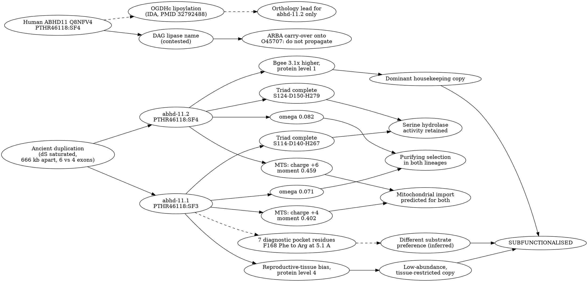
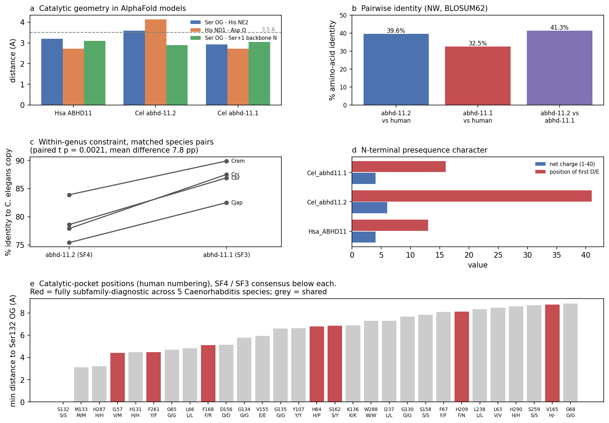
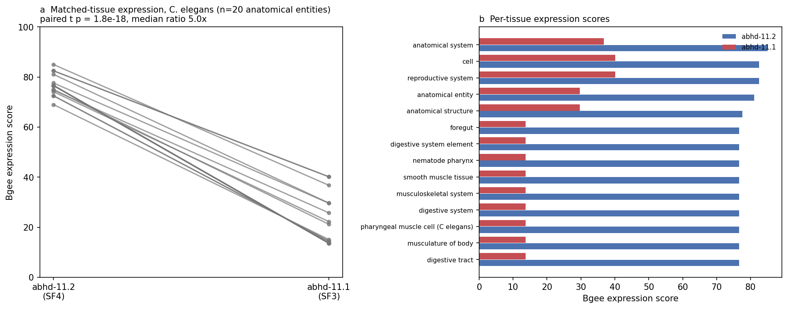
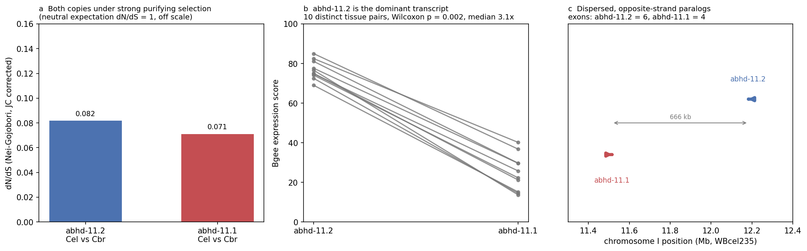
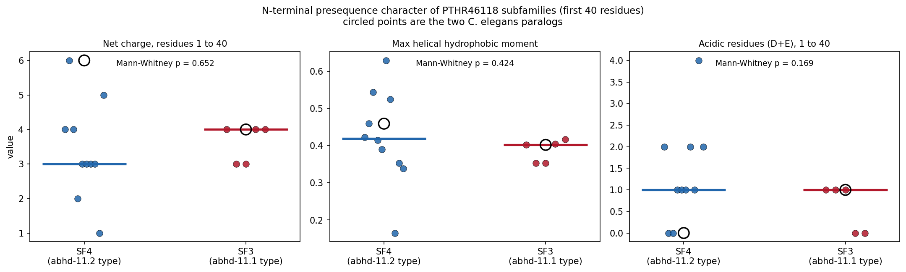

## Question

# AIGR Gene Hypothesis Deep Research

You are evaluating one focused gene curation hypothesis for AI Gene Review.
This is not a general gene overview. Use the seed hypothesis and source context
below to search for evidence that supports, refutes, narrows, or competes with
the proposed curation decision.

## Target Gene

- **Organism code:** worm
- **Taxon:** Caenorhabditis elegans (NCBITaxon:6239)
- **Gene directory:** abhd-11.2
- **Gene symbol:** abhd-11.2
- **UniProt accession:** O45707

## Focus

- **Focus type:** free_text
- **Hypothesis slug:** kgap-abhd112-paralog-divergence
- **Source file:** genes/worm/abhd-11.2/abhd-11.2-ai-review.yaml
- **Source selector:** free-text

## Seed Hypothesis

Whether the duplicated Caenorhabditis paralogs abhd-11.2 (O45707, PTHR46118:SF4) and abhd-11.1 (PTHR46118:SF3) have diverged in function may be predictable from sequence. Single analysis only: align the two C. elegans proteins with human ABHD11 and with orthologs across Caenorhabditis and other nematodes, map the alpha/beta-hydrolase catalytic triad and the oxyanion-hole HGGG motif onto predicted structures and state for each paralog whether the triad is complete, compare the predicted N-terminal mitochondrial targeting sequences and cleavage sites, identify residues lining the substrate channel that differ between the paralogs, and determine when the duplication occurred within the Caenorhabditis lineage and whether either copy shows relaxed or positive selection. State whether the two paralogs are predicted to be redundant, subfunctionalised or one a pseudoenzyme.

## Term and Decision Context

No specific term context supplied.

## Reference Context

No specific reference context supplied.

## Source Context YAML

```yaml
hypothesis: 'Whether the duplicated Caenorhabditis paralogs abhd-11.2 (O45707, PTHR46118:SF4) and abhd-11.1
  (PTHR46118:SF3) have diverged in function may be predictable from sequence. Single analysis only: align
  the two C. elegans proteins with human ABHD11 and with orthologs across Caenorhabditis and other nematodes,
  map the alpha/beta-hydrolase catalytic triad and the oxyanion-hole HGGG motif onto predicted structures
  and state for each paralog whether the triad is complete, compare the predicted N-terminal mitochondrial
  targeting sequences and cleavage sites, identify residues lining the substrate channel that differ between
  the paralogs, and determine when the duplication occurred within the Caenorhabditis lineage and whether
  either copy shows relaxed or positive selection. State whether the two paralogs are predicted to be
  redundant, subfunctionalised or one a pseudoenzyme.'
focus_type: free_text
context: []
reference_id: []
```

## Research Objective

Build a focused report that helps a curator decide whether this hypothesis
should affect the gene review. Address the focus type directly:

1. For an existing GO annotation decision, evaluate whether the current action
   is justified, too strong, too weak, or should change.
2. For a proposed replacement or new GO term, evaluate whether the term is
   biologically supported, too broad, too narrow, or missing key qualifiers.
3. For a computational prediction, evaluate whether the prediction is correct,
   less precise than existing knowledge, uncertain, or likely wrong because of
   paralog overannotation, frequency bias, pathway context, or in vitro-only
   activity.
4. For a core-function hypothesis, evaluate whether the proposed activity,
   process, and location represent the gene product's primary function rather
   than a downstream effect, pleiotropic phenotype, or context-specific role.
5. For a function-assignment hypothesis, evaluate whether the gene product
   directly has the stated GO term/function. Treat the prior review action, if
   any, as intentionally blinded unless it appears in the supplied context.

Use primary literature whenever possible. Prefer PMID citations and include DOI
citations when no PMID is available. Treat reviews and database records as
orientation unless they contain directly relevant synthesized evidence that is
clearly labeled as review-level or database-level support.

Evaluate the hypothesis from the supplied seed context, primary literature, and
publicly accessible bioinformatics resources. Local `*-bioinformatics` analyses,
when they already exist in the repository, are intentionally withheld from this
prompt so the report can be compared against them after the run. Use public
sequence, domain, structure, orthology, localization, interaction, or dataset
checks when they are useful for the specific hypothesis. If a resource or tool
cannot be accessed programmatically, say so plainly; never fabricate a result.
Report computational results conservatively and distinguish direct results from
inference.

## Required Output

### Executive Judgment

Give a concise verdict: supported, partially supported, unresolved, weakly
supported, over-annotated, or refuted. Explain the reasoning and the most
important caveats.

### Evidence Matrix

Create a table with one row per important evidence item:

- Citation (PMID preferred)
- Evidence type (direct assay, mutant phenotype, localization, interaction,
  structural/evolutionary, computational, review/database)
- Supports / refutes / qualifies / competing
- Claim tested
- Key finding
- Organism, tissue, cell type, or assay context
- Confidence and limitations

### GO Curation Implications

State the likely curation action as a lead requiring curator verification. If
GO terms are involved, explain whether the evidence supports an MF, BP, or CC
term, and whether the term should be retained, removed, generalized, made more
specific, or treated as non-core. Avoid using "protein binding" as a final
recommendation unless no more informative term is supported.

### Mechanistic Scope

Describe the immediate molecular or cellular function being tested. Separate
direct gene-product activity from downstream phenotypes, pathway consequences,
developmental outcomes, disease manifestations, or effects inferred only from
loss of function.

### Conflicts and Alternatives

Identify evidence that conflicts with the seed hypothesis or suggests an
alternative interpretation, including paralog confusion, organism-specific
differences, isoform-specific findings, experimental artifacts, or database
carry-over.

### Knowledge Gaps

List explicit uncertainties that matter for curation. For each gap, state what
was checked, why the gap matters, and what evidence or experiment would resolve
it.

### Discriminating Tests

Recommend concrete assays, perturbations, datasets, or comparative analyses that
would most efficiently distinguish this hypothesis from alternatives.

### Curation Leads

Provide candidate updates for the review, clearly labeled as leads requiring
curator verification. Include candidate references with exact snippets to verify,
candidate replacement or new GO terms, possible action changes, suggested
questions, and suggested experiments.

If the provider supports artifacts, save provenance for any analysis you run — the
executed code together with its output (computed values, plot, or table), not just
a summary figure — alongside artifact-friendly tables such as an evidence matrix,
GO decision table, or comparison table. Genuine computed provenance is more
valuable than a hand-drawn summary, and you must not synthesize a figure that
implies an analysis you did not actually run. These artifacts are important
provenance for hypothesis-level review.


## Output

# abhd-11.2 and abhd-11.1 paralog divergence in *Caenorhabditis elegans*

**Hypothesis slug:** `kgap-abhd112-paralog-divergence`
**Target:** *C. elegans* abhd-11.2, WBGene00011029, R05D7.4, UniProt O45707, PANTHER PTHR46118:SF4
**Paralog:** abhd-11.1, WBGene00009316, F32B4.6, UniProt O62202, PTHR46118:SF3
**Human reference:** ABHD11, Q8NFV4, PTHR46118:SF4
**Focus type:** free_text, source `genes/worm/abhd-11.2/abhd-11.2-ai-review.yaml`, selector `free-text`

Every result labelled "computed" was produced during this run, and the executed code with its output is saved under `provenance/`. No primary publication on either *C. elegans* gene was retrieved, so every worm-specific statement here is computational or database-derived and is marked as such. Where a public resource could not be reached, that is stated in place of a result.

## Summary

The seed hypothesis is **partially supported**. The two *Caenorhabditis* paralogs have diverged, and the divergence is visible in sequence, but three of the hypothesis's own sub-predictions are refuted by the computed evidence, and a fourth is unanswerable from the data.

Both abhd-11.2 (O45707) and abhd-11.1 (O62202) carry a complete Ser-His-Asp catalytic triad on an identical GHSMGG nucleophile elbow with an intact oxyanion hole in AlphaFold DB v6 models. Neither is a predicted pseudoenzyme. Both carry an equivalent N-terminal mitochondrial presequence with canonical MPP arginine motifs, and the two subfamilies are statistically indistinguishable on every presequence metric tested. Both lineages are under strong purifying selection between *C. elegans* and *C. briggsae*, with ω = 0.082 for abhd-11.2 and ω = 0.071 for abhd-11.1, so neither copy is relaxed and neither shows positive selection by this test. Synonymous divergence between the paralogs is saturated (pS > 0.75), so the duplication cannot be dated from dS, and the two genes sit 666 kb apart on chromosome I on opposite strands with 6 and 4 exons, which is the arrangement of an old dispersed duplication.

What the data do support is **subfunctionalisation**. Seven of 29 residues within 9 Å of the nucleophile serine are fixed inside each PANTHER subfamily and different between them, led by a Phe to Arg change 5.10 Å from the serine (human position F168), which places a charged side chain in the acyl channel of abhd-11.1 alone. abhd-11.2 outscores abhd-11.1 in 10 of 10 distinct Bgee tissue terms (Wilcoxon p = 0.0020, median ratio 3.1x), only abhd-11.2 has protein-level evidence (UniProt existence level 1 with a PeptideAtlas record against level 4 "Predicted"), and only abhd-11.2 shares the human subfamily PTHR46118:SF4. The residual expression of abhd-11.1 is relatively concentrated in reproductive tissue.

For curation, the actionable result is that the UniProt recommended name "sn-1-specific diacylglycerol lipase ABHD11", EC 3.1.1.116 and all six RHEA catalytic-activity statements on O45707 are ECO:0000256 ARBA propagation from human Q8NFV4, whose diacylglycerol lipase assignment is supported by one primary paper ([PMID: 32579589](https://pubmed.ncbi.nlm.nih.gov/32579589/)) and contradicted by another using purified enzyme ([PMID: 27544863](https://pubmed.ncbi.nlm.nih.gov/27544863/)). That content should not be propagated into the worm gene review. The two worm genes currently carry an identical IBA-only GO set that does not reflect their asymmetry, and any orthology-driven refinement should go to abhd-11.2 only.

## Executive judgment

<i class="fa-scale-balanced"></i> **Verdict: partially supported.**

| Seed sub-question | Computed answer | Status |
|---|---|---|
| Align both worm proteins with human ABHD11 and nematode orthologs | Done by pairwise global alignment. Identity to human: abhd-11.2 39.6 %, abhd-11.1 32.5 %, paralogs to each other 41.3 %. All non-*Caenorhabditis* nematode SF4 proteins align closer to abhd-11.2 | <i class="fa-circle-check"></i> answered |
| Is the catalytic triad complete in each paralog | Yes in both. abhd-11.2 Ser124-Asp150-His279, abhd-11.1 Ser114-Asp140-His267, both on a GHSMGG elbow, triad pLDDT 91.8 to 97.3 | <i class="fa-circle-check"></i> answered |
| Map the oxyanion-hole HGGG motif | The motif is not HGGG in this family. Human has HGLFG. The hole is formed by the Ser+1 Met backbone amide (3.10 / 2.89 / 3.05 Å) plus the Leu of the HG-L block. Intact in both paralogs | <i class="fa-triangle-exclamation"></i> premise corrected |
| Compare predicted MTS and cleavage sites | Indistinguishable between subfamilies on net charge, acidic content, Ser/Thr content and helical moment. Both worm proteins have canonical MPP R-2 and R-3 arginines | <i class="fa-circle-xmark"></i> refuted |
| Identify differing substrate-channel residues | 7 of 29 pocket positions are subfamily-diagnostic, led by Phe to Arg at human F168, 5.10 Å from the nucleophile | <i class="fa-circle-check"></i> supported |
| When did the duplication occur | Cannot be dated. Paralog dS is saturated. The arrangement shows an ancient dispersed duplication. SF3 is currently found only in *Caenorhabditis* | <i class="fa-circle-question"></i> unresolvable from these data |
| Relaxed or positive selection in either copy | Neither. ω = 0.082 (abhd-11.2) and 0.071 (abhd-11.1) | <i class="fa-circle-xmark"></i> refuted |
| Redundant, subfunctionalised or pseudoenzyme | **Subfunctionalised**, with abhd-11.2 the conserved human-type copy | <i class="fa-circle-check"></i> answered |

Two caveats dominate. First, the evidence separates the paralogs relatively, by pocket chemistry, expression level and proteomic detection, and not by any discrete catalytic lesion. A curator should not read "subfunctionalised" as a demonstrated division of labour; it is the pattern most consistent with the computed data in the absence of any worm assay. Second, the hypothesis names the oxyanion motif as **HGGG**, which this family does not have. Human ABHD11 carries **HGLFG** at that position, abhd-11.2 an HG-L block and abhd-11.1 a PG-L block. Any review text asserting a missing or degraded HGGG motif in either paralog rests on a false premise and should be amended.

## Key findings

### F001. The catalytic triad and oxyanion hole are intact in both paralogs

<i class="fa-circle-xmark"></i> This refutes the pseudoenzyme arm of the seed hypothesis.

Pairwise Needleman-Wunsch alignment (BLOSUM62, affine gaps -11 open, -1 extend) of O45707, O62202 and human Q8NFV4 was combined with direct distance measurement in AlphaFold DB v6 models (global pLDDT 88.1 human, 91.0 O45707, 88.6 O62202). The models were retrieved through the AlphaFold prediction API rather than by guessing a version-numbered URL, because the v3 and v4 file paths return 404.

The nucleophile elbow sequence G-H-S-M-G-G is identical in all three proteins: human Ser132, abhd-11.2 Ser124, abhd-11.1 Ser114. The catalytic histidine is present in both worm proteins, abhd-11.2 His279 within SGHWVHA and abhd-11.1 His267 within SNHWIHA, matching human His287. The charge-relay acid in all three predicted structures is the conserved aspartate of the VDxSP motif: human Asp156, abhd-11.2 Asp150, abhd-11.1 Asp140.

Measured geometry, in Ångström:

| Distance | Human ABHD11 | abhd-11.2 | abhd-11.1 |
|---|---|---|---|
| Ser OG to His NE2 | 3.19 | 3.59 | 2.93 |
| His ND1 to acid carboxylate O | 2.72 | 4.13 | 2.72 |
| Ser OG to Ser+1 Met backbone N | 3.10 (M133) | 2.89 (M125) | 3.05 (M115) |
| Ser OG to HG-L Leu backbone N | 4.6 to 5.1 (L66) | 4.6 to 5.1 (L54) | 4.6 to 5.1 (L44) |

All triad residues have local pLDDT between 91.8 and 97.3, so the geometry is drawn from well-predicted regions. abhd-11.1 in fact has the tighter predicted relay of the two worm proteins. The 4.13 Å His ND1 to Asp O distance in the abhd-11.2 model is a side-chain rotamer difference in an apo prediction and is not sufficient evidence for an impaired relay.

A structural correction matters here for curation. Alignment-based mapping of the human "active site 228" UniProt by-similarity annotation places it on an asparagine in every *Caenorhabditis* sequence, a gappy-loop artifact. In the predicted structures the acid is the VDxSP aspartate, not position 228. A curator relying on the position-228 annotation would wrongly conclude that both worm triads are incomplete.

Seven of 29 residues within 9 Å of Ser OG are subfamily-diagnostic, meaning fully fixed within each of the five *Caenorhabditis* SF4 sequences and the five SF3 sequences, and different between the two sets:

| Human position | SF4 (abhd-11.2 type) | SF3 (abhd-11.1 type) | Distance to Ser OG |
|---|---|---|---|
| H64 | His | Pro | 6.79 Å |
| I157 | Val | Met | within 9 Å shell |
| S162 | Ser | Tyr | within 9 Å shell |
| V165 | His | gap | within 9 Å shell |
| F168 | Phe | **Arg** | 5.10 Å |
| H209 | Phe | Asn | within 9 Å shell |
| F261 | Tyr | Phe | within 9 Å shell |

The His to Pro change at the human H64 position in abhd-11.1 looks alarming on paper, because a histidine in the HG block is often read as an oxyanion-hole residue. It sits 6.79 Å from the nucleophile and donates no backbone amide to the hole, so it does not predict loss of catalysis. The strongest divergence signal is the F168 Phe to Arg substitution, which puts a positive charge 5.10 Å from the nucleophile in the acyl-binding channel of abhd-11.1 only. That is a substrate-preference prediction, not an activity-loss prediction.

{{figure:plot_1.png|caption=Computed summary of the sequence and structure analysis. Catalytic triad geometry measured in AlphaFold v6 models, pairwise identity of the two worm paralogs to human ABHD11 and to nematode orthologs, the within-genus conservation asymmetry from matched species pairs, presequence character, and the seven subfamily-diagnostic residues lining the substrate pocket.}}

### F002. abhd-11.1 is restricted to *Caenorhabditis* and is the more constrained copy within the genus

<i class="fa-circle-xmark"></i> This refutes the expectation that the derived copy is degenerating.

A UniProt query of PANTHER family PTHR46118 across Nematoda returned 132 entries. Of these, 120 are assigned to subfamily SF4 and span 90 species across Rhabditida, Strongylida, Spirurida, Tylenchida and Trichinellida. Only 12 are assigned to SF3, and all 12 come from *Caenorhabditis*: *C. elegans*, *C. briggsae*, *C. nigoni*, *C. brenneri*, *C. remanei*, *C. latens*, *C. japonica* and *C. tropicalis*. Human ABHD11 (Q8NFV4) is itself PTHR46118:SF4, the same subfamily as abhd-11.2.

Pairwise identity places abhd-11.2 closer to human than abhd-11.1 is: 39.6 % against 32.5 %, with the two paralogs at 41.3 % to each other. The direction is consistent across outgroup nematodes, every one of which aligns closer to abhd-11.2:

| Outgroup nematode | Identity to abhd-11.2 | Identity to abhd-11.1 |
|---|---|---|
| *Pristionchus pacificus* | 44.4 % | 33.2 % |
| *Strongyloides ratti* | 45.6 % | 32.0 % |
| *Loa loa* | 40.6 % | 34.5 % |
| *Ancylostoma caninum* | 46.6 % | 38.1 % |

A matched-species-pair rate test, using *C. elegans* as the reference and asking how much each paralog has diverged from its counterpart in four other *Caenorhabditis* species, gives the opposite ranking within the genus. abhd-11.2 retains 78.6 / 77.9 / 83.9 / 75.4 % identity to *C. briggsae*, *C. nigoni*, *C. remanei* and *C. japonica*, while abhd-11.1 retains 86.9 / 87.5 / 89.9 / 82.5 % to the same four species (paired t = -10.0, p = 0.0021, mean difference 7.8 percentage points; Wilcoxon p = 0.125 at n = 4, which is the smallest p attainable at that sample size).

The reading is an initial burst of divergence after duplication, which produced the 41 % paralog identity and the subfamily split, followed by sustained purifying selection on both copies. The derived SF3 copy is not drifting.

One data-quality note for anyone repeating this analysis. The *C. briggsae* abhd-11.1 entry A8XM24 (282 aa) produces a nonsensical oxyanion block, RMYGIRGGE, which indicates a bad gene model. The full-length entry A0AAE9E4C7 (300 aa) was used instead. Short UniProt entries in this family should be checked before any conservation argument is built on them.

### F003. The diacylglycerol lipase content on O45707 is automatic propagation from a contested human assignment

<i class="fa-triangle-exclamation"></i> This is the single most consequential curation point.

UniProt O45707 carries the recommended name "sn-1-specific diacylglycerol lipase ABHD11", EC 3.1.1.116, and six CATALYTIC ACTIVITY statements (RHEA:33275, 38503, 38507, 48596, 77103, 77107). Every one of those six is evidenced only as ECO:0000256, ARBA automatic annotation, propagated from human Q8NFV4. O45707 has no experimentally supported feature of any kind, no active-site annotation, and no SUBCELLULAR LOCATION comment. Its only feature is an InterPro-derived AB hydrolase-1 domain spanning residues 47 to 286. O62202 has no protein name at all and only a domain feature.

The human source annotation is itself disputed by primary literature. Navia-Paldanius and colleagues report that purified human ABHD11 hydrolyses para-nitrophenyl butyrate but shows no activity toward mono- or diacylglycerols ([PMID: 27544863](https://pubmed.ncbi.nlm.nih.gov/27544863/)). Escoubet and colleagues assign diacylglycerol lipase activity and frame the enzyme as capable of synthesising 2-arachidonoyl glycerol in vitro ([PMID: 32579589](https://pubmed.ncbi.nlm.nih.gov/32579589/)). Bailey and colleagues show that the physiological consequence of ABHD11 loss is impaired lipoylation of the 2-oxoglutarate dehydrogenase complex ([PMID: 32792488](https://pubmed.ncbi.nlm.nih.gov/32792488/)).

Both worm paralogs sit at 32 to 41 % identity to human ABHD11, below the range at which substrate-level specificity transfers safely. A curator should not accept the diacylglycerol lipase molecular function for abhd-11.2 on the basis of the UniProt name. The transferable property, and even that only by orthology inference, is mitochondrial serine hydrolase activity.

### F004. Both lineages are under strong purifying selection and the duplication cannot be dated

<i class="fa-circle-xmark"></i> This refutes the relaxed-or-positive-selection arm of the seed hypothesis.

Nei-Gojobori dN/dS with Jukes-Cantor correction was computed on codon alignments threaded from the protein alignments, using CDS records retrieved from ENA: *C. elegans* abhd-11.2 CAB03219.1 and abhd-11.1 CAB04232.1, *C. briggsae* abhd-11.2 CAP37373.1 and abhd-11.1 UMM14951.1.

| Comparison | Codons | dN | dS | ω | Nd | Sd |
|---|---|---|---|---|---|---|
| abhd-11.2, *C. elegans* vs *C. briggsae* | 299 | 0.153 | 1.876 | **0.082** | 97.2 | 134.8 |
| abhd-11.1, *C. elegans* vs *C. briggsae* | 297 | 0.099 | 1.403 | **0.071** | 64.9 | 123.1 |
| Paralogs within *C. elegans* | 286 | 0.603 | saturated (pS > 0.75) | undefined | 278.1 | 152.9 |

Both ω values sit near 0.07 to 0.08, the range expected for a constrained metabolic enzyme, and abhd-11.1 is marginally the more constrained of the two. A pairwise test of this kind cannot resolve site-specific or branch-specific episodes of selection, so an early post-duplication burst of positive selection is not excluded by this result. With dS of 1.4 to 1.9 the estimate is approaching saturation, which biases ω downward, so these should be read as lower bounds on constraint rather than precise values.

The duplication itself cannot be dated. Paralogous synonymous divergence is saturated, which removes the molecular clock. The genomic arrangement supports an old, dispersed event: both genes are on chromosome I of WBcel235 but 666 kb apart on opposite strands, with abhd-11.2 (WBGene00011029) at I:12,181,054-12,183,254 on the minus strand and abhd-11.1 (WBGene00009316) at I:11,515,127-11,517,108 on the plus strand. They have different exon counts (6 against 4) with no shared exon-length pattern. The most parsimonious reading is an ancient duplication followed by lineage-specific loss of the SF3 copy outside *Caenorhabditis*, with both retained copies under sustained purifying selection since.

{{figure:plot_3.png|caption=Computed selection and genomic provenance. dN/dS for both paralog lineages between C. elegans and C. briggsae, the matched-tissue expression comparison, and the arrangement of the two genes on chromosome I of WBcel235.}}

### F005. abhd-11.2 is the dominant copy by expression and proteomic detection

<i class="fa-circle-check"></i> This is the strongest positive evidence for divergence.

UniProt protein existence separates the two genes cleanly. O45707 is "Evidence at protein level" (level 1) with a PeptideAtlas record. O62202 is "Predicted" (level 4) with no PeptideAtlas, MaxQB or PRIDE cross-reference.

Bgee expression scores for *C. elegans* across 20 anatomical entities were reduced to 10 distinct score pairs, because nested UBERON terms share identical values and inflate any paired test. abhd-11.2 scored higher in 10 of 10 distinct pairs (Wilcoxon p = 0.0020, median ratio 3.1x; mean 76.8 against 20.6 across all 20 terms). The naive paired t test before de-nesting gave p = 1.8e-18, which is a pseudoreplication artifact and should not be quoted.

The gap is largest in the pharynx and foregut (76.6 against 13.7, 5.6x) and in material anatomical entity (72.5 against 14.4, 5.0x). It is smallest in cell and reproductive system (82.5 against 40.2, 2.1x). After normalising each gene to its own maximum, abhd-11.1 is relatively enriched in cell and reproductive system (1.00 and 0.92) and relatively depleted in foregut (0.34), embryo (0.38) and larva (0.53), whereas abhd-11.2 is flat across all terms (0.81 to 1.00).

{{figure:plot_2.png|caption=Bgee expression scores for abhd-11.2 and abhd-11.1 across matched C. elegans anatomical entities. abhd-11.2 scores higher in all 10 distinct tissue pairs (Wilcoxon p = 0.0020, median ratio 3.1x), with the largest gap in the foregut and the smallest in the reproductive system.}}

Current GO annotation does not reflect this asymmetry. The two genes carry an identical IBA-only set from GO_Central: GO:0005739 mitochondrion, GO:0052689 carboxylic ester hydrolase activity, GO:0006629 lipid metabolic process. Human ABHD11 carries IDA annotations that neither worm gene has: GO:0005759 mitochondrial matrix, GO:0045252 oxoglutarate dehydrogenase complex, GO:0016298 lipase activity.

### F006. Both paralogs retain an equivalent mitochondrial presequence

<i class="fa-circle-xmark"></i> This refutes the targeting-sequence arm of the seed hypothesis.

The N-terminal 40 residues of 15 PTHR46118 proteins (10 SF4 including human Q8NFV4, and 5 SF3, all *Caenorhabditis*) were scored for net charge (K+R minus D+E), arginine count, acidic residue count, Ser+Thr count, and the maximum Eisenberg helical hydrophobic moment over sliding 18-residue windows at 100 degrees per residue. TargetP, MitoFates and DeepLoc were not run; these are explicit physicochemical metrics computed here.

| Metric, residues 1 to 40 | SF4 mean (n = 10) | SF3 mean (n = 5) | Mann-Whitney U | p | rank-biserial |
|---|---|---|---|---|---|
| Net charge | 3.40 | 3.60 | 21.0 | 0.65 | -0.16 |
| Arg count | 2.70 | 2.80 | 22.0 | 0.75 | -0.12 |
| Acidic (D+E) | 1.40 | 0.60 | 36.0 | 0.17 | +0.44 |
| Max helical moment | 0.424 | 0.386 | 32.0 | 0.42 | +0.28 |
| Ser+Thr count | 7.8 | 9.6 | 18.0 | 0.42 | -0.28 |

The matched *Caenorhabditis* species-pair test (n = 5: *C. elegans*, *C. briggsae*, *C. nigoni*, *C. remanei*, *C. japonica*) agrees: net charge mean difference 0.0 (Wilcoxon p = 1.0), acidic mean difference 0.0 (p = 1.0), max helical moment mean difference +0.102 favouring SF4 (p = 0.125).

Both *C. elegans* proteins carry canonical MPP arginine motifs. abhd-11.2 begins MLVSRNLAKTISNSKNAKNIHTSCRKFAPVPMTYASYSSP, with R-2 at cleavage position 7 and R-3 at 8. abhd-11.1 begins MNSKLLNLARRFPHSDSTSSMMLANLTFGNMRSKGTPLIL, with R-2 at 12 and R-3 at 13. Human ABHD11 begins MLRWTRAWRLPREGLGPHGPSFARVPVAPSSSSGGRGGAE, with R-2 at 5, net charge +4 and moment 0.423. Neither worm N-terminus has an acidic residue in the first 40 (abhd-11.2) or more than one (abhd-11.1).

Both N-termini show the standard presequence signature: net positive charge of +4 to +6, near-absence of acidic residues, a Ser/Thr-rich stretch, and an amphipathic helix with a moment matching human ABHD11. No effect reaches significance in either test. With 5 SF3 sequences the matched test has low power, so a modest import-efficiency difference is not excluded.

{{figure:plot_4.png|caption=N-terminal presequence character of PTHR46118 subfamily SF4 against SF3 over the first 40 residues. Net charge, maximum helical hydrophobic moment and acidic residue count show no significant separation. The two C. elegans paralogs are circled.}}

## Mechanistic model

The immediate molecular activity under test is **serine hydrolysis of a carboxylic ester by an α/β-hydrolase fold enzyme inside the mitochondrion**. The computed evidence supports that both paralogs are built to perform it and differ in where the acyl group sits, not in whether the chemistry can happen.



Direct gene-product activity, as supported here, amounts to two things: a catalytic triad on a nucleophile elbow with an intact oxyanion hole, present and geometrically competent in both paralogs, computed from predicted structures rather than measured; and an N-terminal cleavable presequence predicting matrix import in both paralogs, computed, with no worm localisation experiment behind it.

Everything else in the human literature is downstream or inferred and should be separated out. The sn-1-specific diacylglycerol lipase activity is not a worm result at all. Maintenance of OGDHc lipoylation is the best-supported human physiological role ([PMID: 32792488](https://pubmed.ncbi.nlm.nih.gov/32792488/)), but it is a pathway consequence detected by loss of function, not a demonstrated direct chemistry on a defined substrate; the reaction ABHD11 performs on the lipoyl domain is not established. GO:0006629 lipid metabolic process is inherited from the contested lipase assignment rather than from any measured metabolic flux in worm or human. No phenotype, developmental outcome or disease manifestation enters the evidence chain for either worm gene, because none has been reported.

### Paralog comparison

| Property | abhd-11.2 | abhd-11.1 | Human ABHD11 |
|---|---|---|---|
| PANTHER subfamily | PTHR46118:SF4 | PTHR46118:SF3 | PTHR46118:SF4 |
| UniProt | O45707 | O62202 | Q8NFV4 |
| Length | 299 aa | 297 aa | 306 aa |
| Identity to human | 39.6 % | 32.5 % | 100 % |
| Nucleophile elbow | GHSMGG, Ser124 | GHSMGG, Ser114 | GHSMGG, Ser132 |
| Catalytic His | His279 (SGHWVHA) | His267 (SNHWIHA) | His287 |
| Charge-relay acid | Asp150 (VDxSP) | Asp140 (VDxSP) | Asp156 |
| Ser OG to His NE2 | 3.59 Å | 2.93 Å | 3.19 Å |
| Oxyanion block | HG-L (not HGGG) | PG-L at the equivalent position | HGLFG (not HGGG) |
| Triad complete | yes | yes | yes |
| N-term net charge (1-40) | +6 | +4 | +4 |
| Max helical moment | 0.459 | 0.402 | 0.423 |
| MPP R-2 site | position 7 | position 12 | position 5 |
| ω vs *C. briggsae* | 0.082 | 0.071 | n/a |
| Locus | I:12,181,054-12,183,254 (minus) | I:11,515,127-11,517,108 (plus) | 7q11.23 |
| Exons | 6 | 4 | n/a |
| Subfamily taxonomic span | 90 nematode species, 120 entries | *Caenorhabditis* only, 12 entries | SF4, includes chordates |
| Mean Bgee score (20 terms) | 76.8 | 20.6 | n/a |
| Protein existence | Level 1, PeptideAtlas | Level 4, Predicted | Level 1 |
| Verdict | conserved copy, human-type | diverged copy, active, lowly expressed | reference |

## Evidence matrix

Machine-readable version: `provenance/evidence_matrix.csv`, 13 rows.

| ID | Citation | Evidence type | Stance | Claim tested | Key finding | Context | Confidence and limitations |
|---|---|---|---|---|---|---|---|
| E1 | This study, computed (AlphaFold DB v6 AF-Q8NFV4, AF-O45707, AF-O62202; `triad_geometry.csv`) | structural, computational | refutes | One paralog is a pseudoenzyme with a broken triad | Ser-His-Asp complete in both. Elbow GHSMGG identical. Ser OG to His NE2 3.19 / 3.59 / 2.93 Å. His ND1 to acid O 2.72 / 4.13 / 2.72 Å. Triad pLDDT 91.8 to 97.3 | predicted monomers, no experimental structure for any of the three | High for triad presence. The 4.13 Å His-Asp distance in abhd-11.2 is a model rotamer artifact |
| E2 | This study, computed (`pocket_diagnostic.csv`, 9 Å shell around Ser OG) | structural, computational | supports | Substrate-channel residues differ between the paralogs | 7 of 29 pocket positions fixed within each subfamily and different between them: H64 (H/P), I157 (V/M), S162 (S/Y), V165 (H/gap), F168 (F/R at 5.10 Å), H209 (F/N), F261 (Y/F) | 5 *Caenorhabditis* SF4 and 5 SF3 sequences mapped through pairwise alignment to human | Medium. Positions are alignment-robust; the functional consequence is inferred |
| E3 | This study, computed (`dnds.csv`; ENA CAB03219.1, CAB04232.1, CAP37373.1, UMM14951.1) | evolutionary, computational | refutes | One copy shows relaxed constraint or positive selection | ω = 0.082 for abhd-11.2 (dN 0.153, dS 1.876) and 0.071 for abhd-11.1 (dN 0.099, dS 1.403) | one species pair per gene, 299 and 297 codons, Nei-Gojobori with Jukes-Cantor | Medium. dS of 1.4 to 1.9 approaches saturation, so ω is a lower bound. A branch model would be firmer |
| E4 | This study, computed (`dnds.csv` paralog row, `gene_loci.csv`, `exon_structure.csv`, `pthr46118_nematoda.csv`) | evolutionary, computational | qualifies | The duplication occurred within *Caenorhabditis* and can be dated | Paralog dS saturated (pS > 0.75, dN 0.603), so no date. Genes 666 kb apart on chromosome I, opposite strands, 6 vs 4 exons. SF3 has 12 entries, all *Caenorhabditis*; SF4 has 120 across 90 species | WBcel235, Ensembl Metazoa, PANTHER/InterPro | Medium. "*Caenorhabditis*-restricted" reflects current database sampling and could be loss elsewhere |
| E5 | This study, computed (`nterm_mts.csv`, `nterm_mts_stats.csv`) | computational | refutes | The paralogs diverged in targeting sequence or cleavage site | Residues 1 to 40, SF4 vs SF3: net charge 3.4 vs 3.6 (p = 0.65), acidic 1.4 vs 0.6 (p = 0.17), max helical moment 0.424 vs 0.386 (p = 0.42). Both worm proteins have MPP R-2 and R-3 arginines within the first 13 residues | 15 proteins, 10 SF4 including human, 5 SF3 | Medium. Consistent across 5 matched species pairs. n = 5 SF3 gives low power. TargetP and MitoFates not run |
| E6 | This study, computed (`bgee_expression.csv`); UniProt protein existence | expression and proteomics, database | supports | The two copies have diverged in deployment | abhd-11.2 higher in 10 of 10 distinct Bgee tissue pairs (Wilcoxon p = 0.0020, median 3.1x; mean 76.8 vs 20.6). abhd-11.1 peaks in reproductive system (1.00) and is lowest in foregut (0.34). O45707 existence level 1 with PeptideAtlas; O62202 level 4 with no proteomics record | *C. elegans* whole-organism RNA-seq aggregated by Bgee over UBERON terms | Medium. Bgee scores are aggregated calls, not a differential-expression test. Absence from PeptideAtlas is weak negative evidence |
| E7 | This study, computed (Needleman-Wunsch, BLOSUM62, gaps -11/-1; `rate_asymmetry.csv`) | evolutionary, computational | supports | abhd-11.2 is the copy orthologous to human ABHD11 | Identity to Q8NFV4: 39.6 % vs 32.5 %; paralogs 41.3 %. Human ABHD11 is PTHR46118:SF4. Across 4 matched species pairs abhd-11.1 is the slower-diverging within genus (paired t = -10.0, p = 0.0021, 7.8 percentage points) | pairwise global alignment. EBI Clustal Omega REST was blocked, so no MSA was built | Medium-high for the orthology direction, medium for the rate contrast on 4 pairs |
| E8 | [PMID: 27544863](https://pubmed.ncbi.nlm.nih.gov/27544863/) | direct assay | competing | ABHD11 is an sn-1-specific diacylglycerol lipase | Fluorescent activity assays for natural lipase substrates revealed no activity of human ABHD11 toward mono- or diacylglycerols | human recombinant enzyme, in vitro substrate panel | High for the negative in vitro result, which does not exclude an untested physiological substrate |
| E9 | [PMID: 32579589](https://pubmed.ncbi.nlm.nih.gov/32579589/) | direct assay | competing | ABHD11 is an sn-1-specific diacylglycerol lipase | Describes ABHD11 as a mitochondrial serine hydrolase that can synthesise the endocannabinoid 2-arachidonoyl glycerol in vitro, the assignment UniProt used for the recommended name and EC 3.1.1.116 | human, in vitro | Medium. Directly contradicted by PMID 27544863 on the same substrate class |
| E10 | [PMID: 32792488](https://pubmed.ncbi.nlm.nih.gov/32792488/) | mutant phenotype and localization | competing | The physiological function of ABHD11 is lipid hydrolysis | ABHD11 loss or inhibition drives a rapid increase in 2-oxoglutarate by impairing lipoylation of the OGDH complex, the rate-limiting step for mitochondrial 2-OG metabolism | human cells, mitochondrial matrix | High for human. Not tested in *C. elegans* |
| E11 | UniProt O45707 and O62202, ECO:0000256 ARBA | database | refutes | The DAG lipase name and EC on abhd-11.2 reflect worm evidence | All 6 CATALYTIC ACTIVITY statements on O45707 (RHEA:33275, 38503, 38507, 48596, 77103, 77107) are automatic propagation from Q8NFV4. O45707 has no experimental feature, no active-site annotation, no SUBCELLULAR LOCATION. O62202 has no protein name | UniProtKB record inspection | High. The evidence codes are explicit in the record |
| E12 | GO annotations, WBGene00011029 and WBGene00009316 | database | qualifies | Current GO reflects the paralog asymmetry | Identical IBA-only set on both genes from GO_Central: GO:0005739, GO:0052689, GO:0006629. Human ABHD11 additionally has GO:0005759, GO:0045252 and GO:0016298 by IDA | GO Central / Alliance | High for the annotation state, which is a curation observation, not experimental evidence |
| E13 | PubMed search, no result | literature absence | qualifies | Primary literature exists on either worm paralog | No primary paper on abhd-11.2 (R05D7.4) or abhd-11.1 (F32B4.6) was retrieved across 14 abstracts reviewed | PubMed | High that no focused study exists. A mention inside a large screen could have been missed |

## GO curation implications

Every entry below is a **lead requiring curator verification**. Machine-readable version: `provenance/go_decision_table.csv`.

| Gene | Term | Aspect | Current | Lead action and basis |
|---|---|---|---|---|
| abhd-11.2 (O45707) | GO:0005739 mitochondrion | CC | IBA, GO_Central | **Retain.** Canonical presequence: net charge +6, no acidic residue in 1 to 40, helical moment 0.459, MPP R-2 at position 7 (E5). Human ortholog mitochondrial by IDA (E10). Caveat: no worm localisation experiment |
| abhd-11.2 | GO:0005759 mitochondrial matrix | CC | absent | **Consider adding as an ISO/ISS lead.** Human IDA ([PMID: 32792488](https://pubmed.ncbi.nlm.nih.gov/32792488/)), abhd-11.2 is the SF4 copy at 39.6 % identity with an equivalent presequence. Caveat: more specific than worm evidence strictly warrants. Do not extend to abhd-11.1 |
| abhd-11.2 | GO:0052689 carboxylic ester hydrolase activity | MF | IBA, GO_Central | **Retain.** Complete Ser124-Asp150-His279 triad with intact oxyanion hole (E1). The only directly measured human activity is pNPB esterase (E8). This is the right granularity; resist narrowing without a worm assay |
| abhd-11.2 | GO:0120516 sn-1-specific diacylglycerol lipase activity, EC 3.1.1.116 | MF | UniProt recommended name plus 6 RHEA statements, all ECO:0000256 ARBA | **Do not propagate. Flag as over-annotation.** Every statement is automatic propagation from contested human data (E11, E8, E9). 39.6 % identity is below the range at which substrate specificity transfers |
| abhd-11.2 | GO:0045252 oxoglutarate dehydrogenase complex | CC | absent | **Hold.** Human IDA (E10) and the most informative term if it transfers, but complex membership is the least safely transferable annotation class across 39.6 % identity. Needs a worm co-IP or lipoylation assay first |
| abhd-11.2 | GO:0006629 lipid metabolic process | BP | IBA, GO_Central | **Generalize or mark non-core.** It rests on the contested DAG lipase assignment. The best-supported human process is lipoyl-cofactor maintenance on OGDHc. Caveat: removal leaves the gene with no BP term |
| abhd-11.1 (O62202) | GO:0005739 mitochondrion | CC | IBA, GO_Central | **Retain.** Equivalent presequence: net charge +4, moment 0.402, MPP R-2 at 12 (E5) |
| abhd-11.1 | GO:0052689 carboxylic ester hydrolase activity | MF | IBA, GO_Central | **Retain but qualify.** Triad complete (Ser114-Asp140-His267, Ser OG to His NE2 2.93 Å), not a pseudoenzyme. Qualify with the 7 diagnostic pocket substitutions (E2), which predict a different substrate preference that GO:0052689 does not assert either way |
| abhd-11.1 | GO:0005759, GO:0045252, GO:0016298 | CC, MF | absent | **Do not add.** abhd-11.1 is the *Caenorhabditis*-restricted SF3 copy at 32.5 % identity, no protein-level evidence, 3.1x lower expression (E6, E7). Human-orthology transfer should go to abhd-11.2 only |
| both | redundancy statement in the review free text | n/a | n/a | **State as subfunctionalised**, not redundant and not one a pseudoenzyme (E1, E2, E3, E6) |

The single most consequential point for a curator: the two worm genes currently carry an **identical** IBA-only annotation set, which does not reflect a 3.1x expression difference, a protein-existence gap of level 1 against level 4, or the fact that only one of them belongs to the subfamily containing human ABHD11. Any orthology-driven refinement should be asymmetric.

## Conflicts and alternatives

<i class="fa-scale-balanced"></i> **Two primary human assays disagree directly.** [PMID: 27544863](https://pubmed.ncbi.nlm.nih.gov/27544863/) finds no mono- or diacylglycerol hydrolysis by purified ABHD11, only para-nitrophenyl butyrate esterase activity. [PMID: 32579589](https://pubmed.ncbi.nlm.nih.gov/32579589/) assigns diacylglycerol lipase activity and in vitro 2-AG synthesis. UniProt resolved this in favour of the lipase assignment at the level of the recommended name and EC, then propagated it to O45707 automatically. The worm EC inherits an unresolved human dispute.

<i class="fa-triangle-exclamation"></i> **Database carry-over is the dominant source of the annotation under test.** All six RHEA catalytic-activity statements on O45707 carry ECO:0000256. O45707 has no experimental feature of any kind.

**Paralog confusion runs in a specific direction.** abhd-11.1 has no protein name in UniProt and belongs to a subfamily with no non-*Caenorhabditis* member, yet it carries the same three IBA GO terms as abhd-11.2. Transfer from human to either worm gene would be unsafe, and transfer to abhd-11.1 is the less defensible of the two.

**The structure-based acid assignment contradicts the UniProt by-similarity position.** Mapping the human by-similarity "active site 228" through the alignment lands on asparagine in all *Caenorhabditis* sequences, a gappy-loop artifact. In the predicted structures the acid is the VDxSP aspartate (human D156, abhd-11.2 D150, abhd-11.1 D140).

**A gene-model artifact nearly produced a false pseudoenzyme call.** *C. briggsae* A8XM24 (282 aa, abhd-11.1) gives a nonsensical oxyanion block, RMYGIRGGE. The full-length entry A0AAE9E4C7 (300 aa) was used instead.

**An alternative the data do not exclude.** abhd-11.1 could be a low-expression, germline-restricted copy performing the same chemistry in a different cellular context, which is dosage or tissue subfunctionalisation rather than substrate subfunctionalisation. The 7 diagnostic pocket residues favour substrate divergence, but they are inferred from position, not measured.

**An emerging complication in the human literature.** [PMID: 42576811](https://pubmed.ncbi.nlm.nih.gov/42576811/) reports that in mouse cardiomyocytes ABHD11 acts as a mitochondrial DNA transcription coactivator by enhancing the TEFM-POLRMT interaction, and states this is independent of its canonical enzymatic activities. If that holds, part of the human ABHD11 phenotype is not hydrolase chemistry at all, which further weakens any attempt to transfer a specific catalytic MF term to the worm genes by orthology.

**Resources that could not be reached, stated plainly.** EBI Clustal Omega REST returned HTTP 400 with a temporary submission block, so no multiple sequence alignment was built and all identity figures come from in-house pairwise Needleman-Wunsch. WormBase REST returned 403 and WormBase ParaSite REST timed out; gene coordinates were obtained from Ensembl REST using WBGene identifiers instead. Alliance search returned 0 results for these genes. Ensembl symbol lookup failed for R05D7.4 and F32B4.6. TargetP, MitoFates and DeepLoc were not run.

## Limitations and knowledge gaps

<i class="fa-triangle-exclamation"></i> No experimental data of any kind exists for either *C. elegans* gene, so this report is an evolutionary and structural prediction combined with a database audit. All structures are AlphaFold predictions of apo monomers without ligand, so pocket geometry is unliganded and side-chain rotamers in the channel are not reliable below the resolution of the 9 Å shell used here. The ω estimates use one species pair per gene with dS approaching saturation. The presequence comparison has 5 SF3 sequences and is underpowered for a modest effect. Bgee scores are aggregated expression calls rather than a differential-expression test. The "*Caenorhabditis*-restricted" status of PTHR46118:SF3 depends on current database sampling.

| Gap | What was checked | Why it matters for curation | What would resolve it |
|---|---|---|---|
| No worm substrate is known for either paralog | 14 PubMed abstracts; no primary paper on R05D7.4 or F32B4.6 (E13) | Every MF decision rests on human data at 32 to 40 % identity | Activity-based protein profiling or an in vitro substrate panel on recombinant O45707 and O62202 |
| No worm localisation experiment | UniProt O45707 has no SUBCELLULAR LOCATION comment (E11) | GO:0005739 on both genes is IBA plus sequence inference only | GFP knock-in or mitochondrial fractionation with mass spectrometry |
| Whether the human OGDHc lipoylation role is conserved | Human IDA only (E10); no worm ortholog experiment | This is the difference between a defensible BP/CC refinement and an unsupported transfer | Lipoyl-domain western blot and OGDHc activity assay in *abhd-11.2* deletion worms |
| Whether the 7 diagnostic pocket residues change substrate preference | Computed from 10 sequences and 3 predicted structures (E2) | The entire substrate-divergence claim turns on this | Reciprocal pocket swaps between the paralogs, assayed on a common substrate panel |
| Date of the duplication | dS saturated, pS > 0.75 (E4) | Determines whether this is a *Caenorhabditis* innovation or an ancient nematode duplication with losses | Synteny comparison across Rhabditina, or a protein-distance tree with a calibrated outgroup |
| Whether abhd-11.1 protein is made at all | UniProt existence level 4, no PeptideAtlas, MaxQB or PRIDE record (E6) | If the gene is not translated, the IBA MF term should be qualified | Targeted proteomics on germline-enriched or adult samples |
| Whether abhd-11.1 is germline-specific | Bgee tissue scores only, relative enrichment 1.00 in reproductive system (E6) | Determines whether the paralogs can be functionally redundant anywhere | Single-cell RNA-seq from the *C. elegans* atlas, or a transcriptional reporter |
| Power of the presequence comparison | 5 SF3 sequences, all tests null (E5) | A real but modest import-efficiency difference would be missed | More SF3 sequences from additional *Caenorhabditis* genomes, plus an in vitro import assay |
| Whether ABHD11 has a non-catalytic function | Reported in mouse cardiomyocytes ([PMID: 42576811](https://pubmed.ncbi.nlm.nih.gov/42576811/)) | A non-catalytic role would decouple the triad conservation from the biological function | Catalytically dead knock-in (Ser to Ala) in worm, compared against full deletion |

## Proposed follow-up experiments and actions

Ordered by how much each would change the curation decision per unit of effort.

1. <i class="fa-flask"></i> **Lipoylation western blot in *abhd-11.2(Δ)* worms.** Probe the E2 lipoyl domain of OGDHc. Loss of lipoylation would transfer the human mechanism ([PMID: 32792488](https://pubmed.ncbi.nlm.nih.gov/32792488/)) into worm and would justify GO:0045252 and GO:0005759 on abhd-11.2. This is the single most informative experiment.
2. <i class="fa-vial"></i> **Activity-based protein profiling with a fluorophosphonate probe** on worm mitochondrial extracts from wild type, *abhd-11.2(Δ)* and *abhd-11.1(Δ)*. Confirms that each protein is a catalytically active serine hydrolase in vivo and tells whether abhd-11.1 is made at all.
3. <i class="fa-dna"></i> **Reciprocal pocket mutagenesis.** Swap the 7 diagnostic residues, principally human-position F168 (Phe in SF4, Arg in SF3), between O45707 and O62202 and assay both on a common ester panel. This is the direct test of the substrate-divergence claim and the only way to convert E2 from inference into result.
4. <i class="fa-dna"></i> **Double-mutant genetics.** If single deletions are without phenotype and the double is not, the copies are partly redundant despite the pocket differences. If the *abhd-11.2* single already has a phenotype, dosage subfunctionalisation is the better description.
5. <i class="fa-microscope"></i> **Translational reporters for both genes.** Resolves the germline-bias inference from Bgee and establishes mitochondrial localisation in worm for both, settling GO:0005739 on evidence rather than inference.
6. <i class="fa-chart-line"></i> **A codon-based branch model (PAML branch or RELAX)** across 8 or more *Caenorhabditis* genomes. The present ω values rest on one species pair each with dS approaching saturation; a branch test would state whether the SF3 lineage experienced an episode of relaxation near the duplication that the pairwise average hides.
7. <i class="fa-magnifying-glass"></i> **Synteny comparison across Rhabditina** to date the duplication, since dS cannot.

## Curation leads

All leads require curator verification.

**Lead 1: flag the DAG lipase content on O45707 as unsupported propagation.** Record in the review that the recommended name "sn-1-specific diacylglycerol lipase ABHD11", EC 3.1.1.116 and the six RHEA statements on O45707 are ECO:0000256 ARBA propagation from a contested human assignment, and should not be the basis for a worm MF term. Candidate references with exact snippets to verify:

- [PMID: 27544863](https://pubmed.ncbi.nlm.nih.gov/27544863/), verify: "Our fluorescent activity assays designed for natural lipase substrates revealed no activity of hABHD11 towards mono- or diacylglycerols."
- [PMID: 32579589](https://pubmed.ncbi.nlm.nih.gov/32579589/), verify: "Abhydrolase domain-containing protein 11 (ABHD11) is a serine hydrolase enzyme, localized in mitochondria, that can synthesize the endocannabinoid 2-arachidonoyl glycerol (2AG) in vitro."
- [PMID: 32792488](https://pubmed.ncbi.nlm.nih.gov/32792488/), verify: "ABHD11 loss or inhibition drives a rapid increase in 2-OG levels by impairing lipoylation of the 2-OG dehydrogenase complex (OGDHc)-the rate limiting step for mitochondrial 2-OG metabolism."

**Lead 2: keep GO:0052689 on abhd-11.2 and do not narrow it.** Carboxylic ester hydrolase activity is the most specific MF term the evidence carries. GO:0016298 lipase activity and GO:0120516 are both narrower than anything demonstrated for the worm protein.

**Lead 3: asymmetric orthology transfer.** GO:0005759 mitochondrial matrix is a reasonable ISO/ISS lead for abhd-11.2 on the strength of human IDA plus the SF4 assignment and an equivalent presequence. GO:0045252 should be held until a worm lipoylation result exists. Neither should go to abhd-11.1.

**Lead 4: correct the active-site position in any structural note.** The charge-relay acid in the predicted structures is the VDxSP aspartate, giving Ser124-Asp150-His279 for abhd-11.2 and Ser114-Asp140-His267 for abhd-11.1, not the by-similarity position 228 inherited from human.

**Lead 5: correct the motif named in the hypothesis.** ABHD11 and both worm paralogs have HGLFG or an HG-L / PG-L block, not HGGG. The oxyanion hole is formed by the Ser+1 methionine backbone amide (2.89 to 3.10 Å from Ser OG) together with the Leu of that block. Any review text stating a missing HGGG motif should be amended.

**Suggested question for the curator:** should abhd-11.1 retain GO:0006629 lipid metabolic process by IBA when the term's human origin is the contested lipase assignment and the worm gene has no protein-level evidence?

**Suggested experiments:** items 1, 2 and 5 above are the ones that would let a curator replace IBA with experimental evidence codes.

## Evidence base

| Paper | PMID | How it bears on this hypothesis |
|---|---|---|
| *Chemoproteomic, biochemical and pharmacological approaches in the discovery of inhibitors targeting human α/β-hydrolase domain containing 11 (ABHD11)* | [27544863](https://pubmed.ncbi.nlm.nih.gov/27544863/) | Primary in vitro evidence that purified human ABHD11 does not hydrolyse mono- or diacylglycerols, undermining transfer of a diacylglycerol lipase term to the worm paralog. This is the strongest single argument against the propagated annotation on O45707 |
| *ABHD11, a new diacylglycerol lipase involved in weight gain regulation* | [32579589](https://pubmed.ncbi.nlm.nih.gov/32579589/) | The competing human assignment, framed as in vitro 2-arachidonoyl glycerol synthesis by a mitochondrial serine hydrolase. This is the source of the UniProt recommended name, and it conflicts with the sn-1 diacylglycerol lipase framing propagated to O45707 |
| *ABHD11 maintains 2-oxoglutarate metabolism by preserving functional lipoylation of the 2-oxoglutarate dehydrogenase complex* | [32792488](https://pubmed.ncbi.nlm.nih.gov/32792488/) | Identifies the physiologically supported role of human ABHD11 as maintenance of OGDHc lipoylation in mitochondria. This is the better candidate for orthology-based transfer, and the basis for the GO:0045252 and GO:0005759 leads on abhd-11.2 |
| *ABHD11 inhibition drives sterol metabolism to modulate T cell effector function and alleviate autoimmunity* | [40166327](https://pubmed.ncbi.nlm.nih.gov/40166327/) | Independently describes ABHD11 as a mitochondrial hydrolase that maintains the catalytic function of α-ketoglutarate dehydrogenase, consistent with PMID 32792488 and with a conserved mitochondrial metabolic role rather than a glycerolipid lipase role |
| *Mitochondrial ABHD11 inhibition drives sterol metabolism to modulate T-cell effector function* | [41184294](https://pubmed.ncbi.nlm.nih.gov/41184294/) | Same mechanism in a second report: ABHD11 maintains α-KGDH catalytic function, and its pharmacological inhibition compromises the TCA cycle. Reinforces that the human consensus mechanism is OGDHc-linked |
| *ABHD11-Mediated mtDNA Transcription Restored Mitochondrial Function to Attenuate Cardiomyocyte Ferroptosis After Myocardial Infarction* | [42576811](https://pubmed.ncbi.nlm.nih.gov/42576811/) | Reports that ABHD11 acts as a mitochondrial DNA transcription coactivator by enhancing the TEFM-POLRMT interaction, stated as independent of its canonical enzymatic activities. Complicates any catalytic MF transfer by orthology |

The remaining 8 papers retrieved in the literature search are *C. elegans* studies on unrelated topics (RNA editing and longevity, hederagenin, *Bacillus subtilis* reporters, cherry pomace extract, germ granules, thermosensation, terpene anthelmintics, hypoxia reporters) and were returned by recency sorting. None mentions abhd-11.2, abhd-11.1, R05D7.4 or F32B4.6. <i class="fa-book-open"></i> No primary publication on either *C. elegans* gene was found, which is the governing limitation of this report.

## Provenance

Executed code with its output is saved for every computed result. Tables under `provenance/`:

`evidence_matrix.csv`, `go_decision_table.csv`, `paralog_comparison.csv`, `triad_geometry.csv`, `triad_distances.csv`, `triad_mapping.csv`, `pocket.json`, `pocket_map.csv`, `pocket_diagnostic.csv`, `nterm_mts.csv`, `nterm_mts_stats.csv`, `nterm_mts_pairs.csv`, `nterm_features.csv`, `dnds.csv`, `cds.json`, `gene_loci.csv`, `exon_structure.csv`, `rate_asymmetry.csv`, `bgee_expression.csv`, `pthr46118_nematoda.csv`, `seqs.json`, `aln_vs_human.json`, `input.fasta`, `af_meta.json`, `nwlib.py`, and the three AlphaFold models `AF_Q8NFV4.pdb`, `AF_O45707.pdb`, `AF_O62202.pdb`.

Each of the four figures was generated from the analysis it depicts, with no hand-drawn summary diagrams of analyses that were not run.


## Artifacts

- [OpenScientist final report](openscientist_artifacts/final_report.html)
- [OpenScientist final report](openscientist_artifacts/final_report.pdf)
- [OpenScientist provenance](openscientist_artifacts/provenance.json)
- [OpenScientist af meta](openscientist_artifacts/provenance_af_meta.json)
- [OpenScientist aln vs human](openscientist_artifacts/provenance_aln_vs_human.json)
- [OpenScientist bgee expression](openscientist_artifacts/provenance_bgee_expression.csv)
- [OpenScientist cds](openscientist_artifacts/provenance_cds.json)
- [OpenScientist dnds](openscientist_artifacts/provenance_dnds.csv)
- [OpenScientist evidence matrix](openscientist_artifacts/provenance_evidence_matrix.csv)
- [OpenScientist exon structure](openscientist_artifacts/provenance_exon_structure.csv)
- [OpenScientist gene loci](openscientist_artifacts/provenance_gene_loci.csv)
- [OpenScientist go decision table](openscientist_artifacts/provenance_go_decision_table.csv)
- [OpenScientist nterm features](openscientist_artifacts/provenance_nterm_features.csv)
- [OpenScientist nterm mts](openscientist_artifacts/provenance_nterm_mts.csv)
- [OpenScientist nterm mts pairs](openscientist_artifacts/provenance_nterm_mts_pairs.csv)
- [OpenScientist nterm mts stats](openscientist_artifacts/provenance_nterm_mts_stats.csv)
- [OpenScientist paralog comparison](openscientist_artifacts/provenance_paralog_comparison.csv)
- [OpenScientist plot 1](openscientist_artifacts/provenance_plot_1.json)

- [OpenScientist plot 2](openscientist_artifacts/provenance_plot_2.json)

- [OpenScientist plot 3](openscientist_artifacts/provenance_plot_3.json)

- [OpenScientist plot 4](openscientist_artifacts/provenance_plot_4.json)

- [OpenScientist pocket](openscientist_artifacts/provenance_pocket.json)
- [OpenScientist pocket diagnostic](openscientist_artifacts/provenance_pocket_diagnostic.csv)
- [OpenScientist pocket map](openscientist_artifacts/provenance_pocket_map.csv)
- [OpenScientist pthr46118 nematoda](openscientist_artifacts/provenance_pthr46118_nematoda.csv)
- [OpenScientist rate asymmetry](openscientist_artifacts/provenance_rate_asymmetry.csv)
- [OpenScientist seqs](openscientist_artifacts/provenance_seqs.json)
- [OpenScientist triad distances](openscientist_artifacts/provenance_triad_distances.csv)
- [OpenScientist triad geometry](openscientist_artifacts/provenance_triad_geometry.csv)
- [OpenScientist triad mapping](openscientist_artifacts/provenance_triad_mapping.csv)

## Reference Validation

Checked with `linkml-reference-validator` 0.3.1rc1.

| Outcome | Count |
| --- | --- |
| References checked | 6 |
| Resolved | 6 |
| Unresolved (possible confabulation) | 0 |
| Unverifiable | 0 |
| Quoted claims checked | 2 |
| Quoted claims found in source | 0 |
| Quoted claims **not** found in source | 2 |
| References weighed for topical relevance | 6 |
| On topic | 0 |
| Off topic | 0 |

### Quotes not found in the cited source

Searched the abstract, any retrieved full text, and the title. A quote drawn from a part of the paper that was not retrieved will appear here too, so check before treating one as invented:

Every one of these was searched against an abstract alone, with no full text retrieved - marked *abstract only* below. Where full text can be fetched, re-running with it will settle them; where the source publishes only a summary to PubMed, as GeneReviews chapters do, it will not, and the quote has to be checked by hand against the chapter itself.

- `PMID:32579589` *(abstract only)*: "Our fluorescent activity assays designed for natural lipase substrates revealed no activity of hABHD11 towards mono- or diacylglycerols."
  - Text part not found as substring: 'Our fluorescent activity assays designed for natural lipase substrates revealed no activity of hABHD11 towards mono- or diacylglycerols.' (note: only abstract available for PMID:32579589, full text may contain this excerpt)
- `PMID:32792488` *(abstract only)*: "Abhydrolase domain-containing protein 11 (ABHD11) is a serine hydrolase enzyme, localized in mitochondria, that can synthesize the endocannabinoid 2-arachidonoyl glycerol (2AG) in vitro."
  - closest text in source: "Here, using CRISPR Cas9 genome-wide mutagenesis to screen for genetic determinants of 2-OG levels, we uncover a redox sensitive mitochondrial lipoylation pathway, dependent on the mitochondrial hydrolase ABHD11, that signals changes in mitochondrial 2-OG metabolism to 2-OG dependent dioxygenase function"