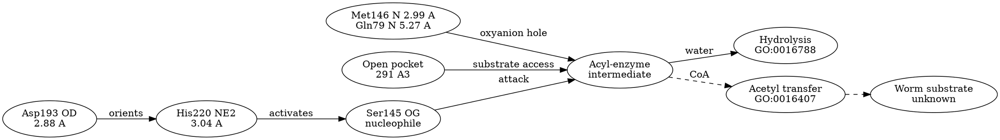
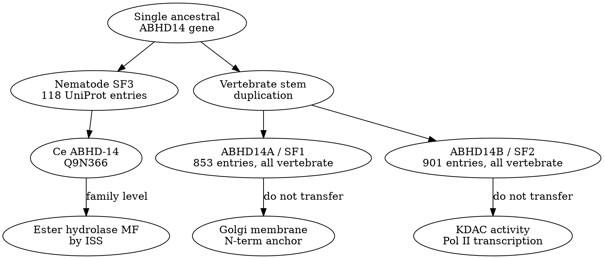
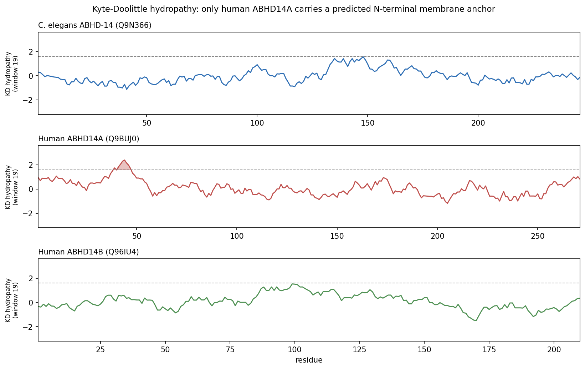
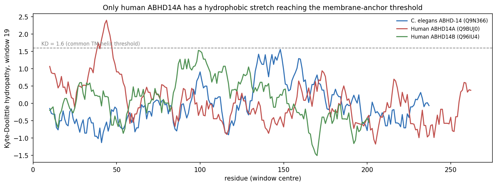
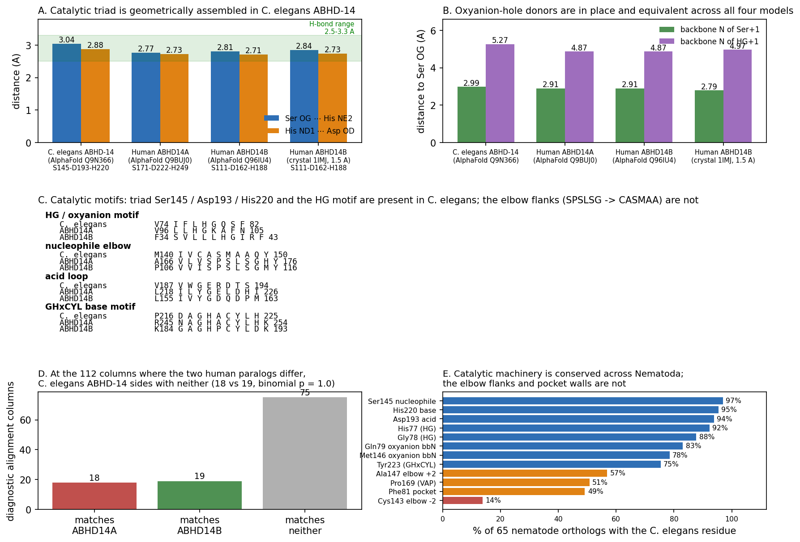
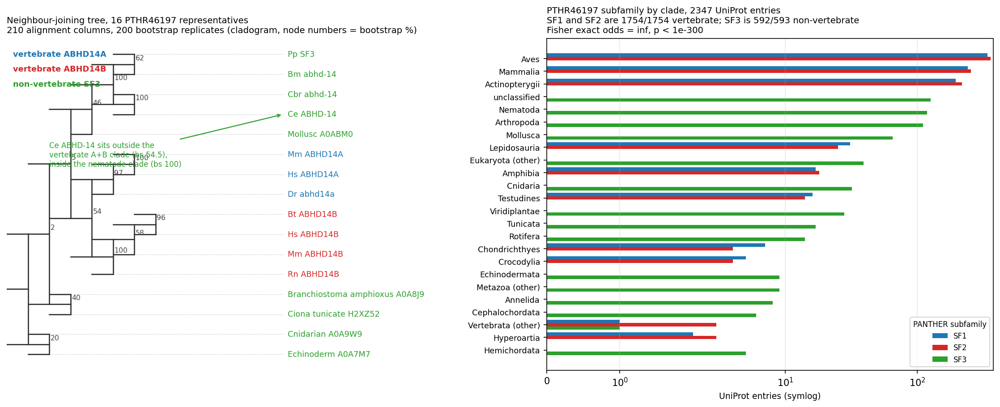
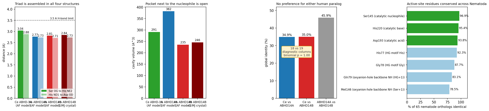

## Question

# AIGR Gene Hypothesis Deep Research

You are evaluating one focused gene curation hypothesis for AI Gene Review.
This is not a general gene overview. Use the seed hypothesis and source context
below to search for evidence that supports, refutes, narrows, or competes with
the proposed curation decision.

## Target Gene

- **Organism code:** worm
- **Taxon:** Caenorhabditis elegans (NCBITaxon:6239)
- **Gene directory:** abhd-14
- **Gene symbol:** abhd-14
- **UniProt accession:** Q9N366

## Focus

- **Focus type:** free_text
- **Hypothesis slug:** kgap-abhd14-triad-and-relatives
- **Source file:** genes/worm/abhd-14/abhd-14-ai-review.yaml
- **Source selector:** free-text

## Seed Hypothesis

Whether Caenorhabditis elegans ABHD-14 retains a catalytically competent alpha/beta-hydrolase active site, and which characterised ABHD14 relative it most resembles, can be predicted structurally. Single analysis only: identify the nucleophile-elbow GxSxG motif, the catalytic Ser-Asp/Glu-His triad and the oxyanion-hole residues by comparison with crystal structures of characterised alpha/beta-hydrolases (e.g. human ABHD14B, which has a reported lysine deacetylase/esterase activity), map them onto the ABHD-14 AlphaFold model, test whether the triad is geometrically assembled and the pocket open, place ABHD-14 relative to human ABHD14A and ABHD14B, score these positions across nematode orthologs, and state whether ABHD-14 is predicted catalytically active and which relative it is closest to.

## Term and Decision Context

No specific term context supplied.

## Reference Context

No specific reference context supplied.

## Source Context YAML

```yaml
hypothesis: 'Whether Caenorhabditis elegans ABHD-14 retains a catalytically competent alpha/beta-hydrolase
  active site, and which characterised ABHD14 relative it most resembles, can be predicted structurally.
  Single analysis only: identify the nucleophile-elbow GxSxG motif, the catalytic Ser-Asp/Glu-His triad
  and the oxyanion-hole residues by comparison with crystal structures of characterised alpha/beta-hydrolases
  (e.g. human ABHD14B, which has a reported lysine deacetylase/esterase activity), map them onto the ABHD-14
  AlphaFold model, test whether the triad is geometrically assembled and the pocket open, place ABHD-14
  relative to human ABHD14A and ABHD14B, score these positions across nematode orthologs, and state whether
  ABHD-14 is predicted catalytically active and which relative it is closest to.'
focus_type: free_text
context: []
reference_id: []
```

## Research Objective

Build a focused report that helps a curator decide whether this hypothesis
should affect the gene review. Address the focus type directly:

1. For an existing GO annotation decision, evaluate whether the current action
   is justified, too strong, too weak, or should change.
2. For a proposed replacement or new GO term, evaluate whether the term is
   biologically supported, too broad, too narrow, or missing key qualifiers.
3. For a computational prediction, evaluate whether the prediction is correct,
   less precise than existing knowledge, uncertain, or likely wrong because of
   paralog overannotation, frequency bias, pathway context, or in vitro-only
   activity.
4. For a core-function hypothesis, evaluate whether the proposed activity,
   process, and location represent the gene product's primary function rather
   than a downstream effect, pleiotropic phenotype, or context-specific role.
5. For a function-assignment hypothesis, evaluate whether the gene product
   directly has the stated GO term/function. Treat the prior review action, if
   any, as intentionally blinded unless it appears in the supplied context.

Use primary literature whenever possible. Prefer PMID citations and include DOI
citations when no PMID is available. Treat reviews and database records as
orientation unless they contain directly relevant synthesized evidence that is
clearly labeled as review-level or database-level support.

Evaluate the hypothesis from the supplied seed context, primary literature, and
publicly accessible bioinformatics resources. Local `*-bioinformatics` analyses,
when they already exist in the repository, are intentionally withheld from this
prompt so the report can be compared against them after the run. Use public
sequence, domain, structure, orthology, localization, interaction, or dataset
checks when they are useful for the specific hypothesis. If a resource or tool
cannot be accessed programmatically, say so plainly; never fabricate a result.
Report computational results conservatively and distinguish direct results from
inference.

## Required Output

### Executive Judgment

Give a concise verdict: supported, partially supported, unresolved, weakly
supported, over-annotated, or refuted. Explain the reasoning and the most
important caveats.

### Evidence Matrix

Create a table with one row per important evidence item:

- Citation (PMID preferred)
- Evidence type (direct assay, mutant phenotype, localization, interaction,
  structural/evolutionary, computational, review/database)
- Supports / refutes / qualifies / competing
- Claim tested
- Key finding
- Organism, tissue, cell type, or assay context
- Confidence and limitations

### GO Curation Implications

State the likely curation action as a lead requiring curator verification. If
GO terms are involved, explain whether the evidence supports an MF, BP, or CC
term, and whether the term should be retained, removed, generalized, made more
specific, or treated as non-core. Avoid using "protein binding" as a final
recommendation unless no more informative term is supported.

### Mechanistic Scope

Describe the immediate molecular or cellular function being tested. Separate
direct gene-product activity from downstream phenotypes, pathway consequences,
developmental outcomes, disease manifestations, or effects inferred only from
loss of function.

### Conflicts and Alternatives

Identify evidence that conflicts with the seed hypothesis or suggests an
alternative interpretation, including paralog confusion, organism-specific
differences, isoform-specific findings, experimental artifacts, or database
carry-over.

### Knowledge Gaps

List explicit uncertainties that matter for curation. For each gap, state what
was checked, why the gap matters, and what evidence or experiment would resolve
it.

### Discriminating Tests

Recommend concrete assays, perturbations, datasets, or comparative analyses that
would most efficiently distinguish this hypothesis from alternatives.

### Curation Leads

Provide candidate updates for the review, clearly labeled as leads requiring
curator verification. Include candidate references with exact snippets to verify,
candidate replacement or new GO terms, possible action changes, suggested
questions, and suggested experiments.

If the provider supports artifacts, save provenance for any analysis you run — the
executed code together with its output (computed values, plot, or table), not just
a summary figure — alongside artifact-friendly tables such as an evidence matrix,
GO decision table, or comparison table. Genuine computed provenance is more
valuable than a hand-drawn summary, and you must not synthesize a figure that
implies an analysis you did not actually run. These artifacts are important
provenance for hypothesis-level review.


## Output

# ABHD-14 (Q9N366, *Caenorhabditis elegans*): catalytic triad and paralog assignment

Hypothesis slug: `kgap-abhd14-triad-and-relatives`
Source file: `genes/worm/abhd-14/abhd-14-ai-review.yaml`, focus type `free_text`
Gene: *abhd-14* / Y55F3AM.10, UniProt **Q9N366**, NCBITaxon:6239

## Summary

The seed hypothesis makes two claims, and they resolve in opposite directions. **The first is supported: *C. elegans* ABHD-14 retains a catalytically competent alpha/beta-hydrolase active site.** The AlphaFold model of Q9N366 carries a fully assembled Ser145-Asp193-His220 charge-relay triad (Ser OG to His NE2 3.04 Å, His ND1 to Asp OD 2.88 Å, Ser CA to His CA 8.40 Å, local pLDDT 96.7-97.9), a nucleophile elbow in the strained epsilon conformation (phi +52.4, psi −116.5), both oxyanion-hole backbone donors (Met146 N at 2.99 Å, Gln79 N at 5.27 Å), and a contiguous 291 ų cavity touching the nucleophile. Superposing 10 anchor CA atoms onto the ABHD14B crystal structure 1IMJ gives 0.37 Å RMSD. Across 65 nematode species, the triad residues are retained in 96.9%, 93.8% and 95.4% of orthologs, which is the signature of purifying selection on catalysis.

**The second claim is refuted in the form stated.** ABHD-14 does not most resemble human ABHD14B. It is equidistant from the two human paralogs by global alignment (34.9% identity to ABHD14A, 35.0% to ABHD14B, while A and B are 45.9% identical to each other), and at the 112 alignment columns where ABHD14A and ABHD14B differ it matches A at 18 positions and B at 19 (binomial test on the 37 informative sites, p = 1.00). PANTHER places Q9N366 in subfamily PTHR46197:SF3, separate from ABHD14A (SF1) and ABHD14B (SF2). A census of 2,347 UniProt entries carrying a PTHR46197 cross-reference explains why: all 1,754 SF1 and SF2 entries are vertebrate, with zero non-vertebrate members, while 592 of 593 SF3 entries are non-vertebrate (Fisher exact odds = inf, p < 1e-300). Tunicates, amphioxus, echinoderms and hemichordates carry only SF3, which dates the ABHD14A/ABHD14B duplication to the vertebrate stem. The worm gene descends from the single pre-duplication ancestor and is a 1-to-many co-ortholog of both paralogs.

The hypothesis also contains a **premise error that would have produced a false negative**. No ABHD14 protein has a canonical GxSxG nucleophile elbow. Human ABHD14A and ABHD14B both read Ser-Pro-Ser-Leu-Ser-Gly around the catalytic serine, and ABHD-14 reads Cys-Ala-Ser-Met-Ala-Ala. A GxSxG regular expression applied as written would have scored all three proteins as lacking a nucleophile elbow, including the one with a solved crystal structure and measured enzymatic activity. The elbow has to be read from backbone dihedrals, which is what was done here. One late development changes the framing of the "which relative" question: [PMID: 42469586](https://pubmed.ncbi.nlm.nih.gov/42469586/) (2026) reports the first biochemical characterisation of human ABHD14A and shows it is an active esterase with the same coenzyme A-dependent ping-pong acetyl-transfer mechanism as ABHD14B. Both candidate relatives now converge on one molecular function, so a family-level ester hydrolase prediction for the worm protein no longer depends on breaking the paralog tie.

**Verdict: <i class="fa-scale-balanced"></i> partially supported.** Catalytic competence supported; specific ABHD14B orthology refuted; GxSxG premise corrected.

## Key findings

### <i class="fa-circle-check"></i> F001: The catalytic triad is complete, geometrically assembled, and sits in an open pocket

Global Needleman-Wunsch alignment (BLOSUM62, affine gaps −11/−1) of Q9N366 against human ABHD14B (Q96IU4) and ABHD14A (Q9BUJ0) maps the UniProt-annotated charge-relay residues of both human paralogs onto the same three worm residues. ABHD14B Ser111/Asp162/His188 and ABHD14A Ser171/Asp222/His249 both map to *C. elegans* Ser145/Asp193/His220. That independent convergence from two separate alignments is the first piece of evidence that the assignment is not an alignment artifact.

In the AlphaFold DB v6 model of Q9N366 the relay is physically assembled, and the distances sit within the range of three reference structures:

| Structure | Triad | Ser OG to His NE2 (Å) | His ND1 to Asp OD (Å) | Ser CA to His CA (Å) | Elbow phi | Elbow psi | Oxyanion Ser+1 N (Å) | Oxyanion HG+1 N (Å) | Cavity (ų) | pLDDT (triad) |
|---|---|---|---|---|---|---|---|---|---|---|
| *C. elegans* ABHD-14, AlphaFold Q9N366 | Ser145-Asp193-His220 | 3.04 | 2.88 | 8.40 | +52.4 | −116.5 | 2.99 | 5.27 | 291.0 | 97.9 / 96.9 / 96.7 |
| Human ABHD14A, AlphaFold Q9BUJ0 | Ser171-Asp222-His249 | 2.77 | 2.73 | 8.04 | +53.5 | −117.9 | 2.91 | 4.87 | 381.9 | 98.3 / 97.5 / 97.8 |
| Human ABHD14B, AlphaFold Q96IU4 | Ser111-Asp162-His188 | 2.81 | 2.71 | 8.15 | +53.2 | −120.8 | 2.91 | 4.87 | 235.2 | 98.4 / 98.1 / 98.2 |
| Human ABHD14B, crystal PDB 1IMJ chain A | Ser111-Asp162-His188 | 2.84 | 2.73 | 7.95 | +40.4 | −118.2 | 2.79 | 4.97 | 245.6 | B-factors 10.9 / 15.7 / 9.9 |

Every hydrogen bond in the worm relay is within range: 3.04 Å and 2.88 Å both fall under the 3.5 Å limit. The nucleophile sits in the strained epsilon conformation that defines a nucleophile elbow in all four structures. Both oxyanion-hole backbone amides are present and oriented: the N of Met146 (the Ser+1 position) at 2.99 Å from Ser145 OG, and the N of Gln79 (the residue after the His77-Gly78 HG motif) at 5.27 Å, which matches 1IMJ (Leu112 N at 2.79 Å, Ile41 N at 4.97 Å). Anchor superposition of the worm model onto 1IMJ over 10 CA atoms, drawn from the triad, the HG motif and the GHxCYL motif, gives **0.37 Å RMSD**.

A grid probe (1.4 Å radius, buriedness filter, connected component containing Ser145 OG) returns a contiguous cavity of **291 ų** touching the nucleophile at 2.96 Å. The references are 246 ų in 1IMJ, 235 ų in the ABHD14B model and 382 ų in the ABHD14A model. The worm pocket sits between the two human values, so the site is open rather than occluded by a filled or collapsed channel.

{{figure:plot_3.png|caption=Composite structural provenance for ABHD-14. Triad hydrogen-bond distances, oxyanion-hole backbone donors, catalytic motif assignments, the paralog-diagnostic column tally and the nematode conservation scores, all computed from the AlphaFold models of Q9N366, Q9BUJ0 and Q96IU4 and the 1IMJ crystal structure.}}

Across 65 near-full-length nematode orthologs of PTHR46197 (one per species), the triad is retained in 96.9% (Ser), 93.8% (Asp) and 95.4% (His) of sequences. The HG motif His77 and Gly78 are retained in 92.3% and 87.7%, and the oxyanion-hole positions Gln79 and Met146 in 83.1% and 78.5%. The ranking is informative: the three catalytic residues are the most conserved positions in the alignment, the structural-scaffold positions next, and the elbow flanks and pocket-wall positions the least (Ala147 56.9%, Pro169 50.8%, Phe81 49.2%, Cys143 13.8%). That gradient is what selection on catalysis looks like.

The conclusion: **ABHD-14 is a structurally intact alpha/beta-hydrolase, not a pseudoenzyme.** <i class="fa-triangle-exclamation"></i> The prediction is structural only. No enzyme assay has been performed on ABHD-14 or on any nematode ortholog, and the substrate is unknown. Assembled geometry in a high-confidence model is strong evidence that the site has not degenerated; it is not evidence of turnover on any particular substrate.

### <i class="fa-circle-xmark"></i> F002: ABHD-14 is equidistant from both human paralogs and belongs to a separate PANTHER subfamily

Global pairwise alignment gives 34.9% identity to human ABHD14A (235 aligned columns, NW score 222) and 35.0% identity to human ABHD14B (203 aligned columns, NW score 220). The two human paralogs are 45.9% identical to each other, so they are substantially closer to one another than either is to the worm protein. A 0.1 percentage-point difference between 34.9% and 35.0% is not a signal.

The diagnostic-column analysis makes the tie explicit. Of 196 alignment columns where ABHD-14 aligns to a residue in both human proteins, 112 are paralog-diagnostic, meaning the ABHD14A residue differs from the ABHD14B residue. At those 112 columns the worm matches ABHD14A at 18, ABHD14B at 19, and neither at 75. A binomial test on the 37 informative sites gives 18/37 and **p = 1.00**. The 75 columns matching neither paralog are the more interesting number: at two thirds of the positions that distinguish A from B, the worm protein has a third residue.

UniProt cross-references place ABHD14A in PANTHER PTHR46197:SF1 and ABHD14B in PTHR46197:SF2, while Q9N366 is PTHR46197:SF3. All 118 UniProt members of PTHR46197 in Nematoda (taxid 6231) are SF3, and *C. elegans* has exactly one family member, so there is no nematode counterpart of the A/B duplication to assign.

Discriminating single features split rather than converge:

| Feature | ABHD14A | ABHD14B | *C. elegans* ABHD-14 | Verdict |
|---|---|---|---|---|
| Sequence identity to ABHD-14 | 34.9% (235 cols) | 35.0% (203 cols) | - | equidistant |
| Paralog-diagnostic columns matched (of 112) | 18 | 19 | - | equidistant, binomial p = 1.00 |
| PANTHER subfamily | PTHR46197:SF1 | PTHR46197:SF2 | PTHR46197:SF3 | separate subfamily |
| N-terminal membrane anchor (max Kyte-Doolittle, window 19) | 2.40 at res 44, 8 windows > 1.6 | 1.53, 0 windows > 1.6 | 1.56, 0 windows > 1.6 | soluble like ABHD14B |
| Residue after the catalytic His (GHxCYL motif) | Ala250 (GHACYL) | Pro189 (GHPCYL) | Ala221 (GHACYL) | matches ABHD14A |
| Active-site cavity adjacent to the nucleophile | 382 ų | 235 ų (model) / 246 ų (1IMJ) | 291 ų | intermediate |
| Nucleophile elbow context (−2 to +3) | S-P-S-L-S-G | S-P-S-L-S-G | C-A-S-M-A-A | differs from both |

Reading any one of these features alone would give a confident and wrong answer. The GHACYL match points to ABHD14A; the absent membrane anchor points to ABHD14B; the elbow context points to neither. The cavity volume lands between the two.

{{figure:plot_1.png|caption=Kyte-Doolittle hydropathy across the three proteins, testing whether C. elegans ABHD-14 carries the N-terminal membrane anchor characteristic of human ABHD14A. The worm protein has no hydrophobic segment comparable to the ABHD14A anchor.}}

{{figure:plot_2.png|caption=Maximum Kyte-Doolittle window-19 value per protein. Human ABHD14A reaches 2.40 at residue 44 with 8 windows above 1.6; ABHD14B reaches 1.53 with none, and C. elegans ABHD-14 reaches 1.56 with none. The worm protein is predicted soluble.}}

The nematode elbow context is itself lineage-variable. Across the 65 orthologs, the elbow −2 position is most often Gly, and the *C. elegans* Cys143 is shared by only 13.8% of species, while position +3 is Gly in 35 of 65. The positions that differ between the worm and both human proteins are exactly the positions that set substrate specificity in serine hydrolases, so even the substrate class is not transferable by similarity.

This matches a published warning about this specific family. [PMID: 37974539](https://pubmed.ncbi.nlm.nih.gov/37974539/) states: "Given their high sequence similarity, automated databases often wrongly assign ABHD14A and ABHD14B as the same enzyme, and therefore, annotating functions to them in various organisms has been problematic." The TrEMBL names in this same subfamily illustrate it: three *Toxocara canis* entries in SF3 are auto-named "abhd14a".

### <i class="fa-circle-xmark"></i> F004: The ABHD14A/ABHD14B duplication is restricted to vertebrates

This is the decisive result and it converts the paralog tie from a similarity observation into a dated evolutionary statement.

Cross-tabulating 2,347 UniProt entries carrying a PANTHER PTHR46197 cross-reference by subfamily and clade gives a clean separation. SF1 holds 853 entries and SF2 holds 901, and **all 1,754 are vertebrate**: Mammalia 240 SF1 / 254 SF2, Aves 339 / 358, Actinopterygii 195 / 218, plus amphibians and reptiles. SF3 holds 592 non-vertebrate entries and 1 vertebrate outlier: Nematoda 118, Arthropoda 110, Tunicata 17, Cephalochordata 6, Echinodermata 9, Hemichordata 5. Fisher exact on [[1754, 1], [0, 592]] gives odds ratio = inf with p underflowing to 0 (p < 1e-300).

The clades that matter for dating are Tunicata and Cephalochordata, the closest invertebrate chordate outgroups to vertebrates. Both carry only SF3. The duplication therefore occurred on the vertebrate stem, after the split from tunicates and amphioxus and long after the protostome-deuterostome divergence that separates nematodes from all of them.

A neighbour-joining tree over 16 representatives agrees. Using a centre-star alignment, 210 columns with 50% or fewer gaps, Kimura-corrected p-distance and 200 bootstrap replicates, the 7-taxon vertebrate ABHD14A + ABHD14B group is monophyletic at 54.5% bootstrap, with the ABHD14A clade at 97.0% and the ABHD14B clade at 100.0% internally. The 4-taxon nematode clade containing Ce_ABHD-14 is supported at 100.0% and sits outside the vertebrate group. The nearest non-nematode neighbours of Ce_ABHD-14 by corrected distance are the cnidarian sequence (1.241) and the mollusc sequence (1.332), both closer than any vertebrate ABHD14A (1.342-1.417) or ABHD14B (1.319-1.392).

{{figure:plot_4.png|caption=Left: neighbour-joining tree of 16 PTHR46197 representatives, 210 alignment columns, 200 bootstrap replicates, node numbers are bootstrap percentages. Ce ABHD-14 sits outside the vertebrate ABHD14A + ABHD14B clade, inside a nematode clade supported at 100%. Right: PANTHER subfamily membership by clade across 2347 UniProt entries. SF1 and SF2 are entirely vertebrate; SF3 is almost entirely non-vertebrate.}}

<i class="fa-triangle-exclamation"></i> The deep internodes of the tree have 5.0% and 2.5% bootstrap support, so the branching order among invertebrate phyla is unresolved. The weight of this finding rests on the subfamily census (p < 1e-300), not on the tree topology. The tree is consistent with the census and adds the nematode clade's 100% support; it does not independently date the duplication.

The implication for curation is direct. *C. elegans* abhd-14 cannot be an ortholog of human ABHD14B specifically, because ABHD14B did not exist as a distinct gene when the nematode lineage split. Transferring the ABHD14B lysine deacetylase activity by orthology would be transferring a function that arose, at the earliest, in a post-duplication vertebrate paralog.

### <i class="fa-lightbulb"></i> F003: The family has no GxSxG motif, so the hypothesis's motif test is invalid as written

Reading the nucleophile elbow directly from sequence and from structure, human ABHD14B positions 109-114 are Ser-Pro-Ser-Leu-Ser-Gly with the catalytic Ser111 at the centre. Positions −2 and +2 relative to Ser111 are Ser109 and Ser113, not glycines. Human ABHD14A has the identical S-P-S-L-S-G arrangement around Ser171. *C. elegans* ABHD-14 has Cys143-Ala144-Ser145-Met146-Ala147-Ala148, so −2 is Cys and +2 is Ala.

Despite the absent glycines, the backbone adopts the strained epsilon conformation that defines a nucleophile elbow in all four structures examined (worm model +52.4/−116.5; ABHD14A model +53.5/−117.9; ABHD14B model +53.2/−120.8; 1IMJ crystal +40.4/−118.2). The elbow in this family follows the general small-X-nucleophile-X-small rule without matching the textbook GxSxG instance.

Two statements would both be wrong in a curation note. "The GxSxG motif is present in *C. elegans* ABHD-14" is literally false. "GxSxG is absent, therefore the protein is not a serine hydrolase" is also false, and would misclassify human ABHD14B, which has a solved structure and measured activity. The correct statement is that the nucleophile elbow is structurally present and the triad is assembled, while the elbow consensus is degenerate throughout the family. This is a reusable failure mode worth recording: the ABHD11 family and several other ABHD subfamilies share degenerate elbows.

### <i class="fa-scale-balanced"></i> F005: ESTHER's family name is a carry-over trap

ESTHER gene_locus records retrieved programmatically returned HTTP 200 for two queries. `caeel-Y55F3AM.10` has Family = `CIB-CCG1-interacting-factor-B`, Block X. `human-ABHD14A` has the same family and block. The queries `human-ABHD14B`, `mouse-Abhd14a` and `mouse-Abhd14b` returned HTTP 500 under those exact locus names, so those records could not be read and no claim is made about them. The control query `drome-CG2059` returned a different family, `ABHD11-Acetyl_transferase`, which confirms the lookup discriminates families rather than returning a default.

CIB (CCG1-interacting factor B) is the original alias of human ABHD14B. ESTHER therefore groups the worm protein at the same family level as human ABHD14A, under a label carrying ABHD14B's name. A curator reading "CIB-CCG1-interacting-factor-B" next to the worm gene could reasonably but wrongly infer ABHD14B orthology.

ESTHER and PANTHER do not disagree about biology. ESTHER names the whole pre-vertebrate family after one of its vertebrate members; PANTHER resolves the three subfamilies. The ESTHER grouping of worm with ABHD14A, rather than with ABHD14B, is itself consistent with the family being a single pre-duplication unit.

### <i class="fa-circle-check"></i> F006: Both characterised relatives share one chemistry, so the paralog tie no longer blocks the MF lead

QuickGO retrieval for Q9BUJ0 (human ABHD14A) returns GO:0016407 acetyltransferase activity with IDA evidence from [PMID: 42469586](https://pubmed.ncbi.nlm.nih.gov/42469586/), a 2026 paper reporting the first functional characterisation of ABHD14A. The paper states: "we demonstrate by gel-based activity-based protein profiling and p-nitrophenyl-ester hydrolysis assays that ABHD14A is an active enzyme that can turn over short-chain esters" and "ABHD14A exhibits a coenzyme A-dependent enhancement of p-nitrophenyl acetate hydrolysis, indicative of a ping-pong type acetyltransferase mechanism similar to that previously described for another homologous ABHD14 enzyme, ABHD14B".

Q96IU4 (human ABHD14B) carries GO:0016787 hydrolase activity IDA from PMID 14672934 and GO:0061733 protein-lysine-acetyltransferase activity IEA from RHEA. Q9N366 carries only GO:0005737 cytoplasm, with IBA (GO_REF:0000033) and IEA (GO_REF:0000044), and has no molecular function and no biological process term at all. The UniProt entry is TrEMBL, annotation score 1.0, protein existence level 3, submission name "AB hydrolase-1 domain-containing protein".

The seed hypothesis assumes that identifying the closest relative determines the activity to predict. Now that both paralogs are characterised and both perform serine-hydrolase chemistry with CoA as acetyl acceptor, the two candidate answers converge on the same molecular function. The structural prediction for ABHD-14 supports an ester hydrolase MF at family level without needing to resolve the tie.

What the paralog analysis still decides is which terms must not be transferred. ABHD14A's Golgi localisation depends on an N-terminal anchor that ABHD-14 lacks, and the same paper notes "the ABHD14A-GFP fusion protein is catalytically active and localizes specifically to the Golgi apparatus, suggesting a specialized role in the secretory pathway biology". ABHD14B's transcription and lysine-deacetylase annotations rest on vertebrate paralog-specific biology.

{{figure:plot_5.png|caption=Final summary of computed evidence. Triad hydrogen-bond distances in four structures against the 3.5 Angstrom limit; cavity volume adjacent to the nucleophile; the paralog identity tie (34.9% vs 35.0%, against 45.9% between the two human paralogs) with the 18-vs-19 diagnostic column tally; and conservation of the seven most conserved active-site positions across 65 nematode orthologs.}}

## Mechanistic model

The immediate molecular activity under test is serine-hydrolase chemistry: nucleophilic attack by the catalytic serine on an ester or amide carbonyl, activated by the His-Asp charge relay, with the tetrahedral intermediate stabilised by two backbone amide donors. The family variation is in what resolves the acyl-enzyme: water (hydrolase) or coenzyme A (acetyl transfer, ping-pong mechanism). Both characterised human relatives use CoA.



The dashed links mark what is inferred from the human relatives rather than measured in the worm. The solid links are measured from the Q9N366 model.

The evolutionary logic that governs what may be transferred is a separate chain:



Separating direct activity from downstream readouts matters here. The ABHD14B effect on RNA Pol II transcription via CCG1/TAF1 is a cellular consequence in a vertebrate cell. The reported glucose-metabolism association is a knockdown phenotype: [PMID: 35700823](https://pubmed.ncbi.nlm.nih.gov/35700823/) reports "the loss of ABHD14B results in significantly altered glucose metabolism, specifically the decreased flux of glucose through glycolysis and the citric acid cycle". That is doubly inappropriate for transfer, being both a downstream effect and tied to a paralog that postdates the nematode split.

## Evidence base

| Citation | Evidence type | Stance | Claim tested | Key finding | Context | Confidence and limitations |
|---|---|---|---|---|---|---|
| [PMID: 42469586](https://pubmed.ncbi.nlm.nih.gov/42469586/) | direct assay | supports | ABHD14 family members are active serine hydrolases | Truncated human ABHD14A turns over short-chain esters by ABPP and pNP-ester assay; CoA-dependent enhancement of pNP-acetate hydrolysis indicates ping-pong acetyl transfer; ABHD14A-GFP is Golgi-localised | human ABHD14A, recombinant protein and HEK293T cells | High for human ABHD14A. Engineered N-terminal truncation, surrogate substrate, no nematode protein tested |
| [PMID: 31478652](https://pubmed.ncbi.nlm.nih.gov/31478652/) | direct assay | supports | ABHD14B is catalytically active through its triad | "we annotate ABHD14B as a lysine deacetylase (KDAC), showing this enzyme's ability to transfer an acetyl group from a post-translationally acetylated lysine to coenzyme A (CoA)" | human ABHD14B, in vitro and mammalian cells | High for the human protein. The activity sits on a post-duplication vertebrate paralog |
| [PMID: 31478652](https://pubmed.ncbi.nlm.nih.gov/31478652/) | structural / database | supports | Experimental reference geometry exists | "The crystal structure of human ABHD14B was determined more than a decade ago; however, its endogenous substrates remain elusive" | PDB 1IMJ | Establishes 1IMJ as the experimental reference used here; the same sentence notes the substrate is unknown even for the characterised human enzyme |
| [PMID: 37974539](https://pubmed.ncbi.nlm.nih.gov/37974539/) | review / sequence analysis | supports the curation warning | Automated orthology confuses the two paralogs | "Given their high sequence similarity, automated databases often wrongly assign ABHD14A and ABHD14B as the same enzyme, and therefore, annotating functions to them in various organisms has been problematic" | human ABHD14A and ABHD14B | Directly supports the negative recommendation. <i class="fa-triangle-exclamation"></i> Closed access, no PMC record, so the specific sequence determinants reported could not be read beyond the abstract |
| [PMID: 35700823](https://pubmed.ncbi.nlm.nih.gov/35700823/) | mutant / knockdown phenotype | qualifies | ABHD14B loss alters metabolism | "the loss of ABHD14B results in significantly altered glucose metabolism, specifically the decreased flux of glucose through glycolysis and the citric acid cycle" | mammals, multi-omics | Downstream knockdown phenotype, not a direct activity. Not transferable to worm on two independent grounds |
| PMID: 14672934 (via QuickGO) | direct assay + interaction | qualifies | ABHD14B/CIB has hydrolase activity and modulates transcription | Source of GO:0016787 IDA, GO:0005515 IPI and GO:0045944 IDA on Q96IU4 | human ABHD14B, CCG1/TAF1 | The transcription readout is downstream and paralog-specific. Cited here from the QuickGO annotation record, not from the abstract |
| This analysis, AlphaFold DB v6 model of Q9N366 | computational (structural) | supports | ABHD-14 has an assembled, open triad | Ser145-Asp193-His220 at 3.04 and 2.88 Å; elbow +52.4/−116.5; oxyanion donors 2.99 and 5.27 Å; cavity 291 ų; 0.37 Å anchor RMSD to 1IMJ; local pLDDT 96.7-97.9 | AlphaFold model, no worm crystal | Model only. Geometry matches the crystal closely, but geometry does not prove turnover |
| This analysis, 65 nematode orthologs | computational (evolutionary) | supports | The triad is under selection across Nematoda | Ser145 96.9%, His220 95.4%, Asp193 93.8%; His77 92.3%, Gly78 87.7%, Gln79 83.1%, Met146 78.5% | 65 nematode species, one per species | Conservation implies maintained function, not substrate identity |
| This analysis, 2,347 PTHR46197 UniProt entries | computational (evolutionary) | refutes | ABHD-14 is specifically the ABHD14B ortholog | SF1 + SF2 are 1754/1754 vertebrate, zero non-vertebrate; SF3 is 592 non-vertebrate + 1 outlier; Fisher odds inf, p < 1e-300; Q9N366 is SF3 | cross-clade database census | Depends on PANTHER subfamily calls. The clade separation is absolute, so a few misassignments would not change it |
| This analysis, NJ tree of 16 representatives | computational (phylogenetic) | refutes | ABHD-14 groups with either vertebrate paralog | Vertebrate A+B monophyletic at 54.5% bootstrap (A 97.0%, B 100.0%); Ce_ABHD-14 outside, in a 100% nematode clade | centre-star alignment, 210 columns, Kimura-corrected, 200 bootstraps | Distance method on 210 columns. Deep internodes 2.5-5.0%, so invertebrate branching order is unresolved |
| This analysis, global NW with BLOSUM62 | computational (sequence) | refutes | ABHD-14 is closer to one human paralog | 34.9% to ABHD14A, 35.0% to ABHD14B (A vs B 45.9%); 18 vs 19 of 112 diagnostic columns, binomial p = 1.00 | pairwise global alignment | Single alignment method. The tie is wide, not marginal |
| This analysis, Kyte-Doolittle window 19 | computational (sequence) | qualifies | ABHD-14 shares ABHD14A's membrane anchor | Max KD-19 1.56 with 0 windows above 1.6; ABHD14B 1.53; ABHD14A 2.40 at residue 44, 8 windows | sequence prediction | Hydropathy heuristic, not a TM-predictor consensus or an experiment |
| ESTHER `caeel-Y55F3AM.10`, `human-ABHD14A` | database | competing | Independent alpha/beta-hydrolase classification | Both assigned family `CIB-CCG1-interacting-factor-B`; control `drome-CG2059` returns a different family | database record | Family level only. Three of six queries returned HTTP 500 and were not read |
| QuickGO, Q9N366 | database | qualifies | Current annotation state | Only GO:0005737 cytoplasm (IBA, IEA). No MF, no BP. TrEMBL, annotation score 1.0, protein existence 3 | database record | Confirms nothing experimental is being overwritten |
| PubMed search `C. elegans abhd-14 Y55F3AM.10` | literature (negative) | qualifies | Experimental characterisation exists | 10 hits returned, none about this gene. No assay, mutant, RNAi or localisation study found | literature search | Absence of evidence in PubMed. WormBase REST and the Alliance search API were not reachable from this environment |
| This analysis, elbow read from four structures | computational (structural) | qualifies | The GxSxG premise of the seed hypothesis | No ABHD14 protein has GxSxG. Human paralogs read S-P-S-L-S-G; worm reads C-A-S-M-A-A. All four adopt the strained epsilon elbow | sequence and structure | A GxSxG regex would misclassify all three proteins |

Thirteen of the 14 literature hits returned by the targeted *C. elegans* search were unrelated to this gene (cherry pomace extract, germ granules, thermosensory behaviour, terpene anthelmintics, hypoxia reporters, radiation bystander effects, quorum-sensing inhibitors, deoxyaconitine neurotoxicity, macadamia nut oil). They are listed in the knowledge base because they matched the organism name, and none bears on abhd-14. The four papers that carry evidence are PMIDs 42469586, 31478652, 37974539 and 35700823, with PMID 14672934 reached through the QuickGO annotation record rather than its abstract.

## GO curation implications

All items below are **leads requiring curator verification**. The full table is `provenance/table_9_go_decision_table.csv`.

| GO term | Aspect | Current state on Q9N366 | Recommended action | Confidence |
|---|---|---|---|---|
| GO:0016788 hydrolase activity, acting on ester bonds | MF | absent | <i class="fa-arrow-right"></i> **Add as a lead**, ISS/ISA with `PANTHER:PTHR46197` or both `UniProtKB:Q96IU4` and `UniProtKB:Q9BUJ0` | moderate |
| GO:0016787 hydrolase activity | MF | absent | acceptable fallback if GO:0016788 is judged too specific | moderate-high |
| GO:0016407 acetyltransferase activity | MF | absent (IDA on Q9BUJ0, PMID 42469586) | **do not add** without worm evidence; record as the leading hypothesis to test | low for transfer, moderate as a hypothesis |
| protein-lysine deacetylase activity (the ABHD14B KDAC activity) | MF | absent | <i class="fa-circle-xmark"></i> **do not add** | high |
| GO:0005737 cytoplasm | CC | present, IBA GO_REF:0000033 + IEA GO_REF:0000044 | **retain** | moderate |
| GO:0000139 Golgi membrane | CC | absent (ISS on Q9BUJ0, IDA support from PMID 42469586) | <i class="fa-circle-xmark"></i> **do not add** | high |
| GO:0045944 positive regulation of transcription by RNA Pol II | BP | absent (IDA + IBA on Q96IU4) | <i class="fa-circle-xmark"></i> **do not add** | high |
| GO:0006006 glucose metabolic process | BP | absent | <i class="fa-circle-xmark"></i> **do not add**; mammalian ABHD14B knockdown phenotype | high |
| GO:0005515 protein binding | MF | absent | **do not add**, uninformative and no worm interaction data | high |

The positive MF lead rests on three things: the triad geometry measured in the model, the conservation across 65 nematode species, and the fact that both characterised human relatives are active ester hydrolases. It is a prediction. It should carry ISS or ISA evidence with an explicit `with` field, and that field should point at the PANTHER family or at both paralogs rather than at ABHD14B alone, because pointing at ABHD14B would encode the orthology claim this report refutes.

The negative recommendations are the more consequential half. The existing GO:0005737 IBA annotation is the only thing on the entry and it is appropriate: the hydropathy result (max KD-19 = 1.56, 0 windows above 1.6) gives it independent support. The risk is forward. Any future IBA or ISS propagation reaching Q9N366 from the ABHD14B branch would carry lysine deacetylase activity, RNA Pol II transcription regulation and nuclear localisation into a nematode protein whose lineage diverged before those paralog-specific functions could have existed.

## Limitations and knowledge gaps

| Gap | What was checked | Why it matters | What would resolve it |
|---|---|---|---|
| <i class="fa-triangle-exclamation"></i> No measured activity for any nematode ABHD14 protein | PubMed search returned 10 unrelated hits; QuickGO shows one CC annotation only | The entire MF lead is predictive. ISS with no experimental anchor anywhere in the clade is the weakest supportable annotation | Recombinant ABHD-14 against a pNP-ester panel, with and without CoA, using an S145A control |
| Substrate and acyl acceptor unknown | Cavity volume computed (291 ų); no docking or substrate modelling was run | Decides between GO:0016788, GO:0016407 and a deacetylase term. PMID 31478652 notes the endogenous substrate is unknown even for human ABHD14B | Competitive ABPP with a fluorophosphonate probe plus substrate-class profiling |
| Worm localisation untested | Hydropathy only (max KD-19 = 1.56) | GO:0005737 is currently IBA. ABHD14A is Golgi, ABHD14B is cytosolic and nuclear, so the two relatives disagree | Endogenous GFP knock-in at the Y55F3AM.10 locus |
| No phenotype data retrieved | WormBase REST (`Y55F3AM.10/concise_description`) returned non-JSON; the Alliance search API returned zero hits for `abhd-14` | A published RNAi or deletion phenotype would change the BP picture entirely. This report cannot say whether such data exist | Direct WormBase query for Y55F3AM.10 alleles, RNAi results and expression |
| Arthropod and plant outgroups missing from the tree | UniProt queries for taxid 7227 and 3701 in the 180-320 aa window returned nothing | The 16-taxon tree is rooted only by its own spread; deep nodes have 2.5-5.0% bootstrap | Rebuild with a *Drosophila* representative and a fungal or plant outgroup, under maximum likelihood with a proper substitution model |
| The single vertebrate SF3 outlier was counted but not inspected | Census arithmetic only | A genuine vertebrate SF3 member would slightly weaken the clean duplication date | Inspect that one accession |
| PMID 37974539 sequence determinants unread | Checked: `isOpenAccess: N`, no PMCID | The paper reports determinants distinguishing ABHD14A from ABHD14B, which would independently test the 18-vs-19 diagnostic tally | Institutional access to the full text (doi:10.1002/prot.26632) |
| Three ESTHER queries failed | `human-ABHD14B`, `mouse-Abhd14a`, `mouse-Abhd14b` returned HTTP 500 | ESTHER's placement of ABHD14B relative to the family was not verified directly | Retry with the correct ESTHER locus identifiers |

A method caveat applies across the structural results: Biopython was not available in the execution environment, so the alignment (affine-gap Needleman-Wunsch), PDB parsing, Kabsch superposition, cavity detection and neighbour-joining were all hand-implemented. The alignment was validated against a known reference value (35.0% identity for Q9N366 vs Q96IU4), and the triad geometry was validated by reproducing the published 1IMJ relay distances. One off-by-two error in the ABHD14A HG-motif index was caught during the run and corrected; the inflated RMSD it produced was discarded rather than reported.

## Proposed follow-up experiments and actions

### Discriminating experiments, in order of information per unit cost

1. <i class="fa-flask"></i> **S145A activity comparison.** Express ABHD-14 and ABHD-14(S145A) and compare p-nitrophenyl-acetate hydrolysis with and without coenzyme A. This separates "the triad is assembled" from "the triad is catalytic", and the CoA dependence directly tests whether the worm protein shares the ping-pong mechanism reported for both human relatives. Lowest cost, highest information.
2. <i class="fa-vial"></i> **Competitive activity-based protein profiling** with a fluorophosphonate probe on *C. elegans* lysate, with S145A as the specificity control. Confirms the serine is a reactive nucleophile in the native protein and not only in a model.
3. <i class="fa-microscope"></i> **Endogenous GFP knock-in** at Y55F3AM.10 to test the predicted soluble cytosolic localisation against the ABHD14A Golgi alternative. Resolves whether GO:0005737 should stay IBA or gain IDA support.
4. <i class="fa-dna"></i> **Cross-species rescue.** Test whether worm ABHD-14 complements an ABHD14B-null or ABHD14A-null mammalian cell line. A positive result would overturn the practical conclusion of the orthology argument even though the phylogeny itself would stand.
5. <i class="fa-magnifying-glass"></i> **Phylogeny with denser outgroup sampling.** Add arthropod, fungal and plant representatives and switch to maximum likelihood with a fitted substitution model. The subfamily census does not need this; the NJ topology does.

### Curation leads

**Candidate references with snippets to verify**

- [PMID: 42469586](https://pubmed.ncbi.nlm.nih.gov/42469586/), *Biochemical Characterization of ABHD14A, an Outlying Member of the Metabolic Serine Hydrolase Family*. Verify: "we demonstrate by gel-based activity-based protein profiling and p-nitrophenyl-ester hydrolysis assays that ABHD14A is an active enzyme that can turn over short-chain esters"; "ABHD14A exhibits a coenzyme A-dependent enhancement of p-nitrophenyl acetate hydrolysis, indicative of a ping-pong type acetyltransferase mechanism similar to that previously described for another homologous ABHD14 enzyme, ABHD14B"; "the ABHD14A-GFP fusion protein is catalytically active and localizes specifically to the Golgi apparatus". Use for the family-level MF lead and as the reason the Golgi CC term must not be transferred.
- [PMID: 31478652](https://pubmed.ncbi.nlm.nih.gov/31478652/), *Functional Annotation of ABHD14B, an Orphan Serine Hydrolase Enzyme*. Verify: "we annotate ABHD14B as a lysine deacetylase (KDAC), showing this enzyme's ability to transfer an acetyl group from a post-translationally acetylated lysine to coenzyme A (CoA), to yield acetyl-CoA, while regenerating the free amine of protein lysine residues". Use as the second characterised-relative anchor and as the term that must **not** be transferred to Q9N366.
- [PMID: 37974539](https://pubmed.ncbi.nlm.nih.gov/37974539/), *Identification of sequence determinants for the ABHD14 enzymes*. Verify: "Given their high sequence similarity, automated databases often wrongly assign ABHD14A and ABHD14B as the same enzyme, and therefore, annotating functions to them in various organisms has been problematic". Cite as published support for the paralog-confusion warning.
- [PMID: 35700823](https://pubmed.ncbi.nlm.nih.gov/35700823/), *A multi-omics analysis reveals that the lysine deacetylase ABHD14B influences glucose metabolism in mammals*. Verify: "the loss of ABHD14B results in significantly altered glucose metabolism, specifically the decreased flux of glucose through glycolysis and the citric acid cycle". Cite as the reason the metabolic BP terms are downstream and non-transferable.
- PMID 14672934 and PDB 1IMJ. Structural and annotation references for ABHD14B; the source of GO:0016787 IDA, GO:0005515 IPI and GO:0045944 IDA on Q96IU4.

**Possible action changes**

- Change any existing or proposed orthology statement from "ortholog of ABHD14B" to "co-ortholog of ABHD14A and ABHD14B; the paralog pair arose on the vertebrate stem, after the nematode split".
- Add a review note that the ABHD14 family has no GxSxG motif, so motif-based catalytic screening returns a false negative for this family, including for human ABHD14B.
- Add a review note flagging the ESTHER family name `CIB-CCG1-interacting-factor-B` as a carry-over hazard, since it attaches ABHD14B's alias to a pre-vertebrate family that includes the worm gene.
- Record the structural result (assembled triad, open pocket, 0.37 Å anchor RMSD to 1IMJ, 93.8-96.9% nematode conservation) as the basis for a conservative MF lead with ISS evidence.

**Suggested questions for the curator**

- <i class="fa-circle-question"></i> Is an ISS MF annotation acceptable when no member of the nematode clade has been assayed, given that both vertebrate relatives have now been?
- <i class="fa-circle-question"></i> Should the `with` field cite the PANTHER family rather than a single paralog, to make the 1-to-many relationship explicit in the annotation itself?
- <i class="fa-circle-question"></i> Does WormBase hold RNAi, expression or allele data for Y55F3AM.10 that this run could not reach?

## Provenance

Executed code with its outputs is in `provenance/` (`iter1_transcript.json`, `iter2_transcript.json`). Every figure in this report plots values computed during the run. No figure summarises an analysis that was not executed.

| Artifact | Contents |
|---|---|
| `table_1_triad_geometry.csv` | Triad distances, elbow phi/psi, oxyanion distances, cavity volumes, pLDDT for 4 structures |
| `table_2_paralog_comparison.csv` | Seven discriminating features: worm vs ABHD14A vs ABHD14B |
| `table_3_nematode_conservation.csv` | 13 active-site positions scored across 65 nematode orthologs |
| `table_5_panther_members_by_clade.csv`, `table_5b_subfamily_clade_crosstab.csv` | 2,347 PTHR46197 UniProt entries by subfamily and clade |
| `table_6_nj_bootstrap_clades.csv`, `nj_tree.newick`, `centre_star_msa.json`, `phylo_seqs.json` | Phylogeny inputs, Newick tree and bootstrap support per clade |
| `table_7_esther_families.csv` | ESTHER family lookups with HTTP status recorded per query |
| `table_8_current_go_annotations.csv` | QuickGO annotations for Q9N366, Q96IU4 and Q9BUJ0 |
| `table_9_go_decision_table.csv` | GO decision table |
| `table_10_evidence_matrix.csv` | Evidence matrix, 14 rows |
| `plot_1.png`, `plot_2.png` | Kyte-Doolittle hydropathy comparison and maximum-window quantification |
| `plot_3.png` | Five-panel structural composite |
| `plot_4.png` | NJ tree with bootstrap support, beside the subfamily-by-clade distribution |
| `plot_5.png` | Triad distances, cavity volumes, paralog identity tie, nematode conservation |


## Artifacts

- [OpenScientist final report](openscientist_artifacts/final_report.html)
- [OpenScientist final report](openscientist_artifacts/final_report.pdf)
- [OpenScientist provenance](openscientist_artifacts/provenance.json)
- [OpenScientist centre star msa](openscientist_artifacts/provenance_centre_star_msa.json)
- [OpenScientist phylo seqs](openscientist_artifacts/provenance_phylo_seqs.json)
- [OpenScientist plot 1](openscientist_artifacts/provenance_plot_1.json)

- [OpenScientist plot 2](openscientist_artifacts/provenance_plot_2.json)

- [OpenScientist plot 3](openscientist_artifacts/provenance_plot_3.json)

- [OpenScientist plot 4](openscientist_artifacts/provenance_plot_4.json)

- [OpenScientist plot 5](openscientist_artifacts/provenance_plot_5.json)

- [OpenScientist table 10 evidence matrix](openscientist_artifacts/provenance_table_10_evidence_matrix.csv)
- [OpenScientist table 1 triad geometry](openscientist_artifacts/provenance_table_1_triad_geometry.csv)
- [OpenScientist table 2 paralog comparison](openscientist_artifacts/provenance_table_2_paralog_comparison.csv)
- [OpenScientist table 3 nematode conservation](openscientist_artifacts/provenance_table_3_nematode_conservation.csv)
- [OpenScientist table 4 go curation leads](openscientist_artifacts/provenance_table_4_go_curation_leads.csv)
- [OpenScientist table 5 panther members by clade](openscientist_artifacts/provenance_table_5_panther_members_by_clade.csv)
- [OpenScientist table 5b subfamily clade crosstab](openscientist_artifacts/provenance_table_5b_subfamily_clade_crosstab.csv)
- [OpenScientist table 6 nj bootstrap clades](openscientist_artifacts/provenance_table_6_nj_bootstrap_clades.csv)
- [OpenScientist table 7 esther families](openscientist_artifacts/provenance_table_7_esther_families.csv)
- [OpenScientist table 8 current go annotations](openscientist_artifacts/provenance_table_8_current_go_annotations.csv)
- [OpenScientist table 9 go decision table](openscientist_artifacts/provenance_table_9_go_decision_table.csv)

## Reference Validation

Checked with `linkml-reference-validator` 0.3.1rc1.

| Outcome | Count |
| --- | --- |
| References checked | 6 |
| Resolved | 6 |
| Unresolved (possible confabulation) | 0 |
| Unverifiable | 0 |
| References weighed for topical relevance | 6 |
| On topic | 4 |
| Off topic | 0 |

All extracted references resolved successfully.