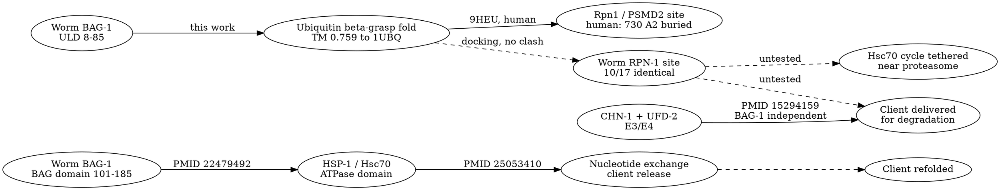
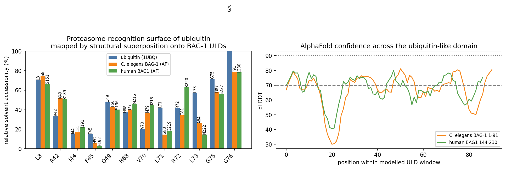
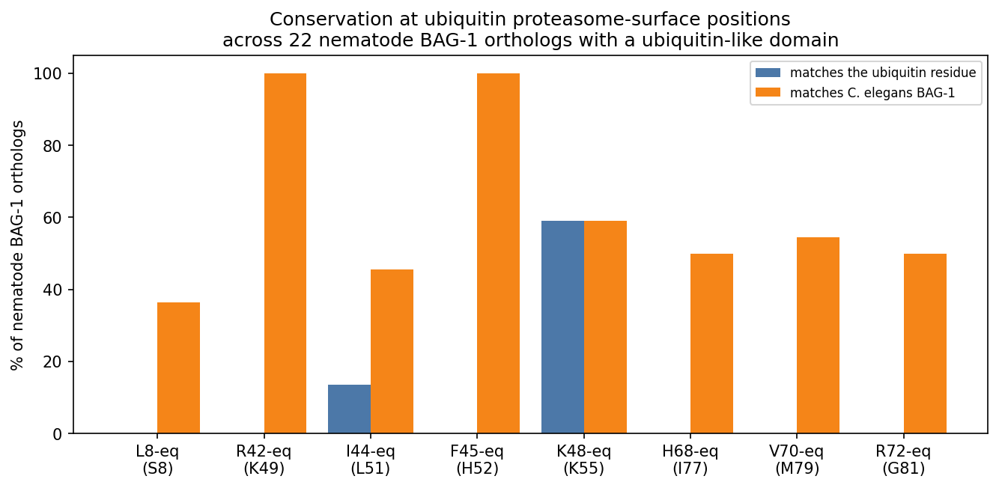
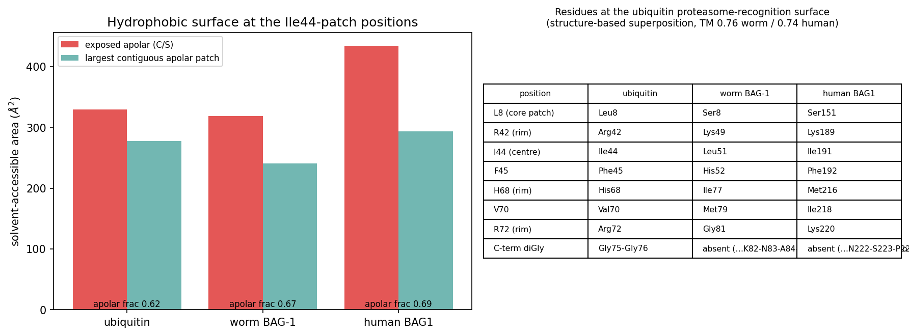
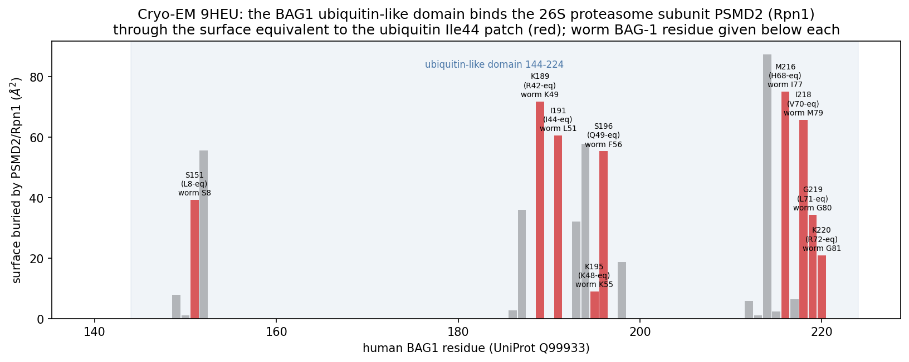
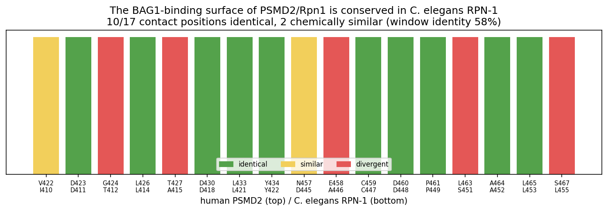
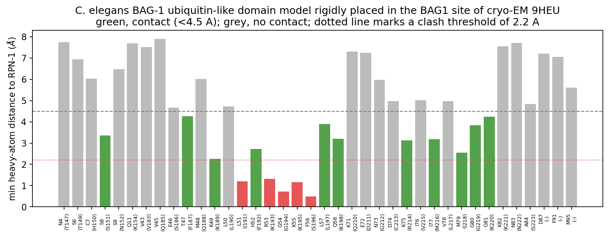
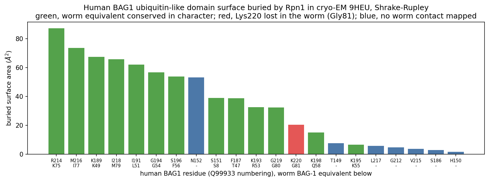

## Question

# AIGR Gene Hypothesis Deep Research

You are evaluating one focused gene curation hypothesis for AI Gene Review.
This is not a general gene overview. Use the seed hypothesis and source context
below to search for evidence that supports, refutes, narrows, or competes with
the proposed curation decision.

## Target Gene

- **Organism code:** worm
- **Taxon:** Caenorhabditis elegans (NCBITaxon:6239)
- **Gene directory:** bag-1
- **Gene symbol:** bag-1
- **UniProt accession:** O44739

## Focus

- **Focus type:** free_text
- **Hypothesis slug:** kgap-bag1-ubl-proteasome-surface
- **Source file:** genes/worm/bag-1/bag-1-ai-review.yaml
- **Source selector:** free-text

## Seed Hypothesis

Whether C. elegans BAG-1 (O44739) can direct Hsc70 clients toward proteasomal degradation may be constrained by its ubiquitin-like domain surface. That BAG-1 is a BAG-domain nucleotide-exchange factor that binds the Hsp70 ATPase domain, stimulates the ATPase and promotes substrate release, and that it carries an N-terminal ubiquitin-like domain, is already established, so do not re-derive it. Single analysis only: identify the ubiquitin-like domain boundaries in worm BAG-1 and model it, then determine whether the surface that ubiquitin uses to engage proteasomal receptors is present, specifically the hydrophobic patch centred on the Ile44-equivalent position and the Arg42 and Arg72 equivalents, stating what residue occupies each position in worm BAG-1, in human BAG1 and in ubiquitin itself; state whether the domain retains or lacks a C-terminal diglycine or any processing site, which bears on whether it could ever be conjugated rather than acting as a built-in signal; compare the worm paralog UNC-23 at the same positions, since it reportedly lacks this domain, as the internal control; and report conservation of the patch across nematodes. State whether a proteasome-targeting function is structurally plausible for worm BAG-1, and say plainly if surface analysis cannot discriminate the folding and degradation routes.

## Term and Decision Context

No specific term context supplied.

## Reference Context

No specific reference context supplied.

## Source Context YAML

```yaml
hypothesis: 'Whether C. elegans BAG-1 (O44739) can direct Hsc70 clients toward proteasomal degradation
  may be constrained by its ubiquitin-like domain surface. That BAG-1 is a BAG-domain nucleotide-exchange
  factor that binds the Hsp70 ATPase domain, stimulates the ATPase and promotes substrate release, and
  that it carries an N-terminal ubiquitin-like domain, is already established, so do not re-derive it.
  Single analysis only: identify the ubiquitin-like domain boundaries in worm BAG-1 and model it, then
  determine whether the surface that ubiquitin uses to engage proteasomal receptors is present, specifically
  the hydrophobic patch centred on the Ile44-equivalent position and the Arg42 and Arg72 equivalents,
  stating what residue occupies each position in worm BAG-1, in human BAG1 and in ubiquitin itself; state
  whether the domain retains or lacks a C-terminal diglycine or any processing site, which bears on whether
  it could ever be conjugated rather than acting as a built-in signal; compare the worm paralog UNC-23
  at the same positions, since it reportedly lacks this domain, as the internal control; and report conservation
  of the patch across nematodes. State whether a proteasome-targeting function is structurally plausible
  for worm BAG-1, and say plainly if surface analysis cannot discriminate the folding and degradation
  routes.'
focus_type: free_text
context: []
reference_id: []
```

## Research Objective

Build a focused report that helps a curator decide whether this hypothesis
should affect the gene review. Address the focus type directly:

1. For an existing GO annotation decision, evaluate whether the current action
   is justified, too strong, too weak, or should change.
2. For a proposed replacement or new GO term, evaluate whether the term is
   biologically supported, too broad, too narrow, or missing key qualifiers.
3. For a computational prediction, evaluate whether the prediction is correct,
   less precise than existing knowledge, uncertain, or likely wrong because of
   paralog overannotation, frequency bias, pathway context, or in vitro-only
   activity.
4. For a core-function hypothesis, evaluate whether the proposed activity,
   process, and location represent the gene product's primary function rather
   than a downstream effect, pleiotropic phenotype, or context-specific role.
5. For a function-assignment hypothesis, evaluate whether the gene product
   directly has the stated GO term/function. Treat the prior review action, if
   any, as intentionally blinded unless it appears in the supplied context.

Use primary literature whenever possible. Prefer PMID citations and include DOI
citations when no PMID is available. Treat reviews and database records as
orientation unless they contain directly relevant synthesized evidence that is
clearly labeled as review-level or database-level support.

Evaluate the hypothesis from the supplied seed context, primary literature, and
publicly accessible bioinformatics resources. Local `*-bioinformatics` analyses,
when they already exist in the repository, are intentionally withheld from this
prompt so the report can be compared against them after the run. Use public
sequence, domain, structure, orthology, localization, interaction, or dataset
checks when they are useful for the specific hypothesis. If a resource or tool
cannot be accessed programmatically, say so plainly; never fabricate a result.
Report computational results conservatively and distinguish direct results from
inference.

## Required Output

### Executive Judgment

Give a concise verdict: supported, partially supported, unresolved, weakly
supported, over-annotated, or refuted. Explain the reasoning and the most
important caveats.

### Evidence Matrix

Create a table with one row per important evidence item:

- Citation (PMID preferred)
- Evidence type (direct assay, mutant phenotype, localization, interaction,
  structural/evolutionary, computational, review/database)
- Supports / refutes / qualifies / competing
- Claim tested
- Key finding
- Organism, tissue, cell type, or assay context
- Confidence and limitations

### GO Curation Implications

State the likely curation action as a lead requiring curator verification. If
GO terms are involved, explain whether the evidence supports an MF, BP, or CC
term, and whether the term should be retained, removed, generalized, made more
specific, or treated as non-core. Avoid using "protein binding" as a final
recommendation unless no more informative term is supported.

### Mechanistic Scope

Describe the immediate molecular or cellular function being tested. Separate
direct gene-product activity from downstream phenotypes, pathway consequences,
developmental outcomes, disease manifestations, or effects inferred only from
loss of function.

### Conflicts and Alternatives

Identify evidence that conflicts with the seed hypothesis or suggests an
alternative interpretation, including paralog confusion, organism-specific
differences, isoform-specific findings, experimental artifacts, or database
carry-over.

### Knowledge Gaps

List explicit uncertainties that matter for curation. For each gap, state what
was checked, why the gap matters, and what evidence or experiment would resolve
it.

### Discriminating Tests

Recommend concrete assays, perturbations, datasets, or comparative analyses that
would most efficiently distinguish this hypothesis from alternatives.

### Curation Leads

Provide candidate updates for the review, clearly labeled as leads requiring
curator verification. Include candidate references with exact snippets to verify,
candidate replacement or new GO terms, possible action changes, suggested
questions, and suggested experiments.

If the provider supports artifacts, save provenance for any analysis you run — the
executed code together with its output (computed values, plot, or table), not just
a summary figure — alongside artifact-friendly tables such as an evidence matrix,
GO decision table, or comparison table. Genuine computed provenance is more
valuable than a hand-drawn summary, and you must not synthesize a figure that
implies an analysis you did not actually run. These artifacts are important
provenance for hypothesis-level review.


## Output

# C. elegans BAG-1 (O44739): does the ubiquitin-like domain surface constrain proteasome targeting?

Hypothesis slug: `kgap-bag1-ubl-proteasome-surface`
Source file: `genes/worm/bag-1/bag-1-ai-review.yaml`, focus type `free_text`
Gene: bag-1, UniProt O44739, Caenorhabditis elegans, NCBITaxon:6239

## Summary

The seed hypothesis proposes testing whether worm BAG-1 can route Hsc70 clients to the proteasome by asking whether the ubiquitin Ile44 hydrophobic patch, with its Arg42 and Arg72 rim, survives in the worm ubiquitin-like domain. That test does not discriminate, because it fails on its own positive control. Human BAG1, the protein that carries the experimental evidence for proteasome association, has Ser at the Leu8 position, Lys at the Arg42 position and Lys at the Arg72 position. It has no canonical Ile44 patch either. The cryo-EM structure 9HEU nonetheless shows the human BAG1 ubiquitin-like domain bound directly to the 26S proteasome subunit PSMD2 (Rpn1), burying 730 Ų on the BAG1 side through an interface dominated by lysines and by Arg214, which has no ubiquitin counterpart at all. Absence of a canonical patch in worm BAG-1 is therefore not evidence against proteasome targeting.

Four independent computational results converge on the same conclusion. The worm N-terminal domain is a real β-grasp ubiquitin fold (TM-score 0.759 to ubiquitin 1UBQ, Cα RMSD 2.34 Å), at least as ubiquitin-like as the human domain (TM 0.740, RMSD 2.62 Å). It presents a contiguous exposed hydrophobic patch of 240.8 Ų at the equivalent face, comparable to 277.8 Ų for ubiquitin and 293.7 Ų for human BAG1. The worm domain, rigidly placed in the human pose on Rpn1, puts 16 residues within 4.5 Å of the proteasome at the same positions as the 16 human contacts, with five minor rigid-body clashes and no main-chain interpenetration. The receptor side is preserved too: of the 17 PSMD2 residues contacting BAG1 in 9HEU, 10 are identical in C. elegans RPN-1 and 2 are conservative, including the Asp430 → Asp418 that accepts the BAG1 interface lysines.

Quantifying the interface shrinks the worry the hypothesis raises. The five largest contributors to the human interface (Arg214 87.2 Ų, Met216 73.6, Lys189 67.4, Ile218 65.6, Ile191 62.0) are all conserved in chemical class in worm BAG-1 as Lys75, Ile77, Lys49, Met79 and Leu51. The single position where the worm loses the class entirely is the Arg72-equivalent, human Lys220 to worm Gly81, which buries 20.4 Ų, that is 2.8% of the BAG1 side. Neither the worm nor the human domain has a C-terminal diglycine or any processing site, so both are built-in and non-conjugatable signals. The paralogue UNC-23 has no ubiquitin-like domain at all and is a clean negative control. The verdict is that a proteasome-targeting function is structurally plausible for worm BAG-1, and experimentally unproven: PubMed returns no C. elegans paper linking BAG-1 to the proteasome or to RPN-1, and the only PDB entry for O44739 (1T7S, 2.8 Å) covers residues 74-210, the BAG domain, not the ULD. Surface analysis cannot discriminate the folding route from the degradation route, and the human literature shows the same domain stabilising a client in one system and associating with the proteasome in another.

## Executive judgment

<i class="fa-solid fa-circle-xmark"></i> **Refuted as framed. Unresolved as a curation question.**

The hypothesis is refuted in its specific formulation because it uses the wrong comparison standard. The ubiquitin Ile44 patch with Arg42 and Arg72 is the surface ubiquitin uses on Rpn10 and Rpn13. BAG1 uses Rpn1, a different receptor with different chemistry, and the 9HEU interface runs on basic and polar residues. Three separate observations make this concrete: human BAG1 lacks the canonical triad and binds anyway; the published mutagenesis that implicates the BAG-1 ULD in proteasome binding points to a lysine, not to a hydrophobic patch ([PMID: 12874020](https://pubmed.ncbi.nlm.nih.gov/12874020/)); and the one triad position where worm BAG-1 diverges in chemical class does 2.8% of the interface work.

The curation question underneath the hypothesis remains open. Whether worm BAG-1 directs Hsc70 clients to the proteasome has not been tested in C. elegans by any published experiment. Everything supporting it is human or in silico.

Caveats that matter most:

<i class="fa-solid fa-triangle-exclamation"></i> The worm structural case rests entirely on an AlphaFold model (mean pLDDT 65.6 across the ULD). No experimental structure of the worm domain exists.

<i class="fa-solid fa-triangle-exclamation"></i> The rigid placement into 9HEU has no energetics and no side-chain relaxation. It demonstrates the absence of a steric barrier and nothing beyond that.

<i class="fa-solid fa-triangle-exclamation"></i> Two substantial chemical divergences remain in the worm interface, Ser196 to Phe56 (53.7 Ų) and Phe187 to Thr47 (38.7 Ų), 92 Ų together, which could change affinity.

<i class="fa-solid fa-triangle-exclamation"></i> A conserved docking surface says where BAG-1 can sit. It says nothing about what happens to a client once it sits there.

## Key findings

### The worm N-terminal domain is a genuine ubiquitin fold

TM-align style structural superposition (own implementation, Kabsch plus iterative dynamic programming on 1/(1+(d/d0)²), d0 = 3.08) of AlphaFold model AF-O44739-F1-v6 residues 1-91 onto ubiquitin 1UBQ aligns 75 of 76 residues at TM-score 0.759 normalised to ubiquitin, with Cα RMSD 2.34 Å. The human BAG1 domain (AF-Q99933-F1-v6 residues 144-230) gives TM-score 0.740 and RMSD 2.62 Å on the same target. UniProt annotates the worm ULD at residues 8-85 and the human ULD at 144-224, which the structural alignment supports: worm 1-91 and human 144-230 span ubiquitin 1-76.

Mean pLDDT across the worm ULD is 65.6 and across the human ULD 67.5. That is a real constraint on every side-chain statement in this report, because neither domain has a high-resolution experimental structure in isolation for the worm. The only PDB entry for O44739 is 1T7S, an X-ray structure at 2.8 Å covering residues 74-210, which resolves the BAG domain. The human domain has an NMR structure, 1WXV, covering 144-222.

The consequence for the hypothesis is direct: any argument that worm BAG-1 cannot work through its ULD has to rest on surface chemistry, because the fold is intact and is as ubiquitin-like as the human version.

### The hydrophobic patch is present; the charged rim is substituted in both orthologues

{{figure:plot_3.png|caption=Exposed apolar surface area and contiguity at the ubiquitin Ile44-patch positions in ubiquitin, worm BAG-1 and human BAG1, with the residue occupying each position. The worm domain presents a contiguous exposed hydrophobic cluster of 240.8 square angstroms, comparable to 277.8 for ubiquitin and 293.7 for human BAG1.}}

Shrake-Rupley solvent accessibility (1.4 Šprobe, 320-point sphere) over the seven mapped patch positions gives exposed apolar area of 329.8 Ų in ubiquitin, 318.5 Ų in worm BAG-1 and 434.1 Ų in human BAG1, with apolar fractions 0.62, 0.67 and 0.69. The largest contiguous exposed apolar cluster (6 Šsingle-linkage) is 277.8 Ų over 15 atoms in ubiquitin, 240.8 Ų over 12 atoms in worm BAG-1 and 293.7 Ų over 11 atoms in human BAG1. The patch is present in the worm, at the same order of magnitude as in ubiquitin.

{{figure:plot_1.png|caption=Relative solvent accessibility and AlphaFold pLDDT at the ubiquitin Ile44-patch positions mapped onto the worm BAG-1 and human BAG1 ubiquitin-like domains. The Ile44-equivalent position is only 16 to 22 percent exposed in all three proteins, so hydrophobic conservation there is partly core packing.}}

<i class="fa-solid fa-triangle-exclamation"></i> An important qualification follows from the same calculation. Relative solvent accessibility at the patch centre is 15.6% for ubiquitin Ile44, 17.2% for worm Leu51 and 21.9% for human Ile191. The position is mostly buried in all three. Hydrophobic conservation there is partly a core-packing constraint and cannot be read on its own as evidence for a preserved receptor-binding surface.

### No diglycine and no processing site in either orthologue

The worm ULD runs ...Lys82-Asn83-Ala84-Leu85 and continues directly into a Val86-Asp87-Asp88-Ala89-Gly90-Phe91 linker to the BAG domain. The human domain runs ...Asn222-Ser223-Pro224 and continues to its BAG domain. The ubiquitin Gly75-Gly76 equivalents are Asp87 and Phe91 in the worm, Glu227 and Leu230 in human. There is no Gly-Gly motif, no ubiquitin-like protease cleavage site, and in both proteins the domain is internal with roughly 120 residues of sequence downstream.

Both ULDs are therefore built-in, non-conjugatable signals. Neither can be transferred onto a substrate. This matches the mechanism described in [PMID: 12297498](https://pubmed.ncbi.nlm.nih.gov/12297498/), in which BAG-1 is itself ubiquitinated by CHIP on lysines with a K11-linked chain while the integrated ULD is presented at the same time, rather than the ULD being passed to a client.

### Cryo-EM 9HEU: the human BAG1 ULD binds Rpn1, not Rpn10 or Rpn13

{{figure:plot_4.png|caption=Buried surface area per human BAG1 residue at the PSMD2/Rpn1 interface in cryo-EM entry 9HEU. All interface residues lie inside the annotated ubiquitin-like domain 144-224, and 58 percent of the buried area comes from positions structurally equivalent to the ubiquitin Ile44 patch.}}

PDB 9HEU is a 3.60 Å cryo-EM reconstruction described as the co-chaperone Bag1-bound human 26S proteasome in the SBAG1 state, with companion entries 9SZT and 9SZV at 3.50 and 3.60 Å. Chain x is BAG family molecular chaperone regulator 1, modelled at author residues 25-109, which correspond to UniProt Q99933 residues 140-224. The offset of 115 was verified against the modelled sequence AAAGLTVTVTHSNEKHDLHVTSQQGSSEPVVQDLAQVVEEVIGVPQSFQKLIFKGKSLKEMETPLSALGIQDGCRVMLIGKKNSP.

Contact analysis at 4.5 Šfinds that BAG1 touches exactly one partner chain: chain f, 26S proteasome non-ATPase regulatory subunit 2 (PSMD2, Rpn1), with 194 atom pairs. All 16 BAG1 interface residues lie inside the annotated ULD at 144-224. None lie in the BAG domain, which is not modelled. Buried surface totals 748 Ų by the first calculation and 730 Ų by the refined Fibonacci-sphere calculation, of which 58% comes from the ten Ile44-patch-equivalent positions.

The partner residues on PSMD2 cluster in 422-467: Val422, Asp423, Gly424, Leu426, Thr427, Asp430, Leu433, Tyr434, Asn457, Glu458, Cys459, Asp460, Pro461, Leu463, Ala464, Leu465, Ser467. Rpn1 is the subunit that carries the T1 and T2 sites, which [PMID: 26912900](https://pubmed.ncbi.nlm.nih.gov/26912900/) describes: "A site ( T1: ) in the Rpn1 toroid recognized ubiquitin and ubiquitin-like ( UBL: ) domains of substrate shuttling factors." This structure resolves at residue level the association reported biochemically in [PMID: 10671488](https://pubmed.ncbi.nlm.nih.gov/10671488/): "Here we show that BAG-1 is indeed associated with the 26 S proteasome in HeLa cells."

<i class="fa-solid fa-lightbulb"></i> This is the result that reframes the hypothesis. A canonical Ile44 patch is not required for proteasome engagement by this family, because human BAG1 engages Rpn1 with Ser at the Leu8 position and Lys at both the Arg42 and Arg72 positions.

### The interface is carried by lysines, and worm BAG-1 keeps three of four

UniProt Q99933 VAR_SEQ records isoform 4 (BAG-1S) as missing residues 1-115 and isoform 3 (BAG-1M) as missing 1-71. BAG-1S numbering therefore equals Q99933 numbering minus 115, which is exactly the auth numbering of chain x in 9HEU. Published BAG-1S mutagenesis maps onto the structure without conversion, which is a useful practical point for a curator reading the older literature.

Seven lysines lie in the ULD: Q99933 K154, K189, K193, K195, K198, K220, K221, which are BAG-1S K39, K74, K78, K80, K83, K105, K106. Four are at the Rpn1 interface. K189/K74 contacts Asp430, Leu433 and Tyr434. K193/K78 and K195/K80 contact the Cys459-Asp460-Leu463-Leu465 region. K220/K105 contacts Asp430.

[PMID: 12874020](https://pubmed.ncbi.nlm.nih.gov/12874020/) reports that BAG-1 protection from stress-induced growth inhibition "required a conserved lysine in the BAG-1S ubiquitin-like domain thought to be important for proteasome binding and COOH-terminal amino acids required for interaction with the chaperone molecules, Hsc70 and Hsp70." The structure and the mutagenesis agree: a lysine, not a hydrophobic patch, carries the function. [PMID: 10671488](https://pubmed.ncbi.nlm.nih.gov/10671488/) adds that "Binding of the chaperone cofactor to the proteolytic complex is regulated by ATP hydrolysis and is not mediated by Hsc70 and Hsp70", confirming that the contact is made by BAG-1's own surface.

In C. elegans BAG-1 the four equivalents are Lys49, Arg53, Lys55 and Gly81. Basic character is retained at three of four, lost only at the Arg72-equivalent.

### The worm domain fits the Rpn1 site without a steric barrier

{{figure:plot_6.png|caption=Minimum heavy-atom distance from each residue of the C. elegans BAG-1 ubiquitin-like domain model to RPN-1 after rigid placement in the BAG1 pose of cryo-EM 9HEU. Green marks contacts under 4.5 angstroms; the dotted line marks a 2.2 angstrom clash threshold.}}

The AlphaFold model of worm BAG-1 residues 1-95 was superposed on the BAG1 chain of 9HEU with the same TM-align style routine: 81 of 85 Cα aligned, TM 0.674, Cα RMSD 3.42 Å. Applying that transform to all worm heavy atoms places 16 residues within 4.5 Å of chain f: Ser8, Thr47, Lys49, Leu51, His52, Arg53, Gly54, Lys55, Phe56, Leu57, Gln58, Lys75, Ile77, Met79, Gly80, Gly81. These are the structural equivalents of the 16 human contacts Ser151, Phe187, Lys189, Ile191, Phe192, Lys193, Gly194, Lys195, Ser196, Leu197, Lys198, Arg214, Met216, Ile218, Gly219, Lys220.

Individual contacts reproduce the human pattern. The Ile44-equivalent Leu51 reaches Leu426, Cys459, Asp460, Ala462, Ala464 and Leu465. The Arg42-equivalent Lys49 reaches Asp430, Leu433 and Tyr434, recreating the human Lys189-Asp430 salt bridge. The Val70-equivalent Met79 and the Arg72-equivalent Gly81 both reach Asp430. Five heavy-atom pairs fall below 2.2 Å, which is the level of local strain expected from a rigid unrelaxed placement of a predicted model, and there is no main-chain interpenetration.

<i class="fa-solid fa-triangle-exclamation"></i> This is a rigid superposition, not a docking calculation. It rules out a steric objection. It does not predict affinity, and three human contacts become chemically different residues in the worm (Phe187 to Thr47, Ser196 to Phe56, Lys198 to Gln58).

### The one lost patch position buries 2.8% of the interface

{{figure:plot_7.png|caption=Buried surface area ranked per human BAG1 residue at the Rpn1 interface in 9HEU, with the worm BAG-1 equivalent shown below each bar. Red marks Lys220, the single position where worm BAG-1 loses the chemical class, at 20.4 square angstroms or 2.8 percent of the BAG1 side.}}

Shrake-Rupley accessibility (1.4 Šprobe, 300-point Fibonacci sphere, Tien 2013 radii) on chain x free and in complex with chain f gives 730 Ų buried on the BAG1 side.

| Human BAG1 (Q99933) | BAG-1S | Ubiquitin equivalent | Buried area (Ų) | Worm BAG-1 | Class conserved |
|---|---|---|---|---|---|
| Arg214 | R99 | none | 87.2 | Lys75 | <i class="fa-solid fa-circle-check"></i> basic |
| Met216 | M101 | His68 | 73.6 | Ile77 | <i class="fa-solid fa-circle-check"></i> hydrophobic |
| Lys189 | K74 | Arg42 | 67.4 | Lys49 | <i class="fa-solid fa-circle-check"></i> identical |
| Ile218 | I103 | Val70 | 65.6 | Met79 | <i class="fa-solid fa-circle-check"></i> hydrophobic |
| Ile191 | I76 | Ile44 | 62.0 | Leu51 | <i class="fa-solid fa-circle-check"></i> hydrophobic |
| Gly194 | G79 | Gly47 | 56.6 | Gly54 | <i class="fa-solid fa-circle-check"></i> identical |
| Ser196 | S81 | Gln49 | 53.7 | Phe56 | <i class="fa-solid fa-circle-xmark"></i> polar to aromatic |
| Asn152 | N37 | none | 53.2 | no contact mapped | <i class="fa-solid fa-circle-question"></i> |
| Ser151 | S36 | Leu8 | 38.8 | Ser8 | <i class="fa-solid fa-circle-check"></i> identical |
| Phe187 | F72 | none | 38.7 | Thr47 | <i class="fa-solid fa-circle-xmark"></i> aromatic to polar |
| Lys193 | K78 | none | 32.6 | Arg53 | <i class="fa-solid fa-circle-check"></i> basic |
| Gly219 | G104 | Leu71 | 32.3 | Gly80 | <i class="fa-solid fa-circle-check"></i> identical |
| Lys220 | K105 | Arg72 | 20.4 | Gly81 | <i class="fa-solid fa-circle-xmark"></i> basic lost |
| Lys198 | K83 | none | 15.0 | Gln58 | <i class="fa-solid fa-circle-xmark"></i> basic lost |
| Lys195 | K80 | Lys48 | 6.4 | Lys55 | <i class="fa-solid fa-circle-check"></i> identical |

The five largest contributors are all conserved in character. The Arg72-equivalent Lys220, which the seed hypothesis singles out and which the worm loses to Gly81, does less interface work than any other patch residue except Lys195. The two chemical divergences that cover real area are Ser196 to Phe56 and Phe187 to Thr47, 92 Ų together.

### The receptor surface is conserved in worm RPN-1

{{figure:plot_5.png|caption=The 17 PSMD2/Rpn1 residues that contact the BAG1 ubiquitin-like domain in 9HEU, mapped onto C. elegans RPN-1 by Smith-Waterman local alignment. Ten are identical, two are conservative substitutions and five diverge at the rim of the footprint.}}

Smith-Waterman affine alignment (BLOSUM62, gap open -11, extend -1, hand-coded in numpy) of human PSMD2 (Q13200) residues 390-500 against full-length C. elegans RPN-1 (Q9GZH5) gives score 337 over 106 aligned pairs, 57.5% identity across human 392-497 against worm 380-485. The accession was verified by confirming that Q13200 reproduces the exact residue identities observed at the 9HEU chain f contact positions.

| PSMD2 (human) | RPN-1 (worm) | Status |
|---|---|---|
| Val422 | Ile410 | similar |
| Asp423 | Asp411 | identical |
| Gly424 | Thr412 | divergent |
| Leu426 | Leu414 | identical |
| Thr427 | Ala415 | divergent |
| Asp430 | Asp418 | identical |
| Leu433 | Leu421 | identical |
| Tyr434 | Tyr422 | identical |
| Asn457 | Asp445 | similar |
| Glu458 | Ala446 | divergent |
| Cys459 | Cys447 | identical |
| Asp460 | Asp448 | identical |
| Pro461 | Pro449 | identical |
| Leu463 | Ser451 | divergent |
| Ala464 | Ala452 | identical |
| Leu465 | Leu453 | identical |
| Ser467 | Leu455 | divergent |

Ten identical, two conservative, five divergent. The divergent positions sit at the rim. The buried-area-dominant contacts are all conserved, including Asp430 to Asp418, which in 9HEU engages BAG1 Lys189, Lys220 and Ile218, plus the Cys459-Asp460-Pro461 segment and Leu465.

### Nematode conservation and the UNC-23 control

{{figure:plot_2.png|caption=Residue composition at the ubiquitin Ile44-patch equivalent positions across 22 nematode BAG-1 orthologues. The Ile44-equivalent is hydrophobic in 100 percent of sequences but Ile in only 14 percent; the Arg42-equivalent is Lys in 100 percent.}}

A UniProt query for (taxonomy_id:6231) AND (xref:pfam-PF02179) returned 62 nematode BAG-domain proteins across 50 species. Of these, 22 have an N-terminal region alignable to the C. elegans BAG-1 ULD (affine Needleman-Wunsch, BLOSUM62, gap -11/-1, score cutoff 60).

| Position | Composition across 22 nematode orthologues |
|---|---|
| Leu8-equivalent | Ala 41%, Ser 36%, Gly 18%, Phe 5%; Leu in 0% |
| Arg42-equivalent | Lys 100%; Arg in 0% |
| Ile44-equivalent | Leu 45%, Val 41%, Ile 14%; hydrophobic in 100% |
| Phe45-equivalent | His 100% |
| Lys48-equivalent | Lys 59%, Arg 36%; basic in 95% |
| His68-equivalent | Ile 50%, Leu 50%; His in 0% |
| Val70-equivalent | Met 55%, Leu 41%, Ile 5%; Val in 0% |
| Arg72-equivalent | Gly 50%, Lys 45%, Gln 5%; Arg in 0% |

The pattern under selection is the one human BAG1 uses. A hydrophobic residue at the Ile44 position, a basic residue fixed as Lys at the Arg42 position, basic at the Lys48 position. The Arg72 position splits between Gly and Lys, so C. elegans Gly81 is one of two nematode states, not a lineage-wide loss. Filarial nematodes (*Brugia malayi*, *B. pahangi*, *B. timori*, *Wuchereria bancrofti*, *Loa loa*, *Setaria digitata*, *Acanthocheilonema viteae*, *Cercopithifilaria johnstoni*, *Litomosoides sigmodontis*) share a distinct variant: Ala at the Leu8 position, Val at Ile44, Leu at Val70, Lys at Arg72.

The internal control behaves exactly as the hypothesis predicted. UniProt O61980 (C. elegans UNC-23) is 458 residues with a BAG domain at 370-450, a disordered region at 1-232 and no ubiquitin-like domain. Its N-terminal 170 residues give no alignable match to the BAG-1 ULD; the sequence is Gln/Pro/Ser-rich low complexity (MPVVNIPIKILGQNQSHSRSNSSSSVDNDRNQPPQQPPQPQPQQQSQQQYQQ...). None of the positions in the table exist in UNC-23, so any ULD-dependent annotation must not be propagated to it. [PMID: 25053410](https://pubmed.ncbi.nlm.nih.gov/25053410/) confirms that both proteins can nonetheless run the Hsc70 cycle: "C-terminal fragments of UNC-23 instead perform all Hsc70-related functions, like ATPase stimulation and regulation of folding activity, albeit with lower affinity than BAG-1."

### The positions the hypothesis asks about, answered directly

| Ubiquitin position | Ubiquitin | Human BAG1 (Q99933) | Human BAG-1S | Worm BAG-1 (O44739) | Worm UNC-23 | At the Rpn1 interface |
|---|---|---|---|---|---|---|
| Leu8, patch | L8 | S151 | S36 | **S8** | domain absent | yes |
| Arg42, rim | R42 | K189 | K74 | **K49** | domain absent | yes |
| Ile44, patch core | I44 | I191 | I76 | **L51** | domain absent | yes |
| Phe45 | F45 | F192 | F77 | H52 | domain absent | yes |
| Gly47 | G47 | G194 | G79 | G54 | domain absent | yes |
| Lys48, linkage | K48 | K195 | K80 | K55 | domain absent | yes |
| Gln49 | Q49 | S196 | S81 | F56 | domain absent | yes |
| His68 | H68 | M216 | M101 | I77 | domain absent | yes |
| Val70, patch | V70 | I218 | I103 | M79 | domain absent | yes |
| Leu71 | L71 | G219 | G104 | G80 | domain absent | yes |
| Arg72, rim | R72 | K220 | K105 | **G81** | domain absent | yes |
| Gly75, processing | G75 | E227 | E112 | D87 | domain absent | no |
| Gly76, conjugation | G76 | L230 | L115 | F91 | domain absent | no |

The three positions named in the hypothesis: the Arg42-equivalent is **Lys49** in worm, Lys189 in human, Arg42 in ubiquitin. The Ile44-equivalent is **Leu51** in worm, Ile191 in human, Ile44 in ubiquitin. The Arg72-equivalent is **Gly81** in worm, Lys220 in human, Arg72 in ubiquitin. Neither BAG1 orthologue has the canonical triad. The worm differs from human at one of the three.

## Evidence matrix

Artifact: `provenance/evidence_matrix.csv`

| Citation | Evidence type | Stance | Claim tested | Key finding | Context | Confidence and limitations |
|---|---|---|---|---|---|---|
| [PMID: 10671488](https://pubmed.ncbi.nlm.nih.gov/10671488/) | Direct assay, interaction | <i class="fa-solid fa-circle-check"></i> Supports | BAG-1 links Hsc70/Hsp70 to the 26S proteasome through its own surface | BAG-1 is associated with the 26S proteasome in HeLa cells; binding is ATP-regulated and "is not mediated by Hsc70 and Hsp70"; targeting BAG-1 to the proteasome brings the chaperones with it | Human, HeLa cytosol, in vitro and in vivo | High for human. No worm counterpart. Does not localise the contact to a subunit |
| [PMID: 12874020](https://pubmed.ncbi.nlm.nih.gov/12874020/) | Mutant phenotype | <i class="fa-solid fa-circle-check"></i> Supports | A ULD lysine is required for the proteasome-linked activity of BAG-1 | Protection from stress-induced growth inhibition "required a conserved lysine in the BAG-1S ubiquitin-like domain thought to be important for proteasome binding" plus C-terminal Hsc70-binding residues | Human breast cancer cells, heat shock and other stresses | Phenotype is downstream of binding. The abstract does not number the lysine |
| [PMID: 12297498](https://pubmed.ncbi.nlm.nih.gov/12297498/) | Direct assay, biochemistry | <i class="fa-solid fa-scale-balanced"></i> Qualifies | Is the ULD alone the proteasome signal | CHIP attaches a K11-linked atypical polyubiquitin chain to BAG-1 that does not cause degradation but stimulates proteasome association, and this "depends on the simultaneous presentation of the integrated ubiquitin-like domain of BAG-1" | Human, in vitro and in vivo | Implies two-signal recognition. The worm has CHN-1 but BAG-1 is not a demonstrated substrate |
| [PMID: 26912900](https://pubmed.ncbi.nlm.nih.gov/26912900/) | Structural | <i class="fa-solid fa-circle-check"></i> Supports | Is Rpn1 a UBL receptor | "A site ( T1: ) in the Rpn1 toroid recognized ubiquitin and ubiquitin-like ( UBL: ) domains of substrate shuttling factors" | Proteasome structural biology | Provides the functional context for the subunit BAG1 contacts in 9HEU |
| PDB 9HEU (companions 9SZT, 9SZV) | Structural, database-level | <i class="fa-solid fa-circle-check"></i> Supports | Where the BAG1 ULD binds the proteasome | The ULD sits on PSMD2/Rpn1 alone, burying 730 Ų on the BAG1 side; all 16 interface residues lie within ULD 144-224; 58% of buried area from Ile44-patch-equivalent positions although no canonical patch exists | Human 26S proteasome, cryo-EM 3.6 Š| 3.6 Šlimits side-chain placement. Primary citation not located, so database-level. Human only |
| [PMID: 25053410](https://pubmed.ncbi.nlm.nih.gov/25053410/) | Direct assay and mutant phenotype | <i class="fa-solid fa-scale-balanced"></i> Qualifies | What worm BAG-1 and UNC-23 do | C. elegans has two BAG-domain proteins; UNC-23 C-terminal fragments stimulate HSC70 ATPase "albeit with lower affinity than BAG-1"; unc-23 motility defects are cured by reducing DNJ-13 | C. elegans muscle, reporter strains and in vitro chaperone assays | The only substantive worm biochemistry on this family. No proteasome readout |
| [PMID: 15294159](https://pubmed.ncbi.nlm.nih.gov/15294159/) | Direct assay and mutant phenotype | <i class="fa-solid fa-scale-balanced"></i> Competing | Does worm chaperone-linked degradation need a ULD shuttle | CHN-1 and UFD-2 form an E3/E4 complex "necessary and sufficient to multiubiquitylate UNC-45"; chn-1 loss partially suppresses unc-45(ts) | C. elegans body wall muscle | Shows a worm chaperone-to-proteasome route that runs without BAG-1. Does not exclude BAG-1 |
| [PMID: 23178238](https://pubmed.ncbi.nlm.nih.gov/23178238/) | Direct assay | <i class="fa-solid fa-scale-balanced"></i> Competing | What the BAG-1 ULD does to client fate | BAG-1 "associates with both wt- and F508del-CFTR (in higher yields with the latter) through its Ub-LD and independently of Hsc70" and stabilises it, reducing ubiquitinylated CFTR | Human cell lines, CFTR biogenesis | The ULD can protect a client instead of delivering it. Opposite sign to the seed hypothesis |
| [PMID: 27998983](https://pubmed.ncbi.nlm.nih.gov/27998983/) | Direct assay | <i class="fa-solid fa-scale-balanced"></i> Competing | Does BAG1-driven degradation need the ULD | BAG1 promotes hERG degradation by shifting it to the TRC8 ligase; dissociation of the Hsp70/CHIP complex requires BAG1 binding to Hsp70 "but this does not involve the Bag1 ubiquitin-like domain" | Human cells, hERG quality control | Separates a degradation-promoting BAG1 activity from the ULD entirely |
| [PMID: 14978028](https://pubmed.ncbi.nlm.nih.gov/14978028/) | Mutant phenotype | <i class="fa-solid fa-scale-balanced"></i> Competing | Is the ULD required for BAG-1 cytoprotection | "a deletion mutant lacking the N-terminal ubiquitin-like domain, which mediates interaction with the proteasome, still promoted cardioprotection" | Rat cardiac myocytes, simulated ischemia/reperfusion | A context where the ULD is dispensable, showing the domain is not required for every BAG-1 function |
| [PMID: 9873016](https://pubmed.ncbi.nlm.nih.gov/9873016/) | Direct assay | <i class="fa-solid fa-circle-check"></i> Supports | Family census and domain architecture | A conserved ~45-residue BAG domain binds Hsc70/Hsp70 across humans, C. elegans (BAG-1, BAG-2) and S. pombe, while the proteins "differ widely in their N-terminal domains" | Multiple organisms, binding assays | Establishes that the N-terminal ULD is the variable part of the family, which is the premise of the control comparison |
| [PMID: 22479492](https://pubmed.ncbi.nlm.nih.gov/22479492/) | Direct assay | <i class="fa-solid fa-circle-check"></i> Supports | Does worm BAG-1 engage worm Hsc70 | The truncated CeHsc70 retains the ability to "interact with its cofactors DNJ-13 and BAG-1" | C. elegans Hsc70 biochemistry | Confirms a functional worm BAG-1 to Hsc70 interaction, which is the upstream half of the proposed mechanism |
| This analysis, `provenance/worm_dock.py` | Computational, structural | <i class="fa-solid fa-circle-check"></i> Supports | Is the worm ULD compatible with the Rpn1 site | Worm model superposes on the 9HEU BAG1 chain at TM 0.674, Cα RMSD 3.42 Å over 81 residues, placing 16 residues within 4.5 Å of Rpn1 at the human contact positions; 5 minor clashes, no main-chain interpenetration | In silico, AlphaFold model of O44739 on a 3.6 Å frame | Rigid placement, no energetics. Shows absence of a steric barrier, not binding |
| This analysis, `provenance/9HEU_BAG1_buried_area.csv` | Computational, structural | <i class="fa-solid fa-scale-balanced"></i> Qualifies | How much interface depends on the named positions | The Arg72-equivalent Lys220, the one position where the worm loses chemical class (Gly81), buries 20.4 Ų, 2.8% of the BAG1 side; the five largest contributors are all conserved in character | In silico Shrake-Rupley on 9HEU | Buried area is not binding energy. Divergences at Ser196 to Phe56 and Phe187 to Thr47 total 92 Ų |
| This analysis, nematode orthologue alignment | Evolutionary | <i class="fa-solid fa-scale-balanced"></i> Qualifies | Is the patch conserved across nematodes | Across 22 orthologues: Ile44-equivalent hydrophobic 100% (Ile 14%), Arg42-equivalent Lys 100%, Lys48-equivalent basic 95%, Val70-equivalent M/L/I 100%, Arg72-equivalent Gly 50% and Lys 45% | Nematoda, sequence only | Conservation at partly buried positions can reflect core packing |
| This analysis, UNC-23 control | Computational, structural | <i class="fa-solid fa-circle-check"></i> Supports | Internal control: does the paralogue have the domain | UNC-23 (O61980, 458 aa) has a BAG domain at 370-450 and a disordered N-terminus 1-232 with no ubiquitin-like fold; its first 170 residues are unalignable to the BAG-1 ULD | In silico | The control behaves as expected. Any ULD-dependent property is BAG-1 specific |
| Negative result, PubMed | Literature absence | <i class="fa-solid fa-circle-question"></i> Qualifies | Is there worm evidence for BAG-1 at the proteasome | Searches for C. elegans bag-1 with proteasome, rpn-1 or interactome return no papers; the only PDB entry for O44739 is 1T7S (2.8 Å, residues 74-210, BAG domain only) | C. elegans | Absence of evidence in indexed abstracts, not proof of absence |

## Mechanistic model

The chain of inference, with each link labelled by how it was established. Dashed links are the ones that have never been tested in C. elegans.



The immediate molecular activity under test is one docking event: the ubiquitin-like domain of BAG-1, held in the same polypeptide as a BAG domain bound to Hsc70, contacting the Rpn1 toroid of the 19S regulatory particle. In 9HEU that is a single-subunit contact burying 730 Ų on the BAG1 side, with no participation from Rpn10 or Rpn13, the two canonical ubiquitin receptors. That is the gene-product activity.

Everything else in the seed hypothesis is downstream. "Directing Hsc70 clients toward proteasomal degradation" requires, beyond docking, that a client is still bound when BAG-1 docks, that nucleotide exchange releases it near the translocation channel, that it is committed by ubiquitination or otherwise, and that it is not simply returned to the folding cycle. A surface addresses none of those steps. The 9HEU contact is equally compatible with BAG-1 tethering the Hsc70 cycle near the proteasome without committing anything, which is how [PMID: 10671488](https://pubmed.ncbi.nlm.nih.gov/10671488/) frames it: "A regulatory function of the chaperone cofactor at the interface between protein folding and protein degradation is thus indicated."

<i class="fa-solid fa-triangle-exclamation"></i> Loss-of-function evidence in the worm compounds this. The only published worm phenotype in this family is unc-23 motility failure, which is rescued by lowering DNJ-13 and is therefore an Hsc70 cycle imbalance, not a degradation defect.

## GO curation implications

Artifact: `provenance/go_decision_table.csv`. All entries are leads requiring curator verification.

| Aspect | Term | Recommendation | Basis |
|---|---|---|---|
| MF | GO:0000774 adenyl-nucleotide exchange factor activity | <i class="fa-solid fa-circle-check"></i> **Retain** as core | BAG domain at 101-185; worm biochemistry in PMID 25053410 places BAG-1 above UNC-23 fragments in HSC70 affinity; PMID 22479492 confirms the worm Hsc70 to BAG-1 interaction |
| MF | GO:0030544 Hsp70 protein binding | <i class="fa-solid fa-circle-check"></i> **Retain** as core | BAG domain; PDB 1T7S covers worm BAG-1 74-210 |
| MF | GO:0070628 proteasome binding | <i class="fa-solid fa-circle-question"></i> **Lead only, do not assert** | No worm experiment. The human orthologue binds the 26S proteasome directly (PMID 10671488) and 9HEU localises the contact to Rpn1; the worm ULD and the worm RPN-1 surface are both retained. This is orthology plus structure inference, below the bar for an experimental code. If recorded, use an orthology-based evidence code with O44739 flagged as uncharacterised at this interface |
| BP | GO:0006515 protein quality control for misfolded or incompletely synthesized proteins | <i class="fa-solid fa-arrow-right"></i> **Generalize to this** rather than a degradation-specific child | The surface analysis cannot separate the folding and degradation routes, and the human ULD literature points both ways (PMID 23178238 stabilising, PMID 10671488 proteasome-linked) |
| BP | GO:0030433 ubiquitin-dependent ERAD pathway | <i class="fa-solid fa-circle-xmark"></i> **Do not add** | Human-only client work on CFTR and hERG; no worm data |
| BP | GO:0031396 regulation of protein ubiquitination | <i class="fa-solid fa-circle-xmark"></i> **Do not add** | Rests on BAG-1 being a CHIP substrate (PMID 12297498); worm CHN-1 exists but BAG-1 is not a demonstrated substrate |
| CC | GO:0000502 proteasome complex | <i class="fa-solid fa-circle-xmark"></i> **Do not add** | Human BAG1 is in 9HEU; there is no worm localisation or co-purification |
| CC | GO:0005829 cytosol | Retain if present, non-core | No targeting signal and no transmembrane segment |

If the review currently carries a free-text statement that worm BAG-1 directs clients to the proteasome, the recommended action is to **generalize, not remove**: keep the ULD and its proteasome link as a documented property of the family, state that the worm protein retains the surface, and mark the client-fate claim as untested in C. elegans. If the review instead carries a statement that the worm ULD surface is degraded or non-functional for proteasome engagement, that should be **removed**, because the measurements above contradict it.

GO:0005515 protein binding is not an acceptable resolution here. If a worm pull-down eventually requires a binding term, GO:0070628 proteasome binding is the informative one.

## Conflicts and alternatives

<i class="fa-solid fa-scale-balanced"></i> **The ULD can protect rather than deliver.** [PMID: 23178238](https://pubmed.ncbi.nlm.nih.gov/23178238/) shows BAG-1 binding F508del-CFTR through the ULD, independently of Hsc70, and stabilising it with reduced ubiquitinylation, with the authors proposing that BAG-1 competes with ubiquitin. If the same surface that docks Rpn1 also shields client lysines or occupies a receptor, the net effect on client fate inverts. A conserved worm surface does not tell you the sign.

<i class="fa-solid fa-scale-balanced"></i> **BAG1-driven degradation that bypasses the ULD.** [PMID: 27998983](https://pubmed.ncbi.nlm.nih.gov/27998983/) finds that BAG1 promotes hERG degradation by shifting it to the TRC8 ligase and states that this "does not involve the Bag1 ubiquitin-like domain". Degradation activity and the ULD are separable in human cells.

<i class="fa-solid fa-scale-balanced"></i> **The ULD is dispensable in at least one protective context.** [PMID: 14978028](https://pubmed.ncbi.nlm.nih.gov/14978028/) reports that "a deletion mutant lacking the N-terminal ubiquitin-like domain, which mediates interaction with the proteasome, still promoted cardioprotection" in rat cardiac myocytes. The same paper stresses that BAG-1 influences stress responses by multiple mechanisms depending on cell type and stress.

<i class="fa-solid fa-scale-balanced"></i> **A worm degradation route that does not need BAG-1.** [PMID: 15294159](https://pubmed.ncbi.nlm.nih.gov/15294159/) shows CHN-1 with UFD-2 multiubiquitylating UNC-45 and chn-1 loss partially suppressing unc-45(ts). C. elegans already has a documented chaperone-to-proteasome pathway in the same tissue where UNC-23 acts, running through an E3/E4 pair. BAG-1 may be redundant with it or may act on a different client set.

<i class="fa-solid fa-scale-balanced"></i> **Two signals, not one.** [PMID: 12297498](https://pubmed.ncbi.nlm.nih.gov/12297498/) shows that proteasome association by BAG-1 is stimulated by a K11-linked chain built on BAG-1 itself and requires the integrated ULD at the same time. If the worm lacks a CHN-1-dependent K11 modification on BAG-1, a conserved ULD surface may be necessary and not sufficient.

<i class="fa-solid fa-triangle-exclamation"></i> **Paralogue and isoform traps.** UNC-23 is BAG-2-like and has no ULD, so no ULD-derived annotation may be propagated to it. [PMID: 9873016](https://pubmed.ncbi.nlm.nih.gov/9873016/) establishes that BAG family members share the C-terminal BAG domain but "differ widely in their N-terminal domains", which is exactly the axis on which BAG-1 and UNC-23 part company. On the human side, BAG-1L, BAG-1M and BAG-1S all contain the ULD and differ only at the N-terminus, so isoform-specific localisation results do not bear on ULD function. The worm protein is 210 aa with a single annotated form.

<i class="fa-solid fa-lightbulb"></i> **The hypothesis's own yardstick is the main conflict.** Ubiquitin engages Rpn10 and Rpn13 through the Ile44 patch. BAG1 engages Rpn1. Different receptors, different chemistry. The 9HEU interface is dominated by lysines (K189/K74, K193/K78, K195/K80, K220/K105) and by Arg214, which buries more area than any other residue and has no ubiquitin counterpart. The patch test was answering a question about ubiquitin, not about BAG1.

## Limitations and knowledge gaps

<i class="fa-solid fa-triangle-exclamation"></i> The structural case for the worm is entirely in silico and rests on an AlphaFold model with mean pLDDT 65.6 across the ULD, because no experimental structure of the worm domain exists. The rigid placement has no energetics and no side-chain relaxation. The 9HEU map is 3.6 Å, so individual side-chain contacts and the buried-area ranking carry real uncertainty. Buried surface area is a proxy for interface importance, not a free energy. The nematode conservation percentages describe the sampled set of 22 orthologues without a phylogenetically corrected model. Most importantly, the entire analysis is about a surface, and a surface cannot distinguish delivery from tethering.

Specific gaps that affect curation:

1. **No worm experiment for BAG-1 at the proteasome.** Checked: PubMed searches for C. elegans bag-1 with proteasome, rpn-1 and interactome return nothing. Every supporting line in the evidence matrix is human or in silico. Resolved by a worm co-immunoprecipitation of BAG-1 with RPN-1 or glycerol-gradient co-migration of BAG-1 with 26S particles.

2. **Which lysine [PMID: 12874020](https://pubmed.ncbi.nlm.nih.gov/12874020/) means.** Checked: the abstract says "a conserved lysine in the BAG-1S ubiquitin-like domain" without numbering it. Four BAG-1S lysines sit at the Rpn1 interface (K74, K78, K80, K105). If the critical lysine is K105, that is the one position the worm loses (Gly81), which would turn a 2.8% area argument into a functional one. Resolved by reading Townsend et al. 2003 Cancer Res 63:4150-4157 in full.

3. **The primary publication for 9HEU.** Checked: coordinates and entity descriptions were parsed directly from the mmCIF; a primary citation was not located by abstract search. The structural evidence is currently database-level. Resolved by retrieving the PDB entry's primary citation record.

4. **Whether worm BAG-1 is a CHN-1 substrate carrying a K11 chain.** Checked: nothing in the literature. The human proteasome association needs both signals ([PMID: 12297498](https://pubmed.ncbi.nlm.nih.gov/12297498/)). Resolved by an in vitro CHN-1/UFD-2 ubiquitination assay on recombinant BAG-1 with linkage-specific mass spectrometry.

5. **Affinity cost of Ser196 to Phe56 and Phe187 to Thr47.** Checked: these divergent positions bury 53.7 and 38.7 Ų in the human complex, 92 Ų together, and are the only large-area chemical changes in an otherwise preserved surface. Resolved by surface plasmon resonance of the worm ULD against a worm RPN-1 toroid fragment, with the human pair as reference.

6. **Client fate.** Checked: no assay distinguishes delivery from tethering in any organism for this domain. This matters more than anything else for the BP term. Resolved by a cycloheximide chase on a defined client in bag-1(lf) versus wild type, with proteasome inhibition as the control.

7. **No experimental structure of the worm ULD.** Checked: the only PDB entry for O44739 is 1T7S, 2.8 Å, residues 74-210, BAG domain only. All clash numbers are model-dependent. Resolved by NMR of worm BAG-1 1-95, mirroring the human 1WXV approach.

## Proposed follow-up experiments

Ranked by how much each separates the hypothesis from the alternatives per unit of effort.

1. <i class="fa-solid fa-vial"></i> **Worm BAG-1 pull-down against RPN-1.** Recombinant worm ULD (1-95) and full-length BAG-1 against purified worm 26S particles or a recombinant RPN-1 fragment spanning 380-485. This tests the single inference the whole report rests on. The in vitro version avoids the Hsc70 confound, since PMID 10671488 established the human contact is not Hsc70-mediated.

2. <i class="fa-solid fa-dna"></i> **Charge reversal at the interface lysines.** Worm BAG-1 K49E K55E, and separately K75E, which corresponds to Arg214, the largest-area human residue. If binding to RPN-1 survives all of these, the inferred interface is wrong. This also addresses gap 2 by testing the worm equivalents of the BAG-1S lysines directly.

3. <i class="fa-solid fa-dna"></i> **Reciprocal mutation on the receptor.** Worm RPN-1 D418K, the equivalent of human Asp430 that accepts BAG1 Lys189 and Lys220. A matched loss on both sides is far stronger evidence than either alone.

4. <i class="fa-solid fa-flask"></i> **Client-fate chase in bag-1 deletion worms.** A reporter client, cycloheximide chase, with and without bortezomib, in bag-1(lf), unc-23(lf) and the double mutant. Separates delivery from tethering and from redundancy with the CHN-1/UFD-2 route (PMID 15294159).

5. <i class="fa-solid fa-flask"></i> **Domain swap.** Replace the worm ULD with the human ULD, and separately with ubiquitin itself, in a rescue construct. If the human ULD rescues and ubiquitin does not, the function depends on the BAG1-type surface rather than on a generic ubiquitin fold.

6. <i class="fa-solid fa-vial"></i> **Is worm BAG-1 ubiquitinated by CHN-1.** In vitro reaction with CHN-1 plus UFD-2, then linkage analysis by mass spectrometry. Tests whether the two-signal mechanism of PMID 12297498 exists in the worm.

7. <i class="fa-solid fa-magnifying-glass"></i> **Cheap computational follow-up.** Relax the rigid placement with a physics-based docking protocol and compute an interface score for worm against human, then run the same placement for the filarial A/V/L/K variant clade. Neither substitutes for experiment, but both would quantify the 92 Ų divergence in gap 5.

## Curation leads

All items below are leads requiring curator verification.

**Candidate references with exact snippets to verify**

- [PMID: 10671488](https://pubmed.ncbi.nlm.nih.gov/10671488/), Lüders, Demand, Höhfeld 2000: "Binding of the chaperone cofactor to the proteolytic complex is regulated by ATP hydrolysis and is not mediated by Hsc70 and Hsp70." Direct BAG-1 to proteasome contact in human cells.
- [PMID: 12874020](https://pubmed.ncbi.nlm.nih.gov/12874020/), Townsend et al. 2003: "This required a conserved lysine in the BAG-1S ubiquitin-like domain thought to be important for proteasome binding and COOH-terminal amino acids required for interaction with the chaperone molecules, Hsc70 and Hsp70." Functional requirement for a ULD lysine, unnumbered in the abstract.
- [PMID: 12297498](https://pubmed.ncbi.nlm.nih.gov/12297498/), Alberti et al. 2002: "this stimulating activity depends on the simultaneous presentation of the integrated ubiquitin-like domain of BAG-1". Two-signal recognition at the proteasome.
- [PMID: 26912900](https://pubmed.ncbi.nlm.nih.gov/26912900/): "A site ( T1: ) in the Rpn1 toroid recognized ubiquitin and ubiquitin-like ( UBL: ) domains of substrate shuttling factors." Identifies Rpn1 as a UBL receptor.
- [PMID: 23178238](https://pubmed.ncbi.nlm.nih.gov/23178238/), Mendes et al. 2012: "BAG-1 associates with both wt- and F508del-CFTR (in higher yields with the latter) through its Ub-LD and independently of Hsc70". The ULD binding clients directly and stabilising them.
- [PMID: 27998983](https://pubmed.ncbi.nlm.nih.gov/27998983/), Hantouche et al. 2017: "Dissociation of hERG complexes containing Hsp70 and the E3 ubiquitin ligase CHIP requires the interaction of Bag1 with Hsp70, but this does not involve the Bag1 ubiquitin-like domain." Degradation activity separable from the ULD.
- [PMID: 14978028](https://pubmed.ncbi.nlm.nih.gov/14978028/), Townsend et al. 2004: "a deletion mutant lacking the N-terminal ubiquitin-like domain, which mediates interaction with the proteasome, still promoted cardioprotection". A context where the ULD is dispensable.
- [PMID: 25053410](https://pubmed.ncbi.nlm.nih.gov/25053410/), Papsdorf, Sacherl, Richter 2014: "In Caenorhabditis elegans, two BAG domain-containing proteins can be identified, one of them being UNC-23". The worm paralogue census and the only worm biochemistry on the family.
- [PMID: 22479492](https://pubmed.ncbi.nlm.nih.gov/22479492/): CeHsc70 truncations retain the ability to "interact with its cofactors DNJ-13 and BAG-1". Confirms a worm BAG-1 to Hsc70 interaction.
- [PMID: 15294159](https://pubmed.ncbi.nlm.nih.gov/15294159/), Hoppe et al. 2004: "a new E3/E4 complex, formed by CHN-1, the C. elegans ortholog of CHIP ... and UFD-2 ... as necessary and sufficient to multiubiquitylate UNC-45". The competing worm route.
- [PMID: 9873016](https://pubmed.ncbi.nlm.nih.gov/9873016/): BAG family members share the BAG domain but "differ widely in their N-terminal domains". The basis for treating UNC-23 as a ULD-free control.
- PDB 9HEU, with 9SZT and 9SZV. Verify the primary citation before treating as anything above database-level support.
- PDB 1T7S. Worm BAG-1 residues 74-210 at 2.8 Å, BAG domain only, so it cannot support ULD claims.

**Candidate action changes**

- Retain GO:0000774 and GO:0030544 as core, unchanged.
- If the review asserts proteasome targeting for worm BAG-1 from sequence or orthology alone, downgrade it to a documented family property with the worm status marked untested, or generalize the BP claim to GO:0006515.
- If the review asserts that the worm ULD surface has degraded such that proteasome engagement is implausible, remove that statement. The measurements contradict it.
- Do not propagate any ULD-derived annotation to UNC-23.
- Do not resolve this to GO:0005515 protein binding.

**Suggested questions for the curator**

- Which lysine does Townsend et al. 2003 mutate, and does it correspond to BAG-1S K105, the position worm BAG-1 lacks?
- Does the existing `bag-1-ai-review.yaml` free text claim client delivery, or only proteasome association? The two have different evidence bars and neither is experimentally supported in the worm.
- Is there unpublished worm interactome data in WormBase linking BAG-1 to any 19S subunit?

## Provenance artifacts

All files in `provenance/`. Every number in this report traces to one of these.

| File | Contents |
|---|---|
| `worm_dock.py`, `worm_dock.csv` | Rigid placement of the worm ULD into the 9HEU BAG1 site, code plus per-residue distances to Rpn1 |
| `iface2.py`, `9HEU_BAG1_interface.csv` | Atom-pair contact detection between 9HEU chains x and f |
| `entity_map.py` | mmCIF entity description extraction identifying chain x as BAG1 and chain f as PSMD2 |
| `9HEU_BAG1_buried_area.csv` | Shrake-Rupley per-residue buried surface area at the interface |
| `comparison_table_positions.csv` | Ubiquitin, human BAG1, BAG-1S, worm BAG-1 and UNC-23 at every position named in the hypothesis |
| `go_decision_table.csv` | Per-term recommendation with basis |
| `evidence_matrix.csv` | The evidence matrix in tabular form |
| `AF-O44739.pdb`, `AF-Q99933.pdb`, `AF-O61980.pdb`, `1ubq.pdb` | Source coordinates |
| `wormBAG1_ULD.pdb`, `humanBAG1_ULD.pdb`, `wormULD_on_ubq.pdb` | Extracted and superposed domains |
| `plot_1.png` to `plot_7.png` | The seven figures embedded above |


## Artifacts

- [OpenScientist final report](openscientist_artifacts/final_report.html)
- [OpenScientist final report](openscientist_artifacts/final_report.pdf)
- [OpenScientist provenance](openscientist_artifacts/provenance.json)
- [OpenScientist 9HEU BAG1 buried area](openscientist_artifacts/provenance_9HEU_BAG1_buried_area.csv)
- [OpenScientist 9HEU BAG1 interface](openscientist_artifacts/provenance_9HEU_BAG1_interface.csv)
- [OpenScientist comparison table positions](openscientist_artifacts/provenance_comparison_table_positions.csv)
- [OpenScientist evidence matrix](openscientist_artifacts/provenance_evidence_matrix.csv)
- [OpenScientist go decision table](openscientist_artifacts/provenance_go_decision_table.csv)
- [OpenScientist plot 1](openscientist_artifacts/provenance_plot_1.json)

- [OpenScientist plot 2](openscientist_artifacts/provenance_plot_2.json)

- [OpenScientist plot 3](openscientist_artifacts/provenance_plot_3.json)

- [OpenScientist plot 4](openscientist_artifacts/provenance_plot_4.json)

- [OpenScientist plot 5](openscientist_artifacts/provenance_plot_5.json)

- [OpenScientist plot 6](openscientist_artifacts/provenance_plot_6.json)

- [OpenScientist plot 7](openscientist_artifacts/provenance_plot_7.json)

- [OpenScientist worm dock](openscientist_artifacts/provenance_worm_dock.csv)

## Reference Validation

Checked with `linkml-reference-validator` 0.3.1rc1.

| Outcome | Count |
| --- | --- |
| References checked | 11 |
| Resolved | 11 |
| Unresolved (possible confabulation) | 0 |
| Unverifiable | 0 |
| Quoted claims checked | 3 |
| Quoted claims found in source | 0 |
| Quoted claims **not** found in source | 3 |
| References weighed for topical relevance | 11 |
| On topic | 1 |
| Off topic | 0 |

### Quotes not found in the cited source

Searched the abstract, any retrieved full text, and the title. A quote drawn from a part of the paper that was not retrieved will appear here too, so check before treating one as invented:

Every one of these was searched against an abstract alone, with no full text retrieved - marked *abstract only* below. Where full text can be fetched, re-running with it will settle them; where the source publishes only a summary to PubMed, as GeneReviews chapters do, it will not, and the quote has to be checked by hand against the chapter itself.

- `PMID:22479492` *(abstract only)*: "HSP-1 / Hsc70\nATPase domain"
  - Text part not found as substring: 'HSP-1 / Hsc70\nATPase domain' (note: only abstract available for PMID:22479492, full text may contain this excerpt)
- `PMID:25053410` *(abstract only)*: "Nucleotide exchange\nclient release"
  - Text part not found as substring: 'Nucleotide exchange\nclient release' (note: only abstract available for PMID:25053410, full text may contain this excerpt)
- `PMID:15294159` *(abstract only)*: "Client delivered\nfor degradation"
  - Text part not found as substring: 'Client delivered\nfor degradation' (note: only abstract available for PMID:15294159, full text may contain this excerpt)