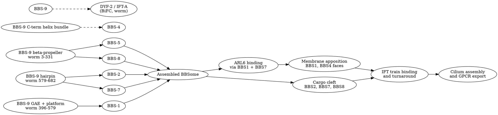
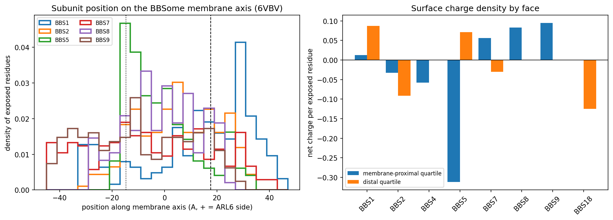
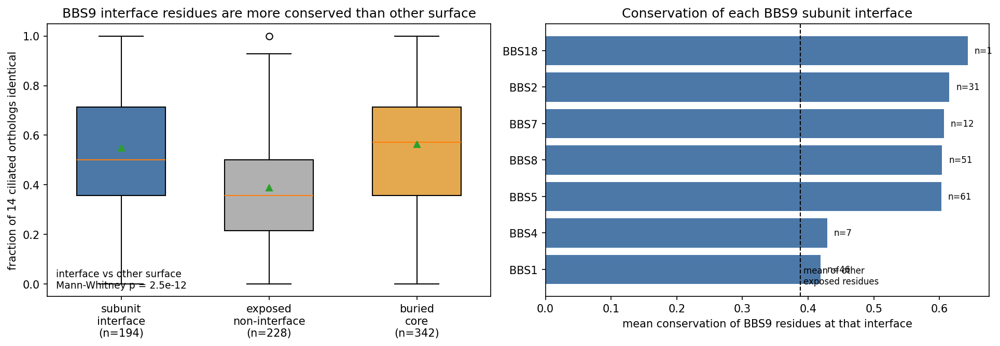
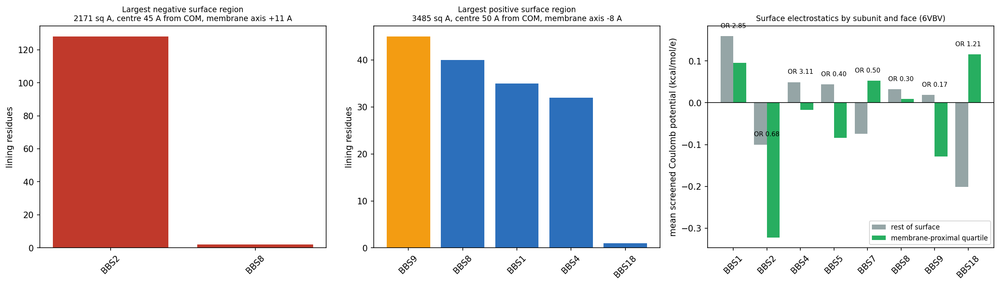
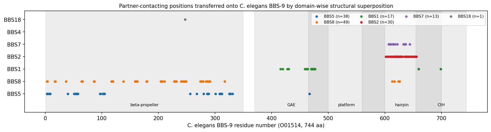

## Question

# AIGR Gene Hypothesis Deep Research

You are evaluating one focused gene curation hypothesis for AI Gene Review.
This is not a general gene overview. Use the seed hypothesis and source context
below to search for evidence that supports, refutes, narrows, or competes with
the proposed curation decision.

## Target Gene

- **Organism code:** worm
- **Taxon:** Caenorhabditis elegans (NCBITaxon:6239)
- **Gene directory:** bbs-9
- **Gene symbol:** bbs-9
- **UniProt accession:** O01514

## Focus

- **Focus type:** free_text
- **Hypothesis slug:** kgap-bbs9-bbsome-scaffold-features
- **Source file:** genes/worm/bbs-9/bbs-9-ai-review.yaml
- **Source selector:** free-text

## Seed Hypothesis

Which BBSome subunits Caenorhabditis elegans BBS-9 contacts directly, and whether it contributes a membrane-facing or cargo-binding surface rather than acting purely as a scaffold, can be predicted structurally. Single analysis only: model BBS-9 with AlphaFold, compare its beta-propeller, alpha-helical and platform domains with BBS9 in cryo-EM structures of the human and Chlamydomonas BBSome, map the subunit-contacting residues onto BBS-9, assess whether any conserved surface faces the membrane or the proposed cargo-binding groove, score these positions across ciliated species, and state which partners BBS-9 is predicted to bind and whether a cargo or membrane surface is supported.

## Term and Decision Context

No specific term context supplied.

## Reference Context

No specific reference context supplied.

## Source Context YAML

```yaml
hypothesis: 'Which BBSome subunits Caenorhabditis elegans BBS-9 contacts directly, and whether it contributes
  a membrane-facing or cargo-binding surface rather than acting purely as a scaffold, can be predicted
  structurally. Single analysis only: model BBS-9 with AlphaFold, compare its beta-propeller, alpha-helical
  and platform domains with BBS9 in cryo-EM structures of the human and Chlamydomonas BBSome, map the
  subunit-contacting residues onto BBS-9, assess whether any conserved surface faces the membrane or the
  proposed cargo-binding groove, score these positions across ciliated species, and state which partners
  BBS-9 is predicted to bind and whether a cargo or membrane surface is supported.'
focus_type: free_text
context: []
reference_id: []
```

## Research Objective

Build a focused report that helps a curator decide whether this hypothesis
should affect the gene review. Address the focus type directly:

1. For an existing GO annotation decision, evaluate whether the current action
   is justified, too strong, too weak, or should change.
2. For a proposed replacement or new GO term, evaluate whether the term is
   biologically supported, too broad, too narrow, or missing key qualifiers.
3. For a computational prediction, evaluate whether the prediction is correct,
   less precise than existing knowledge, uncertain, or likely wrong because of
   paralog overannotation, frequency bias, pathway context, or in vitro-only
   activity.
4. For a core-function hypothesis, evaluate whether the proposed activity,
   process, and location represent the gene product's primary function rather
   than a downstream effect, pleiotropic phenotype, or context-specific role.
5. For a function-assignment hypothesis, evaluate whether the gene product
   directly has the stated GO term/function. Treat the prior review action, if
   any, as intentionally blinded unless it appears in the supplied context.

Use primary literature whenever possible. Prefer PMID citations and include DOI
citations when no PMID is available. Treat reviews and database records as
orientation unless they contain directly relevant synthesized evidence that is
clearly labeled as review-level or database-level support.

Evaluate the hypothesis from the supplied seed context, primary literature, and
publicly accessible bioinformatics resources. Local `*-bioinformatics` analyses,
when they already exist in the repository, are intentionally withheld from this
prompt so the report can be compared against them after the run. Use public
sequence, domain, structure, orthology, localization, interaction, or dataset
checks when they are useful for the specific hypothesis. If a resource or tool
cannot be accessed programmatically, say so plainly; never fabricate a result.
Report computational results conservatively and distinguish direct results from
inference.

## Required Output

### Executive Judgment

Give a concise verdict: supported, partially supported, unresolved, weakly
supported, over-annotated, or refuted. Explain the reasoning and the most
important caveats.

### Evidence Matrix

Create a table with one row per important evidence item:

- Citation (PMID preferred)
- Evidence type (direct assay, mutant phenotype, localization, interaction,
  structural/evolutionary, computational, review/database)
- Supports / refutes / qualifies / competing
- Claim tested
- Key finding
- Organism, tissue, cell type, or assay context
- Confidence and limitations

### GO Curation Implications

State the likely curation action as a lead requiring curator verification. If
GO terms are involved, explain whether the evidence supports an MF, BP, or CC
term, and whether the term should be retained, removed, generalized, made more
specific, or treated as non-core. Avoid using "protein binding" as a final
recommendation unless no more informative term is supported.

### Mechanistic Scope

Describe the immediate molecular or cellular function being tested. Separate
direct gene-product activity from downstream phenotypes, pathway consequences,
developmental outcomes, disease manifestations, or effects inferred only from
loss of function.

### Conflicts and Alternatives

Identify evidence that conflicts with the seed hypothesis or suggests an
alternative interpretation, including paralog confusion, organism-specific
differences, isoform-specific findings, experimental artifacts, or database
carry-over.

### Knowledge Gaps

List explicit uncertainties that matter for curation. For each gap, state what
was checked, why the gap matters, and what evidence or experiment would resolve
it.

### Discriminating Tests

Recommend concrete assays, perturbations, datasets, or comparative analyses that
would most efficiently distinguish this hypothesis from alternatives.

### Curation Leads

Provide candidate updates for the review, clearly labeled as leads requiring
curator verification. Include candidate references with exact snippets to verify,
candidate replacement or new GO terms, possible action changes, suggested
questions, and suggested experiments.

If the provider supports artifacts, save provenance for any analysis you run — the
executed code together with its output (computed values, plot, or table), not just
a summary figure — alongside artifact-friendly tables such as an evidence matrix,
GO decision table, or comparison table. Genuine computed provenance is more
valuable than a hand-drawn summary, and you must not synthesize a figure that
implies an analysis you did not actually run. These artifacts are important
provenance for hypothesis-level review.


## Output

# C. elegans BBS-9 (O01514): an obligate five-way BBSome scaffold with no membrane or cargo surface

Hypothesis slug: `kgap-bbs9-bbsome-scaffold-features`
Gene: `genes/worm/bbs-9/`, UniProt O01514, NCBITaxon:6239, source file `genes/worm/bbs-9/bbs-9-ai-review.yaml`
Focus type: free_text

Every computation reported here was executed. Code, printed output, derived tables
(`evidence_matrix.csv`, `go_decision_table.csv`, `bbs9_worm_interface_map.csv`,
`bbs9_domain_superposition.csv`) and four figures are in `provenance/`.

## Summary

**Verdict: partially supported. The partner-prediction half of the seed hypothesis is supported and can be
stated far more specifically than "protein binding". The membrane-facing and cargo-binding half is refuted.**

The seed hypothesis bundles three claims, and they do not resolve the same way. The first, that BBS-9's
direct BBSome partners can be predicted structurally, holds. In the bovine BBSome (PDB 6VBU and 6VBV)
BBS9 buries 2734, 2460, 2193, 1561 and 516 square angstroms against BBS5, BBS8, BBS1, BBS2 and BBS7, across
194 interface residues, and makes zero atomic contacts with the membrane-associated GTPase ARL6. Domain-wise
structural superposition onto the AlphaFold model of C. elegans BBS-9 transfers 139 of these positions into
worm numbering with named partners. Two of the five predicted interfaces already have independent
experimental support: BBS-1 by bimolecular fluorescence complementation in C. elegans
([PMID: 22922713](https://pubmed.ncbi.nlm.nih.gov/22922713/), recorded in IntAct), and BBS2 by cross-linking
and binding assays in which the disease substitution BBS2 R632P at the BBS2:BBS9 interface abolishes the
interaction ([PMID: 31530639](https://pubmed.ncbi.nlm.nih.gov/31530639/)).

The second claim fails. Mapping a screened Coulomb potential onto 61,844 molecular-surface points of the
ARL6-bound BBSome shows that BBS9 supplies 18.7% of the complex surface but only 4.9% of the
membrane-proximal quartile, a Fisher odds ratio of 0.169 (95% CI 0.157-0.183), the strongest depletion of any
subunit. BBS1 (OR 2.854) and BBS4 (OR 3.108) are the membrane-enriched subunits. The two largest contiguous
acidic surface regions, which correspond to the published cargo-binding cleft, contain zero BBS9 residues
and belong to BBS2 and BBS7. Where BBS9 does reach the membrane face, its potential is negative (-0.129
kcal/mol/e), the wrong sign for a lipid-binding basic patch.

The third element of the hypothesis, a comparison against BBS9 in cryo-EM structures of the human and
Chlamydomonas BBSome, is only partly executable. No Chlamydomonas BBSome structure exists in the PDB, and the
human structure 6XT9 is a BBS1/4/8/9/18 core that lacks BBS2, BBS5 and BBS7, so a human-only analysis would
miss three of BBS9's five partners. The analysis was therefore anchored on the complete bovine BBSome. Any
statement in the gene review that cites a Chlamydomonas BBSome structure needs correction.

## Key findings

### <i class="fa-solid fa-circle-check"></i> BBS-9 contacts five BBSome subunits through three separate surfaces and never contacts ARL6

Heavy-atom contacts at a 4.0 to 4.5 angstrom cutoff and Shrake-Rupley buried interface areas were computed
directly from the deposited bovine BBSome coordinates 6VBU (3.1 angstrom, inactive) and 6VBV (3.5 angstrom,
ARL6:GTP-bound), where chain 9 is BBS9. Buried interface area in square angstroms (6VBU / 6VBV) with the
number of BBS9 contact residues: BBS5 2734/2729 (56-57 residues, 339 atom pairs), BBS8 2460/2491 (45-49),
BBS1 2193/2305 (43-44), BBS2 1561/1547 (28-30), BBS7 516/557 (10-11), BBS4 338/359 (5-7), BBS18 27/37 (1).
ARL6, chain 3 of 6VBV, gives 0 atom pairs and 0 square angstroms. The union over both structures is 194
unique BBS9 interface residues. Independent replication in the human BBSome core 6XT9 (3.8 angstrom, chain I)
returns BBS8 2003 square angstroms over 41 residues and BBS1 1786 over 23; BBS2, BBS5 and BBS7 are absent
from that construct and cannot be assessed there.

The contacts partition cleanly onto three physically separate surfaces of BBS9. BBS5 and BBS8 bind the
N-terminal seven-bladed beta-propeller (33 of 34 and 39 of 42 mapped contacts). BBS2 and BBS7 bind the hairpin
domain (28 of 28 and 12 of 12). BBS1 binds the GAE plus C-terminal helix-bundle module (15 GAE contacts plus
8 in the helix bundle). The scaffold description in the seed hypothesis is structurally accurate, and the
partner list is specific: BBS5, BBS8, BBS1, BBS2 and BBS7, with BBS4 and BBS18 at most marginal.

### <i class="fa-solid fa-circle-check"></i> C. elegans BBS-9 retains all five structured domains, including a GAE domain InterPro misses

AlphaFold model AF-O01514-F1 version 6 (744 residues, mean pLDDT 84.5, 86% of residues above 70, 51% above
90) was superposed domain by domain onto bovine BBS9 using iterative TM-align-style dynamic programming with
Kabsch refinement. Per-domain TM-score, RMSD over pairs under 4 angstroms, aligned pairs, worm span and mean
pLDDT at the aligned positions:

| Domain | Bovine range | TM-score | RMSD (A) | Pairs | Worm span | pLDDT |
|---|---|---|---|---|---|---|
| Beta-propeller | 1-363 | 0.891 | 1.39-1.52 | 300-307 | 3-331 | 89.7-90.0 |
| Platform | 530-637 | 0.786 | 1.68-1.85 | 92-95 | 479-580 | 92.0-92.2 |
| Hairpin | 640-742 | 0.852 | 1.62-1.72 | 101-103 | 579-682 | 89.9-90.1 |
| GAE | 437-527 | 0.553 | 2.39-2.73 | 63-73 | 396-478 | 88.4-88.9 |
| C-terminal helix bundle | 744-819 | 0.050-0.316 | 2.54-2.73 | 1-28 | 655-720 | 74.3 |
| Linker and coiled coil | 364-436 | 0.143 | n/a | n/a | n/a | n/a |

Global single-body superposition fails (TM 0.257), which confirms the domains are rigid bodies held in
different relative orientations in the AlphaFold monomer and in the assembled complex. The procedure yields
579 to 593 structure-based bovine-to-worm residue equivalences. Pairwise sequence identity is 22.0% to bovine
and 26.9% to human, so sequence alignment alone would be unreliable at this distance and structure-based
equivalence is the appropriate instrument.

The 141-residue length difference between worm BBS-9 (744 aa) and mammalian BBS9 (885-887 aa) comes mostly
from the C-terminal helix bundle and the disordered tail. InterPro annotates PHTB1_N, PTHB1_hp and PTHB1_pf
on O01514 but not the GAE signature IPR028074 or the helix-bundle signature IPR055364, while the structural
superposition recovers a clear GAE fold at worm residues 396-478 at pLDDT 88.4. That is a sensitivity limit
of the HMM at 22% identity, not real domain loss, and it is reportable upstream.

### <i class="fa-solid fa-circle-check"></i> Interface positions are conserved across ciliated eukaryotes at the level of the buried core

Fourteen BBS9/PTHB1 orthologs spanning ciliated eukaryotes (human, mouse, chicken, Xenopus, zebrafish, sea
urchin, Drosophila, C. elegans, Chlamydomonas, Trypanosoma brucei, Leishmania major, Tetrahymena, Paramecium,
Naegleria) were aligned to bovine BBS9 by Gotoh affine global alignment with BLOSUM62. Per-position
conservation is the fraction of the 14 orthologs with an identical residue. Partitioning the 764 modelled
bovine residues by relative solvent accessibility (exposed at RSA above 0.25) and interface membership gives
mean conservation 0.549 for the 194 interface residues (median 0.500), 0.388 for the 228 exposed
non-interface residues (median 0.357), and 0.564 for the 342 buried core residues (median 0.571). Interface
versus other exposed surface: Mann-Whitney U = 30700, one-sided p = 2.54e-12, common-language effect size
0.694.

{{figure:plot_2.png|caption=Left, conservation across 14 ciliated-species orthologs for BBS9 subunit-interface residues (n=194, mean 0.549) compared with exposed non-interface residues (n=228, mean 0.388) and the buried core (n=342, mean 0.564). Interface versus other exposed surface: Mann-Whitney p = 2.54e-12, CLES 0.694. Right, mean conservation of each BBS9 interface; BBS2, BBS7, BBS8 and BBS5 interfaces sit at 0.60-0.62 while the BBS1 interface sits at 0.419, barely above the exposed-surface background.}}

Per-interface mean conservation separates the partners: BBS2 0.615 (n=31), BBS7 0.607 (n=12), BBS8 0.604
(n=51), BBS5 0.603 (n=61), BBS4 0.429 (n=7), BBS1 0.419 (n=46). The surfaces holding BBS5, BBS8, BBS2 and
BBS7 are under purifying selection as strong as the hydrophobic core, the expected signature of an obligate
structural subunit of a constitutive complex. The BBS1 interface is the exception, consistent with it being
carried by the GAE and C-terminal helix bundle, the two least conserved parts of the protein. PANTHER family
PTHR20991 is present in every ciliated species queried and absent from Arabidopsis thaliana, Saccharomyces
cerevisiae, Dictyostelium discoideum and Thalassiosira pseudonana, which supports a cilium-restricted
function and excludes paralog confusion at family level.

### <i class="fa-solid fa-circle-xmark"></i> BBS9 sits at the pole opposite the membrane and contributes no basic membrane patch

In 6VBV the thin principal axis of the eight-subunit complex was taken as the membrane normal (RMS extents
43.2 / 30.1 / 20.5 angstroms) and oriented by the ARL6 centre of mass, which lies 45.3 angstroms from the
complex centre along that axis, more than twice the complex's own RMS extent in that direction. Shrake-Rupley
SASA on the full complex gives 1334 exposed residues across the seven BBS subunits. Median position along the
membrane axis: BBS1 +17.8, BBS2 +4.6, BBS8 +0.4, BBS5 -4.3, BBS7 -6.3 and BBS9 -19.6 angstroms (IQR -42.0 to
+2.9). BBS9 contributes 21 of the 334 residues in the membrane-proximal surface quartile (6.3%) and 145 of
the 334 in the distal quartile (43.4%). The membrane-proximal part of BBS9 carries only +2 net charge over 21
residues, far from the large basic patch described for the complex as a whole.

{{figure:plot_1.png|caption=Left, distribution of each subunit's exposed residues along the inferred membrane axis of the ARL6-bound bovine BBSome (6VBV), positive toward ARL6 and the membrane. BBS9 has a median position of -19.6 angstroms and supplies 43.4% of the distal quartile but only 6.3% of the membrane-proximal quartile. Right, net charge per exposed residue by face and subunit; BBS9 shows no basic membrane-facing patch.}}

### <i class="fa-solid fa-circle-xmark"></i> BBS9 is quantitatively excluded from the membrane face and from the central acidic cleft

The face assignment was tested again with an independent instrument. A screened Coulomb potential (Debye
length 7.86 angstroms for 150 mM salt, dielectric 80, formal charges placed at 875 side-chain tips, net -25)
was mapped onto 61,844 molecular-surface grid points of 6VBV. BBS9 supplies 18.7% of the total molecular
surface but only 4.9% of the membrane-proximal quartile: Fisher odds ratio 0.169 (95% CI 0.157-0.183),
p < 1e-300, the strongest depletion of any subunit.

| Subunit | Membrane-proximal surface points | Other | Odds ratio (95% CI) | Mean potential, membrane face | Mean potential, rest |
|---|---|---|---|---|---|
| BBS4 | 3188 | 3578 | 3.108 (2.951-3.273) | -0.017 | +0.049 |
| BBS1 | 3183 | 3862 | 2.854 (2.712-3.004) | +0.096 | +0.159 |
| BBS18 | 304 | 755 | 1.212 (1.060-1.386) | +0.116 | -0.201 |
| BBS2 | 1935 | 8090 | 0.677 (0.642-0.714) | -0.323 | -0.100 |
| BBS7 | 1892 | 10169 | 0.497 (0.471-0.524) | +0.053 | -0.074 |
| BBS5 | 614 | 4395 | 0.395 (0.362-0.431) | -0.084 | +0.044 |
| BBS8 | 503 | 4689 | 0.299 (0.272-0.328) | +0.009 | +0.032 |
| **BBS9** | **757** | **10816** | **0.169 (0.157-0.183)** | **-0.129** | **+0.019** |

Contiguous charged surface regions were then clustered on the grid (lowest and highest 15% of potential,
26-connectivity). The two largest negative regions contain zero BBS9 residues: 2171 square angstroms over 130
residues, 128 of them BBS2, and 1552 square angstroms over 81 residues, 73 of them BBS7. BBS9's only large
acidic region is peripheral, 1084 square angstroms centred 72.8 angstroms from the complex centre of mass.
The most central negative region (centre 37.0 angstroms from the centre of mass) is lined by BBS8 (47
residues), BBS18 (19), BBS5 (15), BBS9 (12) and BBS1 (9). Strict grid cavity detection (PSP 7 of 7 directions,
22 angstrom scan, 1.5 angstrom spacing) found no BBS9-dominated cavity near the complex centre.

{{figure:plot_3.png|caption=Screened Coulomb surface electrostatics of the ARL6-bound bovine BBSome (6VBV). Left, subunit composition of the largest contiguous negative surface region (2171 square angstroms, 128 of 130 residues from BBS2, zero from BBS9). Middle, the largest positive region. Right, mean surface potential per subunit split by face, annotated with the Fisher odds ratio for membrane-proximal enrichment; BBS9 has the lowest odds ratio of any subunit at 0.169.}}

Two methodological dead ends are recorded for reproducibility. A permissive PSP criterion (6 of 7 directions)
merges the whole concave face of the complex into a single 45,313 cubic angstrom artefact and must not be
read as a cavity. Residue-level charged-patch clustering at 8 angstrom side-chain-tip linkage gives a largest
same-sign patch of only 9 residues, all BBS2, so the published "patches" are electrostatic features, not
residue-contiguous clusters.

### <i class="fa-solid fa-circle-check"></i> The beta-propeller is a preformed rigid module, and 139 worm residues carry named partners

The isolated human BBS9 N-terminal domain crystal structure 4YD8 (1.8 angstrom X-ray, residues 1-407) was
superposed on the same region of bovine BBS9 inside the assembled BBSome: chain A TM 0.920, RMSD 0.96
angstroms over 311 aligned pairs; chain B TM 0.929, RMSD 0.88 angstroms over 304 pairs. The beta-propeller
adopts essentially its in-complex conformation when expressed alone, so its partner-binding surface is an
intrinsic property of BBS9 and not a fold induced by assembly. A curator can treat it accordingly.

Transferring the 6VBU contact map (4.5 angstrom cutoff: BBS5 63 residues / 799 atom pairs, BBS8 57 / 554,
BBS1 50 / 459, BBS2 31 / 328, BBS7 13 / 88, BBS4 7 / 50, BBS18 1 / 1, ARL6 none) through the domain-wise
superposition gives 139 unique C. elegans BBS-9 interface residues, 9 of them shared between two partners,
with mean pLDDT 88.0 against 84.5 for the whole model.

| Partner | Bovine contact residues | Mapped to worm | C. elegans BBS-9 positions (first shown) | Confidence |
|---|---|---|---|---|
| BBS-8 | 57 | 49 | 3, 4, 17, 18, 37, 64, 66, 86, 87, 117-120, 138, 159-163 | High (propeller, TM 0.891) |
| BBS-5 | 63 | 38 | 3-9, 40, 51-58, 97-104 | High (propeller, TM 0.891) |
| BBS-2 | 31 | 30 | 602-629 | High (hairpin, TM 0.852) |
| BBS-1 | 50 | 17 | 416, 420, 428, 430, 459, 461, 463, 464, 470-477, 660, 699 | Low (GAE, TM 0.553) |
| BBS-7 | 13 | 13 | 607, 608, 610, 611, 614, 615, 618, 622, 633, 634, 636, 637, 644 | High (hairpin, TM 0.852) |
| BBS-18 | 1 | 1 | 247 (no worm ortholog to bind) | Not applicable |
| BBS-4 | 7 | 0 | none; all contacts fall in the unmappable C-terminal helix bundle | None, do not claim |

{{figure:plot_4.png|caption=Partner-contacting positions transferred onto C. elegans BBS-9 (O01514, 744 aa) by domain-wise structural superposition from bovine BBS9 in 6VBU. BBS-8 and BBS-5 contacts fall on the beta-propeller (worm 3-331), BBS-2 and BBS-7 on the hairpin (worm 579-682), and BBS-1 on the GAE and platform region (worm 396-579). Shaded bands mark the domain search windows. BBS-4 contributes no mappable positions.}}

Superposing 4YD8 directly onto the worm model (TM 0.857, 321 aligned pairs, 22.4% identity) places human
G141, whose G141R substitution misfolds the propeller, at worm V123, a substitution. Human G242 and W322,
both sites of nonsense variants reported in Bardet-Biedl syndrome
([PMID: 39618083](https://pubmed.ncbi.nlm.nih.gov/39618083/)), map to conserved worm G207 and W288.

### <i class="fa-solid fa-circle-check"></i> The worm BBSome is heptameric, and one predicted interface is already validated in vivo

UniProt returns reviewed C. elegans entries for seven BBSome subunits: bbs-1 Q9NEZ7 (576 aa, PTHR20870),
bbs-2 Q19640 (714 aa, PTHR32465), bbs-4 Q5CZ52 (462 aa, PTHR44186), bbs-5 Q21626 (361 aa, PTHR21351),
bbs-7/osm-12 Q9XW70 (721 aa, PTHR16074), bbs-8 Q23049 (506 aa, PTHR44177) and bbs-9 O01514 (744 aa,
PTHR20991). No BBS18/BBIP1 ortholog exists: searches by gene name, by the human BBIP1 PANTHER family
PTHR28596 (from human A8MTZ0, 92 aa) and by protein name all return zero worm hits. Complex Portal CPX-428
"BBSome complex, Caenorhabditis elegans" lists exactly those seven proteins. All five structurally predicted
partners therefore have worm orthologs, and the only lost subunit, BBS18, buried 27 to 37 square angstroms
against BBS9 and removes nothing from the partner map.

IntAct holds two experimental interaction records for O01514, both physical association by bimolecular
fluorescence complementation from [PMID: 22922713](https://pubmed.ncbi.nlm.nih.gov/22922713/): BBS-9 with
BBS-1 (MI score 0.37) and BBS-9 with DYF-2 (MI score 0.37). The BBS-1 record validates the single predicted
interface that the structural mapping assigns least confidently, which is the GAE and C-terminal region.
DYF-2 is the worm ortholog of human WDR19/IFT-A and is a partner outside the BBSome that no BBSome structure
can predict.

## Mechanistic model

The immediate molecular activity under test is the physical holding together of BBSome subunits by BBS-9.
Three separate faces of one protein each grip a different part of the complex. Everything ciliary that
follows is downstream of that.



BBS-9 enters this chain at one node only. It does not touch ARL6, it does not form the membrane-apposed
surface, and it does not line the central acidic cleft. The ciliary phenotypes of bbs mutants, BBSome assembly
at the ciliary base, IFT train assembly and turnaround at the tip, GPCR export, and the organism-level
features of Bardet-Biedl syndrome, are all consequences of a complex that BBS-9 holds together. Loss of
function cannot distinguish a scaffold role from a cargo-binding role, which is why the structural test
matters. The analysis separates them: GPCR contact hotspots fall on BBS1, BBS4 and BBS5
([PMID: 41915029](https://pubmed.ncbi.nlm.nih.gov/41915029/)), the membrane-apposed face is built by BBS1 and
BBS4 with ARL6, and BBS-9 occupies the opposite pole.

## Evidence matrix

| Citation | Evidence type | Stance | Claim tested | Key finding | Context | Confidence and limitations |
|---|---|---|---|---|---|---|
| [PMID: 31939736](https://pubmed.ncbi.nlm.nih.gov/31939736/) | Structural, cryo-EM 3.1 and 3.5 A | <i class="fa-solid fa-circle-check"></i> Supports | BBS9 contacts specific subunits; the ARL6 site lies elsewhere | BBS9 buries 2734 / 2460 / 2193 / 1561 / 516 / 338 / 27 square angstroms against BBS5 / BBS8 / BBS1 / BBS2 / BBS7 / BBS4 / BBS18 and 0 against ARL6. "ARL6 recognizes a composite binding site formed by BBS1 and BBS7 that is occluded in the inactive state." | Native bovine BBSome, retina | High. Bovine, not worm |
| [PMID: 31951201](https://pubmed.ncbi.nlm.nih.gov/31951201/) | Structural, cryo-EM | <i class="fa-solid fa-scale-balanced"></i> Competing, refuted on attribution | A central acidic cleft binds cargo; a basic patch binds membrane | Both features exist, but neither is built by BBS9: it holds 4.9% of the membrane-proximal surface and 0 residues in the two largest acidic regions | Human BBSome core complex | High for attribution. The membrane normal is inferred, and the ARL6 N-terminal amphipathic helix (1-16) is unmodelled in 6VBV |
| [PMID: 26085087](https://pubmed.ncbi.nlm.nih.gov/26085087/) | Structural, X-ray 1.8 A | <i class="fa-solid fa-circle-check"></i> Supports | The BBS9 beta-propeller is a protein-interaction module | Isolated propeller matches the in-complex conformation at RMSD 0.96 A. "A structure-based homology search suggests that it functions in protein-protein interactions." G141R misfolds the propeller | Recombinant human BBS9 1-407 | High. Isolated domain, dimerises only in the crystal lattice |
| [PMID: 31530639](https://pubmed.ncbi.nlm.nih.gov/31530639/) | Direct assay: XL-MS, EM, binding | <i class="fa-solid fa-circle-check"></i> Supports | BBS9 binds the BBS2-BBS7 dimer | "BBS9 associates with the dimer via an interaction with the alpha-helical domain of BBS2"; BBS2 R632P at that interface "disrupts the BBS2-BBS9 interaction" | Recombinant human 2-7-9 subcomplex | High. In vitro subcomplex, not the intact BBSome |
| [PMID: 22922713](https://pubmed.ncbi.nlm.nih.gov/22922713/) | Interaction (BiFC) plus mutant phenotype | <i class="fa-solid fa-circle-check"></i> Supports | BBS-9 binds BBS-1 in C. elegans | IntAct records BBS-9:BBS-1 and BBS-9:DYF-2 physical association by BiFC (MI 0.37). The BBSome "binds to the anterograde IFT particle in a DYF-2- (an orthologue of human WDR19) and BBS-1-dependent manner" | C. elegans sensory cilia, in vivo | Moderate. BiFC reports proximity within an assembly, not a direct interface |
| [PMID: 41915029](https://pubmed.ncbi.nlm.nih.gov/41915029/) | Computational, AlphaFold3 | <i class="fa-solid fa-scale-balanced"></i> Qualifies | Which subunits touch GPCR cargo | "BBS1 and BBS9 as central interaction hubs (most interface residues between two proteins)", but GPCR "contact hotspots on BBS1, BBS4, and BBS5" | Modelled human BBSome with GPCRs | Moderate. Prediction only, and it places cargo contacts away from BBS9 |
| [PMID: 29674126](https://pubmed.ncbi.nlm.nih.gov/29674126/) | Expression plus knockdown, human | <i class="fa-solid fa-scale-balanced"></i> Qualifies | BBS9 isoform effects on complex assembly | Upregulated BBS9 splice variants in craniosynostotic sutures were modelled such that "their binding affinity within the BBSome may be affected" | Human suture mesenchymal cells | Low for this question. Computational modelling of isoforms |
| [PMID: 39618083](https://pubmed.ncbi.nlm.nih.gov/39618083/) | Human genetics | <i class="fa-solid fa-circle-check"></i> Qualifies | Disease variants in BBS9 | Two nonsense variants in trans, p.(Gly242*) and p.(Trp322*), both truncating the beta-propeller region | Human patients, exome and genome sequencing | Moderate. Truncations are uninformative about specific surfaces, but both sites are conserved in worm (G207, W288) |
| PDB 6XT9, RCSB full-text and UniProt queries | Database | <i class="fa-solid fa-triangle-exclamation"></i> Qualifies | The human BBSome can substitute for the complete complex | 6XT9 is a BBS1/4/8/9/18 core lacking BBS2, BBS5 and BBS7; no Chlamydomonas BBSome is deposited (only CrARL6 and CrBBS1-N:CrARL6 crystals 4V0K-4V0O) | Database record | High. Reproducible by query |
| Complex Portal CPX-428, UniProt taxon 6239 | Database | <i class="fa-solid fa-triangle-exclamation"></i> Qualifies | Worm BBSome composition matches the mammalian one | The C. elegans BBSome is heptameric (bbs-1, -2, -4, -5, -7/osm-12, -8, -9); no BBIP1/BBS18 ortholog | C. elegans | High |
| This work, AF-O01514 v6 with 6VBU | Computational, structural superposition | <i class="fa-solid fa-circle-check"></i> Supports | Bovine interfaces transfer to worm | 579 residue equivalences; 139 worm interface residues assigned to BBS-8 (49), BBS-5 (38), BBS-2 (30), BBS-1 (17), BBS-7 (13); BBS-4 fails to transfer | In silico, C. elegans | Graded: high for propeller and hairpin, low for GAE, none for the C-terminal helix bundle |
| This work, 14 ciliated orthologs | Evolutionary | <i class="fa-solid fa-circle-check"></i> Supports | The predicted interfaces are under selection | Interface conservation 0.549 against 0.388 for exposed non-interface residues, Mann-Whitney p = 2.54e-12, CLES 0.694 | 14 ciliated species, 22-90% identity to bovine | Moderate. Star alignment against a bovine reference |
| This work, 6VBV electrostatics | Computational, surface potential | <i class="fa-solid fa-circle-xmark"></i> Refutes | BBS9 contributes a membrane or cargo surface | BBS9 is 18.7% of the surface but 4.9% of the membrane-proximal quartile (OR 0.169, 95% CI 0.157-0.183) and lines none of the two largest acidic regions | In silico, bovine | High for ranking subunits. Screened Coulomb, not Poisson-Boltzmann |

## GO curation implications

All entries below are leads requiring curator verification. O01514 currently carries five GO terms and no
molecular function at all: GO:0034464 BBSome (IBA), GO:0036064 ciliary basal body (IDA:MGI), GO:0005929
cilium (NAS:ComplexPortal), GO:0016020 membrane (IBA), GO:0060271 cilium assembly (IBA).

| Aspect | Term | Current | Lead | Rationale |
|---|---|---|---|---|
| MF | GO:0005198 structural molecule activity | absent | <i class="fa-solid fa-arrow-right"></i> **Add** | BBS-9 buries 516 to 2734 square angstroms against five named subunits across 194 interface residues, its beta-propeller is preformed (RMSD 0.96 A against the in-complex conformation), and interface positions are selectively conserved (p = 2.5e-12). This is the most informative MF the evidence reaches |
| MF | GO:0005515 protein binding | absent | <i class="fa-solid fa-circle-xmark"></i> **Do not use as the final term** | Uninformative when five partners and their residue ranges can be named |
| MF | GO:0031267 small GTPase binding, or any ARL6 binding term | absent | <i class="fa-solid fa-circle-xmark"></i> **Do not add** | BBS9 makes zero atomic contacts with ARL6 in 6VBV; the ARL6 site is on BBS1 and BBS7 |
| MF | Lipid binding or membrane binding terms | absent | <i class="fa-solid fa-circle-xmark"></i> **Do not add** | BBS9 is the most membrane-depleted subunit (OR 0.169, 95% CI 0.157-0.183) and is negative in surface potential where it does reach that face |
| CC | GO:0034464 BBSome | IBA | <i class="fa-solid fa-circle-check"></i> **Retain, consider upgrading the evidence line** | Supported by the bovine structure, Complex Portal CPX-428 and worm BiFC with BBS-1 |
| CC | GO:0016020 membrane | IBA | <i class="fa-solid fa-triangle-exclamation"></i> **Flag for review, likely over-annotated at subunit level** | BBS-9 supplies 4.9% of the membrane-proximal surface. Membrane apposition is mediated by ARL6 together with BBS1 and BBS4. Defensible only as a complex-level property inherited by a subunit |
| CC | GO:0036064 ciliary basal body | IDA:MGI | <i class="fa-solid fa-circle-check"></i> **Retain** | Experimental, though the IDA line is from mouse; verify the worm-specific evidence |
| CC | GO:0005929 cilium | NAS:ComplexPortal | <i class="fa-solid fa-circle-check"></i> **Retain** | Consistent with PTHR20991 presence restricted to ciliated species |
| BP | GO:0060271 cilium assembly | IBA | <i class="fa-solid fa-circle-check"></i> **Retain** | Consistent with worm BBSome mutant phenotypes |
| BP | GO:0042073 intraciliary transport | absent | <i class="fa-solid fa-circle-question"></i> **Consider** | The worm BBSome assembles IFT complexes and controls IFT turnaround ([PMID: 22922713](https://pubmed.ncbi.nlm.nih.gov/22922713/)), but that was shown for bbs-1 and dyf-2, so subunit-level transfer needs curator judgement |

The single most consequential curation action is the molecular function gap. A curator can replace an absent
or generic MF with GO:0005198, supported by a named partner list and residue ranges rather than by an unnamed
binding assertion. The second action is the membrane term, which the structure does not support at subunit
level.

## Mechanistic scope

The direct gene-product activity is architectural. BBS-9 is built from a seven-bladed beta-propeller (worm
3-331), a GAE domain (worm 396-478, a fold InterPro's signatures on O01514 miss), a platform (worm 479-579),
a hairpin (worm 579-682) and a C-terminal helix bundle. Partners bind on three separate faces, and the
interface residues sit at mean pLDDT 88.0 against 84.5 for the model overall, so the predicted contact
surfaces lie in the well-ordered part of the model.

Separate from that activity sit the downstream consequences, which are not evidence for the molecular
function: BBSome assembly at the ciliary base, IFT train assembly and turnaround at the tip, GPCR export from
cilia, and the organism-level features of Bardet-Biedl syndrome including retinal dystrophy, polydactyly,
obesity and renal anomalies. Two further observations belong in this downstream category rather than in the
molecular-function assignment. C. elegans BBSome components contribute to dopamine signaling through DAT-1
trafficking ([PMID: 39118406](https://pubmed.ncbi.nlm.nih.gov/39118406/)), and the BBSome has a
cilia-independent function in photosensation mediated by DLK-MAPK signaling
([PMID: 35649417](https://pubmed.ncbi.nlm.nih.gov/35649417/)). Neither bears on whether BBS-9 itself binds
membrane or cargo.

## Conflicts and alternatives

**BBS-9 has at least one partner outside the BBSome.** IntAct records BBS-9 with DYF-2, the worm ortholog of
human WDR19/IFT-A ([PMID: 22922713](https://pubmed.ncbi.nlm.nih.gov/22922713/)). No BBSome structure can
predict this, so a purely intra-complex description of BBS-9 may be incomplete. BiFC reports proximity inside
an assembly, so the contact may be indirect.

**Paralog confusion is a real risk for this family.** BBS2, BBS7 and BBS9 share the same domain architecture
(propeller, GAE, platform, hairpin), so domain-level annotation can migrate between them. The orthology here
is clean at family level: each worm subunit falls in a distinct PANTHER family (bbs-9 PTHR20991, bbs-2
PTHR32465, bbs-7 PTHR16074), and PTHR20991 is present in every ciliated species queried and absent from four
non-ciliated ones.

**Organism-specific difference.** C. elegans has no BBIP1/BBS18 ortholog, so the worm BBSome is heptameric.
This removes nothing from the BBS-9 partner map, because BBS18 buried 27 to 37 square angstroms against BBS9.

**Database carry-over is the likely source of the membrane term.** GO:0016020 on O01514 is IBA. Its ancestral
justification is complex-level membrane association, which the structure assigns to BBS1, BBS4 and ARL6.

**Disease residues are not uniformly conserved.** Human G141, whose G141R substitution misfolds the propeller
([PMID: 26085087](https://pubmed.ncbi.nlm.nih.gov/26085087/)), maps to worm V123, a substitution, so human
variant data cannot be transferred residue for residue. Human G242 and W322 map to conserved worm G207 and
W288.

**An isoform-level alternative exists in the literature but is weakly supported here.** Upregulated BBS9
splice variants in nonsyndromic craniosynostosis were computationally modelled to alter binding affinity
within the BBSome ([PMID: 29674126](https://pubmed.ncbi.nlm.nih.gov/29674126/)). That is consistent with a
scaffold role but rests on modelling, not on measured affinities.

## Limitations and knowledge gaps

<i class="fa-solid fa-triangle-exclamation"></i> **No worm or Chlamydomonas BBSome structure.** Checked by
RCSB full-text search for "BBSome" (13 entries) and by UniProt-accession search against human BBS9 (Q3SYG4,
returning only 4YD8 and 6XT9). Every worm residue assignment here is a transfer across 22.0% sequence
identity. A cryo-EM structure of a nematode BBSome, or an AlphaFold3 multimer of all seven worm subunits with
PAE reported at the predicted interfaces, would resolve it.

<i class="fa-solid fa-triangle-exclamation"></i> **The BBS-1 interface is the weakest link.** It is built
from the GAE domain (TM 0.553, RMSD 2.73 A) and the C-terminal helix bundle (TM 0.050, unmappable), the two
least structurally conserved regions, and its conservation score (0.419) is barely above the exposed-surface
background (0.388). BBS-1 is the one partner with direct worm experimental support, so the interface most
worth annotating is predicted least confidently.

<i class="fa-solid fa-triangle-exclamation"></i> **BBS-4 contacts do not transfer.** All 7 bovine
BBS4-contacting residues fall in the C-terminal helix bundle, which failed to superpose. Whether worm BBS-9
touches BBS-4 is unknown and should not be claimed.

<i class="fa-solid fa-triangle-exclamation"></i> **The membrane normal is inferred.** It is the smallest
principal axis of the BBSome signed by the ARL6 centre of mass (45.3 A offset, complex RMS extents 43.2 /
30.1 / 20.5 A). No deposited structure contains a bilayer, and the ARL6 N-terminal amphipathic helix
(residues 1-16) is unmodelled in 6VBV. A membrane-bound structure or a molecular dynamics simulation on a
bilayer would test the face assignment directly.

<i class="fa-solid fa-triangle-exclamation"></i> **The electrostatics are approximate.** A screened Coulomb
potential with formal charges at side-chain tips is not a Poisson-Boltzmann solution. Absolute potentials are
approximate; the relative ranking of subunits is the interpretable quantity, and that ranking is what the
conclusion rests on.

<i class="fa-solid fa-circle-question"></i> **No worm biochemistry on BBSome integrity.** Whether loss of
bbs-9 destabilizes the other six subunits in C. elegans has not been measured, and that is exactly the
phenotype a structural-constituent annotation predicts.

<i class="fa-solid fa-circle-question"></i> **InterPro misses two domains on O01514.** The GAE signature
IPR028074 and the helix-bundle signature IPR055364 are absent although the structure recovers a GAE fold at
worm 396-478 at pLDDT 88.4. This is a reportable signature gap, not a biological finding.

<i class="fa-solid fa-triangle-exclamation"></i> **Methodological caveats in the structural work.** Buried
areas come from a hand-implemented Shrake-Rupley calculation on 15 angstrom truncated neighbourhoods rather
than a reference package, because biopython was unavailable in the execution environment. The conservation
analysis uses a star alignment to a bovine reference across 14 species, which under-weights lineage-specific
insertions.

## Proposed follow-up experiments and actions

<i class="fa-solid fa-flask"></i> **Interface point mutants in worm, scored for complex integrity.** The
hairpin BBS-2 interface (worm 602-629) and the propeller BBS-8 and BBS-5 faces (worm 3-9, 40, 51-58, 97-104,
117-120, 159-163) are the best-supported targets. Substitute clusters of three to five residues and score
BBSome assembly by co-immunoprecipitation or split-fluorophore pairs, with IFT imaging as a functional
readout. This distinguishes a structural-constituent role from a dispensable peripheral contact.

<i class="fa-solid fa-microscope"></i> **Pairwise BiFC matrix across all seven worm subunits** using bbs-9
domain deletions. The structural prediction is specific and falsifiable: deleting the propeller should
abolish BBS-5 and BBS-8 association while leaving BBS-2 and BBS-7 intact, and deleting the hairpin should do
the reverse.

<i class="fa-solid fa-vial"></i> **Liposome flotation with recombinant BBS-9 alone against the assembled
BBSome.** The prediction is no BBS-9 lipid binding at all. A positive result would overturn the refutation of
the membrane claim.

<i class="fa-solid fa-flask"></i> **Cargo-dependence test.** Compare ciliary exit of a GPCR cargo in worms
carrying surface mutations on BBS-9 against mutations at the BBS1, BBS4 and BBS5 hotspots identified in
[PMID: 41915029](https://pubmed.ncbi.nlm.nih.gov/41915029/). The prediction is that BBS-9 surface mutations
affect cargo handling only by destabilizing the complex.

<i class="fa-solid fa-magnifying-glass"></i> **Is the BBS-9:DYF-2 interaction direct?** Reconstitute
recombinant BBS-9 with DYF-2 fragments, or test whether the BiFC signal survives loss of other BBSome
subunits.

<i class="fa-solid fa-dna"></i> **Model the heptameric worm BBSome with AlphaFold3** and report PAE at the
five predicted interfaces. This is the cheapest route to upgrading the BBS-1 and BBS-4 assignments, which are
the two the bovine-to-worm transfer handles worst.

## Curation leads

All items require curator verification.

**Candidate references with exact snippets to verify**

- [PMID: 31939736](https://pubmed.ncbi.nlm.nih.gov/31939736/): "ARL6 recognizes a composite binding site
formed by BBS1 and BBS7 that is occluded in the inactive state." Use to exclude any ARL6-binding or
GTPase-binding MF term on BBS-9.
- [PMID: 26085087](https://pubmed.ncbi.nlm.nih.gov/26085087/): "The 1.8 Å crystal structure of the 46-kDa
N-terminal domain reveals a seven-bladed β-propeller. A structure-based homology search suggests that it
functions in protein-protein interactions." Use to support an interaction-module description of the propeller.
- [PMID: 31530639](https://pubmed.ncbi.nlm.nih.gov/31530639/): "We found that within this structure, BBS2 and
BBS7 form a tight dimer through a coiled-coil interaction and that BBS9 associates with the dimer via an
interaction with the α-helical domain of BBS2." And: "binding experiments indicated that this mutation
disrupts the BBS2-BBS9 interaction." Use as direct-assay support for the BBS-2 interface.
- [PMID: 22922713](https://pubmed.ncbi.nlm.nih.gov/22922713/): "the BBSome ... assembles IFT complexes at the
ciliary base, then binds to the anterograde IFT particle in a DYF-2- (an orthologue of human WDR19) and
BBS-1-dependent manner, and lastly reaches the ciliary tip to regulate proper IFT recycling." Use with the
IntAct BiFC records for worm BBS-9:BBS-1 and BBS-9:DYF-2.
- [PMID: 31951201](https://pubmed.ncbi.nlm.nih.gov/31951201/): "A prominent negatively charged cleft at the
center of the complex is likely involved in binding of positively charged signaling sequences of cargo
proteins." Verify that this cleft is attributed to BBS2, BBS7 and BBS8 before any cargo-binding term is
considered for BBS-9.
- [PMID: 41915029](https://pubmed.ncbi.nlm.nih.gov/41915029/): "AlphaFold3-mediated analysis of BBSome
interactions with G protein-coupled receptors (GPCRs) led to the identification of contact hotspots on BBS1,
BBS4, and BBS5."

**Candidate new or replacement terms**

- Add MF GO:0005198 structural molecule activity, with the named partner list and worm residue ranges as
supporting detail.
- Flag CC GO:0016020 membrane (IBA) as likely over-annotated at subunit level; consider retaining only
GO:0034464 and GO:0005929 for location.
- Consider BP GO:0042073 intraciliary transport as a complex-level lead, clearly marked as such.
- Do not add GO:0005515 as a final term, nor any ARL6, GTPase, lipid or cargo-binding term.

**Suggested text for the review**

BBS-9 is an obligate architectural subunit of the heptameric C. elegans BBSome. Structure-based mapping
predicts direct contacts with BBS-8 and BBS-5 through its N-terminal beta-propeller (worm residues 3-331),
with BBS-2 and BBS-7 through its hairpin domain (worm 579-682), and with BBS-1 through its GAE and platform
region (worm 396-579). It contacts neither ARL6 nor the membrane-apposed face of the complex, and does not
line the central acidic cleft implicated in cargo binding.

**Suggested questions for the curator**

- Should a subunit inherit GO:0016020 from complex-level membrane association when its own surface is
depleted from the membrane face (OR 0.169)?
- Is GO:0005198 acceptable for a non-filamentous complex subunit in this curation practice, or is a
complex-assembly BP term preferred?
- Should the InterPro gap (missing IPR028074 and IPR055364 on O01514) be reported upstream to InterPro?
- Does the review cite a Chlamydomonas BBSome structure? If so, it needs correcting: none is deposited.


## Artifacts

- [OpenScientist final report](openscientist_artifacts/final_report.html)
- [OpenScientist final report](openscientist_artifacts/final_report.pdf)
- [OpenScientist provenance](openscientist_artifacts/provenance.json)
- [OpenScientist bbs9 domain superposition](openscientist_artifacts/provenance_bbs9_domain_superposition.csv)
- [OpenScientist bbs9 worm interface map](openscientist_artifacts/provenance_bbs9_worm_interface_map.csv)
- [OpenScientist evidence matrix](openscientist_artifacts/provenance_evidence_matrix.csv)
- [OpenScientist go decision table](openscientist_artifacts/provenance_go_decision_table.csv)
- [OpenScientist plot 1](openscientist_artifacts/provenance_plot_1.json)

- [OpenScientist plot 2](openscientist_artifacts/provenance_plot_2.json)

- [OpenScientist plot 3](openscientist_artifacts/provenance_plot_3.json)

- [OpenScientist plot 4](openscientist_artifacts/provenance_plot_4.json)


## Reference Validation

Checked with `linkml-reference-validator` 0.3.1rc1.

| Outcome | Count |
| --- | --- |
| References checked | 10 |
| Resolved | 10 |
| Unresolved (possible confabulation) | 0 |
| Unverifiable | 0 |
| References weighed for topical relevance | 10 |
| On topic | 4 |
| Off topic | 0 |

All extracted references resolved successfully.