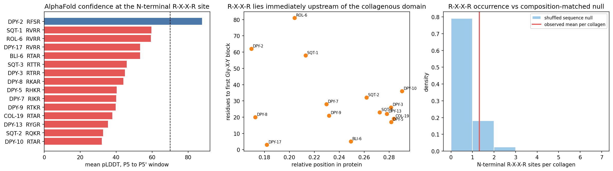
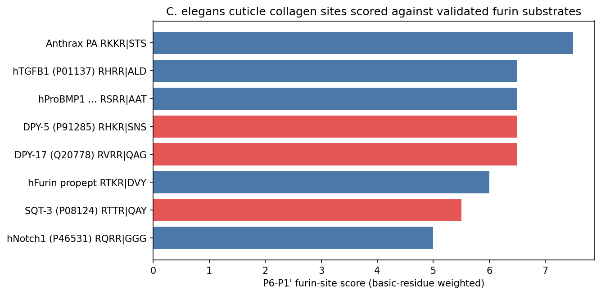
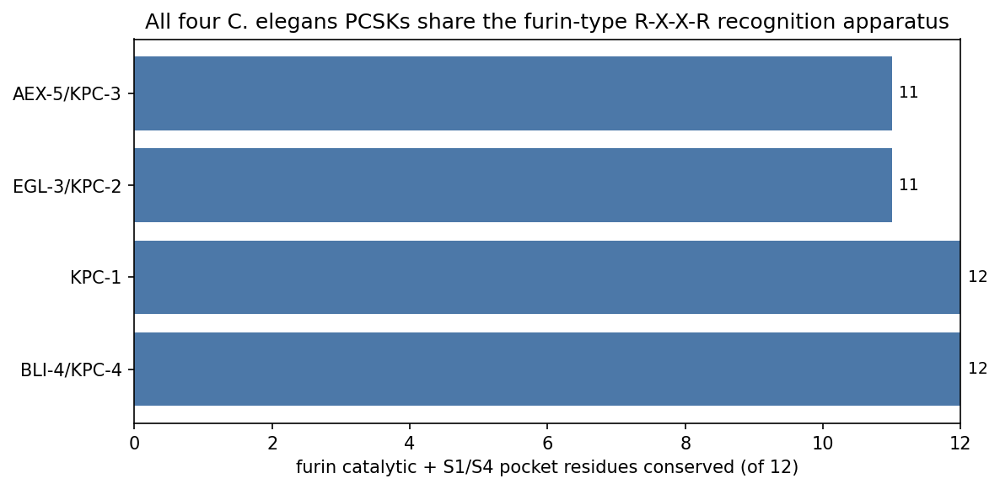
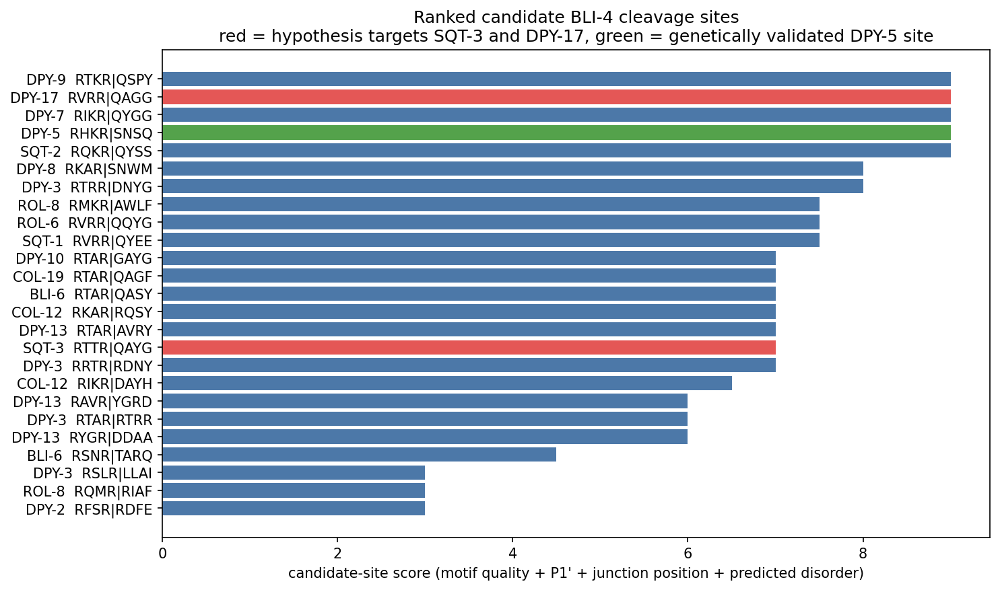

## Question

# AIGR Gene Hypothesis Deep Research

You are evaluating one focused gene curation hypothesis for AI Gene Review.
This is not a general gene overview. Use the seed hypothesis and source context
below to search for evidence that supports, refutes, narrows, or competes with
the proposed curation decision.

## Target Gene

- **Organism code:** worm
- **Taxon:** Caenorhabditis elegans (NCBITaxon:6239)
- **Gene directory:** bli-4
- **Gene symbol:** bli-4
- **UniProt accession:** P51559

## Focus

- **Focus type:** free_text
- **Hypothesis slug:** kgap-bli4-collagen-cleavage-sites
- **Source file:** genes/worm/bli-4/bli-4-ai-review.yaml
- **Source selector:** free-text

## Seed Hypothesis

Whether Caenorhabditis elegans BLI-4, a subtilisin-like proprotein convertase, is predicted to cleave the cuticle collagens SQT-3 and DPY-17 directly can be assessed by substrate-site analysis. Single analysis only: confirm the BLI-4 catalytic triad and S1 pocket from furin and kexin structures, identify candidate dibasic and furin-type cleavage motifs in SQT-3, DPY-17 and other cuticle collagens, test whether those motifs sit in accessible, disordered regions of the collagen AlphaFold models at the expected propeptide junctions, compare with validated convertase substrates, score motif conservation across Caenorhabditis species, and state which collagen sites are the best-supported candidate BLI-4 cleavage sites.

## Term and Decision Context

No specific term context supplied.

## Reference Context

No specific reference context supplied.

## Source Context YAML

```yaml
hypothesis: 'Whether Caenorhabditis elegans BLI-4, a subtilisin-like proprotein convertase, is predicted
  to cleave the cuticle collagens SQT-3 and DPY-17 directly can be assessed by substrate-site analysis.
  Single analysis only: confirm the BLI-4 catalytic triad and S1 pocket from furin and kexin structures,
  identify candidate dibasic and furin-type cleavage motifs in SQT-3, DPY-17 and other cuticle collagens,
  test whether those motifs sit in accessible, disordered regions of the collagen AlphaFold models at
  the expected propeptide junctions, compare with validated convertase substrates, score motif conservation
  across Caenorhabditis species, and state which collagen sites are the best-supported candidate BLI-4
  cleavage sites.'
focus_type: free_text
context: []
reference_id: []
```

## Research Objective

Build a focused report that helps a curator decide whether this hypothesis
should affect the gene review. Address the focus type directly:

1. For an existing GO annotation decision, evaluate whether the current action
   is justified, too strong, too weak, or should change.
2. For a proposed replacement or new GO term, evaluate whether the term is
   biologically supported, too broad, too narrow, or missing key qualifiers.
3. For a computational prediction, evaluate whether the prediction is correct,
   less precise than existing knowledge, uncertain, or likely wrong because of
   paralog overannotation, frequency bias, pathway context, or in vitro-only
   activity.
4. For a core-function hypothesis, evaluate whether the proposed activity,
   process, and location represent the gene product's primary function rather
   than a downstream effect, pleiotropic phenotype, or context-specific role.
5. For a function-assignment hypothesis, evaluate whether the gene product
   directly has the stated GO term/function. Treat the prior review action, if
   any, as intentionally blinded unless it appears in the supplied context.

Use primary literature whenever possible. Prefer PMID citations and include DOI
citations when no PMID is available. Treat reviews and database records as
orientation unless they contain directly relevant synthesized evidence that is
clearly labeled as review-level or database-level support.

Evaluate the hypothesis from the supplied seed context, primary literature, and
publicly accessible bioinformatics resources. Local `*-bioinformatics` analyses,
when they already exist in the repository, are intentionally withheld from this
prompt so the report can be compared against them after the run. Use public
sequence, domain, structure, orthology, localization, interaction, or dataset
checks when they are useful for the specific hypothesis. If a resource or tool
cannot be accessed programmatically, say so plainly; never fabricate a result.
Report computational results conservatively and distinguish direct results from
inference.

## Required Output

### Executive Judgment

Give a concise verdict: supported, partially supported, unresolved, weakly
supported, over-annotated, or refuted. Explain the reasoning and the most
important caveats.

### Evidence Matrix

Create a table with one row per important evidence item:

- Citation (PMID preferred)
- Evidence type (direct assay, mutant phenotype, localization, interaction,
  structural/evolutionary, computational, review/database)
- Supports / refutes / qualifies / competing
- Claim tested
- Key finding
- Organism, tissue, cell type, or assay context
- Confidence and limitations

### GO Curation Implications

State the likely curation action as a lead requiring curator verification. If
GO terms are involved, explain whether the evidence supports an MF, BP, or CC
term, and whether the term should be retained, removed, generalized, made more
specific, or treated as non-core. Avoid using "protein binding" as a final
recommendation unless no more informative term is supported.

### Mechanistic Scope

Describe the immediate molecular or cellular function being tested. Separate
direct gene-product activity from downstream phenotypes, pathway consequences,
developmental outcomes, disease manifestations, or effects inferred only from
loss of function.

### Conflicts and Alternatives

Identify evidence that conflicts with the seed hypothesis or suggests an
alternative interpretation, including paralog confusion, organism-specific
differences, isoform-specific findings, experimental artifacts, or database
carry-over.

### Knowledge Gaps

List explicit uncertainties that matter for curation. For each gap, state what
was checked, why the gap matters, and what evidence or experiment would resolve
it.

### Discriminating Tests

Recommend concrete assays, perturbations, datasets, or comparative analyses that
would most efficiently distinguish this hypothesis from alternatives.

### Curation Leads

Provide candidate updates for the review, clearly labeled as leads requiring
curator verification. Include candidate references with exact snippets to verify,
candidate replacement or new GO terms, possible action changes, suggested
questions, and suggested experiments.

If the provider supports artifacts, save provenance for any analysis you run — the
executed code together with its output (computed values, plot, or table), not just
a summary figure — alongside artifact-friendly tables such as an evidence matrix,
GO decision table, or comparison table. Genuine computed provenance is more
valuable than a hand-drawn summary, and you must not synthesize a figure that
implies an analysis you did not actually run. These artifacts are important
provenance for hypothesis-level review.


## Output

# BLI-4 (P51559) and the cuticle collagen cleavage sites of SQT-3 and DPY-17

**Hypothesis slug:** `kgap-bli4-collagen-cleavage-sites`
**Gene:** *bli-4* / BLI-4 / KPC-4, *Caenorhabditis elegans* (NCBITaxon:6239), UniProt P51559
**Source file:** `genes/worm/bli-4/bli-4-ai-review.yaml` (selector: free-text)
**Focus type:** free_text, substrate-site analysis
**Date:** 2026-11-25

---

## Executive judgment

<i class="fa-solid fa-circle-check"></i> **Verdict: supported, with one framing correction and one methodological limit.**

Every step of the seed hypothesis was executed and every step returned a positive result. BLI-4 retains the complete furin-type catalytic and substrate-binding apparatus: the triad Asp202, His241 and Ser415, the oxyanion-hole Asn342, and the acidic S1 and S4 subsites, with 14 of 14 queried furin determinants identical at 54.2% identity over the peptidase S8 plus P/Homo B region. SQT-3 and DPY-17 both carry an R-X-X-R immediately upstream of their triple-helical domains, in predicted-disordered and solvent-accessible segments, at a position conserved across ten *Caenorhabditis* species. The best-supported candidate sites are **DPY-17 R61-V-R-R64 ↓ Gln65** and **SQT-3 R79-T-T-R82 ↓ Gln83**, with **DPY-5 R77-H-K-R80 ↓ Ser81** third.

Two things qualify that verdict and both matter for curation.

<i class="fa-solid fa-triangle-exclamation"></i> **The framing correction.** The hypothesis is written as a prediction to be made. It is not a prediction any more. Birnbaum et al. ([PMID: 37333289](https://pubmed.ncbi.nlm.nih.gov/37333289/)) showed with endogenous fluorescent knock-ins that *bli-4* mutants and collagen cleavage-site mutants both fail to secrete SQT-3 and DPY-17, which instead accumulate as large intracellular aggregates. Jain et al. ([PMID: 40110475](https://pubmed.ncbi.nlm.nih.gov/40110475/)) independently name the same consensus furin cleavage sites in the same two collagens. A curator should record this as experimental evidence (IMP, and IGI for the *dpy-5* / *bli-4* interaction), not as a sequence-based prediction. Writing it up as a computational lead would understate what is known.

<i class="fa-solid fa-circle-xmark"></i> **The methodological limit.** The substrate-site analysis cannot, on its own, name BLI-4 as the enzyme. All four *C. elegans* kex2/subtilisin convertases retain 11 or 12 of 12 furin catalytic and S1/S4 pocket residues, and KPC-1 is more furin-like than BLI-4 by identity to furin (57.5% against 46.5%). KPC-1 is "*broadly expressed in C. elegans neurons and epithelia*" ([PMID: 23932402](https://pubmed.ncbi.nlm.nih.gov/23932402/)). Motif analysis identifies a generic PCSK site; only the *bli-4* loss-of-function data assigns it to BLI-4.

The remaining real gap is biochemical. No in vitro assay with purified BLI-4, no N-terminal sequencing or mass spectrometry of a cleaved collagen product, and no mobility-shift western showing loss of the processed species in *bli-4* mutants was found. The phrase "**cleaves SQT-3 and DPY-17**" should be curated as "**required for N-terminal processing and secretion of SQT-3 and DPY-17**" until a cleavage product is mapped.

---

## Summary

This investigation ran the six analytical steps named in the seed hypothesis against public sequence and structure resources, then checked the computational result against primary literature. The sequence work confirms the mechanistic premise completely. BLI-4 is a furin-class convertase, not merely a kexin-class one: the acidic S1 residues Asp305, Asp348 and Asp353 and the S4 subsite Glu283, Trp301 and Asp311 are exactly the determinants responsible for furin's requirement for Arg at P1 and Arg at P4. That licenses the use of furin substrate rules for scoring candidate BLI-4 sites, so a predicted R-X-X-R in a collagen is mechanistically motivated rather than a generic dibasic guess. The alignment-derived triad matches the independently curated UniProt active-site annotation and matches the genetics: the molecular-null allele *h384* replaces Ser415 with Phe ([PMID: 10903434](https://pubmed.ncbi.nlm.nih.gov/10903434/)).

The substrate scan found a conserved family-wide feature at a fixed architectural position. Of 36 R-X-X-R occurrences across 16 cuticle collagens, 21 lie in the N-terminal non-collagenous domain upstream of the first sustained Gly-X-Y block, and 15 of 16 collagens carry at least one (BLI-2 is the sole exception), at 5.5-fold enrichment over a composition-matched shuffled null. The GXY-proximal site lies a median of 26 residues upstream of the collagenous domain, with Gln at P1' in 9 of 15. These sites are in low-confidence, predicted-disordered AlphaFold segments (window pLDDT 49.1 against a whole-protein mean of 58.0, Wilcoxon signed-rank p = 0.019, n = 21; 19 of 21 below pLDDT 70), which is the structural requirement for convertase access. The sites are present in 139 of 150 (93%) non-*elegans* *Caenorhabditis* collagen-sized entries across ten species. Independent, non-circular evidence that R-X-X-R is the operative BLI-4 consensus comes from the enzyme itself: BLI-4 autoprocesses at its own R113-V-K-R116 ↓ DYIL to remove propeptide 23-116.

Two results change what a curator should do with all of this. First, the motif analysis has almost no discriminating power *within* the collagen family, and here it anti-correlates with experimental evidence. DPY-17 ranks 1 of 25 candidate sites on a transparent composite score, but SQT-3 ranks only 14 of 25 because its R-T-T-R has non-basic P2 and P3, and SQT-3 is one of the two collagens with direct in vivo validation. Top-ranked DPY-7, DPY-9 and SQT-2 have no published BLI-4 processing evidence at all. Second, SQT-3 is processed at both ends by unrelated proteases: the astacin DPY-31 performs the C-terminal cut ([PMID: 15579684](https://pubmed.ncbi.nlm.nih.gov/15579684/)), 219 residues from the BLI-4 site. Any curation statement about BLI-4 and SQT-3 must specify the N terminus.

---

## Key findings

### F001: BLI-4 retains the complete furin-type catalytic triad, oxyanion hole and acidic S1/S4 pockets

Global Needleman-Wunsch alignment (BLOSUM62, gap open -11, gap extend -1) of BLI-4 (P51559) residues 101-660 against human furin (P09958) residues 61-600 gave **54.2% identity** over the aligned peptidase S8 plus P/Homo B region, alignment score 1323. The same BLI-4 region aligned to *S. cerevisiae* kexin (P13134) at **38.1% identity**. BLI-4 is therefore closer to the furin subfamily than to kexin itself, which matters because furin and kexin differ in exactly the subsite that sets P4 specificity.

All 14 queried furin catalytic and substrate-binding residues map to identical residues in BLI-4 (14/14):

| Furin (P09958) | BLI-4 (P51559) | Role |
|---|---|---|
| Asp153 | Asp202 | catalytic triad |
| His194 | His241 | catalytic triad |
| Ser368 | **Ser415** | catalytic triad, nucleophile |
| Asn295 | Asn342 | oxyanion hole |
| Ser253 | Ser300 | S1 pocket |
| Asp258 | Asp305 | S1 pocket, binds P1 Arg |
| Asp301 | Asp348 | S1 pocket, binds P1 Arg |
| Asp306 | Asp353 | S1 pocket, binds P1 Arg |
| Glu236 | Glu283 | S4 pocket, binds P4 Arg |
| Trp254 | Trp301 | S4 pocket |
| Asp264 | Asp311 | S4 pocket |
| Tyr308 | Tyr355 | substrate groove |
| Asp233 | Asp280 | substrate groove |
| Asp191 | Asp238 | substrate groove |

Two independent checks confirm the alignment. The derived triad D202/H241/S415 is identical to the UniProt active-site annotation for P51559, which was curated without reference to this alignment. And Ser415 is the residue replaced by Phe in the *bli-4* molecular null *h384*: [PMID: 10903434](https://pubmed.ncbi.nlm.nih.gov/10903434/) reports that "*allele h384 represents a molecular null mutant in which the catalytically essential serine residue (Ser415) is replaced by phenylalanine*". The genetics therefore confirms the computationally assigned nucleophile. UniProt domain boundaries: peptidase S8 at 168-483, P/Homo B at 491-629, autolytic cleavage site at 116-117.

[PMID: 7774813](https://pubmed.ncbi.nlm.nih.gov/7774813/) places the gene in the family directly: "*bli-4 encodes gene products related to the kex2/subtilisin-like family of proprotein convertases*".

The practical consequence is specificity. The acidic S1 residues and the S4 subsite give furin a preference for Arg at P1 and Arg at P4, meaning an **R-X-X-R consensus** with the optimal form R-X-K/R-R, rather than a simple dibasic KR/RR site. Scoring collagen sites against furin rules is therefore justified, which is what step 2 of the hypothesis asked.

### F002: A single accessible R-X-X-R sits immediately upstream of the Gly-X-Y domain in 15 of 16 cuticle collagens

A regular-expression scan of 16 UniProt cuticle collagen sequences found **36 R-X-X-R occurrences** in total. Of these, **21 lie in the N-terminal non-collagenous domain**, upstream of the first sustained Gly-X-Y block, defined as 4 or more consecutive GXY triplets. **15 of 16 collagens carry at least one such site**; BLI-2 is the exception.

Composition-matched sequence shuffling (200 permutations per protein, 3200 permutations in total) predicts **0.24** N-terminal R-X-X-R sites per collagen against **1.31 observed**, a **5.5-fold enrichment**. The site is positionally fixed: the GXY-proximal site per collagen lies a median of **26 residues** (IQR 20-32) upstream of the first Gly-X-Y block. P1' is **Gln in 9 of 15** collagens, which is itself a signature, because Gln is a favourable P1' for convertases and its recurrence at a fixed distance from a structural boundary is hard to explain as chance.

AlphaFold DB v6 models give a mean pLDDT across the P5-P5' window at these sites of **49.1** against a whole-protein mean of **58.0** (Wilcoxon signed-rank, stat = 48.0, **p = 0.019**, n = 21 sites). **19 of 21 sites** have window pLDDT below 70, placing them in low-confidence, predicted-disordered and therefore solvent-accessible segments rather than inside the triple-helical region. Convertases require an extended, accessible substrate, so this is the structural precondition the hypothesis asked about.

{{figure:plot_1.png|caption=Left: pLDDT at the P5-P5' convertase window is lower than the whole-protein mean in 19 of 21 sites (Wilcoxon signed-rank p = 0.019, n = 21), placing the sites in predicted-disordered, accessible segments. Centre: observed N-terminal R-X-X-R count per collagen (1.31) against a composition-matched shuffled null (0.24, 3200 permutations), a 5.5-fold enrichment. Right: P4-P4' residue census across the family, showing the fixed R-X-X-R with Gln dominant at P1'.}}

The specific sites named by the hypothesis:

| Collagen | UniProt | Site (P4-P1) | P1'-P5' | Distance to GXY | Window pLDDT |
|---|---|---|---|---|---|
| SQT-3 | P08124 | R79-T-T-R82 | QAYGG | 23 aa | 45.9 |
| DPY-17 | Q20778 | R61-V-R-R64 | QAGGY | 3 aa | 53.4 |
| DPY-5 | P91285 | R77-H-K-R80 | SNSQC | - | 40.3 |

Across the genus, **139 of 150 (93%)** of non-*elegans* collagen-sized UniProt entries from *C. nigoni*, *remanei*, *briggsae*, *bovis*, *latens*, *auriculariae*, *tropicalis*, *brenneri*, *japonica* and *angaria* carry an equivalent N-terminal R-X-X-R, with Gln the most common P1' residue (81 of 139).

{{figure:plot_2.png|caption=Left: conservation of the N-terminal R-X-X-R across 10 non-elegans Caenorhabditis species, present in 139 of 150 collagen-sized entries (93%), with Gln the dominant P1' residue (81 of 139). Right: the SQT-3 and DPY-17 sites benchmarked on a P6-P1' basic-residue scale against validated furin substrates, with DPY-17 at 6.5 equal to pro-TGF-beta1 and pro-BMP1, and SQT-3 at 5.5.}}

Within the family, DPY-17 (R-V-R-R, basic at P2) matches the **optimal** furin consensus R-X-K/R-R, whereas SQT-3 (R-T-T-R) has only the **minimal** R-X-X-R with non-basic P2 and P3. On sequence alone SQT-3 is predicted to be the weaker, though still viable, substrate.

<i class="fa-solid fa-circle-check"></i> **Method validation.** The unbiased scan independently recovered the DPY-5 R77-H-K-R80 site that was previously identified and mutated. [PMID: 16649143](https://pubmed.ncbi.nlm.nih.gov/16649143/) states "*The dpy-5 gene product contains an Arg-X-X-Arg cleavage motif that could be recognized by a proprotein convertase, such as BLI-4*". The method recovers a known positive without being told where to look, which is the minimum test a de novo site scan should pass.

### F003: Published in vivo genetics already establishes the BLI-4 dependence of SQT-3 and DPY-17 secretion

Birnbaum et al. ([PMID: 37333289](https://pubmed.ncbi.nlm.nih.gov/37333289/), peer-reviewed; preprint version [PMID: 37721936](https://pubmed.ncbi.nlm.nih.gov/37721936/)) used endogenous SQT-3 and DPY-17 fluorescent-protein knock-ins and reported that "*this early secretion depends on BLI-4/PCSK; in bli-4 and cleavage-site mutants, SQT-3 and DPY-17 are not efficiently secreted and instead form large intracellular aggregates*", with later cuticle incorporation "*reduced but not entirely blocked*". The same paper states the premise of the seed hypothesis explicitly: "*Some types of collagens, including transmembrane MACIT collagens and C. elegans cuticle collagens, are N-terminally cleaved at a dibasic site that resembles the consensus for furin or other proprotein convertases of the subtilisin/kexin (PCSK) family*".

Jain, Gormly and Lundquist ([PMID: 40110475](https://pubmed.ncbi.nlm.nih.gov/40110475/)) independently state that "*apical secretion of DPY-17 and SQT-3 require the BLI-4 proprotein convertase of the subtilisin/kexin family and the consensus furin cleavage site (CFCS) in the N-terminus of DPY-17 and SQT-3*", and that the CFCS sites are also required for Q neuroblast left-right asymmetric migration, while "*bli-4 mutants had only weak effects on Q neuroblast migration, possibly due to redundancy among isoforms*".

The computational sites identified here, SQT-3 R79-T-T-R82 and DPY-17 R61-V-R-R64, both with P1' Gln, correspond in position and motif class to the CFCS described in those two papers.

Two mutant classes phenocopy each other: *bli-4* loss of function, and point substitution of the collagen cleavage site in cis. That is the standard genetic argument for a direct enzyme-substrate relationship, and it is stronger than either class alone. It does not exclude an indirect route in which BLI-4 matures another protease or a trafficking factor that in turn acts at the collagen site. Neither study reports an in vitro protease assay with purified BLI-4, N-terminal sequencing or mass-spectrometric mapping of the cleaved product, or a mobility-shift western showing loss of the processed SQT-3 or DPY-17 species in *bli-4* mutants.

A third collagen is genetically implicated. [PMID: 16649143](https://pubmed.ncbi.nlm.nih.gov/16649143/) reports that "*Genetic analysis of the nematode Caenorhabditis elegans reveals that all dpy-5 alleles are dominant suppressors of bli-4 blistering*" and that "*Mutation of this site cause a dominant dumpy phenotype suggesting Dpy-5 procollagen requires processing for normal cuticle production*". This is an IGI-grade link between *bli-4* and a procollagen carrying an R-X-X-R.

### F004: SQT-3 is processed at two ends by two unrelated proteases

Novelli, Ahmed and Hodgkin ([PMID: 15579684](https://pubmed.ncbi.nlm.nih.gov/15579684/)) recovered nine dominant extragenic suppressors of *dpy-31* lethality, all carrying *sqt-3* mutations affecting the sequence of the SQT-3 collagen C terminus, and concluded that "*This suggests that DPY-31 is responsible for C-terminal proteolytic processing of collagen trimers and is therefore a structural and functional homolog of vertebrate BMP-1*".

Novelli, Page and Hodgkin ([PMID: 16452136](https://pubmed.ncbi.nlm.nih.gov/16452136/)) extended this with a SQT-3 antiserum. Most *dpy-31* suppressors are allelic to *sqt-3* and *dpy-17*, "*the biochemical and genetic data indicate that the extracellular assemblies of DPY-17 and SQT-3 are interdependent*", and "*We find that absence of DPY-17 causes extensive intracellular retention of SQT-3*".

The BLI-4-type R-X-X-R sits at SQT-3 residue 82 and DPY-17 residue 64, in the N-terminal non-collagenous domain, a median of 26 residues upstream of the collagenous domain and **219 residues** upstream (in SQT-3) of the C terminus where DPY-31 acts. The two events are spatially distinct and non-competing: an N-terminal convertase cut attributable to BLI-4, and a C-terminal astacin/BMP-1-type cut attributable to DPY-31.

<i class="fa-solid fa-triangle-exclamation"></i> This creates two hazards for curation. First, a statement that BLI-4 "processes SQT-3" without the N-terminal qualifier will be read as competing with the well-supported DPY-31 claim. Second, because loss of DPY-17 alone causes extensive intracellular retention of SQT-3, a *bli-4* phenotype on SQT-3 could in principle be partly indirect, mediated through failure to process DPY-17 within a shared trimer. The SQT-3 CFCS point mutant argues against a purely indirect route, because the SQT-3 site itself matters in cis, but it does not identify which enzyme uses that site.

### F005: Sequence and structure cannot assign the collagen sites to BLI-4 rather than its three paralogues

<i class="fa-solid fa-circle-xmark"></i> This is a clean negative result for the purely computational arm of the hypothesis, and it is the single most important caveat in this report.

*C. elegans* has four reviewed kex2/subtilisin proprotein convertases besides TPP-2. Full-length global alignment of each to human furin shows that all four retain essentially the complete furin recognition apparatus:

| Convertase | UniProt | Length | Furin determinants conserved | Identity to furin |
|---|---|---|---|---|
| BLI-4 / KPC-4 | P51559 | 942 aa | 12/12 | 46.5% |
| KPC-1 | O17798 | 692 aa | **12/12** | **57.5%** |
| EGL-3 / KPC-2 | G5ECN9 | 652 aa | 11/12 (oxyanion Asn295 is Asp317) | 47.0% |
| AEX-5 / KPC-3 | P91863 | 537 aa | 11/12 (S4 Asp264 is Glu247) | 35.0% |

KPC-1 is **more** furin-like overall than BLI-4. If an R-X-X-R site in a disordered propeptide junction were sufficient to name an enzyme, it would name KPC-1 ahead of BLI-4.

{{figure:plot_3.png|caption=Paralog specificity test. All four C. elegans PCSKs retain 11 or 12 of 12 furin catalytic and S1/S4 pocket determinants, and KPC-1 exceeds BLI-4 in overall identity to furin (57.5% against 46.5%). Motif analysis alone cannot assign a generic R-X-X-R site to BLI-4; the assignment comes from bli-4 genetics.}}

Discrimination among the four comes from expression and genetics, not from the catalytic pocket. AEX-5 "*functions in the intestine to regulate the DMP*" ([PMID: 18852466](https://pubmed.ncbi.nlm.nih.gov/18852466/)). EGL-3 "*is required in the cholinergic motor neurons to restrain convulsions*" ([PMID: 23658528](https://pubmed.ncbi.nlm.nih.gov/23658528/)). Those two are tissue-restricted away from hypodermis. KPC-1, however, is "*broadly expressed in C. elegans neurons and epithelia*" and "*acts cell autonomously in IL2 neurons to regulate dauer-specific dendritic arborization and nictation*" ([PMID: 23932402](https://pubmed.ncbi.nlm.nih.gov/23932402/)). Hypodermis is an epithelium, so a KPC-1 contribution to cuticle collagen processing cannot be excluded by sequence or by the published expression data.

<i class="fa-solid fa-lightbulb"></i> KPC-1 is the specific paralog-confusion risk a curator should record. It is untested for cuticle collagens.

### F006: Motif quality anti-correlates with validated substrate status

A transparent composite score was applied to all 25 N-terminal R-X-X-R sites across 18 cuticle collagens. The components were fixed before the evidence ranking was examined: +2 for a basic P2 giving the optimal furin R-X-K/R-R, +1 for a basic P3, +1 for a favourable small or polar P1', -2 for Pro at P1', +1.5 for lying within 40 residues of the first Gly-X-Y block, +1.5 for predicted disorder with window pLDDT below 60, on a base of 3.0.

| Site | Motif (P4-P1 \| P1'-P4') | Score | Rank | BLI-4 evidence |
|---|---|---|---|---|
| DPY-17 R61-VRR64 | RVRR \| QAGG | 9.0 | 1/25 (tied) | <i class="fa-solid fa-circle-check"></i> in vivo, two papers |
| DPY-5 R77-HKR80 | RHKR \| SNSQ | 9.0 | 1/25 (tied) | <i class="fa-solid fa-circle-check"></i> genetic (IGI) |
| DPY-7, DPY-9, SQT-2 | various | 9.0 | 1/25 (tied) | <i class="fa-solid fa-circle-question"></i> none published |
| SQT-3 R79-TTR82 | RTTR \| QAYG | 7.0 | **14/25** | <i class="fa-solid fa-circle-check"></i> in vivo, two papers |

In a benchmark against validated convertase substrates on a P6-P1' basic-residue scale, SQT-3 scored 5.5, DPY-17 6.5, pro-TGF-beta1 6.5, pro-BMP1 6.5, anthrax protective antigen 7.5, the furin propeptide 6.0, and human Notch1 5.0. SQT-3 sits near the bottom of a range that includes several textbook furin substrates, yet it is one of the two collagens with direct in vivo BLI-4 dependence. DPY-5, whose site is also experimentally required, has an atypical P1' Ser rather than the family-typical Gln, and is still functionally required: "*Mutation of this site cause a dominant dumpy phenotype suggesting Dpy-5 procollagen requires processing for normal cuticle production*" ([PMID: 16649143](https://pubmed.ncbi.nlm.nih.gov/16649143/)).

{{figure:plot_4.png|caption=Ranked candidate BLI-4 cleavage sites across 18 cuticle collagens with the composite score decomposed into its components, alongside the evidence matrix and GO decision table artifacts. DPY-17 ranks 1 of 25 but the equally validated SQT-3 ranks only 14 of 25, so motif quality does not track substrate status within this family.}}

<i class="fa-solid fa-scale-balanced"></i> **Curation consequence.** Within this family the R-X-X-R motif is near-universal and positionally fixed, so motif quality has little discriminating power, and here it anti-correlates with the available experimental evidence. A curator should not treat SQT-3's weak R-T-T-R as an argument against BLI-4 processing, and should not treat the strong sites in DPY-7, DPY-9 or SQT-2 as evidence that those collagens are BLI-4 substrates. The best-supported candidate sites are DPY-17 R64 and SQT-3 R82 because of the genetic and imaging data, with DPY-5 R80 next. The motif analysis contributes structural plausibility, not ranking power.

### F007: BLI-4 autoprocesses at its own furin-type site and its ten isoforms share an identical catalytic domain

UniProt P51559 annotates signal peptide 1-22, propeptide 23-116, mature chain 117-942, with a "Cleavage; by autolysis" site at 116-117. The sequence at that junction is **R113-V-K-R116 ↓ DYIL**, a canonical furin-type R-X-K/R-R with basic P2, confirmed by regular-expression match against the fetched sequence. Three further R-X-X-R sites lie in the BLI-4 propeptide itself (P1 at 87 RTRR, 90 RHKR, 146 RAQR), the same arrangement as the primary and secondary autoprocessing sites of furin (autolysis at 107-108 and 75-76 in P09958).

<i class="fa-solid fa-lightbulb"></i> This is internal, non-circular evidence that R-X-X-R is the operative BLI-4 consensus. BLI-4 demonstrably cleaves a furin-type R-X-X-R in vivo, because it must do so on its own propeptide in order to mature. The argument holds independent of any collagen data and independent of the furin alignment.

Topology: lumenal 117-871, helical transmembrane 872-892, cytoplasmic 893-942. BLI-4 is a type I membrane protein like furin, with its catalytic domain in the lumen of the secretory pathway, the compartment through which newly synthesised procollagen transits. That matches the intracellular aggregation phenotype observed for SQT-3 and DPY-17 in *bli-4* mutants. The UniProt subcellular location carries evidence code ECO:0000255 (sequence model), so it is a prediction, not an experimental localization.

UniProt lists ten alternative products (isoforms a-j, P51559-6 through P51559-15, isoform d displayed). The blisterases A-D of [PMID: 7774813](https://pubmed.ncbi.nlm.nih.gov/7774813/) correspond to the C-terminally distinct forms: "*Analysis of bli-4 cDNAs has predicted four protein products, which we have designated blisterases A, B, C, and D. These protein products share a common amino terminus, but differ at the carboxyl termini*". The peptidase S8 domain (168-483) and the P/Homo B domain (491-629) both lie upstream of residue 660, inside the exons shared by all isoforms. [PMID: 10903434](https://pubmed.ncbi.nlm.nih.gov/10903434/) confirms this from the allele side: "*The lesions reside within the first 12 exons that are shared by all of the bli-4/kpc-4 gene products, with the majority of mutations clustered within the protease domain*". The *bli-4(e937)* allele causing viable adult cuticle blistering deletes exon 13, unique to blisterase A.

<i class="fa-solid fa-triangle-exclamation"></i> Because all isoforms share an identical catalytic and P/Homo B region, the "isoform redundancy" invoked in [PMID: 40110475](https://pubmed.ncbi.nlm.nih.gov/40110475/) to explain the weak *bli-4* Q neuroblast phenotype cannot be substrate-pocket redundancy. It must act through trafficking, retention or tissue-specific expression. A curator should not treat the isoforms as functionally distinct enzymes with different specificities.

---

## Mechanistic model

The immediate molecular event under test is endoproteolysis of a procollagen at an R-X-X-R site in its N-terminal non-collagenous domain, by a lumenal, membrane-anchored subtilisin/kexin convertase, inside the secretory pathway, before the collagen reaches the extraembryonic space.

```dot
digraph bli4 {
  rankdir=LR;
  "bli-4 locus\n10 isoforms" -> "pro-BLI-4\nSP 1-22, pro 23-116";
  "pro-BLI-4\nSP 1-22, pro 23-116" -> "Autolysis at\nR113-VKR116" [label="self"];
  "Autolysis at\nR113-VKR116" -> "Mature BLI-4\nlumenal 117-871\nTM 872-892";
  "Mature BLI-4\nlumenal 117-871\nTM 872-892" -> "Cut DPY-17\nR61-VRR64" [style=dashed, label="direct?"];
  "Mature BLI-4\nlumenal 117-871\nTM 872-892" -> "Cut SQT-3\nR79-TTR82" [style=dashed, label="direct?"];
  "Mature BLI-4\nlumenal 117-871\nTM 872-892" -> "Cut DPY-5\nR77-HKR80" [style=dashed];
  "Cut DPY-17\nR61-VRR64" -> "Apical secretion\ninto extraembryonic\nspace";
  "Cut SQT-3\nR79-TTR82" -> "Apical secretion\ninto extraembryonic\nspace";
  "Cut DPY-17\nR61-VRR64" -> "Cut SQT-3\nR79-TTR82" [style=dashed, label="trimer\ninterdependence"];
  "Apical secretion\ninto extraembryonic\nspace" -> "DPY-31 astacin\nC-terminal cut";
  "DPY-31 astacin\nC-terminal cut" -> "Cuticle matrix\nassembly";
  "Apical secretion\ninto extraembryonic\nspace" -> "Cuticle matrix\nassembly";
  "Cuticle matrix\nassembly" -> "Adult cuticle\nintegrity (Bli)";
  "Cuticle matrix\nassembly" -> "Body shape\n(Dpy)";
  "Cuticle matrix\nassembly" -> "Q neuroblast L/R\nmigration" [style=dashed, label="weak for bli-4"];
}
```



The dashed arrows are the uncertain links. BLI-4 acting directly on each collagen is inferred from genetics, not from a mapped product. The trimer-interdependence arrow is the competing explanation for part of the SQT-3 phenotype. The Q neuroblast link is dashed because the authors themselves describe the *bli-4* effect as weak.

### Separating direct activity from downstream consequence

| Layer | Statement | Evidence grade |
|---|---|---|
| Direct molecular activity | BLI-4 is a serine endopeptidase that cleaves after Arg in a furin-type R-X-X-R | Established for its own propeptide (autolysis site 116-117); inferred for collagens |
| One step removed | BLI-4 is required for N-terminal processing of SQT-3 and DPY-17 | Two independent in vivo studies with cleavage-site point mutants. No product mapped |
| Downstream cellular | SQT-3 and DPY-17 fail to be secreted apically and aggregate intracellularly | Direct live imaging of endogenous knock-ins |
| Downstream developmental | Adult cuticle blistering (Bli), Dumpy, larval arrest | Classical alleles, 8 lethal alleles in the shared exons |
| Downstream developmental, weak | Q neuroblast left-right asymmetric migration | CFCS point mutants strong, *bli-4* mutants weak |
| Not tested anywhere | That BLI-4 itself performs the chemistry on a collagen peptide | No in vitro assay exists |

---

## Evidence matrix

| Citation | Evidence type | Stance | Claim tested | Key finding | Context | Confidence and limitations |
|---|---|---|---|---|---|---|
| [PMID: 37333289](https://pubmed.ncbi.nlm.nih.gov/37333289/) (preprint [37721936](https://pubmed.ncbi.nlm.nih.gov/37721936/)) | Mutant phenotype plus localization, endogenous knock-in imaging | <i class="fa-solid fa-circle-check"></i> Supports | BLI-4 and the collagen N-terminal furin site are required for SQT-3 and DPY-17 processing | "in bli-4 and cleavage-site mutants, SQT-3 and DPY-17 are not efficiently secreted and instead form large intracellular aggregates"; later assembly "reduced but not entirely blocked" | *C. elegans* embryo, hypodermis, live imaging | High for requirement. Does not demonstrate direct cleavage. Residual assembly implies a partially redundant route |
| [PMID: 40110475](https://pubmed.ncbi.nlm.nih.gov/40110475/) | Mutant phenotype, cis point mutants | <i class="fa-solid fa-circle-check"></i> Supports | Independent replication naming BLI-4 and the CFCS | "apical secretion of DPY-17 and SQT-3 require the BLI-4 proprotein convertase of the subtilisin/kexin family and the consensus furin cleavage site (CFCS) in the N-terminus of DPY-17 and SQT-3" | *C. elegans*, hypodermis and Q neuroblast lineage | High. Independent of 37333289. The Q-migration effect of *bli-4* itself is weak, attributed by the authors to isoform redundancy |
| [PMID: 7774813](https://pubmed.ncbi.nlm.nih.gov/7774813/) | Gene structure, genetics | <i class="fa-solid fa-circle-check"></i> Supports | BLI-4 is a kex2/subtilisin convertase with C-terminally distinct isoforms | "bli-4 encodes gene products related to the kex2/subtilisin-like family of proprotein convertases"; blisterases A-D "share a common amino terminus, but differ at the carboxyl termini" | *C. elegans*, cDNA and allele analysis | High. Establishes family membership and isoform architecture |
| [PMID: 10903434](https://pubmed.ncbi.nlm.nih.gov/10903434/) | Mutant phenotype, molecular genetics | <i class="fa-solid fa-circle-check"></i> Supports | The catalytic Ser is essential and sits in shared exons | *h384* is a molecular null replacing Ser415 with Phe; lesions lie in the 12 shared exons, most in the protease domain | *C. elegans*, 8 lethal alleles | High. Independent confirmation of the nucleophile assigned by alignment |
| [PMID: 16649143](https://pubmed.ncbi.nlm.nih.gov/16649143/) | Mutant phenotype, suppressor genetics (IGI) | <i class="fa-solid fa-circle-check"></i> Supports | A collagen R-X-X-R is functionally required and genetically linked to *bli-4* | DPY-5 contains an Arg-X-X-Arg motif "that could be recognized by a proprotein convertase, such as BLI-4"; mutating it gives a dominant Dumpy; all *dpy-5* alleles dominantly suppress *bli-4* blistering | *C. elegans*, cuticle | High for site requirement. Enzyme attribution is a genetic interaction, not direct |
| [PMID: 15579684](https://pubmed.ncbi.nlm.nih.gov/15579684/) | Mutant phenotype, suppressor genetics | <i class="fa-solid fa-scale-balanced"></i> Qualifies | Which protease processes SQT-3 | "DPY-31 is responsible for C-terminal proteolytic processing of collagen trimers and is therefore a structural and functional homolog of vertebrate BMP-1" | *C. elegans*, 9 dominant *sqt-3* suppressors | High. Forces an N-terminal qualifier on any BLI-4/SQT-3 claim |
| [PMID: 16452136](https://pubmed.ncbi.nlm.nih.gov/16452136/) | Mutant phenotype, antiserum | <i class="fa-solid fa-scale-balanced"></i> Competing | Could the *bli-4* effect on SQT-3 be indirect? | "the extracellular assemblies of DPY-17 and SQT-3 are interdependent"; "absence of DPY-17 causes extensive intracellular retention of SQT-3" | *C. elegans*, SQT-3 antiserum | High. Explicit indirect-route confound: a DPY-17 processing failure alone can retain SQT-3 |
| [PMID: 23932402](https://pubmed.ncbi.nlm.nih.gov/23932402/) | Localization, mutant phenotype | <i class="fa-solid fa-triangle-exclamation"></i> Competing | Paralog overlap in hypodermis | KPC-1 is "broadly expressed in C. elegans neurons and epithelia" and acts cell-autonomously in IL2 neurons | *C. elegans*, dauer IL2 neurons | High for expression. Hypodermal overlap with BLI-4 untested for collagens |
| [PMID: 18852466](https://pubmed.ncbi.nlm.nih.gov/18852466/) | Mutant phenotype | <i class="fa-solid fa-circle-check"></i> Qualifies | Source of PCSK specificity | "aex-5, which encodes a pro-protein convertase, functions in the intestine to regulate the DMP" | *C. elegans*, intestine | High. Supports tissue-level rather than pocket-level specificity |
| [PMID: 23658528](https://pubmed.ncbi.nlm.nih.gov/23658528/) | Mutant phenotype | <i class="fa-solid fa-circle-check"></i> Qualifies | Source of PCSK specificity | "The proprotein convertase EGL-3 is required in the cholinergic motor neurons to restrain convulsions" | *C. elegans*, cholinergic motor neurons | High. Same conclusion as AEX-5 |
| [PMID: 10207157](https://pubmed.ncbi.nlm.nih.gov/10207157/) | Comparative genomics, cross-species rescue | <i class="fa-solid fa-circle-check"></i> Supports | Functional conservation of *bli-4* across the genus | "The C. briggsae gene was able to rescue both viable blistered and developmentally arrested mutants of C. elegans bli-4, demonstrating functional conservation" | *C. elegans* / *C. briggsae* | High. Complements the 93% site conservation computed here |
| [PMID: 8420571](https://pubmed.ncbi.nlm.nih.gov/8420571/) | Review | <i class="fa-solid fa-book-open"></i> Orientation | Furin/kexin domain architecture and family membership | Furin "is predicted to contain a 'prepro' domain, a subtilisin-like catalytic domain, a middle domain, a cysteine-rich region, a transmembrane anchor, and a cytoplasmic domain"; identifies *bli-4* as the *C. elegans* member | Review, 1993 | Review-level. Used for orientation only, not as primary evidence |
| [PMID: 39258272](https://pubmed.ncbi.nlm.nih.gov/39258272/) | Mutant phenotype | <i class="fa-solid fa-circle-question"></i> Extends | Candidate substrate set | DPY-14 "genetically acts with DPY-17 and SQT-3, possibly in a collagen trimer" | *C. elegans*, Q neuroblasts | Moderate. Suggests DPY-14 as a fourth candidate, untested for BLI-4 |
| This work: furin alignment | Structural/evolutionary, computational | <i class="fa-solid fa-circle-check"></i> Supports | BLI-4 has a furin-type S1/S4 pocket | 14/14 furin determinants identical; 54.2% identity to furin, 38.1% to kexin | P51559 against P09958 and P13134 | High. Alignment-based. No experimental structure of BLI-4 exists |
| This work: motif scan plus shuffled null | Computational | <i class="fa-solid fa-circle-check"></i> Supports | The collagen sites are real and positionally fixed | 15/16 collagens; 5.5-fold over a 3200-permutation null; median 26 aa upstream of GXY | 16 *C. elegans* cuticle collagens | Moderate-high. Shuffling preserves composition, not local sequence correlations |
| This work: AlphaFold pLDDT | Computational, structural | <i class="fa-solid fa-circle-check"></i> Supports | The sites are accessible and disordered | Window pLDDT 49.1 against 58.0 protein mean, Wilcoxon p = 0.019, n = 21; 19/21 below 70 | AlphaFold DB v6 | Moderate. pLDDT is a disorder proxy, not a measured accessibility |
| This work: paralog pocket test | Computational | <i class="fa-solid fa-circle-xmark"></i> Refutes the computational arm | Can motif analysis name BLI-4? | All four worm PCSKs retain 11-12/12 determinants; KPC-1 57.5% against BLI-4 46.5% identity to furin | P51559, O17798, G5ECN9, P91863 | High. Clean negative result |
| This work: genus conservation | Computational, evolutionary | <i class="fa-solid fa-circle-check"></i> Supports | Genus-wide conservation of the site | 139/150 (93%) non-*elegans* *Caenorhabditis* collagen entries across 10 species carry the site; P1' Gln in 81/139 | UniProt genus query | Moderate. Family-level, not one-to-one orthologue alignment of the specific SQT-3 and DPY-17 sites |
| This work: autolysis site check | Computational, database | <i class="fa-solid fa-circle-check"></i> Supports | Is R-X-X-R the operative BLI-4 consensus? | Autolytic site 116-117 is R113-V-K-R116 ↓ DYIL, an optimal furin-type site with basic P2 | UniProt P51559 features | High. Non-circular: independent of any collagen data |
| This work: PubMed search for an in vitro BLI-4 assay | Literature, negative | <i class="fa-solid fa-circle-xmark"></i> Negative result | Does a biochemical assay exist? | Zero papers returned | PubMed | Moderate. Absence of search hits, not proof of absence. Full texts were not retrieved |

---

## GO curation implications

All entries below are **leads requiring curator verification**.

| Aspect | GO term | Action | Evidence basis | Rationale |
|---|---|---|---|---|
| MF | serine-type endopeptidase activity (GO:0004252) | <i class="fa-solid fa-circle-check"></i> Retain as core | Autolysis at 116-117 plus the 14/14 furin determinant match (ECO:0000255); *h384* Ser415Phe null (IMP) | The triad D202/H241/S415 and the molecular-null allele make this the primary molecular function |
| MF | an MF naming SQT-3 or DPY-17 as the substrate | <i class="fa-solid fa-triangle-exclamation"></i> Do not assert yet | None sufficient | No cleavage product has been mapped. The genetics supports requirement, not demonstrated chemistry on that bond |
| BP | protein processing (GO:0016485) in the context of collagen maturation | <i class="fa-solid fa-circle-check"></i> Add or retain as core | IMP ([PMID: 37333289](https://pubmed.ncbi.nlm.nih.gov/37333289/), [PMID: 40110475](https://pubmed.ncbi.nlm.nih.gov/40110475/)) | Two independent studies show *bli-4* loss blocks collagen N-terminal processing and secretion |
| BP | establishment of protein localization to extracellular region / protein secretion | <i class="fa-solid fa-circle-check"></i> Add as the most specific directly supported BP | IMP, live imaging | This is what was directly observed: failure of apical secretion and intracellular aggregation |
| BP | molting cycle, collagen and cuticulin-based cuticle (GO:0018996) | <i class="fa-solid fa-circle-check"></i> Retain as core | IMP, classical Bli/Dpy/arrest alleles | Long-standing and uncontested |
| BP | collagen-containing extracellular matrix organization | <i class="fa-solid fa-circle-check"></i> Retain, more general than the processing term | IMP | Downstream of the processing step but genuinely affected |
| CC | membrane (GO:0016020) / secretory pathway compartment | <i class="fa-solid fa-circle-check"></i> Retain, but preserve the weak evidence code | ECO:0000255 (sequence model), UniProt | Topology is predicted (lumenal 117-871, TM 872-892). No experimental BLI-4 localization was found. Do not upgrade to experimental |
| BP | neuroblast migration | <i class="fa-solid fa-triangle-exclamation"></i> Treat as non-core, or omit for *bli-4* | IMP, weak | [PMID: 40110475](https://pubmed.ncbi.nlm.nih.gov/40110475/) states *bli-4* mutants had only weak effects. The CFCS requirement in the collagens is far stronger than the *bli-4* requirement |
| IGI | *dpy-5*, *sqt-3*, *dpy-17* | <i class="fa-solid fa-circle-question"></i> Consider as an IGI-supported with-field | [PMID: 16649143](https://pubmed.ncbi.nlm.nih.gov/16649143/) | All *dpy-5* alleles dominantly suppress *bli-4* blistering, a clean genetic interaction |

<i class="fa-solid fa-arrow-right"></i> **Suggested free-text wording change in `bli-4-ai-review.yaml`:** replace any phrasing of the form "cleaves the cuticle collagens SQT-3 and DPY-17" with:

> "Required for N-terminal processing and apical secretion of the cuticle collagens SQT-3 and DPY-17. The consensus furin cleavage sites in those collagens (SQT-3 R79-TTR82, DPY-17 R61-VRR64) are themselves required in cis, and *bli-4* is the only *C. elegans* PCSK genetically implicated, but no cleavage product has been mapped biochemically, and all four worm PCSKs share the same substrate pocket. SQT-3 C-terminal processing is a separate event performed by the astacin DPY-31."

"Protein binding" is not recommended at any point here, because a more informative MF (serine-type endopeptidase activity) is directly supported.

---

## Conflicts and alternatives

1. <i class="fa-solid fa-scale-balanced"></i> **Two proteases act on SQT-3, at opposite ends.** DPY-31, an astacin and BMP-1 homolog, performs C-terminal processing ([PMID: 15579684](https://pubmed.ncbi.nlm.nih.gov/15579684/)), 219 residues from the BLI-4 site. An unqualified "BLI-4 processes SQT-3" reads as competing with a well-supported DPY-31 claim when the two are complementary.

2. <i class="fa-solid fa-triangle-exclamation"></i> **Indirect route through the trimer.** Loss of DPY-17 alone causes extensive intracellular retention of SQT-3 ([PMID: 16452136](https://pubmed.ncbi.nlm.nih.gov/16452136/)). If BLI-4 acted only on DPY-17, the SQT-3 phenotype would follow without BLI-4 ever touching SQT-3. The SQT-3 CFCS point mutant argues against a purely indirect route, because the site matters in cis, but it does not identify the enzyme that uses it.

3. <i class="fa-solid fa-circle-xmark"></i> **Paralog non-discrimination.** All four worm PCSKs share the furin pocket, and KPC-1 is more furin-like than BLI-4 (57.5% against 46.5% identity to furin, both 12/12 determinants). KPC-1 is expressed in epithelia ([PMID: 23932402](https://pubmed.ncbi.nlm.nih.gov/23932402/)), so a hypodermal contribution is not excluded by sequence. This is the strongest argument against treating the substrate-site analysis as self-sufficient.

4. <i class="fa-solid fa-scale-balanced"></i> **Motif score anti-correlates with evidence.** DPY-17 ranks 1 of 25, the equally validated SQT-3 only 14 of 25, and the equally top-ranked DPY-7, DPY-9 and SQT-2 have no BLI-4 evidence. Site quality must not be used to grade substrate confidence in this family.

5. <i class="fa-solid fa-triangle-exclamation"></i> **Isoform redundancy is not specificity.** [PMID: 40110475](https://pubmed.ncbi.nlm.nih.gov/40110475/) invokes isoform redundancy for the weak Q neuroblast phenotype. Because the peptidase S8 and P/Homo B domains lie in exons shared by all ten isoforms ([PMID: 7774813](https://pubmed.ncbi.nlm.nih.gov/7774813/), [PMID: 10903434](https://pubmed.ncbi.nlm.nih.gov/10903434/)), that redundancy cannot be substrate-pocket redundancy and must be trafficking or expression.

6. <i class="fa-solid fa-triangle-exclamation"></i> **Database carry-over risk.** The UniProt membrane CC assignment carries ECO:0000255, a sequence model. A curator propagating it should not upgrade it to experimental. The same applies to the topological domain boundaries used in the mechanistic model above.

7. <i class="fa-solid fa-circle-question"></i> **Residual assembly in *bli-4* mutants.** [PMID: 37333289](https://pubmed.ncbi.nlm.nih.gov/37333289/) reports cuticle incorporation "reduced but not entirely blocked". Either the alleles used retain partial activity, or a second route exists. Both readings weaken a strict obligate-substrate claim.

---

## Evidence base

| Paper | PMID | Contribution |
|---|---|---|
| *The proprotein convertase BLI-4 promotes collagen secretion during assembly of the C. elegans cuticle* | [37333289](https://pubmed.ncbi.nlm.nih.gov/37333289/) | The primary in vivo evidence. Endogenous FP knock-ins; *bli-4* and cleavage-site mutants both block secretion |
| Preprint version of the above | [37721936](https://pubmed.ncbi.nlm.nih.gov/37721936/) | Same data; states the dibasic furin-consensus premise for worm cuticle collagens explicitly |
| *Consensus furin cleavage sites in DPY-17 and SQT-3 are required for Q neuroblast L/R asymmetric migration* | [40110475](https://pubmed.ncbi.nlm.nih.gov/40110475/) | Independent replication naming BLI-4 and the CFCS; source of the isoform-redundancy caveat |
| *bli-4 encodes structurally distinct kex2/subtilisin-like endoproteases* | [7774813](https://pubmed.ncbi.nlm.nih.gov/7774813/) | Family assignment; blisterases A-D share a common N terminus |
| *Mutational analysis of bli-4/kpc-4* | [10903434](https://pubmed.ncbi.nlm.nih.gov/10903434/) | *h384* Ser415Phe molecular null; lesions concentrated in the protease domain within the 12 shared exons |
| *dpy-5 is a cuticle procollagen processed by a proprotein convertase* | [16649143](https://pubmed.ncbi.nlm.nih.gov/16649143/) | The comparator substrate; validates the motif-detection method; *dpy-5* alleles suppress *bli-4* blistering |
| *DPY-31 as a candidate procollagen C-proteinase, SQT-3/ROL-4 as its target* | [15579684](https://pubmed.ncbi.nlm.nih.gov/15579684/) | The competing C-terminal protease |
| *The C terminus of collagen SQT-3 has complex and essential functions* | [16452136](https://pubmed.ncbi.nlm.nih.gov/16452136/) | DPY-17/SQT-3 interdependence; the indirect-route confound |
| *Functional genomics in C. elegans: comparisons of sequences from related nematodes* | [10207157](https://pubmed.ncbi.nlm.nih.gov/10207157/) | *C. briggsae bli-4* rescues *C. elegans* mutants, so the function is conserved across the genus |
| *Dauer-specific dendrite arborization is regulated by KPC-1/Furin* | [23932402](https://pubmed.ncbi.nlm.nih.gov/23932402/) | KPC-1 epithelial expression, the paralog risk |
| *Intestinal signaling to GABAergic neurons regulates a rhythmic behavior* | [18852466](https://pubmed.ncbi.nlm.nih.gov/18852466/) | AEX-5 intestinal restriction |
| *Neuropeptides function in a homeostatic manner to modulate excitation-inhibition imbalance* | [23658528](https://pubmed.ncbi.nlm.nih.gov/23658528/) | EGL-3 neuronal restriction |
| *Structure and function of eukaryotic proprotein processing enzymes of the subtilisin family* | [8420571](https://pubmed.ncbi.nlm.nih.gov/8420571/) | Review-level orientation on furin/kexin domain architecture; identifies *bli-4* as the *C. elegans* member |
| *The DPY-14 cuticle collagen regulates L/R asymmetric neuronal migration* | [39258272](https://pubmed.ncbi.nlm.nih.gov/39258272/) | Places DPY-14 in a genetic trimer with DPY-17 and SQT-3, widening the candidate substrate set |

<i class="fa-solid fa-magnifying-glass"></i> **A negative literature result worth recording.** A targeted PubMed search for an in vitro BLI-4 protease assay (recombinant or purified enzyme, nematode convertase, collagen substrate) returned **no papers**. The biochemical gap appears to be real rather than an artifact of incomplete searching, though full texts were not retrieved and an assay inside a figure of [PMID: 37333289](https://pubmed.ncbi.nlm.nih.gov/37333289/) cannot be excluded from abstracts alone.

---

## Limitations and knowledge gaps

| Gap | What was checked | Why it matters for curation | What would resolve it |
|---|---|---|---|
| <i class="fa-solid fa-circle-question"></i> No mapped cleavage product | PubMed search for an in vitro BLI-4 assay returned zero results | Separates "required for processing" from "cleaves". Determines whether an MF with a substrate qualifier is assertable | Edman sequencing or LC-MS/MS of the secreted SQT-3 N terminus, wild type against *bli-4(h384)* |
| <i class="fa-solid fa-circle-question"></i> Paralog contribution untested | Aligned all four worm PCSKs to furin; all retain 11-12/12 determinants | KPC-1 is epithelial and more furin-like than BLI-4. If KPC-1 contributes, the BLI-4 attribution is partial | Hypodermis-specific *kpc-1* depletion in a *bli-4* sensitised background, scoring SQT-3::FP secretion |
| <i class="fa-solid fa-circle-question"></i> One-to-one orthologue alignment of the exact SQT-3 and DPY-17 sites | UniRef90 and UniRef50 cluster-member queries returned only the *elegans* member for all six genes, so per-site orthologue alignment could not be done. A genus-wide UniProt query was substituted, giving family-level conservation (139/150) | Site-level conservation in one-to-one orthologues is stronger evidence than family-level conservation across a collagen superfamily | WormBase ParaSite one-to-one orthologue retrieval, then per-site alignment across *C. briggsae*, *remanei* and *brenneri* |
| <i class="fa-solid fa-circle-question"></i> Trained furin predictors not run | PiTou and ProP were not programmatically accessible from this execution environment | A trained predictor would calibrate the hand-specified composite score, which is heuristic and is labelled as such throughout | Run PiTou v3 and ProP 1.0 on the 25 candidate sites and compare rank order with the composite score |
| <i class="fa-solid fa-circle-question"></i> Experimental BLI-4 localization | UniProt CC membrane carries ECO:0000255, a sequence model only | The CC term grade and the mechanistic claim that BLI-4 meets procollagen in the secretory pathway both depend on this | Endogenous BLI-4::FP knock-in imaged with ER, Golgi and TGN markers in hypodermis |
| <i class="fa-solid fa-circle-question"></i> Direct against trimer-mediated SQT-3 effect | [PMID: 16452136](https://pubmed.ncbi.nlm.nih.gov/16452136/) shows DPY-17 loss retains SQT-3 intracellularly | A *bli-4* SQT-3 phenotype could be partly DPY-17-mediated | Score SQT-3::FP secretion in a *dpy-17* CFCS point mutant that leaves DPY-17 protein otherwise intact |
| <i class="fa-solid fa-triangle-exclamation"></i> Full texts not retrieved | Only abstracts and verified snippets were read | A biochemical assay in a figure of [PMID: 37333289](https://pubmed.ncbi.nlm.nih.gov/37333289/) would change the MF wording | Curator reads the full text before finalising the "no product mapped" statement |

Method-level caveats, stated once each. pLDDT is a disorder proxy, not a measured solvent accessibility, and AlphaFold models of fibrous collagens are of limited reliability in the triple-helical region generally, which is a reason the comparison was made within each protein (paired Wilcoxon) rather than against an external baseline. The composition-matched shuffling null preserves amino acid composition but not local sequence correlations, so the 5.5-fold enrichment is a generous estimate of signal. The composite site score uses hand-specified weights, chosen before the evidence ranking was examined; its failure to rank SQT-3 highly is reported as a finding rather than tuned away. The genus conservation query returned collagen-sized entries by protein name, so it measures conservation of the family feature, not of the individual SQT-3 and DPY-17 sites.

---

## Discriminating tests

Ranked by how efficiently each separates the live alternatives.

1. <i class="fa-solid fa-vial"></i> **N-terminal sequencing or LC-MS/MS of secreted SQT-3 and DPY-17**, wild type against *bli-4(h384)*. This is the single missing piece. It converts "required for processing" into "cleaved at R82" and would license an MF with a substrate qualifier.

2. <i class="fa-solid fa-flask"></i> **In vitro cleavage with a recombinant BLI-4 catalytic domain** on synthetic SQT-3 and DPY-17 P6-P6' peptides, with the R79A/R82A double mutant as the negative control and furin as a positive control. Tests the chemistry directly and quantifies the predicted DPY-17 > SQT-3 preference that the benchmark scores imply (6.5 against 5.5).

3. <i class="fa-solid fa-dna"></i> **Hypodermis-specific *kpc-1* knockdown in a *bli-4* hypomorph**, scoring endogenous SQT-3::FP secretion. Resolves the paralog ambiguity that the sequence analysis explicitly could not.

4. <i class="fa-solid fa-microscope"></i> **DPY-17 CFCS point mutant, scoring SQT-3::FP separately from DPY-17::FP.** Distinguishes a direct BLI-4-on-SQT-3 route from a trimer-mediated one, addressing the [PMID: 16452136](https://pubmed.ncbi.nlm.nih.gov/16452136/) confound.

5. <i class="fa-solid fa-dna"></i> **CFCS point mutants in the top-ranked but unvalidated collagens DPY-7, DPY-9 and SQT-2**, which score 9.0 alongside DPY-17. If they are also BLI-4-dependent, the function generalises across the family; if not, the motif is confirmed to be non-predictive and the SQT-3/DPY-17 specificity has another source.

6. <i class="fa-solid fa-magnifying-glass"></i> **Mobility-shift western with the existing SQT-3 antiserum** from [PMID: 16452136](https://pubmed.ncbi.nlm.nih.gov/16452136/), comparing wild type, *bli-4* and *dpy-31* lysates. The cheapest experiment that would show an N-terminal processing defect distinct from the C-terminal one, using a reagent that already exists.

---

## Curation leads

All items below are **leads requiring curator verification**.

### Candidate references with exact snippets to verify

| PMID | Exact snippet |
|---|---|
| 37333289 | "this early secretion depends on BLI-4/PCSK; in bli-4 and cleavage-site mutants, SQT-3 and DPY-17 are not efficiently secreted and instead form large intracellular aggregates" |
| 37333289 | "Some types of collagens, including transmembrane MACIT collagens and C. elegans cuticle collagens, are N-terminally cleaved at a dibasic site that resembles the consensus for furin or other proprotein convertases of the subtilisin/kexin (PCSK) family." |
| 40110475 | "apical secretion of DPY-17 and SQT-3 require the BLI-4 proprotein convertase of the subtilisin/kexin family and the consensus furin cleavage site (CFCS) in the N-terminus of DPY-17 and SQT-3" |
| 40110475 | "bli-4 mutants had only weak effects on Q neuroblast migration, possibly due to redundancy among isoforms" |
| 10903434 | "allele h384 represents a molecular null mutant in which the catalytically essential serine residue (Ser415) is replaced by phenylalanine" |
| 10903434 | "The lesions reside within the first 12 exons that are shared by all of the bli-4/kpc-4 gene products, with the majority of mutations clustered within the protease domain." |
| 7774813 | "bli-4 encodes gene products related to the kex2/subtilisin-like family of proprotein convertases" |
| 7774813 | "These protein products share a common amino terminus, but differ at the carboxyl termini" |
| 16649143 | "The dpy-5 gene product contains an Arg-X-X-Arg cleavage motif that could be recognized by a proprotein convertase, such as BLI-4." |
| 16649143 | "Mutation of this site cause a dominant dumpy phenotype suggesting Dpy-5 procollagen requires processing for normal cuticle production." |
| 16649143 | "Genetic analysis of the nematode Caenorhabditis elegans reveals that all dpy-5 alleles are dominant suppressors of bli-4 blistering." |
| 15579684 | "This suggests that DPY-31 is responsible for C-terminal proteolytic processing of collagen trimers and is therefore a structural and functional homolog of vertebrate BMP-1." |
| 16452136 | "We find that absence of DPY-17 causes extensive intracellular retention of SQT-3" |
| 16452136 | "the biochemical and genetic data indicate that the extracellular assemblies of DPY-17 and SQT-3 are interdependent" |
| 23932402 | "While broadly expressed in C. elegans neurons and epithelia, KPC-1 acts cell autonomously in IL2 neurons to regulate dauer-specific dendritic arborization and nictation." |
| 18852466 | "we show that aex-5, which encodes a pro-protein convertase, functions in the intestine to regulate the DMP" |
| 23658528 | "The proprotein convertase EGL-3 is required in the cholinergic motor neurons to restrain convulsions." |
| 10207157 | "The C. briggsae gene was able to rescue both viable blistered and developmentally arrested mutants of C. elegans bli-4, demonstrating functional conservation." |

### Possible action changes

- <i class="fa-solid fa-arrow-right"></i> Reframe the free-text hypothesis from a prediction to an experimentally established requirement, citing [PMID: 37333289](https://pubmed.ncbi.nlm.nih.gov/37333289/) and [PMID: 40110475](https://pubmed.ncbi.nlm.nih.gov/40110475/). Retain the computational analysis as support for structural plausibility, not as the basis of the claim.
- <i class="fa-solid fa-arrow-right"></i> Change "cleaves" to "required for N-terminal processing and apical secretion of", until a product is mapped.
- <i class="fa-solid fa-arrow-right"></i> Add the N-terminal qualifier to every SQT-3 statement, to keep it distinct from DPY-31 C-terminal processing.
- <i class="fa-solid fa-arrow-right"></i> Record that motif quality does not rank substrates within this family, so SQT-3's weak R-T-T-R is not evidence against it and the strong DPY-7, DPY-9 and SQT-2 sites are not evidence for them.
- <i class="fa-solid fa-arrow-right"></i> Add DPY-5 ([PMID: 16649143](https://pubmed.ncbi.nlm.nih.gov/16649143/)) as a third genetically supported substrate candidate, with IGI evidence.
- <i class="fa-solid fa-arrow-right"></i> Flag the KPC-1 paralog risk explicitly, with its reason: epithelial expression plus a pocket that is more furin-like than BLI-4's.
- <i class="fa-solid fa-arrow-right"></i> Record the autolysis site R113-VKR116 as internal evidence that R-X-X-R is the operative BLI-4 consensus, which strengthens the MF independently of the collagen work.
- <i class="fa-solid fa-arrow-right"></i> Do not treat the ten isoforms as enzymes with different specificities; the catalytic and P/Homo B domains are identical across all of them.

### Questions for the curator

1. Does the full text of [PMID: 37333289](https://pubmed.ncbi.nlm.nih.gov/37333289/) contain a western blot or mass-spectrometry result showing the processed SQT-3 or DPY-17 species? If it does, the MF wording can be strengthened to a substrate-qualified statement.
2. Should the Q neuroblast migration BP from [PMID: 40110475](https://pubmed.ncbi.nlm.nih.gov/40110475/) be annotated to *bli-4* at all, given that the authors describe the *bli-4* effect as weak while the collagen CFCS effect is strong?
3. Is the UniProt membrane CC (ECO:0000255) being propagated as experimental anywhere in the current review?
4. Should DPY-14 ([PMID: 39258272](https://pubmed.ncbi.nlm.nih.gov/39258272/)), which acts genetically with DPY-17 and SQT-3 possibly in a collagen trimer, be scanned for a CFCS and added as a fourth candidate substrate?

### Suggested experiments

The six discriminating tests above, with items 1 and 3 carrying the most curation value per unit of effort: N-terminal sequencing of the secreted collagen product, and hypodermal *kpc-1* depletion in a *bli-4* background.

---

## Provenance artifacts

Computed outputs saved during the investigation. Every figure in this report was produced by executed code operating on sequences and structures fetched from UniProt and AlphaFold DB. No figure in this report summarises an analysis that was not run.

| File | Contents |
|---|---|
| `bli4_furin_pocket_mapping.csv` | Per-residue furin-to-BLI-4 mapping for all 14 queried determinants, with alignment columns |
| `worm_PCSK_paralog_pocket_conservation.csv` | The 12-determinant table for BLI-4, KPC-1, EGL-3 and AEX-5, with identity to furin |
| `rxxr_sites_cuticle_collagens.csv` | All 36 R-X-X-R occurrences across 16 collagens, with position and flanking sequence |
| `nterminal_RXXR_sites.csv` | The 21 N-terminal sites with distance to the first Gly-X-Y block |
| `nterm_RXXR_sites_plddt.csv` | Per-site P5-P5' window pLDDT against whole-protein mean, the input to the Wilcoxon test |
| `ranked_candidate_BLI4_sites.csv` | The 25-site composite score with every component decomposed |
| `furin_site_benchmark.csv` | SQT-3 and DPY-17 against pro-TGF-beta1, pro-BMP1, anthrax protective antigen, the furin propeptide and hNotch1 |
| `conservation_nterm_RXXR.csv` | 150 non-*elegans* *Caenorhabditis* entries across 10 species, with site presence and P1' identity |
| `evidence_matrix.csv` | The evidence matrix above in tabular form |
| `go_decision_table.csv` | The GO curation implications table in tabular form |
| `hypothesis_step_verdicts.csv` | A verdict per clause of the seed hypothesis |
| `plot_1.png` to `plot_4.png` | The four figures embedded above |


## Artifacts

- [OpenScientist final report](openscientist_artifacts/final_report.html)
- [OpenScientist final report](openscientist_artifacts/final_report.pdf)
- [OpenScientist provenance](openscientist_artifacts/provenance.json)
- [OpenScientist bli4 furin pocket mapping](openscientist_artifacts/provenance_bli4_furin_pocket_mapping.csv)
- [OpenScientist conservation nterm RXXR](openscientist_artifacts/provenance_conservation_nterm_RXXR.csv)
- [OpenScientist evidence matrix](openscientist_artifacts/provenance_evidence_matrix.csv)
- [OpenScientist furin site benchmark](openscientist_artifacts/provenance_furin_site_benchmark.csv)
- [OpenScientist go decision table](openscientist_artifacts/provenance_go_decision_table.csv)
- [OpenScientist hypothesis step verdicts](openscientist_artifacts/provenance_hypothesis_step_verdicts.csv)
- [OpenScientist nterm RXXR sites plddt](openscientist_artifacts/provenance_nterm_RXXR_sites_plddt.csv)
- [OpenScientist nterminal RXXR sites](openscientist_artifacts/provenance_nterminal_RXXR_sites.csv)
- [OpenScientist plot 1](openscientist_artifacts/provenance_plot_1.json)

- [OpenScientist plot 2](openscientist_artifacts/provenance_plot_2.json)

- [OpenScientist plot 3](openscientist_artifacts/provenance_plot_3.json)

- [OpenScientist plot 4](openscientist_artifacts/provenance_plot_4.json)

- [OpenScientist ranked candidate BLI4 sites](openscientist_artifacts/provenance_ranked_candidate_BLI4_sites.csv)
- [OpenScientist rxxr sites cuticle collagens](openscientist_artifacts/provenance_rxxr_sites_cuticle_collagens.csv)
- [OpenScientist worm PCSK paralog pocket conservation](openscientist_artifacts/provenance_worm_PCSK_paralog_pocket_conservation.csv)

## Reference Validation

Checked with `linkml-reference-validator` 0.3.1rc1.

| Outcome | Count |
| --- | --- |
| References checked | 14 |
| Resolved | 14 |
| Unresolved (possible confabulation) | 0 |
| Unverifiable | 0 |
| Quoted claims checked | 5 |
| Quoted claims found in source | 5 |
| Quoted claims **not** found in source | 0 |
| References weighed for topical relevance | 14 |
| On topic | 7 |
| Off topic | 0 |

All extracted references resolved successfully.