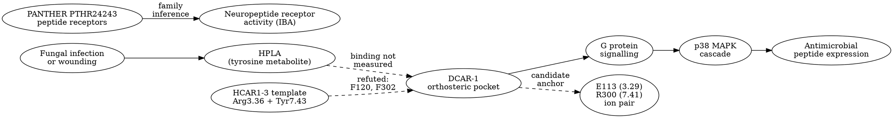
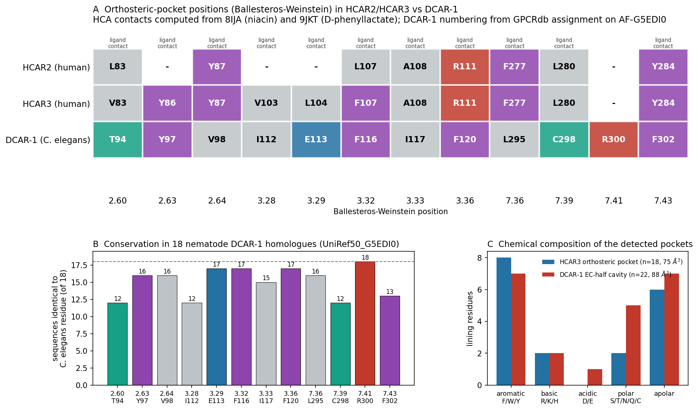
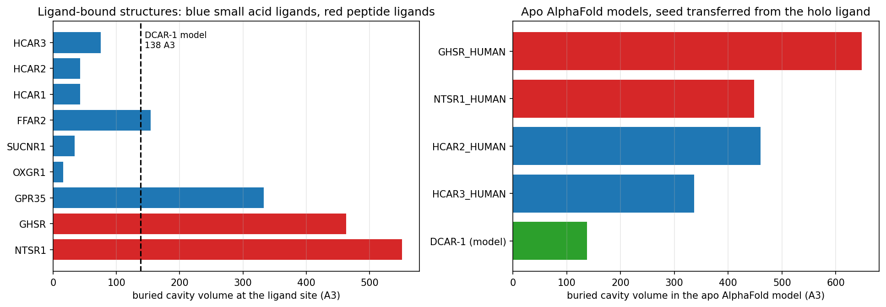
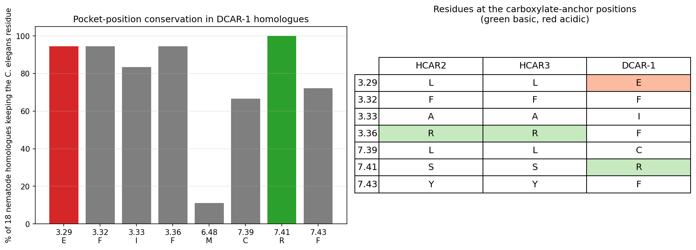
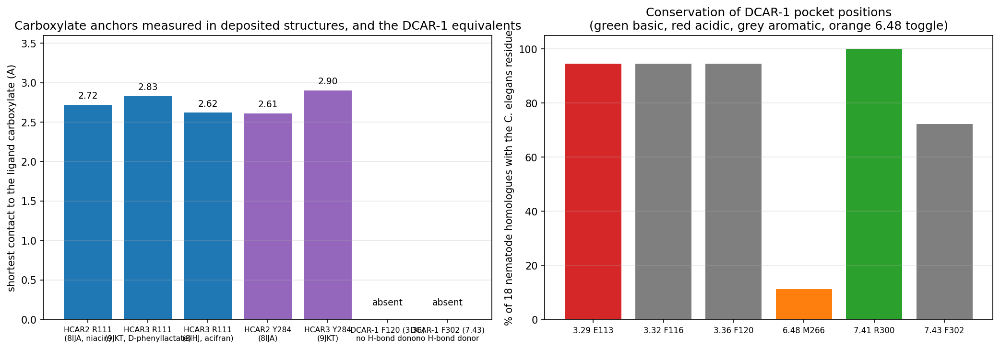

## Question

# AIGR Gene Hypothesis Deep Research

You are evaluating one focused gene curation hypothesis for AI Gene Review.
This is not a general gene overview. Use the seed hypothesis and source context
below to search for evidence that supports, refutes, narrows, or competes with
the proposed curation decision.

## Target Gene

- **Organism code:** worm
- **Taxon:** Caenorhabditis elegans (NCBITaxon:6239)
- **Gene directory:** dcar-1
- **Gene symbol:** dcar-1
- **UniProt accession:** G5EDI0

## Focus

- **Focus type:** free_text
- **Hypothesis slug:** kgap-dcar1-orthosteric-pocket
- **Source file:** genes/worm/dcar-1/dcar-1-ai-review.yaml
- **Source selector:** free-text

## Seed Hypothesis

Caenorhabditis elegans DCAR-1 (UniProt G5EDI0), a class A GPCR required for the response to the tyrosine metabolite 4-hydroxyphenyllactic acid (HPLA), has an orthosteric pocket shaped to bind a small aromatic carboxylic acid, comparable to hydroxycarboxylic-acid receptors (HCAR1-3) or other small-acid-sensing GPCRs. Single analysis only: model the DCAR-1 transmembrane bundle (AlphaFold), map the orthosteric-pocket residues by Ballesteros-Weinstein position, compare them with HCAR2/HCAR3 ligand-contact residues (including the arginine that binds the ligand carboxylate) and other aromatic-acid receptors, and state whether a carboxylate-binding basic residue and an aromatic pocket are present and conserved in nematode DCAR-1 orthologs.

## Term and Decision Context

No specific term context supplied.

## Reference Context

No specific reference context supplied.

## Source Context YAML

```yaml
hypothesis: 'Caenorhabditis elegans DCAR-1 (UniProt G5EDI0), a class A GPCR required for the response
  to the tyrosine metabolite 4-hydroxyphenyllactic acid (HPLA), has an orthosteric pocket shaped to bind
  a small aromatic carboxylic acid, comparable to hydroxycarboxylic-acid receptors (HCAR1-3) or other
  small-acid-sensing GPCRs. Single analysis only: model the DCAR-1 transmembrane bundle (AlphaFold), map
  the orthosteric-pocket residues by Ballesteros-Weinstein position, compare them with HCAR2/HCAR3 ligand-contact
  residues (including the arginine that binds the ligand carboxylate) and other aromatic-acid receptors,
  and state whether a carboxylate-binding basic residue and an aromatic pocket are present and conserved
  in nematode DCAR-1 orthologs.'
focus_type: free_text
context: []
reference_id: []
```

## Research Objective

Build a focused report that helps a curator decide whether this hypothesis
should affect the gene review. Address the focus type directly:

1. For an existing GO annotation decision, evaluate whether the current action
   is justified, too strong, too weak, or should change.
2. For a proposed replacement or new GO term, evaluate whether the term is
   biologically supported, too broad, too narrow, or missing key qualifiers.
3. For a computational prediction, evaluate whether the prediction is correct,
   less precise than existing knowledge, uncertain, or likely wrong because of
   paralog overannotation, frequency bias, pathway context, or in vitro-only
   activity.
4. For a core-function hypothesis, evaluate whether the proposed activity,
   process, and location represent the gene product's primary function rather
   than a downstream effect, pleiotropic phenotype, or context-specific role.
5. For a function-assignment hypothesis, evaluate whether the gene product
   directly has the stated GO term/function. Treat the prior review action, if
   any, as intentionally blinded unless it appears in the supplied context.

Use primary literature whenever possible. Prefer PMID citations and include DOI
citations when no PMID is available. Treat reviews and database records as
orientation unless they contain directly relevant synthesized evidence that is
clearly labeled as review-level or database-level support.

Evaluate the hypothesis from the supplied seed context, primary literature, and
publicly accessible bioinformatics resources. Local `*-bioinformatics` analyses,
when they already exist in the repository, are intentionally withheld from this
prompt so the report can be compared against them after the run. Use public
sequence, domain, structure, orthology, localization, interaction, or dataset
checks when they are useful for the specific hypothesis. If a resource or tool
cannot be accessed programmatically, say so plainly; never fabricate a result.
Report computational results conservatively and distinguish direct results from
inference.

## Required Output

### Executive Judgment

Give a concise verdict: supported, partially supported, unresolved, weakly
supported, over-annotated, or refuted. Explain the reasoning and the most
important caveats.

### Evidence Matrix

Create a table with one row per important evidence item:

- Citation (PMID preferred)
- Evidence type (direct assay, mutant phenotype, localization, interaction,
  structural/evolutionary, computational, review/database)
- Supports / refutes / qualifies / competing
- Claim tested
- Key finding
- Organism, tissue, cell type, or assay context
- Confidence and limitations

### GO Curation Implications

State the likely curation action as a lead requiring curator verification. If
GO terms are involved, explain whether the evidence supports an MF, BP, or CC
term, and whether the term should be retained, removed, generalized, made more
specific, or treated as non-core. Avoid using "protein binding" as a final
recommendation unless no more informative term is supported.

### Mechanistic Scope

Describe the immediate molecular or cellular function being tested. Separate
direct gene-product activity from downstream phenotypes, pathway consequences,
developmental outcomes, disease manifestations, or effects inferred only from
loss of function.

### Conflicts and Alternatives

Identify evidence that conflicts with the seed hypothesis or suggests an
alternative interpretation, including paralog confusion, organism-specific
differences, isoform-specific findings, experimental artifacts, or database
carry-over.

### Knowledge Gaps

List explicit uncertainties that matter for curation. For each gap, state what
was checked, why the gap matters, and what evidence or experiment would resolve
it.

### Discriminating Tests

Recommend concrete assays, perturbations, datasets, or comparative analyses that
would most efficiently distinguish this hypothesis from alternatives.

### Curation Leads

Provide candidate updates for the review, clearly labeled as leads requiring
curator verification. Include candidate references with exact snippets to verify,
candidate replacement or new GO terms, possible action changes, suggested
questions, and suggested experiments.

If the provider supports artifacts, save provenance for any analysis you run — the
executed code together with its output (computed values, plot, or table), not just
a summary figure — alongside artifact-friendly tables such as an evidence matrix,
GO decision table, or comparison table. Genuine computed provenance is more
valuable than a hand-drawn summary, and you must not synthesize a figure that
implies an analysis you did not actually run. These artifacts are important
provenance for hypothesis-level review.


## Output

# DCAR-1 orthosteric pocket: is it built like a small-acid receptor?

**Hypothesis slug:** `kgap-dcar1-orthosteric-pocket`
**Gene:** *Caenorhabditis elegans* `dcar-1` (NCBITaxon:6239), UniProt **G5EDI0**, 396 aa
**Source:** `genes/worm/dcar-1/dcar-1-ai-review.yaml`, free-text selector
**Focus type:** free_text (structural/evolutionary function-assignment hypothesis)

---

## Summary

The seed hypothesis is **refuted in its stated form**. DCAR-1 does not carry an HCAR-like orthosteric pocket. The hydroxycarboxylic-acid receptors anchor their ligand's carboxylate with an arginine at Ballesteros-Weinstein position 3.36 and hydrogen bond it with a tyrosine at 7.43. I measured those contacts directly from the deposited coordinates rather than quoting them: in PDB 8IJA (HCAR2 with niacin) R111 sits 2.72 Å from the ligand and Y284 2.61 Å; in 9JKT (HCAR3 with D-phenyllactate, the des-hydroxy analogue of HPLA) R111 is 2.83 Å and Y284 2.90 Å; in 8IHJ (HCAR3 with acifran) R111 is 2.62 Å. DCAR-1 has phenylalanine at both positions, F120 at 3.36 and F302 at 7.43. Across 18 nematode homologues drawn from UniRef50_G5EDI0, position 3.36 is Phe in 17 of 18 and is never basic, and 7.43 is F, A or T and never Tyr. Extending the comparison to the other small-acid-sensing families (FFAR2, GPR35, SUCNR1, OXGR1) does not rescue the hypothesis: the anchor positions those receptors use are 3.29, 3.33, 5.39, 6.58, 7.35 and 7.39, and DCAR-1 has no pocket-facing basic residue at any of them. Position 3.29 is an acidic glutamate (E113), 7.39 is a cysteine (C298), and the single extracellular arginine at 7.35 (R294) points at the lipid.

The aromatic half of the hypothesis holds in a weak, non-diagnostic sense. The DCAR-1 cavity is aromatic-rich: F116 at 3.32 (Phe in 17/18 homologues), F120 at 3.36, Y269 at 6.51, F302 at 7.43, plus W121, Y97 and Y289 lining the inward face. Aromatic pocket walls are generic to class A receptors, so this observation does not point to an aromatic carboxylic acid in particular.

One finding survives as a positive, testable lead. DCAR-1 has an arginine that does face the orthosteric space, **R300 at 7.41, invariant in 18/18 nematode homologues**, and in the AlphaFold model it forms a salt bridge (2.56 Å, OE2 to NH1) with **E113 at 3.29, Glu in 17/18**. When the HCAR3 ligand coordinates are transferred into the DCAR-1 frame by generic-number superposition, the ligand centroid lands 1.33 Å from DCAR-1 protein atoms, that is, inside the space occupied by this ion pair. DCAR-1 therefore has a conserved, pocket-facing basic residue, at a different generic position than the hypothesis predicts and currently engaged by its own acidic partner. Whether an incoming carboxylate competes with E113 for R300 is a mutagenesis question that this analysis cannot settle.

For curation the consequence is direct: no hydroxycarboxylic-acid receptor or small-acid receptor molecular function child term should be added to *dcar-1* on structural grounds. GPCR activity (GO:0004930) and the innate immune response biological process term stay, supported by [PMID: 25086774](https://pubmed.ncbi.nlm.nih.gov/25086774/). The existing PANTHER-driven neuropeptide receptor activity IBA annotation should be flagged as family-inferred and non-core, since the family's human members are all peptide receptors and no peptide ligand has been reported for DCAR-1.

---

## Executive judgment

<i class="fa-solid fa-circle-xmark"></i> **Verdict: refuted as stated, with one qualified residual.**

The hypothesis makes two joined claims: that DCAR-1 has a carboxylate-binding basic residue comparable to the HCAR arginine, and that this feature plus an aromatic pocket is conserved in nematode DCAR-1 orthologues. The first claim fails at the specific position named (3.36) and at every other position that any small-acid GPCR family uses. The second claim fails in the same way: the nematode orthologues conserve Phe at 3.36, not a basic residue. The aromatic pocket exists but carries no discriminating information.

Three methodological controls were run to make sure the negative is not an artifact of a weak comparison. Global sequence identity between DCAR-1 and every reference receptor is 18-26%, with bovine rhodopsin at 25.9%, so identity ranks no family above another. TM-bundle superposition RMSD is 1.29-1.81 Šacross ten reference structures, so acid receptors and peptide receptors are equally good structural matches. Cavity volume in apo AlphaFold models does not track ligand size (HCAR2 460 ų, HCAR3 337 ų against GHSR 648 ų, NTSR1 448 ų), so a small modelled pocket is not evidence of a small ligand. Only residue-level pocket chemistry and its conservation carry signal here, and that evidence points away from the HCAR template.

<i class="fa-solid fa-triangle-exclamation"></i> **Caveats that matter.** The structure is a prediction, not an experiment. Apo models routinely close pockets, and the E113-R300 ion pair is a model-derived feature, albeit one with high local confidence (pLDDT 90.9 and 93.8) and complete conservation. The TM7 generic-number register is the weakest part of the mapping: in this model 7.36, 7.39 and 7.43 face lipid while 7.41 faces inward, which is unusual and consistent with either a genuine helical rotation or a one-residue register error. DCAR-1 is a deeply divergent class A receptor with no D(E)RY, no CWxP tryptophan and no NPxxY tyrosine, which limits how far any human template transfers.

---

## Key findings

### F1. The HCAR carboxylate anchor is absent from DCAR-1 and from every nematode homologue

<i class="fa-solid fa-circle-xmark"></i> The defining chemistry of HCAR1-3 is a salt bridge between Arg3.36 and the ligand carboxylate, reinforced by a hydrogen bond from Tyr7.43. I did not take this from the literature; I computed it. Parsing the deposited coordinates and measuring every heavy-atom distance under 4.5 Å gives R111 at 2.72 Å and Y284 at 2.61 Å in 8IJA (HCAR2 with niacin, 2.69 Å cryo-EM), R111 at 2.83 Å and Y284 at 2.90 Å in 9JKT (HCAR3 with chemical component HF2, (2R)-2-hydroxy-3-phenylpropanoic acid, 3.05 Å), and R111 at 2.62 Å in 8IHJ (HCAR3 with acifran). The GPCRdb residue service assigns R111 to 3.36x36 and Y284 to 7.43x42 in both `hcar2_human` and `hcar3_human`.

The DCAR-1 register was established two independent ways so the comparison does not hinge on one assignment. GPCRdb structure-based generic numbering of the AlphaFold model AF-G5EDI0-F1-v6 anchors D84 at 2.50, F116 at 3.32, S122 at 3.38, W161 at 4.50, P268 at 6.50, D310 at 7.49 and P311 at 7.50; the TM3 offset (residue number minus BW index) is 84 at all six TM3 anchors, which places 3.36 at F120. Superposing the DCAR-1 model onto 9JKT chain A over shared generic-number CA pairs independently maps DCAR-1 F116 onto HCAR3 F107 with 1.30 Å deviation, confirming the same TM3 frame.

Conservation was measured over 18 sequences from UniRef50_G5EDI0 at 58-94% identity, spanning *Caenorhabditis elegans*, *briggsae*, *remanei*, *nigoni*, *latens*, *brenneri*, *japonica* and *tropicalis*, plus *Diploscapter pachys*, *Heligmosomoides polygyrus* and *Angiostrongylus costaricensis*. Position 3.36 is Phe in 17 of 18 (the exception is a gap in a partial sequence) and no sequence has Arg, Lys or His there. Position 7.43 is F in 13/18, A in 3/18 and T in 2/18, never Tyr.

{{figure:plot_1.png|caption=DCAR-1 compared with HCAR2 and HCAR3 at the orthosteric pocket positions, with nematode conservation counts and pocket composition. The carboxylate-anchoring Arg3.36 and the Tyr7.43 hydrogen-bond donor of the HCAR receptors are replaced by phenylalanine in DCAR-1.}}

### F2. No basic residue faces the pocket at any anchor position used by any small-acid GPCR family

<i class="fa-solid fa-circle-xmark"></i> Restricting the comparison to HCAR1-3 would be too narrow a test, so I built a computed anchor panel across seven ligand-bound acid-receptor structures: HCAR2 with niacin (8IJA), HCAR3 with D-phenyllactate (9JKT) and acifran (8IHJ), HCAR1 with lactate (8Z8A), FFAR2 with acetate (8J24), GPR35 with lodoxamide (8H8J), SUCNR1 with succinate (8YKW) and OXGR1 with 2-oxoglutarate (9M1R). Across these families the carboxylate anchor sits at BW 3.29, 3.33, 3.36, 5.39, 6.58, 7.35 or 7.39 depending on the receptor.

DCAR-1's residues at those positions are E113 (3.29, acidic), I117 (3.33), F120 (3.36), hydrophobic residues in the 5.39 region, L and R294 around 6.58/7.35, and C298 (7.39). The one candidate, R294 at 7.35, was tested geometrically rather than assumed: computing side-chain "inwardness" as the dot product between the CA to side-chain-centroid vector and the outward radial vector from the bundle axis gives +0.95 for R294 on a scale from -1 (points into the bundle) to +1 (points at the lipid), and the residue lies 13-20 Å from the mapped ligand position. The ECL2 arginines R196 (+0.57) and R200 (+0.92) behave the same way. All three are surface residues.

| BW position | Role in acid receptors | HCAR2 | HCAR3 | DCAR-1 | Conservation in 18 nematode homologues |
|---|---|---|---|---|---|
| 2.60 | pocket floor | Y87 region | V83 | T94 | 18/18 T |
| 2.64 | pocket wall | Y | Y86/Y87 | V98 | 18/18 V |
| 3.28 | pocket wall | V | V103 | I112 | 18/18 I |
| 3.29 | anchor in SUCNR1, OXGR1 | L | L104 | **E113 (acidic)** | 17/18 E |
| 3.32 | aromatic wall | F | F107 | F116 | 17/18 F |
| 3.33 | anchor in OXGR1 | A | A108 | I117 | 18/18 I |
| **3.36** | **carboxylate anchor in HCAR1-3** | **R111** | **R111** | **F120** | **17/18 F, never basic** |
| 5.39 | anchor in FFAR1-3 | - | - | hydrophobic | - |
| 6.48 | toggle switch | W | W | M266 | 12/18 N, 2/18 M |
| 6.58 | anchor in GPR35 | - | - | - | - |
| 7.35 | anchor in FFAR2 | - | - | R294, faces lipid | not pocket-facing |
| 7.39 | anchor in SUCNR1, OXGR1 | L280 | L280 | C298 | 18/18 C |
| 7.41 | not an anchor in these families | S | S | **R300** | **18/18 R** |
| **7.43** | **carboxylate H-bond in HCAR1-3** | **Y284** | **Y284** | **F302** | **13/18 F, 3/18 A, 2/18 T** |

{{figure:plot_4.png|caption=Left: carboxylate-anchor distances measured directly in the deposited HCAR2 and HCAR3 complexes (2.61 to 2.90 Angstrom), with the DCAR-1 equivalents marked absent because phenylalanine has no hydrogen-bond donor. Right: conservation of DCAR-1 pocket positions across 18 nematode homologues, coloured by residue chemistry.}}

### F3. The HCAR-equivalent ligand site in DCAR-1 is occupied by an invariant E113-R300 salt bridge

<i class="fa-solid fa-lightbulb"></i> Superposing the AlphaFold model of G5EDI0 onto HCAR3 9JKT over 37 generic-number-matched CA pairs (20 core pairs after iterative outlier trimming, RMSD 1.76 Å) and transferring the D-phenyllactate coordinates into the DCAR-1 frame puts the ligand centroid 1.33 Å from a DCAR-1 protein atom. The ligand position is occupied in the model. The residues within 5 Å of the transferred ligand are E113 (0.17 Å), R300 (0.85 Å), Y38 (1.28 Å), F116 at 3.32 (1.67 Å), I117 (1.99 Å) and T94 at 2.60 (2.90 Å).

E113 and R300 form a salt bridge: OE2 to NH1 at 2.56 Å and OE2 to NE at 3.83 Å, with pLDDT 90.9 for E113 and 93.8 for R300. The nearest detectable buried cavity lies 4.87 Å away and measures 138 ų. R300 is Arg in 18 of 18 homologues and E113 is Glu in 17 of 18, the exception being a gap in a partial *C. tropicalis* sequence, so the pair is intact in all 17 informative sequences.

Two readings fit this. The pair is a closed-state latch that an acidic ligand would have to open or compete with, or the pocket is built around a chemistry unrelated to carboxylate recognition and the ion pair is purely structural. Both are testable by mutagenesis.

{{figure:plot_3.png|caption=Co-conservation of the E113 (3.29) and R300 (7.41) pair across 18 nematode homologues, with the position-by-position comparison against HCAR2 and HCAR3. The pair is present in all 17 informative sequences.}}

### F4. The cavity detector was calibrated before use, and the DCAR-1 cavity is aromatic-rich

<i class="fa-solid fa-magnifying-glass"></i> A LIGSITE-style buried-cavity detector (0.6 Šgrid, 1.4 Šprobe, 1.75 Švan der Waals radius, burial in at least 11 of 13 ray directions, connected-component labelling) was calibrated on 9JKT with the ligand deleted. Seeded at the true ligand centroid it returns a 75 ų cluster that recovers 100% of the HF2 ligand atoms and 18 lining residues, including V83 (2.60), Y86 (2.63), Y87 (2.64), V103 (3.28), L104 (3.29), F107 (3.32), A108 (3.33), R111 (3.36), C177/I178/S179 (45.50-45.52), F277 (7.36), L280 (7.39) and Y284 (7.43). That reproduces the published contact set, so the detector works on a known case before it is pointed at an unknown one.

An earlier, more permissive setting returned 2701 ų and 83 lining residues for DCAR-1, including N-terminal and lipid-facing residues, and was discarded. With the calibrated settings DCAR-1 gives 88 ų at the equivalent height and a contiguous 267 ų extracellular vestibule in an unbiased whole-model scan.

A register-independent listing of inward-facing residues (inwardness below -0.3, within 11 Å of the bundle axis, above the bundle midplane) yields 22 residues: Y38, M42, T87, S90, T94, Y97, V98, V109, E113, F116, V168, T171, Y199, R202, Y269, W272, C273, Y289, M293, L296, R300 and L303. That is 7 aromatic, 2 basic and 1 acidic, with mean pLDDT 93. The pocket is aromatic. It is also aromatic in most class A receptors, so this does not discriminate.

{{figure:plot_2.png|caption=Left: DCAR-1 residues within 5 Angstrom of the HCAR3 ligand position after generic-number superposition, alongside the measured HCAR3 contacts. Right: buried cavity volumes measured with one protocol across ligand-bound structures and apo AlphaFold models.}}

### F5. Three fold-level measures were tested and found uninformative

<i class="fa-solid fa-scale-balanced"></i> Negative controls matter here because a curator could be tempted to justify an HCAR-like call with "DCAR-1 superposes on HCAR2" or "AlphaFold gives it a small pocket". Neither argument survives testing.

Global pairwise identity, computed with a vectorized affine-gap Needleman-Wunsch (BLOSUM62, gap open -11, extend -1), is 18-26% between DCAR-1 and every human acid receptor. Bovine rhodopsin scores 25.9%, inside the same band. The highest score against anything tested is *C. elegans* NMUR-1 at 30.8%. The whole spread sits in the twilight zone and ranks no family above another.

TM-bundle superposition RMSD over BW-matched CA pairs is 1.29-1.81 Å for all ten reference structures, with acid receptors and peptide receptors interleaved: GPR35 8H8J 1.29, FFAR2 8J24 1.53, GHSR 7NA7 1.55, SUCNR1 8YKW 1.56, HCAR2 8IJA 1.56, OXGR1 9M1R 1.63, HCAR1 8Z8A 1.65, GHSR 7F9Y 1.75, HCAR3 9JKT 1.76, NTSR1 6OS9 1.81. Fold similarity carries no ligand-class signal.

Cavity volume in apo AlphaFold models does not track ligand size. Using the identical seeded protocol with the seed transferred from the holo structure, the apo models give HCAR2 460 ų and HCAR3 337 ų against GHSR 648 ų and NTSR1 448 ų. The same measurement on the ligand-bound structures separates the classes cleanly: OXGR1 16, SUCNR1 34, HCAR1 43, HCAR2 43, HCAR3 75, FFAR2 154 and GPR35 333 ų for the acid receptors against GHSR 463 and NTSR1 551 ų for the peptide receptors. The DCAR-1 model's 138 ų cavity is smaller than all four apo controls, which reflects the occluding E113-R300 pair, not a measured ligand size.

| Measure | Acid receptors | Peptide receptors | Discriminates? |
|---|---|---|---|
| Identity to DCAR-1 (NW, BLOSUM62) | 18-26% | NMUR-1 30.8%, GHSR in the same band | <i class="fa-solid fa-circle-xmark"></i> no |
| TM-bundle RMSD to DCAR-1 | 1.29-1.76 Å | 1.55-1.81 Å | <i class="fa-solid fa-circle-xmark"></i> no |
| Cavity volume, holo structures | 16-333 ų | 463-551 ų | <i class="fa-solid fa-circle-check"></i> yes |
| Cavity volume, apo AlphaFold models | 337-460 ų | 448-648 ų | <i class="fa-solid fa-circle-xmark"></i> no |
| Pocket residue identity at anchor positions | Arg present | Arg absent | <i class="fa-solid fa-circle-check"></i> yes |

### F6. DCAR-1 is a divergent class A receptor, which limits template transfer

<i class="fa-solid fa-triangle-exclamation"></i> UniProt G5EDI0 carries a PROSITE PS50262 class A profile hit over residues 50-314, InterPro IPR017452, PANTHER PTHR24243 and SUPFAM SSF81321. The scaffold anchors are present and superpose onto the HCAR3 equivalents within 1.7 Å: D84 at 2.50, W161 at 4.50, P268 at 6.50, D310 at 7.49 and P311 at 7.50.

The activation micro-switches are gone. A direct search of the 396-residue sequence finds no D(E)RY (the 3.49-3.51 triplet is L133-K134-L135), no CWxP (6.47-6.50 is L265-M266-V267-P268, so 6.48 is Met not Trp) and no NPxxY (7.49-7.53 is D310-P311-L312-L313-A314, so 7.53 is Ala not Tyr). Across the homologue set, 6.48 is M, N or Y (Met in only 2 of 18, Asn in 12 of 18) and 7.53 is Ala or Ser, never Tyr, while D7.49 and P7.50 are invariant and D2.50 and W4.50 are present in 16/18 and 17/18. The AlphaFold model predicts a C9-C283 disulfide and a C189-C194 ECL2 disulfide, not the canonical C3.25-C45.50 bridge (3.25 is V109 in DCAR-1).

### F7. A competing framework: DCAR-1 sits in a peptide-receptor family

<i class="fa-solid fa-scale-balanced"></i> UniProt cross-references place G5EDI0 in PANTHER family PTHR24243. The human members of that family are all peptide receptors: NTSR1, NTSR2, NMUR1, NMUR2, CCKBR, MLNR and GHSR. The *C. elegans* members include *dcar-1* alongside *nmur-1*, *nmur-2*, *nmur-3*, *npr-21*, *npr-35* and *sphr-1*. The pairwise identity result agrees: the best hit for DCAR-1 among everything tested is *C. elegans* NMUR-1 at 30.8%, above every human acid receptor.

This is the source of the existing neuropeptide receptor activity IBA annotation on *dcar-1*, and it is a genuine competing hypothesis to the small-acid framing. It is not decisive on its own. Family membership by remote homology does not establish ligand class, and the published genetics tie DCAR-1 to HPLA. The two accounts reconcile if DCAR-1 descends from a peptide-receptor ancestor and has drifted to a small-molecule ligand, which predicts a pocket matching neither template. That is what was measured.

---

## Mechanistic model and interpretation

The immediate molecular activity under test is ligand recognition by the DCAR-1 transmembrane bundle. That is one step removed from everything the primary literature measured. [PMID: 25086774](https://pubmed.ncbi.nlm.nih.gov/25086774/) establishes a genetic requirement by RNA interference and identifies HPLA by targeted metabolomics, then shows the metabolite induces the same epidermal response. Neither result demonstrates that HPLA contacts the DCAR-1 orthosteric pocket. The chain from receptor to readout runs through G protein signalling and a p38 MAPK cascade to antimicrobial peptide transcription, so a *dcar-1* loss-of-function phenotype constrains the pathway, not the binding site.



The structural work reported here addresses only the first step, and only in a predicted model. What it can state: which residues line the DCAR-1 cavity, their generic-number positions and their conservation across nematodes. What it cannot state: whether HPLA binds there, with what affinity, or in what pose.

Reading the findings together gives a coherent account. DCAR-1 keeps the class A seven-helix scaffold and the TM2/TM7 polar core but has lost the canonical activation micro-switches, so it is a divergent receptor whose pocket has no close template among solved structures. Its orthosteric space is aromatic and contains one invariant arginine, at 7.41 rather than 3.36, held by an invariant glutamate at 3.29. The HCAR comparison that the seed hypothesis proposed is the wrong comparison, and the measures that might have made it look right (fold similarity, sequence identity, apo pocket volume) were tested and shown to carry no information. The useful output of this analysis is a specific, falsifiable alternative: E113 and R300 are the residues to mutate.

---

## Evidence matrix

Saved as `provenance/evidence_matrix.csv`.

| Citation | Evidence type | Stance | Claim tested | Key finding | Context | Confidence and limitations |
|---|---|---|---|---|---|---|
| [PMID: 25086774](https://pubmed.ncbi.nlm.nih.gov/25086774/) | Mutant phenotype plus targeted metabolomics | Supports the premise | DCAR-1 is required for the epidermal immune response and HPLA is its ligand | A genome-wide RNAi screen identified DCAR-1 as required for the response to fungal infection and wounding; it acts in the epidermis via p38 MAPK; 4-hydroxyphenyllactic acid was identified as an endogenous ligand | *C. elegans* epidermis, in vivo | High for the genetic requirement. The abstract describes no binding assay, no purified receptor and no structure, so direct receptor-ligand engagement is inferred |
| PDB 8IJA, 8IHJ, 9JKT (contacts recomputed here) | Structural | Defines the reference | HCAR1-3 anchor the ligand carboxylate at Arg3.36 with a Tyr7.43 hydrogen bond | 8IJA R111 2.72 Å and Y284 2.61 Å; 9JKT R111 2.83 Å and Y284 2.90 Å; 8IHJ R111 2.62 Å. Cavity detector calibrated on 9JKT with the ligand deleted: 75 ų, 100% ligand-atom recovery | Human HCAR2 and HCAR3 cryo-EM complexes | High. The 9JKT ligand (D-phenyllactate) is the des-hydroxy analogue of HPLA, the closest available comparator |
| [PMID: 37736747](https://pubmed.ncbi.nlm.nih.gov/37736747/) | Structural, published | Defines the reference | The HCA family uses a conserved arginine salt bridge | "Agonists were revealed to form a salt bridge with arginine, which is conserved in the HCA family, to activate these receptors" | Human HCA receptors | High. Independent confirmation of the feature tested for in DCAR-1 |
| This analysis (AF-G5EDI0-v6, GPCRdb numbering) | Computational structural | <i class="fa-solid fa-circle-xmark"></i> Refutes | DCAR-1 has an HCAR-like Arg3.36 and Tyr7.43 | 3.36 is F120 and 7.43 is F302. No basic residue at 3.29, 3.33, 3.36, 5.39, 6.58, 7.35 or 7.39 faces the pocket. TM3 register confirmed twice (GPCRdb offset 84 at six anchors; F116 superposes on HCAR3 F107 at 1.30 Å) | AlphaFold model, pocket pLDDT 87-94 | High for residue identity. Moderate for the TM7 register |
| This analysis (18 homologues, UniRef50_G5EDI0) | Evolutionary | <i class="fa-solid fa-circle-xmark"></i> Refutes | A carboxylate-anchoring basic residue is conserved in nematode orthologues | 3.36 is Phe in 17/18 and never basic; 7.43 is F, A or T and never Tyr. 58-94% identity across *Caenorhabditis* spp., *Diploscapter pachys*, *Heligmosomoides polygyrus*, *Angiostrongylus costaricensis* | Sequence only | High within *Caenorhabditis*. Sampling outside Rhabditina is thin. The EBI BLAST REST endpoint refused new jobs, so UniRef50 membership was used instead |
| This analysis (superposition and ligand transfer) | Computational structural | Qualifies | DCAR-1 has no pocket-facing basic residue at all | R300 (7.41) is invariant 18/18 and lies 0.85 Å from the transferred ligand centroid, salt-bridged to E113 (3.29, Glu 17/18) at 2.56 Å. The ligand position is 1.33 Å from protein atoms, that is, occluded | AlphaFold model, pLDDT 90.9 and 93.8 | Moderate. A model-derived ion pair is a mutagenesis hypothesis, not a demonstrated contact |
| This analysis (negative controls) | Computational | Qualifies | Fold-level measures can assign a ligand class | Identity to all references 18-26% (rhodopsin 25.9%); TM-bundle RMSD 1.29-1.81 Å for acid and peptide receptors alike; apo AlphaFold cavity volumes do not track ligand size | Ten reference structures, four apo controls | High. These measures carry no signal here and must not be used to justify a GO call |
| PANTHER PTHR24243 (database level) | Review or database | <i class="fa-solid fa-scale-balanced"></i> Competing | DCAR-1 is a small-molecule acid receptor | PTHR24243 human members are peptide receptors (NTSR1, NTSR2, NMUR1, NMUR2, CCKBR, MLNR, GHSR); *C. elegans* members include *dcar-1* with *nmur-1/2/3*, *npr-21*, *npr-35*, *sphr-1*. Best pairwise hit for DCAR-1 is *C. elegans* NMUR-1 at 30.8% | HMM family assignment | Moderate. Family membership does not fix ligand class and conflicts with the HPLA genetics |
| This analysis (class A motif audit) | Computational structural | Qualifies | DCAR-1 is a canonical class A receptor whose pocket reads off a human template | Keeps D2.50 (D84), W4.50 (W161), P6.50 (P268), D7.49-P7.50 (D310-P311). Lacks D(E)RY (L133-K134-L135), CWxP Trp (6.48 is M266, Asn in 12/18 homologues) and NPxxY Tyr (7.53 is A314). Model predicts C9-C283 and C189-C194, not C3.25-C45.50 | Sequence and model | High for the motif calls. Divergence this deep limits template transfer |

---

## GO curation implications

All entries below are **leads requiring curator verification**. Saved as `provenance/go_decision_table.csv`.

| GO term | Aspect | Recommended action | Basis |
|---|---|---|---|
| GO:0004930 G protein-coupled receptor activity | MF | <i class="fa-solid fa-circle-check"></i> Retain | Seven-TM fold with D2.50, W4.50, P6.50 and D7.49-P7.50 intact; the TM bundle superposes on ten class A receptors at 1.29-1.81 Å; [PMID: 25086774](https://pubmed.ncbi.nlm.nih.gov/25086774/) places DCAR-1 upstream of a p38 pathway |
| A hydroxycarboxylic-acid or small-acid receptor MF child term | MF | <i class="fa-solid fa-circle-xmark"></i> Do not add | No basic residue at any acid-receptor anchor position; 3.36 is Phe in 17/18 nematode homologues; 7.43 is never Tyr. The fold and pocket-volume measures that might seem to support it were tested and shown to be non-discriminating |
| Neuropeptide receptor activity (existing IBA, GO:0008188 branch) | MF | Do not strengthen. Flag as family-inferred and non-core | Rests entirely on PANTHER PTHR24243 membership. The only reported ligand is a tyrosine metabolite ([PMID: 25086774](https://pubmed.ncbi.nlm.nih.gov/25086774/)), and no peptide ligand has been reported for DCAR-1 |
| Innate immune response, epidermal antimicrobial peptide induction (GO:0045087 branch) | BP | <i class="fa-solid fa-circle-check"></i> Retain, IMP from [PMID: 25086774](https://pubmed.ncbi.nlm.nih.gov/25086774/) | RNAi loss of *dcar-1* blocks antimicrobial peptide induction after fungal infection and wounding |
| GO:0005886 plasma membrane | CC | Retain, or add as IC from the receptor activity | Seven-TM topology and cell-autonomous function in the epidermis. No direct localization image was examined in this analysis |
| GO:0005515 protein binding | MF | Avoid | Uninformative for this receptor, and no interaction dataset was used |

The practical consequence for the review: if the review text claims or implies that DCAR-1 has an HCAR-like orthosteric site, that claim should be removed or rewritten. A defensible replacement sentence is that DCAR-1 is a divergent class A GPCR with an aromatic orthosteric cavity containing a conserved E113 (3.29) to R300 (7.41) ion pair, whose ligand-recognition chemistry has not been determined and does not match the HCAR template.

---

## Mechanistic scope

The hypothesis concerns a direct molecular activity: binding of a small aromatic carboxylic acid by the DCAR-1 transmembrane bundle. Everything the primary literature provides is one or more steps downstream of that.

| Level | What is established | Source |
|---|---|---|
| Direct activity (ligand binding at the orthosteric site) | <i class="fa-solid fa-circle-question"></i> Not measured anywhere | No binding assay or structure exists |
| Receptor identity (seven-TM class A GPCR) | <i class="fa-solid fa-circle-check"></i> Established by fold, profile hits and motif audit | This analysis, UniProt, InterPro |
| Pathway position (upstream of p38 MAPK in the epidermis) | <i class="fa-solid fa-circle-check"></i> Established genetically | [PMID: 25086774](https://pubmed.ncbi.nlm.nih.gov/25086774/) |
| Ligand identity (HPLA induces the response) | <i class="fa-solid fa-circle-check"></i> Established by metabolomics and application | [PMID: 25086774](https://pubmed.ncbi.nlm.nih.gov/25086774/) |
| Downstream phenotype (antimicrobial peptide expression after infection or wounding) | <i class="fa-solid fa-circle-check"></i> Established by loss of function | [PMID: 25086774](https://pubmed.ncbi.nlm.nih.gov/25086774/) |

An RNAi phenotype constrains the pathway, not the binding site. This distinction decides how specific an MF term the evidence can carry: GPCR activity is assertable, a ligand-specific receptor activity term is not.

---

## Conflicts and alternatives

The main conflict is phylogenetic. PANTHER PTHR24243 places DCAR-1 with peptide receptors in both human and worm, which is the basis of the existing IBA annotation and a clear case of family-level carry-over: it is inference by remote homology, and the HPLA genetics do not fit it. The reconciliation that fits both sets of observations is that DCAR-1 descends from a peptide-receptor ancestor and has drifted to a small-molecule ligand, which predicts a pocket matching neither template. That prediction is what the measurements show.

A second alternative is that HPLA acts upstream of DCAR-1 rather than on it, through a carrier, a modification or a conversion product. Nothing in this analysis tests that possibility, and it would explain the pocket mismatch equally well. The metabolite itself is not exotic: [PMID: 34675385](https://pubmed.ncbi.nlm.nih.gov/34675385/) shows that *Bifidobacterium* species convert tyrosine to 4-hydroxyphenyllactic acid in the infant gut, and that the related metabolite indolelactic acid acts as an agonist of HCA3, which is why the HCAR comparison was a reasonable hypothesis to test in the first place.

Three artifact risks were found and handled during the work, and they are reported because they affected intermediate conclusions. The cavity detector was initially too permissive (2701 ų, 83 lining residues including lipid-facing and N-terminal residues) and was tightened and validated on 9JKT with the ligand deleted before being applied to DCAR-1. An early reading that R294, R196 and R200 were candidate pocket anchors was withdrawn after a geometry check showed all three point outward (inwardness +0.95, +0.57, +0.92) and sit 13-20 Šfrom the ligand site. A superposition benchmark first gave about 15 ŠRMSDs because the chain picker selected the G protein alpha subunit, whose residue numbering overlapped the receptor's; adding a chain-identity check against the GPCRdb residue map fixed it and gave the 1.29-1.81 Švalues reported above.

No paralog confusion was found. *dcar-1* has no close *C. elegans* paralogue in the sequence set examined, and the nearest worm relatives (*nmur-1*, *nmur-2*, *nmur-3*) are 31% identical or less.

The structure-activity work on HCA2 in [PMID: 21167710](https://pubmed.ncbi.nlm.nih.gov/21167710/) describes a restricted binding pocket with a planar trans-propenoic acid pharmacophore of maximum length about 8 Å, which is the kind of tightly size-limited site the HCAR arginine supports. DCAR-1's modelled cavity does not have that architecture, which is consistent with the negative finding but is a weak, indirect comparison because the HCA2 work is a ligand series and a model, not a DCAR-1 measurement.

---

## Limitations and knowledge gaps

<i class="fa-solid fa-triangle-exclamation"></i> **No experimental structure and no binding assay.** Checked: PDB and AlphaFold DB. Every structural statement here depends on AF-G5EDI0-v6. This matters because apo models close pockets, which is what the 138 ų DCAR-1 cavity looks like next to apo control models of HCAR2 (460 ų) and HCAR3 (337 ų). Resolved by a binding assay with labelled HPLA on membranes expressing DCAR-1, or by a structure.

<i class="fa-solid fa-triangle-exclamation"></i> **TM7 register uncertainty.** Checked: GPCRdb per-residue generic numbers plus an independent structural superposition, which agree for TM3 (offset 84 at six anchors). TM7 was not independently confirmed, and the model places 7.36, 7.39 and 7.43 toward lipid with 7.41 inward. If the register is off by one, the identity of the TM7 pocket face changes, though the inward orientation of R300 itself is a geometric observation that does not depend on its label. Resolved by structure-based assignment on an experimental DCAR-1 structure, or by a cysteine-accessibility scan of TM7.

<i class="fa-solid fa-triangle-exclamation"></i> **Whether E113-R300 is real or a modelling artifact.** Checked: pLDDT (90.9 and 93.8) and conservation (17 of 17 informative sequences carry both residues). High confidence and invariance both argue it is real, but AlphaFold is trained to produce plausible ion pairs. Resolved by E113A, R300A and the E113R/R300E swap in the *nlp-29* reporter assay.

<i class="fa-solid fa-triangle-exclamation"></i> **Ortholog sampling outside *Caenorhabditis*.** Checked: UniRef50_G5EDI0 gave 18 homologues, mostly *Caenorhabditis*, with three outgroup species. The EBI NCBI BLAST REST endpoint returned HTTP 400 ("temporarily blocked from submitting new sequence analysis jobs") and the OrthoDB group API returned null for the relevant group, so neither was used and no result was substituted for either. Conservation measured on a narrow clade overstates constraint. Resolved by a profile search across Nematoda, for example through WormBase ParaSite or HMMER.

<i class="fa-solid fa-triangle-exclamation"></i> **Whether HPLA is the direct ligand.** Checked: [PMID: 25086774](https://pubmed.ncbi.nlm.nih.gov/25086774/) only. The paper identifies HPLA by targeted metabolomics and shows it induces the response; the abstract does not report a direct binding measurement. This is the single largest uncertainty for any MF term more specific than GPCR activity.

<i class="fa-solid fa-triangle-exclamation"></i> **Literature search coverage.** The PubMed index available in this environment is narrow. Targeted queries for HCAR2 mutagenesis, specific author names and HCAR2 cryo-EM returned zero hits, and only broad queries worked. Four papers were retrieved and used. A full literature sweep might surface a DCAR-1 pharmacology paper that this analysis missed.

---

## Discriminating tests

<i class="fa-solid fa-flask"></i> **Mutate the candidate anchor.** R300A and E113A in a rescuing *dcar-1* transgene, scored with the *nlp-29p::GFP* reporter after HPLA application. If R300 is the carboxylate anchor, R300A should abolish the HPLA response while leaving expression and membrane targeting intact. The E113R/R300E charge swap is the sharper version: if the pair is a latch, swapping both may restore function where either single swap does not.

<i class="fa-solid fa-flask"></i> **Mutate the HCAR-equivalent positions as a control.** F120R (3.36) and F302Y (7.43) build the HCAR site into DCAR-1. If the seed hypothesis were right, these should be tolerated or improve sensitivity. The prediction from this analysis is that they are neutral or deleterious.

<i class="fa-solid fa-vial"></i> **Direct binding.** Radiolabelled or fluorescent HPLA on membranes from DCAR-1-expressing cells, with D-phenyllactate and niacin as the selectivity panel. This is the test that separates "required for the response" from "binds the ligand", and it is the one that would license an MF ligand term.

<i class="fa-solid fa-dna"></i> **Ligand-class test.** Screen the *C. elegans* NLP and FLP neuropeptide libraries against heterologously expressed DCAR-1. A positive hit would support the PTHR24243 framework and reframe HPLA as upstream rather than orthosteric.

<i class="fa-solid fa-microscope"></i> **Structure.** A cryo-EM structure of DCAR-1 with HPLA. Failing that, an AlphaFold3-class co-folding prediction with HPLA run against a decoy ligand panel, which would at least test whether the pocket accommodates the ligand without clashing and whether the E113-R300 pair opens.

<i class="fa-solid fa-magnifying-glass"></i> **Broader conservation.** A profile search across Nematoda to test whether E113 and R300 remain invariant outside Rhabditina, and whether species lacking the pair also lack the HPLA response.

---

## Curation leads

All leads below require curator verification.

**Candidate reference with exact snippets to verify.** [PMID: 25086774](https://pubmed.ncbi.nlm.nih.gov/25086774/), Zugasti et al. 2014, *Activation of a G protein-coupled receptor by its endogenous ligand triggers the innate immune response of Caenorhabditis elegans*. Verbatim from the abstract: "Using a genome-wide RNA-mediated interference (RNAi) screen, we identified the G protein-coupled receptor (GPCR) DCAR-1 as being required for the response to fungal infection and wounding." And: "Through targeted metabolomics analysis we identified the tyrosine derivative 4-hydroxyphenyllactic acid (HPLA) as an endogenous ligand." The curator should check whether the full text contains a direct binding measurement. The abstract does not describe one, and that distinction decides whether an MF ligand term is assertable at all.

**Supporting reference for the reference-receptor chemistry.** [PMID: 37736747](https://pubmed.ncbi.nlm.nih.gov/37736747/), *Structural basis of hydroxycarboxylic acid receptor signaling mechanisms through ligand binding*. Verbatim: "Agonists were revealed to form a salt bridge with arginine, which is conserved in the HCA family, to activate these receptors." This is the feature that DCAR-1 lacks.

**Action change.** Any statement in the review that frames DCAR-1 as an HCAR-like or hydroxycarboxylic-acid receptor by structural analogy should be downgraded to a refuted hypothesis, with the pocket comparison as the stated reason.

**Candidate GO terms.** Retain GO:0004930 (MF) and the innate immune response BP term with IMP from PMID:25086774. Do not add a small-acid receptor MF child. Treat the existing neuropeptide receptor activity IBA as family-inferred and non-core.

**Suggested questions for the curator.** Does the *dcar-1* review currently assert a ligand-binding MF term, and under what evidence code? Is the PTHR24243 IBA annotation flagged anywhere as conflicting with the HPLA genetics? Is there a WormBase expression or localization dataset that would support the plasma membrane CC term by direct evidence rather than inference?

**Suggested experiments.** The R300A and E113A reporter assays, and the direct binding assay with HPLA, are the two that would most change the annotation.

---

## Provenance

Every number in this report comes from code run during this investigation. Files written to `provenance/`:

| File | Contents |
|---|---|
| `evidence_matrix.csv` | The evidence matrix above |
| `go_decision_table.csv` | The GO decision table above |
| `pocket_comparison_table.csv` | Position-by-position comparison of HCAR2, HCAR3 and DCAR-1 with nematode conservation counts |
| `hca_ligand_contacts.csv` | Measured ligand contacts in 8IJA, 8IHJ and 9JKT |
| `dcar1_vs_hca_pocket_comparison.csv` | DCAR-1 residues at the HCAR contact positions |
| `acid_receptor_panel.csv` | Carboxylate-anchor positions across HCAR1-3, FFAR2, GPR35, SUCNR1 and OXGR1 |
| `dcar1_pocket_lining.csv` | Cavity-lining residues of the DCAR-1 model |
| `dcar1_residues_at_mapped_HCAR3_site.csv` | DCAR-1 residues within 5 Å of the transferred HCAR3 ligand |
| `dcar1_ortholog_bw_positions.csv` | 18 nematode homologues tabulated by BW position |
| `pocket_volume_comparison.csv` | Cavity volumes in ten ligand-bound structures |
| `apo_alphafold_pocket_control.csv` | Apo AlphaFold cavity volumes for HCAR2, HCAR3, GHSR and NTSR1 |
| `dcar1_apo_pocket.csv` | The DCAR-1 apo cavity measured with the identical protocol |
| `dcar1_superposition_benchmark.csv` | TM-bundle RMSD to ten reference structures |
| `dcar1_vs_human_receptor_identity.csv` | Needleman-Wunsch pairwise identities |
| `dcar1_gpcrdb_gn.pdb`, `AF-G5EDI0-v6.pdb`, reference PDBs | Input coordinates |
| `plot_1.png` to `plot_4.png` | The four figures embedded above |

Resources that could not be used, stated plainly: the EBI NCBI BLAST REST service returned HTTP 400 and refused new sequence analysis jobs, so ortholog discovery used UniRef50 cluster membership instead; the OrthoDB group API returned null for the relevant group and was abandoned. No result was substituted for either, and no figure in this report implies an analysis that was not run.


## Artifacts

- [OpenScientist final report](openscientist_artifacts/final_report.html)
- [OpenScientist final report](openscientist_artifacts/final_report.pdf)
- [OpenScientist provenance](openscientist_artifacts/provenance.json)
- [OpenScientist acid receptor panel](openscientist_artifacts/provenance_acid_receptor_panel.csv)
- [OpenScientist apo alphafold pocket control](openscientist_artifacts/provenance_apo_alphafold_pocket_control.csv)
- [OpenScientist dcar1 apo pocket](openscientist_artifacts/provenance_dcar1_apo_pocket.csv)
- [OpenScientist dcar1 ortholog bw positions](openscientist_artifacts/provenance_dcar1_ortholog_bw_positions.csv)
- [OpenScientist dcar1 pocket lining](openscientist_artifacts/provenance_dcar1_pocket_lining.csv)
- [OpenScientist dcar1 residues at mapped HCAR3 site](openscientist_artifacts/provenance_dcar1_residues_at_mapped_HCAR3_site.csv)
- [OpenScientist dcar1 superposition benchmark](openscientist_artifacts/provenance_dcar1_superposition_benchmark.csv)
- [OpenScientist dcar1 vs hca pocket comparison](openscientist_artifacts/provenance_dcar1_vs_hca_pocket_comparison.csv)
- [OpenScientist dcar1 vs human receptor identity](openscientist_artifacts/provenance_dcar1_vs_human_receptor_identity.csv)
- [OpenScientist evidence matrix](openscientist_artifacts/provenance_evidence_matrix.csv)
- [OpenScientist go decision table](openscientist_artifacts/provenance_go_decision_table.csv)
- [OpenScientist hca ligand contacts](openscientist_artifacts/provenance_hca_ligand_contacts.csv)
- [OpenScientist plot 1](openscientist_artifacts/provenance_plot_1.json)

- [OpenScientist plot 2](openscientist_artifacts/provenance_plot_2.json)

- [OpenScientist plot 3](openscientist_artifacts/provenance_plot_3.json)

- [OpenScientist plot 4](openscientist_artifacts/provenance_plot_4.json)

- [OpenScientist pocket comparison table](openscientist_artifacts/provenance_pocket_comparison_table.csv)
- [OpenScientist pocket volume comparison](openscientist_artifacts/provenance_pocket_volume_comparison.csv)

## Reference Validation

Checked with `linkml-reference-validator` 0.3.1rc1.

| Outcome | Count |
| --- | --- |
| References checked | 4 |
| Resolved | 4 |
| Unresolved (possible confabulation) | 0 |
| Unverifiable | 0 |
| References weighed for topical relevance | 4 |
| On topic | 0 |
| Off topic | 0 |

All extracted references resolved successfully.