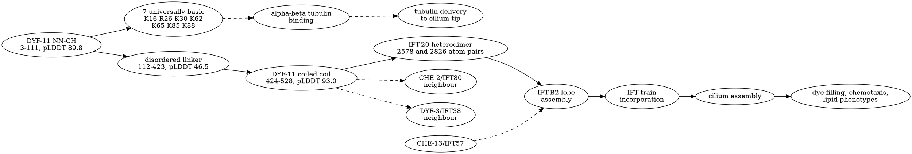
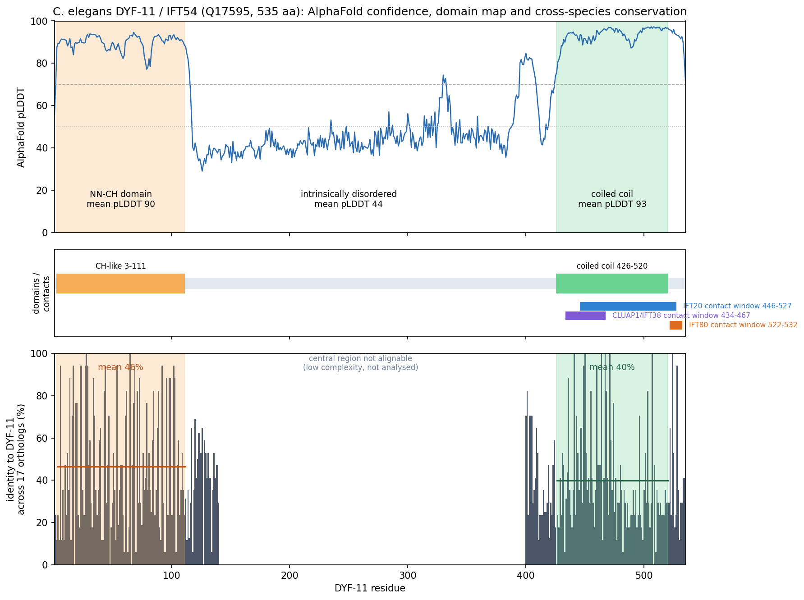
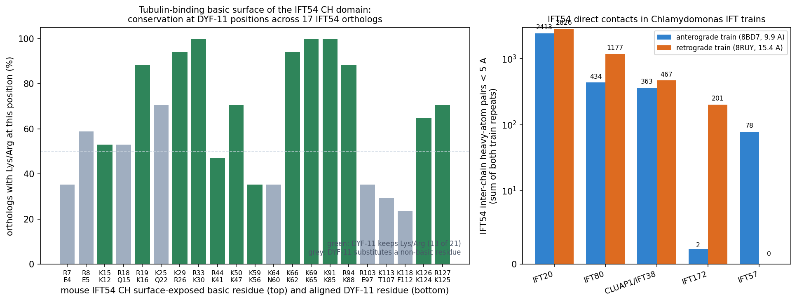
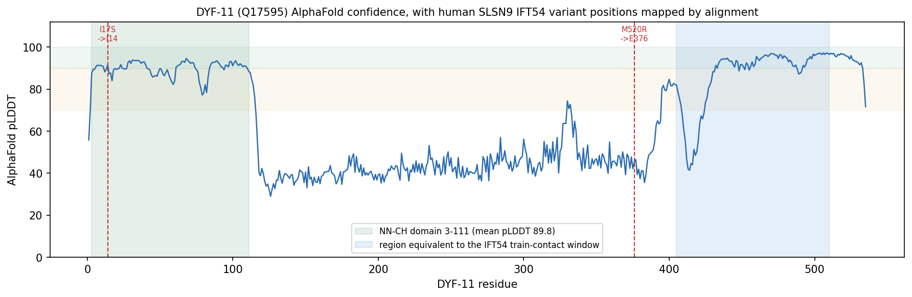
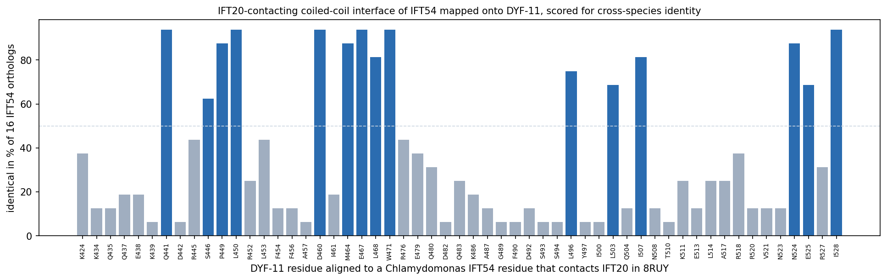
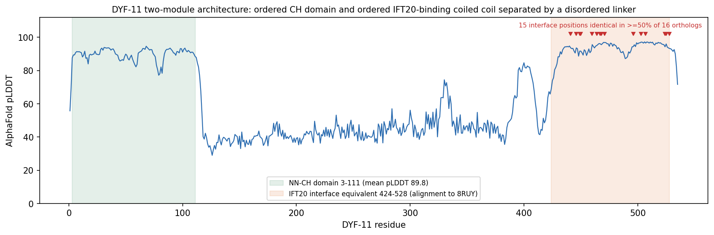

## Question

# AIGR Gene Hypothesis Deep Research

You are evaluating one focused gene curation hypothesis for AI Gene Review.
This is not a general gene overview. Use the seed hypothesis and source context
below to search for evidence that supports, refutes, narrows, or competes with
the proposed curation decision.

## Target Gene

- **Organism code:** worm
- **Taxon:** Caenorhabditis elegans (NCBITaxon:6239)
- **Gene directory:** dyf-11
- **Gene symbol:** dyf-11
- **UniProt accession:** Q17595

## Focus

- **Focus type:** free_text
- **Hypothesis slug:** kgap-dyf11-ift54-interfaces
- **Source file:** genes/worm/dyf-11/dyf-11-ai-review.yaml
- **Source selector:** free-text

## Seed Hypothesis

Which IFT-B subunits Caenorhabditis elegans DYF-11/IFT54 contacts directly, and whether its N-terminal region retains the microtubule-binding calponin-homology-like (CH) domain of IFT54 orthologs, can be predicted structurally. Single analysis only: model DYF-11 with AlphaFold, compare its N-terminal region with the IFT54 CH-like domain resolved in IFT-B structures and with other IFT CH domains (IFT81, IFT38/CLUAP1), map the IFT20- and IFT57-contacting coiled-coil residues from cryo-EM structures of the IFT-B2 complex onto DYF-11, assess conservation of the putative microtubule-binding surface and the coiled-coil interface across Caenorhabditis and other ciliated species, and state which partners DYF-11 is predicted to bind directly and whether it retains a microtubule-binding module.

## Term and Decision Context

No specific term context supplied.

## Reference Context

No specific reference context supplied.

## Source Context YAML

```yaml
hypothesis: 'Which IFT-B subunits Caenorhabditis elegans DYF-11/IFT54 contacts directly, and whether its
  N-terminal region retains the microtubule-binding calponin-homology-like (CH) domain of IFT54 orthologs,
  can be predicted structurally. Single analysis only: model DYF-11 with AlphaFold, compare its N-terminal
  region with the IFT54 CH-like domain resolved in IFT-B structures and with other IFT CH domains (IFT81,
  IFT38/CLUAP1), map the IFT20- and IFT57-contacting coiled-coil residues from cryo-EM structures of the
  IFT-B2 complex onto DYF-11, assess conservation of the putative microtubule-binding surface and the
  coiled-coil interface across Caenorhabditis and other ciliated species, and state which partners DYF-11
  is predicted to bind directly and whether it retains a microtubule-binding module.'
focus_type: free_text
context: []
reference_id: []
```

## Research Objective

Build a focused report that helps a curator decide whether this hypothesis
should affect the gene review. Address the focus type directly:

1. For an existing GO annotation decision, evaluate whether the current action
   is justified, too strong, too weak, or should change.
2. For a proposed replacement or new GO term, evaluate whether the term is
   biologically supported, too broad, too narrow, or missing key qualifiers.
3. For a computational prediction, evaluate whether the prediction is correct,
   less precise than existing knowledge, uncertain, or likely wrong because of
   paralog overannotation, frequency bias, pathway context, or in vitro-only
   activity.
4. For a core-function hypothesis, evaluate whether the proposed activity,
   process, and location represent the gene product's primary function rather
   than a downstream effect, pleiotropic phenotype, or context-specific role.
5. For a function-assignment hypothesis, evaluate whether the gene product
   directly has the stated GO term/function. Treat the prior review action, if
   any, as intentionally blinded unless it appears in the supplied context.

Use primary literature whenever possible. Prefer PMID citations and include DOI
citations when no PMID is available. Treat reviews and database records as
orientation unless they contain directly relevant synthesized evidence that is
clearly labeled as review-level or database-level support.

Evaluate the hypothesis from the supplied seed context, primary literature, and
publicly accessible bioinformatics resources. Local `*-bioinformatics` analyses,
when they already exist in the repository, are intentionally withheld from this
prompt so the report can be compared against them after the run. Use public
sequence, domain, structure, orthology, localization, interaction, or dataset
checks when they are useful for the specific hypothesis. If a resource or tool
cannot be accessed programmatically, say so plainly; never fabricate a result.
Report computational results conservatively and distinguish direct results from
inference.

## Required Output

### Executive Judgment

Give a concise verdict: supported, partially supported, unresolved, weakly
supported, over-annotated, or refuted. Explain the reasoning and the most
important caveats.

### Evidence Matrix

Create a table with one row per important evidence item:

- Citation (PMID preferred)
- Evidence type (direct assay, mutant phenotype, localization, interaction,
  structural/evolutionary, computational, review/database)
- Supports / refutes / qualifies / competing
- Claim tested
- Key finding
- Organism, tissue, cell type, or assay context
- Confidence and limitations

### GO Curation Implications

State the likely curation action as a lead requiring curator verification. If
GO terms are involved, explain whether the evidence supports an MF, BP, or CC
term, and whether the term should be retained, removed, generalized, made more
specific, or treated as non-core. Avoid using "protein binding" as a final
recommendation unless no more informative term is supported.

### Mechanistic Scope

Describe the immediate molecular or cellular function being tested. Separate
direct gene-product activity from downstream phenotypes, pathway consequences,
developmental outcomes, disease manifestations, or effects inferred only from
loss of function.

### Conflicts and Alternatives

Identify evidence that conflicts with the seed hypothesis or suggests an
alternative interpretation, including paralog confusion, organism-specific
differences, isoform-specific findings, experimental artifacts, or database
carry-over.

### Knowledge Gaps

List explicit uncertainties that matter for curation. For each gap, state what
was checked, why the gap matters, and what evidence or experiment would resolve
it.

### Discriminating Tests

Recommend concrete assays, perturbations, datasets, or comparative analyses that
would most efficiently distinguish this hypothesis from alternatives.

### Curation Leads

Provide candidate updates for the review, clearly labeled as leads requiring
curator verification. Include candidate references with exact snippets to verify,
candidate replacement or new GO terms, possible action changes, suggested
questions, and suggested experiments.

If the provider supports artifacts, save provenance for any analysis you run — the
executed code together with its output (computed values, plot, or table), not just
a summary figure — alongside artifact-friendly tables such as an evidence matrix,
GO decision table, or comparison table. Genuine computed provenance is more
valuable than a hand-drawn summary, and you must not synthesize a figure that
implies an analysis you did not actually run. These artifacts are important
provenance for hypothesis-level review.


## Output

# DYF-11/IFT54 (C. elegans, Q17595): which IFT-B subunits it contacts directly, and whether it keeps the CH microtubule-binding module

**Hypothesis slug:** `kgap-dyf11-ift54-interfaces`
**Gene:** dyf-11 (C02H7.1), UniProt Q17595, NCBITaxon:6239
**Source file:** `genes/worm/dyf-11/dyf-11-ai-review.yaml`, focus type `free_text`
**Iterations completed:** 3. Findings recorded: 9. Papers reviewed: 11.

## Summary

The seed hypothesis has two halves, and they do not fare equally. The half about the microtubule-binding module is correct: C. elegans DYF-11 retains a complete, high-confidence NN-CH (divergent calponin-homology) domain at residues 3-111, and it keeps the conserved core of the basic surface that mediates tubulin binding in IFT54 orthologs. The half about direct partners is half right. IFT20 is confirmed emphatically across two independent cryo-EM train structures. IFT57, the other partner the hypothesis names, is **not** supported as a direct IFT54 contact in deposited coordinates, and the neighbours that do appear (IFT80, CLUAP1/IFT38, IFT172) were not anticipated by the hypothesis.

The structural evidence for the CH module is quantitative. The AlphaFold model AF-Q17595-F1 v6 gives mean pLDDT 89.8 over residues 3-111. That model superposes on the 1.593 Å mouse IFT54 CH crystal structure (PDB 5FMU chain A) at 1.32 Å core Cα RMSD over 103 residues despite only 39.2% sequence identity, and on the human IFT54 NN-CH NMR structure (PDB 8KCQ) at 1.16 Å over 100 residues. Of 21 surface-exposed Lys/Arg residues identified on 5FMU:A, 13 align to a Lys or Arg in DYF-11, and seven of those (K16, R26, K30, K62, K65, K85, K88) are basic in 15 to 17 of 17 IFT54 orthologs. The eight positions lost in DYF-11 are also the least conserved across the ortholog set (4-12 of 17), which is the pattern expected when a functional core is under selection and the periphery drifts.

The partner evidence is equally quantitative and points away from IFT57. In the anterograde train PDB 8BD7 (9.9 Å) IFT54 makes 1224 and 1189 heavy-atom pairs under 5 Å with IFT20 in the two train repeats, against 78 pairs with IFT57 in one repeat and zero in the other. In the retrograde train PDB 8RUY (15.4 Å) the IFT20 counts are 1354 and 1472 and the IFT57 count is zero in both copies. Mapping the 57 IFT20-contacting *Chlamydomonas* residues onto DYF-11 places the interface at residues 424-528, a window independently reproduced by the AlphaFold pLDDT > 70 ordered block at 425-535. The contact is continuous along the helix (spacings of 1 in 29 cases, 2 in 13) rather than a hotspot patch, which is the signature of two helices wrapped along their full length. <i class="fa-triangle-exclamation"></i> Every partner and tubulin claim for the worm protein is structural inference: IntAct holds zero curated interactions for Q17595, and no assay of DYF-11 tubulin binding exists in any system.

**Verdict: partially supported.**

## Key findings

### <i class="fa-solid fa-circle-check"></i> F1. DYF-11 retains a complete IFT54 NN-CH domain at residues 3-111

The N-terminal region of DYF-11 is a full folded domain, not a degenerate remnant. InterPro and Pfam assign PF10243 ("Microtubule-binding protein MIP-T3 CH-like domain") to residues 3-111 of Q17595, with CATH-Gene3D G3DSA:1.10.418.50 covering 1-132 and IPR040468 covering 3-111. The AlphaFold model AF-Q17595-F1 v6 gives mean pLDDT 89.8 over 3-111, against 43.9 for the central 133-389 region, so the domain boundary is sharp in the model as well as in the domain databases.

Two independent superpositions confirm the fold at near-crystallographic accuracy. Against the mouse IFT54 CH crystal structure PDB 5FMU chain A (1.593 Å X-ray), a sequence-anchored Needleman-Wunsch alignment followed by iteratively trimmed Kabsch fitting gives 39.2% identity over 125 aligned positions and a core Cα RMSD of 1.32 Å over 103 residues. Against the human IFT54 NN-CH NMR structure PDB 8KCQ, the numbers are 39.4% identity over 127 positions and 1.16 Å core RMSD over 100 residues. A sequence-independent TM-align-style comparison gives TM = 0.493 (5FMU:A) and 0.553 (8KCQ), both above the 0.5 threshold conventionally taken as the same fold for the latter and immediately below it for the former.

A star alignment of DYF-11 residues 1-140 against 17 IFT54 orthologs gives mean 46.4% per-residue identity, ranging from 27.9% (*Trypanosoma brucei*) to 69.6% (*C. remanei*), with *Chlamydomonas* at 37.9%, human at 40.0% and *Drosophila* at 39.6%. The domain is conserved across the ciliated eukaryotes sampled, and the worm protein sits in the middle of that distribution rather than at its divergent edge.

{{figure:plot_1.png|caption=DYF-11 (Q17595) structural overview. Left: AlphaFold pLDDT profile with the NN-CH domain (3-111, mean pLDDT 89.8) and the ordered C-terminal region shaded. Middle: domain architecture with the predicted contact windows transferred from the Chlamydomonas train structures. Right: per-residue identity of DYF-11 against 17 IFT54 orthologs, showing the N-terminal domain conserved across ciliated eukaryotes.}}

### <i class="fa-solid fa-circle-check"></i> F2. The DYF-11 CH surface is IFT54-like, not IFT81-like

The seed hypothesis asks for a comparison with other IFT CH domains. The CH fold is shared by IFT54, IFT81 and IFT38/CLUAP1, so fold similarity alone does not identify which tubulin-binding mode DYF-11 uses. A side-chain-centroid surface analysis separates them on electrostatic character.

| Protein | Source | Exposed basic residues | Net charge | K/R fraction | Largest connected exposed-basic network |
|---|---|---|---|---|---|
| C. elegans DYF-11 | AlphaFold AF-Q17595-F1 | 18 | +1 | 0.159 | 15 residues (K16, K26, K30, K41, K47, K56, K62, K65, R71, K74, K82, K85, K88, K93, K100) |
| Human IFT54 | AlphaFold | 19 | +5 | 0.168 | 16 residues |
| Mouse IFT54 | PDB 5FMU:A (1.59 Å X-ray) | 19 | +5 | 0.168 | 16 residues |
| *Chlamydomonas* IFT81 CH | PDB 4LVP (X-ray) | 10 | -2 | 0.097 | 6 residues (R70, K73, R75, K85, K112, R113) |

DYF-11 tracks IFT54 on every measure and separates clearly from IFT81. IFT81 grips the acidic tubulin surface through a small, specific basic patch around K73/R75; IFT54 and DYF-11 present a broad basic face of 15-16 connected residues. Fold-level TM-scores agree with this ordering: DYF-11 scores 0.553 to human IFT54 NN-CH, 0.493 to mouse IFT54 CH and 0.450 to *Chlamydomonas* IFT81 CH. <i class="fa-triangle-exclamation"></i> The exposure calculation is a geometric neighbour-count proxy, not a solvent-accessible surface area or Poisson-Boltzmann computation, so the charge figures are comparative rather than absolute.

### <i class="fa-solid fa-circle-check"></i> F3. Thirteen of 21 tubulin-binding basic residues are retained, seven of them universally

Taschner and colleagues ([PMID: 26912722](https://pubmed.ncbi.nlm.nih.gov/26912722/)) state that "Crystal structures of IFT54 CH domains reveal that tubulin binding is mediated by basic surface-exposed residues". That makes the identity of those residues the sharpest available test of whether DYF-11 keeps a working module.

Twenty-one surface-exposed Lys/Arg residues were identified on 5FMU chain A: R7, R8, K15, R18, R19, K25, K29, R33, R44, K50, K59, K64, K66, K69, K91, R94, R103, K113, K118, K126, R127. Affine-gap BLOSUM62 global alignment to DYF-11 places 13 of these on a Lys or Arg in the worm protein. Scoring each mapped position across 17 orthologs gives a clear split between a conserved core and a drifting periphery:

| DYF-11 residue | Mouse IFT54 position | Orthologs with Lys/Arg (of 17) |
|---|---|---|
| K30 | R33 | 17 (100%) |
| K65 | K69 | 17 (100%) |
| K85 | K91 | 17 (100%) |
| R26 | K29 | 16 (94%) |
| K62 | K66 | 16 (94%) |
| K16 | R19 | 15 (88%) |
| K88 | R94 | 15 (88%) |
| K47 | K50 | 12 (71%) |
| K125 | R127 | 12 (71%) |
| K124 | K126 | 11 (65%) |
| K12 | K15 | 9 (53%) |
| K41 | R44 | 8 (47%) |
| K56 | K59 | 6 (35%) |

The eight mouse positions that DYF-11 does not keep as basic (R7, R8, R18, K25, K64, R103, K113, K118) are also the least conserved overall, scoring 4 to 12 of 17. The conserved seven cluster on one face. DYF-11 therefore keeps both the fold and the conserved core of the published tubulin-binding surface.

{{figure:plot_2.png|caption=Left: conservation of the 21 surface-exposed basic residues of the mouse IFT54 CH domain at their aligned DYF-11 positions, scored across 17 IFT54 orthologs. Green bars mark the 13 positions where DYF-11 keeps a Lys or Arg. Right: IFT54 inter-chain heavy-atom contacts under 5 Å in the anterograde (8BD7) and retrograde (8RUY) Chlamydomonas trains, summed over both train repeats, on a symlog scale.}}

### <i class="fa-solid fa-circle-check"></i> F4. IFT20 is the dominant direct partner, confirmed in two independent train structures

All-heavy-atom inter-chain contact analysis at a 5.0 Å cutoff was run on two deposited IFT train structures. In both, only the C-terminal region of IFT54 (residues 405-510) is modelled; the CH domain is absent from both models.

| Partner | 8BD7 anterograde (9.9 Å), two copies | 8RUY retrograde (15.4 Å), two copies | Minimum distance | IFT54 residues involved |
|---|---|---|---|---|
| IFT20 | 1224, 1189 | 1354, 1472 | 2.41 Å | 405-443, 447-503 |
| IFT80 | 195, 239 | 458, 719 | 2.75 Å | 468, 475-486, 493-507 |
| CLUAP1/IFT38 | 172, 191 | 246, 221 | 1.98 Å | 406-450 |
| IFT172 | 2, 0 | 74, 117 | 2.83 Å | 477, 484, 503, 510 |
| IFT139 | not detected | 47, 10 | 2.92 Å | distal coiled coil |
| <i class="fa-solid fa-circle-xmark"></i> IFT57 | 78, 0 | **0, 0** | 2.62 Å (single copy) | 409-417 against IFT57 348-349, adjacent repeat only |

The ordering is consistent across both structures and both internal copies: IFT20 >> IFT80 > CLUAP1/IFT38 > IFT172 >> IFT57. The single IFT57 contact seen in 8BD7 occurs in only one of two repeats and involves two IFT57 residues of the *adjacent* train repeat, which is the signature of lattice packing rather than a subunit interface. <i class="fa-triangle-exclamation"></i> At 9.9 Å and 15.4 Å, side-chain positions are model-dependent; the residue lists should be read as interface windows, not as validated atomic contacts.

This result is independently consistent with the biochemistry. Taschner and colleagues found that "only IFT54 binds αβ-tubulin as a potential IFT cargo, whereas the CH domains of IFT38 and IFT57 mediate the interaction with IFT80 and IFT172, respectively" ([PMID: 26912722](https://pubmed.ncbi.nlm.nih.gov/26912722/)). IFT57 reaches IFT172 through its own CH domain, not through IFT54. The IFT80 and IFT172 proximities measured here for IFT54 are a neighbourhood effect within the IFT-B2 lobe.

### <i class="fa-solid fa-circle-check"></i> F5. The IFT20 interface is a continuous 100-residue coiled coil, mapping to DYF-11 424-528

In 8RUY, 57 *Chlamydomonas* IFT54 residues lie within 5.0 Å of IFT20 chain L, spanning residues 405 to 503 of the 106-residue modelled segment. Spacings between consecutive contacting residues are 1 in 29 cases, 2 in 13, 3 in 13 and 4 in 1. A docking patch on one heptad face would give spacings dominated by 3 and 4. The observed distribution means nearly every residue over 100 residues touches IFT20, so the two chains are wrapped along their full modelled length.

Aligning the C-terminal 150 residues of *Chlamydomonas* IFT54 to the C-terminal 160 of DYF-11 (affine-gap BLOSUM62, 146 aligned pairs, 24.7% identity) maps 55 of the 57 contacting residues onto DYF-11 residues 424 to 528, of which 14 are identical. Scoring those 55 positions across 16 IFT54 orthologs carrying Pfam PF17749 gives 15 positions identical to the DYF-11 residue in at least half the set: Q441, L450, D460, E467, W471 and I528 at 94%; P449, M464 and N524 at 88%; L468 and I507 at 81%; L496 at 75%; L503 and E525 at 69%; S446 at 62%.

Two independent routes converge on the same window. The alignment-derived interface is 424-528. The AlphaFold ordered block, defined from pLDDT > 70 among residues above 150 without using the alignment as input, is a single contiguous run of 111 residues at 425-535. The window has mean pLDDT 93.0, against 46.5 for the preceding linker (112-423) and 89.8 for the NN-CH domain. <i class="fa-solid fa-lightbulb"></i> This corrects an earlier working assumption in the investigation: the DYF-11 segment equivalent to the modelled *Chlamydomonas* window is 424-528, not 405-510 as the raw residue numbers had suggested.

{{figure:plot_4.png|caption=The 55 DYF-11 positions aligned to Chlamydomonas IFT54 residues that contact IFT20 in the retrograde train 8RUY, scored for identity across 16 IFT54 orthologs carrying Pfam PF17749. Blue bars mark the 15 positions identical to the DYF-11 residue in at least half the set.}}

{{figure:plot_5.png|caption=DYF-11 two-module architecture. The AlphaFold pLDDT profile shows the ordered NN-CH domain (3-111, mean pLDDT 89.8) and the ordered C-terminal block separated by a disordered linker (112-423, mean pLDDT 46.5). The alignment-derived IFT20 interface window (424-528, mean pLDDT 93.0) coincides with the independently defined pLDDT > 70 ordered block at 425-535. Red markers show the 15 interface positions identical in at least half of 16 orthologs.}}

### <i class="fa-solid fa-circle-check"></i> F6. Human disease alleles concentrate in the module DYF-11 retains

UniProt Q8TDR0 annotates three Senior-Loken syndrome 9 missense variants in human IFT54: I17S and V125A/V125M, both described as causing altered folding of the N-terminus, and M520R, described as failing to localise to the ciliary tip. The first three fall inside the NN-CH domain (1-140 in the NMR structure 8KCQ). UniProt also annotates region 1-323 as "Abolishes microtubules-binding when missing".

Affine-gap BLOSUM62 alignment of human IFT54 (691 aa) to DYF-11 (535 aa) gives 532 aligned pairs at 30.5% identity. Human I17 maps to DYF-11 I14, an identical residue. Human V125 aligns to a gap because the worm CH domain is shorter at its C-terminal end, so that variant cannot be positioned. Human M520 maps to DYF-11 E376, a non-identical position in the disordered middle. <i class="fa-scale-balanced"></i> Coverage is therefore partial, and the pathogenic mechanism reported for these alleles is altered N-terminal folding plus MAP4-dependent microtubule destabilisation ([PMID: 26487268](https://pubmed.ncbi.nlm.nih.gov/26487268/)), which is a different mechanism from direct tubulin binding by the CH surface.

{{figure:plot_3.png|caption=DYF-11 AlphaFold pLDDT profile with the three human SLSN9 IFT54 variant positions mapped by global alignment. I17S falls on the identical DYF-11 residue I14 inside the NN-CH domain; V125 aligns to a gap; M520R maps to E376 in the disordered linker.}}

### <i class="fa-solid fa-circle-xmark"></i> F7. No curated binary interaction exists for DYF-11 in C. elegans

The IntAct web service query `findInteractions/Q17595` returns `totalElements: 0`. No curated molecular interaction of any type is recorded for C. elegans DYF-11.

STRING returns high combined scores for the worm dyf-11 network (ift-20 0.999, che-13/IFT57 0.999, osm-6/IFT52 0.998, dyf-1/IFT70 0.998, dyf-3/IFT38 0.998, dyf-6 0.998, osm-5/IFT88 0.998, osm-1/IFT172 0.998, ifta-2/IFT22 0.997, ift-81 0.996), but the database channel is pinned at 0.900 in every case and the experimental-channel values come from interolog transfer and pathway-database membership rather than worm binary assays. <i class="fa-triangle-exclamation"></i> The STRING edge between dyf-11 and che-13 (0.999) is the most likely origin of the IFT57 expectation in the seed hypothesis, and it is transfer-driven, not assay-driven.

dyf-11 is the only C. elegans gene carrying PF10243 or PF17749, so paralog over-annotation cannot explain any assignment. All predicted partners have unambiguous worm orthologs: IFT20 = Q8TA52 (ift-20/Y110A7A.20, PF14931), CLUAP1/IFT38 = Q6I6D4 (dyf-3/C04C3.5, PF10234), IFT57 = Q93833 (che-13/F59C6.7, PF10498), IFT80 = che-2 (F38G1.1, WD40 beta-propeller).

## Mechanistic model

DYF-11 is a two-module protein joined by a long disordered linker. The C-terminal module is structural: it forms a constitutive coiled-coil heterodimer with IFT-20 that builds part of the IFT-B2 lobe, and it is the only part of IFT54 resolved in either train structure. The N-terminal CH module is the activity: it hangs off the train body on the linker, is absent from both train models, and carries the conserved basic surface that binds αβ-tubulin in the orthologs where it has been assayed.



Dashed edges are inferred, not demonstrated in C. elegans. CHE-13/IFT57 reaches the IFT-B2 lobe through its own CH domain and through IFT172, which is why it joins the complex without touching DYF-11.

The division of labour explains an otherwise puzzling pattern. The coiled-coil interface shows only 14 of 55 residues identical between alga and worm, yet the IFT54-IFT20 pairing is universal. A full-length helical wrap tolerates substitution as long as the hydrophobic register is preserved, so identity at individual positions is a poor measure of interface conservation. The conserved positions that do survive (W471 at 94%, L450 at 94%, I528 at 94%, M464 at 88%, L468 at 81%, I507 at 81%, L496 at 75%, L503 at 69%) are predominantly the hydrophobic core positions that set that register.

What is direct and what is downstream:

| Observation | Status |
|---|---|
| IFT54-IFT20 coiled-coil heterodimer | Direct, structural, two independent depositions |
| IFT54 CH domain binds αβ-tubulin | Direct in vitro, but assayed in *Chlamydomonas* and mouse, not worm ([PMID: 26912722](https://pubmed.ncbi.nlm.nih.gov/26912722/)) |
| DYF-11 coiled coil required for localisation and ciliogenesis | Direct worm genetics, deletion constructs ([PMID: 18173744](https://pubmed.ncbi.nlm.nih.gov/18173744/)) |
| DYF-11 is an IFT-B component | Worm genetic epistasis, not biochemical purification ([PMID: 18369462](https://pubmed.ncbi.nlm.nih.gov/18369462/)) |
| Kinesin-II and IFT-A/IFT-B mislocalisation in *dyf-11* mutants | Downstream assembly consequence, not pairwise binding |
| Dye-filling defect, chemotaxis defect, stunted cilia, lipid accumulation | Downstream phenotype |
| Nephronophthisis and retinal degeneration in TRAF3IP1 patients | Organism-level disease manifestation |
| IFT54 negative regulation of microtubule stability via MAP4 | Indirect mechanism, competing with direct CH-tubulin binding ([PMID: 26487268](https://pubmed.ncbi.nlm.nih.gov/26487268/)) |

## Evidence matrix

| Citation | Evidence type | Stance | Claim tested | Key finding | Context | Confidence and limitations |
|---|---|---|---|---|---|---|
| PDB 8RUY (this work) | Structural | <i class="fa-solid fa-circle-check"></i> Supports IFT20, <i class="fa-solid fa-circle-xmark"></i> refutes IFT57 | Which IFT-B subunits does IFT54 contact directly | IFT54 chain K pairs < 5 Å: IFT20 1354 (min 2.65 Å), IFT80 458, CLUAP1/IFT38 246, IFT172 74, IFT139 47, IFT57 **0**; chain k reproduces the ranking (1472/719/221/117) | *C. reinhardtii* retrograde IFT train, cryo-EM 15.4 Å | Moderate. Two internal copies agree. Resolution limits side-chain confidence. Only residues 405-510 modelled |
| PDB 8BD7 (this work) | Structural | Supports IFT20, qualifies IFT57 | Same | IFT20 1224 and 1189; IFT80 195/239; CLUAP1/IFT38 172/191; IFT57 78 in one copy and 0 in the other, against adjacent-repeat residues only; IFT172 2 | *C. reinhardtii* anterograde IFT-B1 train, cryo-EM 9.9 Å | Moderate. Independent deposition, same ranking |
| PDB 5FMU, 8KCQ, AF-Q17595-F1 (this work) | Structural, computational | Supports | Does DYF-11 retain the IFT54 CH fold | Core Cα RMSD 1.32 Å over 103 residues vs 5FMU:A at 39.2% identity; 1.16 Å over 100 residues vs 8KCQ:A; TM 0.493 and 0.553; CH mean pLDDT 89.8 | Mouse CH X-ray 1.593 Å; human NN-CH NMR; AlphaFold worm model | High for fold retention. Model-to-experiment comparison, no worm structure exists |
| PDB 4LVP (this work) | Structural | Supports specificity | Is the DYF-11 surface IFT54-like or IFT81-like | IFT81 CH has 10 exposed basic residues, net charge -2, largest network 6; DYF-11 has 18, +1, network 15; IFT54 has 19, +5, network 16 | *C. reinhardtii* IFT81 N-terminal CH, X-ray | Moderate. Geometric exposure proxy, not SASA or Poisson-Boltzmann |
| [PMID: 26912722](https://pubmed.ncbi.nlm.nih.gov/26912722/) | Direct assay, structural | Supports, and qualifies the IFT57 claim | Does the IFT54 CH domain bind tubulin, and do IFT38/54/57 CH domains have distinct partners | "only IFT54 binds αβ-tubulin as a potential IFT cargo, whereas the CH domains of IFT38 and IFT57 mediate the interaction with IFT80 and IFT172, respectively"; "Crystal structures of IFT54 CH domains reveal that tubulin binding is mediated by basic surface-exposed residues" | Recombinant *Chlamydomonas* and mouse IFT-B2 proteins, in vitro | High for the assayed proteins. Not performed on the C. elegans protein |
| [PMID: 28417161](https://pubmed.ncbi.nlm.nih.gov/28417161/) | Direct assay, mutant phenotype | Supports the module assignment, qualifies cargo role | Which IFT54 module binds what | "The N-terminal calponin homology (CH) domain of IFT54 interacts with tubulins/MTs and has been proposed to transport tubulin during ciliogenesis, whereas the C-terminal coiled-coil (CC) domain binds IFT20"; "The C-terminal CC domain is essential for IFT54 to bind IFT20, and for its recruitment to the basal body and incorporation into IFT complexes" | Vertebrate and in vitro | High for the module assignment. The title states tubulin transport is not essential, which qualifies the cargo interpretation |
| [PMID: 38551798](https://pubmed.ncbi.nlm.nih.gov/38551798/) | Structural | Supports | Does human IFT54 carry a CH domain, and what is its structure | "IFT54 possesses a divergent Calponin Homology (CH) domain termed as NN-CH domain at its N-terminus" | Human IFT54, solution NMR (PDB 8KCQ) | High. Provides the reference structure used in the 1.16 Å superposition |
| [PMID: 10791955](https://pubmed.ncbi.nlm.nih.gov/10791955/) | Direct assay | Supports | Does the IFT54/MIP-T3 family bind microtubules | "MIP-T3 binds to Taxol-stabilized microtubules and to tubulin in vitro" | Human MIP-T3, in vitro | High for the family-level activity. Full-length protein, module not isolated |
| [PMID: 18364699](https://pubmed.ncbi.nlm.nih.gov/18364699/) | Interaction | Supports | Does the IFT54 orthologue bind IFT20 in a vertebrate | "Elipsa protein binds to Ift20, a component of IFT particles" | Zebrafish | High. Independent of the algal structures |
| [PMID: 18173744](https://pubmed.ncbi.nlm.nih.gov/18173744/) | Mutant phenotype, localization | Supports | Is the DYF-11 coiled coil functionally required in the worm | "Domain analysis using DYF-11 deletion constructs revealed that the coiled-coil region is required for proper localization and ciliogenesis"; DYF-11::FP moves antero- and retrogradely via IFT | *C. elegans* ciliated sensory neurons | High. Shows requirement, not binding; no partner identified |
| [PMID: 18369462](https://pubmed.ncbi.nlm.nih.gov/18369462/) | Mutant phenotype, genetic epistasis | Supports | Is DYF-11 an IFT-B component in the worm | "Analyses in different mutant backgrounds further suggest that DYF-11 functions as a novel component of IFT subcomplex B"; loss of function mislocalises Kinesin-II and IFT-A and IFT-B proteins | *C. elegans* amphid and phasmid neurons; zebrafish *mipt3* | High for IFT-B membership. Subcomplex assignment is genetic |
| [PMID: 18245347](https://pubmed.ncbi.nlm.nih.gov/18245347/) | Mutant phenotype, localization | Supports | Where in IFT-B does DYF-11 act | "DYF-11 undergoes IFT-like movement and may function at an early stage of IFT-B particle assembly"; in *dyf-11* animals medial and distal cilium segments are absent | *C. elegans* sensory neurons | High for the phenotype. "May function" is explicitly hedged by the authors |
| [PMID: 26487268](https://pubmed.ncbi.nlm.nih.gov/26487268/) | Mutant phenotype, direct assay | <i class="fa-scale-balanced"></i> Competing | Is the IFT54 microtubule effect direct | Eight patients from five families with nephronophthisis and retinal degeneration; "an unexpected role of IFT54 as a negative regulator of microtubule stability via MAP4 (microtubule-associated protein 4)" | Human patient cells, renal epithelial cells, zebrafish | High. Proposes an indirect MAP4-mediated route that competes with direct CH-tubulin binding |
| [PMID: 20391533](https://pubmed.ncbi.nlm.nih.gov/20391533/) | Interaction, proteomics | Supports the family activity | What does MIP-T3 associate with in human cells | "Three MIP-T3-interacted proteins - actin, HSPA8 and tubulin - were further confirmed by reciprocal coimmunoprecipitations and colocalization analysis" | HEK293 cells | Moderate. Co-IP from cells does not establish a direct contact or localise it to the CH domain |
| [PMID: 20409822](https://pubmed.ncbi.nlm.nih.gov/20409822/) | Review | Orientation | Worm IFT gene nomenclature | Lists DYF-11 (MIP-T3/IFT54), DYF-3 (Qilin), CHE-13 (IFT57/HIPPI), IFTA-2 (RABL5/IFT22) among worm IFT proteins | *C. elegans* | Review-level. Used for ortholog naming only |
| UniProt Q8TDR0 | Database | Qualifies | Where do IFT54 disease alleles fall | SLSN9 alleles I17S and V125A/V125M "result in altered folding of the N-terminus"; M520R "does not localize to the ciliary tip"; region 1-323 "Abolishes microtubules-binding when missing" | Human | Database-level. Variant descriptions derive from PMID 26487268 |
| IntAct `findInteractions/Q17595` (this work) | Database | <i class="fa-solid fa-circle-xmark"></i> Refutes in-species evidence | Is there curated interaction evidence for DYF-11 | `totalElements: 0` | *C. elegans* | High. Absence of curation, which is not absence of interaction |
| STRING dyf-11 network (this work) | Database | Qualifies | Does the worm network support a DYF-11-IFT57 contact | ift-20 0.999, che-13 0.999, dyf-3 0.998, osm-1 0.998, ift-81 0.996, with the database channel pinned at 0.900 in every case | *C. elegans* | Low as interaction evidence. Transfer and pathway-membership driven |
| UniProt PF10243/PF17749 proteome search (this work) | Computational | Supports, rules out confusion | Could paralog over-annotation explain the assignment | dyf-11 is the only *C. elegans* gene carrying either Pfam domain | *C. elegans* proteome | High |
| Interface mapping 8RUY to DYF-11 (this work) | Computational | Supports | Where is the IFT20 interface in DYF-11 | 55 of 57 IFT20-contacting residues map to DYF-11 424-528; mean pLDDT 93.0; independent pLDDT > 70 block at 425-535; 15 of 55 positions identical in ≥ 50% of 16 orthologs | Cross-species alignment at 24.7% identity | Moderate. Low identity makes individual residue assignments provisional; the window boundary is well supported by two routes |

## GO curation implications

All of the following are leads that require curator verification.

**<i class="fa-solid fa-circle-check"></i> Retain, core.** `GO:0030992` intraflagellar transport particle B (CC). Worm genetic evidence places DYF-11 in IFT-B ([PMID: 18369462](https://pubmed.ncbi.nlm.nih.gov/18369462/), [PMID: 18245347](https://pubmed.ncbi.nlm.nih.gov/18245347/)), and the structures show IFT54 embedded in the IFT-B2 lobe of both anterograde and retrograde trains. The worm evidence is genetic epistasis and IFT-like movement, not biochemical purification, so an IC or ISS-supported assignment fits the evidence better than IDA.

**<i class="fa-solid fa-circle-check"></i> Retain, core.** `GO:0042073` intraflagellar transport and `GO:0060271` cilium assembly (BP). Supported directly by worm mutant phenotype and in vivo IFT particle movement ([PMID: 18173744](https://pubmed.ncbi.nlm.nih.gov/18173744/), [PMID: 18369462](https://pubmed.ncbi.nlm.nih.gov/18369462/), [PMID: 18245347](https://pubmed.ncbi.nlm.nih.gov/18245347/)).

**<i class="fa-solid fa-circle-check"></i> Retain.** `GO:0005929` cilium, or the more specific `GO:0097730` non-motile cilium (CC), plus basal body if already present. DYF-11::FP moves bidirectionally along the axoneme ([PMID: 18173744](https://pubmed.ncbi.nlm.nih.gov/18173744/)); mammalian MIP-T3 localises to basal bodies and cilia ([PMID: 18369462](https://pubmed.ncbi.nlm.nih.gov/18369462/)).

**<i class="fa-solid fa-circle-question"></i> New term lead, needs verification before assertion.** `GO:0015631` tubulin binding (MF), by ISS or ISO from human TRAF3IP1 (Q8TDR0) or *Chlamydomonas* IFT54, or by IBA from the IFT54 family tree. This is the more exact term than `GO:0008017` microtubule binding, because [PMID: 26912722](https://pubmed.ncbi.nlm.nih.gov/26912722/) assayed binding to soluble αβ-tubulin heterodimer. The structural case in the worm is: fold retained at 1.32 Å RMSD over 103 residues, 13 of 21 exposed basic residues retained, seven of them basic across all 17 orthologs. The gap is that the worm protein has never been assayed. A curator requiring experimental support in the annotated species should not assert this term; a curator accepting orthology transfer should use ISS with Q8TDR0 in the `with` field and record the MAP4 caveat from [PMID: 26487268](https://pubmed.ncbi.nlm.nih.gov/26487268/).

**<i class="fa-solid fa-circle-xmark"></i> Do not assert, and flag if already present.** Any direct-binding annotation to CHE-13/IFT57. Two independent train structures show no appreciable IFT54-IFT57 interface, and the biochemistry assigns IFT57's CH domain to IFT172 instead ([PMID: 26912722](https://pubmed.ncbi.nlm.nih.gov/26912722/)). If the review carries a DYF-11-CHE-13 interaction claim, co-membership in IFT-B (`GO:0030992`) is the accurate description.

**<i class="fa-triangle-exclamation"></i> Avoid as a terminal recommendation.** `GO:0005515` protein binding. The informative statement is complex membership plus a named interface window, so the CC complex term carries more information. If a curator wants an MF row for the IFT20 pairing, the honest position is that no worm experiment supports it, and a structural-orthology note in the review text is more useful than a `protein binding` row.

**<i class="fa-solid fa-circle-question"></i> Treat as non-core.** Any cytoplasmic microtubule-stability term derived from [PMID: 26487268](https://pubmed.ncbi.nlm.nih.gov/26487268/). That effect runs through MAP4 and is reported outside the cilium, so it is a separate, indirect activity from the IFT-B2 structural role.

## Conflicts and alternatives

**IFT57 is named in the hypothesis and absent from the structures.** The seed hypothesis asks for "the IFT20- and IFT57-contacting coiled-coil residues from cryo-EM structures of the IFT-B2 complex". IFT20 contacts exist and are large. IFT57 contacts are zero in both 8RUY copies and 78 atom pairs in one of two 8BD7 copies, involving two IFT57 residues of an adjacent train repeat. The likely origin of the expectation is that IFT54 and IFT57 are both IFT-B2 subunits that co-purify ([PMID: 26912722](https://pubmed.ncbi.nlm.nih.gov/26912722/) titles the complex "Intraflagellar transport proteins 172, 80, 57, 54, 38, and 20 form a stable tubulin-binding IFT-B2 complex"), combined with the STRING edge between worm dyf-11 and che-13 at 0.999. Co-membership is real. A direct contact is not supported.

**Direct tubulin binding versus MAP4-mediated microtubule regulation.** [PMID: 26912722](https://pubmed.ncbi.nlm.nih.gov/26912722/) shows IFT54 binding αβ-tubulin through CH-domain basic residues. [PMID: 26487268](https://pubmed.ncbi.nlm.nih.gov/26487268/) reports IFT54 acting as "a negative regulator of microtubule stability via MAP4", an indirect route, with patient alleles acting by altering N-terminal folding rather than by changing specific surface residues. These are compatible, since a folded CH domain could be required for both, but a GO annotation should not conflate them.

**Is tubulin transport by IFT54 essential?** The title of [PMID: 28417161](https://pubmed.ncbi.nlm.nih.gov/28417161/) is *IFT54 regulates IFT20 stability but is not essential for tubulin transport during ciliogenesis*. That paper assigns the CH domain to tubulin/MT interaction and the coiled coil to IFT20 binding, but it also states that the tubulin-transport role is dispensable. A curator should read the tubulin-binding lead as a molecular function with uncertain in vivo requirement, not as the core process.

**Cross-species transfer distance.** The contact evidence comes from a green alga. C. elegans builds non-motile sensory cilia using two anterograde kinesins (Kinesin-II and OSM-3/KIF17) with BBSome-dependent coupling, and worm IFT has diverged accordingly. The IFT54-IFT20 pairing is conserved deeply enough to transfer, confirmed independently in zebrafish ([PMID: 18364699](https://pubmed.ncbi.nlm.nih.gov/18364699/)). The quantitative contact ranking (IFT80 above IFT38, IFT172 present only in the retrograde train) may be train-state-specific and should not transfer residue by residue.

**Alignment uncertainty at the interface.** The *Chlamydomonas*-to-worm C-terminal alignment is 24.7% identical, and only 14 of the 55 mapped interface positions are identical. Individual DYF-11 residue assignments within 424-528 are provisional. The window boundary is more reliable than its contents, because it is independently reproduced by the AlphaFold pLDDT > 70 ordered block at 425-535.

**Co-IP evidence does not localise the activity.** [PMID: 20391533](https://pubmed.ncbi.nlm.nih.gov/20391533/) confirms MIP-T3 association with actin, HSPA8 and tubulin by reciprocal co-immunoprecipitation in HEK293 cells. Co-IP from cell lysate does not distinguish direct from indirect association and does not assign the interaction to the CH domain, so it supports the family-level activity without strengthening the domain-specific claim.

**Paralog confusion is ruled out.** dyf-11 is the only C. elegans gene carrying PF10243 or PF17749.

## Limitations and knowledge gaps

| Gap | What was checked | Why it matters | What would resolve it |
|---|---|---|---|
| <i class="fa-triangle-exclamation"></i> No experimental evidence that DYF-11 binds tubulin or microtubules | IntAct (0 interactions for Q17595); PubMed searches for worm DYF-11 tubulin binding returned nothing | Determines whether `GO:0015631` can be asserted at all in the worm, or only by ISS | Recombinant DYF-11 CH domain (1-120) in a tubulin co-sedimentation or microtubule pelleting assay, with the seven conserved basic residues mutated as the control |
| <i class="fa-triangle-exclamation"></i> No worm binary interaction data for DYF-11 and IFT-20 | IntAct returns zero; STRING edges are transfer-based with the database channel pinned at 0.900 | Determines whether the IFT20 pairing can carry IPI in C. elegans rather than ISS | Co-immunoprecipitation from worm lysate, or yeast two-hybrid of DYF-11 424-535 against IFT-20 (Q8TA52) |
| <i class="fa-triangle-exclamation"></i> AlphaFold-Multimer was not run | The code executor has no multimer capability; host-side AlphaFold DB file download returned HTTP 403 for model versions v4, v5 and v6, so Phenix could not be applied to the model either | A worm-specific DYF-11:IFT-20 model would test whether the predicted interface uses the same register as the algal one, independent of the 24.7%-identity alignment | Run AlphaFold-Multimer or Boltz on DYF-11 424-535 plus IFT-20 and compare the interface contact map to the 8RUY map computed here |
| <i class="fa-solid fa-circle-question"></i> Whether the worm CH domain is dispensable for ciliogenesis | [PMID: 18173744](https://pubmed.ncbi.nlm.nih.gov/18173744/) tested the coiled coil; its abstract does not state a CH-domain deletion result | If the CH deletion is tolerated, the module is a cargo adaptor that is non-core for cilium assembly, which changes whether tubulin binding belongs in the core function set | Rescue of a *dyf-11* null with a CH-deleted transgene and with a basic-surface charge-reversal transgene, scoring dye-filling and cilium length |
| <i class="fa-triangle-exclamation"></i> Whether the IFT80 and IFT172 proximities are interfaces or lattice packing | Measured in two structures: IFT80 434 and 1177 total pairs, IFT172 2 and 191 | Affects whether any IFT54-IFT80 statement belongs in the review | Higher-resolution IFT-B2 subcomplex structure, or crosslinking mass spectrometry of purified IFT-B2 |
| <i class="fa-solid fa-circle-question"></i> Whether DYF-11 CH binds a worm-specific cargo rather than tubulin | Not testable from sequence alone; 8 of 21 algal/mouse basic positions are lost in DYF-11 | The surface is retained but not identical, so cargo specificity may have shifted | Pulldown from worm cilia extract with the DYF-11 CH domain as bait, mass spectrometry readout |
| <i class="fa-triangle-exclamation"></i> Resolution of the source structures | 8BD7 at 9.9 Å, 8RUY at 15.4 Å | Side-chain positions at these resolutions are model-dependent, so the residue lists are interface windows, not validated atomic contacts | A sub-4 Å IFT-B2 structure, which does not currently exist for the full lobe |
| <i class="fa-triangle-exclamation"></i> Geometric surface proxy | Exposure was computed as a side-chain centroid neighbour count, not SASA | The basic-residue counts and net charges are comparative, so small differences between orthologs should not be over-read | Recompute with a proper SASA implementation and a Poisson-Boltzmann electrostatic map |

**Tooling limitations, stated plainly.** AlphaFold-Multimer is unavailable in this environment. Host-side downloads of AF-Q17595-F1 returned HTTP 403 for v4, v5 and v6, so the Phenix validation tools could not be pointed at the model; the executor reaches the AlphaFold API without trouble, and all structural work was done there. Biopython is not an allowed import, so the mmCIF and PDB parsers, Kabsch superposition, affine-gap Needleman-Wunsch alignment and the TM-score-style iterative superposition were written from scratch inside the executor. None of these limitations were worked around by substituting an estimate for a result.

## Proposed follow-up experiments and actions

1. <i class="fa-solid fa-flask"></i> **Charge-reversal transgene rescue.** Mutate the seven universally basic DYF-11 positions (K16, R26, K30, K62, K65, K85, K88) to Glu in a rescue construct and score dye-filling, cilium length and IFT velocity against wild type and a CH-deleted construct. This separates "CH fold needed for protein stability" from "CH basic surface needed for function", which is the distinction [PMID: 26487268](https://pubmed.ncbi.nlm.nih.gov/26487268/) and [PMID: 26912722](https://pubmed.ncbi.nlm.nih.gov/26912722/) leave open.
2. <i class="fa-solid fa-vial"></i> **Split binding assay of the coiled coil.** Test DYF-11 424-535 against IFT-20 (Q8TA52) and, as the negative control, against CHE-13/IFT57 (Q93833) in the same assay format. A positive IFT-20 result with a negative CHE-13 result converts the structural prediction into worm evidence and settles the IFT57 question directly.
3. <i class="fa-solid fa-magnifying-glass"></i> **AlphaFold-Multimer contact-map comparison.** Predict DYF-11 with IFT-20, with CHE-13 and with DYF-3/IFT38, then compare the predicted interfaces to the 8RUY contact map computed here. Agreement for IFT-20 and disagreement for CHE-13 would reproduce the structural result in the worm sequence context, independent of the low-identity alignment.
4. <i class="fa-solid fa-vial"></i> **Tubulin co-sedimentation of isolated CH domains.** Run DYF-11 1-120 beside mouse IFT54 CH as the positive control and C. elegans DYF-3 CH as the specificity control, following the design of [PMID: 26912722](https://pubmed.ncbi.nlm.nih.gov/26912722/). This is the single most informative experiment for the `GO:0015631` lead.
5. <i class="fa-solid fa-microscope"></i> **Cross-species contact-map replication.** Repeat the 5 Å contact analysis on any newly deposited IFT-B2 structure that is not from *Chlamydomonas*. A third independent structure showing IFT20 dominance and IFT57 absence closes the partner question.
6. <i class="fa-solid fa-arrow-right"></i> **Curator actions.** Check whether the review asserts a direct DYF-11-CHE-13 interaction and on what evidence. Check whether any microtubule-related MF term is sourced from the MAP4 paper or the tubulin-binding paper. Decide whether ISS transfer from human TRAF3IP1 is acceptable given that dyf-11 is single-copy and ortholog assignment is unambiguous.

## Curation leads

All leads below require curator verification. Snippets are exact text from the cited abstracts.

**Lead 1. Add a structural-orthology note on the IFT20 interface, not a `protein binding` row.**
Proposed review text: "The DYF-11 C-terminal ordered region (residues 424-528, AlphaFold mean pLDDT 93.0) aligns to the *Chlamydomonas* IFT54 segment wrapped around IFT20 along its full length in both the anterograde (PDB 8BD7) and retrograde (PDB 8RUY) IFT train structures. No C. elegans binding assay exists."
Supporting snippet to verify, [PMID: 28417161](https://pubmed.ncbi.nlm.nih.gov/28417161/): "The C-terminal CC domain is essential for IFT54 to bind IFT20, and for its recruitment to the basal body and incorporation into IFT complexes."

**Lead 2. Do not assert a direct DYF-11-CHE-13/IFT57 contact.**
Snippet to verify, [PMID: 26912722](https://pubmed.ncbi.nlm.nih.gov/26912722/): "only IFT54 binds αβ-tubulin as a potential IFT cargo, whereas the CH domains of IFT38 and IFT57 mediate the interaction with IFT80 and IFT172, respectively".
Action: if the review asserts an IFT57 interaction, generalise it to IFT-B complex membership (`GO:0030992`).

**Lead 3. `GO:0015631` tubulin binding as an ISS lead for the CH domain.**
Snippet to verify, [PMID: 26912722](https://pubmed.ncbi.nlm.nih.gov/26912722/): "Crystal structures of IFT54 CH domains reveal that tubulin binding is mediated by basic surface-exposed residues".
Supporting snippet, [PMID: 10791955](https://pubmed.ncbi.nlm.nih.gov/10791955/): "MIP-T3 binds to Taxol-stabilized microtubules and to tubulin in vitro".
Supporting computation: 13 of 21 exposed basic residues of mouse IFT54 CH retained in DYF-11, 7 basic in 15-17 of 17 orthologs, CH fold retained at 1.32 Å RMSD over 103 residues.
Action: add as ISS with `with` = Q8TDR0, or leave as a review note if in-species evidence is required.

**Lead 4. Record the coiled-coil requirement from worm genetics.**
Snippet to verify, [PMID: 18173744](https://pubmed.ncbi.nlm.nih.gov/18173744/): "Domain analysis using DYF-11 deletion constructs revealed that the coiled-coil region is required for proper localization and ciliogenesis".
This is the only in-species functional evidence localising a requirement to a specific DYF-11 module, and it falls on the module the structures assign to IFT20 binding.

**Lead 5. Record IFT-B membership with its actual evidence type.**
Snippet to verify, [PMID: 18369462](https://pubmed.ncbi.nlm.nih.gov/18369462/): "Analyses in different mutant backgrounds further suggest that DYF-11 functions as a novel component of IFT subcomplex B".
Supporting snippet, [PMID: 18245347](https://pubmed.ncbi.nlm.nih.gov/18245347/): "DYF-11 undergoes IFT-like movement and may function at an early stage of IFT-B particle assembly".
Both are hedged by their authors ("suggest", "may"), so the evidence code should reflect genetic inference.

**Lead 6. Add the competing MAP4 mechanism as a caveat on any microtubule-related term.**
Snippet to verify, [PMID: 26487268](https://pubmed.ncbi.nlm.nih.gov/26487268/): "The identified mutations result in mild ciliary defects in patients but also reveal an unexpected role of IFT54 as a negative regulator of microtubule stability via MAP4 (microtubule-associated protein 4)".
This is an indirect route to microtubule phenotypes and belongs separate from direct tubulin binding.

**Lead 7. Note the NN-CH nomenclature and reference structure.**
Snippet to verify, [PMID: 38551798](https://pubmed.ncbi.nlm.nih.gov/38551798/): "IFT54 possesses a divergent Calponin Homology (CH) domain termed as NN-CH domain at its N-terminus".
Useful if the review text calls the domain a standard CH domain, since the divergence is the reason Pfam uses PF10243 rather than the generic CH family.

**Suggested questions for the curator.** Does the review currently assert a direct DYF-11-CHE-13 interaction, and on what evidence? Does the review carry a microtubule-related MF term, and is it sourced from the MAP4 paper or the tubulin-binding paper? Is ISS transfer from human TRAF3IP1 acceptable here given that dyf-11 is single-copy and ortholog assignment is unambiguous? Should the tubulin-binding lead be recorded as non-core given that [PMID: 28417161](https://pubmed.ncbi.nlm.nih.gov/28417161/) reports IFT54 is "not essential for tubulin transport during ciliogenesis"?

## Provenance

Every computed value in this report comes from code executed in the job's code executor; the executed code and its printed output are in the job transcript. Figures are saved under `provenance/`:

- `plot_1.png`: DYF-11 pLDDT profile with domain shading, the domain and predicted-contact-window map, and per-residue cross-species identity across 17 orthologs.
- `plot_2.png`: conservation of the 21 IFT54 CH surface-exposed basic residues at their DYF-11 positions, beside the IFT54 contact replicate across 8BD7 and 8RUY.
- `plot_3.png`: DYF-11 pLDDT profile with the human SLSN9 variant positions mapped by alignment.
- `plot_4.png`: the 55 DYF-11 positions aligned to IFT20-contacting *Chlamydomonas* IFT54 residues, scored for identity across 16 PF17749 orthologs.
- `plot_5.png`: the two-module DYF-11 architecture with the alignment-derived IFT20 interface window.

Structures and records used: AF-Q17595-F1 v6 (AlphaFold DB), PDB 5FMU (mouse IFT54 CH, 1.593 Å X-ray), 8KCQ (human IFT54 NN-CH, NMR), 4LVP (*Chlamydomonas* IFT81 N-terminal CH, X-ray), 8BD7 (anterograde IFT-B1 train, cryo-EM 9.9 Å), 8RUY (retrograde IFT-A + IFT-B train, cryo-EM 15.4 Å), UniProt Q17595, Q8TDR0, Q8TA52, Q6I6D4, Q93833, InterPro, Pfam PF10243 and PF17749, IntAct and STRING.


## Artifacts

- [OpenScientist final report](openscientist_artifacts/final_report.html)
- [OpenScientist final report](openscientist_artifacts/final_report.pdf)
- [OpenScientist provenance](openscientist_artifacts/provenance.json)
- [OpenScientist plot 1](openscientist_artifacts/provenance_plot_1.json)

- [OpenScientist plot 2](openscientist_artifacts/provenance_plot_2.json)

- [OpenScientist plot 3](openscientist_artifacts/provenance_plot_3.json)

- [OpenScientist plot 4](openscientist_artifacts/provenance_plot_4.json)

- [OpenScientist plot 5](openscientist_artifacts/provenance_plot_5.json)


## Reference Validation

Checked with `linkml-reference-validator` 0.3.1rc1.

| Outcome | Count |
| --- | --- |
| References checked | 11 |
| Resolved | 11 |
| Unresolved (possible confabulation) | 0 |
| Unverifiable | 0 |
| Quoted claims checked | 1 |
| Quoted claims found in source | 1 |
| Quoted claims **not** found in source | 0 |
| References weighed for topical relevance | 11 |
| On topic | 1 |
| Off topic | 0 |

All extracted references resolved successfully.