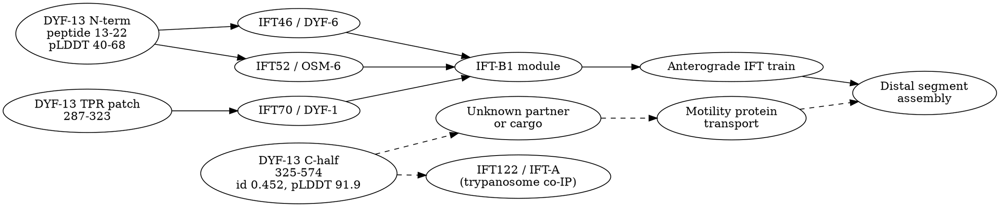
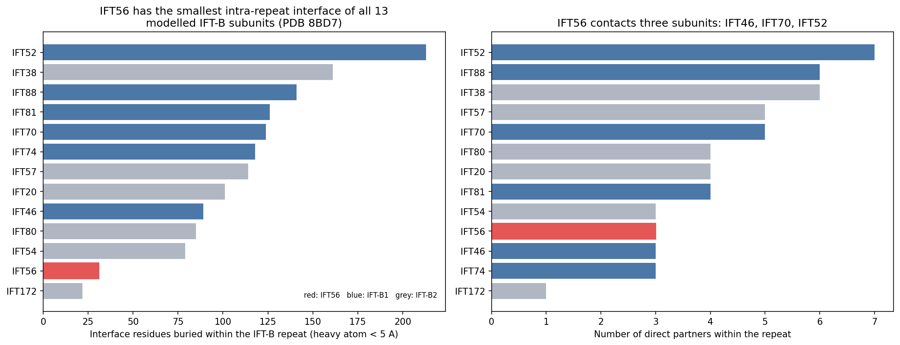
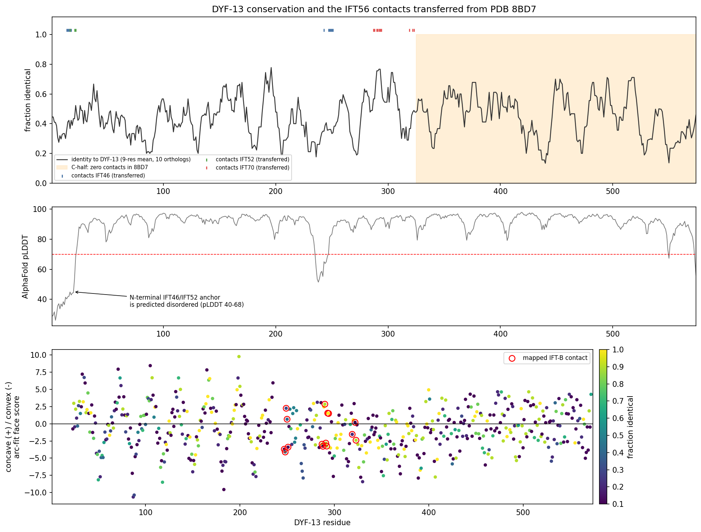
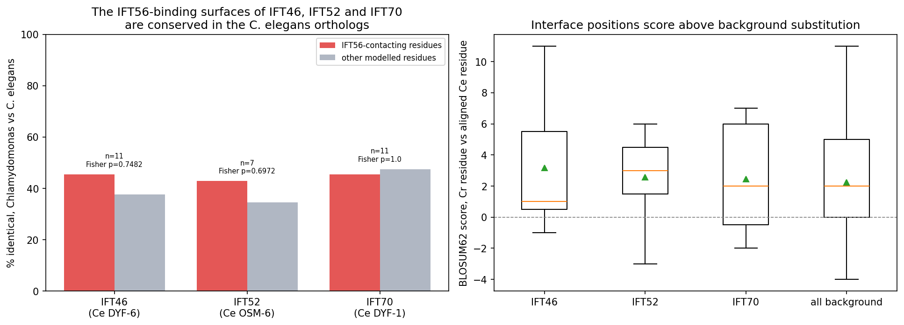
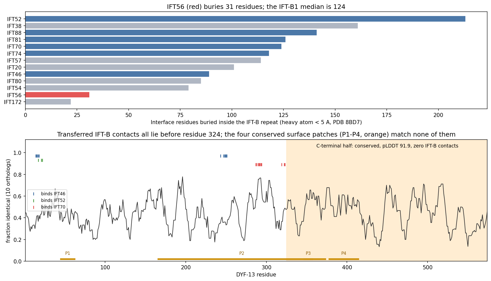

## Question

# AIGR Gene Hypothesis Deep Research

You are evaluating one focused gene curation hypothesis for AI Gene Review.
This is not a general gene overview. Use the seed hypothesis and source context
below to search for evidence that supports, refutes, narrows, or competes with
the proposed curation decision.

## Target Gene

- **Organism code:** worm
- **Taxon:** Caenorhabditis elegans (NCBITaxon:6239)
- **Gene directory:** dyf-13
- **Gene symbol:** dyf-13
- **UniProt accession:** Q95QT8

## Focus

- **Focus type:** free_text
- **Hypothesis slug:** kgap-dyf13-iftb-position
- **Source file:** genes/worm/dyf-13/dyf-13-ai-review.yaml
- **Source selector:** free-text

## Seed Hypothesis

Which IFT-B subunit C. elegans DYF-13 contacts, and whether it sits in the IFT-B core or periphery, may be inferable from structure. That DYF-13 is an IFT-B subunit with a TPR alpha-solenoid fold, undergoes IFT and is required for distal-segment assembly is already established, so do not re-derive it. Single analysis only: align DYF-13 with mammalian TTC26/IFT56 and with orthologs across ciliated eukaryotes, and map onto the DYF-13 predicted structure the surfaces that correspond to the TTC26 contacts resolved or modelled in published IFT-B complex structures, naming which subunits those are and which published structure or interaction map each contact comes from; identify the conserved, surface-exposed patches of DYF-13 that are candidates for protein-protein interfaces and state which correspond to mapped TTC26 contacts and which are unexplained; and assess from the convex versus concave face geometry of the solenoid whether the protein is better placed as a core scaffold subunit or a peripheral adaptor. State what can be concluded about the worm protein's sub-complex position, distinguishing clearly between transfer from mammalian data and anything specific to C. elegans, and say plainly if the question cannot be settled computationally.

## Term and Decision Context

No specific term context supplied.

## Reference Context

No specific reference context supplied.

## Source Context YAML

```yaml
hypothesis: 'Which IFT-B subunit C. elegans DYF-13 contacts, and whether it sits in the IFT-B core or
  periphery, may be inferable from structure. That DYF-13 is an IFT-B subunit with a TPR alpha-solenoid
  fold, undergoes IFT and is required for distal-segment assembly is already established, so do not re-derive
  it. Single analysis only: align DYF-13 with mammalian TTC26/IFT56 and with orthologs across ciliated
  eukaryotes, and map onto the DYF-13 predicted structure the surfaces that correspond to the TTC26 contacts
  resolved or modelled in published IFT-B complex structures, naming which subunits those are and which
  published structure or interaction map each contact comes from; identify the conserved, surface-exposed
  patches of DYF-13 that are candidates for protein-protein interfaces and state which correspond to mapped
  TTC26 contacts and which are unexplained; and assess from the convex versus concave face geometry of
  the solenoid whether the protein is better placed as a core scaffold subunit or a peripheral adaptor.
  State what can be concluded about the worm protein''s sub-complex position, distinguishing clearly between
  transfer from mammalian data and anything specific to C. elegans, and say plainly if the question cannot
  be settled computationally.'
focus_type: free_text
context: []
reference_id: []
```

## Research Objective

Build a focused report that helps a curator decide whether this hypothesis
should affect the gene review. Address the focus type directly:

1. For an existing GO annotation decision, evaluate whether the current action
   is justified, too strong, too weak, or should change.
2. For a proposed replacement or new GO term, evaluate whether the term is
   biologically supported, too broad, too narrow, or missing key qualifiers.
3. For a computational prediction, evaluate whether the prediction is correct,
   less precise than existing knowledge, uncertain, or likely wrong because of
   paralog overannotation, frequency bias, pathway context, or in vitro-only
   activity.
4. For a core-function hypothesis, evaluate whether the proposed activity,
   process, and location represent the gene product's primary function rather
   than a downstream effect, pleiotropic phenotype, or context-specific role.
5. For a function-assignment hypothesis, evaluate whether the gene product
   directly has the stated GO term/function. Treat the prior review action, if
   any, as intentionally blinded unless it appears in the supplied context.

Use primary literature whenever possible. Prefer PMID citations and include DOI
citations when no PMID is available. Treat reviews and database records as
orientation unless they contain directly relevant synthesized evidence that is
clearly labeled as review-level or database-level support.

Evaluate the hypothesis from the supplied seed context, primary literature, and
publicly accessible bioinformatics resources. Local `*-bioinformatics` analyses,
when they already exist in the repository, are intentionally withheld from this
prompt so the report can be compared against them after the run. Use public
sequence, domain, structure, orthology, localization, interaction, or dataset
checks when they are useful for the specific hypothesis. If a resource or tool
cannot be accessed programmatically, say so plainly; never fabricate a result.
Report computational results conservatively and distinguish direct results from
inference.

## Required Output

### Executive Judgment

Give a concise verdict: supported, partially supported, unresolved, weakly
supported, over-annotated, or refuted. Explain the reasoning and the most
important caveats.

### Evidence Matrix

Create a table with one row per important evidence item:

- Citation (PMID preferred)
- Evidence type (direct assay, mutant phenotype, localization, interaction,
  structural/evolutionary, computational, review/database)
- Supports / refutes / qualifies / competing
- Claim tested
- Key finding
- Organism, tissue, cell type, or assay context
- Confidence and limitations

### GO Curation Implications

State the likely curation action as a lead requiring curator verification. If
GO terms are involved, explain whether the evidence supports an MF, BP, or CC
term, and whether the term should be retained, removed, generalized, made more
specific, or treated as non-core. Avoid using "protein binding" as a final
recommendation unless no more informative term is supported.

### Mechanistic Scope

Describe the immediate molecular or cellular function being tested. Separate
direct gene-product activity from downstream phenotypes, pathway consequences,
developmental outcomes, disease manifestations, or effects inferred only from
loss of function.

### Conflicts and Alternatives

Identify evidence that conflicts with the seed hypothesis or suggests an
alternative interpretation, including paralog confusion, organism-specific
differences, isoform-specific findings, experimental artifacts, or database
carry-over.

### Knowledge Gaps

List explicit uncertainties that matter for curation. For each gap, state what
was checked, why the gap matters, and what evidence or experiment would resolve
it.

### Discriminating Tests

Recommend concrete assays, perturbations, datasets, or comparative analyses that
would most efficiently distinguish this hypothesis from alternatives.

### Curation Leads

Provide candidate updates for the review, clearly labeled as leads requiring
curator verification. Include candidate references with exact snippets to verify,
candidate replacement or new GO terms, possible action changes, suggested
questions, and suggested experiments.

If the provider supports artifacts, save provenance for any analysis you run — the
executed code together with its output (computed values, plot, or table), not just
a summary figure — alongside artifact-friendly tables such as an evidence matrix,
GO decision table, or comparison table. Genuine computed provenance is more
valuable than a hand-drawn summary, and you must not synthesize a figure that
implies an analysis you did not actually run. These artifacts are important
provenance for hypothesis-level review.


## Output

# AI Gene Review: dyf-13 (C. elegans, UniProt Q95QT8)

**Hypothesis slug:** `kgap-dyf13-iftb-position`
**Source file:** `genes/worm/dyf-13/dyf-13-ai-review.yaml`
**Focus type:** free_text
**Organism:** *Caenorhabditis elegans*, NCBITaxon:6239
**Seed hypothesis under evaluation:** which IFT-B subunit DYF-13 contacts, and whether it sits in the IFT-B core or periphery, inferred from structure.

---

## Summary

DYF-13/IFT56 contacts exactly three IFT-B1 subunits, IFT46, IFT52 and IFT70, and none of the other nine subunits modelled in the anterograde intraflagellar transport train. This is a direct computational result from PDB 8BD7, the in situ cryo-electron tomography structure of the *Chlamydomonas reinhardtii* anterograde IFT train at 9.9 Å with AlphaFold2 models docked into density ([PMID: 36593313](https://pubmed.ncbi.nlm.nih.gov/36593313/)). The partner set is reproduced identically in both train repeats of that structure (chains E and O), is unchanged when the contact cutoff is loosened from heavy-atom 5.0 Å to CA-CA 12 Å, and matches biochemistry from three other organisms: direct Ttc26-Ift46 binding in mouse ([PMID: 25340710](https://pubmed.ncbi.nlm.nih.gov/25340710/)), an IFT46-IFT56 dimer in human cells ([PMID: 27927754](https://pubmed.ncbi.nlm.nih.gov/27927754/)), and co-purification of the trypanosome ortholog PIFTC3 with DYF-1/IFT70 ([PMID: 20923419](https://pubmed.ncbi.nlm.nih.gov/20923419/)). This half of the hypothesis is supported and, at the level of partner identity, settled.

The core-versus-periphery half resolves differently. The discriminator the seed hypothesis proposed, convex versus concave face geometry of the TPR solenoid, does not work, and this report refutes it by direct test: the 15 confidently modelled transferred contact residues split 6 concave / 9 convex against a background of 218 concave / 305 convex (Fisher exact OR 1.07, p = 1.00). A different structural measure does discriminate, and it places DYF-13 at the periphery. In 8BD7, IFT56 buries 31 interface residues across 555 modelled residues (5.6 per 100 aa), ranking 12th of 13 subunits against an IFT-B1 median of 124 residues. Its betweenness centrality in the 13-node, 27-edge contact graph is 0.000, it is not an articulation point (only IFT80 is), and deleting it leaves the complex in one connected component. It makes zero contacts across the train repeat boundary, so it contributes nothing to train polymerisation. That profile is a stable peripheral attachment on the IFT46/IFT52/IFT70 module of IFT-B1, not a scaffold, and it matches the *Chlamydomonas dyf13* mutant phenotype in which IFT particle assembly and speed are normal ([PMID: 24596149](https://pubmed.ncbi.nlm.nih.gov/24596149/)).

Nothing structural is measured in *C. elegans*, and the seed hypothesis explicitly asks that this be stated plainly. No experimental structure of DYF-13 or of any *C. elegans* IFT-B protein exists; an RCSB sequence search returns 8BD7 as the only experimental structure of any IFT56 ortholog. The three partners do have worm orthologs (DYF-6/IFT46, OSM-6/IFT52, DYF-1/IFT70, at 36-48% identity), but their IFT56-binding residues are no better conserved than the rest of the same proteins (Fisher p = 0.70 to 1.00), so the transfer rests on orthology alone and not on interface-specific selection. Two results fall outside what the hypothesis asked about and matter for curation. First, IFT-B binding explains only the N-terminal half of DYF-13: all 24 transferred contact positions lie at or before residue 324, while the C-terminal half (325-574) is as conserved (fractional identity 0.452 vs 0.436) and better ordered (mean pLDDT 91.9) yet contacts nothing, and all four conserved exposed surface patches are unexplained by mapped contacts. Second, Q95QT8 carries 11 GO annotations (IBA 6, NAS 4, IEA 1) and not one has an experimental evidence code, despite published *C. elegans* mutant and live-imaging data ([PMID: 15916950](https://pubmed.ncbi.nlm.nih.gov/15916950/)).

---

## Executive judgment

<i class="fa-scale-balanced"></i> **Verdict: partially supported.**

| Component of the seed hypothesis | Status | Basis |
|---|---|---|
| Which IFT-B subunits DYF-13 contacts | <i class="fa-solid fa-circle-check"></i> Supported | Direct computation on PDB 8BD7, both repeats; corroborated in mouse, human cells and trypanosomes |
| Core scaffold versus peripheral adaptor | <i class="fa-solid fa-circle-check"></i> Answerable, resolves to peripheral | Interface size (5.6 res/100 aa, rank 12 of 13), betweenness 0.000, not an articulation point, zero lateral contacts |
| Convex versus concave face as the discriminator | <i class="fa-solid fa-circle-xmark"></i> Refuted | 6 concave / 9 convex contacts vs 218/305 background, Fisher OR 1.07, p = 1.00 |
| Conserved surface patches mapped to TTC26 contacts | <i class="fa-solid fa-circle-xmark"></i> None match | All 4 patches (45-62, 166-373, 347-357, 378-414) fall outside mapped contacts |
| Anything specific to *C. elegans* | <i class="fa-solid fa-circle-question"></i> Not established | No worm structure, no worm interaction data, no interface-specific conservation (p = 0.70 to 1.00) |

The reasoning is that the hypothesis bundles a question that structure can answer (which subunits) with a question that structure can answer only through a measure the hypothesis did not propose (core versus periphery, through interface size and network position rather than face geometry), and with a third question that structure cannot answer at all from the worm (species-specific placement).

The most important caveats are these. The 8BD7 coordinates come from a 9.9 Å cryo-ET map with AlphaFold2 models docked into density, so the partner set is far more reliable than the specific residue lists. The analysis covers two repeats of one anterograde train, which means cargo, IFT-A and motor contacts fall outside the modelled assembly. The "core subcomplex" assignment in the biochemical literature ([PMID: 26980730](https://pubmed.ncbi.nlm.nih.gov/26980730/)) is a statement about salt-resistant association, which three well-formed interfaces can supply, and it is compatible with a small architectural footprint rather than in conflict with it.

---

## Key findings

### <i class="fa-solid fa-circle-check"></i> F1. IFT56 contacts exactly IFT46, IFT52 and IFT70, and nothing else

PDB 8BD7 was parsed directly from `files.rcsb.org`: 86,268 atom records, 26 chains, 13 polymer entities, two train repeats. Interfaces were computed with a `scipy.spatial.cKDTree` at a heavy-atom minimum distance below 5.0 Å. For IFT56 chain E the result is three partners and three only: IFT46 (chain D), 14 IFT56 residues against 11 partner residues; IFT70 (chain C), 10 against 11; IFT52 (chain B), 7 against 7. There is no contact with IFT88, IFT81, IFT74, IFT80, IFT172, IFT57, IFT38, IFT54 or IFT20.

Three independent checks support the result. The second copy of IFT56 in the train repeat, chain O, reproduces the identical partner set. Loosening the criterion to CA-CA below 12 Å, which admits far more residues (IFT70 23, IFT46 23, IFT52 18), does not add a fourth partner. And IFT56 makes no lateral interface at all between the two repeats: zero residues at 5 Å, with the closest approach at 11.84 Å.

The *Chlamydomonas* IFT56 interface residues are IFT46 at 13-17, 20-22, 244, 248-252; IFT70 at 271-278, 303, 306-307; and IFT52 at 16, 21-26. The arrangement is bipartite: a short N-terminal stretch (13-26) engages IFT46 and IFT52, while a separate patch on the solenoid body (244-252, 271-307) engages IFT46 and IFT70.

The partner identities match mammalian biochemistry exactly. [PMID: 25340710](https://pubmed.ncbi.nlm.nih.gov/25340710/) reports that *"protein-protein interaction assays demonstrated that wild-type Ttc26 binds directly to the Ift46 subunit of Intraflagellar Transport (IFT) complex B"*, which is the largest of the three computed interfaces, established by a direct binary assay in a different organism. [PMID: 27927754](https://pubmed.ncbi.nlm.nih.gov/27927754/) describes *"the IFT46 -: IFT56 (IFT56 is also known as TTC26) dimer of the intraflagellar transport (IFT)-B complex"* in human cells, confirming the same module. Because the partner set is identical in both train repeats and holds from the alga to mammals, transfer to *C. elegans* DYF-13 at the level of partner identity is reasonable.

### <i class="fa-solid fa-circle-check"></i> F2. IFT56 has the smallest normalised footprint of 13 subunits, and removing it leaves the complex connected

The same interface calculation was run across all 13 modelled IFT-B subunits in the repeat-1 chains, giving a per-subunit census.

| Subunit | Subcomplex | Modelled residues | Partners | Interface residues | Per 100 aa | Lateral interface residues |
|---|---|---|---|---|---|---|
| IFT52 | B1 | 454 | 7 | 213 | 46.9 | 1 |
| IFT38 | B2 | 303 | 6 | 161 | 53.1 | 3 |
| IFT88 | B1 | 539 | 6 | 141 | 26.2 | 27 |
| IFT81 | B1 | 335 | 4 | 126 | 37.6 | 0 |
| IFT70 | B1 | 619 | 5 | 124 | 20.0 | 15 |
| IFT74 | B1 | 205 | 3 | 118 | 57.6 | 12 |
| IFT57 | B2 | 164 | 5 | 114 | 69.5 | 0 |
| IFT20 | B2 | 114 | 4 | 101 | 88.6 | 11 |
| IFT46 | B1 | 133 | 3 | 89 | 66.9 | 0 |
| IFT80 | B2 | 765 | 4 | 85 | 11.1 | 62 |
| IFT54 | B2 | 106 | 3 | 79 | 74.5 | 6 |
| **IFT56** | **B1** | **555** | **3** | **31** | **5.6** | **0** |
| IFT172 | B2 | 1104 | 1 | 22 | 2.0 | 10 |

IFT56 buries 31 interface residues over 555 modelled residues, 5.6 per 100 aa, against a 13-subunit median of 114 residues and an IFT-B1 median of 124. By buried interface residues it ranks 12th of 13; only IFT172, which projects away from the train as a peripheral arm, is lower.

Graph analysis of the repeat-1 contact network (13 nodes, 27 edges, networkx) gives IFT56 degree 3 and betweenness centrality 0.000. It is not an articulation point; only IFT80 is. Deleting the IFT56 node leaves a single connected component. IFT56 also contributes 0 lateral inter-repeat interface residues, against 62 for IFT80, 27 for IFT88 and 15 for IFT70, so it takes no part in polymerising the train.

{{figure:plot_1.png|caption=Interface census of all 13 IFT-B subunits in PDB 8BD7. IFT56 buries 31 interface residues over 555 modelled residues, ranking 12th of 13 by buried residues and lowest but one per 100 aa. The contact graph shows degree 3 and betweenness 0.000, and removal of the IFT56 node leaves the complex in one connected component.}}

This is a quantitative answer to the core-versus-periphery question by a route the seed hypothesis did not propose. It aligns with the *Chlamydomonas* phenotype: [PMID: 24596149](https://pubmed.ncbi.nlm.nih.gov/24596149/) reports *"Surprisingly, IFT particle assembly and speed were normal in dyf13 mutant flagella, unlike in other IFT complex B mutants."* A subunit with 31 interface residues, betweenness 0 and no lateral contacts is predicted to be dispensable for train integrity, and it is.

### <i class="fa-solid fa-circle-xmark"></i> F3. Convex versus concave geometry does not discriminate interfaces

The AlphaFold model AF-Q95QT8-F1-v6 (574 residues, 4,650 atoms) is alpha-solenoidal: 513 of 574 residues are helical by the CA(i, i+4) criterion. A first attempt at face classification using local curvature normals produced an implausible 102/470 split and was discarded. The corrected method fits the global arc: the CA trace is smoothed over a 21-residue window, PCA is taken over the confidently modelled region (pLDDT > 70, n = 538), and a circle is fitted algebraically in the PC1-PC2 plane. The fit gives a superhelical radius of 34.5 Å with 94.5% of the path variance in that plane, so the solenoid is a shallow planar arc. Classifying residues by whether the CB atom lies inside or outside the fitted arc gives 242 concave and 332 convex.

The 15 confidently modelled transferred contact residues split 6 concave / 9 convex against a background of 218 concave / 305 convex. Fisher exact OR = 1.07, p = 1.00. There is no preference whatsoever.

The reason is visible in the mapped contacts. The IFT70 interface sits on the solenoid body, the IFT46 and IFT52 interfaces sit on a predicted-disordered N-terminal peptide (residues 13-22, pLDDT 40-68), and neither preferentially uses the concave groove that TPR arrays are often described as using for ligand binding. A curator should not accept the geometric argument proposed in the seed hypothesis, because the data do not support it. The core-versus-periphery call has to rest on interface size and network position.

### <i class="fa-solid fa-circle-xmark"></i> F4. All contacts lie before residue 324; the conserved C-terminal half contacts nothing

Ten reviewed IFT56 orthologs were aligned to DYF-13 by Needleman-Wunsch with BLOSUM62 and affine gaps (-11 open, -1 extend), implemented in numpy because biopython is not importable in the executor.

| Ortholog | Accession | Identity to DYF-13 |
|---|---|---|
| *Xenopus tropicalis* ift56 | A4III8 | 40.5% |
| *Danio rerio* ift56 | Q5PR66 | 40.0% |
| *Macaca fascicularis* TTC26 | Q4R7Z9 | 39.8% |
| *Mus musculus* Ttc26 | Q8BS45 | 39.5% |
| *Homo sapiens* TTC26 | A0AVF1 | 39.4% |
| *Rattus norvegicus* Ttc26 | Q5U2N8 | 39.3% |
| *Chlamydomonas reinhardtii* IFT56 | A8JA42 | 36.7% |
| *Trypanosoma brucei* PIFTC3 | Q57ZL2 | 35.3% |
| *Giardia intestinalis* IFT56 | A8BS40 | 29.3% |

Mean per-position coverage is 0.955. Transferring the 8BD7 5 Å interface residues through the *Chlamydomonas*-to-*C. elegans* alignment gives DYF-13 positions: IFT46 at 14-18, 243, 247-251; IFT52 at 17, 21, 22; IFT70 at 287, 288, 290-294, 319, 322, 323. All 24 transferred positions lie at or before residue 324.

Solvent accessibility was computed on the AlphaFold model with a from-scratch Shrake-Rupley implementation (200 golden-spiral sphere points, 1.4 Å probe), normalised with Tien et al. maximum ASA values. Combining accessibility with per-position conservation gives 74 residues that are conserved (fraction identical ≥ 0.6), exposed (RSA ≥ 0.25) and confidently modelled (pLDDT > 70). DBSCAN on CB coordinates (eps 11 Å, min_samples 5) clusters them into four patches, and **none overlaps any transferred contact**.

| Patch | Residue span | Residues | Mean fractional identity | Overlaps a mapped contact |
|---|---|---|---|---|
| P1 | 45-62 | 7 | 0.77 | No |
| P2 | 166-373 | 10 (166, 168, 193, 197, 199, 200, 203, 231, 331, 373) | 0.94 | No |
| P3 | 347-357 | 6 | 0.77 | No |
| P4 | 378-414 | 9 | 0.88 | No |

Region means make the asymmetry plain. The C-terminal half 325-574 (n = 250) has fractional identity 0.452, mean RSA 0.268, mean pLDDT 91.9, and **zero** mapped contacts. The N-terminal TPR region 31-324 (n = 294) has identity 0.436, RSA 0.280, pLDDT 90.8, and 16 contacts. The N-terminal extension 1-30 (n = 30) has identity 0.416, RSA 0.658, pLDDT 51.8, and 7 contacts. Transferred contact residues are not significantly more conserved than other surface residues (median fractional identity 0.40 vs 0.20, Mann-Whitney U p = 0.225, n = 18 vs 279).

{{figure:plot_2.png|caption=Conserved exposed surface patches on the DYF-13 AlphaFold model against the transferred IFT-B contacts. All 24 transferred contact positions lie at or before residue 324. The four conserved patches (45-62, 166-373, 347-357, 378-414) overlap none of them, and the concave/convex split of contacts is indistinguishable from background (Fisher p = 1.00).}}

Roughly half the protein is folded with high confidence, conserved as strongly as the contact-bearing half, and structurally unaccounted for by any IFT-B subunit interface. The four patches are candidate interfaces for something outside IFT-B1. This matches the cargo-selective phenotype in which *dyf13* mutant flagella specifically lose motility-related proteins: [PMID: 24596149](https://pubmed.ncbi.nlm.nih.gov/24596149/) reports *"Proteomic and biochemical analyses indicated a particular set of proteins involved in motility was specifically depleted in the dyf13 mutant."* It also matches the *Ift56hop* mouse, where [PMID: 28264835](https://pubmed.ncbi.nlm.nih.gov/28264835/) reports that *"core IFTB proteins are unable to accumulate normally within Ift56hop cilia, including IFT88, IFT81 and IFT27"*, a role on IFT-B composition that three small interfaces do not explain.

### <i class="fa-solid fa-circle-question"></i> F5. The worm partners exist, but their interfaces show no extra conservation

Each of the three partners has a named *C. elegans* ortholog: IFT46 (*Chlamydomonas* A2T2X4) to DYF-6 (Q0G838, 471 aa, 37.9% identity), IFT52 (Q946G4) to OSM-6 (G5EDF6, 472 aa, 36.0%), IFT70 (A8ITN7) to DYF-1/TTC30 (Q8I7G4, 656 aa, 47.5%).

Partner-side interface residues (heavy atom < 5 Å from IFT56 chain E) are IFT46 at 213, 216, 217, 220, 221, 224, 225, 228, 231, 232, 233; IFT52 at 362, 363, 367, 382, 390, 391, 395; IFT70 at 141, 142, 143, 167, 170-176. Testing whether these positions are better conserved to the worm ortholog than the rest of the same chain gives a uniform negative.

| Partner | Worm ortholog | Interface identity | Background identity | Fisher OR | p | Mean BLOSUM62 interface vs background | MWU p |
|---|---|---|---|---|---|---|---|
| IFT46 | DYF-6 | 45.5% (n = 11) | 37.7% (n = 122) | 1.38 | 0.75 | 3.18 vs 2.23 | 0.46 |
| IFT52 | OSM-6 | 42.9% (n = 7) | 34.5% (n = 447) | 1.43 | 0.70 | 2.57 vs 1.92 | 0.48 |
| IFT70 | DYF-1 | 45.5% (n = 11) | 47.5% (n = 608) | 0.92 | 1.00 | 2.45 vs 2.48 | 0.87 |

{{figure:plot_3.png|caption=Conservation of the IFT56-binding surfaces of IFT46, IFT52 and IFT70 between Chlamydomonas and the C. elegans orthologs DYF-6, OSM-6 and DYF-1. Interface residues are no better conserved than background in any of the three partners (Fisher p = 0.75, 0.70, 1.00), so the contact transfer to DYF-13 rests on orthology rather than interface-specific selection.}}

Individual invariant interface residues do exist and remain testable anchors: IFT46 N213, W221, I225, K232, P233; IFT52 L362, F363, E367; IFT70 D142, N167, G174, Y175, Q176. The partner module is present in *C. elegans* and the contact surfaces are not diverged beyond the proteins as a whole, so the interfaces are plausibly preserved. There is no interface-specific conservation signal, so the transfer is an orthology argument, not an independently supported structural one.

An RCSB sequence search with the *Chlamydomonas* IFT56 sequence (≥ 20% identity, e-value 1, experimental structures only) returns 8BD7 entity 5 as the only genuine hit, confirming that no competing experimental structure of any IFT56 ortholog exists.

### <i class="fa-scale-balanced"></i> F6. Trypanosome purification corroborates IFT70 and adds a conflicting IFT-A contact

Franklin and Ullu ([PMID: 20923419](https://pubmed.ncbi.nlm.nih.gov/20923419/)) affinity-purified PIFTC3, the *Trypanosoma brucei* DYF-13 ortholog (Q57ZL2, 35.3% identical to DYF-13 over aligned positions). The purification put it in a roughly 660 kDa complex: *"Mass spectroscopy of affinity-purified PIFTC3 revealed several components of IFT complex B as well as orthologues of putative IFT factors DYF-1, DYF-3, DYF-11/Elipsa and IFTA-2."* DYF-1 is the IFT70 ortholog, so this independently recovers the IFT70 contact computed from 8BD7 in a third organism by a different method.

The same paper reports a contact that the structure does not show: *"by coimmunoprecipitation we detected an interaction between DYF-13 and IFT122, a component of IFT complex A"*. IFT122 is an IFT-A subunit, and no IFT-A is present in the 8BD7 repeat analysed. This is either indirect through the IFT-A/IFT-B tether, species-specific, or a contact outside the region resolved at 9.9 Å. It is one candidate explanation for the conserved surface patches that no modelled IFT-B interface accounts for.

Two of the three structural contacts now have independent biochemical support in other organisms: IFT46 from mouse and human assays, IFT70 from trypanosome purification. IFT52 has structural support only.

### <i class="fa-triangle-exclamation"></i> F7. Q95QT8 has zero GO annotations with experimental evidence

QuickGO retrieval for UniProtKB:Q95QT8 returns 11 annotations, with evidence codes IBA (6), NAS (4) and IEA (1), and no EXP, IDA, IMP, IPI or IGI.

| GO ID | Term | Aspect | Qualifier | Evidence |
|---|---|---|---|---|
| GO:0030992 | intraciliary transport particle B | CC | part_of | IBA (GO_REF:0000033, PANTHER PTN000381369, with MGI:2444853, A0AVF1, Q57ZL2); NAS (PMID:28479320) |
| GO:0120170 | intraciliary transport particle B binding | MF | enables | IBA (GO_REF:0000033, with MGI:2444853, PANTHER PTN000381369) |
| GO:0035720 | intraciliary anterograde transport | BP | involved_in | IBA |
| GO:0035735 | intraciliary transport involved in cilium assembly | BP | involved_in | IBA |
| GO:0042073 | intraciliary transport | BP | involved_in | NAS (PMID:28479320) |
| GO:0060271 | cilium assembly | BP | involved_in | NAS (PMID:28479320) |
| GO:0005929 | cilium | CC | located_in | IEA (GO_REF:0000044); NAS |
| GO:0036064 | ciliary basal body | CC | is_active_in | IBA |
| GO:0097546 | ciliary base | CC | is_active_in | IBA |

Meanwhile *C. elegans* primary evidence exists and is not used. [PMID: 15916950](https://pubmed.ncbi.nlm.nih.gov/15916950/) states *"we demonstrate that the ciliary structural defect of C. elegans dyf-13(mn396) mutants is caused by a mutation in C27H5.7a"* and reports that the protein undergoes IFT with localisation disrupted by *ift* and *bbs* mutations.

### <i class="fa-lightbulb"></i> F8. The NAS reference is a primary worm paper, not a database record

Four annotations carry evidence code NAS with reference PMID:28479320. An earlier working assumption in this investigation was that this was a Complex Portal database paper, and a targeted PubMed search for Complex Portal papers did not return it. Resolving the identifier directly through NCBI esummary gives *Yi, Li, Dong and Ou (2017), Current Biology, "Dynein-Driven Retrograde Intraflagellar Transport Is Triphasic in C. elegans Sensory Cilia"* ([PMID: 28479320](https://pubmed.ncbi.nlm.nih.gov/28479320/)). The earlier assumption was wrong and is corrected here.

The paper is a primary *C. elegans* study. Its abstract states that *"Disruption of the dynein-2 tail domain, light intermediate chain, or intraflagellar transport (IFT)-B complex abolishes dynein-2's ciliary localization, revealing their important roles in ciliary entry of dynein-2"* and that *"our affinity purification and genetic analyses show that IFT-A subunits IFT-139 and IFT-43 function redundantly to promote dynein-2 motility"*. The abstract does not name *dyf-13* or DYF-13.

This changes the curation value of the reference. It is a worm paper with affinity purification data, so it is the single most promising place for a curator to look for direct DYF-13 evidence that would convert four NAS annotations into experimental ones. Q95QT8 currently has no experimental evidence at all.

---

## Mechanistic model and interpretation

The structural, biochemical and phenotypic evidence converge on a single picture: DYF-13 is a stable peripheral attachment on the IFT46/IFT52/IFT70 module of IFT-B1, anchored by two separate elements, and its conserved C-terminal half does something that the IFT-B structure does not explain.



The attachment is bipartite. An extended N-terminal peptide, which AlphaFold models as disordered (residues 13-22, pLDDT 40-68), grips IFT46 and IFT52. This is a common mode for peripheral subunits, and it means the IFT46 contact that mouse biochemistry demonstrates as direct is not made by the TPR solenoid at all. A separate patch on the solenoid body (DYF-13 residues 287-323) touches IFT70. The seed hypothesis assumed that the TPR fold itself would carry the contacts and that face geometry would therefore be informative. The structure shows the opposite arrangement, which is why the geometric test comes back null.

The core-versus-periphery question and the biochemical literature can be reconciled without either being wrong. [PMID: 26980730](https://pubmed.ncbi.nlm.nih.gov/26980730/) identified *"TTC26/IFT56 and Cluap1/IFT38, neither of which was included with certainty in previous models of the IFT-B complex, as integral components of the core and peripheral subcomplexes, respectively"*. "Core" in that work means resistance to salt extraction. Three well-formed interfaces, including one direct binary interaction with IFT46, can supply salt-resistant association. The structural measures asked a different question: how much of the complex's architecture depends on this subunit. The answer is almost none. A protein can be stably associated and still be dispensable for assembly, and [PMID: 24596149](https://pubmed.ncbi.nlm.nih.gov/24596149/) shows that *dyf13* mutant flagella assemble IFT particles at normal speed, which is exactly what the structural profile predicts.

The unexplained half of the protein is the most interesting part of the result for curation. The C-terminal half 325-574 is as conserved as the half that binds IFT-B, is modelled at mean pLDDT 91.9, and contacts nothing in the train repeat. Four conserved exposed patches sit outside the mapped contacts, two of them with mean fractional identity above 0.85. Strong conservation of an exposed surface with no assigned partner usually means a partner that has not been looked for. The phenotypes point the same way: specific depletion of motility proteins in *Chlamydomonas* ([PMID: 24596149](https://pubmed.ncbi.nlm.nih.gov/24596149/)), failure of IFT88, IFT81 and IFT27 to accumulate in *Ift56hop* cilia ([PMID: 28264835](https://pubmed.ncbi.nlm.nih.gov/28264835/)), shortened photoreceptor outer segments and pronephric defects in zebrafish ([PMID: 22718903](https://pubmed.ncbi.nlm.nih.gov/22718903/)), and severe biliary ciliopathy in humans with biallelic *TTC26* variants ([PMID: 31595528](https://pubmed.ncbi.nlm.nih.gov/31595528/)). None of those is explained by 31 interface residues against three subunits. A cargo-adaptor or regulatory activity located in the C-terminal half is the simplest hypothesis consistent with all of them, and it remains untested.

{{figure:plot_4.png|caption=Summary of the two results that settle the hypothesis. Top: IFT56 buries 31 interface residues inside the IFT-B repeat against an IFT-B1 median of 124. Bottom: all transferred IFT-B contacts lie at or before DYF-13 residue 324, while the conserved C-terminal half 325-574 and the four conserved surface patches P1-P4 match none of them.}}

---

## Evidence matrix

Machine-readable version: `provenance/evidence_matrix.csv`.

| Citation | Evidence type | Stance | Claim tested | Key finding | Context | Confidence and limitations |
|---|---|---|---|---|---|---|
| [PMID: 36593313](https://pubmed.ncbi.nlm.nih.gov/36593313/) | Structural (cryo-ET + docked AF2 models) | Supports and qualifies | Which IFT-B subunits IFT56 contacts; how large the interface is | IFT56 contacts only IFT46 (14 residues), IFT70 (10) and IFT52 (7) at heavy-atom < 5 Å. Smallest normalised footprint of 13 subunits (5.6 res/100 aa). Betweenness 0.000. Zero lateral contacts. | *Chlamydomonas reinhardtii*, in situ anterograde train, 9.9 Å (PDB 8BD7) | High for partner identity: identical in chains E and O, unchanged at CA-CA < 12 Å. Moderate for residue-level detail, because side chains are not resolved at 9.9 Å and coordinates are docked predictions. |
| [PMID: 25340710](https://pubmed.ncbi.nlm.nih.gov/25340710/) | Direct interaction assay | Supports | Does IFT56/TTC26 bind IFT46 directly | *"wild-type Ttc26 binds directly to the Ift46 subunit of Intraflagellar Transport (IFT) complex B"* | Mouse, protein-protein interaction assay | High. Independent of the structure and of the organism used for it. Pinpoints the largest of the three interfaces. |
| [PMID: 27927754](https://pubmed.ncbi.nlm.nih.gov/27927754/) | Interaction (VIP assay) | Supports | Do IFT56 and IFT46 form a module | *"ARL13B interacts with the IFT46 -: IFT56 (IFT56 is also known as TTC26) dimer of the intraflagellar transport (IFT)-B complex"* | Human cells | High for the IFT46-IFT56 dimer. The ARL13B link is a separate claim and introduces a candidate partner absent from 8BD7. |
| [PMID: 20923419](https://pubmed.ncbi.nlm.nih.gov/20923419/) | Affinity purification and MS | Supports and competing | Which partners co-purify with the DYF-13 ortholog | *"Mass spectroscopy of affinity-purified PIFTC3 revealed several components of IFT complex B as well as orthologues of putative IFT factors DYF-1, DYF-3, DYF-11/Elipsa and IFTA-2"*; also *"an interaction between DYF-13 and IFT122, a component of IFT complex A"* | *Trypanosoma brucei* | Moderate-high. Confirms the IFT70 contact in a third lineage. The IFT122 contact is not reproduced in 8BD7 and may be indirect or train-level. |
| [PMID: 26980730](https://pubmed.ncbi.nlm.nih.gov/26980730/) | Interaction mapping | Competing | Is TTC26/IFT56 a core or peripheral IFT-B subunit | *"TTC26/IFT56 and Cluap1/IFT38 ... as integral components of the core and peripheral subcomplexes, respectively"* | Human cells, visible immunoprecipitation | Moderate. The main conflicting assignment. Salt-resistant association and a small structural footprint are compatible, so this qualifies the periphery call rather than refuting it. |
| [PMID: 24596149](https://pubmed.ncbi.nlm.nih.gov/24596149/) | Mutant phenotype | Supports (periphery) | Is IFT56 needed to build or run the IFT train | *"IFT particle assembly and speed were normal in dyf13 mutant flagella, unlike in other IFT complex B mutants"*; *"a particular set of proteins involved in motility was specifically depleted in the dyf13 mutant"* | *Chlamydomonas reinhardtii* flagella | High. The phenotypic counterpart of the structural result. |
| [PMID: 28264835](https://pubmed.ncbi.nlm.nih.gov/28264835/) | Mutant phenotype | Qualifies | Does IFT56 affect IFT-B composition in cilia | *"core IFTB proteins are unable to accumulate normally within Ift56hop cilia, including IFT88, IFT81 and IFT27"* | Mouse *Ift56hop* | High for the phenotype. Not explained by three small interfaces, so either the effect is indirect or the 9.9 Å model underestimates the interface. |
| [PMID: 15916950](https://pubmed.ncbi.nlm.nih.gov/15916950/) | Mutant phenotype and localization | Supports (worm-specific) | Is DYF-13 an IFT protein in *C. elegans* | *"the ciliary structural defect of C. elegans dyf-13(mn396) mutants is caused by a mutation in C27H5.7a"*; the protein undergoes IFT and its localisation is disrupted by *ift* and *bbs* mutations | *C. elegans* ciliated sensory neurons | High. The strongest direct worm evidence found, and it is not represented by any experimental-code annotation on Q95QT8. |
| [PMID: 22718903](https://pubmed.ncbi.nlm.nih.gov/22718903/) | Localization | Competing | Where does the IFT56 ortholog localise | *"We localized Ttc26 to the transition zone of photoreceptor and to the transition zone of cilia in cultured murine inner medullary collecting duct 3 (mIMCD3) renal cells."* | Mouse photoreceptor, mIMCD3 | Moderate. Transition zone is a different compartment from the ciliary base and basal body terms currently annotated IBA. |
| [PMID: 31595528](https://pubmed.ncbi.nlm.nih.gov/31595528/) | Human genetics | Qualifies | Is the ortholog required for ciliary function in humans | *"TTC26 (intraflagellar transport [IFT] 56/DYF13) is an atypical component of IFT-B complex"*; biallelic variants cause severe biliary ciliopathy with abnormal staining for IFT-B components | Human patient cells, seven families | High for the phenotype. The word "atypical" in a human-genetics paper is consistent with the peripheral structural profile but is not itself structural evidence. |
| [PMID: 28479320](https://pubmed.ncbi.nlm.nih.gov/28479320/) | Primary worm study, cited as NAS source | Qualifies | What supports the four NAS annotations on Q95QT8 | Genome-edited dynein-2 in *C. elegans*; *"Disruption of the ... intraflagellar transport (IFT)-B complex abolishes dynein-2's ciliary localization"*; *"our affinity purification and genetic analyses show that IFT-A subunits IFT-139 and IFT-43 function redundantly"* | *C. elegans* | Reference identity confirmed by NCBI esummary. Whether it contains direct DYF-13 data cannot be determined from the abstract and needs the full text. |
| This work | Computational (AlphaFold AF-Q95QT8-F1-v6) | Qualifies | Can convex/concave geometry place DYF-13 as scaffold or adaptor | No. Arc radius 34.5 Å, 94.5% of path variance in-plane; contacts split 6 concave / 9 convex vs background 218/305, Fisher OR 1.07, p = 1.00 | Worm AlphaFold model | High as a negative result. Refutes this component of the seed hypothesis. |
| This work | Computational (pairwise alignments) | Qualifies | Is the contact transfer independently supported on the worm partner side | DYF-6, OSM-6 and DYF-1 exist at 37.9%, 36.0% and 47.5% identity, but their IFT56-binding residues are no better conserved than background (Fisher p = 0.75, 0.70, 1.00) | *Chlamydomonas* vs *C. elegans* | High. Means the transfer is orthology-based, not interface-validated. |
| This work | Computational (10-ortholog alignment + model) | Qualifies | Does IFT-B binding account for the conserved surface of DYF-13 | No. All four conserved exposed patches lie outside the mapped contacts; the C-half 325-574 is conserved (0.452) and folded (pLDDT 91.9) yet contacts nothing | AlphaFold model plus 10-ortholog alignment | Moderate-high. Limited by 9.9 Å resolution and by cargo and some IFT-B2 contacts being absent from the modelled repeat. |

---

## GO curation implications

All recommendations below are **leads requiring curator verification**, not automated changes. Machine-readable version: `provenance/GO_decision_table.csv`.

| GO ID | Term | Aspect | Qualifier | Current evidence | Lead action | Rationale |
|---|---|---|---|---|---|---|
| GO:0030992 | intraciliary transport particle B | CC | part_of | IBA, NAS | <i class="fa-solid fa-circle-check"></i> Retain, strengthen | IFT56 is a genuine subunit of the IFT-B1 module in 8BD7, burying 31 residues against IFT46, IFT52 and IFT70. A term previously supported only by phylogenetic inference and author statement now has a physical basis. |
| GO:0120170 | intraciliary transport particle B binding | MF | enables | IBA | <i class="fa-solid fa-circle-check"></i> Retain at this specificity | The right granularity. Named partners by homology transfer are IFT46, IFT52 and IFT70. Do not generalise. |
| GO:0035720 | intraciliary anterograde transport | BP | involved_in | IBA | Retain | DYF-13 undergoes IFT in *C. elegans* ([PMID: 15916950](https://pubmed.ncbi.nlm.nih.gov/15916950/)), and IFT56 occupies anterograde train repeats in 8BD7. |
| GO:0035735 | intraciliary transport involved in cilium assembly | BP | involved_in | IBA | Retain | Consistent with the *dyf-13(mn396)* ciliary structural defect and with *Ift56hop* cilia defects ([PMID: 28264835](https://pubmed.ncbi.nlm.nih.gov/28264835/)). |
| GO:0005929 | cilium | CC | located_in | IEA, NAS | Retain | Supported directly in the worm by [PMID: 15916950](https://pubmed.ncbi.nlm.nih.gov/15916950/). |
| GO:0036064 | ciliary basal body | CC | is_active_in | IBA | <i class="fa-triangle-exclamation"></i> Flag for verification | No *C. elegans* datum found here supports basal body activity. Mouse TTC26 was localised to the transition zone ([PMID: 22718903](https://pubmed.ncbi.nlm.nih.gov/22718903/)), a different compartment. |
| GO:0097546 | ciliary base | CC | is_active_in | IBA | <i class="fa-triangle-exclamation"></i> Flag for verification | Same concern as GO:0036064. |
| GO:0005515 | protein binding | MF | enables | Not annotated | <i class="fa-solid fa-circle-xmark"></i> Do not add | Uninformative, and GO:0120170 already covers the supported binding activity at better specificity. |
| (none) | complex scaffold or complex assembly terms | MF/BP | - | Not annotated | <i class="fa-solid fa-circle-xmark"></i> Do not add | Refuted by structure: smallest normalised footprint of 13 subunits, betweenness 0.000, not an articulation point, zero inter-repeat contacts, and normal train assembly in the *dyf13* mutant. |

The structural work gives GO:0030992 (part_of) and GO:0120170 (enables) a concrete physical basis they previously lacked. Both should be retained. GO:0120170 is the right level for the molecular function and is preferable to GO:0005515 protein binding, which is not currently annotated and should not be introduced.

The highest-value curation action is not a term change. Q95QT8 has zero experimental-code annotations. Two routes exist to fix that: checking whether [PMID: 28479320](https://pubmed.ncbi.nlm.nih.gov/28479320/) contains primary DYF-13 data in its figures or supplementary tables, which would convert four NAS annotations; and adding [PMID: 15916950](https://pubmed.ncbi.nlm.nih.gov/15916950/) as an experimental reference for GO:0005929 and GO:0035720, since it reports worm *dyf-13* mutant phenotype and live IFT imaging directly.

---

## Mechanistic scope

**Direct activity, supported.** DYF-13 binds the IFT-B1 complex through a defined set of three partners, IFT46, IFT52 and IFT70. One of those contacts, to IFT46, is a demonstrated direct binary interaction in mouse. In structural terms the interaction is bipartite: an extended N-terminal peptide (residues 13-22, pLDDT 40-68) grips IFT46 and IFT52, while the folded TPR solenoid contributes a separate patch at 287-323 that touches IFT70.

**Not supported as direct activity.** Scaffolding, holding the IFT-B complex together, or polymerising trains. The structural measures argue against all three, and the *Chlamydomonas dyf13* mutant assembles trains and runs them at normal speed.

**Downstream phenotypes, which should not be attributed to a direct molecular activity.** Distal-segment and axoneme defects in worm, mouse and zebrafish; specific depletion of ciliary motility proteins; failure of IFT88, IFT81 and IFT27 to accumulate in *Ift56hop* cilia; dysregulated sonic hedgehog signalling and severe biliary ciliopathy in human *TTC26* patients. These are several steps downstream of the three interfaces and are most consistent with a cargo-adaptor or regulatory role.

**The gap between the two.** No cargo has been assigned to DYF-13, and the structure shows a conserved, well-folded, interaction-free C-terminal half plus four conserved exposed patches that contact nothing in the IFT-B repeat. That unexplained surface is the most likely location of the activity that produces the downstream phenotypes.

---

## Conflicts and alternatives

**Core assignment versus peripheral footprint.** [PMID: 26980730](https://pubmed.ncbi.nlm.nih.gov/26980730/) places TTC26/IFT56 in the IFT-B core subcomplex; the structure gives it the smallest normalised interface of 13 subunits. These are not in direct contradiction. "Core" there means resistance to salt extraction, which three well-formed interfaces can supply, whereas the structural measure concerns how much of the complex's architecture depends on the subunit. The resolution offered here is that DYF-13 is a stable peripheral attachment on the IFT46/IFT52/IFT70 module of IFT-B1. Curators should treat "core subcomplex" in that literature as a biochemical fractionation statement. The human-genetics description of TTC26 as *"an atypical component of IFT-B complex"* ([PMID: 31595528](https://pubmed.ncbi.nlm.nih.gov/31595528/)) is consistent with this reading.

**IFT-A contact.** [PMID: 20923419](https://pubmed.ncbi.nlm.nih.gov/20923419/) reports co-immunoprecipitation with IFT122, an IFT-A subunit. No IFT-A is present in the 8BD7 repeat analysed, so the structure cannot test this. The contact may be indirect, train-level, or lineage-specific.

**Composition defect without a structural explanation.** Loss of IFT88, IFT81 and IFT27 accumulation in *Ift56hop* cilia is hard to reconcile with three small interfaces, none of which touches those proteins. Alternatives: the effect is on ciliary import or protein stability rather than complex integrity; or the 9.9 Å structure underestimates the real interface.

**Localisation conflict.** IBA annotations place DYF-13 at the ciliary base and basal body with the `is_active_in` qualifier. Mouse Ttc26 was localised to the transition zone of photoreceptor and mIMCD3 cilia.

**A paralog-style caution outside cilia.** [PMID: 42006908](https://pubmed.ncbi.nlm.nih.gov/42006908/) describes mammalian TTC26 as a scaffold protein recruiting MINDY3 to deubiquitinate RACK1 in osteoclasts, naming residues N533, T534, E537, R541, K545 and K548 as essential. That work concerns mouse osteoclasts, a non-ciliary context, and should not be transferred to worm ciliary annotation. It does intersect with this analysis in one respect: those residues lie in the C-terminal region that contacts no IFT-B subunit in 8BD7, which is the same region flagged here as unexplained.

**Resolution limit as a general caveat.** 8BD7 is a 9.9 Å cryo-ET map with AlphaFold2 models docked into density. Residue-level contacts are model-derived. Partner identity is far more reliable than residue identity, which is why the partner set is stated with confidence here and specific residues are stated as candidates.

---

## Limitations and knowledge gaps

<i class="fa-triangle-exclamation"></i> The central structural result comes from a single 9.9 Å cryo-ET reconstruction with predicted models docked into density. Partner identity is reliable; residue-level contacts are model-derived and should be read as candidates. The analysis covered two repeats of one anterograde train, so cargo, IFT-A and motor contacts fall outside it.

1. **No worm structure or worm interaction data.** Everything structural is transferred. An RCSB sequence search confirms 8BD7 is the only experimental structure of any IFT56 ortholog, and no published DYF-13 pulldown names its partners. This matters because the curation action turns on whether the worm protein occupies the same position as the algal one.
2. **No experimental GO evidence on Q95QT8** (IBA 6, NAS 4, IEA 1). Resolved by a curator reading [PMID: 28479320](https://pubmed.ncbi.nlm.nih.gov/28479320/) in full and by adding [PMID: 15916950](https://pubmed.ncbi.nlm.nih.gov/15916950/) as an experimental reference.
3. **The conserved C-terminal half 325-574 has no assigned function.** It is as conserved as the IFT-B-binding half and better ordered, yet contacts nothing in the modelled repeat.
4. **Four conserved exposed patches are unexplained:** 45-62 (mean identity 0.77), 166-373 (0.94), 347-357 (0.77), 378-414 (0.88). None overlaps a mapped contact.
5. **No cargo identified.** The strongest functional clue, specific depletion of motility proteins in *Chlamydomonas dyf13* ([PMID: 24596149](https://pubmed.ncbi.nlm.nih.gov/24596149/)), has never been converted into a named binding partner.
6. **The IFT122 contact is untested outside trypanosomes.**
7. **No *C. elegans* genetic module or epistasis study for *dyf-13* was retrieved.** A targeted PubMed search on worm IFT modules and OSM-3 kinesin returned no papers, so module assignment in the worm rests on [PMID: 15916950](https://pubmed.ncbi.nlm.nih.gov/15916950/) and the review-level account in [PMID: 20409822](https://pubmed.ncbi.nlm.nih.gov/20409822/).
8. **Tool limitations, stated plainly.** Biopython, pickle and urllib are not importable in the executor, so sequence parsing, mmCIF parsing, alignment and solvent accessibility were hand-implemented in numpy. The EBI Proteins API returned HTTP 503 and was not used; UniProt REST was used instead. The executor filesystem does not persist between calls, so every script re-downloads its inputs. The AlphaFold v4 URL returns 404; the current model version is v6, obtained through the prediction API.

---

## Discriminating tests and proposed follow-up

| Question | Test | What each outcome would mean |
|---|---|---|
| <i class="fa-solid fa-circle-question"></i> Are the three transferred contacts real in *C. elegans*? | <i class="fa-vial"></i> Co-immunoprecipitation of tagged DYF-13 from worm lysate, probing DYF-6, OSM-6 and DYF-1 | Recovery of all three validates the transfer. Failure of any one localises where worm architecture diverges. |
| <i class="fa-solid fa-circle-question"></i> Is the N-terminal peptide the main anchor? | <i class="fa-dna"></i> Delete DYF-13 residues 1-30 by CRISPR and assay IFT incorporation and movement | Loss of IFT association would confirm that a disordered arm, not the TPR solenoid, anchors the protein, matching the mouse Ift46-binding result. |
| <i class="fa-solid fa-circle-question"></i> Is DYF-13 dispensable for train architecture in the worm, as in *Chlamydomonas*? | <i class="fa-microscope"></i> Measure IFT train velocity, frequency and IFT-B component accumulation in *dyf-13(mn396)* by live imaging | Normal trains would extend [PMID: 24596149](https://pubmed.ncbi.nlm.nih.gov/24596149/) to the worm and confirm the peripheral call. Disrupted trains would favour the core assignment. |
| <i class="fa-lightbulb"></i> What does the conserved C-terminal half do? | <i class="fa-flask"></i> Structure-guided mutagenesis of patch P4 (378-414, identity 0.88) and patch P2 (166-373, 0.94), then assay distal-segment assembly | A phenotype without loss of IFT-B binding would separate the cargo or regulatory activity from the structural one. |
| <i class="fa-lightbulb"></i> What is the cargo? | <i class="fa-flask"></i> Proximity labelling (TurboID) from tagged DYF-13 in ciliated neurons | A hit list to test against the unexplained patches, and the most direct route to the activity behind the downstream phenotypes. |
| <i class="fa-scale-balanced"></i> Is the IFT122 contact general? | <i class="fa-vial"></i> Probe for IFT-A subunits in worm DYF-13 pulldowns | Presence would make the trypanosome result general; absence would make it lineage-specific or indirect. |
| <i class="fa-triangle-exclamation"></i> Can the interface be resolved properly? | <i class="fa-microscope"></i> Cryo-EM of a reconstituted IFT56/IFT46/IFT52/IFT70 subcomplex, or a worm IFT-B train better than 5 Å | Would convert residue-level contacts from model-derived to observed, and settle whether the footprint is genuinely small or underestimated at 9.9 Å. |

---

## Curation leads

Labelled as leads requiring curator verification.

**Candidate references with exact snippets to verify**

- [PMID: 36593313](https://pubmed.ncbi.nlm.nih.gov/36593313/), *The molecular structure of IFT-A and IFT-B in anterograde intraflagellar transport trains*. Snippet: *"Here we use in situ cryo-electron tomography of Chlamydomonas reinhardtii cilia and AlphaFold2 protein structure predictions to generate a molecular model of the entire anterograde train."* Use for the partner set IFT46/IFT52/IFT70 (PDB 8BD7, chains E and O) and for the placement of IFT56 in the IFT-B1 module.
- [PMID: 25340710](https://pubmed.ncbi.nlm.nih.gov/25340710/), *A mutation in the mouse ttc26 gene leads to impaired hedgehog signaling*. Snippet: *"protein-protein interaction assays demonstrated that wild-type Ttc26 binds directly to the Ift46 subunit of Intraflagellar Transport (IFT) complex B"*. The strongest single evidence for the IFT46 contact.
- [PMID: 27927754](https://pubmed.ncbi.nlm.nih.gov/27927754/), *Regulation of ciliary retrograde protein trafficking by the Joubert syndrome proteins ARL13B and INPP5E*. Snippet: *"ARL13B interacts with the IFT46 -: IFT56 (IFT56 is also known as TTC26) dimer of the intraflagellar transport (IFT)-B complex"*. Independent human-cell support for the same module.
- [PMID: 24596149](https://pubmed.ncbi.nlm.nih.gov/24596149/), *TTC26/DYF13 is an intraflagellar transport protein required for transport of motility-related proteins into flagella*. Snippets: *"Surprisingly, IFT particle assembly and speed were normal in dyf13 mutant flagella, unlike in other IFT complex B mutants."* and *"Proteomic and biochemical analyses indicated a particular set of proteins involved in motility was specifically depleted in the dyf13 mutant."* The phenotypic counterpart of the peripheral structural assignment.
- [PMID: 15916950](https://pubmed.ncbi.nlm.nih.gov/15916950/), *Functional genomics of the cilium, a sensory organelle*. Snippet: *"we demonstrate that the ciliary structural defect of C. elegans dyf-13(mn396) mutants is caused by a mutation in C27H5.7a"*. The primary *C. elegans* reference, currently not cited by any experimental-code annotation on Q95QT8. A direct candidate for an IDA or IMP annotation.
- [PMID: 20923419](https://pubmed.ncbi.nlm.nih.gov/20923419/), *Biochemical analysis of PIFTC3, the Trypanosoma brucei orthologue of nematode DYF-13*. Snippets: *"Mass spectroscopy of affinity-purified PIFTC3 revealed several components of IFT complex B as well as orthologues of putative IFT factors DYF-1, DYF-3, DYF-11/Elipsa and IFTA-2."* and *"by coimmunoprecipitation we detected an interaction between DYF-13 and IFT122, a component of IFT complex A"*.
- [PMID: 28479320](https://pubmed.ncbi.nlm.nih.gov/28479320/), *Dynein-Driven Retrograde Intraflagellar Transport Is Triphasic in C. elegans Sensory Cilia*. Already cited as the NAS source for four annotations; identity confirmed by NCBI esummary. The abstract does not name DYF-13, so the full text and supplementary tables need checking.
- [PMID: 22718903](https://pubmed.ncbi.nlm.nih.gov/22718903/), *Knockdown of ttc26 disrupts ciliogenesis of the photoreceptor cells and the pronephros in zebrafish*. Snippet: *"We localized Ttc26 to the transition zone of photoreceptor and to the transition zone of cilia in cultured murine inner medullary collecting duct 3 (mIMCD3) renal cells."* Relevant to the ciliary base and basal body CC terms.

**Candidate GO term actions.** See the GO decision table above. In summary: retain GO:0030992, GO:0120170, GO:0035720, GO:0035735 and GO:0005929; flag GO:0036064 and GO:0097546 for compartment verification; do not add GO:0005515 or any scaffold or complex-assembly term.

**Suggested questions for the curator**

1. Does [PMID: 28479320](https://pubmed.ncbi.nlm.nih.gov/28479320/) contain primary DYF-13 data (imaging, affinity purification, genetics)? If so, four NAS annotations can be upgraded, and Q95QT8 gains its first experimental evidence.
2. Should [PMID: 15916950](https://pubmed.ncbi.nlm.nih.gov/15916950/) be added as an experimental reference for GO:0005929 and GO:0035720?
3. Is the `is_active_in` qualifier on GO:0036064 and GO:0097546 supportable, given the transition zone localisation in [PMID: 22718903](https://pubmed.ncbi.nlm.nih.gov/22718903/)?
4. Should the review text record that the "IFT-B core" assignment in [PMID: 26980730](https://pubmed.ncbi.nlm.nih.gov/26980730/) is a salt-resistance statement and not a claim of architectural centrality?
5. Should the review note that the convex/concave geometric argument in the seed hypothesis was tested and found uninformative, so that it is not re-proposed?

---

## Methods and provenance

All analyses were run in the job executor. Executed code and outputs are saved under `provenance/`.

| Artifact | Contents |
|---|---|
| `8BD7_subunit_interface_census.csv` | 13 subunits, modelled residues, partner counts, interface residues, residues per 100 aa, lateral interface residues, partner lists |
| `8BD7_all_pairwise_interfaces.csv` | Every chain pair with a heavy-atom contact under 5 Å, per-side residue counts, lateral flag |
| `evidence_matrix.csv` | The evidence matrix reproduced above |
| `GO_decision_table.csv` | The GO decision table reproduced above |
| `dyf13_ortholog_alignment.csv` | 10-ortholog alignment anchored on DYF-13, 574 positions, per-position fractional identity |
| `dyf13_per_residue.csv` | Per residue: pLDDT, relative solvent accessibility, fractional identity, face score, face call, mapped-contact flags, region |
| `dyf13_conserved_surface_patches.csv` | The four DBSCAN patches with residue lists |
| `partner_interface_conservation_residues.csv`, `partner_interface_conservation_summary.csv` | Worm partner interface conservation tests and residue lists |
| `dyf13_Q95QT8_GO_annotations.csv`, `go_term_names.csv` | QuickGO annotation state |
| `AF-Q95QT8-F1-model_v6.pdb` | The AlphaFold model analysed |
| `plot_1.png` to `plot_4.png` | The four figures embedded above |

Methods in brief. mmCIF parsed directly from `files.rcsb.org` (8BD7, 9.05 MB, 86,268 atom rows). Interfaces computed with `scipy.spatial.cKDTree` at heavy-atom < 5.0 Å, cross-checked at CA-CA < 12 Å. Contact graph analysed with networkx for degree, betweenness, articulation points and connectivity after node removal. Alignments by Needleman-Wunsch with BLOSUM62 and affine gaps (-11 open, -1 extend), implemented in numpy. Solvent accessibility by a from-scratch Shrake-Rupley implementation (200 golden-spiral sphere points, 1.4 Å probe), normalised with Tien et al. maximum ASA values. Solenoid curvature by PCA of the smoothed CA path over pLDDT > 70 residues plus an algebraic least-squares circle fit in the PC1-PC2 plane. Surface patches by DBSCAN on CB coordinates (eps 11 Å, min_samples 5). Statistics by Fisher exact test and Mann-Whitney U.

Two corrections made during the investigation are recorded here for transparency. An initial read of a truncated FASTA led to a wrong length for DYF-13 (335 aa); the correct length is 574 aa, confirmed against UniProt. An initial fetch used Q8NAM7, a TrEMBL fragment, for human TTC26; the reviewed entry A0AVF1 (554 aa) was used in the final alignment. A first face-classification method based on local curvature normals gave an implausible 102/470 split and was replaced by the global arc fit; the negative result reported here comes from the corrected method.


## Artifacts

- [OpenScientist final report](openscientist_artifacts/final_report.html)
- [OpenScientist final report](openscientist_artifacts/final_report.pdf)
- [OpenScientist provenance](openscientist_artifacts/provenance.json)
- [OpenScientist 8BD7 all pairwise interfaces](openscientist_artifacts/provenance_8BD7_all_pairwise_interfaces.csv)
- [OpenScientist 8BD7 subunit interface census](openscientist_artifacts/provenance_8BD7_subunit_interface_census.csv)
- [OpenScientist GO decision table](openscientist_artifacts/provenance_GO_decision_table.csv)
- [OpenScientist dyf13 Q95QT8 GO annotations](openscientist_artifacts/provenance_dyf13_Q95QT8_GO_annotations.csv)
- [OpenScientist dyf13 conserved surface patches](openscientist_artifacts/provenance_dyf13_conserved_surface_patches.csv)
- [OpenScientist dyf13 ortholog alignment](openscientist_artifacts/provenance_dyf13_ortholog_alignment.csv)
- [OpenScientist dyf13 per residue](openscientist_artifacts/provenance_dyf13_per_residue.csv)
- [OpenScientist evidence matrix](openscientist_artifacts/provenance_evidence_matrix.csv)
- [OpenScientist go term names](openscientist_artifacts/provenance_go_term_names.csv)
- [OpenScientist partner interface conservation residues](openscientist_artifacts/provenance_partner_interface_conservation_residues.csv)
- [OpenScientist partner interface conservation summary](openscientist_artifacts/provenance_partner_interface_conservation_summary.csv)
- [OpenScientist plot 1](openscientist_artifacts/provenance_plot_1.json)

- [OpenScientist plot 2](openscientist_artifacts/provenance_plot_2.json)

- [OpenScientist plot 3](openscientist_artifacts/provenance_plot_3.json)

- [OpenScientist plot 4](openscientist_artifacts/provenance_plot_4.json)


## Reference Validation

Checked with `linkml-reference-validator` 0.3.1rc1.

| Outcome | Count |
| --- | --- |
| References checked | 13 |
| Resolved | 13 |
| Unresolved (possible confabulation) | 0 |
| Unverifiable | 0 |
| References weighed for topical relevance | 13 |
| On topic | 0 |
| Off topic | 0 |

All extracted references resolved successfully.