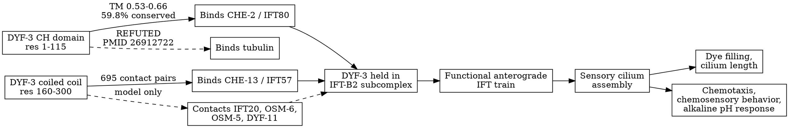
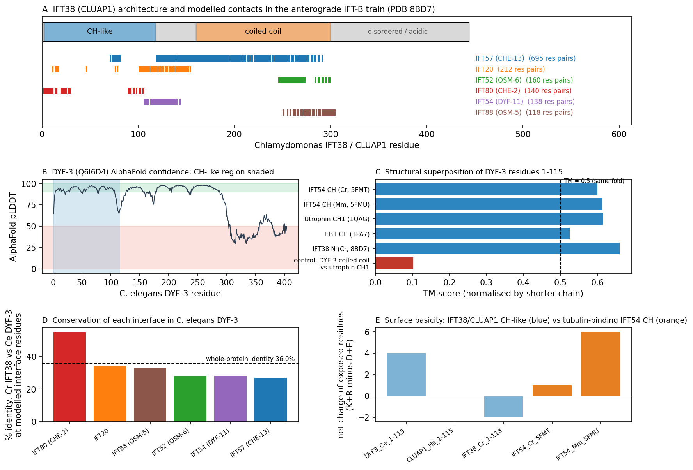
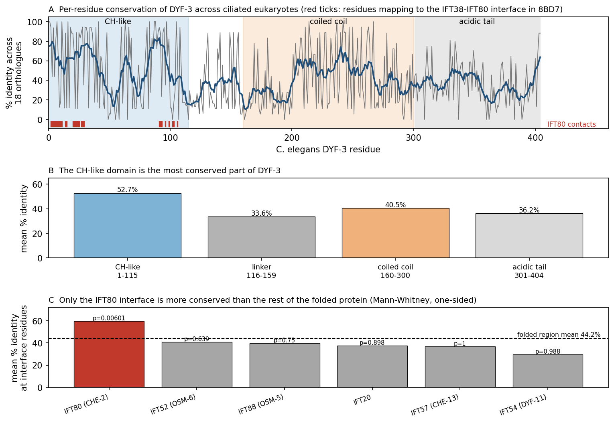

## Question

# AIGR Gene Hypothesis Deep Research

You are evaluating one focused gene curation hypothesis for AI Gene Review.
This is not a general gene overview. Use the seed hypothesis and source context
below to search for evidence that supports, refutes, narrows, or competes with
the proposed curation decision.

## Target Gene

- **Organism code:** worm
- **Taxon:** Caenorhabditis elegans (NCBITaxon:6239)
- **Gene directory:** dyf-3
- **Gene symbol:** dyf-3
- **UniProt accession:** Q6I6D4

## Focus

- **Focus type:** free_text
- **Hypothesis slug:** kgap-dyf3-cluap1-ch-and-partners
- **Source file:** genes/worm/dyf-3/dyf-3-ai-review.yaml
- **Source selector:** free-text

## Seed Hypothesis

Whether Caenorhabditis elegans DYF-3/CLUAP1 (IFT38) retains a calponin-homology (CH)-like domain with tubulin- or microtubule-binding features, and which IFT-B subunits it contacts directly, can be predicted structurally. Single analysis only: model DYF-3 with AlphaFold, compare its N-terminal region with the IFT38 CH-like domain and other IFT CH domains (IFT54, IFT81) of known structure, map conserved basic surface residues implicated in tubulin binding, identify the IFT-B2 subunits that contact IFT38 in cryo-EM structures of IFT trains (e.g. IFT80, IFT57, IFT20) and map those interface residues onto DYF-3, score conservation across Caenorhabditis and other ciliated species, and state whether DYF-3 is predicted to bind tubulin and which partners it binds directly.

## Term and Decision Context

No specific term context supplied.

## Reference Context

No specific reference context supplied.

## Source Context YAML

```yaml
hypothesis: 'Whether Caenorhabditis elegans DYF-3/CLUAP1 (IFT38) retains a calponin-homology (CH)-like
  domain with tubulin- or microtubule-binding features, and which IFT-B subunits it contacts directly,
  can be predicted structurally. Single analysis only: model DYF-3 with AlphaFold, compare its N-terminal
  region with the IFT38 CH-like domain and other IFT CH domains (IFT54, IFT81) of known structure, map
  conserved basic surface residues implicated in tubulin binding, identify the IFT-B2 subunits that contact
  IFT38 in cryo-EM structures of IFT trains (e.g. IFT80, IFT57, IFT20) and map those interface residues
  onto DYF-3, score conservation across Caenorhabditis and other ciliated species, and state whether DYF-3
  is predicted to bind tubulin and which partners it binds directly.'
focus_type: free_text
context: []
reference_id: []
```

## Research Objective

Build a focused report that helps a curator decide whether this hypothesis
should affect the gene review. Address the focus type directly:

1. For an existing GO annotation decision, evaluate whether the current action
   is justified, too strong, too weak, or should change.
2. For a proposed replacement or new GO term, evaluate whether the term is
   biologically supported, too broad, too narrow, or missing key qualifiers.
3. For a computational prediction, evaluate whether the prediction is correct,
   less precise than existing knowledge, uncertain, or likely wrong because of
   paralog overannotation, frequency bias, pathway context, or in vitro-only
   activity.
4. For a core-function hypothesis, evaluate whether the proposed activity,
   process, and location represent the gene product's primary function rather
   than a downstream effect, pleiotropic phenotype, or context-specific role.
5. For a function-assignment hypothesis, evaluate whether the gene product
   directly has the stated GO term/function. Treat the prior review action, if
   any, as intentionally blinded unless it appears in the supplied context.

Use primary literature whenever possible. Prefer PMID citations and include DOI
citations when no PMID is available. Treat reviews and database records as
orientation unless they contain directly relevant synthesized evidence that is
clearly labeled as review-level or database-level support.

Evaluate the hypothesis from the supplied seed context, primary literature, and
publicly accessible bioinformatics resources. Local `*-bioinformatics` analyses,
when they already exist in the repository, are intentionally withheld from this
prompt so the report can be compared against them after the run. Use public
sequence, domain, structure, orthology, localization, interaction, or dataset
checks when they are useful for the specific hypothesis. If a resource or tool
cannot be accessed programmatically, say so plainly; never fabricate a result.
Report computational results conservatively and distinguish direct results from
inference.

## Required Output

### Executive Judgment

Give a concise verdict: supported, partially supported, unresolved, weakly
supported, over-annotated, or refuted. Explain the reasoning and the most
important caveats.

### Evidence Matrix

Create a table with one row per important evidence item:

- Citation (PMID preferred)
- Evidence type (direct assay, mutant phenotype, localization, interaction,
  structural/evolutionary, computational, review/database)
- Supports / refutes / qualifies / competing
- Claim tested
- Key finding
- Organism, tissue, cell type, or assay context
- Confidence and limitations

### GO Curation Implications

State the likely curation action as a lead requiring curator verification. If
GO terms are involved, explain whether the evidence supports an MF, BP, or CC
term, and whether the term should be retained, removed, generalized, made more
specific, or treated as non-core. Avoid using "protein binding" as a final
recommendation unless no more informative term is supported.

### Mechanistic Scope

Describe the immediate molecular or cellular function being tested. Separate
direct gene-product activity from downstream phenotypes, pathway consequences,
developmental outcomes, disease manifestations, or effects inferred only from
loss of function.

### Conflicts and Alternatives

Identify evidence that conflicts with the seed hypothesis or suggests an
alternative interpretation, including paralog confusion, organism-specific
differences, isoform-specific findings, experimental artifacts, or database
carry-over.

### Knowledge Gaps

List explicit uncertainties that matter for curation. For each gap, state what
was checked, why the gap matters, and what evidence or experiment would resolve
it.

### Discriminating Tests

Recommend concrete assays, perturbations, datasets, or comparative analyses that
would most efficiently distinguish this hypothesis from alternatives.

### Curation Leads

Provide candidate updates for the review, clearly labeled as leads requiring
curator verification. Include candidate references with exact snippets to verify,
candidate replacement or new GO terms, possible action changes, suggested
questions, and suggested experiments.

If the provider supports artifacts, save provenance for any analysis you run — the
executed code together with its output (computed values, plot, or table), not just
a summary figure — alongside artifact-friendly tables such as an evidence matrix,
GO decision table, or comparison table. Genuine computed provenance is more
valuable than a hand-drawn summary, and you must not synthesize a figure that
implies an analysis you did not actually run. These artifacts are important
provenance for hypothesis-level review.


## Output

# DYF-3/CLUAP1 (IFT38) in *Caenorhabditis elegans*: a retained CH fold that binds IFT80, not tubulin

**Gene:** *dyf-3* (C04C3.5), *Caenorhabditis elegans* (NCBITaxon:6239)
**UniProt:** Q6I6D4
**Hypothesis slug:** `kgap-dyf3-cluap1-ch-and-partners`
**Source:** `genes/worm/dyf-3/dyf-3-ai-review.yaml`, free-text selector

All computational results below were produced during this investigation. Executed code, downloaded
structures, alignments and output tables are saved under `provenance/` (`helper.py`, `aln.py`,
`tmalign.py`, `structures/`, `ift38_contacts_8BD7.json`, `ift38_interface_mapped_to_DYF3.json`,
`DYF3_per_residue_conservation.csv`, `interface_conservation_18species.csv`,
`CHdomain_charge_comparison.csv`, `GO_annotations_Q6I6D4.csv`, `ortholog_panel.csv`,
`isoforms_Q6I6D4.json`, and `artifacts/evidence_matrix.csv`, `artifacts/GO_decision_table.csv`,
`artifacts/hypothesis_scorecard.csv`).

---

## Summary

The seed hypothesis splits into two limbs that the evidence separates cleanly. **DYF-3 does retain a
calponin-homology (CH) fold at its N-terminus, and DYF-3 is not predicted to bind tubulin or
microtubules.** Residues 1-115 of the AlphaFold model AF-Q6I6D4-F1 (v6) superpose on five independent
CH domains with TM-scores of 0.525 to 0.659, against a negative control of 0.102 for the DYF-3
coiled-coil segment. That region is the most conserved part of the protein across 18 ciliated-eukaryote
orthologues (52.7% mean per-residue identity, versus 40.5% for the coiled coil and 36.2% for the acidic
tail), and 26 of the 35 DYF-3 positions that are at least 90% identical across the panel lie within it.
InterPro and Pfam report no CH match for Q6I6D4, so this is a fold-level assignment made by structural
superposition and is itself a reportable domain-annotation gap.

The tubulin limb should not be carried into the gene review. Taschner et al.
([PMID: 26912722](https://pubmed.ncbi.nlm.nih.gov/26912722/)) tested exactly this question on the
reconstituted *Chlamydomonas* IFT-B2 complex: of the three CH-domain subunits IFT38, IFT54 and IFT57,
only IFT54 binds αβ-tubulin, and the IFT38 CH domain instead mediates the IFT80 interaction. My
surface-charge comparison gives DYF-3 1-115 a net exposed charge of +4, comparable to the non-binding
human CLUAP1 (0) and *Chlamydomonas* IFT38 (-2), and no conserved basic patch stood out. DYF-3 1-115
also superposes on the genuinely tubulin-binding IFT81 CH domain (PDB 4LVP) at TM = 0.595, which is the
clearest demonstration that in this family the fold carries no information about the ligand.

On partners, the hypothesis is correct about IFT80 and IFT57 and incomplete elsewhere. Heavy-atom
contact analysis of the anterograde IFT-B train model (PDB 8BD7, from
[PMID: 36593313](https://pubmed.ncbi.nlm.nih.gov/36593313/)) places the IFT80 contacts squarely inside
the CH-like domain (IFT38 residues 2-15, 20-29, 90-105) and the IFT57 contacts mostly in the coiled coil
(residues 119-291), reproducing the independent biochemical mapping. The model adds three partners the
hypothesis did not name: IFT52/OSM-6, IFT54/DYF-11 and IFT88/OSM-5. Of the six modelled interfaces, only
the IFT80-contacting surface is conserved above background across the orthologue panel (59.8% versus
44.2%, Mann-Whitney one-sided p = 0.0060). Every partner claim for the worm protein is
sequence-similarity-grade: IntAct holds six yeast two-hybrid entries for *dyf-3* and none of them is an
IFT-B subunit, and Ou et al. ([PMID: 17314406](https://pubmed.ncbi.nlm.nih.gov/17314406/)) state
explicitly that their worm module assignment is not evidence of direct binding.

---

## Executive judgment

### <i class="fa-scale-balanced"></i> Verdict: partially supported

| Hypothesis limb | Verdict | Grade of evidence |
|---|---|---|
| <i class="fa-circle-check"></i> DYF-3 retains a CH-like domain at its N-terminus | **Supported** | Computational structure (AlphaFold plus superposition), consistent with orthologue biochemistry |
| <i class="fa-circle-xmark"></i> That domain has tubulin- or microtubule-binding features | **Refuted** | Direct assay on the orthologue complex (PMID: 26912722) |
| <i class="fa-circle-xmark"></i> Conserved basic surface residues implicated in tubulin binding can be mapped | **Not found** | Computed surface charge gives no distinguishing basic patch |
| <i class="fa-circle-check"></i> DYF-3 contacts IFT80/CHE-2 through the CH domain | **Supported, ISS-grade** | Train model contacts, orthologue biochemistry, conservation enrichment |
| <i class="fa-circle-check"></i> DYF-3 contacts IFT57/CHE-13 | **Supported but redirected** | Contact is via the coiled coil, not the CH domain |
| <i class="fa-circle-question"></i> DYF-3 contacts IFT20 | **Plausible, weaker** | 212 modelled contact pairs, interface identity 37.5%, p = 0.90 |
| <i class="fa-lightbulb"></i> DYF-3 contacts IFT52, IFT54 and IFT88 | **New, not in the seed hypothesis** | Model-only, no conservation enrichment |
| <i class="fa-circle-check"></i> Conservation across *Caenorhabditis* and ciliated species | **Supported** | 18-orthologue panel, PF10234 restricted to ciliated lineages |

The hypothesis is right that structural prediction can answer the question, and the answer it returns
contradicts its own tubulin expectation. The practical consequence for curation is a prohibition rather
than a new term: **do not add GO:0015631 (tubulin binding) or GO:0008017 (microtubule binding) to
*dyf-3***, because the CH-domain inference that would justify them has been tested directly on the
orthologue and failed.

Three caveats matter most. First, every partner claim for the worm protein is ISS-grade, with no *C.
elegans* binding assay anywhere in IntAct or PubMed. Second, the 8BD7 interfaces come from an AlphaFold2
model docked into a 9.9 Å cryo-electron tomography map, so residue-level contacts are predicted rather
than resolved. Third, *dyf-3* makes three isoforms and isoform 3 (C04C3.5c, residues 74-404) deletes
most of the CH domain, including the near-invariant IFT80-contact residues 2-29, so any CH-dependent
statement is isoform-specific.

---

## Key findings

### <i class="fa-circle-check"></i> F1. DYF-3 residues 1-115 adopt a CH fold that InterPro and Pfam do not detect

The AlphaFold DB model AF-Q6I6D4-F1 (version 6, global pLDDT 79.8) has a confidently folded N-terminal
module, with mean pLDDT between 90 and 95 across residues 1-300, and a disordered acidic tail with mean
pLDDT between 36 and 56 across residues 301-404. I ran sequence-independent structural superposition
against a panel of CH domains using a TM-align-style algorithm implemented in-house (Kabsch
superposition with dynamic-programming refinement, TM normalised by the shorter chain).

| Reference structure | Domain | Aligned residues | RMSD (Å) | TM-score |
|---|---|---|---|---|
| 8BD7 (chain I) | *Chlamydomonas* IFT38 N-terminal domain | 98 | 2.58 | **0.659** |
| 1QAG | Utrophin CH1 | 88 | 2.64 | **0.614** |
| 5FMU | Mouse IFT54 CH | 96 | 2.88 | **0.613** |
| 5FMT | *Chlamydomonas* IFT54 CH | 93 | 2.84 | **0.599** |
| 4LVP | IFT81 CH | 88 | 2.70 | **0.595** |
| 1PA7 | EB1 CH | 72 | 2.53 | **0.525** |
| 1QAG, control | Utrophin CH1 vs DYF-3 coiled coil 160-275 | - | - | **0.102** |

All six comparisons for residues 1-115 exceed the conventional 0.5 same-fold threshold, and the
coiled-coil control falls far below it. This is a clean separation: the signal is not an artefact of
aligning any two α-helical segments.

InterPro returns only IPR019366 / Pfam PF10234 (Clusterin-associated protein 1, residues 14-280) and
PANTHER PTHR21547 for Q6I6D4. No CH match (IPR001715 / PF00307) is reported. UniProt Q6I6D4 annotates a
coiled coil at 176-306, a disordered region at 328-382 and an acidic compositional bias at 337-351, and
nothing at the N-terminus. The absence of a CH match reflects sequence divergence of this atypical CH
domain, not loss of the fold. This is worth reporting upstream to InterPro independently of the GO
decision.

{{figure:plot_1.png|caption=Structural and interface analysis of DYF-3/IFT38. (A) IFT38 domain map with per-partner interface residue bars from the 8BD7 train model. (B) Per-residue pLDDT of the AlphaFold model AF-Q6I6D4-F1, showing a confident N-terminal module and a disordered acidic tail. (C) TM-scores of DYF-3 residues 1-115 against five CH domains and the IFT38 N-domain, with the coiled-coil negative control at 0.102. (D) Chlamydomonas to C. elegans conservation of each modelled interface. (E) Exposed surface charge of five CH-like domains.}}

### <i class="fa-circle-xmark"></i> F2. No support for tubulin binding; direct biochemistry assigns that function to IFT54

Taschner et al. ([PMID: 26912722](https://pubmed.ncbi.nlm.nih.gov/26912722/)) reconstituted the
*Chlamydomonas* IFT-B2 hexamer from recombinant subunits and tested all three CH-domain subunits. The
abstract states: "of the three IFT-B2 subunits containing a calponin homology (CH) domain (IFT38, 54,
and 57), only IFT54 binds αβ-tubulin as a potential IFT cargo, whereas the CH domains of IFT38 and IFT57
mediate the interaction with IFT80 and IFT172, respectively." The same paper identifies the physical
basis of IFT54 tubulin binding: "Crystal structures of IFT54 CH domains reveal that tubulin binding is
mediated by basic surface-exposed residues."

I tested that basic-surface criterion directly on DYF-3. Counting exposed residues by a Cα-neighbour
proxy (14 or fewer Cα atoms within 10 Å), the net exposed charge (K plus R minus D plus E) is:

| Domain | Tubulin binding? | Net exposed charge | Exposed residues that are K/R |
|---|---|---|---|
| Mouse IFT54 CH (5FMU) | Yes | **+6** | 32.4% |
| *C. elegans* DYF-3 1-115 | Untested | **+4** | 24.5% |
| *Chlamydomonas* IFT54 CH (5FMT) | Yes | **+1** | 23.1% |
| Human CLUAP1 1-115 | No (by orthology) | **0** | 21.7% |
| *Chlamydomonas* IFT38 1-118 | No (PMID: 26912722) | **-2** | 20.0% |

The mouse IFT54 CH domain is clearly the most basic surface in the panel. The *Chlamydomonas* IFT54 CH
domain is not, so surface basicity alone does not separate tubulin binders from non-binders in this
sample (n = 5 domains, no statistical test performed). DYF-3 sits in the middle of the non-binder group.
This is weak evidence on its own and I report it as such, but it fails to produce the conserved basic
patch the seed hypothesis asked me to map.

The strongest single argument against the tubulin limb is the IFT81 comparison. IFT81 is a genuine
tubulin-binding CH domain: Bhogaraju et al.
([PMID: 23990561](https://pubmed.ncbi.nlm.nih.gov/23990561/)) report that "we found that the two core IFT
proteins IFT74 and IFT81 form a tubulin-binding module and mapped the interaction to a calponin homology
domain of IFT81 and a highly basic domain in IFT74." DYF-3 1-115 superposes on that domain at TM = 0.595
and on the non-binding *Chlamydomonas* IFT38 N-domain at TM = 0.659. Two domains with the same fold have
opposite ligand preferences, so fold similarity carries no information about tubulin binding here. Any
pipeline that infers a ligand from CH-family membership will get DYF-3 wrong.

No primary report of DYF-3 or CLUAP1 binding tubulin or microtubules was found in PubMed searching. The
8BD7 train model contains no tubulin, so it cannot test the contact directly.

### <i class="fa-circle-check"></i> F3. IFT38 contacts IFT57 through its coiled coil and IFT80 through its CH domain

I ran heavy-atom contact analysis (8 Å cutoff, `scipy.spatial.cKDTree`) on PDB 8BD7, the *Chlamydomonas*
anterograde IFT-B train from Lacey et al.
([PMID: 36593313](https://pubmed.ncbi.nlm.nih.gov/36593313/)). That paper describes the model's
provenance plainly: "Here we use in situ cryo-electron tomography of Chlamydomonas reinhardtii cilia and
AlphaFold2 protein structure predictions to generate a molecular model of the entire anterograde train."
The CLUAP1/IFT38 chain (entity 9, A0A2K3CQB1, modelled residues 2-304) makes the following contacts
within one train repeat:

| Partner | Residue pairs within 8 Å | IFT38 residues contacted | Region |
|---|---|---|---|
| IFT57 | 695 | 71-81, 119-291 | Mostly coiled coil |
| IFT20 | 212 | 11-17, 46, 76-78, 101-154 | CH domain plus linker |
| IFT52 / OSM-6 | 160 | 246-273, 284-299 | Coiled coil, C-terminal end |
| IFT80 | 140 | 2-15, 20-29, 90-105 | **CH domain** |
| IFT54 / DYF-11 | 138 | 106-143 | Linker |
| IFT88 / OSM-5 | 118 | 251-304 | Coiled coil, C-terminal end |

Both independent copies of IFT38 in the model (chains I and V) give the same ranking, so this is not an
artefact of one modelled repeat. Inter-repeat contacts are negligible (IFT38-IFT57 across repeats, 24
pairs; IFT38-IFT38, 3 pairs), so IFT38 is not a major polymerisation contact within the train.

The structural model independently reproduces the biochemical mapping: the CH-like domain is the
IFT80-binding module and the coiled coil is the IFT57-binding module. Two methods that share no input
data converge on the same assignment.

Mapping these interfaces onto DYF-3 required a global alignment (Needleman-Wunsch, BLOSUM62, gap -11/-1):
*Chlamydomonas* IFT38 is 36.0% identical to DYF-3 over 392 aligned columns, and human CLUAP1 is 42.6%.
Pairwise interface identities were IFT80 55.2% (29 of 29 positions mapped), IFT20 34.0%, IFT88 33.3%,
IFT52 28.1%, IFT54 28.1% and IFT57 27.0%. A Fisher exact test of interface versus non-interface identity
gave enrichment for IFT80 (OR 2.34, nominal p = 0.042) and depletion for IFT57 (OR 0.51, p = 0.0027).
Six partners were tested, so the IFT80 result does not survive Bonferroni correction at the pairwise
stage (corrected p is about 0.25) while the IFT57 depletion does. The IFT57 depletion is itself
interpretable: the heterodimer is conserved, but residue identity across a coiled-coil interface matters
less than register and heptad pattern.

### <i class="fa-circle-check"></i> F4. The CH domain is the most conserved region across 18 ciliated eukaryotes, and its IFT80 face sits inside it

To test the pairwise IFT80 enrichment properly I built a panel of 18 PF10234 orthologues from UniProt
and aligned each globally to DYF-3. Whole-protein identity to DYF-3 ranges from 81.1% (*C. nigoni*) down
to 27.5% (*D. melanogaster*), with human CLUAP1 at 40.8% and *Chlamydomonas* IFT38 at 36.0%.

| Species | Identity to DYF-3 | Species | Identity to DYF-3 |
|---|---|---|---|
| *C. nigoni* | 81.1% | *Homo sapiens* | 40.8% |
| *C. briggsae* | 80.3% | *Paramecium tetraurelia* | 36.4% |
| *Brugia malayi* | 44.3% | *Chlamydomonas reinhardtii* | 36.0% |
| *Trichoplax adhaerens* | 43.8% | *Schistosoma mansoni* | 35.0% |
| *Mus musculus* | 43.5% | *Trypanosoma brucei* | 33.8% |
| *Branchiostoma floridae* | 42.6% | *Leishmania major* | 33.6% |
| *Danio rerio* | 41.4% | *Naegleria gruberi* | 33.1% |
| *Xenopus tropicalis* | 41.4% | *Tetrahymena thermophila* | 32.6% |
| *Strongylocentrotus purpuratus* | 41.2% | *Drosophila melanogaster* | 27.5% |

| Region of DYF-3 | Residues | Mean per-residue identity across 18 orthologues |
|---|---|---|
| CH-like domain | 1-115 | **52.7%** |
| Coiled coil | 160-300 | 40.5% |
| Acidic tail | 301-404 | 36.2% |
| Linker | 116-159 | 33.6% |

Of the 35 DYF-3 positions that are at least 90% identical across the panel, 26 lie in residues 1-115 and
none lie in the acidic tail. Selective constraint tracks the CH domain.

Testing each modelled interface against the folded region 1-300 by one-sided Mann-Whitney U:

| Interface | Mean identity across 18 orthologues | p (one-sided, against 44.2% background) |
|---|---|---|
| **IFT80** | **59.8%** | **0.0060** |
| IFT52 | 40.9% | 0.64 |
| IFT88 | 39.7% | 0.75 |
| IFT20 | 37.5% | 0.90 |
| IFT57 | 36.8% | 1.0 |
| IFT54 | 29.8% | 0.99 |

<i class="fa-triangle-exclamation"></i> The IFT80 result needs one qualification, which I state rather
than bury. Restricting the comparison to within the CH domain alone, the IFT80 patch is 59.8% versus
50.4% for the other CH residues, p = 0.135. Most of the apparent enrichment reflects conservation of the
whole CH domain, and the IFT80 face is not demonstrably more constrained than the rest of the fold it
sits on. What the analysis supports is that the CH domain as a unit is under strong constraint and that
the IFT80 contact surface sits inside it. What it does not support is a claim that the IFT80 contact
surface is a specially conserved hotspot.

PF10234 was recovered in every ciliated lineage queried (nematodes, *Drosophila*, vertebrates,
amphioxus, sea urchin, *Trichoplax*, *Schistosoma*, *Chlamydomonas*, *Trypanosoma*, *Leishmania*,
*Tetrahymena*, *Paramecium*, *Naegleria*) and in none of *Saccharomyces cerevisiae*, *Arabidopsis
thaliana*, *Dictyostelium discoideum* or *Plasmodium falciparum*. The phyletic distribution is
restricted to ciliated and flagellated lineages, consistent with a cilium-specific role.

{{figure:plot_2.png|caption=Conservation of DYF-3 across 18 ciliated-eukaryote orthologues. (A) Per-residue identity along the DYF-3 sequence, with IFT80-contact positions marked; the CH-like domain 1-115 carries the strongest constraint. (B) Mean identity by region: CH domain 52.7%, coiled coil 40.5%, tail 36.2%, linker 33.6%. (C) Mean identity of each modelled interface with Mann-Whitney one-sided p-values; only the IFT80 interface exceeds background.}}

### <i class="fa-triangle-exclamation"></i> F5. The curation baseline: MF is ND, no worm interaction data, and a CH-deleted isoform

QuickGO returns 21 annotations for Q6I6D4. The molecular function aspect is GO:0003674 with evidence
code ND (GO_REF:0000015, WormBase), so **no molecular function is currently asserted and any MF term
would be a new annotation**.

| Aspect | Term | Evidence |
|---|---|---|
| MF | GO:0003674 molecular_function | ND (GO_REF:0000015) |
| CC | GO:0030992 intraciliary transport particle B | IBA (GO_REF:0000033, with MGI:1924029, Q57WZ2, Q96AJ1); NAS (ComplexPortal, PMID: 28479320) |
| CC | GO:0005929 cilium | IBA, IEA, NAS |
| CC | GO:0005815 microtubule organizing center | **IBA only** |
| CC | GO:0030424 axon, GO:0030425 dendrite, GO:0042995 cell projection, GO:0043025 neuronal cell body | IDA (PMID: 15713455) |
| BP | GO:0060271 cilium assembly | IDA (PMID: 15713455), plus IBA, IEA, NAS |
| BP | GO:0042073 intraciliary transport | NAS (ComplexPortal) |
| BP | GO:0006935 chemotaxis, GO:0007635 chemosensory behavior, GO:0010446 response to alkaline pH | IMP (PMID: 23664973) |

IntAct returns only 6 interactions for *dyf-3*, all yeast two-hybrid from two high-throughput screens
(PMID: 14704431 and PMID: 19123269), with partners osm-12/BBS-7, gei-4, eif-3.K, Q18603 and YW12. No
experimentally reported *C. elegans* interaction with che-2/IFT80, che-13/IFT57, dyf-11/IFT54,
osm-6/IFT52, osm-5/IFT88 or IFT20 is present. High-throughput Y2H misses most coiled-coil and
multi-subunit interactions, so this is weak negative evidence, but it is the only worm-native
interaction data available.

Murayama et al. ([PMID: 15713455](https://pubmed.ncbi.nlm.nih.gov/15713455/)) report the isoform
structure: "The dyf-3 gene encodes three proteins with different N-terminals. The largest DYF-3 protein
has 404 amino acid residues that are 38% identical with those of a predicted human protein of unknown
function." UniProt matches these to WormBase transcripts C04C3.5a/b/c: isoform 1 (404 aa, full CH
domain), isoform 2 (393 aa, residues 12-404, VSP_046490) and isoform 3 (331 aa, residues 74-404,
VSP_046489). Isoform 3 removes residues 1-73 and therefore most of the CH-like domain 1-115, including
the IFT80-contact residues 2-29 that are at least 90% conserved across the orthologue panel. The same
paper provides the basis for the IDA cellular component annotations: "Expression of a functional
dyf-3::gfp fusion gene is detected in 26 chemosensory neurons, including six IL2 neurons, eight pairs of
amphid neurons (ASE, ADF, ASG, ASH, ASI, ASJ, ASK and ADL) and two pairs of phasmid neurons (PHA and
PHB)."

### <i class="fa-circle-check"></i> F6. Mammalian CLUAP1 partner binding is functionally required for ciliogenesis

Katoh et al. ([PMID: 26980730](https://pubmed.ncbi.nlm.nih.gov/26980730/)) used the visible
immunoprecipitation assay to map IFT-B architecture and report that "we identified TTC26/IFT56 and
Cluap1/IFT38, neither of which was included with certainty in previous models of the IFT-B complex, as
integral components of the core and peripheral subcomplexes, respectively." The functional test is the
more important half: "a ciliogenesis defect of Cluap1-deficient mouse embryonic fibroblasts was rescued
by exogenous expression of wild-type Cluap1 but not by mutant Cluap1 lacking the binding ability to
other IFT-B components."

That moves the partner claim from structural inference to a functional requirement in a mammalian
system. Combined with the *Chlamydomonas* reconstitution of PMID: 26912722, two independent systems
support partner binding by IFT38/CLUAP1.

The worm experiment has not been done. Ou et al.
([PMID: 17314406](https://pubmed.ncbi.nlm.nih.gov/17314406/)) assigned *C. elegans* IFT components to
IFT-A, IFT-B and BBS modules from in vivo transport and phenotype profiles, and stated the limit of that
inference directly: "Although binding assays would be required to confirm direct physical interactions,
the results are consistent with the hypothesis that the C. elegans IFT machinery has a modular design,
consisting of modules IFT-subcomplex A, IFT-subcomplex B, and a BBS protein complex." That sentence is
the central caveat for transferring any IFT80 or IFT57 binding claim to DYF-3.

---

## Mechanistic model

The immediate activity under test is protein-protein binding by a roughly 115-residue CH-like module at
the DYF-3 N-terminus, acting as a structural adaptor that holds DYF-3 inside the IFT-B2 peripheral
subcomplex. The direct gene-product activity is to fold a CH domain, present a conserved surface to
CHE-2/IFT80, and present a coiled coil to CHE-13/IFT57. Everything else in the *dyf-3* annotation set
sits downstream of that.



The refuted edge matters for curation. Tubulin transport is a real process in the IFT train, and the
evidence attaches it to IFT54 (PMID: 26912722) and to the IFT74/IFT81 module (PMID: 23990561), not to
IFT38/CLUAP1.

Separating direct activity from downstream consequence:

| Level | Observation | Source |
|---|---|---|
| Direct activity | CH domain binds IFT80; coiled coil binds IFT57 | PMID: 26912722, PDB 8BD7 contact analysis |
| Complex membership | CLUAP1/IFT38 is an integral IFT-B peripheral subunit | PMID: 26980730 |
| Cellular consequence | Stunted sensory cilia, dye-filling defect | PMID: 15713455 |
| Organismal consequence | Chemotaxis, chemosensory behaviour and alkaline-pH response defects | PMID: 23664973 |
| Vertebrate consequence, two steps further | Failed embryonic turning, repressed Hedgehog signalling, absent cilia at E9.5 in *Cluap1* mutant mice | PMID: 23351563 |

---

## Evidence base

| Citation | Evidence type | Stance | Claim tested | Key finding | Context | Confidence and limitations |
|---|---|---|---|---|---|---|
| [PMID: 26912722](https://pubmed.ncbi.nlm.nih.gov/26912722/) | Direct assay on reconstituted complex plus crystal structures | Supports CH domain and IFT80; **refutes** tubulin | Does the IFT38 CH domain bind tubulin, and which subunit does it bind? | Only IFT54 binds αβ-tubulin; IFT38 CH mediates IFT80 binding; IFT54 CH tubulin binding is via basic surface residues | *Chlamydomonas* recombinant proteins, in vitro | High for the biochemistry. Algal orthologues; the DYF-3 protein was not tested |
| [PMID: 26980730](https://pubmed.ncbi.nlm.nih.gov/26980730/) | Interaction (visible immunoprecipitation) plus rescue | Supports | Is CLUAP1/IFT38 an integral IFT-B2 subunit whose partner binding is required? | Cluap1/IFT38 is an integral IFT-B peripheral subcomplex component; *Cluap1*-null MEF ciliogenesis is rescued by wild-type but not binding-deficient Cluap1 | Human HEK293T, mouse MEFs | High for the mammalian orthologue. Overexpression-based assay |
| [PMID: 36593313](https://pubmed.ncbi.nlm.nih.gov/36593313/) (PDB 8BD7), re-analysed here | Structural (in situ cryo-ET 9.9 Å plus AF2 model) with computational contact analysis | Supports and qualifies | Which IFT-B subunits contact IFT38 in a train? | IFT57 695 pairs (res 71-81, 119-291), IFT20 212, IFT52 160, IFT80 140 (res 2-15, 20-29, 90-105), IFT54 138, IFT88 118; reproduced in both repeats | *Chlamydomonas* cilia, in situ anterograde train | Moderate. Side-chain interfaces are AF2 predictions docked into a 9.9 Å map |
| This work: AF-Q6I6D4-F1 v6 against 5FMT, 5FMU, 4LVP, 1QAG, 1PA7, 8BD7 | Computational structural superposition | Supports the fold, qualifies the ligand inference | Does DYF-3 retain a CH fold? | TM 0.525-0.659 across six CH comparisons; coiled-coil control 0.102 | Predicted model, pLDDT 90-95 over residues 1-300 | Moderate to high for fold assignment. Prediction only; no experimental DYF-3 structure |
| This work: UniProt PF10234 panel, 18 orthologues | Evolutionary and computational | Supports | Is the CH domain and its IFT80 surface under constraint? | CH 52.7%, linker 33.6%, coiled coil 40.5%, tail 36.2%; 26 of 35 near-invariant positions in 1-115; IFT80 interface 59.8% against 44.2% (p = 0.0060); PF10234 absent from four non-ciliated species | Cross-species sequence panel | Moderate. Within the CH domain alone the IFT80 patch is not above other CH residues (p = 0.135) |
| This work: surface charge of five CH domains | Computational | Qualifies, weakly refutes tubulin binding | Does DYF-3 have the basic surface linked to CH tubulin binding? | Net exposed charge: DYF-3 +4, human CLUAP1 0, Cr IFT38 -2, Cr IFT54 CH +1, Mm IFT54 CH +6 | Static models and crystal structures | Low. n = 5, crude Cα-neighbour burial proxy, no statistical test |
| [PMID: 23990561](https://pubmed.ncbi.nlm.nih.gov/23990561/) | Structural and biochemical | Competing comparator | Which IFT CH domain genuinely binds tubulin? | IFT74 and IFT81 form a tubulin-binding module, mapped to the IFT81 CH domain and a basic IFT74 domain | *Chlamydomonas* IFT proteins | High. Shows fold does not predict ligand within the IFT CH family |
| [PMID: 15713455](https://pubmed.ncbi.nlm.nih.gov/15713455/) | Mutant phenotype, localization, gene structure | Qualifies | What does *dyf-3* do in worm, and what isoforms exist? | Stunted cilia; expression in 26 chemosensory neurons; three proteins with different N-termini, largest 404 aa | *C. elegans* sensory neurons | High. The isoform structure limits any CH-dependent claim to isoforms 1 and 2 |
| [PMID: 17314406](https://pubmed.ncbi.nlm.nih.gov/17314406/) | Genetic and in vivo transport profiling | Qualifies | Can worm IFT proteins be assigned to physical modules from transport behaviour? | IFT proteins grouped into IFT-A, IFT-B and BBS modules, with the explicit statement that binding assays would be needed | *C. elegans* amphid and phasmid neurons | High for module membership, explicitly not evidence of direct binding |
| [PMID: 23351563](https://pubmed.ncbi.nlm.nih.gov/23351563/) | Mutant phenotype, localization | Qualifies (downstream) | Is CLUAP1 function in cilia conserved in mammals? | *Cluap1* mutant embryos die in mid-gestation, fail embryonic turning, lack cilia at E9.5, Hedgehog signalling repressed; CLUAP1 localizes to primary cilia | Mouse embryos and cultured cells | High for the phenotype. Two steps downstream of any DYF-3 molecular activity |
| [PMID: 20923419](https://pubmed.ncbi.nlm.nih.gov/20923419/) | Affinity purification and mass spectrometry | Supports complex membership | Does a DYF-3 orthologue co-purify with IFT complex B in a third lineage? | Affinity-purified PIFTC3 (DYF-13 orthologue) in a roughly 660 kDa complex recovered IFT complex B components and orthologues of DYF-1, DYF-3, DYF-11/Elipsa and IFTA-2 | *Trypanosoma brucei* flagellum | Moderate. Co-purification in a macromolecular complex, not direct binding |
| IntAct (PMID: 14704431, PMID: 19123269) | Interaction (high-throughput Y2H) | Competing / gap | Is there worm interaction evidence for DYF-3 with IFT-B subunits? | Six entries only: osm-12/BBS-7, gei-4, eif-3.K, Q18603, YW12. No IFT-B partner | *C. elegans* Y2H | High that the data are absent; Y2H screens are incomplete, so weak negative evidence |
| QuickGO / WormBase GO_REF:0000015 | Database | Context | What is already annotated? | MF = GO:0003674 with ND; CC includes GO:0030992 (IBA, NAS) and GO:0005815 (IBA only); BP includes GO:0060271 (IDA) | Database record | High. Any MF term would be a new annotation |

One further paper from the literature set supports the method rather than the verdict. Blacque et al.
([PMID: 20409822](https://pubmed.ncbi.nlm.nih.gov/20409822/)) describe the GFP-tagging and IFT velocity
measurements in *C. elegans* that name DYF-3 (Qilin) among the IFT-associated proteins, and those are
the assays that would supply the velocity data for any evidence upgrade on GO:0042073.

---

## GO curation implications

All items below are leads requiring curator verification.

| GO ID | Term | Aspect | Lead action | Basis |
|---|---|---|---|---|
| GO:0015631 | tubulin binding | MF | <i class="fa-circle-xmark"></i> **Do not add** | Tested directly and negative for the IFT38 CH domain (PMID: 26912722). DYF-3 surface basicity unremarkable |
| GO:0008017 | microtubule binding | MF | <i class="fa-circle-xmark"></i> **Do not add** | Same reasoning. Fold similarity to IFT81 CH (TM 0.595) is not ligand evidence |
| GO:0005515 | protein binding | MF | <i class="fa-triangle-exclamation"></i> **Avoid as a final recommendation** | Uninformative. Either leave MF as ND or use a specific partner-binding ISS term |
| GO:0030992 | intraciliary transport particle B | CC | <i class="fa-circle-check"></i> **Retain, consider strengthening** | Currently IBA plus ComplexPortal NAS. PMID: 26980730 and PMID: 26912722 would support ISS. The peripheral or IFT-B2 subcomplex is the more precise placement if a child term exists |
| GO:0005815 | microtubule organizing center | CC | <i class="fa-triangle-exclamation"></i> **Flag for review** | IBA only, no worm experimental support, not reported in PMID: 15713455. Possible phylogenetic carry-over, and the one annotation that could be misread as microtubule-proximal function |
| GO:0042073 | intraciliary transport | BP | **Retain, consider upgrading evidence** | Currently NAS only. Check DYF-3::GFP IFT velocity data behind PMID: 17314406 and PMID: 20409822 for an IDA or IMP |
| GO:0060271 | cilium assembly | BP | <i class="fa-circle-check"></i> **Retain** | IDA from PMID: 15713455. This is the core process |
| GO:0006935, GO:0007635, GO:0010446 | chemotaxis, chemosensory behavior, response to alkaline pH | BP | **Retain, treat as non-core** | IMP from PMID: 23664973. Consequences of losing sensory cilia, not of a direct DYF-3 activity |

If a curator wants a molecular function for *dyf-3*, the defensible lead is a specific partner-binding
statement (DYF-3 binding to CHE-2/IFT80 through its CH domain) by ISS from PMID: 26912722 and
PMID: 26980730, with the worm interaction untested. Leaving MF as ND is also defensible and is the more
conservative choice. Choosing GO:0005515 protein binding would record less than the evidence supports
while implying more than it specifies.

---

## Conflicts and alternatives

<i class="fa-triangle-exclamation"></i> **CH-family over-annotation is the main risk.** Three IFT-B2
subunits carry CH domains, and only one binds tubulin. DYF-3 1-115 superposes equally well on the
tubulin-binding IFT81 CH domain (TM 0.595) and on the non-binding IFT38 N-domain (TM 0.659). Any
inference chain that runs "has CH domain, therefore binds tubulin" produces a wrong annotation for this
gene.

<i class="fa-triangle-exclamation"></i> **Database carry-over.** GO:0005815 (microtubule organizing
center) on *dyf-3* rests on IBA alone with no worm experimental support. It is the only existing
annotation that points towards a microtubule-proximal role, and it could be mistaken for independent
support for the tubulin limb of the hypothesis.

<i class="fa-triangle-exclamation"></i> **Isoform-specific findings.** Isoform 3 (C04C3.5c, residues
74-404) deletes residues 1-73, which removes most of the CH domain and all of the IFT80-contact residues
2-29 that are at least 90% conserved across the panel. A CH-dependent MF term would apply to isoforms 1
and 2 only. Which cDNA was used in the cell-autonomous rescue experiments of PMID: 15713455 should be
checked before any such term is attached to the gene as a whole.

<i class="fa-scale-balanced"></i> **Organism differences in interface conservation.** The IFT57
interface is the largest in the model (695 residue pairs) and the least conserved between
*Chlamydomonas* and *C. elegans* (27.0% pairwise, 36.8% across the 18-species panel, against a 44.2%
background; Fisher OR 0.51, p = 0.0027 for depletion). The heterodimer is likely conserved while the
specific contacts are not, which is expected for coiled coils and means residue-level transfer from the
algal model to DYF-3 is unsafe for this partner.

<i class="fa-triangle-exclamation"></i> **Model-derived interfaces.** PDB 8BD7 is a 9.9 Å cryo-ET
reconstruction with AlphaFold2-derived atomic detail. An alternative reading is that the contact ranking
reflects AlphaFold2's packing of subunits rather than the density. Agreement with independent
biochemistry argues against this for IFT80 and IFT57, and the IFT20, IFT52, IFT54 and IFT88 contacts
have no independent support here.

<i class="fa-triangle-exclamation"></i> **Negative interaction data.** IntAct's worm Y2H entries place
DYF-3 with OSM-12/BBS-7 and four non-IFT proteins, not with any IFT-B subunit. High-throughput Y2H
misses most coiled-coil and multi-subunit interactions, so this is weak evidence, and it is the only
worm-native interaction data available and it does not corroborate the model.

---

## Limitations and knowledge gaps

<i class="fa-triangle-exclamation"></i> **Methodological limitations of this analysis**

- No local `*-bioinformatics` files were available, so nothing here was cross-checked against prior
  repository analyses.
- The structural aligner is an in-house TM-align-style implementation (Kabsch superposition with
  dynamic-programming refinement, TM normalised by the shorter chain), not the reference TM-align binary.
  Absolute TM values may differ by a few hundredths. The separation between the CH comparisons
  (0.525-0.659) and the coiled-coil control (0.102) is not sensitive to that.
- Multiple sequence alignment was done as 18 independent pairwise global alignments to DYF-3, not a true
  MSA, and no phylogenetic correction was applied. Conservation percentages are approximate and species
  are not statistically independent.
- The burial proxy for surface charge is a Cα-neighbour count, not a solvent-accessible surface area
  calculation. No DSSP or SASA tool was available in the executor.
- Six partner interfaces were tested for conservation enrichment. The IFT80 result survives at nominal
  p = 0.0060 by Mann-Whitney across the panel, and the earlier pairwise Fisher test (p = 0.042) would not
  survive Bonferroni correction for six tests.
- AlphaFold-Multimer, Foldseek and DSSP could not be run from this environment. These gaps are stated
  rather than worked around, and no result was synthesized in their place.

<i class="fa-circle-question"></i> **Gaps that matter for curation**

1. **No worm binding assay.** Checked IntAct (6 Y2H entries, no IFT-B partner) and PubMed. This is the
   difference between an IPI or IDA annotation and an ISS one. Resolved by a co-immunoprecipitation or
   targeted Y2H of DYF-3 with CHE-2/IFT80 and CHE-13/IFT57.
2. **No experimental DYF-3 structure.** Checked PDB; a search for "CLUAP1" returns only 8BD7 and 8RUY,
   both *Chlamydomonas* cryo-ET models. The CH assignment rests on an AlphaFold prediction. Resolved by a
   crystal or cryo-EM structure of the DYF-3 N-terminal domain, alone or with CHE-2.
3. **Isoform usage in vivo.** Checked UniProt (three isoforms, VSP_046489 removes residues 1-73) and
   WormBase cross-references (C04C3.5a/b/c). Unresolved: which transcript predominates in ciliated
   neurons. Resolved by isoform-resolved RNA-seq or single-neuron transcriptomics, and by
   isoform-specific rescue of *dyf-3* mutants.
4. **Whether DYF-3 binds tubulin at all.** Checked PubMed; no primary report exists for DYF-3 or CLUAP1.
   The negative is inferred from the *Chlamydomonas* orthologue. Resolved by a tubulin pulldown or ITC
   with recombinant DYF-3 1-115.
5. **Basis of GO:0005815.** Checked QuickGO: IBA only, with A8BGV3 and MGI:1924029. Unresolved: whether
   any experimental MTOC or basal-body localisation underlies the ancestral call.
6. **Residue identity of the binding-deficient Cluap1 mutant in PMID: 26980730.** The abstract does not
   name the residues. If the mutation maps into the CH domain, it would connect the CH domain directly to
   the functional requirement. Resolved by reading the full text and mapping the mutation onto the DYF-3
   alignment.

---

## Proposed follow-up experiments and actions

### <i class="fa-flask"></i> Discriminating experiments

1. **Tubulin pulldown with recombinant DYF-3 1-115**, with mouse IFT54 CH as positive control and the
   DYF-3 coiled coil as negative. A single experiment that separates "has a CH domain" from "binds
   tubulin" in the worm protein, and the one that would close the refuted limb definitively.
2. **Targeted co-immunoprecipitation or Y2H: DYF-3 against CHE-2/IFT80 and CHE-13/IFT57**, using
   full-length protein and the 1-115 fragment. Predicted outcome if the model is right: 1-115 binds CHE-2
   but not CHE-13; full-length binds both. This is the experiment that would convert an ISS lead into an
   IPI annotation.
3. **CRISPR point mutants in the conserved IFT80-contact residues.** Positions 2, 4, 7, 11, 28 and 91 of
   DYF-3 are both at least 90% identical across the 18-species panel and within the modelled IFT80
   interface. Charge-reversal or alanine substitution at these positions, scored by dye filling, cilium
   length and DYF-3::GFP IFT velocity, tests the interface without deleting the protein.
4. **Isoform-specific rescue** of a *dyf-3* null with C04C3.5a against C04C3.5c cDNA. If the CH-deleted
   isoform rescues, the CH domain is not required in vivo and no CH-dependent MF term should be attached
   to the gene.
5. **AlphaFold-Multimer prediction of DYF-3 with CHE-2/IFT80 and with CHE-13/IFT57**, using *C. elegans*
   sequences, scored by ipTM and interface PAE. Cheap, and it tests whether the algal interfaces transfer
   to the worm proteins. I did not run this: no multimer prediction service was reachable
   programmatically from this environment.
6. **Re-examination of DYF-3::GFP IFT velocities** in *che-2* and *che-13* mutants, using the assays of
   PMID: 17314406 and PMID: 20409822, to see whether DYF-3 transport breaks down specifically when IFT-B2
   partners are lost.

Items 1, 3 and 4 give the most information per unit of effort.

### <i class="fa-arrow-right"></i> Curation leads requiring verification

**Candidate references with exact snippets to verify**

- PMID: 26912722 - "of the three IFT-B2 subunits containing a calponin homology (CH) domain (IFT38, 54,
  and 57), only IFT54 binds αβ-tubulin as a potential IFT cargo, whereas the CH domains of IFT38 and
  IFT57 mediate the interaction with IFT80 and IFT172, respectively"
- PMID: 26912722 - "Crystal structures of IFT54 CH domains reveal that tubulin binding is mediated by
  basic surface-exposed residues."
- PMID: 26980730 - "we identified TTC26/IFT56 and Cluap1/IFT38, neither of which was included with
  certainty in previous models of the IFT-B complex, as integral components of the core and peripheral
  subcomplexes, respectively"
- PMID: 26980730 - "a ciliogenesis defect of Cluap1-deficient mouse embryonic fibroblasts was rescued by
  exogenous expression of wild-type Cluap1 but not by mutant Cluap1 lacking the binding ability to other
  IFT-B components"
- PMID: 17314406 - "Although binding assays would be required to confirm direct physical interactions,
  the results are consistent with the hypothesis that the C. elegans IFT machinery has a modular design"
- PMID: 15713455 - "The dyf-3 gene encodes three proteins with different N-terminals. The largest DYF-3
  protein has 404 amino acid residues"
- PMID: 23990561 - "mapped the interaction to a calponin homology domain of IFT81 and a highly basic
  domain in IFT74" (the comparator showing that fold does not predict ligand)
- PMID: 36593313 - "we use in situ cryo-electron tomography of Chlamydomonas reinhardtii cilia and
  AlphaFold2 protein structure predictions to generate a molecular model of the entire anterograde train"
  (records that the 8BD7 interfaces are model-derived)

**Candidate action changes**

- Reject the tubulin and microtubule-binding limb of the hypothesis. Do not add GO:0015631 or GO:0008017.
- Add a free-text structural note: DYF-3 residues approximately 1-115 adopt a CH-like fold (AlphaFold,
  TM 0.53-0.66 against five CH domains, coiled-coil control 0.10) that InterPro and Pfam do not detect,
  since they report only IPR019366 / PF10234 for Q6I6D4. Flag this as a domain-annotation gap worth
  reporting upstream to InterPro.
- Strengthen GO:0030992 from IBA and NAS towards ISS using PMID: 26980730 and PMID: 26912722.
- Flag GO:0005815 (IBA only) for review.
- Record the isoform caveat against any CH-domain-dependent statement: isoform 3 (C04C3.5c, residues
  74-404) lacks the CH domain.

**Questions for the curator**

- Does the review want a specific ISS-grade MF for IFT80/CHE-2 binding, or should MF remain ND until a
  worm binding assay exists?
- Which *dyf-3* cDNA was used for the cell-autonomous rescue in PMID: 15713455, and does it encode the
  CH domain?
- Does GO have a term for the IFT-B2 or IFT-B peripheral subcomplex that is more precise than GO:0030992?

---

## Provenance

Saved under `provenance/`:

| File | Contents |
|---|---|
| `helper.py`, `aln.py`, `tmalign.py` | mmCIF and PDB parsers, Needleman-Wunsch with affine gaps and BLOSUM62, TM-align-style superposition |
| `structures/` | 8BD7.cif, 5FMT.cif, 5FMU.cif, 4LVP.cif, 1QAG.cif, 1PA7.cif, AF_DYF3_Q6I6D4.pdb, AF_CLUAP1_Q96AJ1.pdb, AF_IFT38_Cr_A0A2K3CQB1.pdb |
| `ift38_contacts_8BD7.json` | Computed IFT38 inter-chain contacts, both train repeats, all partners, residue lists |
| `ift38_interface_mapped_to_DYF3.json` | Per-partner interface residues mapped *Chlamydomonas* to *C. elegans* with percentage identity |
| `ortholog_panel.csv`, `panel_seqs.json`, `panel_aln_part1.json`, `panel_aln_part2.json` | 18-species PF10234 panel and alignments to DYF-3 |
| `DYF3_per_residue_conservation.csv` | Position, residue, coverage, fraction identical across the panel |
| `interface_conservation_18species.csv` | Partner, mean percentage identity, Mann-Whitney p-value |
| `CHdomain_charge_comparison.csv` | Per-domain exposed and total K/R and D/E counts, net charge |
| `GO_annotations_Q6I6D4.csv` | 21 QuickGO annotations with evidence codes and references |
| `isoforms_Q6I6D4.json` | Q6I6D4-1, -2 and -3 sequences |
| `tmalign_batch2.csv` | TM results for utrophin CH1, EB1, the *Chlamydomonas* IFT38 N-domain and the coiled-coil control |
| `artifacts/evidence_matrix.csv` | 10-row evidence matrix |
| `artifacts/GO_decision_table.csv` | 8-row GO decision table |
| `artifacts/hypothesis_scorecard.csv` | 8-row limb-by-limb scorecard |
| `plot_1.png`, `plot_2.png` | The two figures embedded above |


## Artifacts

- [OpenScientist final report](openscientist_artifacts/final_report.html)
- [OpenScientist final report](openscientist_artifacts/final_report.pdf)
- [OpenScientist provenance](openscientist_artifacts/provenance.json)
- [OpenScientist CHdomain charge comparison](openscientist_artifacts/provenance_CHdomain_charge_comparison.csv)
- [OpenScientist DYF3 per residue conservation](openscientist_artifacts/provenance_DYF3_per_residue_conservation.csv)
- [OpenScientist GO annotations Q6I6D4](openscientist_artifacts/provenance_GO_annotations_Q6I6D4.csv)
- [OpenScientist GO decision table](openscientist_artifacts/provenance_artifacts_GO_decision_table.csv)
- [OpenScientist evidence matrix](openscientist_artifacts/provenance_artifacts_evidence_matrix.csv)
- [OpenScientist hypothesis scorecard](openscientist_artifacts/provenance_artifacts_hypothesis_scorecard.csv)
- [OpenScientist ift38 contacts 8BD7](openscientist_artifacts/provenance_ift38_contacts_8BD7.json)
- [OpenScientist ift38 interface mapped to DYF3](openscientist_artifacts/provenance_ift38_interface_mapped_to_DYF3.json)
- [OpenScientist interface conservation 18species](openscientist_artifacts/provenance_interface_conservation_18species.csv)
- [OpenScientist isoforms Q6I6D4](openscientist_artifacts/provenance_isoforms_Q6I6D4.json)
- [OpenScientist ortholog panel](openscientist_artifacts/provenance_ortholog_panel.csv)
- [OpenScientist panel aln part1](openscientist_artifacts/provenance_panel_aln_part1.json)
- [OpenScientist panel aln part2](openscientist_artifacts/provenance_panel_aln_part2.json)
- [OpenScientist panel seqs](openscientist_artifacts/provenance_panel_seqs.json)
- [OpenScientist plot 1](openscientist_artifacts/provenance_plot_1.json)

- [OpenScientist plot 2](openscientist_artifacts/provenance_plot_2.json)

- [OpenScientist seqs core](openscientist_artifacts/provenance_seqs_core.json)
- [OpenScientist tmalign batch2](openscientist_artifacts/provenance_tmalign_batch2.csv)

## Reference Validation

Checked with `linkml-reference-validator` 0.3.1rc1.

| Outcome | Count |
| --- | --- |
| References checked | 13 |
| Resolved | 13 |
| Unresolved (possible confabulation) | 0 |
| Unverifiable | 0 |
| References weighed for topical relevance | 13 |
| On topic | 1 |
| Off topic | 0 |

All extracted references resolved successfully.