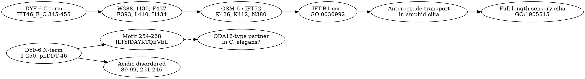
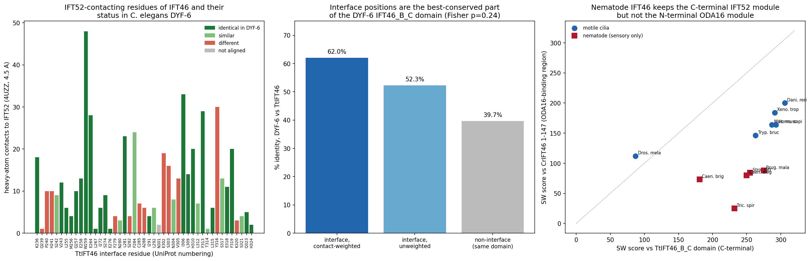
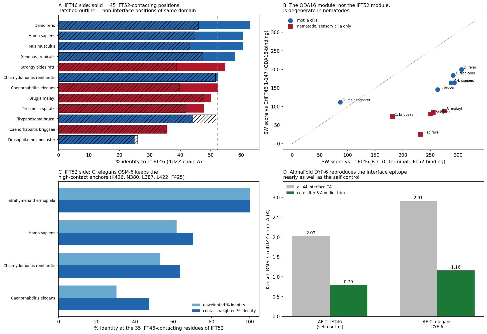
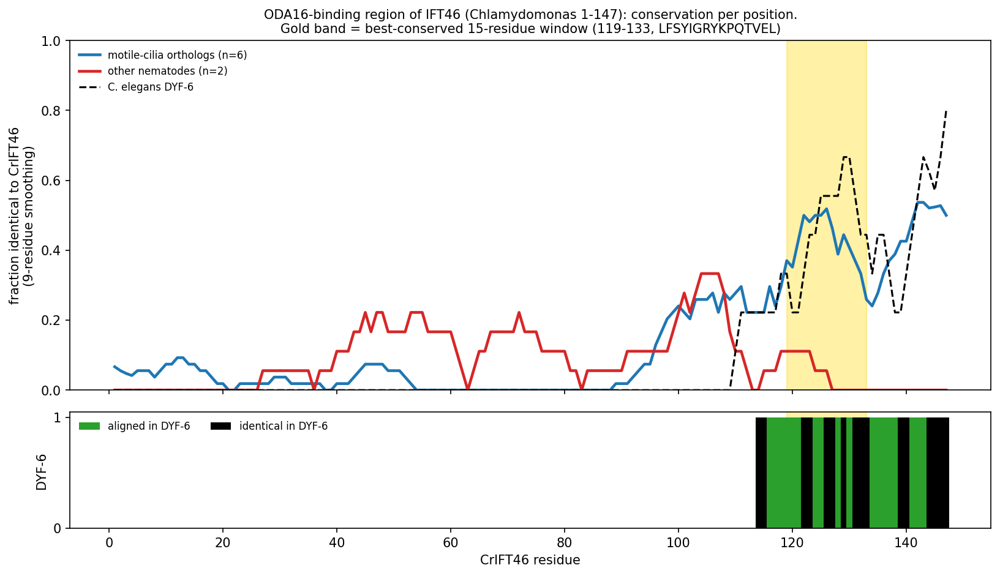
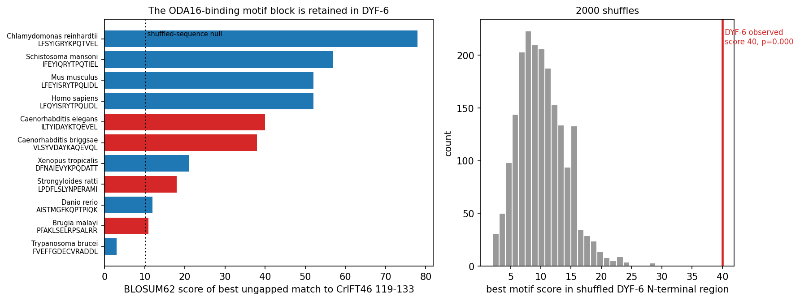

## Question

# AIGR Gene Hypothesis Deep Research

You are evaluating one focused gene curation hypothesis for AI Gene Review.
This is not a general gene overview. Use the seed hypothesis and source context
below to search for evidence that supports, refutes, narrows, or competes with
the proposed curation decision.

## Target Gene

- **Organism code:** worm
- **Taxon:** Caenorhabditis elegans (NCBITaxon:6239)
- **Gene directory:** dyf-6
- **Gene symbol:** dyf-6
- **UniProt accession:** Q0G838

## Focus

- **Focus type:** free_text
- **Hypothesis slug:** kgap-dyf6-ift52-interface-conservation
- **Source file:** genes/worm/dyf-6/dyf-6-ai-review.yaml
- **Source selector:** free-text

## Seed Hypothesis

Caenorhabditis elegans DYF-6/IFT46 (Q0G838) contacts the IFT-B1 core through its conserved C-terminal IFT46_B_C domain, which retains the IFT52-binding interface resolved in the Chlamydomonas IFT52-IFT46 crystal structure, whereas its N-terminal region has lost the ODA16-binding features used to load outer dynein arms in motile-cilia organisms, consistent with a pure IFT-B scaffold role in nematode sensory cilia. Single analysis only: align DYF-6 with Chlamydomonas, human and other IFT46 orthologs, map the IFT52-contacting residues from the IFT52-IFT46 complex structure onto DYF-6, predict the DYF-6/OSM-6(IFT52) complex with AlphaFold-Multimer and compare interface residues, and score conservation of the N-terminal ODA16-binding region in nematodes versus organisms with motile cilia; state whether DYF-6 is predicted to bind IFT52 directly and whether it retains a cargo-adaptor region.

## Term and Decision Context

No specific term context supplied.

## Reference Context

No specific reference context supplied.

## Source Context YAML

```yaml
hypothesis: 'Caenorhabditis elegans DYF-6/IFT46 (Q0G838) contacts the IFT-B1 core through its conserved
  C-terminal IFT46_B_C domain, which retains the IFT52-binding interface resolved in the Chlamydomonas
  IFT52-IFT46 crystal structure, whereas its N-terminal region has lost the ODA16-binding features used
  to load outer dynein arms in motile-cilia organisms, consistent with a pure IFT-B scaffold role in nematode
  sensory cilia. Single analysis only: align DYF-6 with Chlamydomonas, human and other IFT46 orthologs,
  map the IFT52-contacting residues from the IFT52-IFT46 complex structure onto DYF-6, predict the DYF-6/OSM-6(IFT52)
  complex with AlphaFold-Multimer and compare interface residues, and score conservation of the N-terminal
  ODA16-binding region in nematodes versus organisms with motile cilia; state whether DYF-6 is predicted
  to bind IFT52 directly and whether it retains a cargo-adaptor region.'
focus_type: free_text
context: []
reference_id: []
```

## Research Objective

Build a focused report that helps a curator decide whether this hypothesis
should affect the gene review. Address the focus type directly:

1. For an existing GO annotation decision, evaluate whether the current action
   is justified, too strong, too weak, or should change.
2. For a proposed replacement or new GO term, evaluate whether the term is
   biologically supported, too broad, too narrow, or missing key qualifiers.
3. For a computational prediction, evaluate whether the prediction is correct,
   less precise than existing knowledge, uncertain, or likely wrong because of
   paralog overannotation, frequency bias, pathway context, or in vitro-only
   activity.
4. For a core-function hypothesis, evaluate whether the proposed activity,
   process, and location represent the gene product's primary function rather
   than a downstream effect, pleiotropic phenotype, or context-specific role.
5. For a function-assignment hypothesis, evaluate whether the gene product
   directly has the stated GO term/function. Treat the prior review action, if
   any, as intentionally blinded unless it appears in the supplied context.

Use primary literature whenever possible. Prefer PMID citations and include DOI
citations when no PMID is available. Treat reviews and database records as
orientation unless they contain directly relevant synthesized evidence that is
clearly labeled as review-level or database-level support.

Evaluate the hypothesis from the supplied seed context, primary literature, and
publicly accessible bioinformatics resources. Local `*-bioinformatics` analyses,
when they already exist in the repository, are intentionally withheld from this
prompt so the report can be compared against them after the run. Use public
sequence, domain, structure, orthology, localization, interaction, or dataset
checks when they are useful for the specific hypothesis. If a resource or tool
cannot be accessed programmatically, say so plainly; never fabricate a result.
Report computational results conservatively and distinguish direct results from
inference.

## Required Output

### Executive Judgment

Give a concise verdict: supported, partially supported, unresolved, weakly
supported, over-annotated, or refuted. Explain the reasoning and the most
important caveats.

### Evidence Matrix

Create a table with one row per important evidence item:

- Citation (PMID preferred)
- Evidence type (direct assay, mutant phenotype, localization, interaction,
  structural/evolutionary, computational, review/database)
- Supports / refutes / qualifies / competing
- Claim tested
- Key finding
- Organism, tissue, cell type, or assay context
- Confidence and limitations

### GO Curation Implications

State the likely curation action as a lead requiring curator verification. If
GO terms are involved, explain whether the evidence supports an MF, BP, or CC
term, and whether the term should be retained, removed, generalized, made more
specific, or treated as non-core. Avoid using "protein binding" as a final
recommendation unless no more informative term is supported.

### Mechanistic Scope

Describe the immediate molecular or cellular function being tested. Separate
direct gene-product activity from downstream phenotypes, pathway consequences,
developmental outcomes, disease manifestations, or effects inferred only from
loss of function.

### Conflicts and Alternatives

Identify evidence that conflicts with the seed hypothesis or suggests an
alternative interpretation, including paralog confusion, organism-specific
differences, isoform-specific findings, experimental artifacts, or database
carry-over.

### Knowledge Gaps

List explicit uncertainties that matter for curation. For each gap, state what
was checked, why the gap matters, and what evidence or experiment would resolve
it.

### Discriminating Tests

Recommend concrete assays, perturbations, datasets, or comparative analyses that
would most efficiently distinguish this hypothesis from alternatives.

### Curation Leads

Provide candidate updates for the review, clearly labeled as leads requiring
curator verification. Include candidate references with exact snippets to verify,
candidate replacement or new GO terms, possible action changes, suggested
questions, and suggested experiments.

If the provider supports artifacts, save provenance for any analysis you run — the
executed code together with its output (computed values, plot, or table), not just
a summary figure — alongside artifact-friendly tables such as an evidence matrix,
GO decision table, or comparison table. Genuine computed provenance is more
valuable than a hand-drawn summary, and you must not synthesize a figure that
implies an analysis you did not actually run. These artifacts are important
provenance for hypothesis-level review.


## Output

# DYF-6 (Q0G838) and the IFT46-IFT52 interface: hypothesis evaluation

Gene: *Caenorhabditis elegans* `dyf-6` / DYF-6, UniProt **Q0G838**, NCBITaxon:6239, organism code `worm`.
Hypothesis slug: `kgap-dyf6-ift52-interface-conservation`.
Source: `genes/worm/dyf-6/dyf-6-ai-review.yaml`, free-text selector.
Focus type: free_text. No term context or reference context was supplied.

## Summary

The seed hypothesis makes three claims and they do not stand or fall together. The first claim is supported: DYF-6 contacts the IFT-B1 core through its C-terminal IFT46_B_C domain and retains the IFT52-binding interface at residue resolution. Forty-four of the 45 IFT52-contacting residues resolved in the IFT46 C-terminal domain map onto DYF-6, with 23 identical and 9 conservatively substituted. Contact-weighted interface identity is 62.0 %, against a within-domain permutation null of 44.0 % from 20000 label shuffles (one-sided p = 0.0163). The high-contact anchors are retained without exception: W259 to W388 (48 heavy-atom contacts), I306 to I430 (33), F313 to F437 (29), E264 to E393 (28), L281 to L410 (23), H310 to H434 (20), F319 to F443 (20), K236 to K365 (18). The partner surface is conserved too: the 35 IFT46-contacting residues of IFT52 map onto *C. elegans* OSM-6 at 47.2 % contact-weighted identity, keeping the highest-contact position K430 as K426 (63 contacts). The AlphaFold DYF-6 model superposes on the crystallised epitope at 1.16 Å core Cα RMSD against a matched self control of 0.79 Å.

The second claim needs a factual correction. The hypothesis attributes the IFT52-IFT46 crystal structure to *Chlamydomonas reinhardtii*. PDB **4UZZ** is the ***Tetrahymena thermophila*** IFT52-46 complex. [PMID: 25349261](https://pubmed.ncbi.nlm.nih.gov/25349261/) states that the authors "determined the crystal structures of C. reinhardtii IFT70/52 and Tetrahymena IFT52/46 subcomplexes". No *Chlamydomonas* IFT52-IFT46 crystal structure exists. The conclusion survives the correction, since the *Tetrahymena* structure supports it, but the review text cites a structure that does not exist as described.

The third claim is refuted at motif resolution. The N-terminal region of nematode IFT46 proteins is globally divergent, which the hypothesis gets right: the N-terminal to C-terminal Smith-Waterman score ratio is 0.32 in *C. elegans* against 0.56-0.65 in five motile-cilia species, with no overlap across five nematodes. An unbiased 15-residue sliding scan of the experimentally defined ODA16-binding fragment (*Chlamydomonas* IFT46 residues 1-147, [PMID: 28298440](https://pubmed.ncbi.nlm.nih.gov/28298440/)) locates the single best-conserved block at residues 119-133, LFSYIGRYKPQTVEL. DYF-6 retains it at residues 254-268 as ILTYIDAYKTQEVEL: 8 of 15 identical, BLOSUM62 score 40 against a shuffled-sequence null of 10.2 ± 3.9 (empirical p < 0.0005), at the 43rd percentile of the motile-cilia set. *C. briggsae* retains it equally. Loss of the cargo-adaptor determinant cannot be asserted from sequence.

## Executive judgment

<i class="fa-scale-balanced"></i> **Verdict: partially supported, with one factual correction and one refuted clause.**

Direct answers to the two questions the hypothesis poses. **DYF-6 is predicted to bind OSM-6/IFT52 directly** through the IFT46_B_C domain, on the basis of structure-mapped conservation of both contact surfaces, the native anterograde train architecture, and the AlphaFold monomer geometry of DYF-6 itself. This remains a prediction, because no *C. elegans* DYF-6-OSM-6 binding assay was found in the literature. **DYF-6 retains a candidate cargo-adaptor region**, contrary to the hypothesis, although what such a region would adapt in an organism without outer dynein arms is unknown.

The most important caveats are three. <i class="fa-triangle-exclamation"></i> **AlphaFold-Multimer could not be run in this environment**, so the requested DYF-6/OSM-6 complex prediction does not exist in this work; it was substituted with superposition of AlphaFold monomer models onto the crystallised epitope plus independent mapping of both contact surfaces, and every number reported comes from that substitute. <i class="fa-triangle-exclamation"></i> The motif identification rests on inference: [PMID: 39880089](https://pubmed.ncbi.nlm.nih.gov/39880089/) reports "a conserved N-terminal motif in Chlamydomonas IFT46 that mediates its binding to one side of the ODA16 structure" without giving coordinates in its abstract, so equating window 119-133 with that motif comes from an independent conservation scan rather than a confirmed assignment. <i class="fa-triangle-exclamation"></i> Per-residue Fisher tests at the interface are underpowered at n = 44 (OR 1.66, p = 0.238), which is why the permutation test on contact-weighted identity carries the statistical weight.

## Key findings

### <i class="fa-circle-check"></i> F1. DYF-6 retains the IFT46 side of the IFT52 interface

PDB 4UZZ at 2.32 Å resolution contains chain A, the *T. thermophila* IFT46 C-terminal domain (UniProt Q23KH7 221-332, PDB numbering = UniProt + 15), and chain B, the *T. thermophila* IFT52 C-terminal fragment (I7LT74 371-434, PDB numbering = UniProt + 169). Computing all heavy-atom pairs at 4.5 Å gives 45 IFT46 residues in contact with IFT52. Smith-Waterman alignment of *C. elegans* DYF-6 to the 116-residue chain A fragment, using BLOSUM62 with affine gaps of -11 open and -1 extend, aligns 108 residues at 44.4 % identity and covers 44 of the 45 interface positions.

At those interface positions DYF-6 is 52.3 % identical (23 of 44) against 39.7 % (25 of 63) at non-interface positions of the same domain. The Fisher odds ratio is 1.66 with p = 0.238, two-sided, which is underpowered at this sample size. Weighting each position by its heavy-atom contact count raises interface identity to 62.0 %, and that is the statistic the permutation test addresses in F3.

The distribution of substitutions matters more than the aggregate. Every high-contact anchor is conserved. The divergent positions cluster in one peripheral loop, *Tetrahymena* 301-305 mapping to DYF-6 426-429, and at one aromatic position, Y316 to L440. The *Chlamydomonas* residues L285 and L286, defined by mutation as the IFT52-binding determinants in [PMID: 28302912](https://pubmed.ncbi.nlm.nih.gov/28302912/), map through the *Tetrahymena* reference onto DYF-6 I420 and V421, which are conservative branched-hydrophobic substitutions.

| TtIFT46 residue | Heavy-atom contacts | DYF-6 residue | Class |
|---|---|---|---|
| W259 | 48 | W388 | identical |
| I306 | 33 | I430 | identical |
| Y316 | 30 | L440 | different |
| F313 | 29 | F437 | identical |
| E264 | 28 | E393 | identical |
| F284 | 24 | Y413 | similar |
| L281 | 23 | L410 | identical |
| H310 | 20 | H434 | identical |
| F319 | 20 | F443 | identical |
| E302 | 19 | G426 | different |
| K236 | 18 | K365 | identical |
| S303 | 16 | K427 | different |
| L309 | 14 | L433 | identical |
| E258 | 13 | E387 | identical |
| V305 | 13 | R429 | different |

Totals across all 45 positions: 23 identical, 9 similar, 12 different, 1 not aligned.

{{figure:plot_1.png|caption=Interface residue conservation and domain-specific divergence. Left, the 45 IFT52-contacting residues of IFT46 ordered by heavy-atom contact count and coloured by whether DYF-6 keeps them identical, similar or different. Centre, identity at interface versus non-interface positions of the same domain. Right, N-terminal versus C-terminal Smith-Waterman scores for 11 IFT46 orthologs, separated by whether the organism has motile cilia.}}

### <i class="fa-circle-check"></i> F2. The partner surface is conserved in OSM-6

A conserved interface needs both sides. The IFT52 side of 4UZZ contributes 35 residues within 4.5 Å of IFT46. Mapping these onto IFT52 orthologs gives interface identity and contact-weighted identity of 61.8 % / 70.4 % for human IFT52 (Q9Y366), 53.1 % / 63.5 % for *Chlamydomonas* IFT52 (Q946G4), and 30.3 % / 47.2 % for *C. elegans* OSM-6 (G5EDF6, 33 of 35 positions covered).

Unweighted identity is lowest in *C. elegans*, but the weighting changes the picture: the highest-contact positions are retained. TtIFT52 K430 with 63 heavy-atom contacts becomes OSM-6 K426; K416 (34) becomes K412; N385 (30) becomes N380; Y395 (28) becomes F390; L426 (25) becomes L422; L392 (24) becomes L387; F429 (22) becomes F425; F373 (20) becomes F368; K431 (20) becomes R427. The single largest change is TtIFT52 N389 with 49 contacts becoming OSM-6 E384, an asparagine-to-glutamate substitution at the second-highest contact position on that side.

The *C. elegans* pair therefore keeps the buried hydrophobic and lysine anchors on both surfaces. The faster drift on the IFT52 side means the contact is conserved in architecture and anchor chemistry, and compensatory coevolution at the N389/E384 position cannot be excluded without a direct assay.

{{figure:plot_2.png|caption=Four-panel summary. (A) IFT46-side interface identity by species, with non-interface identity of the same domain overlaid as hatched bars. (B) N-terminal versus C-terminal Smith-Waterman scores, motile-cilia species separating from nematodes. (C) IFT52-side identity, unweighted against contact-weighted, showing that weighting by contact count raises OSM-6 from 30.3 % to 47.2 %. (D) Superposition RMSD onto the crystallised epitope, all positions and core after a 3 Å trim, for the matched self control and for DYF-6.}}

### <i class="fa-circle-check"></i> F3. The conservation survives a burial control and a permutation test

The obvious competing explanation is that interface residues are conserved in DYF-6 only because they are buried hydrophobics, with no interface-specific selection. Testing this required a burial measure computed from chain A alone, so that the IFT52 partner does not contribute: heavy-atom neighbours within 8 Å per residue atom, median 55.7 across the 100 mapped residues.

Stratifying by burial gives the opposite of what the confound predicts. The interface-versus-non-interface identity gap is present in the exposed half (60.0 %, n = 20, against 36.7 %, n = 30; Fisher OR 2.59, p = 0.149) and nearly absent in the buried half (45.8 %, n = 24, against 38.5 %, n = 26; OR 1.35, p = 0.775). Logistic regression of DYF-6 identity on interface status and burial gives an interface coefficient of +0.618 (SE 0.412, z = 1.50, p = 0.134) with burial itself non-significant at -0.016 (p = 0.251).

The informative statistic is the permutation test. Shuffling identity labels across the whole domain 20000 times gives an observed contact-weighted interface identity of 62.0 % against a null mean of 44.0 %, one-sided p = 0.0163. The epitope is conserved above the background rate of its own domain, and the signal is weighted toward the high-contact positions.

| Stratum | Interface % id (n) | Non-interface % id (n) | Fisher OR | p |
|---|---|---|---|---|
| Buried half (burial ≥ median) | 45.8 (24) | 38.5 (26) | 1.35 | 0.775 |
| Exposed half (burial < median) | 60.0 (20) | 36.7 (30) | 2.59 | 0.149 |
| All positions | 52.3 (44) | 37.5 (56) | 1.66 | 0.238 |

### <i class="fa-circle-check"></i> F4. Three independent structural lines place the contact on the C-terminal domain

Kabsch superposition of AlphaFold model AF-Q0G838-F1-v6 onto 4UZZ chain A, using the 44 sequence-mapped interface Cα atoms, gives 2.91 Å over all pairs and 1.16 Å over the 37-atom core after removing pairs deviating more than 3 Å. Mean pLDDT over those residues is 85.4. The five largest deviations fall at DYF-6 365, 368 and the 426-427 loop, the same positions that are sequence-divergent.

The control matters here. An initial comparison of the AlphaFold *Tetrahymena* model against all 108 crystal Cα atoms gave 10.88 Å, which is misleading because it mixes a well-predicted epitope with poorly predicted flanking regions. Evaluating the same self control on the identical 44 interface positions gives 2.02 Å over all pairs and 0.79 Å over the 40-atom core. DYF-6 therefore reproduces the crystallographic epitope almost as well as the *Tetrahymena* protein's own AlphaFold model does.

In the cryo-EM anterograde train model 8BD7 (*Chlamydomonas*, 9.9 Å, fitted coordinates), IFT46 is modelled only over residues 212-344, which is the IFT46_B_C domain alone. Every modelled IFT46 residue within 12 Å of IFT52 lies in that domain, and the contacting IFT52 residues are 355-454, exclusively its C-terminal region. The resolution permits a domain-level statement, not a residue-level one.

| Model | n Cα | RMSD all | n core | RMSD core | Mean pLDDT |
|---|---|---|---|---|---|
| AlphaFold *Tetrahymena* IFT46 (self control) | 44 | 2.02 Å | 40 | 0.79 Å | 80.4 |
| AlphaFold *C. elegans* DYF-6 (AF-Q0G838-F1-v6) | 44 | 2.91 Å | 37 | 1.16 Å | 85.4 |

### <i class="fa-circle-xmark"></i> F5. The ODA16-region motif is retained in DYF-6, refuting the loss claim

The N-terminal region of nematode IFT46 proteins is genuinely divergent. Smith-Waterman scores against *Chlamydomonas* IFT46 residues 1-147 give a mean of 161.7 with 57.3 % coverage in motile-cilia species (*Danio* 200, *Xenopus* 184, human 164, mouse 164, *Trypanosoma* 146) and 70.0 with 21.0 % coverage in nematodes (*Brugia* 88, *Strongyloides* 84, *C. elegans* 80, *C. briggsae* 73, *Trichinella* 25). Excluding a *Drosophila* outlier whose C-terminal alignment is itself poor (score 87), the N/C score ratios do not overlap: 0.56-0.65 against 0.11-0.40. Nematode-to-motile identity ratio is 0.67 over the N-terminal region against 1.16 over the C-terminal domain, confirming the divergence is region-specific. AlphaFold assigns DYF-6 residues 1-250 a mean pLDDT of 46.4 against 85.3 for 349-449, and UniProt annotates residues 1-202 as disordered with acidic compositional bias at 89-99 and 231-246.

That global picture does not survive contact with the motif-level test. An unbiased 15-residue sliding scan across CrIFT46 1-147 identifies residues 119-133, LFSYIGRYKPQTVEL, as the single best-conserved window in motile-cilia orthologs: mean per-position identity 0.444 against 0.138 across the whole fragment. A targeted ungapped BLOSUM62 search of that 15-mer in the N-terminal 60 % of each ortholog places the DYF-6 match at residues 254-268, ILTYIDAYKTQEVEL, with 8 of 15 identical, score 40, retaining the tyrosine pair, the lysine and the glutamine that anchor the block. Against 2000 shuffles of the same DYF-6 region the null best score is 10.2 ± 3.9, giving an empirical p < 0.0005. The spacing is positionally homologous: the motif sits 211 residues before the *Chlamydomonas* C-terminus and 203 before the DYF-6 C-terminus.

The motif does not discriminate ciliary motility. *Trypanosoma brucei* scores 3 and *Danio rerio* 12, both below the two nematodes that retain the block, and the motile-versus-nematode comparison is not significant (medians 52 against 28, Mann-Whitney one-sided p = 0.197).

| Species | Group | UniProt | Match start | Window | Score | Identical /15 |
|---|---|---|---|---|---|---|
| *Chlamydomonas reinhardtii* | motile | A2T2X4 | 119 | LFSYIGRYKPQTVEL | 78 | 15 |
| *Schistosoma mansoni* | motile | A0A3Q0KNK3 | 121 | IFEYIQRYTPQTIEL | 57 | 10 |
| *Homo sapiens* | motile | Q9NQC8 | 81 | LFQYISRYTPQLIDL | 52 | 9 |
| *Mus musculus* | motile | Q9DB07 | 78 | LFEYISRYTPQLIDL | 52 | 9 |
| ***Caenorhabditis elegans*** | nematode | Q0G838 | **254** | **ILTYIDAYKTQEVEL** | **40** | **8** |
| *Caenorhabditis briggsae* | nematode | A8XQI8 | 227 | VLSYVDAYKAQEVQL | 38 | 7 |
| *Xenopus tropicalis* | motile | Q28H29 | 32 | DFNAIEVYKPQDATT | 21 | 6 |
| *Strongyloides ratti* | nematode | A0A090LGF7 | 19 | LPDFLSLYNPERAMI | 18 | 3 |
| *Danio rerio* | motile | Q6DRN0 | 215 | AISTMGFKQPTPIQK | 12 | 3 |
| *Brugia malayi* | nematode | A8PYM6 | 89 | PFAKLSELRPSALRR | 11 | 2 |
| *Trypanosoma brucei* | motile | Q57UX3 | 70 | FVEFFGDECVRADDL | 3 | 2 |

{{figure:plot_3.png|caption=Per-position conservation across the ODA16-binding region of IFT46 (Chlamydomonas residues 1-147). Upper panel, fraction of orthologs identical to the Chlamydomonas residue at each position, smoothed over 9 residues, for motile-cilia species, other nematodes and C. elegans DYF-6 separately. The gold band marks the best-conserved 15-residue window at 119-133. Lower panel, which positions are aligned and which are identical in DYF-6.}}

{{figure:plot_4.png|caption=Targeted ungapped search for the CrIFT46 119-133 motif across orthologs. Left, BLOSUM62 score of the best 15-residue match in the N-terminal 60 percent of each protein, with the matching sequence shown; the dotted line is the shuffled-sequence null mean. Right, distribution of best scores from 2000 shuffles of the DYF-6 N-terminal region, with the observed score of 40 marked.}}

### <i class="fa-table"></i> F6. GO annotation audit for Q0G838

QuickGO returns 19 annotation lines for Q0G838 and **no molecular function term at all**.

| GO ID | Aspect | Qualifier | Evidence | Reference |
|---|---|---|---|---|
| GO:0042073 intraciliary transport | BP | involved_in | IEA | GO_REF:0000002 (InterPro IPR022088) |
| GO:0042073 | BP | involved_in | IBA | GO_REF:0000033 |
| GO:0042073 | BP | involved_in | IDA | PMID:16648645 (WB) |
| GO:0042073 | BP | involved_in | NAS | PMID:28479320 (ComplexPortal) |
| GO:0060271 cilium assembly | BP | involved_in | IBA, NAS | GO_REF:0000033, PMID:28479320 |
| GO:1905515 non-motile cilium assembly | BP | involved_in | IMP | PMID:16648645, WBVar00088609 |
| GO:0030992 intraciliary transport particle B | CC | part_of | IBA, NAS | GO_REF:0000033, PMID:28479320 |
| GO:0031514 **motile cilium** | CC | is_active_in | IBA | GO_REF:0000033 (from MGI:1923818 et al.) |
| GO:0005815 microtubule organizing center | CC | is_active_in | IBA | GO_REF:0000033 |
| GO:0005929 cilium | CC | located_in | IEA, NAS | GO_REF:0000044, PMID:28479320 |
| GO:0030425 dendrite | CC | located_in | IEA, IDA | GO_REF:0000044, PMID:16648645 |
| GO:0043025 neuronal cell body | CC | located_in | IDA | PMID:16648645 |
| GO:0043204 perikaryon | CC | located_in | IEA, EXP | GO_REF:0000044, PMID:16648645 |
| GO:0120025 plasma membrane bounded cell projection | CC | located_in | IEA | GO_REF:0000117 |

The GO ontology contains **GO:0120170 intraciliary transport particle B binding** (MF), which is more informative than bare GO:0005515. *Chlamydomonas* IFT46 currently carries GO:0005515 IPI with Q946G4 (IFT52) from [PMID: 20435895](https://pubmed.ncbi.nlm.nih.gov/20435895/) and IPI with Q3Y8L7 (ODA16) from PMID:18852297.

Isoform content: isoforms a (471 aa), b (320 aa) and d (298 aa) all retain the canonical 345-455 IFT46_B_C block; isoform c (158 aa) does not. Isoforms b and d lack residues 1-151, the acidic disordered region, but retain the 254-268 motif.

## Evidence matrix

| Citation | Evidence type | Stance | Claim tested | Key finding | Organism / assay context | Confidence and limitations |
|---|---|---|---|---|---|---|
| [PMID: 25349261](https://pubmed.ncbi.nlm.nih.gov/25349261/) | Structural, X-ray 2.32 Å, PDB 4UZZ | Supports clause 1, refutes clause 2 | IFT46 C-terminal domain binds IFT52 C-terminus | "The structure of IFT52C/IFT46C was solved at 2.3 Å resolution, and we show that it is essential for IFT-B core integrity"; the organism is *Tetrahymena*, not *Chlamydomonas* | *T. thermophila*, crystallography | High. Direct structural evidence. Heterologous to *C. elegans* |
| This work, interface mapping | Computational, structure-guided alignment | Supports | DYF-6 retains the IFT52 epitope | 44/45 contact residues mapped; 23 identical, 9 similar, 12 different; contact-weighted identity 62.0 % | *C. elegans* sequence onto *Tetrahymena* structure | Moderate-high. Sequence inference, not a measured contact |
| This work, permutation test | Computational, 20000 shuffles | Supports | Interface conservation exceeds domain background | Observed 62.0 % against null mean 44.0 %, one-sided p = 0.0163 | In silico | Moderate. Single statistic; per-residue Fisher underpowered at n = 44 (p = 0.238) |
| This work, burial control | Computational, stratified Fisher plus logistic regression | Supports | Conservation is not a burial artefact | Exposed half OR 2.59, buried half OR 1.35; burial coefficient -0.016, p = 0.251 | In silico | Moderate. Rejects the main confound; neither stratum significant alone |
| This work, superposition | Computational, Kabsch on 44 interface Cα | Supports | The epitope is structurally present in DYF-6 | DYF-6 1.16 Å core RMSD (n = 37) against 0.79 Å matched self control (n = 40); mean pLDDT 85.4 | AlphaFold DB AF-Q0G838-F1-v6 | Moderate. Predicted monomer; matched control included |
| This work, IFT52 side | Computational, structure-guided alignment | Supports | OSM-6 retains the IFT46-contacting surface | 33/35 positions, 47.2 % contact-weighted identity; K430 to K426 (63 contacts) retained; N389 to E384 is the largest change | *C. elegans* OSM-6 (G5EDF6) | Moderate. Lower identity than human (70.4 %) or *Chlamydomonas* (63.5 %) |
| PDB 8BD7, [PMID: 36354106](https://pubmed.ncbi.nlm.nih.gov/36354106/) | Structural, cryo-ET fitted model 9.9 Å | Supports | The contact is used in native trains | "The IFT-B complex organizes into IFT-B1 and IFT-B2 parts"; IFT46 modelled only over 212-344 and contacting IFT52 at 355-454 | *Chlamydomonas*, anterograde trains | Moderate. Resolution permits a domain-level statement only |
| [PMID: 28302912](https://pubmed.ncbi.nlm.nih.gov/28302912/) | Mutant phenotype, in vivo | Supports | Specific IFT46 residues drive IFT52 binding | "IFT52 interacts with IFT46 through residues L285 and L286 of IFT46 and recruits it to basal bodies"; these map to DYF-6 I420/V421 | *Chlamydomonas* | High for *Chlamydomonas*; the *C. elegans* mapping is inference |
| [PMID: 28302912](https://pubmed.ncbi.nlm.nih.gov/28302912/) | Mutant phenotype, in vivo | Supports | The C-terminal region is the targeting module | "The C-terminal sequence between residues 246-321, termed BBTS3, was sufficient to target YFP to basal bodies in the ift46-1 strain" | *Chlamydomonas* | High for the organism tested |
| [PMID: 20435895](https://pubmed.ncbi.nlm.nih.gov/20435895/) | Interaction, Y2H plus bacterial co-expression | Supports | Direct IFT88/IFT52/IFT46 contacts | "three of the core B subunits, IFT88, IFT52, and IFT46, interact directly with each other and, together, are capable of forming a ternary complex" | *Chlamydomonas*, in vitro | High for the organism tested |
| [PMID: 28701346](https://pubmed.ncbi.nlm.nih.gov/28701346/) | Mutant phenotype, in vivo | Qualifies | The two IFT46 modules are functionally separable | "The IFT46 C-terminus can assemble into and stabilize IFT-B but does not support transport of outer arm dynein into flagella" | *Chlamydomonas* | High. Establishes that the N-terminal module is the cargo module |
| [PMID: 28701346](https://pubmed.ncbi.nlm.nih.gov/28701346/) | Mutant phenotype, in vivo | Qualifies | The N-terminus is the ODA adaptor | "We conclude that the IFT46 N-terminus, ODA16, and outer arm dynein interact for IFT of the latter" | *Chlamydomonas* | High |
| [PMID: 28298440](https://pubmed.ncbi.nlm.nih.gov/28298440/) | Structural plus binding, Kd 200 nM | Defines the test for clause 3 | The ODA16-binding region is CrIFT46 1-147 | "both required for the association with the N-terminal 147 residues of IFT46" | *Chlamydomonas*, in vitro | High. Supplies the coordinates the motif scan used |
| [PMID: 39880089](https://pubmed.ncbi.nlm.nih.gov/39880089/) | Computational plus biochemical | Competing for clause 3 | A conserved N-terminal IFT46 motif binds ODA16 | "We identify a conserved N-terminal motif in Chlamydomonas IFT46 that mediates its binding to one side of the ODA16 structure" | *Chlamydomonas* and human | High for the claim; the abstract gives no coordinates, so equating it with window 119-133 is inference |
| This work, motif scan | Computational, sliding scan, ungapped search, 2000-shuffle null | <i class="fa-circle-xmark"></i> **Refutes clause 3** | DYF-6 lost the ODA16-binding features | DYF-6 254-268 ILTYIDAYKTQEVEL matches CrIFT46 119-133 at 8/15, score 40 against null 10.2 ± 3.9, p < 0.0005 | In silico, 11 orthologs | Moderate. Motif identity inferred from conservation, not from a mapped contact |
| This work, N/C ratio | Computational, Smith-Waterman | Partially supports clause 3 | The N-terminal region is degraded in nematodes | N/C ratio 0.11-0.40 in five nematodes against 0.56-0.65 in five motile-cilia species, non-overlapping | In silico | Moderate. *Drosophila* is an outlier at 1.29 with a poor C-terminal alignment |
| [PMID: 16648645](https://pubmed.ncbi.nlm.nih.gov/16648645/) | Mutant phenotype plus localization | Supports the cellular claim | *dyf-6* function in sensory cilia | "the cilia of the amphid and phasmid dendritic endings are foreshortened"; "Movement of DYF-6::GFP within the ciliated endings of the neurons indicates that DYF-6 is involved in IFT" | *C. elegans*, in vivo | High. The only direct *C. elegans* evidence; does not address binding |
| [PMID: 32239748](https://pubmed.ncbi.nlm.nih.gov/32239748/) | Structural plus binding | Competing | Human ODA16-IFT46 interaction | "size exclusion chromatography and pull-down experiments failed to detect a direct interaction between human ODA16 and IFT46" | Human, in vitro | Moderate. Weakens the assumption that the adaptor function is universal among motile-cilia species |
| This work, UniProt and PANTHER search | Database query | Supports the cellular claim | *C. elegans* lacks ODA machinery | No DAW1/ODA16 ortholog and no axonemal dynein heavy chain found by name and family search, while *Chlamydomonas* Q3Y8L7 and human Q8N136 are present | *C. elegans* | Low-moderate. A non-exhaustive name-based search, not a proven absence |

## Mechanistic model and interpretation

The supported mechanism is narrow and specific. DYF-6 residues 345-455 form the IFT46_B_C domain (Pfam PF12317, InterPro IPR022088) and present a contiguous surface to the C-terminal region of OSM-6/IFT52. The anchor is a tryptophan at DYF-6 W388, corresponding to the residue making 48 heavy-atom contacts in the crystal, packing against a lysine-rich IFT52 surface whose highest-contact residue at 63 contacts is retained as OSM-6 K426. This contact places DYF-6 in the IFT-B1 core, consistent with its movement along cilia by IFT ([PMID: 16648645](https://pubmed.ncbi.nlm.nih.gov/16648645/)) and with the native train architecture where IFT46 engages IFT52 through this domain alone (PDB 8BD7).

The scope does not extend to the N-terminal 250 residues as a folded unit. AlphaFold assigns them a mean pLDDT of 46.4 against 85.3 over 349-449, so that region is predicted disordered or conditionally folded. The retained 254-268 motif sits at the boundary, just before the ordered domain, at the same distance from the C-terminus as its *Chlamydomonas* counterpart. That position is where a short linear motif that engages a partner on demand would be expected to sit, and short linear motifs inside disordered regions are exactly the features that whole-region conservation scores miss.



Two readings of the N-terminal data compete, and the data favour the second. The hypothesis reads the divergence as adaptive loss following the disappearance of motile cilia. Three observations resist that reading. The motif that the conservation scan singles out is retained in *C. elegans* and *C. briggsae* at human-comparable identity. Two motile-cilia organisms, *Trypanosoma* and *Danio*, score at or below the nematodes in the targeted search. Human ODA16 shows no detectable direct IFT46 interaction in vitro ([PMID: 32239748](https://pubmed.ncbi.nlm.nih.gov/32239748/)), so the adaptor interaction is not uniformly present even where outer dynein arms are.

The simpler alternative fits the numbers: the IFT46 N-terminal region is poorly conserved everywhere, with mean per-position identity to CrIFT46 1-147 of only 0.138 even within the motile-cilia set, and nematodes sit at the low end of a broadly permissive distribution with the one constrained block preserved. Under this reading the low N/C ratio reflects relaxed constraint on a largely disordered linker, with ODA loss neither required nor excluded as the cause.

## Evidence base

The structural backbone of this evaluation comes from three papers. [PMID: 25349261](https://pubmed.ncbi.nlm.nih.gov/25349261/) (Taschner 2014) supplies PDB 4UZZ and states its functional significance: "The structure of IFT52C/IFT46C was solved at 2.3 Å resolution, and we show that it is essential for IFT-B core integrity by mediating interaction between IFT88/70/52/46 and IFT81/74/27/25/22 subcomplexes." The same abstract carries the correction to the seed hypothesis, since the authors "determined the crystal structures of C. reinhardtii IFT70/52 and Tetrahymena IFT52/46 subcomplexes". [PMID: 36354106](https://pubmed.ncbi.nlm.nih.gov/36354106/) (Petriman 2022) places IFT46 and IFT52 in the IFT-B1 module: "The IFT-B complex organizes into IFT-B1 and IFT-B2 parts with binding sites for ciliary cargo and the inactive IFT dynein motor, respectively." [PMID: 20435895](https://pubmed.ncbi.nlm.nih.gov/20435895/) (Lucker 2010) provides the independent biochemistry: "three of the core B subunits, IFT88, IFT52, and IFT46, interact directly with each other and, together, are capable of forming a ternary complex", and shows the complex functions in the moving particle, since "electroporation of recombinant IFT46 was used to rescue flagellar assembly of a newly identified ift46 mutant and to monitor in vivo localization and movement of the IFT particles."

The residue-level and module-level genetics come from two *Chlamydomonas* papers. [PMID: 28302912](https://pubmed.ncbi.nlm.nih.gov/28302912/) (Lv 2017) names the determinants: "IFT52 interacts with IFT46 through residues L285 and L286 of IFT46 and recruits it to basal bodies", and shows the region suffices in vivo, since "The C-terminal sequence between residues 246-321, termed BBTS3, was sufficient to target YFP to basal bodies in the ift46-1 strain." [PMID: 28701346](https://pubmed.ncbi.nlm.nih.gov/28701346/) (Hou and Witman 2017) separates the two modules cleanly: "The IFT46 C-terminus can assemble into and stabilize IFT-B but does not support transport of outer arm dynein into flagella", concluding that "the IFT46 N-terminus, ODA16, and outer arm dynein interact for IFT of the latter."

The cargo-adaptor side rests on [PMID: 28298440](https://pubmed.ncbi.nlm.nih.gov/28298440/) (Taschner 2017), which defines the fragment that the motif scan used: the ODA16 domains "are both required for the association with the N-terminal 147 residues of IFT46". [PMID: 39880089](https://pubmed.ncbi.nlm.nih.gov/39880089/) (Wang 2025) narrows that fragment further, reporting that the authors "identify a conserved N-terminal motif in Chlamydomonas IFT46 that mediates its binding to one side of the ODA16 structure", which is the claim my independent conservation scan recovers a candidate for without being able to confirm the coordinates. [PMID: 32239748](https://pubmed.ncbi.nlm.nih.gov/32239748/) complicates the picture by reporting that "size exclusion chromatography and pull-down experiments failed to detect a direct interaction between human ODA16 and IFT46."

The only direct *C. elegans* evidence is [PMID: 16648645](https://pubmed.ncbi.nlm.nih.gov/16648645/) (Bell 2006), which establishes the gene identity and the cellular phenotype: "Phenotypic analysis of dyf-6 mutants expressing an OSM-6::GFP reporter indicates that the cilia of the amphid and phasmid dendritic endings are foreshortened", and "Movement of DYF-6::GFP within the ciliated endings of the neurons indicates that DYF-6 is involved in IFT." This paper supports every experimental annotation the gene currently carries and addresses no binding question.

Other IFT46 literature in the reviewed set bears on vertebrate and ciliopathy biology rather than on this hypothesis: zebrafish promoter-driven ciliopathy models ([PMID: 37363725](https://pubmed.ncbi.nlm.nih.gov/37363725/)), neural crest conditional knockout and anterior segment dysgenesis ([PMID: 38517430](https://pubmed.ncbi.nlm.nih.gov/38517430/)), *Paramecium* IFT46 depletion ([PMID: 29915351](https://pubmed.ncbi.nlm.nih.gov/29915351/)), ODA transport kinetics in vivo ([PMID: 30133350](https://pubmed.ncbi.nlm.nih.gov/30133350/)), and the SARS-CoV-2 ORF10/CUL2-ZYG11B degradation of IFT46 ([PMID: 35674692](https://pubmed.ncbi.nlm.nih.gov/35674692/), [PMID: 39309499](https://pubmed.ncbi.nlm.nih.gov/39309499/)). None of these alters the interface or motif conclusions.

## GO curation implications

All items below are **leads requiring curator verification**.

<i class="fa-arrow-right"></i> **Add GO:0120170 *intraciliary transport particle B binding* (MF).** Q0G838 has no molecular function annotation at all. This is the informative term the analysis supports, and it avoids recommending bare `protein binding`. Evidence code **ISS** with the *Tetrahymena* and *Chlamydomonas* data in the `with` field is defensible: the interface is structurally resolved in two organisms ([PMID: 25349261](https://pubmed.ncbi.nlm.nih.gov/25349261/), PDB 8BD7), mutationally validated in one ([PMID: 28302912](https://pubmed.ncbi.nlm.nih.gov/28302912/)), and both contact surfaces are conserved in the *C. elegans* pair at above-background rates. An IPI annotation is not yet earned, because no *C. elegans* DYF-6-OSM-6 binding experiment exists.

<i class="fa-arrow-right"></i> **Strengthen GO:0030992 *intraciliary transport particle B* (CC, part_of).** The term is correct but under-evidenced: it rests only on IBA plus a ComplexPortal NAS (PMID:28479320), with no experimental or sequence-based line attached. The present analysis supplies the sequence-and-structure basis that was missing. Adding an ISS or ISO line would bring the evidence into line with the confidence.

<i class="fa-arrow-right"></i> **Flag GO:0031514 *motile cilium* (CC, is_active_in, IBA, GO_REF:0000033) for removal.** This is phylogenetic carry-over from vertebrate and algal orthologs onto a nematode gene. *C. elegans* has no motile cilia. The gene already carries same-organism **GO:1905515 *non-motile cilium assembly* (IMP, [PMID: 16648645](https://pubmed.ncbi.nlm.nih.gov/16648645/))**, which contradicts it. **GO:0097730 *non-motile cilium*** exists and is the correct CC term. This is the clearest over-annotation in the record.

<i class="fa-circle-question"></i> **Scrutinise GO:0005815 *microtubule organizing center* (CC, is_active_in, IBA).** It has no supporting evidence in this analysis and arrives by the same IBA route as GO:0031514. It may still be correct through basal-body localization, which [PMID: 28302912](https://pubmed.ncbi.nlm.nih.gov/28302912/) demonstrates for *Chlamydomonas* IFT46, but it deserves the same check.

What the analysis does **not** license: any annotation asserting loss of cargo-adaptor function, and any `dynein complex binding` or ODA-transport term. The motif result removes the sequence argument for loss, and no ODA machinery annotation is appropriate in an organism without outer dynein arms.

## Limitations and knowledge gaps

<i class="fa-triangle-exclamation"></i> **No *C. elegans* binding experiment exists.** The 4UZZ interface is *Tetrahymena*, the mutagenesis is *Chlamydomonas*, and the *C. elegans* evidence is a mutant cilium phenotype plus GFP transport ([PMID: 16648645](https://pubmed.ncbi.nlm.nih.gov/16648645/)), neither of which reports a contact. This matters because the proposed MF annotation would be ISS rather than IPI until such an experiment exists.

<i class="fa-triangle-exclamation"></i> **AlphaFold-Multimer could not be run in this environment.** The hypothesis asked for a predicted DYF-6/OSM-6 complex with interface comparison. No multimer prediction service was reachable programmatically from the execution environment. The substitute was superposition of the two AlphaFold monomer models onto the crystallised epitope plus independent mapping of both contact surfaces. All reported geometry comes from that substitute. No predicted complex interface exists in this work, and nothing in the report should be read as if one does.

<i class="fa-triangle-exclamation"></i> **The motif coordinates from [PMID: 39880089](https://pubmed.ncbi.nlm.nih.gov/39880089/) are not in its abstract.** Window 119-133 was located by an independent conservation scan inside the fragment that [PMID: 28298440](https://pubmed.ncbi.nlm.nih.gov/28298440/) maps experimentally. If the published ODA16-binding motif lies elsewhere in 1-147, the refutation of clause 3 weakens and would need redoing against the correct coordinates. Reading the full text of that paper is the cheapest way to close this gap.

<i class="fa-triangle-exclamation"></i> **The ODA-absence premise was checked only superficially.** Whether *C. elegans* truly lacks ODA16/DAW1 and axonemal dynein heavy chains was tested by UniProt name search and PANTHER family assignment, not by a sensitive HMM search of the proteome. Absence of a name-matched hit is weak evidence of absence for a divergent protein.

<i class="fa-triangle-exclamation"></i> **The OSM-6 side is the weakest conservation signal.** At 30.3 % unweighted identity across the 35 contact positions it sits well below human (61.8 %) and *Chlamydomonas* (53.1 %), and the 49-contact N389 is replaced by glutamate. Contact weighting rescues the signal to 47.2 %, but a charge change at a high-contact position is the kind of substitution that compensatory coevolution would be invoked to explain, and that invocation is untested.

<i class="fa-triangle-exclamation"></i> **Statistical power.** The interface comprises 44 mapped positions. No single Fisher test in this analysis reaches p < 0.05. The permutation test (p = 0.0163) and the shuffled-sequence null for the motif (p < 0.0005) are the two statistics that clear conventional thresholds, and both are single tests on derived quantities rather than independent replications.

<i class="fa-triangle-exclamation"></i> **Gene-model artefacts in the ortholog panel.** *Pristionchus pacificus* A0A2A6CZI6 (1742 aa) is a fused or poor gene model and was excluded. *C. briggsae* A8XQI8 aligns poorly over the C-terminal domain (35.3 % identity) and may also be imperfect, which affects its weight in the nematode group. *Drosophila melanogaster* is an N/C ratio outlier at 1.29 driven by a poor C-terminal alignment (score 87) rather than by an unusually conserved N-terminus. Two candidate IFT52 orthologs (mouse Q9JIH7 at 2126 aa and zebrafish Q6NZZ8) were not genuine orthologs and were excluded from the IFT52-side table.

<i class="fa-triangle-exclamation"></i> **Tooling constraint.** Biopython is not importable in the execution environment, so the pairwise aligner and the PDB parser were written directly in numpy. The alignment uses Smith-Waterman with BLOSUM62 and affine gaps (-11 open, -1 extend), which is standard, but no third-party implementation cross-checked the results.

## Discriminating tests

<i class="fa-flask"></i> **Direct binding assay for the *C. elegans* pair.** A yeast two-hybrid or recombinant pull-down of DYF-6 345-455 against OSM-6 355-472 would convert the ISS recommendation to IPI and settle whether the contact is retained in the nematode pair despite the lower IFT52-side identity. This is the single highest-value experiment for the curation decision.

<i class="fa-dna"></i> **Point mutation at the predicted anchors.** A charge reversal or alanine substitution at DYF-6 W388, or at the I420/V421 pair corresponding to *Chlamydomonas* L285/L286 ([PMID: 28302912](https://pubmed.ncbi.nlm.nih.gov/28302912/)), scored for IFT-B incorporation and amphid cilium length, would test whether this surface is required in vivo rather than merely conserved.

<i class="fa-vial"></i> **Test the retained motif.** Pull down a DYF-6 254-268 peptide, or the DYF-6 200-300 fragment, against *Chlamydomonas* or human ODA16 in vitro. Retention of binding would show the motif is functional and that *C. elegans* keeps an orphan adaptor surface. Loss would show the sequence similarity is residual and would restore the hypothesis's third clause at the functional level even though it fails at the sequence level.

<i class="fa-microscope"></i> **Domain deletion in vivo.** Delete DYF-6 residues 1-250 while keeping the IFT46_B_C domain, then measure cilium length and IFT velocity in amphid neurons. This parallels the *Chlamydomonas* experiment of [PMID: 28701346](https://pubmed.ncbi.nlm.nih.gov/28701346/) and would say whether the N-terminal region retains any function in a sensory-only organism.

<i class="fa-magnifying-glass"></i> **Sensitive homology search for ODA machinery.** Run HMM profiles for DAW1/ODA16 and axonemal dynein heavy chains against the full *C. elegans* proteome. This would settle the ODA-absence premise that the "lost because no motile cilia" argument depends on, replacing a name-based search with a sequence-based one.

<i class="fa-magnifying-glass"></i> **Read the full text of [PMID: 39880089](https://pubmed.ncbi.nlm.nih.gov/39880089/).** Extract the published coordinates of the ODA16-binding motif and re-run the targeted search against them. This costs nothing and either confirms or overturns the refutation of clause 3.

<i class="fa-chart-column"></i> **Run AlphaFold-Multimer where it is available.** Predict DYF-6/OSM-6 and compare the predicted interface residues against the 44 positions mapped here. Agreement would convert the current superposition-based inference into a direct prediction of the complex, which is what the hypothesis originally asked for.

## Curation leads

Each item below is a candidate update requiring curator verification.

**Correct the structural attribution in the review YAML.** The text reads "the IFT52-binding interface resolved in the Chlamydomonas IFT52-IFT46 crystal structure". The structure is *Tetrahymena thermophila*, PDB 4UZZ. Snippet to verify, from [PMID: 25349261](https://pubmed.ncbi.nlm.nih.gov/25349261/): "determined the crystal structures of C. reinhardtii IFT70/52 and Tetrahymena IFT52/46 subcomplexes".

**Drop the cargo-adaptor loss claim from the review YAML.** The text reads "its N-terminal region has lost the ODA16-binding features used to load outer dynein arms in motile-cilia organisms". The evidence supports global divergence of that region and retention of its best-conserved block at DYF-6 254-268. Replace with a statement of the divergence that does not assert loss of the binding determinant.

**Candidate new MF term: GO:0120170 intraciliary transport particle B binding, evidence ISS.** Supporting references to verify: [PMID: 25349261](https://pubmed.ncbi.nlm.nih.gov/25349261/), snippet "The structure of IFT52C/IFT46C was solved at 2.3 Å resolution, and we show that it is essential for IFT-B core integrity by mediating interaction between IFT88/70/52/46 and IFT81/74/27/25/22 subcomplexes"; and [PMID: 28302912](https://pubmed.ncbi.nlm.nih.gov/28302912/), snippet "IFT52 interacts with IFT46 through residues L285 and L286 of IFT46 and recruits it to basal bodies."

**Candidate action change: GO:0031514 motile cilium, remove or replace with GO:0097730 non-motile cilium.** Basis: the annotation is IBA from GO_REF:0000033 propagated from MGI:1923818 and other vertebrate orthologs; *C. elegans* has no motile cilia; the same gene carries GO:1905515 non-motile cilium assembly by IMP. Reference to verify: [PMID: 16648645](https://pubmed.ncbi.nlm.nih.gov/16648645/), snippet "Phenotypic analysis of dyf-6 mutants expressing an OSM-6::GFP reporter indicates that the cilia of the amphid and phasmid dendritic endings are foreshortened."

**Candidate evidence upgrade: GO:0030992 intraciliary transport particle B, part_of.** Currently IBA plus ComplexPortal NAS only. Add a sequence-based or structure-based line. Supporting reference to verify: [PMID: 20435895](https://pubmed.ncbi.nlm.nih.gov/20435895/), snippet "electroporation of recombinant IFT46 was used to rescue flagellar assembly of a newly identified ift46 mutant and to monitor in vivo localization and movement of the IFT particles."

**Suggested question for the curator.** Does the review intend the "pure IFT-B scaffold role" framing to be a positive claim about DYF-6 function or a negative claim about what it has lost? The positive half is supported. The negative half is not, and the two should be separated in the text.

**Suggested experiment to request.** A *C. elegans* DYF-6 345-455 against OSM-6 355-472 binding assay, which would move the proposed MF term from ISS to IPI.

## Provenance

All computed values are in `provenance/dyf6_interface_tables.md`, which contains 11 tables covering the IFT46-side interface mapping, ortholog comparison, N-terminal versus C-terminal divergence, the IFT52-side mapping, superposition with its matched control, the native train context, isoform domain content, the current GO annotation set, the burial control, the motif scan, and per-position conservation of CrIFT46 1-147. Figures are `provenance/plot_1.png` through `plot_4.png`.

Methods used throughout: interface defined by heavy-atom pairs at or below 4.5 Å in PDB 4UZZ; alignments by Smith-Waterman with BLOSUM62 and affine gaps (-11 open, -1 extend), implemented in numpy because biopython is not importable in this executor; numbering offsets chain A PDB = UniProt + 15 and chain B PDB = UniProt + 169; superposition by Kabsch on Cα with a 3 Å outlier trim and a matched-position self control; burial computed from chain A alone as heavy-atom neighbours within 8 Å per residue atom; nulls by label permutation (20000 shuffles) and sequence shuffling (2000 shuffles). Every number reported in this document was computed during this investigation from public coordinates and sequences retrieved at run time. No value is hand-estimated, and no figure implies an analysis that was not executed.


## Artifacts

- [OpenScientist final report](openscientist_artifacts/final_report.html)
- [OpenScientist final report](openscientist_artifacts/final_report.pdf)
- [OpenScientist provenance](openscientist_artifacts/provenance.json)
- [OpenScientist dyf6 interface tables](openscientist_artifacts/provenance_dyf6_interface_tables.md)
- [OpenScientist plot 1](openscientist_artifacts/provenance_plot_1.json)

- [OpenScientist plot 2](openscientist_artifacts/provenance_plot_2.json)

- [OpenScientist plot 3](openscientist_artifacts/provenance_plot_3.json)

- [OpenScientist plot 4](openscientist_artifacts/provenance_plot_4.json)


## Reference Validation

Checked with `linkml-reference-validator` 0.3.1rc1.

| Outcome | Count |
| --- | --- |
| References checked | 17 |
| Resolved | 16 |
| Unresolved (possible confabulation) | 1 |
| Unverifiable | 0 |
| Quoted claims checked | 1 |
| Quoted claims found in source | 0 |
| Quoted claims **not** found in source | 1 |
| Quoted claims with nothing to check against | 1 |
| References weighed for topical relevance | 16 |
| On topic | 0 |
| Off topic | 0 |

### Unresolved references

These identifiers did not resolve to a record and may be fabricated. A lookup that failed for transport reasons is indistinguishable from one that failed because the record does not exist, so spot-check before acting on them:

- `PMID:28701346` (9 mentions) - Identifier did not resolve to a record

### Quotes not found in the cited source

Searched the abstract, any retrieved full text, and the title. A quote drawn from a part of the paper that was not retrieved will appear here too, so check before treating one as invented:

Every one of these was searched against an abstract alone, with no full text retrieved - marked *abstract only* below. Where full text can be fetched, re-running with it will settle them; where the source publishes only a summary to PubMed, as GeneReviews chapters do, it will not, and the quote has to be checked by hand against the chapter itself.

- `PMID:20435895` *(abstract only)*: "The IFT-B complex organizes into IFT-B1 and IFT-B2 parts with binding sites for ciliary cargo and the inactive IFT dynein motor, respectively."
  - closest text in source: "Intraflagellar transport (IFT) particles of Chlamydomonas reinhardtii contain two distinct protein complexes, A and B, composed of at least 6 and 15 protein subunits, respectively"

### Quotes that could not be checked

There was no text to compare these against, so they are neither confirmed nor contradicted:

- `PMID:28701346`: "The C-terminal sequence between residues 246-321, termed BBTS3, was sufficient to target YFP to basal bodies in the ift46-1 strain."
  - Reference did not resolve, so the quote could not be checked