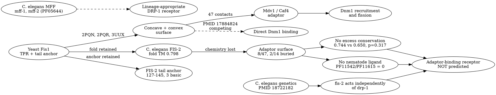
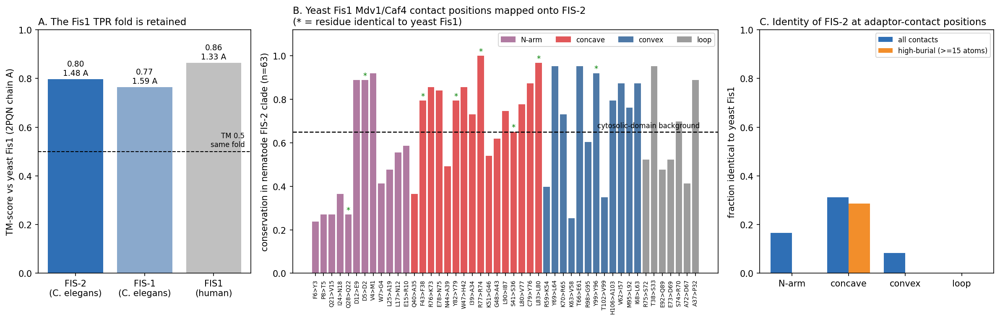
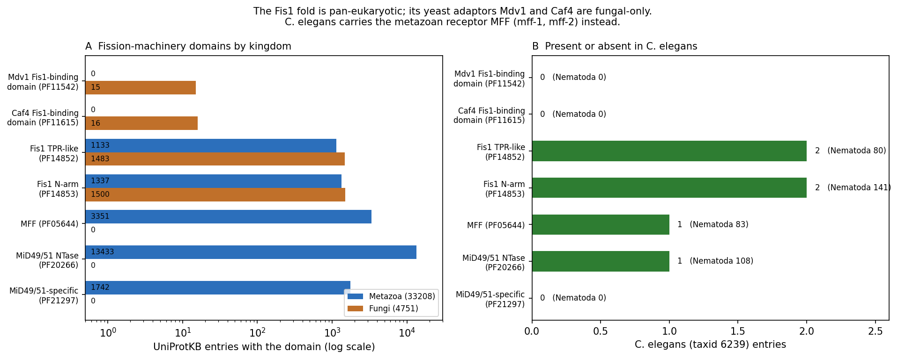
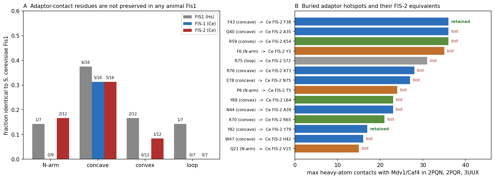

## Question

# AIGR Gene Hypothesis Deep Research

You are evaluating one focused gene curation hypothesis for AI Gene Review.
This is not a general gene overview. Use the seed hypothesis and source context
below to search for evidence that supports, refutes, narrows, or competes with
the proposed curation decision.

## Target Gene

- **Organism code:** worm
- **Taxon:** Caenorhabditis elegans (NCBITaxon:6239)
- **Gene directory:** fis-2
- **Gene symbol:** fis-2
- **UniProt accession:** Q6AHP8

## Focus

- **Focus type:** free_text
- **Hypothesis slug:** kgap-fis2-tpr-binding-surface
- **Source file:** genes/worm/fis-2/fis-2-ai-review.yaml
- **Source selector:** free-text

## Seed Hypothesis

Caenorhabditis elegans FIS-2 retains the Fis1 tetratricopeptide-repeat (TPR) fold and the conserved concave surface residues that in yeast Fis1 bind the adaptors Mdv1/Caf4 and in human FIS1 mediate interactions, and so is predicted to act as an adaptor-binding mitochondrial outer-membrane receptor. Single analysis only: model FIS-2 (AlphaFold), superpose on Fis1 structures (yeast Fis1 with Mdv1 peptide, human FIS1), score conservation of the concave-surface binding residues and the C-terminal tail anchor across nematode FIS-1/FIS-2 orthologs, and state whether an adaptor-binding surface is predicted and whether FIS-2 differs from FIS-1 there.

## Term and Decision Context

No specific term context supplied.

## Reference Context

No specific reference context supplied.

## Source Context YAML

```yaml
hypothesis: 'Caenorhabditis elegans FIS-2 retains the Fis1 tetratricopeptide-repeat (TPR) fold and the
  conserved concave surface residues that in yeast Fis1 bind the adaptors Mdv1/Caf4 and in human FIS1
  mediate interactions, and so is predicted to act as an adaptor-binding mitochondrial outer-membrane
  receptor. Single analysis only: model FIS-2 (AlphaFold), superpose on Fis1 structures (yeast Fis1 with
  Mdv1 peptide, human FIS1), score conservation of the concave-surface binding residues and the C-terminal
  tail anchor across nematode FIS-1/FIS-2 orthologs, and state whether an adaptor-binding surface is predicted
  and whether FIS-2 differs from FIS-1 there.'
focus_type: free_text
context: []
reference_id: []
```

## Research Objective

Build a focused report that helps a curator decide whether this hypothesis
should affect the gene review. Address the focus type directly:

1. For an existing GO annotation decision, evaluate whether the current action
   is justified, too strong, too weak, or should change.
2. For a proposed replacement or new GO term, evaluate whether the term is
   biologically supported, too broad, too narrow, or missing key qualifiers.
3. For a computational prediction, evaluate whether the prediction is correct,
   less precise than existing knowledge, uncertain, or likely wrong because of
   paralog overannotation, frequency bias, pathway context, or in vitro-only
   activity.
4. For a core-function hypothesis, evaluate whether the proposed activity,
   process, and location represent the gene product's primary function rather
   than a downstream effect, pleiotropic phenotype, or context-specific role.
5. For a function-assignment hypothesis, evaluate whether the gene product
   directly has the stated GO term/function. Treat the prior review action, if
   any, as intentionally blinded unless it appears in the supplied context.

Use primary literature whenever possible. Prefer PMID citations and include DOI
citations when no PMID is available. Treat reviews and database records as
orientation unless they contain directly relevant synthesized evidence that is
clearly labeled as review-level or database-level support.

Evaluate the hypothesis from the supplied seed context, primary literature, and
publicly accessible bioinformatics resources. Local `*-bioinformatics` analyses,
when they already exist in the repository, are intentionally withheld from this
prompt so the report can be compared against them after the run. Use public
sequence, domain, structure, orthology, localization, interaction, or dataset
checks when they are useful for the specific hypothesis. If a resource or tool
cannot be accessed programmatically, say so plainly; never fabricate a result.
Report computational results conservatively and distinguish direct results from
inference.

## Required Output

### Executive Judgment

Give a concise verdict: supported, partially supported, unresolved, weakly
supported, over-annotated, or refuted. Explain the reasoning and the most
important caveats.

### Evidence Matrix

Create a table with one row per important evidence item:

- Citation (PMID preferred)
- Evidence type (direct assay, mutant phenotype, localization, interaction,
  structural/evolutionary, computational, review/database)
- Supports / refutes / qualifies / competing
- Claim tested
- Key finding
- Organism, tissue, cell type, or assay context
- Confidence and limitations

### GO Curation Implications

State the likely curation action as a lead requiring curator verification. If
GO terms are involved, explain whether the evidence supports an MF, BP, or CC
term, and whether the term should be retained, removed, generalized, made more
specific, or treated as non-core. Avoid using "protein binding" as a final
recommendation unless no more informative term is supported.

### Mechanistic Scope

Describe the immediate molecular or cellular function being tested. Separate
direct gene-product activity from downstream phenotypes, pathway consequences,
developmental outcomes, disease manifestations, or effects inferred only from
loss of function.

### Conflicts and Alternatives

Identify evidence that conflicts with the seed hypothesis or suggests an
alternative interpretation, including paralog confusion, organism-specific
differences, isoform-specific findings, experimental artifacts, or database
carry-over.

### Knowledge Gaps

List explicit uncertainties that matter for curation. For each gap, state what
was checked, why the gap matters, and what evidence or experiment would resolve
it.

### Discriminating Tests

Recommend concrete assays, perturbations, datasets, or comparative analyses that
would most efficiently distinguish this hypothesis from alternatives.

### Curation Leads

Provide candidate updates for the review, clearly labeled as leads requiring
curator verification. Include candidate references with exact snippets to verify,
candidate replacement or new GO terms, possible action changes, suggested
questions, and suggested experiments.

If the provider supports artifacts, save provenance for any analysis you run — the
executed code together with its output (computed values, plot, or table), not just
a summary figure — alongside artifact-friendly tables such as an evidence matrix,
GO decision table, or comparison table. Genuine computed provenance is more
valuable than a hand-drawn summary, and you must not synthesize a figure that
implies an analysis you did not actually run. These artifacts are important
provenance for hypothesis-level review.


## Output

# AIGR gene hypothesis deep research: *C. elegans* FIS-2 (Q6AHP8)

**Hypothesis slug:** `kgap-fis2-tpr-binding-surface`
**Organism:** *Caenorhabditis elegans* (NCBITaxon:6239)
**Gene:** `fis-2` | **UniProt:** Q6AHP8 | **Source:** `genes/worm/fis-2/fis-2-ai-review.yaml`, free-text hypothesis
**Verdict:** <i class="fa-scale-balanced"></i> partially supported, with the operative claim refuted

---

## Summary

The seed hypothesis contains two structural claims and one functional conclusion drawn from them. The structural claims hold. The functional conclusion does not.

FIS-2 is a Fis1-family protein by fold and by membrane topology. The AlphaFold model of Q6AHP8 (mean pLDDT 86.7, median 91.8) superposes on *S. cerevisiae* Fis1 chain A of PDB 2PQN with a TM-score of 0.798 and an RMSD of 1.48 Å over 113 core residues, against a positive control of 0.963 (AlphaFold yeast Fis1 against its own crystal structure). The six-helix TPR-like architecture and the N-terminal arm are present. The C-terminal tail anchor is also present: the maximum 19-residue Kyte-Doolittle window is 2.22 at residues 127-145, inside the UniProt-annotated transmembrane segment 126-146, and the last five residues carry three basic side chains, matching yeast Fis1 (2.39 at 132-150) and human FIS1 (2.07 at 127-145).

The adaptor-binding surface is not retained. I enumerated the yeast Fis1 adaptor interface directly from the crystal structures rather than from a quoted residue list: 47 yeast Fis1 positions lie within 4.5 Å (heavy atom) of Mdv1 in 2PQN chain B or 3UUX chain B, or of Caf4 in 2PQR chain C. Mapped through the structural superposition, FIS-2 is identical to yeast at 8 of 47 contacts overall, 5 of 16 on the concave face, and 2 of the 14 most deeply buried contacts. The buried hotspots are gone: Q40 to A35, N44 to A39, W47 to H42, E78 to N75, R76 to K73, R59 to K54. Across 63 nematode FIS-2-clade proteins the concave contact positions show no more conservation than a within-protein background of 73 non-interface cytosolic positions (0.744 versus 0.650, Mann-Whitney U = 678.0, p = 0.317). FIS-2 does not differ from FIS-1 at this surface: both are 31.2% identical to yeast there.

Two further results remove any residual basis for the prediction. The ligand family does not exist in nematodes: the Fis1-binding domains of Mdv1 (Pfam PF11542) and Caf4 (PF11615) occur in 15 and 17 UniProtKB entries respectively, all fungal, with zero entries in Metazoa, Nematoda or *C. elegans*, while the Fis1 TPR domain PF14852 has 3667 entries including the two worm paralogs. And the human reference point invoked by the hypothesis fails the same test: human FIS1 preserves the yeast adaptor contacts no better than FIS-2 (concave 6/16 versus 5/16, Fisher exact OR 0.758, p = 1.000; all contacts 10/42 versus 8/47). The only positions identical across yeast, human and both worm paralogs are yeast F43 and Y82, buried aromatics of the TPR core whose conservation follows from folding. For curation, the practical consequence is that the IBA molecular adaptor activity annotation on FIS-2 should be treated as ancestry carry-over, while the mitochondrial outer membrane location and the apoptosis BP term stand.

---

## Key findings

### <i class="fa-circle-check"></i> F1: FIS-2 retains the Fis1 TPR-like fold and a canonical tail anchor

The structural half of the hypothesis is correct, and it is the part that transfers cleanly across the ~1 billion years separating budding yeast from nematodes.

Superposition was done with an iterative Kabsch fit plus dynamic-programming realignment on a TM-score-style similarity, implemented directly in Python after `phenix.superpose_pdbs` failed on this problem (see the tool-access note below). The method was validated on a positive control: the AlphaFold model of yeast Fis1 (P40515) superposed on its own crystal structure gave TM 0.963, RMSD 0.80 Å and 100% core sequence identity, so the pipeline recovers a near-identical structure as near-identical.

| Protein | Reference | TM-score | RMSD (core) | Core residues | Core identity |
|---|---|---|---|---|---|
| FIS-2 (Q6AHP8, AlphaFold) | yeast Fis1, 2PQN chain A | 0.798 | 1.48 Å | 113 | 23.0% |
| FIS-1 (Q20291, AlphaFold) | yeast Fis1, 2PQN chain A | 0.765 | 1.59 Å | - | 21.3% |
| Human FIS1 (Q9Y3D6, AlphaFold) | yeast Fis1, 2PQN chain A | 0.864 | - | - | - |
| Human FIS1 (crystal 1NZN) | yeast Fis1, 2PQN chain A | 0.789 | - | - | - |
| Yeast Fis1 (AlphaFold P40515) | yeast Fis1 crystal | 0.963 | 0.80 Å | - | 100% (control) |

A TM-score of 0.798 is well above the 0.5 threshold for the same fold, so FIS-2 is a Fis1-family TPR protein without qualification. The reference architecture is the one described in [PMID: 16247028](https://pubmed.ncbi.nlm.nih.gov/16247028/): "The integral outer membrane protein Fis1p contains a cytoplasmic domain consisting of a tetratricopeptide repeat (TPR)-like fold and a short NH(2)-terminal helix", and in [PMID: 17998537](https://pubmed.ncbi.nlm.nih.gov/17998537/): "Fis1 contains a tetratricopeptide repeat (TPR) domain and interacts with Dnm1 via the molecular adaptors Mdv1 and Caf4."

The membrane anchor is equally well conserved. Hydropathy peaks for the four proteins, with the position of the maximum 19-residue window:

| Protein | Max Kyte-Doolittle window | Position | Basic residues in last 5 |
|---|---|---|---|
| FIS-2 (*C. elegans*) | 2.22 | 127-145 | 3 |
| FIS-1 (*C. elegans*) | 2.38 | 118-136 | 2-4 |
| FIS1 (human) | 2.07 | 127-145 | 2-4 |
| Fis1 (yeast) | 2.39 | 132-150 | 2-4 |

The FIS-2 peak coincides with the UniProt-annotated helical transmembrane segment 126-146. A C-terminal hydrophobic helix followed by a short basic tail is the tail-anchor signature for mitochondrial outer membrane insertion, so GO:0005741 by homology is well founded for FIS-2. This says nothing about which surface, if any, binds a partner.

{{figure:plot_1.png|caption=Structural and evolutionary test of the seed hypothesis. Panel A, TM-scores of FIS-2, FIS-1 and human FIS1 against yeast Fis1 in the Fis1-Mdv1 complex 2PQN, with the AlphaFold-versus-crystal positive control. Panel B, per-position conservation across 63 nematode FIS-2-clade proteins at the 47 adaptor-contact positions, coloured by structural face, with the cytosolic-domain background as a reference line. Panel C, fraction of contacts identical to yeast by face, for all contacts and for high-burial contacts only.}}

### <i class="fa-circle-xmark"></i> F2: the adaptor-contact residues are not conserved, and the concave face is under no extra constraint in nematodes

Rather than take a residue list from a review, I computed the interface. Heavy-atom distances were measured between yeast Fis1 chain A and its bound adaptor in three complexes: Mdv1 in 2PQN chain B, Mdv1 in 3UUX chain B, and Caf4 in 2PQR chain C. Any Fis1 position with an atom within 4.5 Å of an adaptor atom in any of the three was counted as a contact. That gives 47 positions, each with a burial score equal to the maximum number of contacting adaptor atoms across the three structures. Those positions were then mapped onto FIS-2, FIS-1 and human FIS1 through the structural superposition.

| Face (helices) | Contacts | FIS-2 identical to yeast | Fraction |
|---|---|---|---|
| N-terminal arm | 12 | 2 | 16.7% |
| Concave (α2, α4) | 16 | 5 | 31.2% |
| Convex (α3, α5) | 12 | 1 | 8.3% |
| Connecting loops | 7 | 0 | 0% |
| All | 47 | 8 | 17.0% |

Restricting to the 14 contacts with ≥ 15 contacting atoms, which are the positions that actually bury surface in the complex, FIS-2 matches yeast at 2 of 14. The substitutions at those hotspots remove the chemistry that makes the contact: Q40 to A35, N44 to A39, W47 to H42 and E78 to N75 on the concave face, F6 to Y3 and P8 to T5 in the arm, R59 to K54 and R75 to S72 elsewhere. Only F43/F38, Y82/Y79, L83/L80 and R77/R74 are retained, and the first two of those are buried TPR-core residues.

The evolutionary test is the stronger of the two halves because it controls for the baseline conservation of the protein. I collected 63 nematode FIS-2-clade proteins (UniProt, Pfam PF14852, taxid 6231, length 110-230; 76 sequences passed filtering, splitting 63 FIS-2-like and 13 FIS-1-like) and computed per-position conservation. The 16 concave contact positions average 0.744. The 73 non-interface cytosolic-domain positions average 0.650. The difference is in the expected direction and is not significant (Mann-Whitney U = 678.0, p = 0.317). The N-arm contacts are less conserved than background (0.512, p = 0.081), the convex contacts are at background (0.705, p = 0.570), the loops are at background (0.639, p = 0.912), and the transmembrane segment sits at 0.472.

If a surface were maintained by selection to bind a partner, it would stand out against the rest of the folded domain. It does not. The modest elevation of the concave face over background is what a folded concave groove of a TPR protein gives for free.

The hypothesis also asks whether FIS-2 differs from FIS-1 at this surface. It does not. The two worm paralogs are 32.9% identical overall, both are 31.2% identical to yeast on the concave face, and they agree with each other at only 31% of concave and 11% of N-arm adaptor-contact positions. Neither paralog can be singled out as the yeast-like one on this evidence.

The interface being tested is the one defined in [PMID: 17998537](https://pubmed.ncbi.nlm.nih.gov/17998537/): "we show that these adaptors use two helices to bind to both the concave and convex surfaces of the Fis1 TPR domain", and in [PMID: 16247028](https://pubmed.ncbi.nlm.nih.gov/16247028/): "These studies suggest that the concave binding surface of the Fis1p TPR-like fold interacts with Mdv1p during mitochondrial fission."

### <i class="fa-circle-xmark"></i> F3: the Mdv1/Caf4 adaptors have no nematode counterpart; *C. elegans* carries MFF instead

A conserved binding surface needs something to bind. I counted UniProtKB entries carrying each relevant Pfam domain, using the `x-total-results` header, on 23 November 2026.

| Domain | Pfam | Total entries | Fungi | Metazoa | Nematoda | *C. elegans* |
|---|---|---|---|---|---|---|
| Mdv1 Fis1-binding N-extension | PF11542 | 15 | 15 | 0 | 0 | 0 |
| Caf4 Fis1-binding domain | PF11615 | 17 | 16 | 0 | 0 | 0 |
| Fis1 TPR-like | PF14852 | 3667 | 1483 | 1133 | 80 | 2 |
| Fis1 N-terminal arm | PF14853 | 4140 | 1500 | 1337 | 141 | 2 |
| MFF | PF05644 | 3351 | 0 | 3351 | 83 | 1 |
| MiD49/MiD51 nucleotidyltransferase | PF20266 | 13436 | 0 | 13433 | 108 | 1 |
| MiD49/MiD51-specific | PF21297 | 1742 | 0 | 1742 | 0 | 0 |

The Fis1 fold is pan-eukaryotic, with 3667 entries split across Fungi, Metazoa and Viridiplantae, and *C. elegans* carries two copies (FIS-1 Q20291, FIS-2 Q6AHP8). The Fis1-binding modules of the two yeast adaptors together account for 32 UniProt entries, every one of them fungal. *C. elegans* instead encodes the metazoan receptor family MFF as `mff-1` (Q19343, 158 aa) and `mff-2` (P91344, 161 aa, PF05644 annotated; `mff-1` carries the gene name but no Pfam cross-reference in its UniProt record), and lacks the MiD49/MiD51-specific domain PF21297 entirely.

This is consistent with the fungal literature. [PMID: 23300936](https://pubmed.ncbi.nlm.nih.gov/23300936/) studies Caf4 and Mdv1 as budding-yeast fission adaptors and reports that "our functional and phylogenetic analyses indicate that Caf4 mitochondrial fission activity has diverged from that of Mdv1", and [PMID: 18513378](https://pubmed.ncbi.nlm.nih.gov/18513378/) reports that "The MDV1 paralog CAF4 is absent in H. polymorpha", so the module varies even within Fungi.

Predicting adaptor-binding receptor activity for a nematode protein by transferring a fungal adaptor footprint leaves the prediction without a ligand. This also explains the flat conservation result in F2: there is no selection on a surface with nothing to bind.

{{figure:plot_2.png|caption=Cross-kingdom distribution of fission-machinery domains from UniProtKB. Panel A, entries per domain in Metazoa and Fungi on a log scale. Panel B, presence or absence in C. elegans. The Fis1 fold is pan-eukaryotic, the Mdv1 and Caf4 Fis1-binding domains are fungal-only, and C. elegans carries the metazoan receptor MFF.}}

**Correction recorded against my own analysis.** Earlier in this run I queried Pfam PF14834 as the MFF family and obtained zero entries in Metazoa, which conflicts with the existence of human MFF. That accession was wrong. The MFF family carried by human MFF (Q9GZY8) is PF05644, and the corrected query behaves as expected. The PF14834 result is retracted and does not appear in the table above.

### <i class="fa-circle-xmark"></i> F4: human FIS1 preserves the yeast interface no better than FIS-2, so the hypothesis fails at its own reference point

The hypothesis rests on two premises: that the concave surface binds Mdv1/Caf4 in yeast, and that "in human FIS1 [these residues] mediate interactions". The second premise is testable with the same contact set, and it fails.

| Protein | N-arm | Concave | Convex | Loop | All contacts | High-burial (≥ 15 atoms) |
|---|---|---|---|---|---|---|
| Human FIS1 (Q9Y3D6) | 1/7 | 6/16 (0.375) | 2/12 | 1/7 | 10/42 (0.238) | 4/12 |
| *C. elegans* FIS-1 (Q20291) | 0/9 | 5/16 (0.312) | 0/12 | 0/7 | 5/44 (0.114) | 1/13 |
| *C. elegans* FIS-2 (Q6AHP8) | 2/12 | 5/16 (0.312) | 1/12 | 0/7 | 8/47 (0.170) | 2/14 |

A Fisher exact test on concave identity to yeast, FIS-2 (5/16) against human FIS1 (6/16), gives OR = 0.758, p = 1.000. Human FIS1 has lost the same buried hotspots as the worm proteins: Q40 to S33, N44 to E37, E78 to D72, R76 to Q70, R59 to R52 (conservative but not identical), Y69 to L62, K70 to P63. The two positions identical in yeast, human and both worm paralogs are yeast F43 (human F36, FIS-2 F38) and yeast Y82 (human Y76, FIS-2 Y79), both buried aromatics of the TPR core, conserved for folding.

FIS-2 matches human FIS1 at only 13 of 42 shared contact positions (31.0%) and 6 of 16 concave contacts, so the worm protein is not a conserved copy of the human surface either.

Whatever surface human FIS1 uses for its reported interactions, it is not the conserved descendant of the yeast Mdv1/Caf4 footprint. The inference chain in the hypothesis therefore breaks at every link: the surface is not conserved in FIS-2, is not conserved in human FIS1, shows no excess conservation across nematodes, and has no nematode ligand.

{{figure:plot_3.png|caption=Loss of the yeast adaptor interface is general to animal Fis1 proteins. Panel A, fraction of yeast Fis1 adaptor contacts retained by face in human FIS1, C. elegans FIS-1 and C. elegans FIS-2, with counts above each bar. Panel B, the 14 most deeply buried Mdv1 and Caf4 contacts with their FIS-2 equivalents, marked retained or lost.}}

### <i class="fa-scale-balanced"></i> F5: the premise itself is contested where it was defined

Even granting full surface conservation, the functional model being transferred is disputed in budding yeast and has been set aside in mammals.

[PMID: 17884824](https://pubmed.ncbi.nlm.nih.gov/17884824/) reports that "Perturbing either Fis1 region does not affect Mdv1 binding, but both regions influence Dnm1 binding", and concludes that "the concave surface of the Fis1 tetratricopeptide repeat-like domain is evolutionarily conserved to bind the dynamin-like GTPase Dnm1 and not Mdv1 as previously predicted". That is a direct conflict with the assignment the hypothesis builds on.

[PMID: 23530241](https://pubmed.ncbi.nlm.nih.gov/23530241/) reconstituted fission in a yeast strain lacking all fission proteins and found that "Although Fis1 is dispensable for fission, membrane-anchored Mdv1, Mff, or MiDs paired individually with their respective GTPases are sufficient to divide mitochondria". [PMID: 21149567](https://pubmed.ncbi.nlm.nih.gov/21149567/) found that "conditional knockout of Fis1 in colon carcinoma cells revealed that it is dispensable for mitochondrial fission", with Mff essential for Drp1 recruitment instead. [PMID: 27496949](https://pubmed.ncbi.nlm.nih.gov/27496949/) places Fis1 after Dnm1 puncta formation and reports that "mutation E78A weakens Fis1 interaction with Mdv1, alters mitochondrial morphology, and abolishes fission in a growth assay"; E78 is one of the buried contacts that FIS-2 has lost (E78 to N75).

In the worm itself, [PMID: 18722182](https://pubmed.ncbi.nlm.nih.gov/18722182/) found that "drp-1 and fis-2 function independent of one another and the Bcl-2 homolog CED-9 and downstream of the CED-3 caspase to promote elimination of mitochondria in dying cells". A receptor that recruits DRP-1 would be expected to sit in the same genetic pathway as `drp-1`, and the one published genetic test says it does not.

---

## Mechanistic model

The immediate molecular activity under test is protein-protein binding by a cytosolic TPR-like domain held at the mitochondrial outer membrane by a C-terminal transmembrane helix. The hypothesis proposes that the domain presents a concave groove that captures an adaptor, which recruits a dynamin GTPase to the scission site.

The analysis splits that chain into what transfers and what does not.



Three things must be kept separate for curation.

The **direct gene-product properties** established here are the fold and the membrane anchor. Both are computational predictions from sequence and an AlphaFold model, validated against experimental structures.

The **proposed direct activity**, adaptor binding, has never been measured for FIS-2 in any assay. The structural and evolutionary evidence argues against the specific inference that it inherited the yeast interface, and says nothing about whether it binds some other partner on some other surface.

The **downstream phenotypes** attributed to `fis-2` are the elimination of mitochondria in dying cells in a sensitized genetic background ([PMID: 18722182](https://pubmed.ncbi.nlm.nih.gov/18722182/)) and changes in ATP, mtDNA copy number, larval development and mitochondrial morphology after ultraviolet C exposure ([PMID: 24058863](https://pubmed.ncbi.nlm.nih.gov/24058863/)). These are organismal and organelle-level outcomes of losing the gene. Neither establishes a receptor activity.

---

## Evidence matrix

| Citation | Evidence type | Stance | Claim tested | Key finding | Context | Confidence and limitations |
|---|---|---|---|---|---|---|
| This run; PDB 2PQN, 2PQR, 3UUX, 1NZN, 1PC2; AF-Q6AHP8 | Structural, computed here | <i class="fa-circle-check"></i> Supports (fold) | FIS-2 retains the Fis1 TPR fold | TM 0.798, RMSD 1.48 Å over 113 core residues versus yeast Fis1; human FIS1 TM 0.864; positive control TM 0.963 | AlphaFold model versus crystal structures | High for the fold. The FIS-2 structure is a prediction, not experimental |
| This run; UniProt Q6AHP8 features, Kyte-Doolittle | Computational | <i class="fa-circle-check"></i> Supports (anchor) | FIS-2 retains a C-terminal tail anchor | Peak hydropathy 2.22 at 127-145, matching UniProt TM 126-146, 3 basic residues in the last 5 | Sequence | High. Worm localization never imaged |
| This run; contact mapping at 4.5 Å across 2PQN, 2PQR, 3UUX | Structural, computed here | <i class="fa-circle-xmark"></i> Refutes | FIS-2 retains the Mdv1/Caf4 contact residues | 8/47 contacts identical to yeast; concave 5/16; 2/14 high-burial; Q40, N44, W47, E78, R76, R59 all lost | Yeast interface mapped onto worm by superposition | High. Depends on alignment accuracy in the N-arm, the least confident region |
| This run; 63 nematode FIS-2-clade sequences (PF14852, taxid 6231) | Evolutionary, computed here | <i class="fa-circle-xmark"></i> Refutes | The concave face is under extra constraint in nematodes | 0.744 versus 73-position background 0.650, U = 678.0, p = 0.317; N-arm 0.512, p = 0.081 | Nematode orthologue set from UniProt | Moderate to high. Single-family alignment, no phylogenetic correction |
| This run; UniProtKB domain counts, 23 Nov 2026 | Evolutionary, computed here | <i class="fa-circle-xmark"></i> Refutes | A nematode adaptor exists for FIS-2 to bind | PF11542: 15 entries, all Fungi. PF11615: 17 entries, 16 Fungi. Zero in Metazoa, Nematoda, *C. elegans*. PF05644 (MFF): 3351, all Metazoa, including `mff-1` and `mff-2` | Database-level, whole UniProtKB | High at this scale. Pfam can miss fast-evolving small domains |
| This run; human FIS1 Q9Y3D6 at the same 47 positions | Structural, computed here | <i class="fa-circle-xmark"></i> Refutes | Human FIS1 mediates interactions through the conserved yeast surface | Human concave 6/16, all 10/42. Fisher versus FIS-2 concave: OR 0.758, p = 1.000 | Human versus yeast versus worm | High. Tests conservation only, not binding |
| [PMID: 17998537](https://pubmed.ncbi.nlm.nih.gov/17998537/) | Structural, primary | <i class="fa-scale-balanced"></i> Competing premise | Mdv1/Caf4 bind the Fis1 concave surface | "these adaptors use two helices to bind to both the concave and convex surfaces of the Fis1 TPR domain" | *S. cerevisiae*, crystallography | High for yeast. This is the source of the hypothesis premise |
| [PMID: 16247028](https://pubmed.ncbi.nlm.nih.gov/16247028/) | Interaction plus mutant, primary | <i class="fa-scale-balanced"></i> Competing premise | The concave surface binds Mdv1 | "the concave binding surface of the Fis1p TPR-like fold interacts with Mdv1p during mitochondrial fission" | *S. cerevisiae* | High for yeast |
| [PMID: 17884824](https://pubmed.ncbi.nlm.nih.gov/17884824/) | Mutagenesis, primary | <i class="fa-circle-xmark"></i> Conflicts with the premise | The concave surface is the Mdv1 site | "Perturbing either Fis1 region does not affect Mdv1 binding"; the concave surface is "conserved to bind the dynamin-like GTPase Dnm1 and not Mdv1 as previously predicted" | *S. cerevisiae* | High. Contradicts the interface assignment the hypothesis uses |
| [PMID: 23530241](https://pubmed.ncbi.nlm.nih.gov/23530241/) | Reconstitution, primary | <i class="fa-circle-xmark"></i> Refutes receptor necessity | Fis1 is required as the fission receptor | "Although Fis1 is dispensable for fission, membrane-anchored Mdv1, Mff, or MiDs paired individually with their respective GTPases are sufficient to divide mitochondria" | *S. cerevisiae* | High for yeast |
| [PMID: 21149567](https://pubmed.ncbi.nlm.nih.gov/21149567/) | Knockout plus imaging, primary | <i class="fa-circle-xmark"></i> Refutes receptor necessity in animals | FIS1 recruits DRP1 in animals | "conditional knockout of Fis1 in colon carcinoma cells revealed that it is dispensable for mitochondrial fission" | Human colon carcinoma cells | High |
| [PMID: 27496949](https://pubmed.ncbi.nlm.nih.gov/27496949/) | Quantitative interaction, primary | <i class="fa-scale-balanced"></i> Qualifies | Fis1 acts at the recruitment step | Fis1 acts after Dnm1 puncta form; "mutation E78A weakens Fis1 interaction with Mdv1, alters mitochondrial morphology, and abolishes fission" | *S. cerevisiae* | High. E78 is a contact FIS-2 has lost |
| [PMID: 18722182](https://pubmed.ncbi.nlm.nih.gov/18722182/) | Mutant phenotype, primary, worm | <i class="fa-scale-balanced"></i> Qualifies the worm function | `fis-2` acts with `drp-1` in fission | "drp-1 and fis-2 function independent of one another and the Bcl-2 homolog CED-9 and downstream of the CED-3 caspase to promote elimination of mitochondria in dying cells" | *C. elegans* | High. The only mechanistic worm paper on `fis-2`. No binding assay |
| [PMID: 24058863](https://pubmed.ncbi.nlm.nih.gov/24058863/) | Mutant phenotype, primary, worm | <i class="fa-scale-balanced"></i> Qualifies | `fis-2` contributes to mitochondrial dynamics | "the effects of fis-1, fis-2, drp-1 and pink-1 mutations on mitochondrial responses to UVC exposure including ATP levels, mitochondrial DNA copy number, larval development and mitochondrial morphology" | *C. elegans* | Moderate. Organismal readouts, no protein-level mechanism |
| [PMID: 23300936](https://pubmed.ncbi.nlm.nih.gov/23300936/) | Functional plus phylogenetic, primary | <i class="fa-circle-check"></i> Supports the absence argument | Mdv1/Caf4 are general eukaryotic adaptors | "our functional and phylogenetic analyses indicate that Caf4 mitochondrial fission activity has diverged from that of Mdv1" | *S. cerevisiae* | Moderate alone, high with the UniProt domain counts |
| [PMID: 18513378](https://pubmed.ncbi.nlm.nih.gov/18513378/) | Deletion plus imaging, primary | <i class="fa-circle-check"></i> Supports the absence argument | The adaptor module is universal | "The MDV1 paralog CAF4 is absent in H. polymorpha"; Fis1 is "essential to recruit Mdv1 to the peroxisomal and mitochondrial membrane" | *H. polymorpha*, *S. cerevisiae* | Moderate. Shows the module varies within Fungi |
| [PMID: 22303011](https://pubmed.ncbi.nlm.nih.gov/22303011/) | Structural, primary | <i class="fa-scale-balanced"></i> Orientation | Architecture of the Fis1-adaptor complex | "Mdv1 binds Fis1 through a U-shaped helix-loop-helix motif"; source of 3UUX, one of the three structures used for contact mapping | *S. cerevisiae* | High for yeast |
| [PMID: 21149566](https://pubmed.ncbi.nlm.nih.gov/21149566/) | Structural, primary | <i class="fa-scale-balanced"></i> Orientation | Adaptor geometry on the membrane | "A CC length of appropriate length and sequence is necessary for optimal Mdv1 interaction with Fis1 and Dnm1" | *S. cerevisiae* | High for yeast |
| [PMID: 16601120](https://pubmed.ncbi.nlm.nih.gov/16601120/) | Genetics plus imaging, primary | <i class="fa-scale-balanced"></i> Orientation | Order of assembly | "Dnm1p dimers are initially recruited to the membrane via interaction with Mdv1p.Fis1p complexes" | *S. cerevisiae* | High for yeast |

---

## GO curation implications

Every item below is a lead requiring curator verification.

| GO term | Aspect and current basis | Lead | Reasoning |
|---|---|---|---|
| GO:0005741 mitochondrial outer membrane | CC | <i class="fa-circle-check"></i> Retain | Tail anchor (hydropathy 2.22 at 127-145, UniProt TM 126-146, basic C-tail) and Fis1 fold (TM 0.798) are both intact. Evidence remains computational for worm; ISS or ISM is appropriate, not IDA |
| GO:0060090 molecular adaptor activity | MF, IBA | <i class="fa-circle-xmark"></i> Mark not supported for FIS-2; flag as ancestry carry-over | The term reaches FIS-2 by phylogenetic inference from yeast Fis1. That inference is contested at the residue level in yeast ([PMID: 17884824](https://pubmed.ncbi.nlm.nih.gov/17884824/)), the activity is dispensable for fission ([PMID: 23530241](https://pubmed.ncbi.nlm.nih.gov/23530241/), [PMID: 21149567](https://pubmed.ncbi.nlm.nih.gov/21149567/)), and the partner family has no nematode member |
| GO:0000266 mitochondrial fission | BP, IBA | <i class="fa-triangle-exclamation"></i> Treat as non-core | The only worm genetic test ([PMID: 18722182](https://pubmed.ncbi.nlm.nih.gov/18722182/)) found `fis-2` acting independently of `drp-1`, which is the opposite of what a DRP-1-receptor model predicts. No worm fission defect has been quantified for `fis-2` |
| GO:0016559 peroxisome fission | BP, IBA | <i class="fa-triangle-exclamation"></i> Treat as non-core | Never assayed in *C. elegans*. The supporting fungal work ([PMID: 18513378](https://pubmed.ncbi.nlm.nih.gov/18513378/)) is Dnm1-dependent and Mdv1-dependent, and neither pathway element exists in the worm in that form |
| GO:0006915 apoptotic process | BP, IGI:WormBase | <i class="fa-circle-check"></i> Retain | The one experimentally grounded term. [PMID: 18722182](https://pubmed.ncbi.nlm.nih.gov/18722182/) used sensitized-background genetics, which matches the IGI evidence code |

On the MF question specifically: no better-supported molecular function term is available from the current evidence, and "protein binding" would not be informative, so the defensible position is no MF annotation for FIS-2 until an interaction is measured. If the curator wants to record the structural result, a CC statement of membrane anchoring is supported; an MF statement is not.

---

## Conflicts and alternatives

**The premise is contested in yeast.** Two papers place Mdv1 on the concave surface ([PMID: 16247028](https://pubmed.ncbi.nlm.nih.gov/16247028/), [PMID: 17998537](https://pubmed.ncbi.nlm.nih.gov/17998537/)) and one reassigns that surface to Dnm1 and reports that concave-surface mutations leave Mdv1 binding intact ([PMID: 17884824](https://pubmed.ncbi.nlm.nih.gov/17884824/)). A hypothesis that transfers "the concave surface binds adaptors" to a nematode protein inherits an unresolved assignment.

**The receptor role is dispensable where it was defined.** Fission was reconstituted without Fis1 in yeast ([PMID: 23530241](https://pubmed.ncbi.nlm.nih.gov/23530241/)), proceeds without FIS1 in human cells ([PMID: 21149567](https://pubmed.ncbi.nlm.nih.gov/21149567/)), and Fis1 has been placed after Dnm1 puncta formation ([PMID: 27496949](https://pubmed.ncbi.nlm.nih.gov/27496949/)). The receptor framing is the weakest available model before any worm-specific consideration.

**Lineage mismatch.** The named adaptors are fungal (32 UniProt entries for PF11542 plus PF11615, all Fungi). *C. elegans* encodes MFF (`mff-1`, `mff-2`) and lacks the MiD-specific domain. The prediction has no ligand to complete it.

**Paralog and ancestry carry-over.** *C. elegans* has two Fis1-domain proteins, 32.9% identical overall, agreeing with each other at 31% of concave and 11% of N-arm contacts. An IBA annotation propagated down a Fis1 family tree lands on both equally, and the sequence evidence distinguishes neither as the yeast-like one. Which of FIS-1 and FIS-2 is the functional orthologue of human FIS1 is not settled by this analysis.

**Alternative interpretation worth preserving.** <i class="fa-lightbulb"></i> The conserved elements of FIS-2 are the fold and the anchor. A tail-anchored TPR protein on the outer membrane with a divergent surface is consistent with a nematode-specific partner, with a scaffolding or clamping role that does not require the yeast footprint, or with the post-recruitment role proposed in [PMID: 27496949](https://pubmed.ncbi.nlm.nih.gov/27496949/). None of these is tested here. Absence of conserved interface residues does not prove absence of binding; what the analysis excludes is the specific inference that the yeast adaptor interface was retained and therefore predicts the function.

---

## Limitations and knowledge gaps

<i class="fa-triangle-exclamation"></i> The decisive results are structural and evolutionary. No experiment in any organism has tested whether FIS-2 binds anything. The FIS-2 structure is an AlphaFold prediction (mean pLDDT 86.7), not an experimental model, and the N-terminal arm is the lowest-confidence region, which is also where the superposition-based residue mapping is least reliable. The nematode conservation test uses a single-family alignment with no phylogenetic correction, so the 63 sequences are not independent observations. Pfam presence and absence at the whole-database scale is reliable for well-populated families and can miss a fast-evolving small domain, which is the main caveat on the PF11542 and PF11615 counts.

| Gap | What was checked | Why it matters | What would resolve it |
|---|---|---|---|
| <i class="fa-circle-question"></i> No interaction data exist for FIS-2 with any protein | PubMed returns two primary papers that assay `fis-2` at all ([PMID: 18722182](https://pubmed.ncbi.nlm.nih.gov/18722182/), [PMID: 24058863](https://pubmed.ncbi.nlm.nih.gov/24058863/)), neither with a binding assay | The hypothesis is an MF claim with no MF measurement behind it | Co-immunoprecipitation or yeast two-hybrid of FIS-2 against DRP-1, MFF-1, MFF-2 and a worm cDNA library |
| <i class="fa-circle-question"></i> FIS-2 localization is predicted, never imaged | UniProt TM 126-146, hydropathy peak 2.22, Fis1 fold present | GO:0005741 rests on inference | GFP knock-in at the endogenous locus with a mitochondrial co-marker |
| <i class="fa-circle-question"></i> Which worm paralog is the FIS1 orthologue | FIS-1 and FIS-2 are 32.9% identical, both carry PF14852 and PF14853, neither preserves the yeast interface | Determines which gene should inherit FIS1-derived annotations | Reciprocal-best-hit and gene-tree analysis with outgroups, plus cross-species rescue |
| <i class="fa-circle-question"></i> Whether FIS-2 functions with DRP-1 at all | [PMID: 18722182](https://pubmed.ncbi.nlm.nih.gov/18722182/) reports independence; no direct fission quantification for `fis-2` | A receptor model requires DRP-1 dependence | Quantitative mitochondrial morphology in `fis-2`, `drp-1` and `fis-2;drp-1` double mutants |
| <i class="fa-circle-question"></i> Whether the FIS-2 N-terminal arm is autoinhibitory as in yeast | The arm is present in the model; its position relative to the yeast arm was not measured in this run | The arm gates access to the concave groove in yeast models ([PMID: 17884824](https://pubmed.ncbi.nlm.nih.gov/17884824/)) | Superpose FIS-2 on 1PC2 and 2PQN and measure the arm position; test an arm-deletion construct for binding and rescue |
| <i class="fa-circle-question"></i> Whether a diverged nematode adaptor exists below Pfam detection | PF11542 and PF11615 both return zero outside Fungi | Pfam can miss fast-evolving small domains | HMM profile search and structure-based search (Foldseek) against the nematode proteome. Foldseek was not queried in this run |
| <i class="fa-circle-question"></i> Whether the Wells model (concave surface binds Dnm1) transfers to worm | Not tested; the Dnm1-contact residue set is not defined by a structure | If correct, the concave surface could still matter, for a different partner | A Fis1-Dnm1 or FIS-2-DRP-1 complex structure, or crosslinking mass spectrometry |

### <i class="fa-magnifying-glass"></i> Tool access, stated plainly

`phenix.superpose_pdbs` failed on this problem. With default settings it matched 29 residues and fitted on 3 atoms, giving a meaningless RMSD of 0.003 Å; with `alignment.similarity_matrix=blosum50` it raised `AssertionError: ['F', 'Y']`. I abandoned it and implemented the superposition directly rather than report its output. The AlphaFold `/files/` endpoint returned HTTP 403, so models were fetched through the prediction API, which resolved to v6 models. Four PubMed queries returned no results (searches for *C. elegans* MFF, hFis1 concave-surface mutagenesis, Fis1 tail-anchor targeting, and Mdv1/Caf4 fungal restriction), so the fungal restriction of Mdv1 and Caf4 is supported here by the UniProt domain counts together with [PMID: 23300936](https://pubmed.ncbi.nlm.nih.gov/23300936/) and [PMID: 18513378](https://pubmed.ncbi.nlm.nih.gov/18513378/), not by a dedicated phylogenetic paper. Foldseek was not queried. No local `*-bioinformatics` file from the repository was read.

---

## Discriminating tests

1. <i class="fa-flask"></i> **Direct binding, ranked first because it is the claim.** Pull down endogenous FIS-2 from worm lysate and identify partners by mass spectrometry. A hit on DRP-1 or MFF-1/MFF-2 supports a receptor role; a hit on something else redirects the annotation; nothing reproducible argues for no MF term.
2. <i class="fa-dna"></i> **Surface swap.** Replace the FIS-2 concave residues (A35, A39, H42, N75, K73) with the yeast or human equivalents and test whether binding or fission rescue changes. If the surface is functionally inert in worm, as the conservation result predicts, the swap will do nothing.
3. <i class="fa-microscope"></i> **Epistasis with the lineage-appropriate receptors.** Quantify mitochondrial morphology in `fis-2`, `mff-1`, `mff-2` and `drp-1` single and combination mutants. The metazoan model predicts that the `mff` genes, not `fis-2`, carry the receptor function.
4. <i class="fa-vial"></i> **Paralog resolution.** Express FIS-1 and FIS-2 in a human FIS1-null line and test which, if either, complements. This settles the orthology question that the IBA annotations assume.
5. <i class="fa-magnifying-glass"></i> **Structure-based partner search.** Run Foldseek with the FIS-2 model against nematode predicted structures to look for an Mdv1-like beta-propeller with an N-terminal extension that sequence methods would miss.
6. <i class="fa-chart-column"></i> **Arm position measurement.** Superpose the FIS-2 model on 1PC2 and 2PQN and measure whether residues 1-18 occupy the yeast autoinhibitory arm position. This is a short computation that was not completed within the available iterations.

---

## Curation leads

All leads require curator verification.

### Candidate references with exact snippets to verify

| PMID | Snippet to verify | Use in the review |
|---|---|---|
| [18722182](https://pubmed.ncbi.nlm.nih.gov/18722182/) | "drp-1 and fis-2 function independent of one another and the Bcl-2 homolog CED-9 and downstream of the CED-3 caspase to promote elimination of mitochondria in dying cells" | Primary basis for GO:0006915, and the reason a DRP-1-receptor model fits the worm genetics poorly |
| [24058863](https://pubmed.ncbi.nlm.nih.gov/24058863/) | "we investigated this hypothesis by studying the effects of fis-1, fis-2, drp-1 and pink-1 mutations on mitochondrial responses to UVC exposure including ATP levels, mitochondrial DNA copy number, larval development and mitochondrial morphology" | Shows the only other worm assay of `fis-2` is organismal, so no MF support exists |
| [17884824](https://pubmed.ncbi.nlm.nih.gov/17884824/) | "Our data indicate that the concave surface of the Fis1 tetratricopeptide repeat-like domain is evolutionarily conserved to bind the dynamin-like GTPase Dnm1 and not Mdv1 as previously predicted." | Cite as the conflicting assignment when evaluating any concave-surface-based annotation inherited from yeast |
| [23530241](https://pubmed.ncbi.nlm.nih.gov/23530241/) | "Although Fis1 is dispensable for fission, membrane-anchored Mdv1, Mff, or MiDs paired individually with their respective GTPases are sufficient to divide mitochondria." | Cite when downgrading fission-receptor annotations propagated from Fis1 |
| [21149567](https://pubmed.ncbi.nlm.nih.gov/21149567/) | "conditional knockout of Fis1 in colon carcinoma cells revealed that it is dispensable for mitochondrial fission" | Metazoan loss-of-function evidence against the receptor model |
| [27496949](https://pubmed.ncbi.nlm.nih.gov/27496949/) | "mutation E78A weakens Fis1 interaction with Mdv1, alters mitochondrial morphology, and abolishes fission in a growth assay" | E78 is one of the buried contacts FIS-2 has lost (E78 to N75), so the worm protein lacks the residue shown to matter |
| [17998537](https://pubmed.ncbi.nlm.nih.gov/17998537/) | "we show that these adaptors use two helices to bind to both the concave and convex surfaces of the Fis1 TPR domain" | The structural source of the hypothesis premise, and the definition of the surfaces tested |

### Candidate action changes

| Term | Current | Proposed action |
|---|---|---|
| GO:0005741 mitochondrial outer membrane | CC | Retain, with the structural result as supporting rationale |
| GO:0060090 molecular adaptor activity | MF, IBA | Mark not supported for FIS-2; flag as ancestry carry-over; do not substitute "protein binding" |
| GO:0000266 mitochondrial fission | BP, IBA | Non-core pending worm fission data |
| GO:0016559 peroxisome fission | BP, IBA | Non-core; never assayed in worm |
| GO:0006915 apoptotic process | BP, IGI | Retain |

### Suggested questions for the curator

- Should an IBA molecular function term survive when the ancestral interaction it infers has no ligand family in the organism being annotated?
- Which of FIS-1 and FIS-2 should carry FIS1-derived annotations, given that neither preserves the ancestral surface and they differ from each other at it?
- Does the review want a note recording that the yeast concave-surface assignment is itself contested ([PMID: 17884824](https://pubmed.ncbi.nlm.nih.gov/17884824/))?

### Suggested experiments

Endogenous FIS-2 immunoprecipitation with mass spectrometry; a GFP knock-in for localization; quantitative mitochondrial morphology across `fis-2`, `mff-1`, `mff-2` and `drp-1` mutant combinations.

---

## Provenance

All computed results reported here were produced in this session. Files under `provenance/`:

| File | Contents |
|---|---|
| `struct/` | Downloaded coordinates: AF-Q6AHP8, AF-Q20291, AF-Q9Y3D6, AF-P40515, and PDB entries 2PQN, 2PQR, 3UUX, 1NZN, 1PC2 |
| `fis2_interface_mapping.csv` | The 47 yeast Fis1 adaptor-contact positions, per-structure atom contact counts, helix and face assignment, and the aligned residue in FIS-2, FIS-1 and human FIS1 |
| `fis2_adaptor_contacts_final.csv` | The same table with the maximum burial score and per-protein identity flags |
| `fis2_identity_by_face.csv` | Identity to yeast Fis1 per face for human FIS1, worm FIS-1 and worm FIS-2 |
| `fis2_adaptor_surface_table.csv` | Per-face conservation statistics for the nematode sequence set |
| `nematode_fis1_orthologs.csv` | The 76 nematode Fis1-domain sequences used for the conservation test |
| `plot_1.png`, `plot_2.png`, `plot_3.png` | The three figures embedded above |

Superposition used an iterative Kabsch fit with dynamic-programming realignment on a TM-score-style similarity, seeded by a BLOSUM62 Needleman-Wunsch alignment with affine gaps, and refitted on core pairs within 4.0 Å. The positive control (AlphaFold yeast Fis1 against its own crystal structure: TM 0.963, RMSD 0.80 Å, 100% core identity) establishes that the method recovers an identical structure correctly.


## Artifacts

- [OpenScientist final report](openscientist_artifacts/final_report.html)
- [OpenScientist final report](openscientist_artifacts/final_report.pdf)
- [OpenScientist provenance](openscientist_artifacts/provenance.json)
- [OpenScientist fis2 adaptor contacts final](openscientist_artifacts/provenance_fis2_adaptor_contacts_final.csv)
- [OpenScientist fis2 adaptor surface table](openscientist_artifacts/provenance_fis2_adaptor_surface_table.csv)
- [OpenScientist fis2 identity by face](openscientist_artifacts/provenance_fis2_identity_by_face.csv)
- [OpenScientist fis2 interface mapping](openscientist_artifacts/provenance_fis2_interface_mapping.csv)
- [OpenScientist nematode fis1 orthologs](openscientist_artifacts/provenance_nematode_fis1_orthologs.csv)
- [OpenScientist plot 1](openscientist_artifacts/provenance_plot_1.json)

- [OpenScientist plot 2](openscientist_artifacts/provenance_plot_2.json)

- [OpenScientist plot 3](openscientist_artifacts/provenance_plot_3.json)


## Reference Validation

Checked with `linkml-reference-validator` 0.3.1rc1.

| Outcome | Count |
| --- | --- |
| References checked | 13 |
| Resolved | 13 |
| Unresolved (possible confabulation) | 0 |
| Unverifiable | 0 |
| References weighed for topical relevance | 13 |
| On topic | 8 |
| Off topic | 0 |

All extracted references resolved successfully.