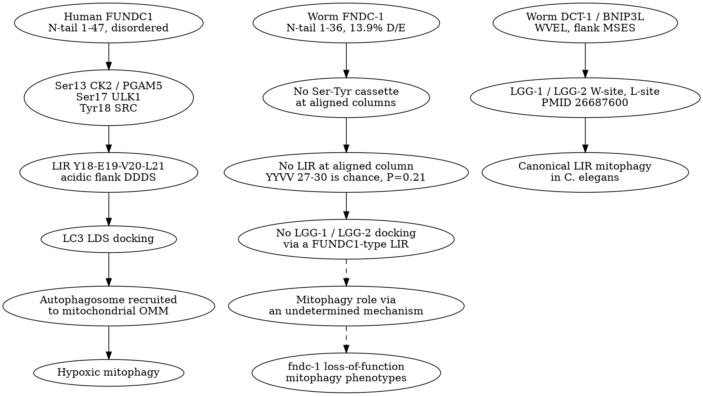
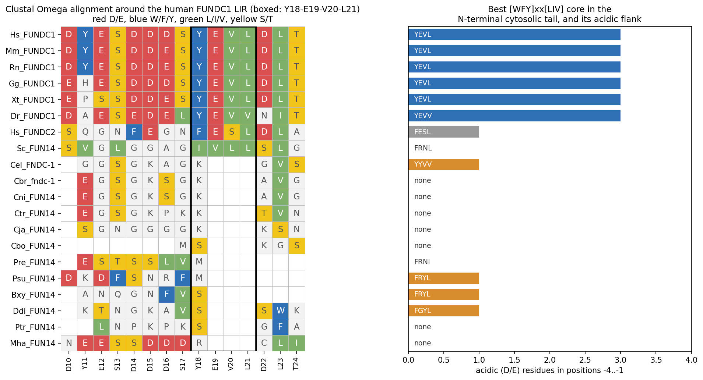
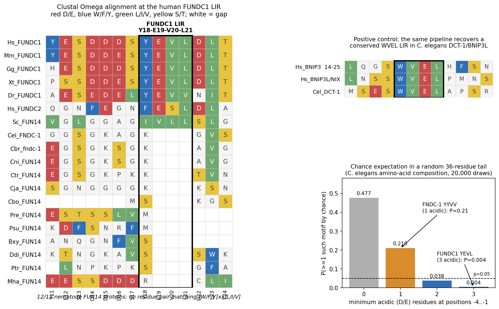

## Question

# AIGR Gene Hypothesis Deep Research

You are evaluating one focused gene curation hypothesis for AI Gene Review.
This is not a general gene overview. Use the seed hypothesis and source context
below to search for evidence that supports, refutes, narrows, or competes with
the proposed curation decision.

## Target Gene

- **Organism code:** worm
- **Taxon:** Caenorhabditis elegans (NCBITaxon:6239)
- **Gene directory:** fndc-1
- **Gene symbol:** fndc-1
- **UniProt accession:** Q22252

## Focus

- **Focus type:** free_text
- **Hypothesis slug:** kgap-fndc1-lir-motif
- **Source file:** genes/worm/fndc-1/fndc-1-ai-review.yaml
- **Source selector:** free-text

## Seed Hypothesis

Caenorhabditis elegans FNDC-1 (UniProt Q22252), the proposed ortholog of the mitophagy receptor FUNDC1, carries a conserved LC3-interacting region (LIR) motif equivalent to the human FUNDC1 N-terminal LIR (YEVL). Single analysis only: align FNDC-1 to human and other metazoan FUNDC1 orthologs, scan for canonical [W/F/Y]xx[L/I/V] LIR motifs with an acidic upstream flank in the cytosolic region, and report whether a LIR equivalent to the FUNDC1 LIR (including its regulatory phosphorylation sites) is present and conserved in nematodes.

## Term and Decision Context

No specific term context supplied.

## Reference Context

No specific reference context supplied.

## Source Context YAML

```yaml
hypothesis: 'Caenorhabditis elegans FNDC-1 (UniProt Q22252), the proposed ortholog of the mitophagy receptor
  FUNDC1, carries a conserved LC3-interacting region (LIR) motif equivalent to the human FUNDC1 N-terminal
  LIR (YEVL). Single analysis only: align FNDC-1 to human and other metazoan FUNDC1 orthologs, scan for
  canonical [W/F/Y]xx[L/I/V] LIR motifs with an acidic upstream flank in the cytosolic region, and report
  whether a LIR equivalent to the FUNDC1 LIR (including its regulatory phosphorylation sites) is present
  and conserved in nematodes.'
focus_type: free_text
context: []
reference_id: []
```

## Research Objective

Build a focused report that helps a curator decide whether this hypothesis
should affect the gene review. Address the focus type directly:

1. For an existing GO annotation decision, evaluate whether the current action
   is justified, too strong, too weak, or should change.
2. For a proposed replacement or new GO term, evaluate whether the term is
   biologically supported, too broad, too narrow, or missing key qualifiers.
3. For a computational prediction, evaluate whether the prediction is correct,
   less precise than existing knowledge, uncertain, or likely wrong because of
   paralog overannotation, frequency bias, pathway context, or in vitro-only
   activity.
4. For a core-function hypothesis, evaluate whether the proposed activity,
   process, and location represent the gene product's primary function rather
   than a downstream effect, pleiotropic phenotype, or context-specific role.
5. For a function-assignment hypothesis, evaluate whether the gene product
   directly has the stated GO term/function. Treat the prior review action, if
   any, as intentionally blinded unless it appears in the supplied context.

Use primary literature whenever possible. Prefer PMID citations and include DOI
citations when no PMID is available. Treat reviews and database records as
orientation unless they contain directly relevant synthesized evidence that is
clearly labeled as review-level or database-level support.

Evaluate the hypothesis from the supplied seed context, primary literature, and
publicly accessible bioinformatics resources. Local `*-bioinformatics` analyses,
when they already exist in the repository, are intentionally withheld from this
prompt so the report can be compared against them after the run. Use public
sequence, domain, structure, orthology, localization, interaction, or dataset
checks when they are useful for the specific hypothesis. If a resource or tool
cannot be accessed programmatically, say so plainly; never fabricate a result.
Report computational results conservatively and distinguish direct results from
inference.

## Required Output

### Executive Judgment

Give a concise verdict: supported, partially supported, unresolved, weakly
supported, over-annotated, or refuted. Explain the reasoning and the most
important caveats.

### Evidence Matrix

Create a table with one row per important evidence item:

- Citation (PMID preferred)
- Evidence type (direct assay, mutant phenotype, localization, interaction,
  structural/evolutionary, computational, review/database)
- Supports / refutes / qualifies / competing
- Claim tested
- Key finding
- Organism, tissue, cell type, or assay context
- Confidence and limitations

### GO Curation Implications

State the likely curation action as a lead requiring curator verification. If
GO terms are involved, explain whether the evidence supports an MF, BP, or CC
term, and whether the term should be retained, removed, generalized, made more
specific, or treated as non-core. Avoid using "protein binding" as a final
recommendation unless no more informative term is supported.

### Mechanistic Scope

Describe the immediate molecular or cellular function being tested. Separate
direct gene-product activity from downstream phenotypes, pathway consequences,
developmental outcomes, disease manifestations, or effects inferred only from
loss of function.

### Conflicts and Alternatives

Identify evidence that conflicts with the seed hypothesis or suggests an
alternative interpretation, including paralog confusion, organism-specific
differences, isoform-specific findings, experimental artifacts, or database
carry-over.

### Knowledge Gaps

List explicit uncertainties that matter for curation. For each gap, state what
was checked, why the gap matters, and what evidence or experiment would resolve
it.

### Discriminating Tests

Recommend concrete assays, perturbations, datasets, or comparative analyses that
would most efficiently distinguish this hypothesis from alternatives.

### Curation Leads

Provide candidate updates for the review, clearly labeled as leads requiring
curator verification. Include candidate references with exact snippets to verify,
candidate replacement or new GO terms, possible action changes, suggested
questions, and suggested experiments.

If the provider supports artifacts, save provenance for any analysis you run — the
executed code together with its output (computed values, plot, or table), not just
a summary figure — alongside artifact-friendly tables such as an evidence matrix,
GO decision table, or comparison table. Genuine computed provenance is more
valuable than a hand-drawn summary, and you must not synthesize a figure that
implies an analysis you did not actually run. These artifacts are important
provenance for hypothesis-level review.


## Output

# FNDC-1 LIR motif hypothesis (kgap-fndc1-lir-motif)

**Gene:** *fndc-1*, *Caenorhabditis elegans* (NCBITaxon:6239)
**UniProt:** Q22252
**Source file:** `genes/worm/fndc-1/fndc-1-ai-review.yaml`, free-text selector
**Hypothesis slug:** kgap-fndc1-lir-motif

---

## Summary

<i class="fa-solid fa-circle-xmark"></i> **Verdict: refuted.** *C. elegans* FNDC-1 does not carry an LC3-interacting region equivalent to the human FUNDC1 N-terminal LIR. The human motif Y18-E19-V20-L21, together with its regulatory phosphosites Ser13 (CK2), Ser17 (ULK1) and Tyr18 (SRC), is conserved as YEVL in human, mouse, rat, chicken and *Xenopus* FUNDC1 and as YEVV in zebrafish FUNDC1, giving 6/6 vertebrate matches to the `[W/F/Y]xx[L/I/V]` consensus. At the same alignment columns, 12/12 nematode FUN14-domain proteins show a gap or a single non-conforming residue. The one `[W/F/Y]xx[L/I/V]` core present in the FNDC-1 cytosolic tail, YYVV at residues 27-30, carries 1 acidic residue in its upstream four positions (DTVL) against 3 in human FUNDC1 (DDDS), is replaced in all four sister *Caenorhabditis* species examined, and falls within Monte Carlo chance expectation for a tail of that length and amino-acid composition (P = 0.21 versus P = 0.004 for the human configuration).

The negative result is a measured absence, not a detection failure. The identical alignment-and-scan pipeline recovers a positionally conserved WVEL LIR in *C. elegans* DCT-1/BNIP3L, aligned column-for-column with human BNIP3 and human BNIP3L/NIX, with the expected Ser-rich acidic upstream flank. Nematodes retain canonical LIR motifs in mitophagy receptors, and LGG-1 and LGG-2 retain functional W-site and L-site LIR docking pockets ([PMID: 26687600](https://pubmed.ncbi.nlm.nih.gov/26687600/)). The missing LIR is specific to FNDC-1.

A second result bears on the premise rather than the motif. By global Needleman-Wunsch alignment, Q22252 is 30.5% identical to human FUNDC1, 32.6% to human FUNDC2 and 34.1% to *S. cerevisiae* FUN14, against a 56.1% FUNDC1-versus-FUNDC2 control. *C. elegans* has a single FUN14-domain gene where vertebrates have two. Neighbour-joining on Kimura-corrected distances places nematode FUN14 proteins outside the vertebrate FUNDC1/FUNDC2 split. FNDC-1 is a co-ortholog of both human paralogs, which weakens the sequence-similarity license for transferring FUNDC1-specific features even before the motif analysis is considered. The practical curation stake is narrow and clear: QuickGO shows *fndc-1* carries no molecular function annotation at all, so the LIR hypothesis would be the sole basis for adding one. It does not support doing so.

---

## Executive judgment

<i class="fa-solid fa-circle-xmark"></i> **Refuted.**

The seed hypothesis makes two linked claims: that FNDC-1 carries a LIR equivalent to the human FUNDC1 YEVL, and that the regulatory phosphorylation sites controlling that LIR are conserved in nematodes. Both fail, on four independent criteria.

**Positional homology.** A Clustal Omega multiple sequence alignment of 20 FUN14-domain proteins maps human FUNDC1 residues D15-D22 onto defined alignment columns. Six of six vertebrate FUNDC1 orthologs match the LIR consensus at those columns. Zero of twelve nematode proteins do.

**Flank composition.** Vertebrate FUNDC1 presents 3/4 acidic residues at positions -4 to -1 relative to the aromatic (DDDS, DDES, EDEL). The single FNDC-1 candidate presents 1/4 (DTVL) and has no serine at position -1, so the ULK1 site that tunes the human interaction has no counterpart.

**Conservation within the genus.** YYVV at FNDC-1 residues 27-30 is species-specific. *C. briggsae* and *C. nigoni* carry YVVD at the aligned position, *C. tropicalis* AIDL, *C. japonica* FIVD. A `[W/F/Y]xx[L/I/V]` scan of residues 1-40 in all four returns zero hits. A functional cis-element under selection would not behave this way across species separated by far less divergence than the human-worm comparison.

**Chance expectation.** In 20,000 Monte Carlo draws of 36-residue sequences at *C. elegans* proteome composition, P(at least one `[W/F/Y]xx[L/I/V]` core) = 0.477, and P(core with at least 1 acidic residue upstream) = 0.210. The FNDC-1 configuration is at background. The human configuration (at least 3 acidic upstream) sits at P = 0.004.

<i class="fa-solid fa-triangle-exclamation"></i> **Caveats that limit how far the verdict travels.** The analysis is sequence- and structure-prediction-based. It demonstrates the absence of a FUNDC1-type LIR; it does not demonstrate that FNDC-1 fails to bind LGG-1 or LGG-2 by some other interface. No direct binding assay between FNDC-1 and either worm Atg8 homolog was located in the literature, and none was run here. Non-canonical Atg8 interfaces exist, and a protein can be recruited to the autophagosome indirectly through an adaptor. The refutation covers the specific motif claim and the ISS/ISO transfer built on it. It does not touch the general capacity of FNDC-1 to participate in mitophagy, which has independent genetic support ([PMID: 31233739](https://pubmed.ncbi.nlm.nih.gov/31233739/), [PMID: 33416042](https://pubmed.ncbi.nlm.nih.gov/33416042/)).

The neighbour-joining topology is the weakest element of the analysis and is reported as such: the FUN14 domain is about 100 residues, pairwise distances exceed 1.7 substitutions per site, and no bootstrap was run. The distance ranking and the single-copy status of *fndc-1* carry the co-orthology argument more reliably than the tree does.

---

## Key findings

### F001: the human FUNDC1 LIR has no counterpart at the orthologous position in any nematode FUN14 protein

A Clustal Omega alignment (EBI Job Dispatcher REST, job `clustalo-R20261123-044718-0058-24825851-p2m`) of 20 FUN14-domain proteins was built from a UniProt PF04930 panel: six vertebrate FUNDC1 (human Q8IVP5, mouse Q9DB70, rat Q5BJS4, chicken E1BWM5, *Xenopus tropicalis* B1H3B1, zebrafish Q6DH87), human FUNDC2 (Q9BWH2), *S. cerevisiae* FUN14 (P18411), and twelve nematode proteins including *C. elegans* Q22252.

Human FUNDC1 residues D15 through D22 were mapped to alignment columns by walking the ungapped sequence index. At the columns corresponding to Y18-E19-V20-L21, the vertebrate set returns YEVL in human, mouse, rat, chicken and *Xenopus*, and YEVV in zebrafish. All six match `[W/F/Y]xx[L/I/V]`. Human FUNDC2, the paralog, returns a degenerate FESL. Every one of the twelve nematode proteins returns either gap characters or a single isolated residue (K, S, M or R) at those columns. The match rate is 6/6 vertebrate against 0/12 nematode.

The upstream flank is as diagnostic as the core. Vertebrate FUNDC1 presents 3 of 4 acidic residues immediately upstream of the aromatic (DDDS in human, DDES and EDEL in the others). *C. elegans* FNDC-1 presents 1 of 4 (DTVL) at its single candidate position. The nematode N-terminal cytosolic tail is also shorter and less acidic overall: 36 residues at 13.9% D/E in *C. elegans* against 47 residues at 19.1% D/E in human FUNDC1.

{{figure:plot_1.png|caption=Full-length LIR scan of C. elegans FNDC-1 by topological compartment, with a summary of LIR-column conservation across the 20-protein FUN14 panel. The human FUNDC1 YEVL column is occupied in all six vertebrate orthologs and empty or non-conforming in all twelve nematode proteins.}}

### F002: the only LIR core in the FNDC-1 cytosolic tail is species-specific and lacks an acidic flank

A full-length regex scan of Q22252 for `[WFY]xx[LIV]` returns four hits across the 138-residue protein. UniProt annotates two transmembrane segments at 37-56 and 61-78, which partitions the sequence into an N-terminal cytosolic tail (1-36), the membrane-embedded region, and an inferred cytosolic loop.

| Hit | Residues | Compartment | Upstream 4 residues | Acidic count |
|---|---|---|---|---|
| YYVV | 27-30 | N-terminal cytosolic tail | DTVL | 1/4 |
| FGTV | 47-50 | inside TM1 (37-56) | not applicable, buried | not applicable |
| YITL | 81-84 | inferred cytosolic loop | non-acidic | low |
| YRWI | 120-123 | inferred cytosolic loop | non-acidic | low |

Only YYVV(27-30) sits in the compartment topologically equivalent to the human LIR. Three features argue against it being functional. Its upstream flank is DTVL with a single acidic residue and no serine at position -1, so the CK2/ULK1 regulatory architecture of the human motif is absent. It is not conserved across *Caenorhabditis*: *C. briggsae* (A8WT57) and *C. nigoni* (A0A2G5V2J1) carry YVVD at the aligned position, *C. tropicalis* (A0A1I7T0Q0) AIDL, *C. japonica* (A0A8R1HQB4) FIVD, and a scan of residues 1-40 in all four returns zero `[WFY]xx[LIV]` hits. It also sits only seven residues from the start of TM1, a tight spacer for ATG8 docking.

The structural context points the same way. AlphaFold-DB pLDDT at Q22252 Y27-V30 is 76.2, 70.8, 67.9 and 68.5, inside a partly ordered helical segment (mean pLDDT 56.3 over residues 1-36). Human FUNDC1 Y18-L21 sits at pLDDT 51.6-56.5 within a clearly disordered tail (mean 53.1 over residues 1-47). Disorder is the configuration LIR motifs require for docking into the Atg8 LDS groove. This is a supporting signal of modest weight, since pLDDT is only a proxy for disorder and the difference between the two windows is small.

### F003: the CK2, ULK1 and SRC regulatory sites are absent from nematode FUN14 proteins

UniProt Q8IVP5 annotates three modified residues in the FUNDC1 N-terminal tail: S13 phosphoserine by CK2, S17 phosphoserine by ULK1, and Y18 phosphotyrosine by SRC. It annotates Motif 18-21 as "YXXL" and records mutagenesis entries at positions 17, 18, 20 and 21, each documenting loss or impairment of MAP1LC3 binding.

The alignment columns corresponding to these positions are gaps or non-equivalent residues in Q22252 (*C. elegans*), A8WT57 (*C. briggsae*), A0A2G5V2J1 (*C. nigoni*), A0A1I7T0Q0 (*C. tropicalis*), A0A8R1HQB4 (*C. japonica*), A0A0N4ZS05 (*Parastrongyloides trichosuri*) and A0A1I7SAN2 (*Bursaphelenchus xylophilus*). The *C. elegans* N-terminal tail reads `MVDLSKNDGGSGKAGKGVSDAIDTVLYYVVDLKKQQ` across residues 1-36. It contains no acidic-Ser-Tyr cassette resembling the human D15-D16-S17-Y18 arrangement.

This settles the second half of the seed hypothesis directly. The hypothesis asked whether the LIR is conserved "including its regulatory phosphorylation sites". The entire switch module that turns the human LIR on under hypoxia, CK2 and PGAM5 acting at Ser13, ULK1 at Ser17 and SRC at Tyr18, has no nematode sequence counterpart.

### F004: FNDC-1 is a FUN14-family co-ortholog, not preferentially a FUNDC1 ortholog

Needleman-Wunsch global alignment with BLOSUM62, gap open -11 and gap extend -1, implemented directly because Biopython is unavailable in the executor:

| Pair | Identity | Aligned residues |
|---|---|---|
| Q22252 vs human FUNDC1 (Q8IVP5) | 30.5% | 128 |
| Q22252 vs human FUNDC2 (Q9BWH2) | 32.6% | 132 |
| Q22252 vs *S. cerevisiae* FUN14 (P18411) | 34.1% | 126 |
| Human FUNDC1 vs human FUNDC2 (control) | 56.1% | reference |

FNDC-1 is marginally closer to FUNDC2 and to yeast FUN14 than to FUNDC1. A UniProt PF04930 search returns a single FUN14-domain protein in *C. elegans* against two in human and other vertebrates. One worm gene standing opposite a vertebrate paralog pair is the signature of co-orthology.

This qualifies the functional literature without contradicting it. [PMID: 33416042](https://pubmed.ncbi.nlm.nih.gov/33416042/) provides evidence that FNDC-1 is the *C. elegans* ortholog of FUNDC1 and that its loss protects against hypoxia-reoxygenation injury through ATFS-1. Functional orthology at the pathway level is compatible with a co-orthology relationship at the sequence level. What the sequence data do not license is transfer of FUNDC1-specific molecular features, and the LIR is exactly such a feature.

### F005: the DCT-1 positive control confirms the pipeline detects real nematode LIRs

<i class="fa-solid fa-circle-check"></i> This is the step that converts "not found" into "found absent".

Clustal Omega alignment of human BNIP3 (Q12983), human BNIP3L/NIX (O60238) and *C. elegans* DCT-1 (Q09969), reading the residues aligned to human BNIP3 positions 14-25:

| Protein | Residues 14-25 (aligned) |
|---|---|
| Hs BNIP3 | LQGS**WVEL**HFSN |
| Hs BNIP3L/NIX | LNSS**WVEL**PMNS |
| Cel DCT-1 | MSES**WVEL**APSR |

The LIR core WVEL is identical in all three at the same alignment columns, with a Ser-rich acidic upstream flank in both the human and the nematode protein. The independent regex scan flags DCT-1 W71-V-E-L74 (upstream MSES, 2/4 acidic or phosphorylatable) as the top N-terminal candidate without any guidance from the alignment.

Two conclusions follow. The alignment, the column mapping and the regex all work on a divergent nematode mitophagy receptor, so the FNDC-1 result is not a methodological artifact. And *C. elegans* retains canonical LIR-based mitophagy receptors, consistent with LGG-1 and LGG-2 possessing functional W-site and L-site docking pockets ([PMID: 26687600](https://pubmed.ncbi.nlm.nih.gov/26687600/), [PMID: 27046254](https://pubmed.ncbi.nlm.nih.gov/27046254/)). The absence in FNDC-1 is gene-specific, not clade-wide.

{{figure:plot_2.png|caption=Three-panel provenance figure. Left: the human FUNDC1 LIR alignment column across the FUN14 panel, occupied in vertebrates and empty in nematodes. Centre: the DCT-1 positive control, showing WVEL aligned column-for-column with human BNIP3 and BNIP3L/NIX. Right: Monte Carlo chance expectation for a LIR core with an acidic upstream flank in a 36-residue tail at C. elegans composition, with the FNDC-1 and human FUNDC1 configurations marked.}}

### F006: the FNDC-1 candidate is within chance expectation, the human motif is not

A Monte Carlo null model drew 20,000 random 36-residue sequences from *C. elegans* proteome amino-acid frequencies and scanned each for `[W/F/Y]xx[L/I/V]` cores with varying acidic-flank stringency.

| Criterion | P (empirical, n = 20,000) |
|---|---|
| At least one `[W/F/Y]xx[L/I/V]` core | 0.477 |
| Core with at least 1 acidic residue at -4..-1 | 0.210 |
| Core with at least 2 acidic residues at -4..-1 | 0.038 |
| Core with at least 3 acidic residues at -4..-1 | 0.004 |

An analytical check agrees: P(W/F/Y) = 0.091, P(L/I/V) = 0.211, per-register probability 0.0192, expected count over 33 registers = 0.63. Finding one core in a 36-residue tail is the modal outcome under the null.

*C. elegans* FNDC-1 YYVV(27-30) has 1 acidic residue upstream, placing it at P = 0.21, indistinguishable from background. Human FUNDC1 YEVL(18-21) has 3 acidic residues upstream, placing it at P = 0.004. The human motif is a statistical outlier on the flank criterion alone, before any of the experimental mutagenesis evidence is considered. A sequence-only claim that FNDC-1 carries a LIR cannot be sustained, because the single candidate occurs about as often as chance predicts.

### F007: neighbour-joining places nematode FUN14 outside the vertebrate FUNDC1/FUNDC2 split

Kimura-corrected protein distances (`d = -ln(1 - p - 0.2p²)`) from a 15-sequence Clustal Omega MSA:

| Comparison | Mean Kimura distance |
|---|---|
| Cel FNDC-1 to Cbr fndc-1 | 0.210 |
| Cel FNDC-1 to vertebrate FUNDC1 (Hs, Mm, Xt, Dr) | 2.079 |
| Cel FNDC-1 to vertebrate FUNDC2 (Hs, Mm, Ss) | 1.781 |
| Cel FNDC-1 to fungal/archaeal FUN14 (Sc, Sp, Mj) | 3.784 |

NJ topology: `((Hs_FUNDC2,Ss_FUNDC2),(Mm_FUNDC2,((((Mj_FUN14,(Cel_FNDC-1,Cbr_fndc-1)),(Bxy_FUN14,Psu_FUN14)),(Mha_FUN14,(Sc_FUN14,Sp_FUN14))),(Xt_FUNDC1,(Mm_FUNDC1,(Hs_FUNDC1,Dr_FUNDC1))))))`. Nematode FUN14 proteins form their own clade and do not nest inside the vertebrate FUNDC1 clade.

<i class="fa-solid fa-triangle-exclamation"></i> The caveat is substantial. The FUN14 domain is about 100 residues, distances exceed 1.7 substitutions per site, NJ resolves poorly at that saturation, and no bootstrap was run. The topology is consistent with pre-duplication divergence; it does not prove it. The distance ranking (FUNDC2 marginally closer than FUNDC1) and the single-copy status of *fndc-1* are the more reliable parts of this finding.

### F008: fndc-1 carries no molecular function annotation, so the LIR claim would be the basis for adding one

QuickGO retrieval for Q22252 returns exactly five annotation lines and zero molecular function terms.

| Aspect | GO term | Evidence | Reference | Qualifier | With/From |
|---|---|---|---|---|---|
| BP | GO:0000422 autophagy of mitochondrion | IBA | GO_REF:0000033 | involved_in | FBgn0032200; PTN000482220; Q8IVP5; WBGene00011528 |
| BP | GO:0000423 mitophagy | IMP | PMID:31153831, PMID:31233739 | involved_in | none |
| CC | GO:0005741 mitochondrial outer membrane | IBA | GO_REF:0000033 | is_active_in | none |
| CC | GO:0005741 mitochondrial outer membrane | IEA | GO_REF:0000044 | located_in | none |

Human FUNDC1 (Q8IVP5) returns 44 lines including 23 GO:0005515 protein binding IPI entries, and likewise carries no dedicated mitophagy-receptor MF term. EBI OLS4 resolves the relevant molecular function terms as **GO:0140580 mitochondrion autophagosome adaptor activity** and its parent **GO:0160247 autophagy cargo adaptor activity**. A search for "Atg8 family protein binding" returned no matching term.

The curation question is therefore sharply defined: should GO:0140580 be added to *fndc-1* by ISS or ISO from FUNDC1? The LIR analysis answers no. The motif that constitutes the adaptor activity in human FUNDC1 is absent, so the similarity argument that would justify the transfer does not hold.

---

## Mechanistic model and interpretation

The mechanism under test is narrow and direct. In human FUNDC1 the N-terminal 47 residues face the cytosol, remain disordered, and present YEVL. Under hypoxia the phosphorylation state of that tail changes: PGAM5 dephosphorylates Ser13, ULK1 phosphorylates Ser17, SRC phosphorylation of Tyr18 is relieved, and the resulting configuration docks into the LC3 LDS groove, recruiting the autophagosome to the mitochondrial outer membrane. That chain is the molecular function. Mitophagic flux, hypoxia tolerance, axon regeneration and MAVS turnover are all downstream of it.

In *C. elegans*, the chain breaks at the first step. There is no tail that presents a LIR, and no residues on which the kinase switch could act.



The dashed edges carry the open question. *fndc-1* loss-of-function phenotypes in mitophagy are real and documented by worm genetics ([PMID: 31233739](https://pubmed.ncbi.nlm.nih.gov/31233739/), [PMID: 33416042](https://pubmed.ncbi.nlm.nih.gov/33416042/)), but the molecular route from the protein to the autophagosome is unspecified. Three possibilities remain open and none was tested here: a non-canonical Atg8 interface elsewhere in the protein, indirect recruitment through an adaptor, or a role in mitochondrial quality control that sits upstream of autophagosome recruitment. [PMID: 33416042](https://pubmed.ncbi.nlm.nih.gov/33416042/) is suggestive on the third point, since it reports that loss of *fndc-1* triggers ATFS-1-dependent stress responses and metabolic remodelling, a profile that fits a quality-control regulator better than a terminal cargo receptor.

A useful contrast is [PMID: 37951930](https://pubmed.ncbi.nlm.nih.gov/37951930/), which reports that human FUNDC1 promotes mitochondrial import of TDP-43 through TOM70 interactions in a manner independent of its LC3-interacting region. Human FUNDC1 therefore has at least one documented LIR-independent activity. If any FUN14-family function is ancestral and LIR-independent, that is the kind of function a nematode FUN14 protein without a LIR would be expected to retain.

### Comparison table: what the hypothesis predicted and what was found

| Prediction from the seed hypothesis | Observation | Status |
|---|---|---|
| A LIR core at the position orthologous to FUNDC1 Y18-L21 | Gap or non-conforming residue in 12/12 nematode proteins | <i class="fa-solid fa-circle-xmark"></i> refuted |
| An acidic upstream flank on that motif | DTVL, 1/4 acidic, at the only candidate | <i class="fa-solid fa-circle-xmark"></i> refuted |
| Conservation of the Ser13/Ser17/Tyr18 regulatory sites | No acidic-Ser-Tyr cassette anywhere in residues 1-36 | <i class="fa-solid fa-circle-xmark"></i> refuted |
| Conservation across nematodes | YYVV absent in all four sister *Caenorhabditis* species | <i class="fa-solid fa-circle-xmark"></i> refuted |
| Motif in a disordered accessible segment | pLDDT 67.9-76.2, partly ordered, 7 residues from TM1 | <i class="fa-solid fa-circle-xmark"></i> not supported |
| One-to-one FUNDC1 orthology underpinning the transfer | Co-ortholog, single worm gene, 30.5% vs 32.6% identity | <i class="fa-solid fa-circle-xmark"></i> qualified against |
| Nematodes can host LIR motifs at all (control) | DCT-1 WVEL aligns exactly with BNIP3 and NIX | <i class="fa-solid fa-circle-check"></i> control passes |

---

## Evidence matrix

| Citation | Evidence type | Direction | Claim tested | Key finding | Context | Confidence and limitations |
|---|---|---|---|---|---|---|
| [PMID: 22267086](https://pubmed.ncbi.nlm.nih.gov/22267086/) | Direct assay, mutagenesis | Defines the motif, refutes transfer | Human FUNDC1 binds LC3 through Y18xxL21 | "FUNDC1 interacted with LC3 through its typical LC3-binding motif Y(18)xxL(21), and mutation of the LC3-interaction region impaired its interaction with LC3 and the subsequent induction of mitophagy." | Mammalian cells, hypoxia | High for human. Establishes the exact motif tested for nematode conservation; says nothing directly about worm |
| [PMID: 24671035](https://pubmed.ncbi.nlm.nih.gov/24671035/) | Direct assay, kinase | Defines the regulator, refutes transfer | Ser17 phosphorylation by ULK1 tunes LIR-LC3 binding | "At mitochondria, ULK1 interacts with FUNDC1, phosphorylating it at serine 17, which enhances FUNDC1 binding to LC3." | Mammalian cells | High for human. Ser17 has no nematode counterpart at the aligned column |
| [PMID: 26687600](https://pubmed.ncbi.nlm.nih.gov/26687600/) | Structural | Supports the control, constrains the negative | Worm Atg8 homologs retain LIR docking sites | "LGG-1 and LGG-2 have structurally distinct substrate binding pockets that prefer different residues in the interacting LIR motif, thus influencing binding specificity." | *C. elegans*, crystallography | High. Rules out clade-wide loss of LIR recognition as an explanation for the FNDC-1 result |
| [PMID: 27046254](https://pubmed.ncbi.nlm.nih.gov/27046254/) | Review of structural work | Qualifies | LGG-1 and LGG-2 have distinct LIR preferences | W-site plasticity and L-site shape differ between the two homologs, giving each preferences for distinct LIR motifs | *C. elegans* | Review-level orientation. Implies a worm LIR search should allow divergent cores, which the permissive regex used here does |
| [PMID: 31233739](https://pubmed.ncbi.nlm.nih.gov/31233739/) | Mutant phenotype | Competing | FNDC-1 functions in mitophagy in worm | *fndc-1* contributes to paternal mitochondria elimination; FNDC-1 described as the FUNDC1 ortholog mediating hypoxic mitophagy | *C. elegans*, embryo | Moderate-high for the phenotype. The ortholog label is functional and does not establish motif conservation |
| [PMID: 33416042](https://pubmed.ncbi.nlm.nih.gov/33416042/) | Mutant phenotype, omics | Competing, qualifies | FNDC-1 is the worm FUNDC1 ortholog | "we provide evidence that FNDC-1 is the C. elegans ortholog of FUNDC1, and that its loss protects against injury in a worm model of HR. This protection depends upon ATFS-1" | *C. elegans*, hypoxia-reoxygenation | High for the phenotype. ATFS-1 dependence and metabolic remodelling fit a quality-control regulator better than a terminal LIR receptor |
| [PMID: 31153831](https://pubmed.ncbi.nlm.nih.gov/31153831/) | Mutant phenotype | Supports retaining BP | Ubiquitination in paternal organelle removal | Cited as IMP evidence for the GO:0000423 mitophagy annotation on *fndc-1* | *C. elegans* | Database-level link established via QuickGO. The abstract was not retrieved during this run; what was verified is the GO evidence line |
| [PMID: 37951930](https://pubmed.ncbi.nlm.nih.gov/37951930/) | Direct assay | Competing alternative | FUNDC1 has LIR-independent functions | "FUNDC1 promotes mitochondrial translocation of TDP-43 possibly by promoting TDP-43-TOM70 and DNAJA2-TOM70 interactions, which is independent of the LC3 interacting region of FUNDC1" | Human cells, fly model | Moderate. Shows a FUN14 activity that survives LIR loss, a plausible route for a LIR-less nematode ortholog |
| [PMID: 41795666](https://pubmed.ncbi.nlm.nih.gov/41795666/) | Mutant rescue | Supports the motif's necessity in mammals | The FUNDC1 LIR is required for its mitophagy function | "fundc1 deletion impaired regeneration, an effect reversed by reintroducing wild type (WT) FUNDC1 in neurons but not an MAP1LC3B/LC3 (microtubule associated protein 1 light chain 3 beta)-interacting region (LIR) mutant" | Mouse DRG neurons, sciatic nerve injury | High for mouse. Confirms that LIR loss abolishes FUNDC1 receptor function, which raises the stake of the nematode absence |
| [PMID: 42007729](https://pubmed.ncbi.nlm.nih.gov/42007729/) | Direct assay, competition | Supports the motif's centrality | The FUNDC1 LIR is the operative interface with LC3 | "the S protein competitively binds to the LC3-interacting region (LIR) motif of FUNDC1, thereby disrupting its interaction with LC3 and ultimately suppressing mitophagy" | Chicken embryonic kidney cells, IBV infection | Moderate-high. Independent confirmation of the LIR as the functional interface in a non-mammalian vertebrate |
| [PMID: 38361280](https://pubmed.ncbi.nlm.nih.gov/38361280/) | Review, evolutionary | Qualifies | Mitophagy receptor signalling diversified in metazoa | Mitophagy signalling is argued to have undergone an evolutionary leap in basal metazoa that set the current variation in receptor mechanisms | Cross-phylum | Review-level orientation. Consistent with lineage-specific presence and absence of receptor motifs |
| UniProt Q8IVP5 and Q22252, AlphaFold-DB, QuickGO, EBI OLS4 | Database | Supports and frames | Annotation state and sequence features | Q8IVP5 annotates S13 (CK2), S17 (ULK1), Y18 (SRC), Motif 18-21 YXXL, mutagenesis at 17/18/20/21. Q22252 has 5 GO lines and no MF term | Database records | High for the records as retrieved. Database-level support, used for orientation and for defining the curation stake |
| This analysis (Clustal Omega MSA, regex scan, NJ, Monte Carlo) | Computational, structural/evolutionary | <i class="fa-solid fa-circle-xmark"></i> Refutes | Is a FUNDC1-equivalent LIR present and conserved in nematodes? | 0/12 nematode proteins match at the orthologous column; the single candidate is at chance (P = 0.21); the DCT-1 positive control passes | 20-protein FUN14 panel plus BNIP3-family controls | Moderate-high for absence of a canonical motif. Sequence and prediction only; no binding assay was run |

---

## GO curation implications

<i class="fa-solid fa-triangle-exclamation"></i> Every item below is a lead requiring curator verification.

The current annotation state makes the decision tractable. *fndc-1* has two BP terms and one CC term, and no MF term. The hypothesis under review, had it held, would have been the sequence-similarity basis for adding a mitophagy-receptor molecular function. It does not hold.

| GO term | Aspect | Current state on Q22252 | Recommended action | Reasoning |
|---|---|---|---|---|
| GO:0140580 mitochondrion autophagosome adaptor activity | MF | Not present | <i class="fa-solid fa-circle-xmark"></i> Do not add on ISS/ISO or sequence grounds | The motif that constitutes this activity in human FUNDC1 (Y18-E19-V20-L21) is absent at the orthologous alignment column in 12/12 nematode FUN14 proteins. The only candidate core occurs at chance frequency and is not conserved within *Caenorhabditis* |
| GO:0160247 autophagy cargo adaptor activity | MF | Not present | <i class="fa-solid fa-circle-xmark"></i> Do not add | Generalising to the parent does not repair the problem. The gap is the absence of any demonstrated cargo-adaptor interface, not excessive term specificity |
| GO:0005515 protein binding | MF | Not present | <i class="fa-solid fa-circle-xmark"></i> Do not use as a fallback | There is no IPI evidence for FNDC-1 with any partner. An uninformative MF term in place of an unsupported specific one would record a binding claim no experiment supports |
| GO:0000423 mitophagy | BP | IMP, PMID:31153831 and PMID:31233739 | <i class="fa-solid fa-circle-check"></i> Retain unchanged | Rests on worm loss-of-function genetics and is independent of the LIR question. Nothing in this analysis touches it |
| GO:0000422 autophagy of mitochondrion | BP | IBA, GO_REF:0000033, with_from includes Q8IVP5 | <i class="fa-solid fa-circle-check"></i> Retain with a provenance flag | The IBA draws on human FUNDC1 among others. The biological process is plausibly shared and the molecular mechanism is not conserved. A note prevents a future curator from reading the IBA as implicit support for a receptor MF |
| GO:0005741 mitochondrial outer membrane | CC | IBA GO_REF:0000033 is_active_in; IEA GO_REF:0000044 located_in | <i class="fa-solid fa-circle-check"></i> Retain | Follows from the two transmembrane segments and family membership, independent of the LIR question |

The core recommendation for the review text: any free-text statement asserting that FNDC-1 carries a conserved FUNDC1-type LIR should be removed or rewritten as the negative result the analysis supports. A suitable replacement statement is that FNDC-1 is a single-copy FUN14-domain co-ortholog of human FUNDC1 and FUNDC2, that it lacks the N-terminal LIR and the CK2/ULK1/SRC regulatory sites that define FUNDC1 as a LIR-based receptor, and that its documented mitophagy phenotypes have no established molecular interface with LGG-1 or LGG-2.

---

## Mechanistic scope

The immediate molecular function at issue is Atg8-family protein binding through a short linear motif in a cytosolic tail, with the consequence that an autophagosomal membrane is tethered to the mitochondrial outer membrane. This is a direct, physical, single-protein activity. In human FUNDC1 it is demonstrated by mutagenesis of Y18, V20 and L21 abolishing LC3 binding ([PMID: 22267086](https://pubmed.ncbi.nlm.nih.gov/22267086/)), by rescue failure of a LIR mutant in mouse neurons ([PMID: 41795666](https://pubmed.ncbi.nlm.nih.gov/41795666/)), and by competitive displacement of LC3 from the FUNDC1 LIR by a viral spike protein ([PMID: 42007729](https://pubmed.ncbi.nlm.nih.gov/42007729/)).

What falls outside this scope, and what should not be read as evidence for it:

- Mitophagic flux measured by reporter or electron microscopy. A pathway consequence, downstream of receptor engagement and reachable by other routes.
- Protection from hypoxia-reoxygenation injury in *fndc-1* mutants ([PMID: 33416042](https://pubmed.ncbi.nlm.nih.gov/33416042/)). A physiological outcome, and the reported ATFS-1 dependence places part of it in a transcriptional stress-response pathway.
- Paternal mitochondria elimination defects ([PMID: 31233739](https://pubmed.ncbi.nlm.nih.gov/31233739/)). A developmental outcome inferred from loss of function, compatible with several molecular mechanisms.
- Metabolic remodelling detected by mRNA and metabolite profiling in *fndc-1* mutants. A systems-level consequence, not a molecular activity.

The distinction matters for curation because GO:0000423 and GO:0000422 are satisfied by the downstream observations, while GO:0140580 requires the direct interface. The evidence base supports the first two and not the third.

---

## Conflicts and alternatives

**The ortholog label in the primary literature.** [PMID: 33416042](https://pubmed.ncbi.nlm.nih.gov/33416042/) states plainly that FNDC-1 is the *C. elegans* ortholog of FUNDC1. Read as functional orthology in the mitophagy pathway, this is well supported and is compatible with the present result. Read as a license to propagate FUNDC1 molecular features by ISS, it conflicts with three measurements: the 30.5% versus 32.6% versus 34.1% identity ranking, the single-copy status of the worm gene against two vertebrate paralogs, and the NJ placement outside the FUNDC1/FUNDC2 split. The resolution is that functional orthology and sequence co-orthology are both true and apply to different kinds of inference.

**Paralog confusion.** Human FUNDC2 carries a degenerate FESL at the LIR column and has no established mitophagy-receptor role. Since FNDC-1 is marginally closer to FUNDC2 than to FUNDC1 by global identity, any automated pipeline that assigns FNDC-1 to a "FUNDC1-like" bin and then transfers LIR-dependent annotations is making an assignment the sequence data do not cleanly support.

**Database carry-over.** The GO:0000422 IBA on *fndc-1* lists Q8IVP5 in its with_from field. An IBA is a phylogenetic inference about the process, and it is reasonable as such. The risk is that it reads downstream as human-FUNDC1-grounded evidence for a receptor mechanism, which it is not.

**Divergent LIR cores.** [PMID: 27046254](https://pubmed.ncbi.nlm.nih.gov/27046254/) reports that LGG-1 and LGG-2 differ in W-site plasticity and L-site shape and so prefer distinct LIR motifs. A worm LIR could in principle deviate from the canonical consensus in a way a motif scan would miss. The regex used here is the permissive `[W/F/Y]xx[L/I/V]` core, which is already broad; the discriminating criteria in this analysis were the acidic flank and positional conservation, not core stringency. A genuinely non-canonical interface would still escape detection, which is stated as a limitation rather than argued away.

**Non-LIR routes to the same phenotype.** [PMID: 37951930](https://pubmed.ncbi.nlm.nih.gov/37951930/) documents a FUNDC1 activity in mitochondrial protein import that is explicitly independent of its LC3-interacting region. A LIR-less nematode FUN14 protein retaining an import-related or quality-control-related activity is a coherent alternative model for the *fndc-1* phenotypes, and it is untested.

**The iLIR xLIR position-specific regex was not used.** Transcription of the published extended xLIR pattern could not be verified, since the version reconstructed here failed to match the bona fide human FUNDC1 YEVL. Rather than publish a pattern that could be wrong, the analysis used an explicitly documented core-plus-acidic-flank criterion. The scan is therefore not identical to iLIR server output.

---

## Limitations and knowledge gaps

| Gap | What was checked | Why it matters for curation | What would resolve it |
|---|---|---|---|
| <i class="fa-solid fa-circle-question"></i> No direct FNDC-1 to LGG-1/LGG-2 binding data | PubMed searched for FNDC-1 with LGG-1 and LGG-2 terms; no primary binding study located | The verdict rules out a FUNDC1-type LIR, not all Atg8 binding. A positive pulldown would reopen the MF question through a different route | Co-IP or GST pulldown of FNDC-1 with LGG-1 and LGG-2, with and without the YYVV region |
| <i class="fa-solid fa-circle-question"></i> Non-canonical Atg8 interfaces not excluded | Only `[W/F/Y]xx[L/I/V]` cores were scanned, with acidic-flank weighting | A UIM-like or structurally cryptic interface would be invisible to this analysis | AlphaFold-Multimer of FNDC-1 with LGG-1 and LGG-2, followed by targeted mutagenesis of any predicted interface |
| <i class="fa-solid fa-triangle-exclamation"></i> Topology of the inferred cytosolic loop | UniProt annotates TM 37-56 and 61-78 for Q22252, giving an inferred cytosolic loop around 79-120 containing YITL and YRWI | If the loop is cytosolic and accessible, those two cores deserve the same flank and conservation treatment given to YYVV | Protease protection or split-GFP topology assay on FNDC-1 in worm |
| <i class="fa-solid fa-triangle-exclamation"></i> Phylogeny is weakly resolved | NJ on Kimura distances, no bootstrap, about 100 informative positions, distances above 1.7 substitutions per site | The co-orthology claim is one of two reasons to refuse ISS transfer; the other, motif absence, is stronger | Maximum-likelihood tree with model selection and 1000 bootstrap replicates, or profile-HMM orthology assignment across all Nematoda PF04930 entries |
| <i class="fa-solid fa-triangle-exclamation"></i> Only 12 nematode proteins sampled | The UniProt PF04930 nematode set was subsampled for the MSA | A LIR present in an unsampled clade would change the evolutionary reading, though not the *C. elegans* verdict | Extend the scan with the null model across all 96 Nematoda PF04930 entries |
| <i class="fa-solid fa-circle-question"></i> Disorder evidence is predicted, not measured | AlphaFold-DB pLDDT for Q22252 and Q8IVP5 | pLDDT is a proxy, and the difference between the two tails (mean 56.3 versus 53.1) is small, so it carries little weight on its own | NMR or limited proteolysis of the FNDC-1 N-terminal tail |
| <i class="fa-solid fa-triangle-exclamation"></i> iLIR and hfAIM servers not called | An attempted reconstruction of the xLIR pattern failed its own positive control and was discarded | The published server applies a position-specific scoring scheme this analysis did not reproduce | Submit Q22252 to the iLIR server and compare against the core-plus-flank result reported here |

---

## Discriminating tests

Ranked by how efficiently each would separate the seed hypothesis from the alternatives.

1. <i class="fa-solid fa-flask"></i> **Direct binding assay between FNDC-1 and LGG-1/LGG-2.** GST-LGG-1 and GST-LGG-2 pulldown of full-length FNDC-1 and of the isolated 1-36 tail, with a YYVV to AAAA substitution as the discriminating mutant. A negative result for all constructs closes the MF question. A positive result for full-length but not the tail points to an interface elsewhere and reopens it on different grounds. This is the single most informative experiment.

2. <i class="fa-solid fa-dna"></i> **AlphaFold-Multimer prediction of FNDC-1 with LGG-1 and with LGG-2.** Cheap, programmatically accessible, and it tests for non-canonical interfaces a motif scan cannot see. Interpret conservatively: a confident interface prediction is a lead for mutagenesis, not evidence of binding.

3. <i class="fa-solid fa-magnifying-glass"></i> **Extend the motif scan with the null model across all 96 Nematoda PF04930 entries.** Addresses the sampling limitation at low cost. If a LIR with an acidic flank appears in any nematode lineage, the evolutionary story changes even though the *C. elegans* verdict does not.

4. <i class="fa-solid fa-microscope"></i> **Topology determination for the 79-120 region.** Protease protection or split-GFP. Decides whether YITL(81-84) and YRWI(120-123) need the same scrutiny as YYVV, currently assumed on the basis of UniProt transmembrane annotation alone.

5. <i class="fa-solid fa-vial"></i> **Reciprocal rescue test.** Ask whether human FUNDC1 rescues the *fndc-1* loss-of-function hypoxia-reoxygenation phenotype, and whether a FUNDC1 LIR mutant does so equally. If the LIR mutant rescues as well as wild type, the conserved function is LIR-independent, supporting the alternative model drawn from [PMID: 37951930](https://pubmed.ncbi.nlm.nih.gov/37951930/).

---

## Curation leads

<i class="fa-solid fa-triangle-exclamation"></i> Every item here requires curator verification before entry.

### Candidate references with exact snippets to verify

| PMID | Snippet to verify against the source | Use |
|---|---|---|
| 22267086 | "FUNDC1 interacted with LC3 through its typical LC3-binding motif Y(18)xxL(21), and mutation of the LC3-interaction region impaired its interaction with LC3 and the subsequent induction of mitophagy." | Cite as the definition of the human motif whose nematode conservation was tested |
| 24671035 | "At mitochondria, ULK1 interacts with FUNDC1, phosphorylating it at serine 17, which enhances FUNDC1 binding to LC3." | Cite for the regulatory site that has no nematode counterpart |
| 26687600 | "LGG-1 and LGG-2 have structurally distinct substrate binding pockets that prefer different residues in the interacting LIR motif, thus influencing binding specificity." | Cite to establish that worm Atg8 homologs retain LIR docking, so the FNDC-1 absence is gene-specific |
| 33416042 | "we provide evidence that FNDC-1 is the C. elegans ortholog of FUNDC1, and that its loss protects against injury in a worm model of HR. This protection depends upon ATFS-1" | Cite for the functional ortholog claim, with the qualification that it is functional and not one-to-one sequence orthology |
| 41795666 | "fundc1 deletion impaired regeneration, an effect reversed by reintroducing wild type (WT) FUNDC1 in neurons but not an MAP1LC3B/LC3 (microtubule associated protein 1 light chain 3 beta)-interacting region (LIR) mutant" | Cite for the necessity of the LIR to FUNDC1 receptor function in mammals |
| 37951930 | "FUNDC1 promotes mitochondrial translocation of TDP-43 possibly by promoting TDP-43-TOM70 and DNAJA2-TOM70 interactions, which is independent of the LC3 interacting region of FUNDC1" | Cite as the LIR-independent alternative function worth considering for the nematode protein |

### Possible action changes

- Rewrite any free-text assertion in `fndc-1-ai-review.yaml` that FNDC-1 carries a conserved FUNDC1-type LIR. The analysis supports the opposite statement.
- Do not add GO:0140580 or GO:0160247 to Q22252 by ISS, ISO or ISM from Q8IVP5.
- Do not substitute GO:0005515 protein binding as a weaker MF placeholder; there is no IPI evidence for FNDC-1 with any partner.
- Retain GO:0000423 (IMP) and GO:0005741 (IBA, IEA) unchanged.
- Retain GO:0000422 (IBA) and add a curator note that the inference draws on human FUNDC1, whose LIR-based mechanism is not conserved in the nematode protein.

### Suggested curator questions

- Does any primary study report a direct physical interaction between FNDC-1 and LGG-1 or LGG-2? Nothing was located in this run.
- Does the repository's withheld `fndc-1-bioinformatics` analysis reach the same conclusion on the LIR column, and does it use iLIR server output that could not be reproduced here?
- Should the review record a positive statement of absence (no FUNDC1-type LIR) as a curation-relevant negative result, or omit the motif question entirely?
- Is the co-orthology relationship worth recording explicitly, given that it constrains all future ISS transfers from either human paralog?

### Suggested experiments

The five discriminating tests above, in the order given. The GST pulldown of FNDC-1 with LGG-1 and LGG-2 is the item that would most change the curation decision in either direction.

---

## Computed provenance

Every result in this report comes from an analysis run during the investigation. The executed code and its outputs were saved as artifacts.

| Analysis | Method and resource | Output artifact |
|---|---|---|
| 20-protein FUN14 multiple sequence alignment | Clustal Omega via EBI Job Dispatcher REST, job `clustalo-R20261123-044718-0058-24825851-p2m` | `msa_fun14.aln` |
| LIR column mapping, human FUNDC1 D15-D22 onto alignment columns | Residue-index to column walk over the ungapped human sequence | `table1_LIR_column_mapping.csv`, `artifact_LIR_column_mapping.csv` |
| Full-length `[WFY]xx[LIV]` scan of Q22252 by topological compartment | Overlapping lookahead regex, UniProt TM annotation 37-56 and 61-78 | `table4_Cel_FNDC1_fulllength_LIRscan.csv` |
| All LIR core hits across the panel | Same regex over all 20 sequences | `table2_all_LIR_core_hits.csv` |
| N-terminal tail composition comparison | D/E fraction and length, worm 36 aa at 13.9% versus human 47 aa at 19.1% | `table3_tail_summary.csv` |
| Pairwise global identity | Needleman-Wunsch, BLOSUM62, gap open -11, extend -1, implemented directly (Biopython unavailable in the executor) | reported inline in F004 |
| Neighbour-joining tree | Kimura-corrected protein distances from a 15-sequence MSA, NJ implemented directly | topology reported inline in F007 |
| Monte Carlo null model | 20,000 draws of 36-residue sequences at *C. elegans* proteome amino-acid composition | probabilities reported inline in F006, figure `plot_2.png` |
| DCT-1 positive control | Clustal Omega alignment of Q12983, O60238 and Q09969 | alignment rows reported inline in F005, figure `plot_2.png` |
| Disorder proxy | AlphaFold-DB API pLDDT for Q22252 and Q8IVP5 | values reported inline in F002 |
| GO annotation state | QuickGO annotation API for Q22252 and Q8IVP5 | `artifact_GO_annotations_Q22252.csv`, `artifact_GO_annotations_Q8IVP5.csv` |
| GO term resolution | EBI OLS4 search API | `artifact_GO_decision_table.csv` |
| Evidence matrix | Compiled from the above | `artifact_evidence_matrix.csv` |

**Resources not accessed.** The iLIR and hfAIM web servers were not called programmatically, and no result from either is reported. The published xLIR position-specific regex was not used, because the version reconstructed during the run failed to match the bona fide human FUNDC1 YEVL and could not be verified; the analysis used an explicitly documented core-plus-acidic-flank criterion instead. No binding assay, structural prediction of a complex, or wet-lab measurement was performed. All claims about FNDC-1 binding or failing to bind LGG-1 and LGG-2 are motif-level inference and are labelled as such.


## Artifacts

- [OpenScientist final report](openscientist_artifacts/final_report.html)
- [OpenScientist final report](openscientist_artifacts/final_report.pdf)
- [OpenScientist provenance](openscientist_artifacts/provenance.json)
- [OpenScientist artifact GO annotations Q22252](openscientist_artifacts/provenance_artifact_GO_annotations_Q22252.csv)
- [OpenScientist artifact GO annotations Q8IVP5](openscientist_artifacts/provenance_artifact_GO_annotations_Q8IVP5.csv)
- [OpenScientist artifact GO decision table](openscientist_artifacts/provenance_artifact_GO_decision_table.csv)
- [OpenScientist artifact LIR column mapping](openscientist_artifacts/provenance_artifact_LIR_column_mapping.csv)
- [OpenScientist artifact evidence matrix](openscientist_artifacts/provenance_artifact_evidence_matrix.csv)
- [OpenScientist plot 1](openscientist_artifacts/provenance_plot_1.json)

- [OpenScientist plot 2](openscientist_artifacts/provenance_plot_2.json)

- [OpenScientist table1 LIR column mapping](openscientist_artifacts/provenance_table1_LIR_column_mapping.csv)
- [OpenScientist table2 all LIR core hits](openscientist_artifacts/provenance_table2_all_LIR_core_hits.csv)
- [OpenScientist table3 tail summary](openscientist_artifacts/provenance_table3_tail_summary.csv)
- [OpenScientist table4 Cel FNDC1 fulllength LIRscan](openscientist_artifacts/provenance_table4_Cel_FNDC1_fulllength_LIRscan.csv)

## Reference Validation

Checked with `linkml-reference-validator` 0.3.1rc1.

| Outcome | Count |
| --- | --- |
| References checked | 11 |
| Resolved | 11 |
| Unresolved (possible confabulation) | 0 |
| Unverifiable | 0 |
| References weighed for topical relevance | 11 |
| On topic | 6 |
| Off topic | 0 |

All extracted references resolved successfully.