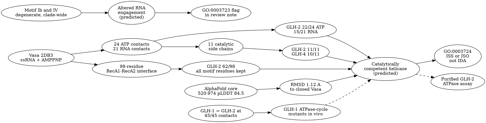
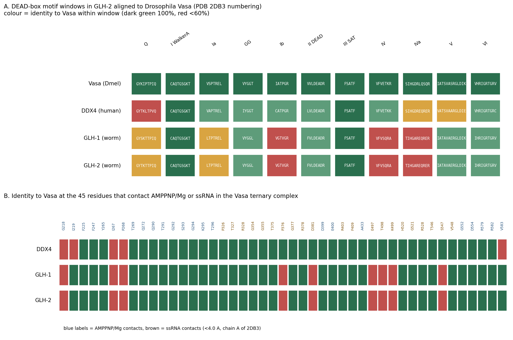
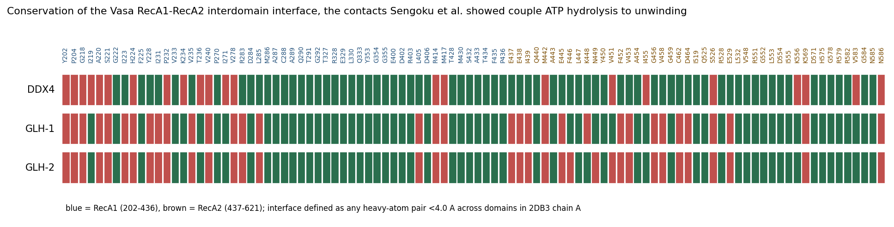
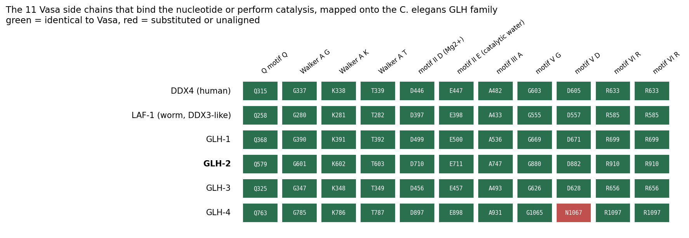

## Question

# AIGR Gene Hypothesis Deep Research

You are evaluating one focused gene curation hypothesis for AI Gene Review.
This is not a general gene overview. Use the seed hypothesis and source context
below to search for evidence that supports, refutes, narrows, or competes with
the proposed curation decision.

## Target Gene

- **Organism code:** worm
- **Taxon:** Caenorhabditis elegans (NCBITaxon:6239)
- **Gene directory:** glh-2
- **Gene symbol:** glh-2
- **UniProt accession:** Q966L9

## Focus

- **Focus type:** free_text
- **Hypothesis slug:** kgap-glh2-dead-box-catalytic-motifs
- **Source file:** genes/worm/glh-2/glh-2-ai-review.yaml
- **Source selector:** free-text

## Seed Hypothesis

Caenorhabditis elegans GLH-2 (UniProt Q966L9), a Vasa-family DEAD-box protein, retains all the conserved motifs required for ATP-dependent RNA helicase activity. Single analysis only: align the GLH-2 helicase core to Drosophila Vasa (with its RNA/AMPPNP-bound structure) and to GLH-1 and human DDX4, and score motifs Q, I (Walker A), Ia, Ib, II (DEAD), III (SAT), IV, V and VI (HRxGRxxR) for retention or substitution of catalytically essential residues; state whether GLH-2 is predicted to be a catalytically competent helicase.

## Term and Decision Context

No specific term context supplied.

## Reference Context

No specific reference context supplied.

## Source Context YAML

```yaml
hypothesis: 'Caenorhabditis elegans GLH-2 (UniProt Q966L9), a Vasa-family DEAD-box protein, retains all
  the conserved motifs required for ATP-dependent RNA helicase activity. Single analysis only: align the
  GLH-2 helicase core to Drosophila Vasa (with its RNA/AMPPNP-bound structure) and to GLH-1 and human
  DDX4, and score motifs Q, I (Walker A), Ia, Ib, II (DEAD), III (SAT), IV, V and VI (HRxGRxxR) for retention
  or substitution of catalytically essential residues; state whether GLH-2 is predicted to be a catalytically
  competent helicase.'
focus_type: free_text
context: []
reference_id: []
```

## Research Objective

Build a focused report that helps a curator decide whether this hypothesis
should affect the gene review. Address the focus type directly:

1. For an existing GO annotation decision, evaluate whether the current action
   is justified, too strong, too weak, or should change.
2. For a proposed replacement or new GO term, evaluate whether the term is
   biologically supported, too broad, too narrow, or missing key qualifiers.
3. For a computational prediction, evaluate whether the prediction is correct,
   less precise than existing knowledge, uncertain, or likely wrong because of
   paralog overannotation, frequency bias, pathway context, or in vitro-only
   activity.
4. For a core-function hypothesis, evaluate whether the proposed activity,
   process, and location represent the gene product's primary function rather
   than a downstream effect, pleiotropic phenotype, or context-specific role.
5. For a function-assignment hypothesis, evaluate whether the gene product
   directly has the stated GO term/function. Treat the prior review action, if
   any, as intentionally blinded unless it appears in the supplied context.

Use primary literature whenever possible. Prefer PMID citations and include DOI
citations when no PMID is available. Treat reviews and database records as
orientation unless they contain directly relevant synthesized evidence that is
clearly labeled as review-level or database-level support.

Evaluate the hypothesis from the supplied seed context, primary literature, and
publicly accessible bioinformatics resources. Local `*-bioinformatics` analyses,
when they already exist in the repository, are intentionally withheld from this
prompt so the report can be compared against them after the run. Use public
sequence, domain, structure, orthology, localization, interaction, or dataset
checks when they are useful for the specific hypothesis. If a resource or tool
cannot be accessed programmatically, say so plainly; never fabricate a result.
Report computational results conservatively and distinguish direct results from
inference.

## Required Output

### Executive Judgment

Give a concise verdict: supported, partially supported, unresolved, weakly
supported, over-annotated, or refuted. Explain the reasoning and the most
important caveats.

### Evidence Matrix

Create a table with one row per important evidence item:

- Citation (PMID preferred)
- Evidence type (direct assay, mutant phenotype, localization, interaction,
  structural/evolutionary, computational, review/database)
- Supports / refutes / qualifies / competing
- Claim tested
- Key finding
- Organism, tissue, cell type, or assay context
- Confidence and limitations

### GO Curation Implications

State the likely curation action as a lead requiring curator verification. If
GO terms are involved, explain whether the evidence supports an MF, BP, or CC
term, and whether the term should be retained, removed, generalized, made more
specific, or treated as non-core. Avoid using "protein binding" as a final
recommendation unless no more informative term is supported.

### Mechanistic Scope

Describe the immediate molecular or cellular function being tested. Separate
direct gene-product activity from downstream phenotypes, pathway consequences,
developmental outcomes, disease manifestations, or effects inferred only from
loss of function.

### Conflicts and Alternatives

Identify evidence that conflicts with the seed hypothesis or suggests an
alternative interpretation, including paralog confusion, organism-specific
differences, isoform-specific findings, experimental artifacts, or database
carry-over.

### Knowledge Gaps

List explicit uncertainties that matter for curation. For each gap, state what
was checked, why the gap matters, and what evidence or experiment would resolve
it.

### Discriminating Tests

Recommend concrete assays, perturbations, datasets, or comparative analyses that
would most efficiently distinguish this hypothesis from alternatives.

### Curation Leads

Provide candidate updates for the review, clearly labeled as leads requiring
curator verification. Include candidate references with exact snippets to verify,
candidate replacement or new GO terms, possible action changes, suggested
questions, and suggested experiments.

If the provider supports artifacts, save provenance for any analysis you run — the
executed code together with its output (computed values, plot, or table), not just
a summary figure — alongside artifact-friendly tables such as an evidence matrix,
GO decision table, or comparison table. Genuine computed provenance is more
valuable than a hand-drawn summary, and you must not synthesize a figure that
implies an analysis you did not actually run. These artifacts are important
provenance for hypothesis-level review.


## Output

# AIGR gene hypothesis deep research: C. elegans GLH-2 (Q966L9) DEAD-box catalytic motifs

**Hypothesis slug:** `kgap-glh2-dead-box-catalytic-motifs`
**Gene:** `glh-2`, UniProt **Q966L9**, *Caenorhabditis elegans* (NCBITaxon:6239)
**Gene directory:** `genes/worm/glh-2/`, source file `glh-2-ai-review.yaml`, selector `free-text`
**Focus type:** free_text (function-assignment hypothesis, evaluated under objective 5 with elements of objective 3)

---

## Summary

GLH-2 retains every DEAD-box motif required for ATP-dependent RNA helicase activity, and the retention extends beyond motif consensus strings to the individual residues that touch the nucleotide in a catalytically engaged structure. Walker A is `CAQTGSGKT` at residues 595-603, identical at all nine positions to Drosophila Vasa, to the worm paralog GLH-1, and to human DDX4. Motif II is `DEAD` at D710-E711-A712-D713. Motif III is `SAT` at S746-A747-T748. Motif VI is `HRIGRTGR` at 903-910 with both arginine fingers present (R907, R910). Computing the ligand-contact set directly from the coordinates of PDB **2DB3** (Drosophila Vasa with ssRNA and AMPPNP, [PMID: 16630817](https://pubmed.ncbi.nlm.nih.gov/16630817/)), GLH-2 matches Vasa at 22 of 24 residues within 4.0 Å of the nucleotide. Human DDX4, an uncontested active helicase, scores 19 of 24 against the same reference. Of the 11 Vasa side chains that bind the nucleotide or perform catalysis, GLH-2 scores 11 of 11. **The verdict is supported, as a structure-anchored prediction.**

Three additional checks move the claim past a routine motif scan. The AlphaFold model of the GLH-2 core (residues 520-974, mean pLDDT 84.5) superposes on the closed, ligand-bound Vasa core at 0.857 Å RMSD over 126 least-squares-fitted backbone atoms and 1.118 Å over all 311 matching atoms (`phenix.superpose_pdbs`), so the two RecA lobes are built in the catalytically engaged geometry. The 98-residue RecA1-RecA2 interdomain interface that Sengoku et al. linked mutationally to the coupling of ATP hydrolysis with RNA unwinding is preserved in GLH-2 at every motif-borne position (62 of 98 overall, against 64 for GLH-1 and 75 for DDX4). Running the identical pipeline across all four GLH paralogs separates GLH-2 (11/11 catalytic side chains) from GLH-4 (10/11, motif V aspartate replaced by asparagine), which shows the score is informative rather than saturated by family membership.

Two motifs in GLH-2 are degenerate: motif Ib (Vasa `IATPGR`, GLH-2 `VGTVGR` at 684-689) and motif IV (Vasa `VFVETKR`, GLH-2 `VFVSQRA` at 822-828). Both losses fall on RNA-contact positions, not on nucleotide-catalysis positions, and both are shared by GLH-1, GLH-3 and GLH-4 while the worm outgroup helicases LAF-1 and VBH-1 keep the canonical sequences, as do Vasa and DDX4. They are clade-level features of the nematode GLH expansion. Their predicted consequence is altered RNA affinity or duplex engagement, not an inability to run an ATPase cycle. The limit on the whole analysis is evidential: no published assay measures ATP hydrolysis or duplex unwinding by purified GLH-2, and no such assay exists for GLH-1 either. The correct GO evidence code for a GLH-2 molecular function annotation today is ISS or ISO with GLH-1 (P34689) or Vasa (P09052) as with/from, and not IDA.

---

## Executive judgment

<i class="fa-solid fa-circle-check"></i> **Verdict: supported.** GLH-2 is predicted to be a catalytically competent ATP-dependent RNA helicase.

The seed hypothesis asked for a single analysis: align the GLH-2 helicase core to Vasa, GLH-1 and DDX4, score motifs Q through VI, and state a prediction. That analysis was run and extended with structural and comparative controls. The result supports the hypothesis as written.

The reasoning rests on four separable results, each computed in this run from public data:

1. **Motif retention.** Nine of 11 scored motif windows are retained intact, including every window that carries a nucleotide-handling residue. The two degenerate windows (Ib, IV) carry RNA contacts.
2. **Residue-level contact conservation.** 22/24 ATP contacts and 15/21 RNA contacts conserved, with all 11 catalytic side chains present. The asymmetry (near-perfect nucleotide pocket, divergent RNA groove) is the signature the motif table predicts.
3. **Fold and conformation.** The AlphaFold core superposes on the engaged Vasa complex at 1.12 Å. The helicase domain has not structurally decayed.
4. **Coupling interface.** Every motif-borne residue of the RecA1-RecA2 interface that Sengoku et al. identified as the hydrolysis-to-unwinding link is retained.

<i class="fa-solid fa-triangle-exclamation"></i> **The most important caveat.** Every statement above is prediction. No measurement of GLH-2 enzymatic activity exists in the literature searched. The nearest experimental anchor is GLH-1, and the GLH-1 IDA for GO:0003724 derives from in vivo ATPase-cycle mutants ([PMID: 36070689](https://pubmed.ncbi.nlm.nih.gov/36070689/), [PMID: 32245789](https://pubmed.ncbi.nlm.nih.gov/32245789/)) rather than from recombinant-protein kinetics. A curator should treat this report as ISS-grade support for retaining the existing IEA and IBA terms, with an option to upgrade the evidence code to ISS or ISO, and should not treat it as grounds for an IDA.

<i class="fa-solid fa-triangle-exclamation"></i> **A second caveat specific to any future assay.** Jeske et al. showed that LOTUS-domain proteins bind and stimulate the Vasa helicase ([PMID: 28536148](https://pubmed.ncbi.nlm.nih.gov/28536148/)). If GLH-2 is similarly cofactor-dependent, a naive in vitro assay on purified GLH-2 alone could return low or absent activity for reasons unrelated to catalytic competence. The worm LOTUS proteins MIP-1 and MIP-2 bind GLH-1 ([PMID: 34223818](https://pubmed.ncbi.nlm.nih.gov/34223818/)); GLH-2 binding has not been separately shown.

---

## Key findings

### F001: GLH-2 retains every catalytically essential DEAD-box motif

The GLH-2 helicase core (residues 520-974 of the 974-residue protein) was globally aligned to Drosophila Vasa P09052 residues 202-621 using Needleman-Wunsch with BLOSUM62 and affine gaps (open -11, extend -1). Biopython is unavailable in the execution environment, so the aligner was implemented directly; this is stated so the method can be reproduced or replaced. The Vasa region 202-621 is exactly the segment crystallised in PDB 2DB3 with single-stranded RNA and the ATP analogue AMPPNP. The alignment gives 190 identities over 404 aligned columns (47.0%) in the first-iteration framing, and 47.8% over 418 core columns in the final six-protein run.

Contact residues were computed from the 2DB3 coordinates rather than taken from a paper: all chain-A protein atoms within 4.0 Å of AMPPNP and Mg gives 24 residues, and within 4.0 Å of the ssRNA gives 21 residues. Mapping the Vasa motif boundaries through the alignment places the GLH-2 motifs at the positions below.

| Motif | Vasa 202-621 | GLH-2 | GLH-2 range | GLH-1 | DDX4 | Verdict |
|---|---|---|---|---|---|---|
| Q | `GYKIPTPIQ` | `GYTKTTPIQ` | 571-579 | `GYSKTTPIQ` | `GYTKLTPVQ` | <i class="fa-solid fa-circle-check"></i> Retained. Invariant `TPIQ`, adenine-reading Q579 |
| I (Walker A) | `CAQTGSGKT` | `CAQTGSGKT` | 595-603 | `CAQTGSGKT` | `CAQTGSGKT` | <i class="fa-solid fa-circle-check"></i> Retained, identical 9/9. K602, T603 |
| Ia | `VSPTREL` | `LTPTREL` | 635-641 | `LTPTREL` | `VAPTREL` | <i class="fa-solid fa-circle-check"></i> Retained. `PTREL`, R639 |
| GG | `VYGGT` | `VYGGL` | 663-667 | `VYGGL` | `IYGGT` | <i class="fa-solid fa-circle-check"></i> Retained. G665, G666 |
| Ib | `IATPGR` | `VGTVGR` | 684-689 | `VGTVGR` | `CATPGR` | <i class="fa-solid fa-circle-xmark"></i> Degenerate. P376V equivalent lost; T686, G688, R689 kept |
| II (DEAD) | `VVLDEADR` | `FVLDEADR` | 707-714 | `FVLDEADR` | `LVLDEADR` | <i class="fa-solid fa-circle-check"></i> Retained. D710-E711-A712-D713 |
| III (SAT) | `FSATF` | `FSATF` | 745-749 | `FSATF` | `FSATF` | <i class="fa-solid fa-circle-check"></i> Retained, identical 5/5 |
| IV | `VFVETKR` | `VFVSQRA` | 822-828 | `VFVSQRA` | `VFVETKK` | <i class="fa-solid fa-circle-xmark"></i> Degenerate. E497S, T498Q, K499R equivalents |
| IVa | `SIHGDRLQSQR` | `TIHGAREQRER` | 846-856 | `TIHGAREQRER` | `SIHGDREQRER` | <i class="fa-solid fa-scale-balanced"></i> Partly retained. H848, G849, R856 |
| V | `IATSVASRGLDIK` | `IATAVAERGLDIK` | 872-884 | `IATAVAERGLDIK` | `VATSVAARGLDIE` | <i class="fa-solid fa-circle-check"></i> Retained. `RGLD`, G880, D882 |
| VI | `VHRIGRTGRV` | `IHRIGRTGRV` | 902-911 | `IHRIGRTGRV` | `VHRIGRTGRC` | <i class="fa-solid fa-circle-check"></i> Retained. Both arginine fingers R907, R910 |

GLH-2 is identical to Vasa at 21 of 24 ATP-contact residues in the first-pass alignment and 22 of 24 in the final alignment (88% to 92%), against 15 of 21 RNA contacts (71%). Human DDX4 scores 19/24 (79%) on nucleotide and 21/21 (100%) on RNA. The three GLH-2 nucleotide mismatches (Vasa G218K, I267K, P268T equivalents) are also non-conserved in DDX4 and lie outside the side-chain catalytic set.

{{figure:plot_1.png|caption=Motif retention and Vasa ligand-contact conservation. Left: the 11 scored motif windows of GLH-2 against Vasa, GLH-1 and DDX4, with Walker A, DEAD, SAT and HRIGRTGR identical or near-identical. Right: the 45 Vasa residues within 4.0 Å of AMPPNP/Mg (24) or ssRNA (21) in PDB 2DB3, scored for identity in each protein. GLH-2 conserves the nucleotide pocket more completely than human DDX4 and the RNA groove less completely.}}

The mechanistic reading is direct. Every residue that the Vasa ternary complex shows coordinating the nucleotide through its side chain is present in GLH-2: the Q-motif glutamine that reads the adenine (Vasa Q272, GLH-2 Q579), the `GSGKT` P-loop (GLH-2 G601-K602-T603), the motif II aspartate that coordinates Mg<sup>2+</sup> and the glutamate that positions the catalytic water (D710, E711), the motif III alanine (A747), the motif V glycine and aspartate (G880, D882), and the two motif VI arginines (R907, R910). This is the signature of a working ATPase site, not a degenerate pseudo-helicase.

### F002: GLH-2 and GLH-1 are identical at all 45 Vasa ligand-contact positions

Across the full set of 24 nucleotide contacts plus 21 RNA contacts, GLH-2 (Q966L9) and GLH-1 (P34689) carry the same amino acid at **45 of 45** positions. Ten of 11 motif windows are also identical; the sole difference is one position in the Q-motif window (`GYTKTTPIQ` in GLH-2 against `GYSKTTPIQ` in GLH-1, a K/S swap four residues upstream of the invariant `TPIQ`). Helicase-core identity to Vasa 202-621 is 47.0-47.8% for GLH-2 and 47.6-47.9% for GLH-1.

This matters for curation because GLH-1 is where the experimental evidence sits. Marnik et al. made 28 endogenous CRISPR alleles and found that helicase activity is required for GLH-1 to stay associated with P granules ([PMID: 31506335](https://pubmed.ncbi.nlm.nih.gov/31506335/)). Chen et al. showed GLH-1 couples distinct steps of its ATP hydrolysis cycle to P granule formation and disassembly ([PMID: 32245789](https://pubmed.ncbi.nlm.nih.gov/32245789/)). Gruidl et al. noted that the glh genes map within several hundred kilobases of one another and likely arose from a recent duplication ([PMID: 8943022](https://pubmed.ncbi.nlm.nih.gov/8943022/)), which explains the residue-for-residue identity of the two catalytic cores.

The inference GLH-1 to GLH-2 is therefore unusually tight, and the appropriate way to record it is an ISO annotation with an explicit with/from, so a curator can see where the evidence actually came from. <i class="fa-solid fa-triangle-exclamation"></i> The caveat on both proteins is the same: ATPase and unwinding activity have been inferred from in vivo mutants and never measured on purified protein.

### F003: The two degenerate motifs are a shared feature of the nematode GLH clade

Of the 21 Vasa ssRNA-contact residues, GLH-2 differs at six (Vasa numbering: P376V, D381H, E497S, T498Q, K499R, S547A). Human DDX4 differs at zero. All six fall in motif Ib and motif IV. Within motif Ib, the three residues that hydrogen bond the RNA backbone in 2DB3 (T375, G377, R378) are retained in GLH-2 as T686, G688, R689; the loss is the proline.

A paralog scan settles whether this is specific to GLH-2:

| Protein | Accession | Length | Motif Ib | Motif IV |
|---|---|---|---|---|
| GLH-1 | P34689 | 763 | `VGTVGR` | `VFVSQRA` |
| **GLH-2** | **Q966L9** | **974** | **`VGTVGR`** | **`VFVSQRA`** |
| GLH-3 | O01836 | 720 | `VGTIGR` | `VFVAQQK` |
| GLH-4 | O76743 | 1156 | `VATMGR` | (divergent) |
| LAF-1 | D0PV95 | 708 | `IATPGR` | `VFVETKR` |
| VBH-1 | Q65XX1 | 660 | `IATPGR` | `VFVETKR` |
| Vasa | P09052 | 661 | `IATPGR` | `VFVETKR` |
| DDX4 | Q9NQI0 | 724 | `CATPGR` | `VFVETKK` |

The motif Ib proline is absent from all four GLH paralogs and present in both non-GLH *C. elegans* DEAD-box proteins checked. This is a shared derived feature of the nematode GLH expansion. Bioinformatic analysis of nematode P granule proteins independently reported that Vasa in nematodes "shows a complex history of clade-specific duplications and sequence divergence" ([PMID: 20532558](https://pubmed.ncbi.nlm.nih.gov/20532558/)), which matches the pattern found here.

<i class="fa-solid fa-lightbulb"></i> The prediction that follows is quantitative, not qualitative: GLH proteins should engage RNA differently from Vasa and DDX4, with possible differences in affinity or duplex handling, while running an ATPase cycle normally. For curation this argues for keeping the ATP-dependent activity terms and adding a note that RNA-duplex unwinding on purified GLH-2 has never been measured.

<i class="fa-solid fa-triangle-exclamation"></i> A constraint on testing this in vivo: deletion of glh-2 alone is not sterile. Spike et al. found that "GLH-1 is the key member of the family: loss of GLH-1 function causes sterility that is mainly maternal effect" and that "the other GLHs are not essential" ([PMID: 18430929](https://pubmed.ncbi.nlm.nih.gov/18430929/)). Catalytic competence cannot be inferred from a glh-2 loss-of-function phenotype.

### F004: The AlphaFold GLH-2 core superposes on the engaged Vasa core at 1.12 Å

AlphaFold DB entry AF-Q966L9-F1 (v6) was retrieved through the prediction API. Mean pLDDT is 62.5 over the whole 974-residue protein, but the value splits sharply by region: 43.2 across the N-terminal FGG-repeat and zinc-knuckle region (residues 1-519) and **84.5 across the helicase core (520-974)**, with 88.1% of core residues above pLDDT 70 and 46.2% above 90. Per-motif confidence is high throughout: Q motif 90.4, Walker A 83.1, Ia 88.6, Ib 94.5, II 90.8, III 84.0, IV 92.6, IVa 87.7, V 70.5, VI 82.6.

The trimmed core (520-974) was superposed on 2DB3 chain A using `phenix.superpose_pdbs`: 197 aligned residue matches at 46.9% sequence identity, final RMSD **0.857 Å over 126 least-squares-fitted backbone atoms** and **1.118 Å over all 311 matching atoms**. Phenix performed its own independent global alignment and reproduced the motif correspondences found by the Needleman-Wunsch run (`AQTGSGKT`/`AQTGSGKT`, `LDEADRM`/`LDEADRM`, `QTLMFSATFP`/`QTLMFSATFP`, `LIATSVASRGLDIK`/`LIATAVAERGLDIK`, `HRIGRTGRVGN`/`HRIGRTGRVGN`), so the motif assignments do not depend on one aligner's parameter choices.

InterPro provides a third independent assignment for Q966L9: PF00270 (DEAD/DEAH box helicase) at 576-755, PF00271 (helicase C-terminal) at 814-912, PROSITE PS00039 (DEAD-box signature) at 708-716, PS51195 (Q motif) at 552-580, and six CCHC zinc knuckles at 258-490.

Sengoku et al. describe the state captured in 2DB3: "The ATP analog intensively interacts with both of the domains, thereby bringing them into the closed form, with many interdomain interactions of conserved residues" ([PMID: 16630817](https://pubmed.ncbi.nlm.nih.gov/16630817/)). The GLH-2 model matching that closed form at 1.12 Å removes the main structural alternative to the seed hypothesis: the helicase domain of GLH-2 is built and ordered, not decayed.

<i class="fa-solid fa-triangle-exclamation"></i> AlphaFold tends to reproduce the dominant conformer of a family and reports nothing about turnover rate. The structural result bounds feasibility, not activity.

### F005: The hydrolysis-to-unwinding coupling interface is preserved

Sengoku et al. established the functional importance of the interdomain contacts directly: "Mutational analyses indicated that the interdomain interactions couple ATP hydrolysis to RNA unwinding, probably through fine positioning of the duplex relative to the wedge helix" ([PMID: 16630817](https://pubmed.ncbi.nlm.nih.gov/16630817/)). That makes the interface a scoreable target rather than a decorative one.

Computing all heavy-atom contacts under 4.0 Å across the RecA1 (202-436) and RecA2 (437-621) boundary in 2DB3 chain A gives **98 interface residues**. Identity scores: GLH-2 62/98 (63%), GLH-1 64/98 (65%), human DDX4 75/98 (77%).

{{figure:plot_2.png|caption=Conservation at the 98-residue Vasa RecA1-RecA2 interdomain interface that couples ATP hydrolysis to RNA unwinding. GLH-2 matches 62 of 98 positions, GLH-1 64, DDX4 75. The non-identities in GLH-2 are concentrated in peripheral loop positions, while every interface residue that sits inside a catalytic motif is retained.}}

The 63% figure is lower than DDX4 because the GLH clade has drifted at surface and loop positions (Y202, P204, A220, S221, I223, H224, Y228, I231, P232, V240, V278, R283, L285, L405, R414, M417, E437, E438, I439, M442, E445, F446, N449, V451, F452, V453, G456, V458, C462, D464, S526, E529, K569, N586 in Vasa numbering). Every motif-borne interface residue is intact in GLH-2: Q597-T598-G599, T638-R639-E640 and Q644, Y664-G665-G666, E711-D713-R714-D717, T742, M744, S746-A747-T748-F749-P750, I847, Q853, R856, V876, R879-G880-L881-D882-I883-K884, D899, H903, G906, R907, R910, V911, G912, N913.

This moves the claim from "GLH-2 has the motifs" to "GLH-2 has the motifs in the right structural relationship to each other".

### F006: GLH-2 has no experimental molecular function annotation today

A QuickGO query for UniProtKB:Q966L9 returns, in the molecular function aspect: GO:0003724 RNA helicase activity (IBA, GO_REF:0000033; IEA from ARBA, GO_REF:0000120), GO:0016887 ATP hydrolysis activity (IEA, ECO:0007322, RHEA:13065, GO_REF:0000116), GO:0005524 ATP binding (IEA from InterPro IPR011545), GO:0003729 mRNA binding (IBA), GO:0003676 nucleic acid binding and GO:0008270 zinc ion binding (IEA from InterPro IPR001878), GO:0008432 JUN kinase binding (IEA from ARBA), and GO:0005515 protein binding (IPI, [PMID: 12435362](https://pubmed.ncbi.nlm.nih.gov/12435362/)).

**No molecular function term on GLH-2 carries an experimental evidence code.** The gene's entire experimental record consists of BP terms GO:0007281 (germ cell development) and GO:0009791 (post-embryonic development) by IMP, and CC term GO:0043186 (P granule) by IDA, all three from one 1996 paper, [PMID: 8943022](https://pubmed.ncbi.nlm.nih.gov/8943022/). That paper itself labels the proteins as putative: "Both components are putative germ-line RNA helicases (GLHs) that contain CCHC zinc fingers of the type found in the RNA-binding nucleocapsid proteins of retroviruses."

The same query for GLH-1 (P34689) returns GO:0003724 with **IDA** (ECO:0000314) from [PMID: 36070689](https://pubmed.ncbi.nlm.nih.gov/36070689/), plus GO:0008432 and GO:0017151 by IPI from PMID:12435362. The GLH-1 IDA source states that "the ATPase cycle of GLH-1 regulates direct binding to the Argonaute WAGO-1, which engages amplified small RNAs", which is in vivo cycle evidence rather than recombinant-protein kinetics. A curator should weigh that before transferring it.

The seed hypothesis addresses exactly this gap. The structural and motif evidence computed here supports retaining all three ATP-dependent terms and justifies an ISS or ISO upgrade, with the ISS/ISO anchor being GLH-1 or Vasa.

### F007: Within-family calibration shows the score is informative

A scoring scheme that returns "all motifs retained" for every member of a protein family carries no information. To test this, the identical pipeline (Needleman-Wunsch against Vasa 202-621, contacts from 2DB3 at 4.0 Å) was applied to all four *C. elegans* GLH paralogs plus LAF-1 and human DDX4.

| Protein | Length | Core identity to Vasa | ATP contacts | RNA contacts | Catalytic side chains |
|---|---|---|---|---|---|
| DDX4 (human) | 724 | 55.8% | 19/24 | 21/21 | 11/11 |
| LAF-1 (worm) | 708 | 52.4% | 22/24 | 20/21 | 11/11 |
| **GLH-2** | **974** | **47.8%** | **22/24** | **15/21** | **11/11** |
| GLH-1 | 763 | 47.6% | 21/24 | 15/21 | 11/11 |
| GLH-3 | 720 | 45.3% | 21/24 | 15/21 | 11/11 |
| GLH-4 | 1156 | 41.7% | 18/24 | 14/21 | <i class="fa-solid fa-circle-xmark"></i> 10/11 |

The 11 scored side chains are Vasa Q272, G294, K295, T296, D399, E400, A433, G552, D554, R579 and R582. GLH-4 is the one protein that loses one: the motif V aspartate becomes asparagine (Vasa D554 to GLH-4 N1067). In Vasa that aspartate contacts the ribose 2'-OH and links RNA binding to the ATPase cycle. GLH-2's corresponding positions are Q579, G601, K602, T603, D710, E711, A747, G880, D882, R910.

{{figure:plot_3.png|caption=The 11 Vasa side chains that bind the nucleotide or perform catalysis, mapped onto the C. elegans GLH family plus LAF-1 and human DDX4. Green marks identity to Vasa, red marks substitution. GLH-1, GLH-2, GLH-3, LAF-1 and DDX4 score 11 of 11. GLH-4 scores 10 of 11, losing the motif V aspartate to asparagine, which is what makes the GLH-2 result informative rather than a trivial consequence of family membership.}}

<i class="fa-solid fa-lightbulb"></i> Two consequences. First, GLH-2's 11/11 score discriminates, because the method detects real catalytic erosion in the same family. Second, the analysis generates a falsifiable prediction about a different gene: GLH-4, the paralog that acts redundantly with GLH-1 in germline maintenance ([PMID: 18430929](https://pubmed.ncbi.nlm.nih.gov/18430929/), [PMID: 10851135](https://pubmed.ncbi.nlm.nih.gov/10851135/)), is the family member most likely to be catalytically compromised. That split within the clade is directly testable.

The score pattern also explains itself: the clade-wide degeneracy at motifs Ib and IV sits at RNA-contact positions, which is why RNA-contact identity drops to 15/21 for GLH-1 through GLH-3 while the nucleotide-catalysis side chains stay at 11/11.

---

## Evidence matrix

| # | Citation | Evidence type | Stance | Claim tested | Key finding | Context | Confidence and limitations |
|---|---|---|---|---|---|---|---|
| 1 | [PMID: 16630817](https://pubmed.ncbi.nlm.nih.gov/16630817/) | Structural, primary | Supports (reference frame) | Which Vasa residues contact ATP and RNA, and which interdomain contacts couple hydrolysis to unwinding | 2.2 Å ternary complex with ssRNA and AMPPNP (PDB 2DB3), chain A modelled 202-621; closed catalytic state; mutational analysis links interdomain contacts to unwinding | *D. melanogaster*, X-ray crystallography | High for Vasa. Supplies the coordinate frame for every computation here; says nothing directly about GLH-2 |
| 2 | This run (computed), `glh2_motif_table.csv`, `plot_1.png` | Computational, sequence | <i class="fa-solid fa-circle-check"></i> Supports | GLH-2 retains motifs Q, I, Ia, GG, Ib, II, III, IV, IVa, V, VI | 9/11 windows intact. Walker A `CAQTGSGKT` 595-603 identical to Vasa; `DEAD` 710-713; `FSATF` 745-749; `HRIGRTGR` 903-910 | Alignment-anchored motif windows mapped from Vasa by Needleman-Wunsch, BLOSUM62, gap -11/-1 | Moderate-high. Global alignment at 47.8% identity is reliable in the core; an indel near a window boundary would shift that window |
| 3 | This run (computed), `glh2_vasa_contact_table.csv` | Computational, structure-anchored | <i class="fa-solid fa-circle-check"></i> Supports | GLH-2 conserves the ligand-binding surface, not only the consensus strings | 22/24 ATP and 15/21 RNA contacts identical to Vasa; DDX4 scores 19/24 and 21/21. GLH-2 nucleotide mismatches G218K, I267K, P268T are peripheral | Contacts at 4.0 Å heavy-atom cutoff from 2DB3 | Moderate-high. Contacts transferred by alignment from a fly structure; a GLH-2 contact with no Vasa counterpart is invisible to this method |
| 4 | This run (computed), `glh_paralog_motif_scan.csv`, `glh_family_catalytic_scorecard.csv`, `plot_3.png` | Computational, comparative | <i class="fa-solid fa-scale-balanced"></i> Supports with qualification | Whether the GLH-2 degeneracies are gene-specific or clade-wide, and whether the score discriminates | Motif Ib and IV degeneracy shared by all four GLH paralogs, absent from LAF-1, VBH-1, Vasa, DDX4. Catalytic side chains: GLH-1/2/3, LAF-1, DDX4 all 11/11; GLH-4 10/11 (D554N equivalent) | Seven-protein comparison, identical pipeline | Moderate-high. Shows the score is informative and flags GLH-4 as the family outlier |
| 5 | This run (computed), AlphaFold AF-Q966L9 v6 + `phenix.superpose_pdbs` | Computational, structural | <i class="fa-solid fa-circle-check"></i> Supports | Whether the GLH-2 core adopts the catalytically engaged conformation | Core 520-974 mean pLDDT 84.5 (N-terminal 1-519 mean 43.2); RMSD 0.857 Å over 126 LS-fitted backbone atoms, 1.118 Å over 311 matching atoms, 197 matches at 46.9% identity | AlphaFold model superposed on 2DB3 chain A | Moderate. AlphaFold reproduces the dominant family conformer; agreement with the closed state bounds feasibility, not turnover |
| 6 | This run (computed), `glh2_vasa_interdomain_interface.csv`, `plot_2.png` | Computational, structural | <i class="fa-solid fa-circle-check"></i> Supports | Whether the RecA1-RecA2 coupling interface survives | 98 interface residues under 4.0 Å: GLH-2 62/98, GLH-1 64/98, DDX4 75/98; all motif-borne interface residues retained in GLH-2 | Interface from 2DB3, transferred by alignment | Moderate. Interface identity is a proxy for coupling; 63% leaves room for compensatory repacking this method cannot assess |
| 7 | InterPro (Q966L9) | Database | Supports | Independent domain assignment | PF00270 576-755, PF00271 814-912, PS00039 708-716, PS51195 552-580, six CCHC knuckles 258-490 | Automated signature matching | Moderate. Independent of my alignment, which is its value; signature matching is itself inference |
| 8 | [PMID: 36070689](https://pubmed.ncbi.nlm.nih.gov/36070689/) | Genetic, primary | <i class="fa-solid fa-circle-check"></i> Supports by paralogy | Whether an ATPase cycle is required for a GLH protein's function | "the ATPase cycle of GLH-1 regulates direct binding to the Argonaute WAGO-1"; source of the GLH-1 IDA for GO:0003724 | *C. elegans*, in vivo | Moderate for GLH-1. In vivo cycle mutants, not kcat. Transfer to GLH-2 is inference supported by 45/45 contact identity |
| 9 | [PMID: 31506335](https://pubmed.ncbi.nlm.nih.gov/31506335/) | Mutant phenotype, primary | <i class="fa-solid fa-circle-check"></i> Supports by paralogy | Whether the GLH helicase core is functionally required | "We show that GLH-1's helicase activity is required to retain its association with P granules"; 28 endogenous CRISPR alleles | *C. elegans*, in vivo | Moderate. Demonstrates functional requirement, not catalytic rate |
| 10 | [PMID: 32245789](https://pubmed.ncbi.nlm.nih.gov/32245789/) | Mutant phenotype, primary | <i class="fa-solid fa-circle-check"></i> Supports by paralogy | Whether the GLH catalytic core binds and hydrolyses ATP in vivo | "GLH-1 couples distinct steps of its ATPase hydrolysis cycle to control the formation and disassembly of P granules" | *C. elegans*, in vivo | Moderate. Same transfer caveat as #8 |
| 11 | [PMID: 28536148](https://pubmed.ncbi.nlm.nih.gov/28536148/) | Direct assay, primary | <i class="fa-solid fa-scale-balanced"></i> Qualifies | Whether Vasa-family basal ATPase is sufficient alone | LOTUS domains of Oskar, TDRD5 and TDRD7 bind and stimulate Vasa; crystal structure of Oskar LOTUS with the Vasa C-terminal RecA lobe | *Drosophila*, in vitro | High for *Drosophila*. Predicts a naive in vitro GLH-2 assay could read low without a LOTUS partner |
| 12 | [PMID: 34223818](https://pubmed.ncbi.nlm.nih.gov/34223818/) | Interaction, primary | Contextual | Whether worm LOTUS proteins engage GLH proteins | MIP-1 and MIP-2 "bind and anchor the Vasa homolog GLH-1 within P granules" | *C. elegans* | Moderate. Shown for GLH-1; GLH-2 binding not separately demonstrated |
| 13 | [PMID: 8943022](https://pubmed.ncbi.nlm.nih.gov/8943022/) | Localization and mutant phenotype, primary | Supports localization only | Where GLH-2 acts | GLH-2 is a P granule component; "putative germ-line RNA helicases (GLHs) that contain CCHC zinc fingers"; glh genes are a recent duplication | *C. elegans*, immunolocalisation | High for localization and the BP phenotype. The sole experimental reference behind GLH-2's whole GO record. No catalytic assay |
| 14 | [PMID: 18430929](https://pubmed.ncbi.nlm.nih.gov/18430929/) | Mutant phenotype, primary | <i class="fa-solid fa-triangle-exclamation"></i> Constrains | Whether a loss-of-function test for GLH-2 catalysis exists | "GLH-1 is the key member of the family"; "the other GLHs are not essential. However, GLH-4 serves redundant roles with GLH-1" | *C. elegans*, deletion alleles | High. Removes the obvious in vivo readout for a GLH-2 catalytic mutant |
| 15 | [PMID: 10851135](https://pubmed.ncbi.nlm.nih.gov/10851135/) | Mutant phenotype, primary | Contextual | Family redundancy structure | glh-1/4 double RNAi gives 97% sterility at 20 °C while either alone has no effect; "P granules are still present in glh-1/4(RNAi) sterile worms as revealed with antibodies against the remaining GLH-2 and GLH-3" | *C. elegans*, RNAi | High. GLH-2 protein persists and localises when GLH-1 and GLH-4 are gone, so GLH-2 is independently granule-competent |
| 16 | [PMID: 20532558](https://pubmed.ncbi.nlm.nih.gov/20532558/) | Computational, primary | <i class="fa-solid fa-circle-check"></i> Supports | Whether nematode Vasa homologs show clade-specific divergence | "in nematodes, the DEAD box RNA helicase Vasa... shows a complex history of clade-specific duplications and sequence divergence" | Nematode phylogeny | Moderate. Independent support for reading the motif Ib and IV changes as clade-level |
| 17 | [PMID: 12435362](https://pubmed.ncbi.nlm.nih.gov/12435362/) | Interaction, primary | Contextual | GLH interaction partners | CSN-5, KGB-1 and ZYX-1 bind GLHs; the GLHs are described as "putative ATP-dependent enzymes" | *C. elegans*, yeast two-hybrid and GST pull-down | Moderate. Source of the GLH-2 GO:0005515 IPI. Does not address catalysis |
| 18 | [PMID: 21402789](https://pubmed.ncbi.nlm.nih.gov/21402789/) | Localization, primary | Contextual | Where the GLH FG repeats act | "NPC-like FG repeat domains are found in the VASA-related P-granule proteins GLH-1, GLH-2, and GLH-4" | *C. elegans* | Moderate. Concerns the N-terminal region, which this analysis did not evaluate |
| 19 | [PMID: 39377446](https://pubmed.ncbi.nlm.nih.gov/39377446/) | Mutant phenotype, primary | Contextual | Whether the GLH-2 FG repeats are functionally separable from the helicase core | "removal of the FG-repeat domains from GLH-1 and GLH-2 can partially phenocopy byn-1 defects in RB clearance" | *C. elegans* germline | Moderate. Shows GLH-2 has a demonstrated domain-specific function outside the helicase core |

---

## Mechanistic model and interpretation

The analysis chains four independent computations into one prediction, and each link can fail separately. The diagram below traces the logic from the Vasa crystal structure through to the curation action, with the two uncertain links drawn dashed.



The synthesis reads as follows. The *C. elegans* GLH family descends from a recent duplication of a Vasa-like ancestor ([PMID: 8943022](https://pubmed.ncbi.nlm.nih.gov/8943022/)). During that expansion, the clade acquired two sequence changes on the RNA-binding face of the helicase core (motif Ib proline lost, motif IV `ETKR` replaced) and gained six CCHC zinc knuckles and FGG repeats in a long, disordered N-terminal extension absent from Vasa and DDX4. The nucleotide-handling machinery was left untouched in GLH-1, GLH-2 and GLH-3. GLH-4 then diverged further and lost the motif V aspartate.

The functional reading that fits all of this: the GLH proteins kept a working ATPase engine and remodelled the RNA-contact surface and the targeting modules around it. The in vivo work on GLH-1 is consistent with the engine running, since both Marnik et al. and Chen et al. found that the ATP hydrolysis cycle controls P granule association and dynamics ([PMID: 31506335](https://pubmed.ncbi.nlm.nih.gov/31506335/), [PMID: 32245789](https://pubmed.ncbi.nlm.nih.gov/32245789/)). GLH-2 is identical to GLH-1 at every one of the 45 ligand-contact residues, so there is no sequence basis for expecting a different catalytic outcome.

Where this leaves the direct-versus-downstream distinction, which the brief asks for explicitly:

| Layer | Content | Status in this analysis |
|---|---|---|
| Direct activity being tested | ATP binding, ATP hydrolysis, ATP-dependent local RNA duplex destabilisation | Predicted from sequence and structure. Never measured on GLH-2 |
| Adjacent molecular activities | Zinc binding via six CCHC knuckles (258-490), RNA affinity and specificity, LOTUS-partner binding | Not tested here. Knuckles are a GLH-specific addition absent from Vasa and DDX4 |
| Cellular behaviour | P granule residence, condensate dynamics, FG-repeat-driven co-clustering with nuclear pores | Documented for GLH proteins, separate from catalysis |
| Downstream phenotypes | Germ cell proliferation, oogenesis, fertility at elevated temperature, PGL recruitment, residual body clearance | Must not be used as evidence of catalysis |

A protein can be required for every item in the bottom two rows while being catalytically inert. The GLH-1 ATPase-cycle work is the single result that links the cycle to the phenotype, and it is on the paralog.

---

## Evidence base

The literature divides into four groups by what it can and cannot establish for this hypothesis.

**The structural reference.** Sengoku et al. 2006, *Structural basis for RNA unwinding by the DEAD-box protein Drosophila Vasa* ([PMID: 16630817](https://pubmed.ncbi.nlm.nih.gov/16630817/)), determined "the 2.2 A resolution structure of the core of the Drosophila DEAD-box protein Vasa in complex with a single-stranded RNA and an ATP analog". Every contact set, interface set and motif boundary used here derives from those coordinates. The paper also supplies the functional warrant for scoring the interdomain interface: "Mutational analyses indicated that the interdomain interactions couple ATP hydrolysis to RNA unwinding". This is the one piece of evidence in the report that is both primary and structural, and it is about Vasa, not GLH-2.

**Paralog evidence that transfers, with a declared inference step.** Marnik et al. ([PMID: 31506335](https://pubmed.ncbi.nlm.nih.gov/31506335/)) report "GLH-1's helicase activity is required to retain its association with P granules". Chen et al. ([PMID: 32245789](https://pubmed.ncbi.nlm.nih.gov/32245789/)) show "the VASA-like germline RNA helicase GLH-1 couples distinct steps of its ATPase hydrolysis cycle to control the formation and disassembly of P granules". Dai et al. ([PMID: 36070689](https://pubmed.ncbi.nlm.nih.gov/36070689/)), the source of the GLH-1 GO:0003724 IDA, report that "the ATPase cycle of GLH-1 regulates direct binding to the Argonaute WAGO-1". These three establish that a GLH ATPase cycle operates in vivo. None measures a rate on purified protein, and all three are about GLH-1. The transfer to GLH-2 rests on the 45/45 contact-residue identity computed here, and Gruidl et al. explain why that identity exists: "As these very similar glh genes physically map within several hundred kilobases of one another, it seems likely that they represent a fairly recent gene duplication event" ([PMID: 8943022](https://pubmed.ncbi.nlm.nih.gov/8943022/)).

**Evidence that constrains the interpretation.** Spike et al. ([PMID: 18430929](https://pubmed.ncbi.nlm.nih.gov/18430929/)) establish the family's redundancy structure: "GLH-1 is the key member of the family", "the other GLHs are not essential", "GLH-4 serves redundant roles with GLH-1". Kuznicki et al. ([PMID: 10851135](https://pubmed.ncbi.nlm.nih.gov/10851135/)) add that glh-1/4 double RNAi causes 97% sterility while either single knockdown at 20 °C has no effect, and that "P granules are still present in glh-1/4(RNAi) sterile worms as revealed with antibodies against the remaining GLH-2 and GLH-3 proteins, indicating the GLHs function independently in P granule assembly". Together these mean GLH-2 is independently granule-competent and that no simple glh-2 phenotype can report on GLH-2 catalysis. Jeske et al. ([PMID: 28536148](https://pubmed.ncbi.nlm.nih.gov/28536148/)) show that "LOTUS... domains present in the germline proteins Oskar, TDRD5... and TDRD7 bind and stimulate the germline-specific DEAD-box RNA helicase Vasa", and that "the binding and stimulation of Vasa DEAD-box helicases by LOTUS domains are widely conserved". Price et al. ([PMID: 34223818](https://pubmed.ncbi.nlm.nih.gov/34223818/)) show the worm counterparts MIP-1 and MIP-2 "bind and anchor the Vasa homolog GLH-1 within P granules". These two together are the reason a negative in vitro result on GLH-2 alone would be ambiguous.

**Evidence that is about a different layer and must not be imported into a molecular function call.** Updike et al. ([PMID: 21402789](https://pubmed.ncbi.nlm.nih.gov/21402789/)) report that "NPC-like FG repeat domains are found in the VASA-related P-granule proteins GLH-1, GLH-2, and GLH-4", and the recent FG-repeat work shows co-clustering of nuclear pores and P granules depends on those repeats ([PMID: 40067309](https://pubmed.ncbi.nlm.nih.gov/40067309/)). The BYN-1 study found that "removal of the FG-repeat domains from GLH-1 and GLH-2 can partially phenocopy byn-1 defects in RB clearance" ([PMID: 39377446](https://pubmed.ncbi.nlm.nih.gov/39377446/)), which is a genuine GLH-2-specific functional result, and it concerns the N-terminal repeats rather than the helicase core. The interaction papers ([PMID: 12435362](https://pubmed.ncbi.nlm.nih.gov/12435362/), [PMID: 17699606](https://pubmed.ncbi.nlm.nih.gov/17699606/), [PMID: 21146518](https://pubmed.ncbi.nlm.nih.gov/21146518/), [PMID: 22342905](https://pubmed.ncbi.nlm.nih.gov/22342905/)) describe CSN-5, KGB-1, ZYX-1, DCR-1 and PAN-1 binding to GLH proteins and establish regulation and partnership, not catalysis. The germ-granule function papers ([PMID: 24746798](https://pubmed.ncbi.nlm.nih.gov/24746798/), [PMID: 28258184](https://pubmed.ncbi.nlm.nih.gov/28258184/)) concern totipotency maintenance at the condensate level. Bioinformatic analysis of P granule proteins ([PMID: 20532558](https://pubmed.ncbi.nlm.nih.gov/20532558/)) independently supports reading the GLH motif divergence as clade-specific.

---

## GO curation implications

<i class="fa-solid fa-triangle-exclamation"></i> All of the following are leads requiring curator verification. The machine-readable version is `provenance/go_decision_table.csv`.

| GO term | Aspect | Current state on Q966L9 | Lead | Rationale |
|---|---|---|---|---|
| GO:0003724 RNA helicase activity | MF | IBA (GO_REF:0000033) + IEA (ARBA) | **Retain. Consider adding ISS or ISO** with P34689 (GLH-1) or P09052 (Vasa) as with/from | All catalytic motifs and 11/11 catalytic side chains retained; core superposes on the engaged Vasa complex at 1.12 Å. The evidence is sequence and structure similarity, so ISS/ISO is the correct code. Do not upgrade to IDA |
| GO:0016887 ATP hydrolysis activity | MF | IEA (RHEA:13065, GO_REF:0000116) | Retain | Walker A identical 9/9, `DEAD` intact, both motif VI arginine fingers present, 22/24 nucleotide contacts conserved |
| GO:0005524 ATP binding | MF | IEA (InterPro IPR011545) | Retain | Same evidence as above and the least inferential of the three MF terms |
| GO:0003723 RNA binding / GO:0003729 mRNA binding | MF | IEA / IBA | Retain, add a review note | 15/21 RNA contacts retained with motif Ib and IV degeneracy shared across the GLH clade. Predicted altered affinity or specificity relative to Vasa and DDX4 |
| GO:0008270 zinc ion binding | MF | IEA (InterPro IPR001878) | Retain | Six CCHC knuckles at 258-490, a GLH-family feature absent from Vasa and DDX4. Not functionally tested here |
| GO:0005515 protein binding | MF | IPI, PMID:12435362 | Leave as is, do not promote | An uninformative term. The report does not recommend it as a curation outcome |
| GO:0008432 JUN kinase binding | MF | IEA (ARBA) | Flag for curator | PMID:12435362 shows KGB-1 binds GLHs; whether the IEA is independently warranted is outside this hypothesis |
| GO:0043186 P granule | CC | IDA, PMID:8943022 | Retain | Direct cytological evidence, reinforced by PMID:10851135 showing GLH-2 antibody staining persists in glh-1/4(RNAi) granules |
| GO:0007281 germ cell development | BP | IMP, PMID:8943022 | Retain with a non-essentiality note | PMID:18430929 shows the glh-2 single deletion is not sterile, so the IMP should be read alongside the redundancy result |

**Terms to avoid adding.** Do not import the LOTUS-domain or P granule interaction literature as a GLH-2 protein binding annotation; the MIP-1/MIP-2 data is on GLH-1 ([PMID: 34223818](https://pubmed.ncbi.nlm.nih.gov/34223818/)) and does not transfer without a GLH-2 experiment. Do not annotate phase separation or granule assembly as a molecular function of GLH-2. Do not substitute the general GO:0004386 (helicase activity) for the more specific GO:0003724.

**Answering the brief's objective 3 directly.** The seed hypothesis is a computational prediction, and the question is whether it is correct, less precise than existing knowledge, uncertain, or likely wrong through paralog overannotation. It is correct at the level it claims, it is more precise than the existing IEA and IBA record because it names the specific residues and their structural context, and it is not a case of paralog overannotation, because the within-family calibration shows the same method flags GLH-4 as degenerate. The residual uncertainty is the absence of any in vitro measurement, which is a gap in the literature rather than a defect in the prediction.

---

## Mechanistic scope

**Immediate molecular function under test.** ATP binding, ATP hydrolysis, and ATP-dependent local destabilisation of RNA duplexes by the GLH-2 helicase core (approximately residues 520-974). The evidence for GLH-2 is sequence and structure prediction. The evidence for the clade is in vivo genetics on GLH-1.

**Molecular activities that are adjacent and were not tested.** Zinc coordination by the six CCHC knuckles at 258-490, which Vasa and DDX4 lack entirely. RNA-binding affinity and substrate preference, which the motif Ib and IV degeneracy predicts differs from Vasa. Binding to LOTUS-domain partners, shown for GLH-1 only. The FG-repeat function in nuclear pore co-clustering and residual body clearance, which is demonstrated for GLH-2 ([PMID: 39377446](https://pubmed.ncbi.nlm.nih.gov/39377446/)) and sits in the disordered region this analysis excluded.

**Cellular and organismal outcomes that are downstream and must not substitute for catalytic evidence.** P granule residence and condensate dynamics, germ cell proliferation, oogenesis and spermatogenesis, fertility at elevated temperature, PGL protein recruitment to granules, prevention of somatic transcript accumulation in the germline. Each of these is documented for one or more GLH proteins and none of them demonstrates that GLH-2 hydrolyses ATP.

---

## Conflicts and alternatives

**Paralog confusion is the main risk in this gene record.** GLH-1 and GLH-2 are identical at all 45 Vasa ligand-contact positions and differ in only one of 11 motif windows, at a position outside the invariant `TPIQ`. That near-identity makes evidence transfer tempting and misattribution easy. Every GLH-1 citation in the GLH-2 record should be marked as paralog-derived. GLH-1 is the functionally dominant family member; GLH-2 is not essential ([PMID: 18430929](https://pubmed.ncbi.nlm.nih.gov/18430929/)).

**Alternative reading: clade-wide decay toward a degenerate helicase.** Motifs Ib and IV are degenerate in all four GLH proteins and intact in LAF-1, VBH-1, Vasa and DDX4. One reading is that the nematode GLH clade is losing helicase function and the intact nucleotide motifs are a trailing evolutionary signal. The within-family calibration argues against this for GLH-2 specifically: the degeneracies fall on RNA contacts, the nucleotide contacts score 22/24, and GLH-4 demonstrates what genuine catalytic erosion looks like in this family (motif V D to N). A clade-level change in RNA engagement fits the pattern better than a clade-level loss of catalysis.

**Organism difference.** Every contact definition, interface definition and motif boundary comes from a *Drosophila* structure and is transferred across roughly 47% identity. That transfer is standard practice and is supported here by the 1.12 Å superposition, and it cannot detect a GLH-2 contact that has no Vasa counterpart. The six CCHC knuckles are exactly the kind of GLH-specific element this method is blind to.

**Database carry-over.** The three ATP-dependent MF terms on GLH-2 trace to InterPro (GO_REF:0000002), RHEA (GO_REF:0000116), ARBA (GO_REF:0000120) and PAN-GO (GO_REF:0000033). They are all family-level inference. <i class="fa-solid fa-triangle-exclamation"></i> The present analysis supports them and does not independently verify them, because it uses the same class of evidence. A curator should see this report as a better-argued version of the existing inference, not as a different kind of evidence.

**Cofactor dependence as a confound for any future refutation.** If GLH-2 behaves like Vasa, its basal ATPase may be low without a LOTUS partner ([PMID: 28536148](https://pubmed.ncbi.nlm.nih.gov/28536148/)). A negative result from purified GLH-2 alone would therefore not refute the hypothesis cleanly.

---

## Limitations and knowledge gaps

<i class="fa-solid fa-triangle-exclamation"></i> Everything in this report about catalysis is prediction. No wet-lab result on GLH-2 enzymatic activity exists to confirm or refute it.

| Gap | What was checked | Why it matters | What would resolve it |
|---|---|---|---|
| No ATPase rate for GLH-2 | PubMed searches for GLH-2 helicase, ATPase and germline helicase biochemistry; QuickGO annotation set | The MF annotations rest entirely on inference | Steady-state ATP hydrolysis assay on the purified core, with and without ssRNA |
| No ATPase rate for GLH-1 either | QuickGO IDA source traced to PMID:36070689 | The ISS/ISO anchor is itself an in vivo cycle result, not kinetics | The same assay on GLH-1, which would also validate the with/from |
| Functional effect of the motif Ib and IV degeneracy unknown | Paralog scan across 8 proteins | Determines whether to flag GO:0003723 | Kd measurement for GLH-2 against a motif Ib/IV revertant |
| No GLH-2 LOTUS partner shown | PMID:34223818 reports MIP-1/MIP-2 binding GLH-1 | A naive in vitro assay could read falsely negative | Pull-down and ATPase stimulation assay with MIP-1/MIP-2 and GLH-2 |
| Six CCHC knuckles untested | InterPro assignment at 258-490; absent from Vasa and DDX4 | The main structural addition of the GLH family over Vasa | Zinc-binding assay and knuckle mutants |
| No experimental structure of any GLH protein | PDB searched; only the AlphaFold model is available | All conformational claims rest on a prediction | Crystal or cryo-EM structure of a GLH core, ideally with ligands |
| N-terminal half (1-519) not evaluated | AlphaFold mean pLDDT 43.2 across this region | Contains the FGG repeats and knuckles where GLH-specific regulation likely sits, and where PMID:39377446 found a GLH-2-specific function | Structural or biochemical work on the disordered region |
| GLH-4 motif V D to N unexplained | Computed in this run | GLH-4 is redundant with GLH-1 for fertility, yet scores as the most degenerate | ATPase comparison of GLH-4 against an N1067D revertant |

**Methodological limitations.** The contact sets, interface set and motif boundaries are transferred from one *Drosophila* crystal structure by pairwise global alignment, so they inherit that structure's conformational state and any alignment error in lower-identity regions. Interface identity at 63% is a coarse proxy for conformational coupling and cannot detect compensatory repacking. The statistical framing is residue counting against a reference, not hypothesis testing against a null distribution, so the numbers are descriptive. Biopython was unavailable in the execution environment and the aligner was written from scratch; Phenix's independent alignment reproduced the motif correspondences, which is the available cross-check.

**What a refutation would look like.** Purified GLH-2 core, with and without a LOTUS cofactor, showing no RNA-stimulated ATP hydrolysis above an E711Q (`DEAD` to `DQAD`) control. Until that experiment runs, the accurate statement is that GLH-2 has every structural requirement for ATP-dependent RNA helicase activity and no measurement of it.

---

## Discriminating tests and proposed follow-up

Ordered by how directly each would settle the hypothesis.

1. <i class="fa-solid fa-flask"></i> **Recombinant GLH-2 ATPase assay.** Express the helicase core (approximately 520-974, matching the high-pLDDT boundary) and measure steady-state ATP hydrolysis with and without ssRNA. A Vasa-like protein shows RNA-stimulated hydrolysis. Include an E711Q (`DEAD` to `DQAD`) control, which should abolish hydrolysis if the motif II assignment made here is right. This is the single decisive experiment.
2. <i class="fa-solid fa-flask"></i> **Duplex unwinding assay.** FRET or gel-based strand displacement on a short duplex with a single-stranded region. Distinguishes local duplex destabilisation from ATP hydrolysis that is uncoupled from RNA.
3. <i class="fa-solid fa-vial"></i> **Cofactor-controlled repeat.** Run both assays with purified MIP-1 and MIP-2 present, so cofactor dependence is not mistaken for catalytic death. This is the direct consequence of [PMID: 28536148](https://pubmed.ncbi.nlm.nih.gov/28536148/) and [PMID: 34223818](https://pubmed.ncbi.nlm.nih.gov/34223818/).
4. <i class="fa-solid fa-dna"></i> **In vivo catalytic-mutant rescue in a sensitised background.** Because the glh-2 single deletion is fertile, test a GLH-2 K602A or E711Q knock-in in a glh-1 or glh-1; glh-4 background, scoring fertility at 26 °C and PGL-1 granule localisation. Wild-type GLH-2 rescuing while the catalytic mutant fails would show catalysis is required in the animal.
5. <i class="fa-solid fa-chart-column"></i> **RNA-binding comparison to test the motif Ib and IV prediction.** Measure Kd for a model ssRNA for GLH-2 against LAF-1 or DDX4, and against a GLH-2 revertant (`VGTVGR` to `IATPGR`, `VFVSQRA` to `VFVETKR`). This directly tests whether the clade-wide degeneracy costs RNA affinity.
6. <i class="fa-solid fa-flask"></i> **GLH-4 motif V test.** Compare GLH-4 with a GLH-4 N1067D revertant for ATPase activity. If the calibration prediction is right, GLH-4 is the catalytically compromised family member, and this is the cleanest internal control on the whole analysis.
7. <i class="fa-solid fa-microscope"></i> **Structure of a GLH core.** Any experimental structure of a GLH helicase core, ideally with AMPPNP and RNA, would replace the AlphaFold-based conformational argument with a measurement.

---

## Curation leads

<i class="fa-solid fa-triangle-exclamation"></i> Leads requiring curator verification.

**Candidate references with snippets to verify.**

- [PMID: 16630817](https://pubmed.ncbi.nlm.nih.gov/16630817/): *"Mutational analyses indicated that the interdomain interactions couple ATP hydrolysis to RNA unwinding, probably through fine positioning of the duplex relative to the wedge helix."* Use as the mechanistic frame for any GLH molecular function annotation.
- [PMID: 36070689](https://pubmed.ncbi.nlm.nih.gov/36070689/): *"We show that the ATPase cycle of GLH-1 regulates direct binding to the Argonaute WAGO-1, which engages amplified small RNAs."* This is the GLH-1 GO:0003724 IDA source and the candidate with/from for a GLH-2 ISO annotation. Verify the evidence code is appropriate before transferring.
- [PMID: 31506335](https://pubmed.ncbi.nlm.nih.gov/31506335/): *"We show that GLH-1's helicase activity is required to retain its association with P granules."*
- [PMID: 32245789](https://pubmed.ncbi.nlm.nih.gov/32245789/): *"we show evidence that the VASA-like germline RNA helicase GLH-1 couples distinct steps of its ATPase hydrolysis cycle to control the formation and disassembly of P granules"*
- [PMID: 18430929](https://pubmed.ncbi.nlm.nih.gov/18430929/): *"Our analysis of deletion alleles of each glh gene demonstrates that GLH-1 is the key member of the family"* and *"The other GLHs are not essential. However, GLH-4 serves redundant roles with GLH-1."* Required context for reading the GLH-2 IMP on GO:0007281.
- [PMID: 10851135](https://pubmed.ncbi.nlm.nih.gov/10851135/): *"P granules are still present in glh-1/4(RNAi) sterile worms as revealed with antibodies against the remaining GLH-2 and GLH-3 proteins, indicating the GLHs function independently in P granule assembly."* Supports the GLH-2 CC annotation independently of PMID:8943022.
- [PMID: 8943022](https://pubmed.ncbi.nlm.nih.gov/8943022/): *"Both components are putative germ-line RNA helicases (GLHs) that contain CCHC zinc fingers."* The only experimental reference behind GLH-2's entire GO record. Flag in the gene review that the experimental basis is one 1996 paper.
- [PMID: 28536148](https://pubmed.ncbi.nlm.nih.gov/28536148/): *"The binding and stimulation of Vasa DEAD-box helicases by LOTUS domains are widely conserved."* Cite as the reason a negative in vitro result on GLH-2 alone would be ambiguous.
- [PMID: 39377446](https://pubmed.ncbi.nlm.nih.gov/39377446/): *"removal of the FG-repeat domains from GLH-1 and GLH-2 can partially phenocopy byn-1 defects in RB clearance"* A GLH-2-specific functional result outside the helicase core, useful for the review's scope section.

**Candidate GO actions.** Add ISS or ISO for GO:0003724 with P34689 or P09052 as with/from, if the group accepts structure-anchored contact-residue conservation as ISS-grade. Retain GO:0016887 and GO:0005524 as they stand. Retain GO:0003723 and GO:0003729 with a review note recording the predicted RNA-binding divergence. Add no protein binding term. Add no IDA for any molecular function.

**Questions for the curator.** Does the group accept a structure-anchored contact-residue analysis as ISS evidence, or does ISS require a curated alignment from a specified method? Should the clade-wide motif Ib and IV degeneracy be recorded once as a GLH-family note rather than on each of the four genes? Should the GLH-1 to GLH-2 evidence transfer be made explicit as ISO with a with/from field, or left out of the annotation record entirely? Should GLH-4 be flagged for separate review given the motif V substitution found here?

**Experiments to request.** Tests 1, 2 and 4 above, in that order.

---

## Provenance

All executed code and its output are saved under `provenance/`.

| Artifact | Contents |
|---|---|
| `glh2_motif_table.csv` | 11 motif windows with Vasa, GLH-2, GLH-1 and DDX4 sequences, GLH-2 coordinates, per-window identity, verdict |
| `glh2_vasa_contact_table.csv` | 45 rows: the 24 nucleotide and 21 RNA contact residues of Vasa at 4.0 Å in 2DB3 with the aligned residue in GLH-2, GLH-1 and DDX4 |
| `glh2_vasa_interdomain_interface.csv` | 98 RecA1-RecA2 interface residues with per-protein identity |
| `glh_paralog_motif_scan.csv` | Accessions, lengths and motif strings for GLH-1 to GLH-4, LAF-1, VBH-1, Vasa and DDX4 |
| `glh_family_catalytic_scorecard.csv` | Core identity, nucleotide-contact, RNA-contact and 11-residue catalytic side-chain scores for six proteins |
| `evidence_matrix.csv` | Machine-readable evidence matrix |
| `go_decision_table.csv` | Machine-readable GO decision table |
| `AF-Q966L9-model.pdb`, `GLH2_AF_core_520_974.pdb`, `VASA_2DB3_chainA.pdb` | Structures used for the superposition |
| `plot_1.png` | Motif retention grid and 45-residue ligand-contact conservation |
| `plot_2.png` | 98-residue interdomain interface conservation |
| `plot_3.png` | The 11 catalytic side chains mapped across the GLH family |
| `iter1_transcript.json`, `iter2_transcript.json` | Executed code with raw output |

Tools and resources used: UniProt REST (sequences and search), RCSB PDB (2DB3 coordinates), AlphaFold DB prediction API, InterPro REST, QuickGO annotation search API, NCBI eutils, `phenix.superpose_pdbs`, and a Needleman-Wunsch aligner with affine gaps and an inline BLOSUM62 matrix written for this run.

Resources that could not be accessed: no local `*-bioinformatics` analyses were supplied, as stated in the brief; no experimental structure of any GLH protein exists in the PDB; no biochemical dataset on purified GLH-2 was found in the literature searched. The AlphaFold v4 static file URL returned HTTP 404 and the model was retrieved through the prediction API instead, which returned the v6 entry.


## Artifacts

- [OpenScientist final report](openscientist_artifacts/final_report.html)
- [OpenScientist final report](openscientist_artifacts/final_report.pdf)
- [OpenScientist provenance](openscientist_artifacts/provenance.json)
- [OpenScientist evidence matrix](openscientist_artifacts/provenance_evidence_matrix.csv)
- [OpenScientist glh2 motif table](openscientist_artifacts/provenance_glh2_motif_table.csv)
- [OpenScientist glh2 vasa contact table](openscientist_artifacts/provenance_glh2_vasa_contact_table.csv)
- [OpenScientist glh2 vasa interdomain interface](openscientist_artifacts/provenance_glh2_vasa_interdomain_interface.csv)
- [OpenScientist glh family catalytic scorecard](openscientist_artifacts/provenance_glh_family_catalytic_scorecard.csv)
- [OpenScientist glh paralog motif scan](openscientist_artifacts/provenance_glh_paralog_motif_scan.csv)
- [OpenScientist go decision table](openscientist_artifacts/provenance_go_decision_table.csv)
- [OpenScientist plot 1](openscientist_artifacts/provenance_plot_1.json)

- [OpenScientist plot 2](openscientist_artifacts/provenance_plot_2.json)

- [OpenScientist plot 3](openscientist_artifacts/provenance_plot_3.json)


## Reference Validation

Checked with `linkml-reference-validator` 0.3.1rc1.

| Outcome | Count |
| --- | --- |
| References checked | 19 |
| Resolved | 19 |
| Unresolved (possible confabulation) | 0 |
| Unverifiable | 0 |
| Quoted claims checked | 6 |
| Quoted claims found in source | 6 |
| Quoted claims **not** found in source | 0 |
| References weighed for topical relevance | 19 |
| On topic | 12 |
| Off topic | 0 |

All extracted references resolved successfully.