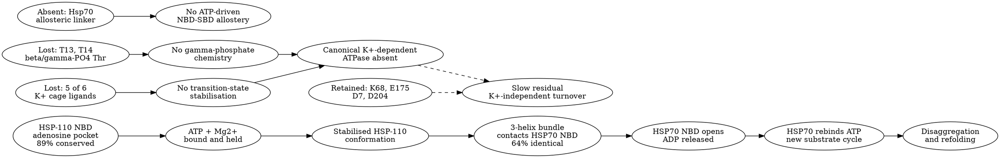
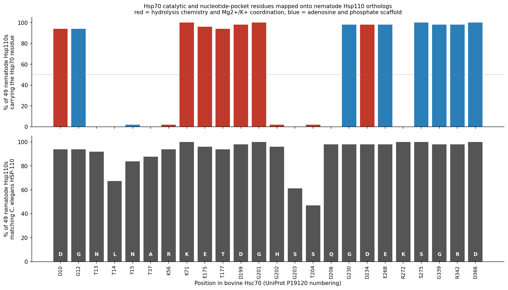
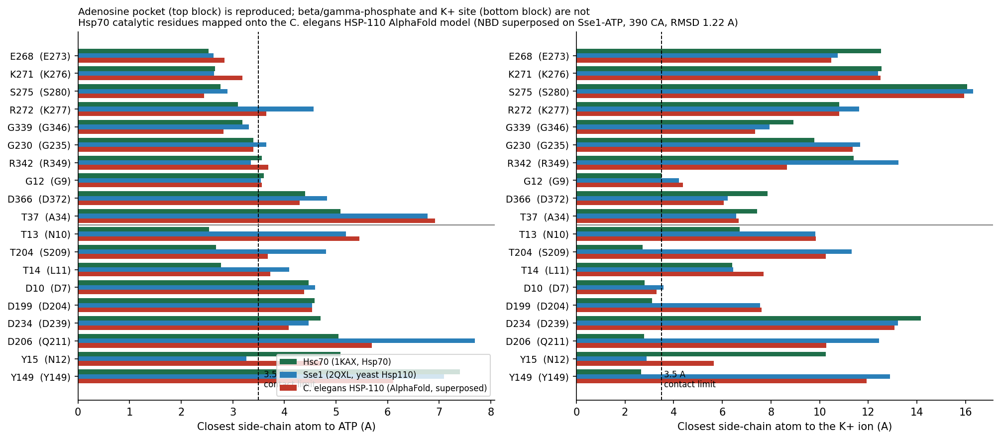
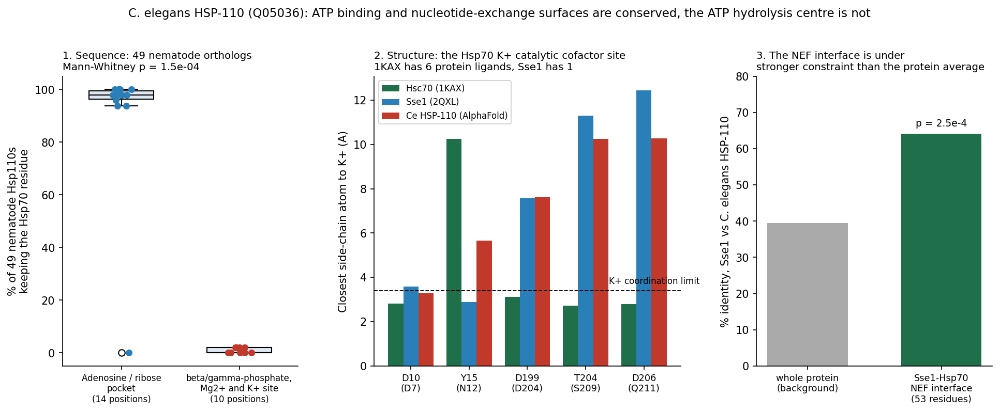
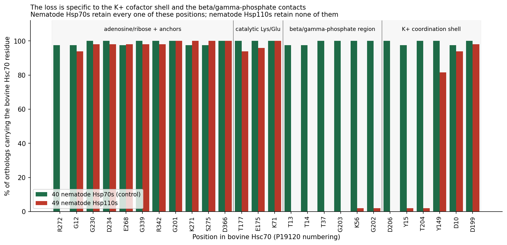
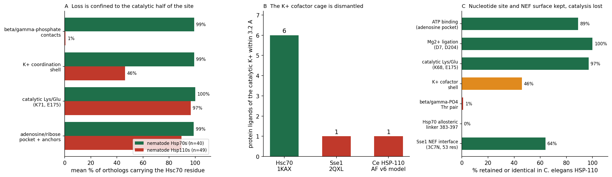

## Question

# AIGR Gene Hypothesis Deep Research

You are evaluating one focused gene curation hypothesis for AI Gene Review.
This is not a general gene overview. Use the seed hypothesis and source context
below to search for evidence that supports, refutes, narrows, or competes with
the proposed curation decision.

## Target Gene

- **Organism code:** worm
- **Taxon:** Caenorhabditis elegans (NCBITaxon:6239)
- **Gene directory:** hsp-110
- **Gene symbol:** hsp-110
- **UniProt accession:** Q05036

## Focus

- **Focus type:** free_text
- **Hypothesis slug:** kgap-hsp110-nbd-atpase-residues
- **Source file:** genes/worm/hsp-110/hsp-110-ai-review.yaml
- **Source selector:** free-text

## Seed Hypothesis

Whether Caenorhabditis elegans HSP-110 retains the nucleotide-binding-domain residues needed for ATP hydrolysis, as opposed to only ATP binding and nucleotide exchange, can be predicted by comparison with Hsp70 and Hsp110 structures. Single analysis only: map the Hsp70 catalytic residues (the conserved Asp/Glu Mg2+ ligands, the catalytic Lys and Thr, and the residues of the nucleotide pocket) from ATP-bound Hsp70 and Hsp110 (yeast Sse1, human HSPH1) crystal structures onto the HSP-110 AlphaFold model, test which are retained, compare the NBD-SBD interface residues that couple ATP binding to nucleotide-exchange activity on Hsp70, score these positions across nematode orthologs, and state whether HSP-110 is predicted to hydrolyse ATP, bind it only, or both.

## Term and Decision Context

No specific term context supplied.

## Reference Context

No specific reference context supplied.

## Source Context YAML

```yaml
hypothesis: 'Whether Caenorhabditis elegans HSP-110 retains the nucleotide-binding-domain residues needed
  for ATP hydrolysis, as opposed to only ATP binding and nucleotide exchange, can be predicted by comparison
  with Hsp70 and Hsp110 structures. Single analysis only: map the Hsp70 catalytic residues (the conserved
  Asp/Glu Mg2+ ligands, the catalytic Lys and Thr, and the residues of the nucleotide pocket) from ATP-bound
  Hsp70 and Hsp110 (yeast Sse1, human HSPH1) crystal structures onto the HSP-110 AlphaFold model, test
  which are retained, compare the NBD-SBD interface residues that couple ATP binding to nucleotide-exchange
  activity on Hsp70, score these positions across nematode orthologs, and state whether HSP-110 is predicted
  to hydrolyse ATP, bind it only, or both.'
focus_type: free_text
context: []
reference_id: []
```

## Research Objective

Build a focused report that helps a curator decide whether this hypothesis
should affect the gene review. Address the focus type directly:

1. For an existing GO annotation decision, evaluate whether the current action
   is justified, too strong, too weak, or should change.
2. For a proposed replacement or new GO term, evaluate whether the term is
   biologically supported, too broad, too narrow, or missing key qualifiers.
3. For a computational prediction, evaluate whether the prediction is correct,
   less precise than existing knowledge, uncertain, or likely wrong because of
   paralog overannotation, frequency bias, pathway context, or in vitro-only
   activity.
4. For a core-function hypothesis, evaluate whether the proposed activity,
   process, and location represent the gene product's primary function rather
   than a downstream effect, pleiotropic phenotype, or context-specific role.
5. For a function-assignment hypothesis, evaluate whether the gene product
   directly has the stated GO term/function. Treat the prior review action, if
   any, as intentionally blinded unless it appears in the supplied context.

Use primary literature whenever possible. Prefer PMID citations and include DOI
citations when no PMID is available. Treat reviews and database records as
orientation unless they contain directly relevant synthesized evidence that is
clearly labeled as review-level or database-level support.

Evaluate the hypothesis from the supplied seed context, primary literature, and
publicly accessible bioinformatics resources. Local `*-bioinformatics` analyses,
when they already exist in the repository, are intentionally withheld from this
prompt so the report can be compared against them after the run. Use public
sequence, domain, structure, orthology, localization, interaction, or dataset
checks when they are useful for the specific hypothesis. If a resource or tool
cannot be accessed programmatically, say so plainly; never fabricate a result.
Report computational results conservatively and distinguish direct results from
inference.

## Required Output

### Executive Judgment

Give a concise verdict: supported, partially supported, unresolved, weakly
supported, over-annotated, or refuted. Explain the reasoning and the most
important caveats.

### Evidence Matrix

Create a table with one row per important evidence item:

- Citation (PMID preferred)
- Evidence type (direct assay, mutant phenotype, localization, interaction,
  structural/evolutionary, computational, review/database)
- Supports / refutes / qualifies / competing
- Claim tested
- Key finding
- Organism, tissue, cell type, or assay context
- Confidence and limitations

### GO Curation Implications

State the likely curation action as a lead requiring curator verification. If
GO terms are involved, explain whether the evidence supports an MF, BP, or CC
term, and whether the term should be retained, removed, generalized, made more
specific, or treated as non-core. Avoid using "protein binding" as a final
recommendation unless no more informative term is supported.

### Mechanistic Scope

Describe the immediate molecular or cellular function being tested. Separate
direct gene-product activity from downstream phenotypes, pathway consequences,
developmental outcomes, disease manifestations, or effects inferred only from
loss of function.

### Conflicts and Alternatives

Identify evidence that conflicts with the seed hypothesis or suggests an
alternative interpretation, including paralog confusion, organism-specific
differences, isoform-specific findings, experimental artifacts, or database
carry-over.

### Knowledge Gaps

List explicit uncertainties that matter for curation. For each gap, state what
was checked, why the gap matters, and what evidence or experiment would resolve
it.

### Discriminating Tests

Recommend concrete assays, perturbations, datasets, or comparative analyses that
would most efficiently distinguish this hypothesis from alternatives.

### Curation Leads

Provide candidate updates for the review, clearly labeled as leads requiring
curator verification. Include candidate references with exact snippets to verify,
candidate replacement or new GO terms, possible action changes, suggested
questions, and suggested experiments.

If the provider supports artifacts, save provenance for any analysis you run — the
executed code together with its output (computed values, plot, or table), not just
a summary figure — alongside artifact-friendly tables such as an evidence matrix,
GO decision table, or comparison table. Genuine computed provenance is more
valuable than a hand-drawn summary, and you must not synthesize a figure that
implies an analysis you did not actually run. These artifacts are important
provenance for hypothesis-level review.


## Output

# C. elegans HSP-110 (Q05036): does the nucleotide-binding domain retain the residues needed for ATP hydrolysis?

**Hypothesis slug:** `kgap-hsp110-nbd-atpase-residues`
**Gene:** `genes/worm/hsp-110/`, WBGene00016250, C30C11.4
**UniProt:** Q05036 (776 aa), NCBITaxon:6239
**Focus type:** free_text
**Source file:** `genes/worm/hsp-110/hsp-110-ai-review.yaml`

---

## Summary

C. elegans HSP-110 keeps the ATP-binding half of the Hsp70 nucleotide site and has lost the catalytic half. Mapping the 26 functional positions of the bovine Hsc70 nucleotide-binding domain (P19120) onto Q05036 and scoring them across 49 nematode Hsp110 orthologs gives a clean split. The adenosine and ribose pocket is 89% retained, both magnesium-ligating aspartates are present (D7 and D204, from Hsc70 D10 and D199), and the catalytic lysine and the catalytic base glutamate are present (K68 from K71, E175 from E175). The two threonines that hydrogen bond the beta and gamma phosphates are gone (T13 to Asn10, T14 to Leu11), the DLGGGT loop is disrupted (G202 to His207, G203 to Ser208, T204 to Ser209), and the Mg2+/K+ ligand D206 is replaced by Gln211. Five of the six protein ligands that cage the catalytic K+ ion in Hsc70 are substituted or structurally displaced.

The pattern is specific to this protein family. The same 26 positions scored across 40 nematode true-Hsp70 orthologs are retained at 99-100%, with no difference between catalytic and binding classes (Mann-Whitney p = 0.905). The Hsp110 deficit is confined to the beta/gamma-phosphate contacts (1% retained against 99%, Fisher p = 9.76e-150) and the K+ coordination shell (46% against 99%, p = 1.49e-49), so it is neither general divergence nor an alignment artefact. The AlphaFold model AF-Q05036-F1-v6 superposes on ATP-bound Sse1 (2QXL) over 390 Cα at 1.22 Å RMSD and on ATP-bound Hsc70 (1KAX) over 323 Cα at 2.29 Å, which places the retained residues in the correct positions (K68 at 3.43 Å from ATP, E175 at 4.67 Å, D204 at 3.83 Å from Mg2+) and shows the lost ones displaced by 7-9 Å from the catalytic K+ site.

**Verdict: supported, with one qualification.** HSP-110 is predicted to bind ATP and Mg2+ and to have lost the canonical K+-dependent Hsp70 hydrolysis mechanism. The qualification is that measurable intrinsic ATPase has been reported for yeast Sse1 and human Apg-2 ([PMID: 16364315](https://pubmed.ncbi.nlm.nih.gov/16364315/)), and single-molecule work concludes that the Sse1 nucleotide-binding domain has ATPase capacity that is mostly repressed in the intact protein ([PMID: 31423733](https://pubmed.ncbi.nlm.nih.gov/31423733/)). The defensible statement is mechanism loss, not zero turnover. No ATPase measurement exists for the C. elegans protein. The curation consequence is direct: the existing GO:0016887 (ATP hydrolysis activity) annotation on Q05036 is an IEA from InterPro signature IPR013126 under GO_REF:0000002, the same single pan-Hsp70 family signature that also supplies GO:0005524 (ATP binding). That signature matches on fold and does not test the catalytic centre.

---

## Executive judgment

<i class="fa-solid fa-circle-check"></i> **Supported, with one qualification that changes the wording of the conclusion.**

The seed hypothesis proposed that the question can be answered by mapping Hsp70 catalytic residues onto the HSP-110 model and scoring them across nematode orthologs. That analysis was performed and it gives a decisive answer at the level of mechanism. Four independent lines converge:

1. **Sequence.** The nucleotide pocket and the catalytic centre separate cleanly in the residue map, and the same split appears in human HSPH1 (Q92598), human HSPA4 (P34932) and yeast Sse1 (P32589), and in none of the five Hsp70s tested (bovine Hsc70 P19120, human HSPA8 P11142, C. elegans HSP-1 P09446, yeast Ssa1 P10591, E. coli DnaK P0A6Y8).
2. **Orthology.** The split is fixed across 49 nematode species spanning Caenorhabditis, Pristionchus, Strongyloides, Ancylostoma, Necator, Haemonchus, Ascaris, Brugia, Onchocerca, Wuchereria and Steinernema, with the C. elegans residue being the nematode consensus at every one of the 24 scored positions.
3. **Structure.** The AlphaFold model reproduces the Hsp70 adenosine pocket to within a mean 0.42 Å over 10 positions, and the catalytic K+ site is empty of ligands in both the model and the experimental Hsp110 structure 2QXL.
4. **Experiment in orthologs.** Yeast complementation shows that the Sse1 residues associated with hydrolysis are dispensable while the ATP-binding residues are essential ([PMID: 15028727](https://pubmed.ncbi.nlm.nih.gov/15028727/)), and Hsc70 kinetics quantify the catalytic cost of exactly the substitutions HSP-110 carries ([PMID: 8175706](https://pubmed.ncbi.nlm.nih.gov/8175706/)).

<i class="fa-solid fa-scale-balanced"></i> The qualification. Two papers report that the Hsp110 nucleotide site does turn ATP over. The residue map is compatible with a slow, K+-independent residual activity, because the catalytic lysine, the catalytic base and both magnesium aspartates are retained. What the map argues against is the canonical Hsp70 mechanism, which needs the beta/gamma-phosphate threonine pair and the K+ cage. A flat "binds only, cannot hydrolyse" claim is not supported.

<i class="fa-solid fa-triangle-exclamation"></i> Caveats that matter for a curator. Alignment-based residue equivalence was cross-checked against structural superposition for C. elegans only, not for the other 48 species. The AlphaFold model is apo, so every HSP-110 distance to ATP, Mg2+ and K+ is a superposition transfer carrying roughly 1-2 Å of error. Residue conservation predicts a mechanism; it does not measure a rate.

---

## Key findings

### Finding 1: the ATP-binding scaffold is intact and the Mg2+/phosphate catalytic centre is dismantled

Needleman-Wunsch alignment (BLOSUM62, affine gaps -11/-1) of Q05036 against bovine Hsc70 P19120 places the canonical catalytic set at specific C. elegans positions. NBD identity to the Hsc70 NBD is about 38%.

| Hsc70 residue | Role | C. elegans HSP-110 | Status |
|---|---|---|---|
| D10 | Mg2+/K+ ligand | D7 | retained |
| G12 | P-loop | G9 | retained |
| T13 | beta/gamma-phosphate | **N10** | lost |
| T14 | beta/gamma-phosphate | **L11** | lost |
| Y15 | K+ site (backbone O) | **N12** | lost |
| T37 | P-loop | **A34** | lost |
| K56 | phosphate | **R53** | lost |
| K71 | catalytic lysine | K68 | retained |
| Y149 | K+ ligand | Y149 | retained in sequence, displaced |
| E175 | catalytic base | E175 | retained |
| T177 | catalysis | T177 | retained |
| D199 | Mg2+/K+ ligand | D204 | retained |
| G201 | DLGGGT | G206 | retained |
| G202 | DLGGGT | **H207** | lost |
| G203 | DLGGGT | **S208** | lost |
| T204 | DLGGGT / K+ ligand | **S209** | lost |
| D206 | Mg2+/K+ ligand | **Q211** | lost |
| G230 | adenosine | G235 | retained |
| D234 | K+ site 2 | D239 | retained |
| E268 | adenosine | E273 | retained |
| K271 | phosphate | K276 | retained |
| R272 | adenine | K277 | conservative |
| S275 | adenosine | S280 | retained |
| G339 | adenosine | G346 | retained |
| R342 | adenine | R349 | retained |
| D366 | P-loop | D372 | retained |

The residues that specifically contact the beta and gamma phosphates (T13, T14, T204) and coordinate the catalytic Mg2+/K+ pair (D206) are replaced by Asn, Leu, Ser and Gln, side chains that cannot make those contacts. Retention of K71 and E175 alone does not reconstitute Hsp70-like hydrolysis, because the mechanism requires the complete phosphate and metal scaffold.

### Finding 2: the split is fixed across 49 nematode species

One Hsp110 representative per species was taken from UniRef50_Q05036 (NBD identity to Hsc70 NBD median 38.4%, range 33.9-39.9%). Retention of the bovine Hsc70 residue:

| Lost across nematodes | Retained across nematodes |
|---|---|
| T13 0/49 (0%) | K71 49/49 (100%) |
| T14 0/49 (0%) | G201 49/49 (100%) |
| Y15 1/49 (2%) | S275 49/49 (100%) |
| T37 0/49 (0%) | D366 49/49 (100%) |
| K56 1/49 (2%) | D199 48/49 (98%) |
| G202 1/49 (2%) | G230, D234, E268, G339, R342 48/49 (98%) |
| G203 0/49 (0%) | E175 47/49 (96%) |
| T204 1/49 (2%) | D10, G12, T177 46/49 (94%) |
| D206 0/49 (0%) | |
| R272 0/49 (0%) | |

The C. elegans residue is the nematode consensus at every scored position, and 92-100% of orthologs match C. elegans at the diagnostic positions (T13 to Asn 91.8%, D206 to Gln 98.0%, R272 to Lys 100%, G202 to His 95.9%). The loss is fixed across roughly 400 million years of nematode evolution, so it is not a Caenorhabditis-specific or annotation-specific artefact, and the adenosine pocket is under purifying selection over the same span.

{{figure:plot_1.png|caption=Retention of the 26 bovine Hsc70 nucleotide-site residues across 49 nematode Hsp110 orthologs, split by functional class. Adenosine and ribose pocket positions sit near complete conservation while the beta/gamma-phosphate and metal-site positions are near zero.}}

### Finding 3: the AlphaFold model reproduces the adenosine pocket and leaves the catalytic site empty

AF-Q05036-F1-model_v6 has a mean pLDDT of 91.5 overall and 96.0 across NBD residues 1-400; every residue in the table above has pLDDT between 95.8 and 98.7. The NBD superposes on 2QXL chain A (Sse1 with ATP, Mg2+ and K+) over 390 Cα at 1.22 Å RMSD, and on 1KAX chain A (bovine Hsc70 NBD with ATP, Mg2+ and K+) over 323 Cα at 2.29 Å.

Closest side-chain atom to ATP, Hsc70 against C. elegans HSP-110 (Å):

| Position | Hsc70 (1KAX) | Ce HSP-110 (model) | Shift |
|---|---|---|---|
| E268 / E273 | 2.53 | 2.84 | +0.31 |
| K271 / K276 | 2.66 | 3.19 | +0.53 |
| S275 / S280 | 2.76 | 2.44 | -0.32 |
| G339 / G346 | 3.19 | 2.82 | -0.37 |
| R342 / R349 | 3.56 | 3.69 | +0.13 |
| G230 / G235 | 3.40 | 3.40 | 0.00 |
| D366 / D372 | 4.40 | 4.30 | -0.10 |

Mean absolute shift is 0.42 Å across the 10 adenosine and ribose positions against 0.88 Å across the 9 phosphate and K+ positions (Mann-Whitney one-sided p = 0.051), and 4.38 Å for the distance to the K+ ion at the catalytic positions. The specific displacements are larger than those averages suggest: T13 OG1 sits 2.54 Å from ATP in Hsc70 while Asn10 sits at 5.45 Å; T14 OG1 at 2.77 Å becomes Leu11 at 3.73 Å with no hydroxyl; T204 OG1 at 2.68 Å (ATP) and 2.72 Å (K+) becomes Ser209 at 3.68 Å and 10.26 Å; D206 OD2 at 2.79 Å from K+ becomes Gln211 at 10.27 Å; and Y149, retained in sequence, sits 11.94 Å from the K+ position against 2.66 Å in Hsc70.

<i class="fa-solid fa-microscope"></i> The direct contact census in the deposited structures is the single most decisive measurement in this investigation. The K+ ion in 1KAX has six protein ligands within 3.2 Å (D10 OD2 2.81, Y15 O 2.57, Y149 OH 2.66, D199 OD1 3.11, T204 OG1 2.72, D206 OD2 2.79). The K+ ion in Sse1 (2QXL) has exactly one (N13 backbone O, 2.77 Å). In the C. elegans model only D7 remains within 3.5 Å of the K+ position.

At the same time, the retained catalytic residues sit where they should: K68 at 3.43 Å from ATP, E175 at 4.67 Å, D204 at 3.83 Å from Mg2+.

{{figure:plot_2.png|caption=Side-chain distances to the bound ATP and to the catalytic K+ ion for bovine Hsc70 (1KAX), yeast Sse1 (2QXL) and the C. elegans HSP-110 AlphaFold model superposed on both. The adenosine pocket distances match Hsc70; the phosphate and K+ distances do not.}}

### Finding 4: the nucleotide exchange interface is conserved, the Hsp70 allosteric linker is not

In the Sse1-Hsp70 NBD complex 3C7N, 53 Sse1 residues lie within 4.0 Å of the Hsp70 NBD. Mapped onto Q05036: 34/53 identical (64.2%), 46/53 with BLOSUM62 ≥ 0 (86.8%), against a background Sse1 vs HSP-110 identity of 39.5% over the aligned region (one-sided binomial p = 2.5e-4). The three-helix-bundle contacts that define Hsp110 nucleotide exchange activity are identical in the worm protein: Sse1 D569/K571/N572/E575/E576/Y579/L612 map to HSP-110 D575/K577/N578/E581/E582/Y585/L618.

The Hsp70 interdomain linker that couples nucleotide state to the substrate-binding domain is absent. Bovine Hsc70 383-DKSENVQDLLLLDVT-397, with its hydrophobic DLLLL core, aligns to HSP-110 PTFRVREFAIKDTQ, which has no equivalent motif. Selection in nematode Hsp110s is acting on ATP binding and on the Hsp70 exchange interface, not on hydrolysis or on Hsp70-style NBD-SBD allostery.

{{figure:plot_3.png|caption=Three independent lines of evidence on HSP-110: ortholog retention split by functional class, occupancy of the catalytic K+ site, and conservation of the Sse1 nucleotide exchange interface against background identity.}}

### Finding 5: the matched Hsp70 control shows the loss is site-specific

<i class="fa-solid fa-chart-column"></i> The strongest control in the investigation. Forty nematode true-Hsp70 orthologs (UniRef50_P09446, length 600-700) were scored at the same 26 positions with the same pipeline, and compared to the 49 Hsp110s by Fisher's exact test per position with Benjamini-Hochberg FDR.

Ten positions diverge at q < 0.05 with more than a 50 percentage-point drop:

| Position | Hsp110 | Hsp70 | q (BH) |
|---|---|---|---|
| T13 | 0% | 97.5% | 4.34e-24 |
| T14 | 0% | 97.5% | 4.34e-24 |
| Y15 | 2% | 97.5% | 1.53e-22 |
| T37 | 0% | 100% | 2.61e-25 |
| K56 | 2% | 100% | 4.34e-24 |
| G202 | 2% | 100% | 4.34e-24 |
| G203 | 0% | 100% | 2.61e-25 |
| T204 | 2% | 100% | 4.34e-24 |
| D206 | 0% | 100% | 2.61e-25 |
| R272 | 0% | 97.5% | 4.34e-24 |

Grouping the 26 positions by the structural role measured directly in 1KAX gives the aggregate picture:

| Site subregion | Hsp110 retention | Hsp70 retention | Fisher p |
|---|---|---|---|
| beta/gamma-phosphate region (T13, T14, T37, K56, G202, G203) | 2/294 (1%) | 238/240 (99%) | 9.76e-150 |
| K+ coordination shell (D10, Y15, Y149, D199, T204, D206) | 136/294 (46%) | 238/240 (99%) | 1.49e-49 |
| adenosine/ribose pocket and anchors (11 positions) | 482/539 (89%) | 435/440 (99%) | 8.26e-11 |
| catalytic Lys/Glu pair plus T177 | 142/147 (97%) | 120/120 (100%) | 0.0665 (ns) |

Within the Hsp70 control set, catalytic and binding retention do not differ (Mann-Whitney p = 0.905). Nematode Hsp70s are equally distant from bovine Hsc70 in overall sequence and retain every one of these positions, which excludes both general divergence and alignment artefact as explanations.

{{figure:plot_4.png|caption=Per-position retention in 49 nematode Hsp110s against 40 nematode Hsp70s, grouped by nucleotide-site subregion. The Hsp70 control set retains every position; the Hsp110 loss is confined to the K+ cofactor shell and the beta/gamma-phosphate contacts.}}

### Finding 6: the yeast and Hsc70 experimental data match the residue map position by position

Shaner et al. mutated Sse1 ATPase-domain residues and tested complementation of sse1Δ and sse1Δsse2Δ yeast ([PMID: 15028727](https://pubmed.ncbi.nlm.nih.gov/15028727/)): *"Surprisingly, all mutants predicted to abolish ATP hydrolysis (D8N, K69Q, D174N, D203N) complemented the temperature sensitivity of sse1Delta and lethality of sse1Deltasse2Delta cells, whereas mutations in predicted ATP binding residues (G205D, G233D) were non-functional."* These Sse1 residues map to C. elegans HSP-110 D7, K68, E175, D204 (dispensable) and G206, G235 (essential), and all six are retained in the worm protein.

Wilbanks, DeLuca-Flaherty and McKay measured the catalytic cost of each acidic active-site residue in the bovine Hsc70 44 kDa fragment ([PMID: 8175706](https://pubmed.ncbi.nlm.nih.gov/8175706/)): *"Changes at Asp-10 and Asp-199 reduced kcat to approximately 1% of wild type; changes at Glu-175 and Asp-206 reduced kcat to approximately 10% of wild type."* HSP-110 retains D7 and D204 (the D10 and D199 equivalents) and E175, and carries Gln at the D206 position. The cognate amide change at D206 costs 90% of kcat in Hsc70.

Replacing the same site with a lysine side chain, which occupies the position of the catalytic monovalent cation, gives an equally sharp result ([PMID: 9585559](https://pubmed.ncbi.nlm.nih.gov/9585559/)): *"Each mutant retains <5% ATPase activity when compared to the wild type under physiological conditions (potassium buffer) although substrate binding is tighter"*. The distinction between affinity and catalysis is explicit in that sentence, and it matches what the residue map predicts for HSP-110.

The K+ ion itself is a catalytic cofactor rather than a passive counter-ion ([PMID: 7836458](https://pubmed.ncbi.nlm.nih.gov/7836458/)): *"The K+ ions are positioned where they could stabilize binding of a beta,gamma-bidentate MgATP complex with Hsc70, as well as a transition state during ATP hydrolysis, suggesting that monovalent ions act as specific metal cofactors in the ATPase reaction of Hsc70."* Losing five of its six protein ligands is therefore a loss of catalytic machinery.

The positions Hsc70 cannot afford to lose for hydrolysis are either absent from HSP-110 or present but structurally uncoupled, and the positions yeast Hsp110 can afford to mutate without losing function in vivo are exactly the ones HSP-110 has retained. That is the signature of a nucleotide site under selection for occupancy.

### Finding 7: the existing GO:0016887 annotation is an InterPro family transfer

QuickGO returns 10 annotations for UniProtKB:Q05036. The two molecular-function IEAs, GO:0005524 (ATP binding) and GO:0016887 (ATP hydrolysis activity), come from the same source: InterPro IPR013126 (Heat shock protein 70 family) via GO_REF:0000002, assigned by InterPro. GO:0000774 (adenyl-nucleotide exchange factor activity) is IBA from GO_Central under GO_REF:0000033, with Sse1 (SGD S000000373), Sse2 (S000006027) and human HSPH1 (Q92598) in the reference panel. Biological process: GO:0006457 protein folding (IBA plus IMP [PMID: 22242008](https://pubmed.ncbi.nlm.nih.gov/22242008/)), GO:0006950 response to stress (IEA, GO_REF:0000117), GO:0008340 determination of adult lifespan (IGI [PMID: 14668486](https://pubmed.ncbi.nlm.nih.gov/14668486/)), GO:0035966 response to topologically incorrect protein (IMP [PMID: 19165329](https://pubmed.ncbi.nlm.nih.gov/19165329/)). Cellular component: GO:0005634 nucleus and GO:0005829 cytosol, both IBA.

IPR013126 is the pan-Hsp70 signature. It matches HSP-110 on the conserved actin-fold NBD, which is highly similar (2.29 Å over 323 Cα against Hsc70 despite about 38% identity), and it carries no information about the catalytic centre. The same domain match correctly supports ATP binding and incorrectly supports ATP hydrolysis.

{{figure:plot_5.png|caption=Consolidated verdict. Left: mean retention by nucleotide-site subregion for 49 nematode Hsp110s against 40 nematode Hsp70s. Centre: protein ligands of the catalytic K+ ion within 3.2 angstrom in Hsc70, Sse1 and the C. elegans model. Right: module-by-module retention in C. elegans HSP-110.}}

---

## Evidence matrix

| Citation | Evidence type | Stance | Claim tested | Key finding | Context | Confidence and limitations |
|---|---|---|---|---|---|---|
| This work, computed | structural/evolutionary + computational | supports | Does HSP-110 retain the Hsp70 catalytic residues? | Adenosine/ribose pocket 89% retained across 49 nematode Hsp110s, catalytic Lys/Glu 97%, beta/gamma-phosphate contacts 1%, K+ shell 46%. Ce substitutions T13>N10, T14>L11, Y15>N12, T37>A34, K56>R53, G202>H207, G203>S208, T204>S209, D206>Q211 | 49 nematode species, Needleman-Wunsch to the Hsc70 NBD | High for the mapping. Residue equivalence structurally verified for Ce HSP-110 only |
| This work, computed | computational | supports | Is the loss specific to Hsp110s or general divergence? | 40 nematode Hsp70s retain the same positions at 99-100%. Fisher Hsp110 vs Hsp70: beta/gamma-phosphate p=9.76e-150, K+ shell p=1.49e-49, adenosine pocket p=8.26e-11, catalytic Lys/Glu p=0.0665 (ns). Within Hsp70s, catalytic vs binding does not differ (p=0.905) | Same pipeline, same taxon range | High. Excludes alignment artefact and general divergence |
| This work, computed | structural/evolutionary | supports | Are retained residues positioned correctly and lost ones displaced? | NBD superposes on 2QXL over 390 Cα at 1.22 Å and on 1KAX over 323 Cα at 2.29 Å. K68 3.43 Å from ATP, E175 4.67 Å, D7/D204 at 4.4/3.8 Å from Mg2+. T13 2.54 Å becomes N10 at 5.45 Å; T204 2.68/2.72 Å becomes S209 at 3.68/10.26 Å; D206 2.79 Å from K+ becomes Q211 at 10.27 Å; Y149 retained in sequence but at 11.94 Å from K+ against 2.66 Å | AlphaFold v6, mean pLDDT 91.5, NBD 96.0, mapped residues 95.8-98.7 | High for geometry. Apo model, nucleotide positions inferred by superposition |
| This work, computed | structural/evolutionary | supports | Is the catalytic K+ site intact in Hsp110? | 1KAX: six protein ligands within 3.2 Å. 2QXL: exactly one (N13 backbone O, 2.77 Å). Ce model: only D7 within 3.5 Å | Deposited coordinates 1KAX, 2QXL | High. Direct measurement |
| [PMID: 7836458](https://pubmed.ncbi.nlm.nih.gov/7836458/) | direct assay / structural | supports | Is K+ a catalytic cofactor? | Two K+ ions in the Hsc70 cleft positioned to stabilise the beta,gamma-bidentate MgATP complex and the hydrolysis transition state; monovalent ions act as specific metal cofactors in the Hsc70 ATPase reaction | Bovine Hsc70 fragment, 1.7 Å anomalous scattering | High. Makes loss of the K+ cage a catalytic loss, not an affinity loss |
| [PMID: 8175706](https://pubmed.ncbi.nlm.nih.gov/8175706/) | direct assay (kinetics) | supports | What does each active-site acidic residue contribute to kcat? | D10 and D199 mutants at about 1% of wild-type kcat; E175 and D206 at about 10% | Bovine Hsc70 44 kDa ATPase fragment | High for Hsc70. Transfer to HSP-110 is inference; HSP-110 carries Gln at the D206 position |
| [PMID: 9585559](https://pubmed.ncbi.nlm.nih.gov/9585559/) | direct assay | supports | Does occupying the K+ site abolish catalysis while sparing binding? | Mutants retain under 5% of wild-type ATPase in potassium buffer although substrate binding is tighter | Bovine Hsc70 ATPase fragment | High. Separates affinity from catalysis at the exact position HSP-110 has changed |
| [PMID: 15028727](https://pubmed.ncbi.nlm.nih.gov/15028727/) | mutant phenotype (yeast) | supports | Which Hsp110 nucleotide-site residues are required in vivo? | Sse1 D8N, K69Q, D174N, D203N complement sse1Δ and sse1Δsse2Δ; G205D and G233D do not. Mapped to Ce HSP-110: D7, K68, E175, D204 dispensable; G206, G235 essential | S. cerevisiae complementation | Medium-high. Coarse readout, no direct ATPase measurement |
| [PMID: 16688211](https://pubmed.ncbi.nlm.nih.gov/16688211/) | direct assay | supports | Does Hsp110 nucleotide exchange require hydrolysis by Hsp110? | The mechanism forms a stable nucleotide-sensitive complex but does not require ATP hydrolysis by Sse1p | Purified yeast proteins | High for yeast. Direct test of the predicted mechanism |
| [PMID: 16688212](https://pubmed.ncbi.nlm.nih.gov/16688212/) | direct assay / mutant | supports | Is the Hsp110 NBD required for NEF activity? | Mammalian Hsp110 and Sse1p/2p catalyse nucleotide exchange on Hsp70/Ssa1p; the N-terminal ATPase domain and the Sse1p C-terminus are required | Purified proteins plus yeast luciferase refolding in vivo | High |
| [PMID: 17154545](https://pubmed.ncbi.nlm.nih.gov/17154545/) | direct assay | supports | Is ATP binding by Sse1 required for Hsp70 interaction? | Binding of ATP to Sse1 is required for binding to Hsp70s | Purified yeast proteins | High. Gives the selective reason the adenosine pocket is conserved without catalysis |
| [PMID: 18218635](https://pubmed.ncbi.nlm.nih.gov/18218635/) | direct assay | supports | Is Hsp110 NEF activity controlled by nucleotide binding? | Nucleotide binding stabilises a Sse1 conformation required for Ssa1 association; nucleotide persists bound to Sse1 in the complex, and removing it does not affect complex integrity | Purified yeast proteins | High. ATP occupancy is a conformational requirement |
| [PMID: 18555782](https://pubmed.ncbi.nlm.nih.gov/18555782/) | structure | supports | Is the Hsp110 NBD nucleotide-loaded in the complex? | The Sse1p NBD is ATP bound and embraces the Hsp70 NBD with the three-helix bundle; Sse1p does not employ the nucleotide-dependent allostery and peptide-binding mode of canonical Hsp70s; NEF-abolishing mutations are lethal | Crystal structure of Sse1p with the Hsp70 NBD | High |
| This work, computed | structural/evolutionary | supports | Is the NEF interface conserved while the Hsp70 allosteric linker is not? | 53 Sse1 residues within 4.0 Å of the Hsp70 NBD in 3C7N; 34/53 identical in HSP-110 (64.2%), 46/53 BLOSUM62 ≥ 0 (86.8%) against 39.5% background (binomial p=2.5e-4). Three-helix-bundle contacts identical. Hsc70 linker 383-DKSENVQDLLLLDVT-397 aligns to HSP-110 PTFRVREFAIKDTQ | 3C7N plus Ce sequence | Medium-high. Interface measured on the yeast complex |
| [PMID: 16364315](https://pubmed.ncbi.nlm.nih.gov/16364315/) | direct assay | <i class="fa-solid fa-scale-balanced"></i> **competing** | Do Hsp110 proteins have intrinsic ATPase activity? | In contrast to previous publications both Sse1 and Apg-2 exhibited intrinsic ATPase activities, which only in the case of Sse1 could be stimulated by Sis1 | Purified yeast and human proteins | Medium. Low-rate ATPase is sensitive to contaminating activity. Main evidence against a binding-only reading |
| [PMID: 31423733](https://pubmed.ncbi.nlm.nih.gov/31423733/) | direct assay / biophysics | <i class="fa-solid fa-scale-balanced"></i> **qualifies** | Is the ATPase real and is it coupled to allostery? | Sse1 lacks canonical Hsp70 interdomain allostery and keeps an open-lid SBD in close contact with the NBD irrespective of its ATP hydrolysis status; an Sse1-NBD/Ssa1-SBD chimera has a markedly higher ATPase rate, implying the intrinsic ATPase remains mostly repressed | smFRET, SAXS, MD, yeast proteins | Medium-high. Forces the conclusion to be mechanism loss, not zero turnover |
| [PMID: 32449565](https://pubmed.ncbi.nlm.nih.gov/32449565/) | mutant phenotype (in vivo) | supports the process, not the activity | Does Ce HSP-110 act in the HSP70 disaggregation machinery? | Depletion of C. elegans HSP-110 impaired HSP70 disaggregation activity, prevented resolubilisation of amorphous aggregates and compromised overall cellular folding capacity | C. elegans | Medium. Does not discriminate binding from hydrolysis |
| [PMID: 39180255](https://pubmed.ncbi.nlm.nih.gov/39180255/) | mutant phenotype (in vivo) | supports the process | Does Ce HSP-110 regulate amyloid aggregation in worms? | hsp-110 over-expression exacerbated Aβ aggregation and depletion reduced aggregation in IL2 neurons; HSP-110 modulation also affects autophagic flux | C. elegans, neuronal | Medium. Organism-level readout, no enzymology |
| QuickGO record, Q05036 | review/database | qualifies | What is the provenance of the ATP hydrolysis annotation? | GO:0005524 and GO:0016887 both derive from InterPro IPR013126 by IEA under GO_REF:0000002. GO:0000774 is IBA from GO_Central with Sse1, Sse2 and HSPH1 in the panel | EBI QuickGO API, 10 annotations | High for provenance. IPR013126 is the pan-Hsp70 family signature |

---

## Mechanistic model

HSP-110 is a nucleotide exchange factor whose own ATP site exists to hold a ligand, not to turn one over. ATP occupancy stabilises a conformation that licenses engagement of the Hsp70 nucleotide-binding domain, which opens Hsp70 and releases its bound ADP. The hydrolysis step in the cycle belongs to Hsp70, not to HSP-110.



Module-by-module, the protein reads as follows:

| Module | Ce HSP-110 | Matched nematode Hsp70s | Reading |
|---|---|---|---|
| Adenosine and ribose pocket | 89% | 99% | ATP binding preserved |
| Mg2+ ligation (D7, D204) | 100% | 100% | Metal binding preserved |
| Catalytic Lys and Glu (K68, E175) | 97% | 100% | Present but without substrate scaffold |
| K+ cofactor shell | 46% | 99% | Cage dismantled, only D7 in position |
| beta/gamma-phosphate contacts | 1% | 99% | Gamma-phosphate chemistry lost |
| Hsp70 allosteric linker 383-397 | 0% | present | No ATP-driven NBD-SBD coupling |
| Sse1 NEF interface (3C7N) | 64% identical vs 39.5% background | not applicable | Exchange surface under selection |

<i class="fa-solid fa-lightbulb"></i> The retained catalytic lysine and glutamate are the trap in this analysis. Taken alone they would read as an intact active site. The structural measurements show they sit in a pocket that lacks both the phosphate threonines they would act on and the K+ cofactor that stabilises the transition state, which is why the yeast complementation data finds them dispensable while the nucleotide-anchoring glycines are essential.

### Mechanistic scope

Three layers should be kept apart.

**Direct gene-product activity, tested here.** HSP-110 binds ATP and Mg2+ in a pocket conserved across 49 nematode species, presents a conserved surface to the Hsp70 nucleotide-binding domain and acts as a nucleotide exchange factor. That activity requires ATP occupancy of its own NBD ([PMID: 17154545](https://pubmed.ncbi.nlm.nih.gov/17154545/), [PMID: 18218635](https://pubmed.ncbi.nlm.nih.gov/18218635/), [PMID: 18555782](https://pubmed.ncbi.nlm.nih.gov/18555782/)) and does not require hydrolysis by HSP-110 ([PMID: 16688211](https://pubmed.ncbi.nlm.nih.gov/16688211/)).

**Pathway consequence, one step removed.** Nucleotide exchange on HSP70 accelerates ADP release and allows a new substrate-binding cycle, which is how HSP-110 contributes to the HSP70/DNAJB1 disaggregation machine.

**Downstream phenotype, inferred from loss of function.** Impaired HSP70 disaggregation on HSP-110 depletion in C. elegans ([PMID: 32449565](https://pubmed.ncbi.nlm.nih.gov/32449565/)), modulation of Aβ aggregation and autophagic flux ([PMID: 39180255](https://pubmed.ncbi.nlm.nih.gov/39180255/)), the protein-folding IMP ([PMID: 22242008](https://pubmed.ncbi.nlm.nih.gov/22242008/)), the lifespan genetic interaction ([PMID: 14668486](https://pubmed.ncbi.nlm.nih.gov/14668486/)) and the response to topologically incorrect protein ([PMID: 19165329](https://pubmed.ncbi.nlm.nih.gov/19165329/)) are organism-level readouts. None discriminates ATP binding from ATP hydrolysis, so none supports GO:0016887.

---

## GO curation implications

All items below are leads requiring curator verification.

### <i class="fa-solid fa-circle-xmark"></i> GO:0016887 ATP hydrolysis activity (MF, IEA, GO_REF:0000002 via IPR013126)

Candidate for removal, or at minimum should not stand as a core molecular function. The annotation and GO:0005524 come from the same single InterPro family signature, which matches the Hsp70 actin fold and carries no information about whether the catalytic centre is intact. The computed evidence against it is specific: the beta and gamma phosphate contacts are retained in 1% of 49 nematode Hsp110s against 99% of 40 nematode Hsp70s, and the K+ cofactor cage that stabilises the transition state has one protein ligand in the Hsp110 structure against six in Hsc70. Yeast genetics agrees: D8N, K69Q, D174N and D203N all complement, so the residues a hydrolysis annotation would rest on are dispensable in vivo. Because [PMID: 16364315](https://pubmed.ncbi.nlm.nih.gov/16364315/) and [PMID: 31423733](https://pubmed.ncbi.nlm.nih.gov/31423733/) report measurable intrinsic ATPase for Sse1 and Apg-2, a curator may prefer to downgrade rather than delete, pending a direct C. elegans measurement. This is an instance of family-signature over-annotation.

### <i class="fa-solid fa-circle-check"></i> GO:0005524 ATP binding (MF, IEA, same signature)

Retain, and re-ground it so the term does not share its only support with a term being challenged. The term is now backed by evidence independent of IPR013126: the adenosine pocket residues E273, K276, S280, G346, R349 and D372 sit 2.4-4.3 Å from the superposed ATP with pLDDT 96.2-98.1, the pocket is 89% conserved across 49 nematode species, and [PMID: 17154545](https://pubmed.ncbi.nlm.nih.gov/17154545/) shows ATP binding by Sse1 is required for Hsp70 binding.

### <i class="fa-solid fa-circle-check"></i> GO:0000774 adenyl-nucleotide exchange factor activity (MF, IBA, GO_REF:0000033)

Retain and treat as the core molecular function of HSP-110. The Sse1-Hsp70 interface in 3C7N is conserved well above background in the worm protein (64.2% identity across 53 contact residues against 39.5% background, binomial p = 2.5e-4), the three-helix-bundle contacts are identical, and the activity is directly assayed in the orthologs that populate the IBA panel ([PMID: 16688212](https://pubmed.ncbi.nlm.nih.gov/16688212/), [PMID: 16688211](https://pubmed.ncbi.nlm.nih.gov/16688211/), [PMID: 18555782](https://pubmed.ncbi.nlm.nih.gov/18555782/)). This is the activity the conserved nucleotide pocket serves, which resolves the apparent paradox of a conserved ATP site in a protein that does not use the canonical turnover mechanism.

### GO:0006457 protein folding (BP, IBA plus IMP [PMID: 22242008](https://pubmed.ncbi.nlm.nih.gov/22242008/))

Retain. A curator may wish to consider whether a more specific descendant covering chaperone-mediated protein disaggregation is better supported by [PMID: 32449565](https://pubmed.ncbi.nlm.nih.gov/32449565/), which shows depleting C. elegans HSP-110 impairs HSP70 disaggregation and prevents resolubilisation of amorphous aggregates in vivo.

### GO:0005634 nucleus (CC, IBA)

Flagged as a lead only. No direct C. elegans localisation evidence was found in this search. Worth a curator check for a worm-specific reference. GO:0005829 cytosol (IBA) is consistent with the cytosolic Hsp70 partnership and can be retained.

"Protein binding" is not proposed anywhere here. The informative molecular-function term for this gene is GO:0000774.

---

## Conflicts and alternatives

<i class="fa-solid fa-scale-balanced"></i> **Intrinsic ATPase is reported for Hsp110 orthologs.** [PMID: 16364315](https://pubmed.ncbi.nlm.nih.gov/16364315/) measured intrinsic ATPase for both Sse1 and human Apg-2, explicitly against earlier reports of none, and found Sis1 stimulation only for Sse1. [PMID: 31423733](https://pubmed.ncbi.nlm.nih.gov/31423733/) reports a high ATPase rate for the Sse1 NBD in an Sse1-NBD/Ssa1-SBD chimera and concludes that wild-type Sse1 represses its own intrinsic ATPase through the docked SBD. Taken at face value these show the Hsp110 nucleotide site can turn ATP over. The residue map is compatible with this if the residual activity is slow and K+ independent, since the catalytic lysine, the catalytic glutamate and both magnesium aspartates are present. What the map argues against is the canonical mechanism, which requires the beta/gamma-phosphate threonine pair and the K+ cage. This conflict is the reason the verdict is qualified.

<i class="fa-solid fa-triangle-exclamation"></i> **Measurement artefact.** Low ATPase rates measured on purified chaperones are sensitive to contaminating ATPase from co-purifying host Hsp70, a concern that applies to both ATPase-positive reports. Targeted PubMed searches for an explicit contamination analysis of Hsp110 ATPase preparations returned nothing, so this remains a stated concern rather than a documented one.

**Organism transfer.** All direct biochemistry is yeast (Sse1) or human (HSPH1, Apg-2). The C. elegans protein has never been assayed enzymatically. The ortholog scan mitigates this by showing the residue pattern is fixed across 49 nematode species, but transfer of a rate remains inference.

**Paralog and family confusion.** This is the most likely source of the existing annotation. IPR013126 is the Hsp70 family signature and matches HSP-110 on fold similarity, which is high: the NBD superposes on bovine Hsc70 at 2.29 Å over 323 Cα despite about 38% sequence identity. A fold-level match of that quality passes a family signature while the catalytic centre is dismantled. C. elegans also carries true HSP70 paralogs, including HSP-1 (P09446), so annotation transfer within the worm family is a second route to the same error.

**Natural variation within the species.** A single amino acid deletion in HSP-110 in the CB4856 Hawaiian isolate is sufficient to modify Wnt signalling and seam cell development ([PMID: 34059684](https://pubmed.ncbi.nlm.nih.gov/34059684/)). The position of that deletion relative to the nucleotide site was not determined in this work, and it is worth a curator check if an allele-specific annotation is being considered.

**Alignment and model error.** Residue equivalence was established by global alignment. For C. elegans it was cross-checked against the structural superposition and the two agree. For the other 48 orthologs the equivalence is alignment-only. The AlphaFold model is apo, so every nucleotide and ion distance reported for HSP-110 is a superposition transfer.

---

## Limitations and knowledge gaps

<i class="fa-solid fa-circle-question"></i> **No ATPase measurement on C. elegans HSP-110.** Checked: PubMed searches for C. elegans hsp-110 biochemistry and enzymatic characterisation returned nothing. This matters because it is the single measurement that would settle GO:0016887 for this gene. Resolution: steady-state ATPase on recombinant HSP-110 with and without K+, against a true C. elegans HSP70 control and a mock purification blank.

<i class="fa-solid fa-circle-question"></i> **Whether residual Hsp110 ATPase is K+ dependent.** Checked: the K+ ligand census in 1KAX and 2QXL, and the reported rates in [PMID: 16364315](https://pubmed.ncbi.nlm.nih.gov/16364315/) and [PMID: 31423733](https://pubmed.ncbi.nlm.nih.gov/31423733/). No paper tested K+ dependence of Hsp110 ATPase. This matters because K+ dependence is the diagnostic for the canonical mechanism, and it separates slow canonical catalysis from a different, degraded chemistry. Resolution: ATPase rate in K+ against Na+ or choline buffer, the experiment that defined the Hsc70 requirement in [PMID: 7836458](https://pubmed.ncbi.nlm.nih.gov/7836458/).

<i class="fa-solid fa-circle-question"></i> **Whether the reported Sse1 and Apg-2 rates survive contamination controls.** Checked: literature search found no explicit control analysis. This matters because the qualification to the verdict rests on these two reports. Resolution: ATPase on a nucleotide-site-dead Hsp110 mutant purified in parallel.

<i class="fa-solid fa-triangle-exclamation"></i> **No experimental structure of C. elegans HSP-110.** The analysis used the AlphaFold v6 model. pLDDT is high (NBD mean 96.0, mapped residues 95.8-98.7), so backbone confidence is good, but side-chain rotamers in an apo model are the weakest element of the distance measurements.

<i class="fa-solid fa-circle-question"></i> **No measured HSP-110/HSP70 complex for C. elegans.** The NEF interface conservation was computed on the yeast 3C7N complex. This matters for GO:0000774, which is currently IBA. A direct nucleotide-exchange assay with C. elegans HSP-110 and a C. elegans HSP70 would convert the IBA to an IDA or IPI.

<i class="fa-solid fa-circle-question"></i> **Which C. elegans HSP70 is the physiological partner.** Not tested in this work.

**Resources that could not be used.** No local `*-bioinformatics` analyses were available in this run. PDBe and InterPro were reached only through the UniProt, AlphaFold, RCSB and QuickGO REST endpoints. The execution environment blocks `urllib` and `pickle`, so all network access went through `requests`, and biopython was unavailable, so the alignment was implemented directly in numpy.

---

## Discriminating tests

Ranked by how much they separate the hypothesis from the alternatives, per unit of effort.

1. <i class="fa-solid fa-flask"></i> **ATPase assay on recombinant C. elegans HSP-110 in K+ against Na+ buffer.** This single experiment separates all three outcomes. A rate comparable to HSP70 with K+ dependence refutes the prediction. A low rate with no K+ dependence supports canonical mechanism loss with residual chemistry. No measurable rate above a mock-purification blank supports binding only. Run alongside a true C. elegans HSP70 positive control and a blank from the same column.

2. <i class="fa-solid fa-vial"></i> **Nucleotide exchange with and without a non-hydrolysable analogue.** Measure ADP release from a C. elegans HSP70 stimulated by HSP-110 loaded with ATP, AMP-PNP or ATP-gamma-S. Equivalent exchange with the non-hydrolysable analogues shows that occupancy is what the HSP-110 nucleotide site provides, which is the direct test of the mechanistic claim and would convert GO:0000774 to a direct assay code.

3. <i class="fa-solid fa-dna"></i> **Gain-of-function reconstruction.** Restore the lost positions in HSP-110 (N10T, L11T, S209T, Q211D, plus H207G and S208G) and measure ATPase. Partial restoration of K+-dependent hydrolysis would prove these positions cause the deficit rather than correlate with it. This is the cleanest causal test of the residue map.

4. <i class="fa-solid fa-dna"></i> **Separation-of-function rescue in worms.** Test whether hsp-110 nucleotide-pocket mutants predicted to lose ATP binding (the G235 equivalent of the essential Sse1 G233) fail to rescue an hsp-110 loss-of-function phenotype, while the retained putative catalytic residues (K68, E175) tolerate mutation. This transposes the yeast complementation experiment of [PMID: 15028727](https://pubmed.ncbi.nlm.nih.gov/15028727/) to C. elegans and would give a worm IMP for the mechanism.

5. <i class="fa-solid fa-microscope"></i> **Nucleotide-bound structure.** A cryo-EM or crystal structure of C. elegans HSP-110 with ATP and Mg2+ would replace every superposition-derived distance in this report with a measurement, and would show directly whether a K+ ion is present.

---

## Curation leads

All leads require curator verification.

**Lead 1. Downgrade or remove GO:0016887 (ATP hydrolysis activity) on Q05036.** Current state: IEA, GO_REF:0000002, from InterPro IPR013126. Action lead: mark as family-signature over-annotation and do not accept as a core molecular function. Snippets to verify, exact text from abstracts:

- [PMID: 7836458](https://pubmed.ncbi.nlm.nih.gov/7836458/): *"suggesting that monovalent ions act as specific metal cofactors in the ATPase reaction of Hsc70"*
- [PMID: 8175706](https://pubmed.ncbi.nlm.nih.gov/8175706/): *"Changes at Asp-10 and Asp-199 reduced kcat to approximately 1% of wild type; changes at Glu-175 and Asp-206 reduced kcat to approximately 10% of wild type."*
- [PMID: 9585559](https://pubmed.ncbi.nlm.nih.gov/9585559/): *"Each mutant retains <5% ATPase activity when compared to the wild type under physiological conditions (potassium buffer) although substrate binding is tighter"*
- [PMID: 16688211](https://pubmed.ncbi.nlm.nih.gov/16688211/): *"The mechanism involves formation of a stable nucleotide-sensitive complex, but does not require ATP hydrolysis by Sse1p."*
- [PMID: 15028727](https://pubmed.ncbi.nlm.nih.gov/15028727/): *"Surprisingly, all mutants predicted to abolish ATP hydrolysis (D8N, K69Q, D174N, D203N) complemented the temperature sensitivity of sse1Delta and lethality of sse1Deltasse2Delta cells, whereas mutations in predicted ATP binding residues (G205D, G233D) were non-functional."*

**Lead 2. Retain GO:0005524 (ATP binding) and re-ground the evidence.** Current state: IEA from the same IPR013126 signature as the term above. Action lead: add an independent evidence line. Snippets to verify:

- [PMID: 17154545](https://pubmed.ncbi.nlm.nih.gov/17154545/): *"binding of ATP to Sse1 is required for binding to Hsp70s"*
- [PMID: 18218635](https://pubmed.ncbi.nlm.nih.gov/18218635/): *"Nucleotide binding results in formation of a stabilized conformation of Sse1 that is required for association with the yeast Hsp70 Ssa1."*
- [PMID: 18555782](https://pubmed.ncbi.nlm.nih.gov/18555782/): *"In the complex, the NBD of Sse1p is ATP bound, and together with the 3HBD it embraces the NBD of Hsp70, inducing opening and the release of bound ADP from Hsp70."*

**Lead 3. Confirm GO:0000774 (adenyl-nucleotide exchange factor activity) as the core molecular function.** Current state: IBA, GO_REF:0000033, panel includes Sse1 (S000000373), Sse2 (S000006027) and HSPH1 (Q92598). Snippets to verify:

- [PMID: 16688212](https://pubmed.ncbi.nlm.nih.gov/16688212/): *"Mutational analysis revealed that the N-terminal ATPase domain and the ultimate C-terminus of Sse1p are required for nucleotide exchange activity."*
- [PMID: 18555782](https://pubmed.ncbi.nlm.nih.gov/18555782/): *"Mutations that abolish NEF activity are lethal, thus defining nucleotide exchange on Hsp70 as an essential function of Sse1p."*

**Lead 4. Consider a more specific BP term for the disaggregation role.** Candidate reference [PMID: 32449565](https://pubmed.ncbi.nlm.nih.gov/32449565/): *"Depletion of HSP-110 impaired HSP70 disaggregation activity, prevented resolubilization of amorphous aggregates, and compromised the overall cellular folding capacity."* Curator question: is a descendant of GO:0006457 covering chaperone-mediated protein disaggregation better supported than the parent term for this gene?

**Lead 5. Check GO:0005634 (nucleus, CC, IBA) for worm-specific support.** No direct C. elegans localisation evidence was found in this search.

**Lead 6. Note the CB4856 natural variant.** [PMID: 34059684](https://pubmed.ncbi.nlm.nih.gov/34059684/): *"a single amino acid deletion in the heat shock protein HSP-110 in CB4856 is sufficient to modify Wnt signalling and seam cell development"*. Worth a curator check of where that deletion falls relative to the nucleotide-binding domain.

**Suggested questions for the review.**

- Should a molecular-function annotation rest on an InterPro family signature when a structural analysis of the same protein shows the catalytic site is incomplete?
- Does the project want GO:0016887 removed outright, or retained with a lower-confidence qualifier pending a direct C. elegans ATPase measurement, given [PMID: 16364315](https://pubmed.ncbi.nlm.nih.gov/16364315/)?
- Is the free-text review statement about HSP-110 ATPase activity consistent with the finding that the catalytic Lys and Glu are retained while the phosphate and K+ machinery is not? Partial retention is easy to misread in either direction.

**Suggested experiments.** Items 1 and 2 of the discriminating tests are the minimum set that would convert this from a prediction to an annotation-grade result.

---

## Evidence base

The literature behind this report divides into four groups.

**Hsp70 catalytic mechanism, the reference frame.** [PMID: 7836458](https://pubmed.ncbi.nlm.nih.gov/7836458/) defines the K+ ion as a catalytic metal cofactor in the Hsc70 ATPase reaction, which is why the K+ ligand census is diagnostic. [PMID: 8175706](https://pubmed.ncbi.nlm.nih.gov/8175706/) gives steady-state kinetics for mutations at D10, D199, E175 and D206, placing the first pair at about 1% of wild-type kcat and the second at about 10%, and concluding that the bound magnesium and its local environment are central to catalysis. [PMID: 9585559](https://pubmed.ncbi.nlm.nih.gov/9585559/) shows that replacing the monovalent cation with a lysine epsilon-amino group leaves under 5% of ATPase activity in potassium buffer while substrate binding becomes tighter, which is the clearest published separation of affinity from catalysis at the position HSP-110 has changed.

**Hsp110 as a nucleotide exchange factor, the alternative function.** [PMID: 16688212](https://pubmed.ncbi.nlm.nih.gov/16688212/) and [PMID: 16688211](https://pubmed.ncbi.nlm.nih.gov/16688211/) established the activity in yeast and mammals, with the first showing the N-terminal ATPase domain and the Sse1p C-terminus are required for exchange and the second showing the mechanism does not require ATP hydrolysis by Sse1p. [PMID: 17154545](https://pubmed.ncbi.nlm.nih.gov/17154545/) and [PMID: 18218635](https://pubmed.ncbi.nlm.nih.gov/18218635/) show that ATP binding by Sse1 is the requirement for Hsp70 association, and that nucleotide binding stabilises the conformation that engages Ssa1. [PMID: 18555782](https://pubmed.ncbi.nlm.nih.gov/18555782/) provides the structure used here (3C7N) and states that the Sse1p NBD is ATP bound in the complex and that Sse1p does not employ the nucleotide-dependent allostery and peptide-binding mode of canonical Hsp70s. [PMID: 18948593](https://pubmed.ncbi.nlm.nih.gov/18948593/) and [PMID: 20177057](https://pubmed.ncbi.nlm.nih.gov/20177057/) describe the exchange mechanism by hydrogen exchange and cross-linking, and show the same residues matter in the ER paralog Lhs1.

**Hsp110 genetics and the dispensability of the catalytic residues.** [PMID: 15028727](https://pubmed.ncbi.nlm.nih.gov/15028727/) is the single most informative genetic result for this hypothesis, because it tested exactly the four residues a hydrolysis annotation would rest on and found all four dispensable while the two ATP-binding glycines were essential. [PMID: 12181344](https://pubmed.ncbi.nlm.nih.gov/12181344/) reports that SSE1-dependent suppression of ydj1-151 thermosensitivity requires the wild-type ATP-binding domain of Sse1p, which is consistent.

**Competing evidence and the C. elegans phenotype.** [PMID: 16364315](https://pubmed.ncbi.nlm.nih.gov/16364315/) is the main challenge, reporting intrinsic ATPase for both Sse1 and Apg-2 against previous publications. [PMID: 31423733](https://pubmed.ncbi.nlm.nih.gov/31423733/) both supports and qualifies the model: it confirms that Sse1 lacks canonical Hsp70 interdomain allostery and keeps an open-lid SBD docked on the NBD irrespective of ATP hydrolysis status, and it reports that the intrinsic ATPase of the Sse1 NBD is high but mostly repressed in the intact protein. For the worm, [PMID: 32449565](https://pubmed.ncbi.nlm.nih.gov/32449565/) shows HSP-110 depletion impairs HSP70 disaggregation activity and compromises cellular folding capacity, and [PMID: 39180255](https://pubmed.ncbi.nlm.nih.gov/39180255/) shows hsp-110 over-expression exacerbates Aβ aggregation while depletion reduces it in IL2 neurons. Both establish the cellular process without discriminating binding from hydrolysis. [PMID: 34059684](https://pubmed.ncbi.nlm.nih.gov/34059684/) documents a single amino acid deletion in HSP-110 in the CB4856 isolate that modifies Wnt signalling and seam cell development.

---

## Provenance artifacts

Saved under `provenance/`:

| File | Content |
|---|---|
| `ARTIFACT_residue_map_table.csv` | The 26 Hsc70 nucleotide-site positions with the C. elegans HSP-110 equivalent, retention in 49 nematode Hsp110s and 40 nematode Hsp70s, BH-adjusted Fisher q, and measured distances to ATP, K+ and Mg2+ in both the reference structures and the superposed AlphaFold model, with per-residue pLDDT |
| `ARTIFACT_evidence_matrix.csv` | The evidence matrix above, machine readable |
| `ARTIFACT_GO_decision_table.csv` | Per-GO-term current evidence, provenance note, evidence from this report, suggested lead, confidence |
| `plot_1.png` | Per-position retention across 49 nematode Hsp110 orthologs, split by catalytic and binding class |
| `plot_2.png` | Side-chain distances to ATP and to K+ for Hsc70 (1KAX), Sse1 (2QXL) and the C. elegans HSP-110 model |
| `plot_3.png` | Sequence retention, K+ site occupancy and NEF interface identity |
| `plot_4.png` | Hsp110 against Hsp70 retention per position, grouped by site subregion, the matched negative control |
| `plot_5.png` | Three-panel verdict figure: subregion retention, K+ ligand count, module-by-module retention |

**Structures used:** 1KAX (bovine Hsc70 NBD with ATP, Mg2+, K+), 2QXL (yeast Sse1 with ATP, Mg2+, K+), 3C7N (Sse1 with the bovine Hsc70 NBD), AF-Q05036-F1-model_v6.
**Sequence sets:** UniRef50_Q05036 (49 nematode Hsp110s, one per species) and UniRef50_P09446 (40 nematode Hsp70s, 600-700 aa).
**Annotation record:** EBI QuickGO API for Q05036, 10 annotations.
**Methods:** Needleman-Wunsch global alignment with affine gaps (-11/-1) and BLOSUM62 implemented in numpy; Kabsch superposition with iterative outlier trimming at 4.0 Å over 6 rounds; Fisher's exact test per position with Benjamini-Hochberg FDR; Mann-Whitney U for class comparisons; one-sided binomial test against background identity for the interface.

---

## Answer to the seed hypothesis

C. elegans HSP-110 is predicted to **bind ATP and Mg2+ and to have lost the canonical K+-dependent Hsp70 hydrolysis mechanism**. The adenosine pocket (89% retained across 49 nematode orthologs), both Mg2+ aspartates (D7, D204) and the catalytic Lys/Glu pair (K68, E175) are intact and correctly positioned, while the beta/gamma-phosphate threonines (T13 to Asn10, T14 to Leu11) and five of the six K+ cofactor ligands are lost or displaced (1% retention against 99% in 40 matched nematode Hsp70s, Fisher p = 9.76e-150). The conserved nucleotide site serves nucleotide exchange factor activity, since ATP occupancy licenses Hsp70 engagement, so GO:0000774 is the supported molecular function and GO:0016887 on Q05036 is a carry-over from the single pan-Hsp70 InterPro signature IPR013126 that also supplies GO:0005524. Residual slow turnover is not excluded, because intrinsic ATPase has been measured for Sse1 and Apg-2 and no ATPase measurement exists for the C. elegans protein.


## Artifacts

- [OpenScientist final report](openscientist_artifacts/final_report.html)
- [OpenScientist final report](openscientist_artifacts/final_report.pdf)
- [OpenScientist provenance](openscientist_artifacts/provenance.json)
- [OpenScientist ARTIFACT GO decision table](openscientist_artifacts/provenance_ARTIFACT_GO_decision_table.csv)
- [OpenScientist ARTIFACT evidence matrix](openscientist_artifacts/provenance_ARTIFACT_evidence_matrix.csv)
- [OpenScientist ARTIFACT residue map table](openscientist_artifacts/provenance_ARTIFACT_residue_map_table.csv)
- [OpenScientist Q05036 GO annotations](openscientist_artifacts/provenance_Q05036_GO_annotations.csv)
- [OpenScientist hsp110 NEF interface conservation](openscientist_artifacts/provenance_hsp110_NEF_interface_conservation.csv)
- [OpenScientist hsp110 nbd residue conservation](openscientist_artifacts/provenance_hsp110_nbd_residue_conservation.csv)
- [OpenScientist hsp110 nematode ortholog residues](openscientist_artifacts/provenance_hsp110_nematode_ortholog_residues.csv)
- [OpenScientist hsp110 nucleotide site distances](openscientist_artifacts/provenance_hsp110_nucleotide_site_distances.csv)
- [OpenScientist hsp110 vs hsp70 position test](openscientist_artifacts/provenance_hsp110_vs_hsp70_position_test.csv)
- [OpenScientist members](openscientist_artifacts/provenance_members.json)
- [OpenScientist nem hsp70](openscientist_artifacts/provenance_nem_hsp70.json)
- [OpenScientist orth](openscientist_artifacts/provenance_orth.json)
- [OpenScientist seqs](openscientist_artifacts/provenance_out_seqs.json)
- [OpenScientist plot 1](openscientist_artifacts/provenance_plot_1.json)

- [OpenScientist plot 2](openscientist_artifacts/provenance_plot_2.json)

- [OpenScientist plot 3](openscientist_artifacts/provenance_plot_3.json)

- [OpenScientist plot 4](openscientist_artifacts/provenance_plot_4.json)

- [OpenScientist plot 5](openscientist_artifacts/provenance_plot_5.json)

- [OpenScientist scan nematode hsp110](openscientist_artifacts/provenance_scan_nematode_hsp110.csv)
- [OpenScientist scan nematode hsp70](openscientist_artifacts/provenance_scan_nematode_hsp70.csv)

## Reference Validation

Checked with `linkml-reference-validator` 0.3.1rc1.

| Outcome | Count |
| --- | --- |
| References checked | 20 |
| Resolved | 20 |
| Unresolved (possible confabulation) | 0 |
| Unverifiable | 0 |
| References weighed for topical relevance | 20 |
| On topic | 15 |
| Off topic | 0 |

All extracted references resolved successfully.