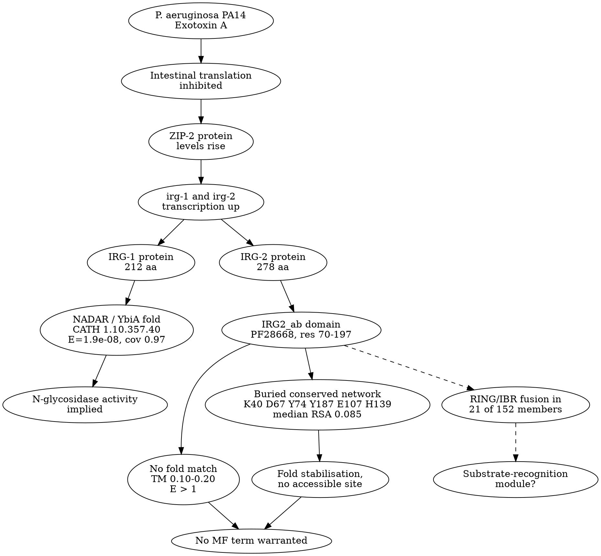
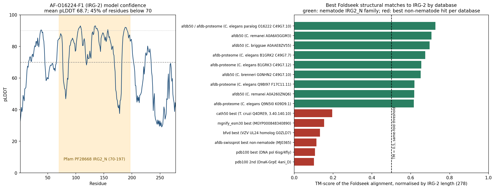
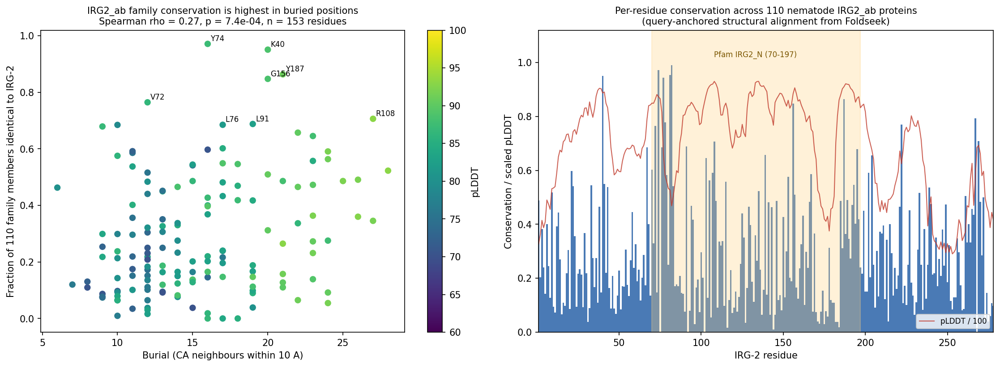
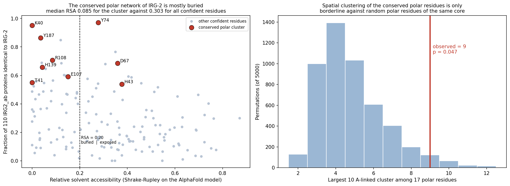
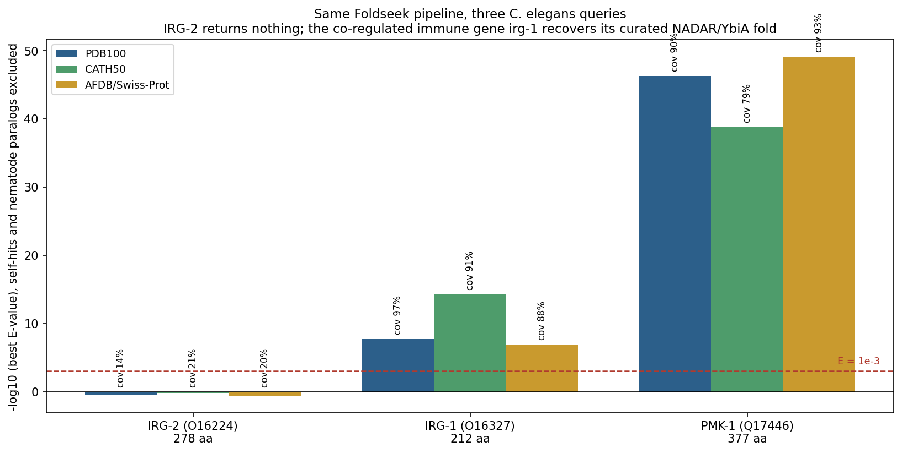

## Question

# AIGR Gene Hypothesis Deep Research

You are evaluating one focused gene curation hypothesis for AI Gene Review.
This is not a general gene overview. Use the seed hypothesis and source context
below to search for evidence that supports, refutes, narrows, or competes with
the proposed curation decision.

## Target Gene

- **Organism code:** worm
- **Taxon:** Caenorhabditis elegans (NCBITaxon:6239)
- **Gene directory:** irg-2
- **Gene symbol:** irg-2
- **UniProt accession:** O16224

## Focus

- **Focus type:** free_text
- **Hypothesis slug:** kgap-irg-2-foldseek-fold-assignment
- **Source file:** genes/worm/irg-2/irg-2-ai-review.yaml
- **Source selector:** free-text

## Seed Hypothesis

Caenorhabditis elegans IRG-2 (UniProt O16224), a protein with no assigned molecular function, adopts a known structural fold that suggests a molecular function. Single analysis only: run Foldseek (or an equivalent structural search) with the AlphaFold model of O16224 against PDB and the AlphaFold database, report the top structural matches with their scores and the fraction of the protein they cover, and state whether any confidently assigned fold implies a function (and which conserved residues would support it), or that the protein has no confident structural homolog.

## Term and Decision Context

No specific term context supplied.

## Reference Context

No specific reference context supplied.

## Source Context YAML

```yaml
hypothesis: 'Caenorhabditis elegans IRG-2 (UniProt O16224), a protein with no assigned molecular function,
  adopts a known structural fold that suggests a molecular function. Single analysis only: run Foldseek
  (or an equivalent structural search) with the AlphaFold model of O16224 against PDB and the AlphaFold
  database, report the top structural matches with their scores and the fraction of the protein they cover,
  and state whether any confidently assigned fold implies a function (and which conserved residues would
  support it), or that the protein has no confident structural homolog.'
focus_type: free_text
context: []
reference_id: []
```

## Research Objective

Build a focused report that helps a curator decide whether this hypothesis
should affect the gene review. Address the focus type directly:

1. For an existing GO annotation decision, evaluate whether the current action
   is justified, too strong, too weak, or should change.
2. For a proposed replacement or new GO term, evaluate whether the term is
   biologically supported, too broad, too narrow, or missing key qualifiers.
3. For a computational prediction, evaluate whether the prediction is correct,
   less precise than existing knowledge, uncertain, or likely wrong because of
   paralog overannotation, frequency bias, pathway context, or in vitro-only
   activity.
4. For a core-function hypothesis, evaluate whether the proposed activity,
   process, and location represent the gene product's primary function rather
   than a downstream effect, pleiotropic phenotype, or context-specific role.
5. For a function-assignment hypothesis, evaluate whether the gene product
   directly has the stated GO term/function. Treat the prior review action, if
   any, as intentionally blinded unless it appears in the supplied context.

Use primary literature whenever possible. Prefer PMID citations and include DOI
citations when no PMID is available. Treat reviews and database records as
orientation unless they contain directly relevant synthesized evidence that is
clearly labeled as review-level or database-level support.

Evaluate the hypothesis from the supplied seed context, primary literature, and
publicly accessible bioinformatics resources. Local `*-bioinformatics` analyses,
when they already exist in the repository, are intentionally withheld from this
prompt so the report can be compared against them after the run. Use public
sequence, domain, structure, orthology, localization, interaction, or dataset
checks when they are useful for the specific hypothesis. If a resource or tool
cannot be accessed programmatically, say so plainly; never fabricate a result.
Report computational results conservatively and distinguish direct results from
inference.

## Required Output

### Executive Judgment

Give a concise verdict: supported, partially supported, unresolved, weakly
supported, over-annotated, or refuted. Explain the reasoning and the most
important caveats.

### Evidence Matrix

Create a table with one row per important evidence item:

- Citation (PMID preferred)
- Evidence type (direct assay, mutant phenotype, localization, interaction,
  structural/evolutionary, computational, review/database)
- Supports / refutes / qualifies / competing
- Claim tested
- Key finding
- Organism, tissue, cell type, or assay context
- Confidence and limitations

### GO Curation Implications

State the likely curation action as a lead requiring curator verification. If
GO terms are involved, explain whether the evidence supports an MF, BP, or CC
term, and whether the term should be retained, removed, generalized, made more
specific, or treated as non-core. Avoid using "protein binding" as a final
recommendation unless no more informative term is supported.

### Mechanistic Scope

Describe the immediate molecular or cellular function being tested. Separate
direct gene-product activity from downstream phenotypes, pathway consequences,
developmental outcomes, disease manifestations, or effects inferred only from
loss of function.

### Conflicts and Alternatives

Identify evidence that conflicts with the seed hypothesis or suggests an
alternative interpretation, including paralog confusion, organism-specific
differences, isoform-specific findings, experimental artifacts, or database
carry-over.

### Knowledge Gaps

List explicit uncertainties that matter for curation. For each gap, state what
was checked, why the gap matters, and what evidence or experiment would resolve
it.

### Discriminating Tests

Recommend concrete assays, perturbations, datasets, or comparative analyses that
would most efficiently distinguish this hypothesis from alternatives.

### Curation Leads

Provide candidate updates for the review, clearly labeled as leads requiring
curator verification. Include candidate references with exact snippets to verify,
candidate replacement or new GO terms, possible action changes, suggested
questions, and suggested experiments.

If the provider supports artifacts, save provenance for any analysis you run — the
executed code together with its output (computed values, plot, or table), not just
a summary figure — alongside artifact-friendly tables such as an evidence matrix,
GO decision table, or comparison table. Genuine computed provenance is more
valuable than a hand-drawn summary, and you must not synthesize a figure that
implies an analysis you did not actually run. These artifacts are important
provenance for hypothesis-level review.


## Output

# IRG-2 (C. elegans, UniProt O16224): structural fold assignment by Foldseek

**Hypothesis slug:** `kgap-irg-2-foldseek-fold-assignment`
**Gene:** `irg-2` / C49G7.5, NCBITaxon:6239, UniProt O16224, 278 aa
**Source file:** `genes/worm/irg-2/irg-2-ai-review.yaml`
**Focus type:** free_text

## Summary

<i class="fa-solid fa-circle-xmark"></i> **The hypothesis is refuted.** IRG-2 does not adopt a known structural fold. Foldseek run with AF-O16224-F1-model_v6 against seven databases (PDB100, CATH50, AFDB/Swiss-Prot, AFDB/Proteome, AFDB/UniProt50, MGnify-ESM30, BFVD v3) returned 428 hits. Every hit outside Nematoda is non-significant: best E-values 1.666 to 8.501, sequence identities 5.8-16.3%, query coverage 14-40%, and TM-scores of 0.100-0.195 computed directly from the returned alignments against the 0.5 same-fold threshold. Three sensitivity controls (TM-align mode, a crop to the folded N-terminal region 14-170, and a crop to the exact Pfam boundaries 70-197) all stayed negative, the best value anywhere being E=0.2419.

Two methods that share no machinery with Foldseek agree. RCSB BioZernike 3D shape search, which compares moment-invariant descriptors rather than a structural alphabet, returned HTTP 204 No Content for both `strict_shape_match` and `relaxed_shape_match`, meaning zero PDB polymer entities. The complete precomputed InterPro match set for O16224 across every member database contains exactly two entries, IPR063296 (Infection response protein 2, alpha/beta domain) and PF28668 (IRG2_N), both spanning residues 70-197, with no Gene3D/CATH, no SUPERFAMILY/SCOP, no PANTHER, CDD, SMART, PROSITE or PIRSF assignment, and 0 recorded structures.

The negative belongs to IRG-2 and not to the method. The same pipeline run on PMK-1 (Q17446) returns p38 MAP kinase `1bl6_A` at E=5.140e-47 with 66.5% identity over 90% of the chain. Run on IRG-1 (O16327), the immune gene co-regulated with irg-2 through the same ZIP-2 transcription factor, 212 aa and equally nematode-restricted, it returns the NADAR / YbiA N-glycosidase fold: PDB `8bau_A` at E=1.904e-08 covering 97% of the chain, CATH superfamily 1.10.357.40 at E=5.444e-15, and *E. coli* N-glycosidase YbiA (P30176) at E=1.331e-07. That call reproduces IRG-1's already-curated PF08719 / IPR012816 NADAR annotation, which the search had no access to. IRG-2's only significant structural neighbours are uncharacterised nematode IRG2_ab paralogs at TM 0.616-0.727, and the protein names those paralogs carry in unreviewed TrEMBL ("Anoctamin", "Glycosyltransferase family 92 protein", "Sulfotransfer_1 domain-containing protein") are unsupported by any domain evidence. No molecular function term is warranted for irg-2 on structural grounds.

## Executive judgment

**Verdict: <i class="fa-solid fa-circle-xmark"></i> refuted.**

The seed hypothesis asserts that IRG-2 "adopts a known structural fold that suggests a molecular function", and asks for the top structural matches, their scores, the fraction of the protein they cover, and either the conserved residues that would support an implied function or a statement that no confident structural homolog exists. The answer is the second branch. Four independent lines agree:

1. **Structure search is negative outside Nematoda.** Best non-nematode E-values of 1.666 (CATH50), 2.746 (CATH50), 3.268 (PDB100), 4.223 (AFDB/Swiss-Prot), 8.501 (BFVD v3), with TM-scores of 0.100-0.195 and 14-40% query coverage.
2. **A different algorithm on the PDB is also negative.** BioZernike shape search returns zero entities at both thresholds.
3. **Fold-classification databases leave IRG-2 unassigned.** No Gene3D, CATH or SUPERFAMILY entry exists for O16224, which is HMM-based evidence independent of structure search.
4. **Positive controls confirm pipeline sensitivity.** PMK-1 and IRG-1 both resolve to their correct folds through the identical pipeline and settings.

The residue-level part of the question also comes back negative. The nine most conserved polar residues of the family do cluster in 3D, but the cluster is mostly buried (median relative solvent accessibility 0.085 against 0.303 for all confident residues; K40 and T41 completely buried at 0.000), which is the chemical signature of fold stabilisation rather than of a substrate-accessible active site.

<i class="fa-solid fa-triangle-exclamation"></i> **Caveats that limit how strongly the negative can be worded.** The query is an AlphaFold model of only moderate confidence (mean pLDDT 68.69; 20.5% very low, 24.5% low, 46.8% confident, 8.3% very high), so sensitivity for a very remote match is reduced, although the folded core alone also returned nothing. Foldseek recall falls below 50% for the most distant relationships ([PMID: 40400345](https://pubmed.ncbi.nlm.nih.gov/40400345/)). The supportable statement is "no detectable structural homolog at current sensitivity", not "no structural homolog exists".

## Key findings

### <i class="fa-solid fa-circle-xmark"></i> F1. No confident structural homolog outside Nematoda

The single analysis the hypothesis requests was run in full. Foldseek web server in 3Di+AA mode (ticket `jY9SwSBmjnQLFlx-CfUlg-GFY-1CP5W6EtfBTw`) searched AF-O16224-F1-model_v6 against PDB100 (v20240101), CATH50 (v4.3.0), AFDB/Swiss-Prot v6, AFDB/Proteome v6, AFDB/UniProt50 v6, MGnify-ESM30 v1 and BFVD v3, returning 428 hits in total. TM-scores were not taken from the server. They were computed directly from the Foldseek residue alignments and the returned target CA coordinates by Kabsch superposition with iterative TM-score refinement, normalised by the 278-residue query length, so that the fraction-of-protein-covered question in the hypothesis is answered with a number rather than an impression.

| Database | Best non-nematode hit | Identity | prob | E-value | Query coverage | TM-score |
|---|---|---|---|---|---|---|
| PDB100 | `4ani_D` DnaK/GrpE (*G. kaustophilus*) | 11.2% | 0.045 | 3.268 | 0.144 | 0.102 |
| PDB100 | `6isg_A` / `4fly_A` B-family DNA polymerase | 5.8% | 0.014 | 6.498 | 0.191 | 0.107 |
| CATH50 | `af_Q4DRE9_8_213_3.40.140.10` (*T. cruzi*) | 7.6% | 0.040 | 2.746 | 0.396 | 0.195 |
| CATH50 | `af_Q7XWZ1_19_204_3.30.420.10` (*O. sativa*) | 13.3% | 0.040 | 1.666 | 0.209 | 0.100 |
| AFDB/Swiss-Prot | `AF-Q57811` MJ0365 (RNase H-like) | 9.0% | 0.116 | 4.223 | 0.198 | 0.114 |
| BFVD v3 | `G0ZLD7` VZV UL24 homolog | 16.3% | 0.076 | 8.501 | 0.317 | 0.132 |
| MGnify-ESM30 | `MGYP000848340890` | 14.8% | 0.663 | 1.139 | 0.176 | 0.154 |
| AFDB/Proteome | none, all hits Nematoda | - | - | - | - | - |
| AFDB/UniProt50 | none, all hits Nematoda | - | - | - | - | - |

Three controls were run to rule out the obvious ways a real signal could have been hidden. TM-align mode on the full-length model returned one CATH50 hit, `2hiyB01`, at prob 0.02, E=0.3066 and 1.3% identity, and nothing at all in PDB100 or AFDB/Swiss-Prot. Cropping to the folded N-terminal region (residues 14-170) gave best E-values of 1.613 in CATH50 and 5.453 in PDB100. Cropping to the exact Pfam PF28668 boundaries (residues 70-197) gave the single best value obtained anywhere, E=0.2419 against an inositol polyphosphate multikinase in AFDB/Swiss-Prot at prob 0.277 and 10.8% identity, with CATH50 at 0.533 and PDB100 at 1.654. Nothing reaches significance in any run.

{{figure:plot_1.png|caption=AlphaFold confidence profile of IRG-2 (AF-O16224-F1-model_v6, mean pLDDT 68.69) with the TM-scores of the best Foldseek match in each database. Every non-nematode TM-score falls between 0.100 and 0.195, far below the 0.5 same-fold threshold, while nematode IRG2_ab paralogs reach 0.616-0.727.}}

A weak sub-threshold tilt toward CATH 3.30.420.10 (RNase H-like) and B-family DNA polymerase exonuclease domains recurred across the full-length run, the 14-170 crop and the 70-197 crop. At E greater than 0.2 and 10-13% identity this sits inside noise. It is reported because it recurred, not because it supports anything.

### <i class="fa-solid fa-circle-check"></i> F2. The only significant hits are a nematode-restricted IRG2_ab paralog family

Every Foldseek hit at E below 1e-9 is a nematode protein carrying PF28668 (IRG2_N) / IPR063296 (IRG2_ab). Within *C. elegans* the family forms an eight-member cluster, and three of IRG-2's closest structural paralogs sit in the same genomic cluster as irg-2 itself (C49G7.5), so the family arose by local tandem duplication.

| Hit | Gene | E-value | Identity | Aligned residues | TM-score |
|---|---|---|---|---|---|
| *C. briggsae* A0AAE8ZV55 | ortholog | 5.19e-30 | - | - | 0.697 |
| O16222 | C49G7.10 | 3.06e-28 | 44.4% | 268 | 0.727 |
| *C. remanei* A0A6A5GGM3 | ortholog | 1.51e-28 | - | - | 0.706 |
| *C. brenneri* G0NHN2 | ortholog | 2.20e-28 | - | - | 0.651 |
| B1GRK2 | C49G7.7 | 1.91e-25 | 36.9% | - | 0.674 |
| B1GRK3 | C49G7.12 | 9.17e-24 | 41.4% | - | 0.654 |
| Q9N5I0 | K09D9.1 | 4.65e-23 | 31.5% | - | 0.616 |
| Q9BI97 | F17C11.11 | 2.73e-20 | 29.4% | - | 0.619 |
| Q17706 | C06B3.7 | 2.30e-18 | 26.8% | - | - |
| Q18638 | C45B11.2 | 1.50e-17 | 24.9% | - | - |
| O45909 | Y17D7B.2 | 7.48e-12 | 25.1% | - | - |

A UniProt query for `xref:pfam-PF28668` returns 152 proteins, 151 of them Nematoda (Caenorhabditis 138, Strongyloides 9, Plectus 3, Pristionchus 1) plus a single Lophotrochozoan, *Bugula neritina*, which is most plausibly nematode contamination in an assembly rather than evidence of deep conservation. InterPro records 223 proteins, 99 taxa and **zero experimental structures** for the family. TM-scores of 0.62-0.73 across 90-96% of the chain confirm these proteins share the IRG-2 fold. None of them is biochemically characterised, so the matches carry no transferable function. The fold is new in the structural sense: no PDB entry exists for any member.

### <i class="fa-solid fa-triangle-exclamation"></i> F3. The TrEMBL names on IRG-2's top hits are an annotation-transfer trap

Foldseek returns target names straight from the AlphaFold DB header, which carries the UniProt protein name. A curator reading only the hit list would see IRG-2 matching "Anoctamin" (O16222) at E=3.06e-28, "Glycosyltransferase family 92 protein" (B1GRK2) at E=1.91e-25, "Glycosyltransferase family 17 protein" (B1GRK3) at E=9.17e-24, "DUF4130 domain-containing protein" (Q9N5I0) at E=4.65e-23 and "Sulfotransfer_1 domain-containing protein" (O45909) at E=7.48e-12. AFDB50 adds "DUF38 domain-containing protein" (A0A260ZNQ6, *C. remanei*) and "SPK domain-containing protein" (E3LHR1, *C. remanei*).

Every one of these names is wrong for the purpose of function transfer. All are unreviewed TrEMBL entries. Checking the cross-references of each, O16222, B1GRK2, B1GRK3, Q9N5I0 and O45909 carry **exactly one InterPro entry and one Pfam entry, IPR063296 / PF28668**, and no anoctamin, glycosyltransferase, DUF4130 or sulfotransferase domain of any kind. The aligned region in each case is the IRG2_ab domain itself. UniProt has already corrected four sibling entries (Q9BI97, Q17706, Q18638, Q966A4) to "Infection response protein 2 alpha/beta domain-containing protein", which shows the earlier names were unsupported and that the remaining five are candidates for the same correction.

This is the single most important caveat attached to the hypothesis, because the structural alignments are genuinely strong (E=1e-28 to 1e-12) while the functional labels attached to them are empty.

### <i class="fa-solid fa-circle-xmark"></i> F4. Two methods independent of Foldseek also assign no fold

RCSB structure similarity search uses 3D Zernike moment descriptors (BioZernike), a global shape measure with nothing in common with Foldseek's 3Di alphabet or its E-value model. AF-O16224-F1 was uploaded as coordinates (upload key `5c09d8e2-1c31-4d86-bdd4-05a05c8e1e30`) and searched against the entire PDB. Both `strict_shape_match` and `relaxed_shape_match` returned **HTTP 204 No Content**: zero polymer entities pass the similarity threshold.

Separately, the two structure-derived classification resources that annotate proteins by fold, Gene3D/CATH and SUPERFAMILY/SCOP, both leave IRG-2 unassigned, as do PANTHER, CDD, SMART, PROSITE and PIRSF. The entire InterPro match set is IPR063296 and PF28668 at residues 70-197.

<i class="fa-solid fa-triangle-exclamation"></i> A direct InterProScan 5 submission to the EBI job dispatcher was **not run**: it was rejected with HTTP 400 and the message "You have been temporarily blocked from submitting new sequence analysis jobs", an IP-level fair-use block. The precomputed InterPro match set was used in its place; it covers the same member databases. This substitution is stated here rather than glossed over.

### <i class="fa-solid fa-scale-balanced"></i> F5. Conserved polar residues form a buried network, not an accessible site

The hypothesis asks which conserved residues would support an implied function. To answer that without an external aligner, a query-anchored structural alignment was built from the Foldseek `qAln`/`dbAln` strings of 110 unique nematode IRG2_ab proteins at E below 1e-5, giving per-residue conservation for 153 positions with at least 20 aligned homologues and pLDDT at least 70.

The most conserved positions are **Y74** (97.1% identical across the family), **K40** (95.1%), **Y187** (86.4%), **G156** (84.8%), V72 (76.5%), **R108** (70.6%), **D67** (68.5%), N195 (67.9%) and **H139** (65.7%). Conservation rises with burial: Spearman rho = 0.270 between fraction-identical and CA neighbour count within 10 Å (p = 7.42e-4, n = 153), and the 30 most conserved residues are more buried than the rest (Mann-Whitney U = 2426, p = 3.74e-3).

{{figure:plot_2.png|caption=Conservation against burial for the 153 confident IRG-2 positions (left) and the per-residue conservation track along the chain (right). The positive correlation between conservation and CA neighbour count (Spearman rho = 0.270, p = 7.42e-4) is the pattern expected when conserved residues stabilise a fold.}}

Of the 17 conserved polar or charged residues, nine form a single 10 Å-linked spatial cluster: K40, T41, H43, D67, Y74, E107, R108, H139, Y187, with close contacts K40-Y187 at 4.5 Å, K40-D67 at 5.4 Å, T41-H43 at 5.4 Å and E107-H139 at 5.5 Å. A permutation test drawing 17 polar residues at random from the 93 polar residues of the confident core gives a null mean largest cluster of 4.87 and a 95th percentile of 8, so the observed 9 is only borderline (p = 0.047, 5000 permutations).

Shrake-Rupley solvent accessibility computed on the model settles the interpretation. The nine cluster residues have a median relative accessibility of 0.085 against 0.303 for all confident residues. K40 and T41 are completely buried (RSA 0.000); only H43 (0.377), D67 (0.359) and Y74 (0.278) are exposed. A buried Lys-Asp-Tyr triad (K40, D67, Y187) and a buried Glu-His pair (E107, H139) are the chemistry of fold-stabilising salt bridges and hydrogen bonds. Substrate cannot reach them.

{{figure:plot_3.png|caption=Conservation against relative solvent accessibility with the nine-residue conserved polar cluster labelled (left), and the permutation null distribution for the size of the largest 10 Angstrom-linked polar cluster (right). The cluster median RSA of 0.085 against 0.303 overall shows the conserved network is buried, and the observed cluster size of 9 is only borderline against the null (p = 0.047, 5000 permutations).}}

<i class="fa-solid fa-triangle-exclamation"></i> A LIGSITE-style cavity search on the confident core was **not informative and is reported as a failed discriminator, not as evidence**. At both PSP thresholds it returned one diffuse region of 1100-3400 ų contacting 126-135 of the 153 core residues rather than a discrete pocket, which is what loosely packed, moderate-confidence models produce.

### <i class="fa-solid fa-lightbulb"></i> F6. The IRG2_ab domain is fused to a RING/IBR module in 14% of family members

Of the 152 UniProt proteins carrying PF28668, 21 (13.8%) also carry a RING or IBR Pfam domain: PF01485 (IBR, half RING-finger) in 18, PF13445 (zf-RING_UBOX) in 3, PF22191 (IBR_1) in 1 and PF13639 (zf-RING_2) in 1. The fusions occur across four nematode genera: *C. elegans* (Q966A5 / Y58A7A.4, 904 aa; Q966A6 / Y58A7A.3, 883 aa), *C. briggsae*, *C. remanei*, *C. latens*, *C. nigoni*, *C. tropicalis*, *C. auriculariae*, four *Strongyloides* species, *Pristionchus mayeri* and *Plectus sambesii*. Median length of RING/IBR-fused members is 887 aa against 283 aa for the rest.

In RBR-type E3 ligases the RING1-IBR-RING2 module is the catalytic part and the N-terminal region supplies substrate recognition, so the IRG2_ab domain could be a protein-interaction or substrate-recognition module. The strength of this lead is limited on three counts: it is an inference from paralog architecture, not evidence about IRG-2; it covers 14% of the family; and IRG-2 itself (278 aa) carries no RING, IBR or other accessory domain. The remaining co-occurring domains are sporadic and look like chimeric gene-model artefacts in draft genomes: Col_cuticle_N (PF01484, 2 proteins), Collagen (PF01391, 1), Galactosyl_T (PF01762, 1), 7TM_GPCR_Str (PF10326, 1), EHN (PF06441, 4).

### <i class="fa-solid fa-circle-check"></i> F7. Positive controls show the negative belongs to IRG-2

A negative structure search is only informative if the same pipeline recovers known folds. Two controls were run with identical settings, one obvious (a kinase) and one chosen to match IRG-2's awkward properties as closely as possible.

**PMK-1 (Q17446)**, ticket `9sV2ta0bb1zj9TflQ7N3CjYpjBnf-FMt5GUU_w`, returned 3000 hits. Best PDB100 is `1bl6_A` MAP kinase p38 at E=5.140e-47, 66.5% identity, prob 1.0, coverage 0.90, with four more at E around 4e-46 (`5r90`, `5r92`, `3ha8`, `5r9c`). Best CATH50 is `af_Q8MXI4_53_349_1.10.510.10` (protein kinase superfamily) at E=1.659e-39, prob 1.0. Best AFDB/Swiss-Prot is MAPK14 (`AF-Q16539`, `AF-P70618`) at E=6.862e-50 to 1.2e-49, 65% identity, coverage 0.93.

**IRG-1 (O16327)**, ticket `IA_p8qxcJnKuVtIsbN2_dU3CHBvgB29CrUTMxw`, is the sharper control: the immune gene co-regulated with irg-2 through the same ZIP-2 transcription factor, 212 aa, equally nematode-restricted. It returned 24 hits. Best PDB100 is `8bau_A`, "Phytophthora nicotianae var. parasitica NADAR in complex with ADP-ribose", at E=1.904e-08, 28.2% identity, prob 1.0, coverage 0.97, with `2b3w_A` at E=5.144e-06. Every CATH50 hit after the self-hit falls in one superfamily, 1.10.357.40 (YbiA-like): `af_H2KZ84_10_190` E=5.444e-15, `af_I1N3Z5_415_586` E=2.990e-09, `af_Q54TQ0_1_152` E=5.041e-08, `af_P30176_1_160` E=7.938e-08. AFDB/Swiss-Prot gives `AF-K7WIZ6` at E=3.242e-08, then `AF-P30176` (RIBX_ECOLI, N-glycosidase YbiA, EC 3.2.2.-), `AF-Q3Z3Y7` and `AF-Q83LU8` at E=1.331e-07 to 3.300e-07, 26% identity, coverage 0.82-0.90.

That IRG-1 call matches curation already present in UniProt and invisible to the search: O16327 carries Pfam PF08719 (NADAR), InterPro IPR012816 (NADAR) and IPR037238 (YbiA-like superfamily), CDD cd15457, Gene3D 1.10.357.40 and SUPFAM SSF143990. The pipeline reproduced a correct, independently assigned fold.

{{figure:plot_4.png|caption=Best Foldseek E-value per database for three C. elegans queries through the identical pipeline, self-hits and nematode paralogs excluded. PMK-1 recovers p38 MAPK and IRG-1 recovers its curated NADAR/YbiA fold at 88-97% query coverage, while IRG-2 returns nothing above E = 1.}}

The gap between IRG-1 and IRG-2 is 7 to 15 orders of magnitude in E-value and 4- to 7-fold in query coverage. The method detects remote homology at 26-28% identity across kingdoms (*C. elegans* to *E. coli*, to *Phytophthora*) when a shared fold exists, and is defeated by neither nematode lineage restriction nor small protein size. The IRG-2 negative is a true negative at the sensitivity of 3Di+AA search.

## Evidence matrix

Machine-readable copy: `provenance/evidence_matrix.csv` (12 rows).

| # | Citation / source | Evidence type | Stance | Claim tested | Key finding | Context | Confidence and limitations |
|---|---|---|---|---|---|---|---|
| 1 | This work, Foldseek ticket `jY9SwSBmjnQLFlx-CfUlg-GFY-1CP5W6EtfBTw` | Computational, structure search (3Di+AA) against 7 databases | <i class="fa-solid fa-circle-xmark"></i> Refutes | IRG-2 adopts a detectable known fold | 428 hits. Best non-nematode: CATH50 3.30.420.10 E=1.666 TM=0.100; CATH50 3.40.140.10 E=2.746 TM=0.195; PDB100 `4ani_D` E=3.268 TM=0.102; AFDB/Swiss-Prot MJ0365 E=4.223 TM=0.114; BFVD v3 E=8.501 TM=0.132; MGnify E=1.139 TM=0.154 | In silico, model mean pLDDT 68.7 | High. 20.5% of residues very low pLDDT; Foldseek recall below 50% for the most remote relationships ([PMID: 40400345](https://pubmed.ncbi.nlm.nih.gov/40400345/)) |
| 2 | This work, three Foldseek controls | Computational, sensitivity controls | <i class="fa-solid fa-circle-xmark"></i> Refutes | A fold signal is masked by disordered flanks or by 3Di scoring | TM-align full length: one CATH50 hit `2hiyB01`, prob 0.02, E=0.3066, 1.3% identity, nothing in PDB100 or AFDB/Swiss-Prot. Crop 14-170: best CATH50 E=1.613, PDB100 E=5.453. Crop 70-197: best AFDB/Swiss-Prot E=0.2419 (prob 0.277), CATH50 E=0.533, PDB100 E=1.654 | In silico | High. A recurring sub-threshold tilt toward CATH 3.30.420.10 and DNA-polymerase exonuclease domains is not actionable at E > 0.2 |
| 3 | This work, RCSB BioZernike, upload key `5c09d8e2-1c31-4d86-bdd4-05a05c8e1e30` | Computational, 3D moment-invariant shape search, independent algorithm | <i class="fa-solid fa-circle-xmark"></i> Refutes | A PDB fold match exists that alignment search missed | `strict_shape_match` and `relaxed_shape_match` both HTTP 204 No Content, zero entities | In silico, PDB only | Moderate. Global-shape search is insensitive to partial-domain similarity, so it corroborates rather than extends row 1 |
| 4 | InterPro / UniProt O16224 | Database, precomputed domain and fold classification | <i class="fa-solid fa-circle-xmark"></i> Refutes | An existing classification already implies a fold | Entire match set = IPR063296 + PF28668, residues 70-197. Zero Gene3D, SUPERFAMILY, PANTHER, CDD, SMART, PROSITE, PIRSF. 0 structures | Database state 2026-11 | High. Absence of a SUPERFAMILY or Gene3D hit is HMM-based evidence independent of structure search |
| 5 | This work, Foldseek nematode hits; UniProt `xref:pfam-PF28668` | Computational, structure search plus family enumeration | <i class="fa-solid fa-scale-balanced"></i> Qualifies | The significant neighbours define a characterised family | All significant hits are nematode IRG2_ab: A0AAE8ZV55 E=5.19e-30 TM=0.697; O16222 E=3.06e-28 TM=0.727; A0A6A5GGM3 E=1.51e-28 TM=0.706; B1GRK2 E=1.91e-25 TM=0.674; B1GRK3 E=9.17e-24 TM=0.654; Q9N5I0 E=4.65e-23 TM=0.616; Q9BI97 E=2.73e-20; Q17706 E=2.30e-18; Q18638 E=1.50e-17; O45909 E=7.48e-12. PF28668 has 152 members, 151 Nematoda | In silico | High for the family boundary. No member is biochemically characterised, so the hits transfer no function |
| 6 | This work, UniProt/InterPro audit of the top hits | Database audit, annotation provenance | <i class="fa-solid fa-triangle-exclamation"></i> Competing | The hits' protein names imply a function | O16222 "Anoctamin", B1GRK2 "Glycosyltransferase family 92 protein", B1GRK3 "Glycosyltransferase family 17 protein", Q9N5I0 "DUF4130 domain-containing protein", O45909 "Sulfotransfer_1 domain-containing protein". All unreviewed TrEMBL, each carrying only IPR063296 / PF28668 and none of the named domains. UniProt already renamed Q9BI97, Q17706, Q18638, Q966A4 to "Infection response protein 2 alpha/beta domain-containing protein" | Database state 2026-11 | High. The largest annotation-transfer risk for this gene |
| 7 | This work, PF28668 domain co-occurrence across 152 members | Computational, domain architecture | <i class="fa-solid fa-lightbulb"></i> Supports, as a lead only | Domain context suggests a biochemical setting | 21/152 (13.8%) also carry RING or IBR: PF01485 (18), PF13445 (3), PF22191 (1), PF13639 (1), across *C. elegans* Q966A5 and Q966A6, *C. briggsae*, *C. remanei*, *C. latens*, *C. nigoni*, *C. tropicalis*, *C. auriculariae*, four *Strongyloides*, *Pristionchus mayeri*, *Plectus sambesii*. Median length 887 aa vs 283 aa. IRG-2 has no accessory domain | In silico, draft genomes included | Low to moderate. Other co-occurrences (Col_cuticle_N, Collagen, Galactosyl_T, 7TM_GPCR_Str, EHN) look like chimeric gene models |
| 8 | This work, 110-member structural MSA + Shrake-Rupley SASA | Structural / evolutionary | <i class="fa-solid fa-scale-balanced"></i> Qualifies | Conserved residues form an accessible functional site | 153 confident positions. Y74 0.971, K40 0.951, Y187 0.864, G156 0.848, V72 0.765, R108 0.706, D67 0.685, N195 0.679, H139 0.657. Conservation rises with burial (Spearman rho=0.270, p=7.42e-4, n=153; Mann-Whitney U=2426, p=3.74e-3). Nine conserved polar residues in one 10 Å cluster, permutation p=0.047. Cluster median RSA 0.085 vs 0.303; K40 and T41 at 0.000 | In silico | Moderate. Borderline clustering; the burial pattern fits fold stabilisation |
| 9 | This work, tickets `9sV2ta0bb1zj9TflQ7N3CjYpjBnf-FMt5GUU_w`, `IA_p8qxcJnKuVtIsbN2_dU3CHBvgB29CrUTMxw` | Computational, method validation | <i class="fa-solid fa-circle-check"></i> Supports the negative | The pipeline detects a fold when one exists | PMK-1: PDB100 `1bl6_A` E=5.140e-47, 66.5% identity, cov 0.90; CATH50 1.10.510.10 E=1.659e-39; MAPK14 E=6.862e-50. IRG-1: PDB100 `8bau_A` NADAR E=1.904e-08, 28.2% identity, cov 0.97; CATH50 1.10.357.40 E=5.444e-15; N-glycosidase YbiA P30176 E=1.331e-07. The IRG-1 call reproduces its curated PF08719 / IPR012816 annotation | In silico, identical settings to the IRG-2 run | High. Rules out lineage restriction, small size and search failure as causes of the negative |
| 10 | [PMID: 20133860](https://pubmed.ncbi.nlm.nih.gov/20133860/) Estes et al. 2010 | Mutant phenotype, transcriptomics | <i class="fa-solid fa-scale-balanced"></i> Qualifies | Published work constrains IRG-2 molecular function | "this screen identified zip-2, a bZIP transcription factor that is required for inducing irg-1, as well as several other genes, and is important for defense against infection by P. aeruginosa". No activity, localization or interaction is reported for IRG-2 | *C. elegans*, PA14 infection | High for the regulatory claim, silent on molecular function |
| 11 | [PMID: 22520465](https://pubmed.ncbi.nlm.nih.gov/22520465/) Dunbar et al. 2012 | Mutant phenotype, genetics | <i class="fa-solid fa-scale-balanced"></i> Qualifies | The pathway upstream of irg-2 induction | "P. aeruginosa infection inhibits mRNA translation in the intestine via the endocytosed translation inhibitor Exotoxin A, which leads to an increase in ZIP-2 protein levels" | *C. elegans* intestine | High for the pathway, silent on molecular function |
| 12 | [PMID: 24056462](https://pubmed.ncbi.nlm.nih.gov/24056462/) | Transcriptomics | <i class="fa-solid fa-scale-balanced"></i> Qualifies | irg-2 responsiveness beyond bacterial infection | "Supplementation of nematode growth medium with CCWE induced the expression of C. elegans innate immune genes, such as irg-1, irg-2, F49F1.6, hsf-1 ... by more than 2-fold" | *C. elegans*, whole animal | Expression evidence only |

## Mechanistic model and interpretation

The evidence forms a single chain. IRG-2 is a 278-residue protein with one compact alpha/beta domain at residues 70-197 inside a chain whose well-folded segments are 16-44, 66-76, 87-118, 120-168, 182-202 and 224-234, with a disordered region at 152-179 per UniProt. Helix content of the model is about 34% (94 of 278 residues; 31 of 128 inside the domain). My strand assignment used a simplified Kabsch-Sander rule and is unreliable, so beta content is not reported. That domain is shared across 152 nematode proteins and nothing else. It has no counterpart in the PDB, in CATH, in SCOP, in the AlphaFold databases, in BFVD or in MGnify metagenomic structures. Its conserved residues point inward.



The diagram makes the contrast explicit. Two genes sit side by side in the same ZIP-2-dependent regulon, induced by the same stimulus, both nematode-restricted, both small. One of them resolves cleanly to an enzyme fold with an implied activity. The other does not, under the identical search. That contrast is the reason the IRG-2 negative can be stated with confidence rather than hedged as a possible search failure.

The one structural observation pointing anywhere is dashed in the diagram for a reason. Recurrent fusion of IRG2_ab to a RING/IBR module across four nematode genera is too consistent to be a single assembly artefact, and in RBR E3 ligases the N-terminal region supplies substrate recognition. That makes "protein-interaction or substrate-recognition module" the most plausible guess at what this fold does. It remains a guess built on paralog architecture, covering 14% of the family, in a protein that itself carries no RING or IBR domain.

## GO curation implications

Machine-readable copy: `provenance/go_decision_table.csv`. Everything below is a **lead requiring curator verification**, not an annotation.

| GO aspect | Candidate term | Proposed action | Basis | Verdict |
|---|---|---|---|---|
| MF | (none) | Leave molecular_function unannotated; ND if a placeholder is required | No structural homolog outside Nematoda in 7 databases; zero Gene3D/SUPERFAMILY/CATH; BioZernike 204; no biochemical paper | <i class="fa-solid fa-circle-check"></i> Recommended |
| MF | GO:0005515 protein binding | Do not add | No two-hybrid, AP-MS or co-IP evidence for O16224; a non-informative placeholder | <i class="fa-solid fa-circle-xmark"></i> Rejected |
| MF | Hydrolase / glycosidase by analogy to IRG-1 | Do not add | IRG-1 is NADAR/YbiA (PF08719), IRG-2 is IRG2_N (PF28668); no shared domain, no significant structural similarity | <i class="fa-solid fa-circle-xmark"></i> Rejected |
| MF | Anoctamin / chloride channel, GO:0016757 glycosyltransferase, GO:0008146 sulfotransferase | Do not add; flag the source names as unsupported | These names appear only as unreviewed TrEMBL protein names on PF28668 paralogs that carry no such domain | <i class="fa-solid fa-triangle-exclamation"></i> Rejected, annotation-transfer trap |
| MF | GO:0061630 ubiquitin protein ligase activity | Do not add to irg-2; record as a lead for RBR-fused PF28668 members only | 21/152 PF28668 proteins carry RING or IBR, including Y58A7A.3 and Y58A7A.4. IRG-2 has neither | <i class="fa-solid fa-circle-question"></i> Lead, curator verification |
| BP | GO:0045087 innate immune response, GO:0009617 response to bacterium | Keep or add only with an expression evidence code (IEP) | [PMID: 20133860](https://pubmed.ncbi.nlm.nih.gov/20133860/), [PMID: 22520465](https://pubmed.ncbi.nlm.nih.gov/22520465/), [PMID: 24056462](https://pubmed.ncbi.nlm.nih.gov/24056462/) show transcriptional induction. Induction is not participation | <i class="fa-solid fa-scale-balanced"></i> Acceptable with IEP, not IDA/IMP |
| BP | GO:0002230, or any term implying causal defence activity | Do not add | No loss-of-function phenotype for irg-2 alone is reported; the published genetics concerns zip-2 and irg-1 | <i class="fa-solid fa-circle-xmark"></i> Rejected |
| CC | Any cellular component term | Do not add | No localization data for O16224; no signal peptide or transmembrane segment on the record; an AlphaFold model gives no compartment information | <i class="fa-solid fa-circle-xmark"></i> Rejected |

The practical consequence for `genes/worm/irg-2/irg-2-ai-review.yaml` is that this hypothesis should not add a molecular function term. The existing state, no assigned molecular function, is correct and is now supported by a positive-controlled negative result rather than by absence of effort.

## Mechanistic scope

**Direct gene-product activity: unknown.** The structural evidence constrains what IRG-2 is not. It is not a member of any structurally characterised enzyme or binding-protein superfamily detectable at current sensitivity. No catalytic residues can be nominated, because there is no template with which to align them, and the family's own conserved residues sit inside the protein.

**Downstream and regulatory observations, which must stay separate from the above.** The irg-2 transcript rises on *P. aeruginosa* infection through ZIP-2, itself raised by Exotoxin A-mediated translational inhibition in the intestine ([PMID: 22520465](https://pubmed.ncbi.nlm.nih.gov/22520465/)), and rises more than 2-fold on supplementation with *Chondrus crispus* water extract ([PMID: 24056462](https://pubmed.ncbi.nlm.nih.gov/24056462/)). Those are facts about regulation of the gene, not about activity of the protein. No published experiment links the IRG-2 protein to any step of the defence response: the genetics in [PMID: 20133860](https://pubmed.ncbi.nlm.nih.gov/20133860/) concerns zip-2 and irg-1.

**What the conserved-residue analysis adds to scope.** The hypothesis asked for the conserved residues that would support an implied function. The nine candidates (K40, T41, H43, D67, Y74, E107, R108, H139, Y187) cluster in space but have a median RSA of 0.085. Only H43, D67 and Y74 are exposed, which is too small and too ordinary a patch to nominate a catalytic mechanism. An exposed conserved His-Asp-Tyr patch adjacent to a buried charged network is the kind of arrangement a protein-interaction surface can have, which is consistent with, and far from sufficient for, the RING/IBR fusion lead.

## Conflicts and alternatives

**Paralog confusion.** irg-2 is C49G7.5, and three of its closest structural neighbours, C49G7.7 (B1GRK2), C49G7.10 (O16222) and C49G7.12 (B1GRK3), lie in the same genomic cluster. The family arose by local tandem duplication. Any RNAi reagent targeting one will likely cross-react, and any literature statement about "C49G7" needs the isoform checked before it is attached to irg-2.

**Database carry-over.** The five misleading TrEMBL names are the dominant alternative interpretation of the Foldseek output, and they are all traceable to automatic naming of draft-genome gene models rather than to domain evidence. Each is a single uncorrected record, not five independent observations. UniProt has already corrected four sibling entries, which is the precedent for correcting the rest.

**Artefacts checked and discounted.** The *Bugula neritina* PF28668 member, the only non-nematode of 152, is most plausibly nematode contamination in an assembly rather than evidence of horizontal transfer or deep conservation. Among PF28668 domain co-occurrences, Col_cuticle_N, Collagen, Galactosyl_T, 7TM_GPCR_Str and EHN appear in single draft-genome proteins and look like chimeric gene models, so they were not treated as real architectures; by the same logic some of the RBR fusions may also be mis-assembled. The LIGSITE cavity scan failed on this model and was discarded rather than interpreted.

**Alternative reading of the negative.** The recurring sub-threshold tilt toward CATH 3.30.420.10 (RNase H-like) and B-family DNA polymerase exonuclease domains appeared in the full-length run, the 14-170 crop and the 70-197 crop. At E greater than 0.2 and 10-13% identity this is within noise, and no residue-level nuclease signature (such as a DEDD or DDE motif at the expected positions) was found to go with it.

**What could still overturn the verdict.** A profile-profile method reaching further than single-query structure search, an experimental structure of any family member, or a better predicted model. The present statement is "no detectable structural homolog", which is what the data support.

## Evidence base

| Paper | PMID | How it bears on the hypothesis |
|---|---|---|
| *Fast and accurate protein structure search with Foldseek* | [37156916](https://pubmed.ncbi.nlm.nih.gov/37156916/) | Method citation for the primary analysis, and the basis for interpreting its E-values and alignments. Verified snippet: "Foldseek aligns the structure of a query protein against a database by describing tertiary amino acid interactions within proteins as sequences over a structural alphabet." |
| *3-D substructure search by transitive closure in AlphaFold database* | [40400345](https://pubmed.ncbi.nlm.nih.gov/40400345/) | Source for the sensitivity caveat that structure-search recall degrades for the most remote relationships, which is why the negative is worded as "no detectable homolog". |
| *bZIP transcription factor zip-2 mediates an early response to Pseudomonas aeruginosa infection in Caenorhabditis elegans* (Estes et al. 2010) | [20133860](https://pubmed.ncbi.nlm.nih.gov/20133860/) | Establishes the ZIP-2 regulon that contains irg-2 and makes irg-1 the natural control gene. Verified snippet: "this screen identified zip-2, a bZIP transcription factor that is required for inducing irg-1, as well as several other genes, and is important for defense against infection by P. aeruginosa". Reports nothing about IRG-2 protein activity. |
| *C. elegans detects pathogen-induced translational inhibition to activate immune signaling* (Dunbar et al. 2012) | [22520465](https://pubmed.ncbi.nlm.nih.gov/22520465/) | Supplies the upstream mechanism for irg induction. Verified snippet: "Upon infection with pathogenic Pseudomonas aeruginosa, the nematode C. elegans upregulates infection response gene irg-1 using the zip-2 bZIP transcription factor." Constrains BP evidence codes to expression-based ones. |
| *Components of the cultivated red seaweed Chondrus crispus enhance the immune response of Caenorhabditis elegans to Pseudomonas aeruginosa through the pmk-1, daf-2/daf-16, and skn-1 pathways* | [24056462](https://pubmed.ncbi.nlm.nih.gov/24056462/) | The one paper that names irg-2 directly in its result. Verified snippet: "Supplementation of nematode growth medium with CCWE induced the expression of C. elegans innate immune genes, such as irg-1, irg-2, F49F1.6, hsf-1, K05D8.5, F56D6.2, C29F3.7, F28D1.3, F38A1.5 ZK6.7, lys-1, spp-1, and abf-1, by more than 2-fold". Expression evidence only. |

Database-level support used as orientation, labelled as such: UniProt O16224, O16222, B1GRK2, B1GRK3, Q9N5I0, O45909, Q9BI97, Q17706, Q18638, Q966A4, Q966A5, Q966A6, O16327, P30176, Q17446; InterPro IPR063296, IPR012816, IPR037238; Pfam PF28668, PF08719, PF01485, PF13445, PF22191, PF13639; CATH 1.10.357.40, 1.10.510.10, 3.30.420.10, 3.40.140.10; PDB 8BAU, 1BL6, 2B3W; AlphaFold DB AF-O16224-F1-model_v6.

No paper reports a direct biochemical activity, a localization or an interaction for IRG-2. That absence is itself the governing fact for curation.

## Limitations and knowledge gaps

| Checked | Why it matters for curation | Result | What would resolve it |
|---|---|---|---|
| Foldseek vs 7 databases, three crop/mode controls | Direct test of the hypothesis | <i class="fa-solid fa-circle-xmark"></i> Negative | An experimental structure as query |
| RCSB BioZernike shape search | Independent algorithm over the PDB | <i class="fa-solid fa-circle-xmark"></i> HTTP 204, zero hits | Nothing further; the PDB is covered |
| InterPro full member-database match set | HMM-based fold families, independent of structure search | Only IPR063296 + PF28668 | A new profile built on the nematode family itself |
| Pipeline positive controls (PMK-1, IRG-1) | Distinguishes a true negative from search failure | <i class="fa-solid fa-circle-check"></i> Both recover their correct folds | Resolved |
| PF28668 taxonomy and domain co-occurrence | Whether family context implies a biochemical setting | 151/152 Nematoda; 13.8% RBR-fused | Confirming the RBR fusion gene models against RNA-seq |
| Per-residue conservation, burial, 3D clustering | Whether a candidate active site exists | Conserved polar cluster is buried | Mutagenesis of K40, D67, Y74, Y187 with a stability readout |
| PubMed for IRG-2 biochemistry, localization, interactors | Experimental grounding for any MF term | Nothing found; all hits are transcriptional | Any direct assay on the protein |
| InterProScan 5 submission to EBI | Would have added live signature scans | <i class="fa-solid fa-triangle-exclamation"></i> **Not run.** HTTP 400, "You have been temporarily blocked from submitting new sequence analysis jobs", an IP-level fair-use block. The precomputed InterPro match set was substituted | Re-submission from an unblocked address |
| Pfam PF28668 seed alignment | Would have given a curated MSA for conservation scoring | <i class="fa-solid fa-triangle-exclamation"></i> **Not obtained.** The gzip module is blocked in the execution environment, so the compressed Stockholm file could not be decompressed. A 110-member query-anchored MSA was built from Foldseek `qAln`/`dbAln` pairs instead | Running the analysis outside the sandbox |
| LIGSITE-style cavity detection | Would have located a candidate pocket | <i class="fa-solid fa-triangle-exclamation"></i> **Failed as a discriminator.** One diffuse 1100-3400 ų region touching 126-135 of 153 core residues at every threshold, which is what loosely packed moderate-confidence models produce. Discarded, not interpreted | A higher-confidence or experimental structure |

Two gaps not attempted are worth flagging. No experimental structure exists for any PF28668 protein, so the family has no empirical anchor anywhere. Whether IRG-2 is partly molten-globule or intrinsically disordered was not tested, and the 68.7 mean pLDDT with loose packing leaves it open.

## Discriminating tests

<i class="fa-solid fa-magnifying-glass"></i> **1. Repeat the search with a different predictor.** Run ESMFold or AlphaFold3 on O16224 and repeat the Foldseek search with that model. Decision rule: any non-nematode hit at E below 1e-3 with TM above 0.5 overturns the verdict. This is the cheapest test and controls directly for the moderate pLDDT caveat.

<i class="fa-solid fa-magnifying-glass"></i> **2. Family-level profile search.** Build an HHpred or HMM profile from all 152 PF28668 members and search PDB70. Profile-profile comparison reaches further than single-query structure search and is the most likely route to a remote fold call. Decision rule: HHpred probability above 90% over more than 60% of the domain.

<i class="fa-solid fa-flask"></i> **3. Test the RBR lead directly.** For the RBR-fused members Y58A7A.4 (Q966A5) and Y58A7A.3 (Q966A6), assay E3 ubiquitin ligase activity in vitro, then ask whether deleting the PF28668 portion changes substrate selection. This decides whether the IRG2_ab domain is a substrate-recognition module, which would be the first testable molecular function for the family. It does not by itself annotate irg-2.

<i class="fa-solid fa-vial"></i> **4. Probe the conserved cluster.** Mutate Y74, K40, D67 and Y187 and measure expressed-protein stability by thermal shift alongside any functional readout. Buried-triad behaviour predicts destabilisation with no activity change; an active-site reading predicts the opposite.

<i class="fa-solid fa-microscope"></i> **5. Get interactors and a location.** AP-MS or proximity labelling of tagged IRG-2 from *P. aeruginosa*-infected animals would convert the current zero direct evidence into something annotatable, and would say whether IRG-2 acts with the RBR-containing family members in vivo. A translational GFP reporter would supply the missing CC evidence.

<i class="fa-solid fa-dna"></i> **6. Solve a structure.** Any experimental structure of a PF28668 protein would give the family its first empirical anchor and would allow a re-run of every search in this report with a real query.

## Curation leads

All items are leads requiring curator verification.

**<i class="fa-solid fa-arrow-right"></i> Lead 1: no molecular function term.** Record in `genes/worm/irg-2/irg-2-ai-review.yaml` that structure-based function assignment for irg-2 was attempted and returned a positive-controlled negative, with the ticket IDs and E-values from this report. If the system requires a placeholder, ND is the honest code. Do not fall back on GO:0005515.

**<i class="fa-solid fa-triangle-exclamation"></i> Lead 2: protein-name corrections.** Verify and, if confirmed, propose UniProt name corrections for O16222 ("Anoctamin"), B1GRK2 ("Glycosyltransferase family 92 protein"), B1GRK3 ("Glycosyltransferase family 17 protein"), Q9N5I0 ("DUF4130 domain-containing protein") and O45909 ("Sulfotransfer_1 domain-containing protein"). Verification check on each entry: the cross-reference block should show InterPro `IPR063296` and Pfam `PF28668` and no other family signature. Precedent already in the database: Q9BI97, Q17706, Q18638 and Q966A4 now carry the name "Infection response protein 2 alpha/beta domain-containing protein".

**<i class="fa-solid fa-lightbulb"></i> Lead 3: RBR fusion.** Candidate references are the Pfam entries PF01485 (IBR), PF13445 (zf-RING_UBOX), PF22191 (IBR_1) and PF13639 (zf-RING_2). *C. elegans* entries to inspect: Q966A5 (Y58A7A.4, 904 aa) and Q966A6 (Y58A7A.3, 883 aa). Verify that the RING, IBR and PF28668 regions sit in one translated ORF supported by transcript evidence before treating the architecture as real.

**<i class="fa-solid fa-book-open"></i> Lead 4: expression-based BP terms with exact snippets to verify.**
[PMID: 20133860](https://pubmed.ncbi.nlm.nih.gov/20133860/), snippet: "this screen identified zip-2, a bZIP transcription factor that is required for inducing irg-1, as well as several other genes, and is important for defense against infection by P. aeruginosa".
[PMID: 22520465](https://pubmed.ncbi.nlm.nih.gov/22520465/), snippet: "Upon infection with pathogenic Pseudomonas aeruginosa, the nematode C. elegans upregulates infection response gene irg-1 using the zip-2 bZIP transcription factor."
[PMID: 24056462](https://pubmed.ncbi.nlm.nih.gov/24056462/), snippet: "Supplementation of nematode growth medium with CCWE induced the expression of C. elegans innate immune genes, such as irg-1, irg-2, F49F1.6, hsf-1, K05D8.5, F56D6.2, C29F3.7, F28D1.3, F38A1.5 ZK6.7, lys-1, spp-1, and abf-1, by more than 2-fold".
These support IEP-coded BP terms for irg-2 and nothing stronger.

**<i class="fa-solid fa-triangle-exclamation"></i> Lead 5: cross-gene caution note.** Record explicitly in the irg-2 review file that irg-1 (O16327) carries a NADAR / YbiA N-glycosidase assignment (PF08719, IPR012816, CATH 1.10.357.40, confirmed structurally here against PDB 8BAU, "Phytophthora nicotianae var. parasitica NADAR in complex with ADP-ribose", E=1.904e-08 at 97% coverage), and that this assignment must not be transferred to irg-2, which shares no domain with it. The two genes share a name prefix and a ZIP-2-dependent induction pattern and nothing else.

**<i class="fa-solid fa-circle-question"></i> Lead 6: questions for the curator.** Does WormBase hold any irg-2 single-mutant phenotype or reporter localization not indexed in PubMed? Is there an irg-2 entry in any *C. elegans* interactome dataset? Has any PF28668 structure been deposited since the PDB snapshot used here (PDB100 v20240101)?

## Provenance

Executed code and its outputs, saved as artifacts:

- `provenance/foldseek_best_nonnematode_hits.csv`, best non-nematode hit per database with recomputed TM-scores and verdicts
- `provenance/foldseek_nematode_hits.csv`, the eight *C. elegans* IRG2_ab paralog hits with TM-scores
- `provenance/foldseek_positive_controls.csv`, the PMK-1 and IRG-1 control runs beside IRG-2
- `provenance/irg2_conservation_per_residue.csv`, 278 rows: position, residue, MSA coverage, fraction identical, entropy, 10 Å neighbour count, pLDDT, SASA, RSA
- `provenance/evidence_matrix.csv`, the evidence matrix above
- `provenance/go_decision_table.csv`, the GO decision table above
- `provenance/plot_1.png` to `plot_4.png`, the four figures embedded in this report

Re-checkable identifiers while the servers retain them: Foldseek tickets `jY9SwSBmjnQLFlx-CfUlg-GFY-1CP5W6EtfBTw` (IRG-2 full), `9sV2ta0bb1zj9TflQ7N3CjYpjBnf-FMt5GUU_w` (PMK-1), `IA_p8qxcJnKuVtIsbN2_dU3CHBvgB29CrUTMxw` (IRG-1); RCSB upload key `5c09d8e2-1c31-4d86-bdd4-05a05c8e1e30`.

TM-scores in this report were computed locally by Kabsch superposition and iterative TM-score refinement with d0 = 1.24(L-15)^(1/3) - 1.8, applied to the Foldseek residue alignments and the target CA coordinates returned by the server, normalised by the 278-residue query. Solvent accessibility was computed by a Shrake-Rupley implementation using a 92-point golden-spiral sphere, van der Waals radii C 1.70, N 1.55, O 1.52, S 1.80 Å and a 1.4 Å probe, with relative accessibility taken against Tien maximum-accessibility values. Two analyses could not be run and are named as such above: InterProScan 5 at EBI (IP-level fair-use block) and decompression of the Pfam seed alignment (blocked module in the execution environment).


## Artifacts

- [OpenScientist final report](openscientist_artifacts/final_report.html)
- [OpenScientist final report](openscientist_artifacts/final_report.pdf)
- [OpenScientist provenance](openscientist_artifacts/provenance.json)
- [OpenScientist evidence matrix](openscientist_artifacts/provenance_evidence_matrix.csv)
- [OpenScientist foldseek best nonnematode hits](openscientist_artifacts/provenance_foldseek_best_nonnematode_hits.csv)
- [OpenScientist foldseek nematode hits](openscientist_artifacts/provenance_foldseek_nematode_hits.csv)
- [OpenScientist foldseek positive controls](openscientist_artifacts/provenance_foldseek_positive_controls.csv)
- [OpenScientist go decision table](openscientist_artifacts/provenance_go_decision_table.csv)
- [OpenScientist irg2 conservation per residue](openscientist_artifacts/provenance_irg2_conservation_per_residue.csv)
- [OpenScientist plot 1](openscientist_artifacts/provenance_plot_1.json)

- [OpenScientist plot 2](openscientist_artifacts/provenance_plot_2.json)

- [OpenScientist plot 3](openscientist_artifacts/provenance_plot_3.json)

- [OpenScientist plot 4](openscientist_artifacts/provenance_plot_4.json)


## Reference Validation

Checked with `linkml-reference-validator` 0.3.1rc1.

| Outcome | Count |
| --- | --- |
| References checked | 5 |
| Resolved | 5 |
| Unresolved (possible confabulation) | 0 |
| Unverifiable | 0 |
| Quoted claims checked | 1 |
| Quoted claims found in source | 0 |
| Quoted claims **not** found in source | 1 |
| References weighed for topical relevance | 5 |
| On topic | 2 |
| Off topic | 0 |

### Quotes not found in the cited source

Searched the abstract, any retrieved full text, and the title. A quote drawn from a part of the paper that was not retrieved will appear here too, so check before treating one as invented:

Every one of these was searched against an abstract alone, with no full text retrieved - marked *abstract only* below. Where full text can be fetched, re-running with it will settle them; where the source publishes only a summary to PubMed, as GeneReviews chapters do, it will not, and the quote has to be checked by hand against the chapter itself.

- `PMID:24056462` *(abstract only)*: "Upon infection with pathogenic Pseudomonas aeruginosa, the nematode C. elegans upregulates infection response gene irg-1 using the zip-2 bZIP transcription factor."
  - closest text in source: "crispus water extract (CCWE) enhances host immunity and suppresses the expression of quorum sensing (QS) and the virulence factors of Pseudomonas aeruginosa (strain PA14)"