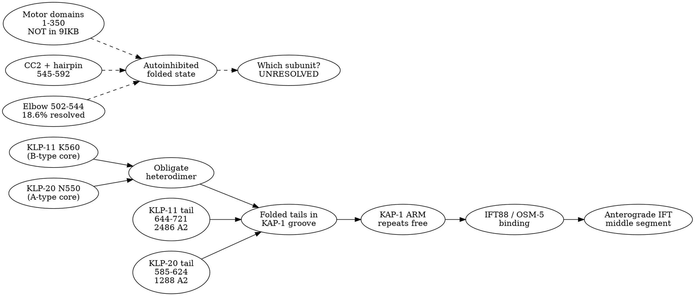
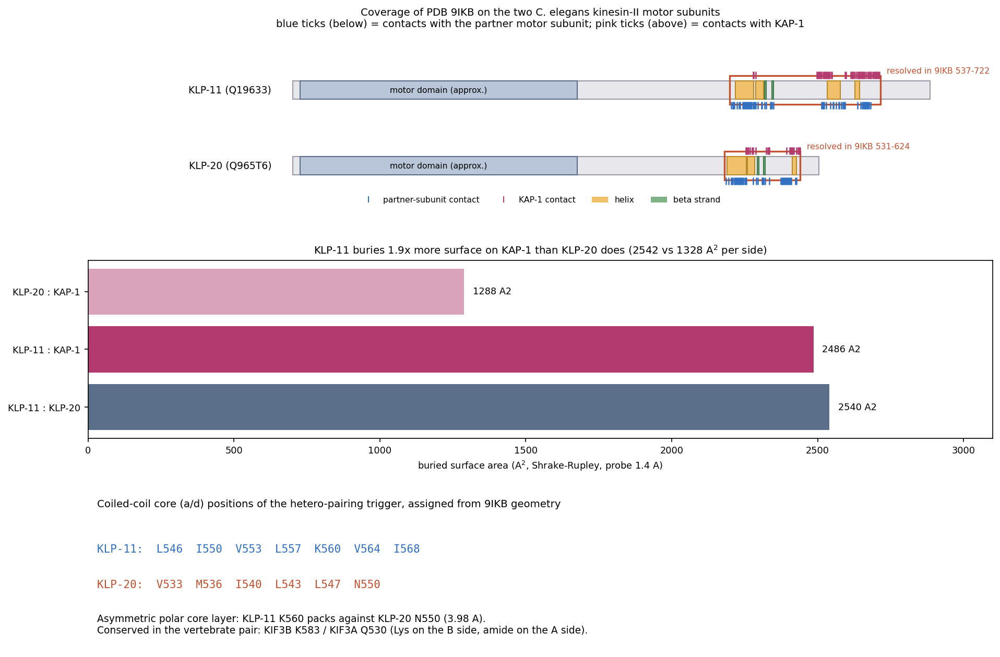
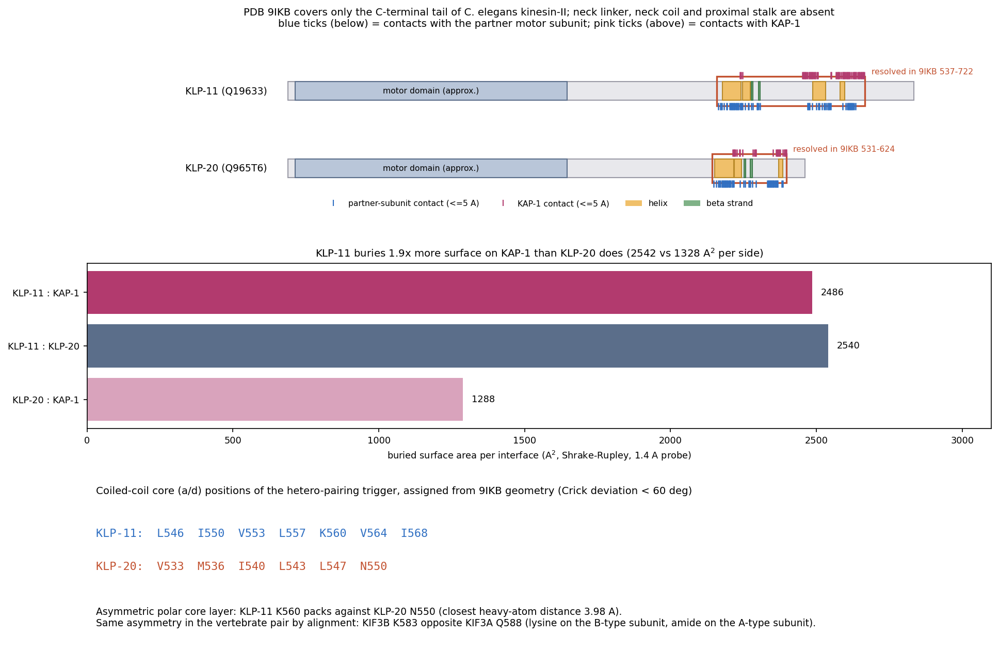
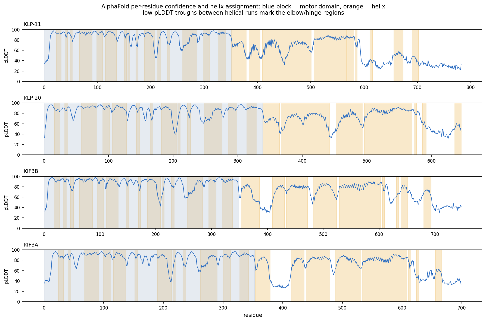
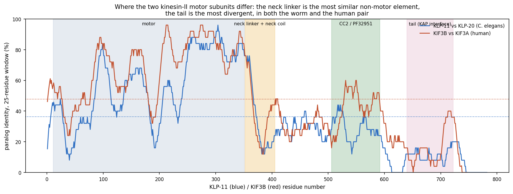
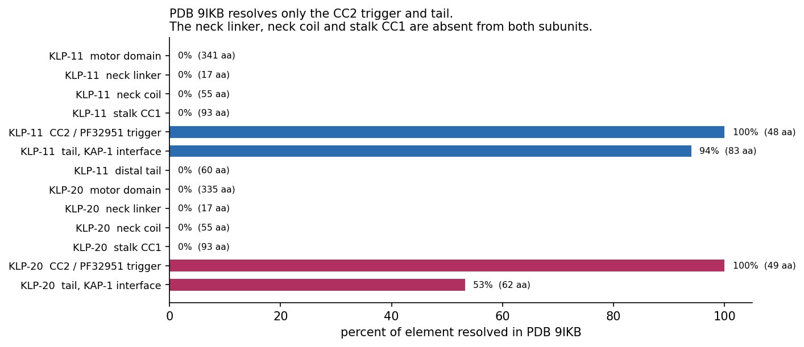

## Question

# AIGR Gene Hypothesis Deep Research

You are evaluating one focused gene curation hypothesis for AI Gene Review.
This is not a general gene overview. Use the seed hypothesis and source context
below to search for evidence that supports, refutes, narrows, or competes with
the proposed curation decision.

## Target Gene

- **Organism code:** worm
- **Taxon:** Caenorhabditis elegans (NCBITaxon:6239)
- **Gene directory:** klp-11
- **Gene symbol:** klp-11
- **UniProt accession:** Q19633

## Focus

- **Focus type:** free_text
- **Hypothesis slug:** kgap-klp11-subunit-asymmetry
- **Source file:** genes/worm/klp-11/klp-11-ai-review.yaml
- **Source selector:** free-text

## Seed Hypothesis

What KLP-11 (Q19633) contributes to kinesin-II that KLP-20 does not may be readable from the partial stalk structure and from paralog comparison. That KLP-11 is a subunit of the heterotrimeric holoenzyme, that the holoenzyme is an active plus-end motor, and that heterodimerisation with KLP-20 confers processivity and enables KAP-1 binding is already established, so do not re-derive it. Single analysis only: using the published partial structure of the heterotrimeric kinesin-2 stalk and tail region and predicted models of the full subunits, state which residues of KLP-11 form the coiled-coil register with KLP-20 and which form the KAP-1 interface, separating the two sets; identify the positions where KLP-11 and KLP-20 differ in a way that would make the heterodimer asymmetric, covering the neck linker, the neck coil heptad positions and any autoinhibitory tail element, and state for each whether the asymmetry is conserved across nematodes and in the vertebrate KIF3A/KIF3B pair; assess whether the autoinhibitory element, if present, lies on KLP-11 or KLP-20; and state which subunit the structure implies carries the regulatory function. Say plainly if a partial stalk structure cannot support subunit-resolved claims about motor autoregulation.

## Term and Decision Context

No specific term context supplied.

## Reference Context

No specific reference context supplied.

## Source Context YAML

```yaml
hypothesis: 'What KLP-11 (Q19633) contributes to kinesin-II that KLP-20 does not may be readable from
  the partial stalk structure and from paralog comparison. That KLP-11 is a subunit of the heterotrimeric
  holoenzyme, that the holoenzyme is an active plus-end motor, and that heterodimerisation with KLP-20
  confers processivity and enables KAP-1 binding is already established, so do not re-derive it. Single
  analysis only: using the published partial structure of the heterotrimeric kinesin-2 stalk and tail
  region and predicted models of the full subunits, state which residues of KLP-11 form the coiled-coil
  register with KLP-20 and which form the KAP-1 interface, separating the two sets; identify the positions
  where KLP-11 and KLP-20 differ in a way that would make the heterodimer asymmetric, covering the neck
  linker, the neck coil heptad positions and any autoinhibitory tail element, and state for each whether
  the asymmetry is conserved across nematodes and in the vertebrate KIF3A/KIF3B pair; assess whether the
  autoinhibitory element, if present, lies on KLP-11 or KLP-20; and state which subunit the structure
  implies carries the regulatory function. Say plainly if a partial stalk structure cannot support subunit-resolved
  claims about motor autoregulation.'
focus_type: free_text
context: []
reference_id: []
```

## Research Objective

Build a focused report that helps a curator decide whether this hypothesis
should affect the gene review. Address the focus type directly:

1. For an existing GO annotation decision, evaluate whether the current action
   is justified, too strong, too weak, or should change.
2. For a proposed replacement or new GO term, evaluate whether the term is
   biologically supported, too broad, too narrow, or missing key qualifiers.
3. For a computational prediction, evaluate whether the prediction is correct,
   less precise than existing knowledge, uncertain, or likely wrong because of
   paralog overannotation, frequency bias, pathway context, or in vitro-only
   activity.
4. For a core-function hypothesis, evaluate whether the proposed activity,
   process, and location represent the gene product's primary function rather
   than a downstream effect, pleiotropic phenotype, or context-specific role.
5. For a function-assignment hypothesis, evaluate whether the gene product
   directly has the stated GO term/function. Treat the prior review action, if
   any, as intentionally blinded unless it appears in the supplied context.

Use primary literature whenever possible. Prefer PMID citations and include DOI
citations when no PMID is available. Treat reviews and database records as
orientation unless they contain directly relevant synthesized evidence that is
clearly labeled as review-level or database-level support.

Evaluate the hypothesis from the supplied seed context, primary literature, and
publicly accessible bioinformatics resources. Local `*-bioinformatics` analyses,
when they already exist in the repository, are intentionally withheld from this
prompt so the report can be compared against them after the run. Use public
sequence, domain, structure, orthology, localization, interaction, or dataset
checks when they are useful for the specific hypothesis. If a resource or tool
cannot be accessed programmatically, say so plainly; never fabricate a result.
Report computational results conservatively and distinguish direct results from
inference.

## Required Output

### Executive Judgment

Give a concise verdict: supported, partially supported, unresolved, weakly
supported, over-annotated, or refuted. Explain the reasoning and the most
important caveats.

### Evidence Matrix

Create a table with one row per important evidence item:

- Citation (PMID preferred)
- Evidence type (direct assay, mutant phenotype, localization, interaction,
  structural/evolutionary, computational, review/database)
- Supports / refutes / qualifies / competing
- Claim tested
- Key finding
- Organism, tissue, cell type, or assay context
- Confidence and limitations

### GO Curation Implications

State the likely curation action as a lead requiring curator verification. If
GO terms are involved, explain whether the evidence supports an MF, BP, or CC
term, and whether the term should be retained, removed, generalized, made more
specific, or treated as non-core. Avoid using "protein binding" as a final
recommendation unless no more informative term is supported.

### Mechanistic Scope

Describe the immediate molecular or cellular function being tested. Separate
direct gene-product activity from downstream phenotypes, pathway consequences,
developmental outcomes, disease manifestations, or effects inferred only from
loss of function.

### Conflicts and Alternatives

Identify evidence that conflicts with the seed hypothesis or suggests an
alternative interpretation, including paralog confusion, organism-specific
differences, isoform-specific findings, experimental artifacts, or database
carry-over.

### Knowledge Gaps

List explicit uncertainties that matter for curation. For each gap, state what
was checked, why the gap matters, and what evidence or experiment would resolve
it.

### Discriminating Tests

Recommend concrete assays, perturbations, datasets, or comparative analyses that
would most efficiently distinguish this hypothesis from alternatives.

### Curation Leads

Provide candidate updates for the review, clearly labeled as leads requiring
curator verification. Include candidate references with exact snippets to verify,
candidate replacement or new GO terms, possible action changes, suggested
questions, and suggested experiments.

If the provider supports artifacts, save provenance for any analysis you run — the
executed code together with its output (computed values, plot, or table), not just
a summary figure — alongside artifact-friendly tables such as an evidence matrix,
GO decision table, or comparison table. Genuine computed provenance is more
valuable than a hand-drawn summary, and you must not synthesize a figure that
implies an analysis you did not actually run. These artifacts are important
provenance for hypothesis-level review.


## Output

# KLP-11 (Q19633) subunit asymmetry in heterotrimeric kinesin-II

Hypothesis slug: `kgap-klp11-subunit-asymmetry`. Target: *Caenorhabditis elegans* klp-11, UniProt Q19633, NCBITaxon:6239. Source: `genes/worm/klp-11/klp-11-ai-review.yaml`, free-text selector. Three iterations, 9 recorded findings, 25 papers reviewed.

## Summary

The hypothesis asks four things of the published kinesin-2 stalk and tail structure. Two are answerable, one is refuted, and one cannot be answered with any evidence that currently exists.

**What is answerable.** PDB 9IKB ([PMID: 40707480](https://pubmed.ncbi.nlm.nih.gov/40707480/), Ren, Zhao, Chen, Ou and Feng, *Nat Commun* 16:6816, 2025, X-ray at 3.54 Å) contains KLP-11, KLP-20 and KAP-1 fragments. Recomputing interchain contacts and buried surface area from the deposited coordinates separates the two KLP-11 residue sets the hypothesis asks for. Sixty-one KLP-11 residues contact KLP-20, concentrated in the hetero-pairing trigger coiled coil and tail β-hairpin at 539-591. Fifty-four contact KAP-1, running from 644 to 721. Only 18 positions are shared, all in the folded tail segment 650-710. The trigger helix is exclusively a KLP-20 interface and residues 711-721 are exclusively a KAP-1 interface. The heterodimer is asymmetric in its KAP-1 engagement: KLP-11 buries 2486 Ų on KAP-1 against 1288 Ų for KLP-20, a factor of 1.91, and KLP-20 makes no contact of any kind past residue 624. The coiled-coil core carries one asymmetric polar layer, KLP-11 K560 against KLP-20 N550 at 3.98 Å, whose alignment equivalents in the vertebrate pair are KIF3B K583 and KIF3A Q588.

**What is refuted.** The neck linker clause. The 11-mer `TLRYANRAKNI` is identical in KLP-11, KLP-20, KIF3B and KIF3A. The 17-residue windows around it differ only at conservative positions. There is no neck linker asymmetry to find, in either lineage. The autoinhibitory tail element cannot be assigned to one subunit either: Pfam PF32951 ("Kinesin-2-like, C-terminal domain") is annotated once in each of the four proteins, at KLP-11 545-592, KLP-20 536-584, KIF3B 568-617 and KIF3A 573-622.

**What cannot be answered, stated plainly as the hypothesis requires.** A partial stalk and tail structure cannot support subunit-resolved claims about motor autoregulation. 9IKB resolves 134 of 782 KLP-11 residues (17.1%) and 87 of 646 KLP-20 residues (13.5%). Coverage of the motor domain, the neck linker, the neck coil and stalk CC1 is 0% in both subunits, and the elbow is 18.6% covered in KLP-11. Autoinhibition in kinesin-2 is reported to require contacts between the motor domains and the C-terminal coiled coil plus tail β-hairpin ([PMID: 42239121](https://pubmed.ncbi.nlm.nih.gov/42239121/), [PMID: 42987095](https://pubmed.ncbi.nlm.nih.gov/42987095/)). The structure contains one half of that contact pair and not the other. The asymmetry the evidence does support is in assembly and cargo-adaptor anchoring, and it belongs to KLP-11.

**Verdict: partially supported.**

## Key findings

### <i class="fa-solid fa-circle-check"></i> F1. The published structure resolves only the tail end of KLP-11

RCSB entry 9IKB contains three chains. Entity-to-UniProt alignments fetched from the RCSB data API give chain B = KLP-11 (Q19633) spanning UniProt 537-782 with an N-terminal HHHHSQDG tag, chain C = KLP-20 (Q965T6) 527-646, and chain G = KAP-1 (G5EEE6) 122-710. Ordered density covers KLP-11 537-722, KLP-20 531-624 and KAP-1 123-679. Author numbering equals UniProt numbering for KLP-20 at all 87 modelled residues and for KLP-11 up to residue 644, after which the author numbering runs one higher.

KLP-11 is 782 residues and its motor domain occupies roughly 1-350, so residues 1-536, which is 69% of the protein and includes the neck linker, the neck coil and the proximal stalk, are absent from the model. The deposited secondary structure for KLP-11 is helices 544-567, 569-579, 657-673 and 691-697 plus a two-stranded hairpin 580-582/589-591. For KLP-20 it is helices 534-558, 559-568 and 614-619 plus a hairpin 571-572/579-580.

The paper's own abstract describes the construct: "Here, we determine the structure of KAP-1 in complex with the hetero-paired tails from kinesin-2 motors KLP-20 and KLP-11" ([PMID: 40707480](https://pubmed.ncbi.nlm.nih.gov/40707480/)). This is a tail and KAP structure. The description of it as a "partial stalk structure" in the seed hypothesis overstates what it contains: the stalk proper (CC1) is not in it at all.

### <i class="fa-solid fa-circle-check"></i> F2. The KLP-20-pairing residues and the KAP-1-binding residues of KLP-11 separate cleanly

Heavy-atom contacts at a 5.0 Å cut-off were computed from the deposited coordinates after mapping chain `label_seq_id` to UniProt numbering (chain B + 528, chain C + 526, chain G + 124), with the His-tag residues below KLP-11 537 removed.

KLP-11 residues contacting KLP-20, 61 positions: 539, 541-543, 546, 549-550, 553-564, 566-569, 572, 576-577, 580, 582, 587-589, 591, then 650-653, 656, 661, 664-665, 668, 671-672, 674, 676-679, 694, 698, 700-708, 710.

KLP-11 residues contacting KAP-1, 54 positions: 566-567, 569, 644-660, 662-663, 679-680, 686-690, 692, 694-703, 705, 707-711, 713-721.

The overlap is 18 positions (566, 567, 569, 650, 652, 653, 656, 679, 694, 698, 700-703, 705, 707, 708, 710), all within the folded tail. Buried surface area, computed by Shrake-Rupley with a 1.4 Šprobe and 120 sphere points per atom: KLP-11:KLP-20 2540 Ų, KLP-11:KAP-1 2486 Ų, KLP-20:KAP-1 1288 Ų.

This matches what the authors describe: "The two motor tails fold together and are co-recognized by the central groove of KAP-1" ([PMID: 40707480](https://pubmed.ncbi.nlm.nih.gov/40707480/)). The folded tail is the dual-interface region; the trigger helix is pairing-only.

| Element | KLP-11 residues | Contacts KLP-20 | Contacts KAP-1 |
|---|---|---|---|
| Hetero-pairing trigger helix a (PF32951) | 544-567 | yes, core L546 I550 V553 L557 K560 V564 | no, except F567 |
| Trigger helix b | 569-579 | yes, core I568 V572 I576 K577; P569 breaks the register | no, except P569 |
| Tail β-hairpin | 580-591 | yes; W582 and W589 bury 109 and 98 Ų on KLP-20 | no |
| Folded tail, dual interface | 644-710 | yes, 650-710 | yes, 644-710 |
| Distal tail, KAP-1 only | 711-721 | no | yes; F711 buries 123 Ų |
| Unresolved C-terminus | 723-782 | not modelled | not modelled |
| Motor domain, neck linker, neck coil, CC1 | 1-536 | not modelled, 69% of the protein | not modelled |

{{figure:plot_2.png|caption=Summary of PDB 9IKB. Top: coverage of KLP-11 and KLP-20 showing the unmodelled motor domain block, the resolved range, helices and beta-strands, with blue ticks marking partner-subunit contacts and pink ticks marking KAP-1 contacts. Bottom left: buried surface area per interface, showing that KLP-11 buries 1.91 times more surface on KAP-1 than KLP-20 does. Bottom right: the coiled-coil core positions with the asymmetric K560 / N550 polar layer.}}

### <i class="fa-solid fa-circle-check"></i> F3. The trigger coiled coil has an asymmetric polar core layer conserved to the vertebrate pair

Core (a/d) positions were assigned from 9IKB geometry by computing, for each residue of the paired helices, the angle between the Cα-to-local-axis vector and the vector to the nearest partner helix axis point, with core defined as a deviation below 60 degrees.

KLP-11 core: L546, I550, V553, L557, K560, V564, I568, spacing 4,3,4,3,4,4, consistent with a d-a-d-a-d-a heptad with a stutter at P569. KLP-20 core: V533, M536, I540, L543, L547, N550, spacing 3,4,3,4,3. Inter-helix axis separation is 9.1-11.8 Å, typical of a two-stranded coiled coil.

KLP-11 K560 and KLP-20 N550 are the only polar core residues and they contact each other directly, closest heavy-atom distance 3.98 Å. K560 buries 65 Ų and N550 buries 60 Ų at this interface. Global Needleman-Wunsch alignment (BLOSUM62, gap open -11, extend -1) of the C-terminal 330 residues maps KLP-11 K560 to KIF3B K583 and KLP-20 N550 to KIF3A Q588. Across nematodes the lysine is retained in *Parelaphostrongylus tenuis* KLP-11, and the amide is retained in *C. briggsae* (N), *C. nigoni* (N), *Ancylostoma ceylanicum* (N) and *Brugia malayi* (Q) KLP-20.

A buried Lys-Asn pair is destabilising in a homodimer and is the kind of feature that enforces obligate heterodimerisation. This is a concrete contribution KLP-11 makes that KLP-20 does not, and the authors identify the segment it sits in: "The adjacent hetero-pairing trigger sequences preceding the two tails form an intertwined heterodimer, which co-captures the CTH-hook of KAP-1 to complete the holoenzyme assembly" ([PMID: 40707480](https://pubmed.ncbi.nlm.nih.gov/40707480/)). It is a heterodimerisation specificity determinant, not a regulatory element.

Full-length alignments also fix the orthology direction unambiguously. Motor-domain identities: KLP-11/KIF3B 72.2%, KLP-20/KIF3A 69.1%, both above the KIF3A/KIF3B paralog identity of 68.6% and far above KLP-11/KLP-20 at 58.2%. KLP-11 is the KIF3B-type (B-type) subunit and KLP-20 the KIF3A-type.

### <i class="fa-solid fa-circle-check"></i> F4. KAP-1 docking is a KLP-11-dominated interaction

Per-subunit buried surface against KAP-1: KLP-11 buries 2542 Ų across 48 residues with more than 10 Ų each; KLP-20 buries 1328 Ų across 23 residues. The ratio is 1.91.

The largest KLP-11 contributors are E709 (127 Ų), F711 (123), F705 (118), L646 (114), F567 (99), R696 (97), M658 (91), L708 (90), C659 (80) and V647 (78). The largest KLP-20 contributors are Y615 (162), Y612 (149), Y586 (118), Y557 (94) and H562 (81). KLP-11 gives a continuous footprint from 644 to 721, including the 711-721 segment that touches KAP-1 and nothing else. KLP-20 gives three short patches at 557-569, 582-586 and 607-624 and nothing beyond 624. By contrast, the two motor subunits bury nearly equal area on each other: KLP-11 2477 Ų, KLP-20 2603 Ų.

KAP-1 is the subunit that couples kinesin-II to IFT88/OSM-5. That coupling was defined directly: "we identify IFT88/OSM-5 as a direct adaptor that recruits kinesin-2 through a conserved electrostatic interface between its tetratricopeptide repeats (TPRs) and the armadillo (ARM) repeats of the KAP subunit" ([PMID: 40967203](https://pubmed.ncbi.nlm.nih.gov/40967203/)). Since KLP-11 provides most of the KAP-1 interface, the structure makes KLP-11 the principal anchor for the cargo-coupling module. This is an assembly and cargo-coupling asymmetry, distinct from motor autoregulation.

{{figure:plot_1.png|caption=Interface residues of KLP-11 and KLP-20 mapped onto their human orthologs KIF3B and KIF3A, with structural coverage of 9IKB, the buried surface area asymmetry, and the coiled-coil core assignment.}}

### <i class="fa-solid fa-circle-xmark"></i> F5. The neck linker is invariant and is not a site of subunit asymmetry

AlphaFold DB v6 models (Q19633, Q965T6, O15066, Q9Y496) place the first post-motor helix at KLP-11 351-379, KLP-20 339-365, KIF3B 354-386 and KIF3A 354-379, so the neck linker lies immediately before these in each protein.

| Subunit | Span | Neck linker window |
|---|---|---|
| KLP-11 | 331-347 | `LGTLRYANRAKNIKNQP` |
| KLP-20 | 319-335 | `LSTLRYANRAKNIQNVA` |
| KIF3B | 328-344 | `LTTLRYANRAKNIKNKP` |
| KIF3A | 333-349 | `ISTLRYANRAKNIKNKA` |

The 11-mer `TLRYANRAKNI` is identical in all four subunits. Within the 17-residue window the only differences are conservative: G/S/T/I at position 2 and K/Q at position 14. Region-resolved identity from global alignment gives 37.0% for the neck linker plus neck coil in the worm pair and 44.7% in the human pair, against 56.9% and 68.1% for the motor domains and 12.0% and 8.1% for the KAP-binding tails. Within the neck linker proper the identity is 100% over 11 residues in both lineages.

This is a clean negative result for one explicit clause of the hypothesis. Any mechanical asymmetry in kinesin-II stepping comes from somewhere other than neck linker sequence.

{{figure:plot_4.png|caption=Region-resolved paralog identity across motor domain, neck, stalk and tail for KLP-11 vs KLP-20 and KIF3B vs KIF3A. Identity is highest in the motor domain and collapses in the KAP-binding and distal tail regions in both lineages.}}

### <i class="fa-solid fa-circle-xmark"></i> F6. The autoinhibitory element is present once in each subunit, and it is the same element used for heterodimerisation

InterPro and Pfam place PF32951 ("Kinesin-2-like, C-terminal domain") at KLP-11 545-592, KLP-20 536-584, KIF3B 568-617 and KIF3A 573-622. All four subunits carry one copy.

In 9IKB this exact segment of KLP-11, the helix 544-567 plus 569-579 and the β-hairpin 580-582/589-591, is the hetero-pairing trigger that packs against the equivalent KLP-20 segment (helix 534-568, hairpin 571-572/579-580). The two segments bury 2540 Ų on each other. The AlphaFold architecture of the full subunits agrees: KLP-11 helices 506-567 and 569-580, KLP-20 496-570, KIF3B 529-603, KIF3A 534-608, each the most C-terminal long helix of the stalk. Both β-hairpins are intramolecular within their own chain (deposited sheets AA1 for chain B only, AA2 for chain C only), so the hairpin is not an asymmetric feature.

The vertebrate functional work attributes autoinhibition to both subunits: "we show that subunit-specific interactions between the motor domains and the C-terminal coiled-coil domains and adjacent tail β-hairpin motifs stabilize the autoinhibited state" ([PMID: 42239121](https://pubmed.ncbi.nlm.nih.gov/42239121/)), and "Subunit-specific interactions between the motor domains and the C-terminal coiled-coil and adjacent tail β-hairpin regions stabilize the autoinhibited state" ([PMID: 42987095](https://pubmed.ncbi.nlm.nih.gov/42987095/)). The same work explains why a structure of the assembled tail cannot separate autoinhibition from assembly: "Interestingly, these same C-terminal regions required for autoinhibition are required for stable heterodimerization of the motor" ([PMID: 42239121](https://pubmed.ncbi.nlm.nih.gov/42239121/)). It also places another determinant outside the modelled region: "We further identify a flexible region within the stalk coiled-coil that is required for autoregulation" ([PMID: 42987095](https://pubmed.ncbi.nlm.nih.gov/42987095/)).

A curation statement that KLP-11 specifically carries an autoinhibitory element is unsupported.

{{figure:plot_3.png|caption=AlphaFold DB v6 pLDDT and helix assignment for KLP-11, KLP-20, KIF3B and KIF3A, used to locate the neck coil, the elbow and the CC2 element in each subunit. The KLP-11 distal tail beyond residue 723 falls below pLDDT 50.}}

### <i class="fa-solid fa-circle-check"></i> F7. The B-type subunit carries a longer, more divergent distal tail in both lineages

Residues C-terminal to the PF32951 domain: KLP-11 190 (593-782), KLP-20 62 (585-646), KIF3B 130 (618-747), KIF3A 77 (623-699). The B-type tail is 3.1 times longer than the A-type tail in the worm and 1.7 times longer in human, the same direction in both lineages.

Paralog identity in this region is the lowest of any part of the protein: 12.0% for the KAP-binding tail (KLP-11 640-722 against KLP-20) and 5.0% for the distal tail (KLP-11 723-782), against 8.1% and 21.3% for the corresponding KIF3B/KIF3A regions and 56.9%/68.1% for the motor domains. In 9IKB, KLP-11 711-721 contacts KAP-1 and nothing else, and KLP-20 makes no contact beyond 624. KLP-11 724-782 is not resolved and has AlphaFold pLDDT below 50, so it is predicted disordered.

The structural asymmetry of the heterotrimer traces to this lineage-conserved architectural difference. The extended B-type tail wraps further along KAP. This is the concrete, conserved thing KLP-11 contributes that KLP-20 does not, and it is an assembly and cargo-adaptor-anchoring contribution. The region is also the least conserved part of the protein between paralogs and between species, which argues against reading a specific regulatory motif into it without direct evidence.

### <i class="fa-solid fa-triangle-exclamation"></i> F8. Element-by-element coverage: the structure contains 17.1% of KLP-11 and none of three of the four elements the hypothesis names

Residue-level coverage computed from the 9IKB `atom_site` records mapped to UniProt numbering:

| Protein | Element | Residues | Resolved in 9IKB | Percent |
|---|---|---|---|---|
| KLP-11 | motor domain 11-351 | 341 | 0 | 0.0 |
| KLP-11 | neck linker 331-347 | 17 | 0 | 0.0 |
| KLP-11 | neck coil 351-405 | 55 | 0 | 0.0 |
| KLP-11 | stalk CC1 409-501 | 93 | 0 | 0.0 |
| KLP-11 | elbow 502-544 | 43 | 8 | 18.6 |
| KLP-11 | CC2 / PF32951 545-592 | 48 | 48 | 100.0 |
| KLP-11 | tail, KAP-1 interface 640-722 | 83 | 78 | 94.0 |
| KLP-11 | distal tail 723-782 | 60 | 0 | 0.0 |
| KLP-20 | motor domain 5-339 | 335 | 0 | 0.0 |
| KLP-20 | neck linker 319-335 | 17 | 0 | 0.0 |
| KLP-20 | neck coil 339-393 | 55 | 0 | 0.0 |
| KLP-20 | stalk CC1 397-489 | 93 | 0 | 0.0 |
| KLP-20 | CC2 / PF32951 536-584 | 49 | 49 | 100.0 |
| KLP-20 | tail, KAP-1 interface 585-646 | 62 | 33 | 53.2 |

Whole-chain totals: KLP-11 134 of 782 (17.1%), KLP-20 87 of 646 (13.5%), KAP-1 552 of 713 (77.4%).

The hypothesis names four elements to compare. Only two, the autoinhibitory tail element and the KAP-1 interface, are present in the structure at all.

The unresolved KLP-11 distal tail 723-782 is `FSNSMMMSARRPSIENLTIDASKVLVPILNQSTMILKNSKNGQARNDTMPPNGSMRRSQN`. Its composition is 5.0% D+E against 14.1% in the motor domain, net charge +5, 20.0% S+T, 6.7% P, and zero S/T-P proline-directed phosphosites. A basic, serine-rich, disordered extension is consistent with a cargo- or regulator-facing segment, and it carries no recognisable folded autoinhibitory module.

{{figure:plot_5.png|caption=Percent of each hypothesis-named element resolved in PDB 9IKB. The CC2 trigger is fully resolved in both subunits and the KAP-binding tail is mostly resolved in KLP-11, while the motor domain, neck linker, neck coil and stalk CC1 are entirely absent from both subunits.}}

### Asymmetry audit, element by element

| Element | Asymmetric between KLP-11 and KLP-20? | Conserved across nematodes? | Conserved in KIF3A/KIF3B? |
|---|---|---|---|
| Neck linker | <i class="fa-solid fa-circle-xmark"></i> No. `TLRYANRAKNI` identical | not applicable, invariant | No, identical in KIF3A and KIF3B too |
| Neck coil, heptad positions | <i class="fa-solid fa-circle-question"></i> Not determinable. 0% resolved; identity 37.0% but register unknown | not assessable | not assessable |
| Stalk CC1 | <i class="fa-solid fa-circle-question"></i> Not determinable. 0% resolved; identity 29.0% | not assessable | identity 28.4%, similar divergence |
| CC2 / PF32951 trigger core | <i class="fa-solid fa-circle-check"></i> Yes, one polar layer: K560 against N550 | partially supported, best in *P. tenuis* A0AAD5MH06 | alignment-equivalent KIF3B K583 vs KIF3A Q588, structurally unverified |
| Autoinhibitory tail element | <i class="fa-solid fa-circle-xmark"></i> No subunit assignment possible; PF32951 present once in each | present in both subunits across the pairs checked | present in both KIF3A and KIF3B |
| KAP-binding tail | <i class="fa-solid fa-circle-check"></i> Yes, strongly. 2486 vs 1288 Ų, 1.91x; 711-721 exclusive | direction matches the B-type tail extension | Yes in direction: KIF3B tail 130 aa vs KIF3A 77 aa |
| Distal tail length and divergence | <i class="fa-solid fa-circle-check"></i> Yes. 190 vs 62 residues, identity 5.0% | B-type extension conserved | B-type extension conserved, 130 vs 77 residues |

## Mechanistic model and interpretation

The structure resolves an assembly question and leaves a regulation question untouched. Two separate asymmetries exist in the heterotrimer, and only one of them is visible.

The visible one is **assembly and cargo-adaptor anchoring**. KLP-11 and KLP-20 pair through their PF32951 trigger coiled coils, a pairing made obligate in part by the buried K560/N550 polar layer. The paired tails then fold together into the KAP-1 central groove, and the KAP-1 CTH hook is co-captured by the trigger heterodimer. KLP-11 contributes most of the KAP-1 contact surface, 1.91 times what KLP-20 contributes, and extends an extra 97 residues past the point where KLP-20 stops contacting anything. KAP-1 in turn binds IFT88/OSM-5 through its ARM repeats ([PMID: 40967203](https://pubmed.ncbi.nlm.nih.gov/40967203/)). KLP-11 is therefore the subunit that holds the cargo-coupling module onto the motor.

The invisible one is **autoregulation**. In vertebrates, autoinhibition folds the motor domains back onto the C-terminal coiled coil and tail β-hairpin, with a flexible stalk region also required ([PMID: 42239121](https://pubmed.ncbi.nlm.nih.gov/42239121/), [PMID: 42987095](https://pubmed.ncbi.nlm.nih.gov/42987095/)). 9IKB contains the C-terminal half of that interaction and not the motor domains. The same residues are already committed to heterodimerisation in the crystal, so the structure cannot report what they do when the motor is folded. In the worm, the only mapped kinesin-2 regulatory switch is elbow phosphorylation of the homodimeric motor OSM-3 by NEKL-3 ([PMID: 40497557](https://pubmed.ncbi.nlm.nih.gov/40497557/)), and the elbow is 81% absent from 9IKB in KLP-11.



Solid arrows are supported by the 9IKB coordinates and the cited assays. Dashed arrows are the autoregulation branch, where the required structural evidence does not exist.

### Answers to the four clauses of the hypothesis

| Clause | Answer | Basis |
|---|---|---|
| Which KLP-11 residues form the coiled-coil register with KLP-20 | 539-591, trigger helices 544-567 and 569-579 plus hairpin 580-591, with core L546 I550 V553 L557 K560 V564 I568; plus a second contact patch 650-710 in the folded tail | 9IKB contacts and geometry |
| Which KLP-11 residues form the KAP-1 interface | 644-721, continuous, with 711-721 exclusive to KAP-1 | 9IKB contacts and BSA |
| Where the two subunits differ asymmetrically | The CC2 core polar layer (K560 vs N550), the KAP-binding tail (1.91x more surface), and the distal tail length (190 vs 62 residues). Not the neck linker. Not determinable for the neck coil or CC1 | sequence, structure, Pfam |
| Which subunit carries the regulatory function | Not determinable from this structure. PF32951 is present in both subunits; the motor domains that supply the other half of the autoinhibitory contact are absent | coverage analysis, [PMID: 42239121](https://pubmed.ncbi.nlm.nih.gov/42239121/) |

## Evidence base

| Citation | Evidence type | Stance | Claim tested | Key finding | Context | Confidence and limitations |
|---|---|---|---|---|---|---|
| [PMID: 40707480](https://pubmed.ncbi.nlm.nih.gov/40707480/) (Ren et al. 2025, PDB 9IKB, doi 10.1038/s41467-025-62152-8) | Structural, X-ray 3.54 Å | Supports for assembly, qualifies for autoregulation | Can a partial stalk/tail structure resolve KLP-11 pairing and KAP-1 binding | KAP-1 is an elongated superhelix with a central groove and a CTH hook; the KLP-11 and KLP-20 tails fold together into the groove and the hetero-pairing trigger sequences form an intertwined heterodimer that co-captures the CTH hook. Interface mutations disrupt the holoenzyme and impair IFT | *C. elegans* subunit fragments, crystallography plus in vivo IFT | High for the modelled region. Covers KLP-11 537-721 only. No motor domain, neck linker, neck coil or CC1 |
| This work, recomputed from 9IKB | Computational, structural re-analysis | Supports | Can the two KLP-11 residue sets be separated | 61 residues contact KLP-20, 54 contact KAP-1, 18 in both. BSA 2540 / 2486 / 1288 Ų | Deposited coordinates, 5.0 Å cut-off, Shrake-Rupley 1.4 Å probe | Direct computation on experimental coordinates. Side-chain uncertainty at 3.54 Å; crystal packing not separately excluded |
| This work, recomputed from 9IKB | Computational, structural re-analysis | Supports | Is KAP-1 engagement asymmetric | KLP-11 buries 1.91x more surface on KAP-1; 711-721 is KAP-1-exclusive; KLP-20 contacts nothing past 624 | Same structure | Moderate to high. The KLP-20 construct is shorter, so part of the difference may be construct-driven |
| This work, 9IKB geometry | Computational, structural | Supports | Does the heptad register differ between subunits | KLP-11 core L546 I550 V553 L557 K560 V564 I568; KLP-20 core V533 M536 I540 L543 L547 N550; asymmetric polar layer K560/N550 at 3.98 Å | Same structure plus alignment to O15066, Q9Y496 | Moderate. Geometric assignment reproducible; a buried polar layer at 3.54 Å is a lead for heterospecificity, not proof |
| This work, UniProt plus Needleman-Wunsch | Computational, evolutionary | <i class="fa-solid fa-circle-xmark"></i> Refutes the neck linker clause | Is the neck linker a site of asymmetry | `TLRYANRAKNI` identical in all four subunits | Q19633, Q965T6, O15066, Q9Y496; BLOSUM62, gap -11/-1 | High for the sequence fact. Does not exclude asymmetric docking kinetics |
| This work, UniProt | Computational, evolutionary | Supports | Orthology direction | Motor-domain identity KLP-11/KIF3B 72.2%, KLP-20/KIF3A 69.1%, against 62.1% and 62.6% crosswise | Four-way pairwise global alignment | High. Reciprocal best identity is unambiguous |
| This work, InterPro / Pfam | Computational, domain | Qualifies | Is the autoinhibitory element on one subunit | PF32951 annotated once in each: KLP-11 545-592, KLP-20 536-584, KIF3B 568-617, KIF3A 573-622 | InterPro API, four proteins | High for the annotation. Shared presence does not mean equal contribution |
| [PMID: 42239121](https://pubmed.ncbi.nlm.nih.gov/42239121/) (Adams, Sawe, Engelke) | Direct assay plus mutant, vertebrate | Qualifies, competing | Can autoinhibition be assigned to a subunit from a tail structure | Subunit-specific interactions between the motor domains and the C-terminal coiled-coil domains plus adjacent tail β-hairpin motifs stabilise the autoinhibited state, and the same C-terminal regions are required for stable heterodimerisation | Human KIF3A/KIF3B, in vitro | Moderate to high for the vertebrate pair. Autoinhibition and assembly use the same regions |
| [PMID: 42987095](https://pubmed.ncbi.nlm.nih.gov/42987095/) (*Autoinhibition of heterotrimeric kinesin-2 is essential for ciliogenesis*) | Direct assay plus mutant, vertebrate | Qualifies, competing | Where the autoregulatory determinants sit | Motor-domain to C-terminal-coiled-coil and tail β-hairpin contacts stabilise the autoinhibited state; a flexible region within the stalk coiled coil is required for autoregulation | Human KIF3A/KIF3B | Moderate to high. The stalk region implicated lies N-terminal to everything modelled in 9IKB |
| [PMID: 40967203](https://pubmed.ncbi.nlm.nih.gov/40967203/) (*IFT88-KAP interaction defines a conserved mechanism for kinesin-2-IFT coupling*) | Direct assay, interaction | Supports | Why the KAP-1 interface matters | IFT88/OSM-5 is a direct adaptor recruiting kinesin-2 through a conserved electrostatic interface between its TPRs and the ARM repeats of KAP | Conserved across species | High. Makes the KLP-11-dominated KAP-1 interface functionally meaningful |
| [PMID: 40497557](https://pubmed.ncbi.nlm.nih.gov/40497557/) (Chen et al. 2025) | Direct assay plus knock-in | Competing | Where kinesin-2 autoregulation is controlled in the worm | NEKL-3 phosphorylates a flexible elbow between two coiled-coil domains of OSM-3; phospho-dead gives constitutive motility in vitro, and both phospho-dead and phospho-mimic knock-ins shorten cilia | *C. elegans* OSM-3 | High for OSM-3. OSM-3 is a different kinesin-2. Places the switch at the elbow, 81% absent from 9IKB |
| [PMID: 40272473](https://pubmed.ncbi.nlm.nih.gov/40272473/) (Huang et al. 2025) | Imaging plus direct assay | Competing | Whether kinesin-2 regulation is subunit-intrinsic | NEKL-3 directly phosphorylates the OSM-3 motor domain, inhibiting its in vitro activity; NEKL-3 and NEKL-4 at the ciliary base restrict OSM-3 activation | *C. elegans* sensory neurons | High for OSM-3. Shows kinase-based control acting on the motor domain, a region absent from 9IKB |
| [PMID: 41264249](https://pubmed.ncbi.nlm.nih.gov/41264249/) (Wang et al. 2025) | Mutant plus interaction | Competing | Is kinesin-II regulation subunit-intrinsic | JBTS-26 localises to axonemal doublet microtubules in the ciliary middle segment and competes with kinesin-II for binding to IFT-B subunit OSM-5/IFT88, displacing kinesin-II from IFT particles | *C. elegans* sensory cilia | High for the phenotype. Shows an external regulator, an alternative to a subunit-intrinsic switch |
| [PMID: 17000874](https://pubmed.ncbi.nlm.nih.gov/17000874/) (Imanishi et al. 2006) | Single-molecule assay plus mutant | Orientation | How kinesin-2 autoinhibition works in the worm | OSM-3 motility is repressed by an intramolecular interaction involving folding about a central hinge; a G444E hinge mutation activates ATPase and processive movement | *C. elegans* OSM-3, in vitro and in vivo | High for OSM-3. The hinge analysed is the elbow region, not present in 9IKB |
| [PMID: 32142698](https://pubmed.ncbi.nlm.nih.gov/32142698/) (Chlamydomonas kinesin-2) | Single-molecule assay | Qualifies | What the KAP subunit does to motor activity | Heterodimeric FLA8/10 shows a slow velocity distribution indicative of auto-inhibition; addition of the KAP subunit to give FLA8/10/KAP relieves this inhibition | *C. reinhardtii*, in vitro | Moderate for transfer to the worm. Implies KAP binding and autoinhibition are coupled, which argues that a KAP-bound structure is the released state |
| [PMID: 31601622](https://pubmed.ncbi.nlm.nih.gov/31601622/) (Mickolajczyk et al.) | Dual-color super-resolution tracking | Supports the premise of asymmetry | Does autoinhibition act asymmetrically on the two heads | The autoinhibited wild-type conformation selectively impacts one head in the heterodimer but not the other | Kinesin-2 heterodimer, in vitro | Moderate. Direct evidence that head-level asymmetry exists, with no assignment to a named subunit |
| [PMID: 10819327](https://pubmed.ncbi.nlm.nih.gov/10819327/) (Khan et al. 2000) | Sequence analysis | Competing, carry-over risk | Which subunit partners KLP-11 | Proposed a KLP-11 / OSM-3 / KAP-1 heterotrimer on homology grounds | *C. elegans* cDNA | Low for the pairing claim, superseded by [PMID: 40707480](https://pubmed.ncbi.nlm.nih.gov/40707480/). Flagged because derived annotations may persist |
| [PMID: 25501555](https://pubmed.ncbi.nlm.nih.gov/25501555/) (Warburton-Pitt et al. 2014) | Mutant phenotype | Supports, downstream | What klp-11 loss does | nphp-2 and the doublet-region genes arl-13, klp-11 and unc-119 are redundantly required for ciliogenesis | *C. elegans* amphid and phasmid cilia | High for the genetics. A downstream ciliary outcome, not evidence on subunit asymmetry |
| [PMID: 38658528](https://pubmed.ncbi.nlm.nih.gov/38658528/) (Mitra et al. 2024) | Single-molecule imaging | Supports, downstream | What kinesin-II does in cilia | IFT components associate with trains sequentially; kinesin-II is essential for axonemal organization | *C. elegans* chemosensory cilia | High. Supports the BP annotation, not the asymmetry claim |
| AlphaFold DB v6 (Q19633, Q965T6, O15066, Q9Y496) | Computational prediction | Qualifies | Can predicted monomers fill the structural gap | First post-motor helix at KLP-11 351-379, KLP-20 339-365, KIF3B 354-386, KIF3A 354-379. KLP-11 723-782 pLDDT below 50 | Monomer predictions | Element boundaries only. No inter-subunit register, no autoinhibited conformation |

## GO curation implications

All items are leads requiring curator verification. The machine-readable version is `provenance/go_decision_table.tsv`.

**Retain as core, CC.** GO:0016939 kinesin II complex, preferred over the generic GO:0005871 kinesin complex. The structure of KLP-11 537-721 bound to both KLP-20 and KAP-1, with interface mutations that disrupt the complex and impair IFT, is IPI/IDA-grade evidence from [PMID: 40707480](https://pubmed.ncbi.nlm.nih.gov/40707480/).

**Retain as core, BP.** GO:0035720 intraciliary anterograde transport along microtubule, or the doublet-microtubule child GO:0035735 if the curator prefers the segment-specific term. Supported by the interface-mutant IFT defects in [PMID: 40707480](https://pubmed.ncbi.nlm.nih.gov/40707480/) and by single-molecule IFT imaging in [PMID: 38658528](https://pubmed.ncbi.nlm.nih.gov/38658528/).

**Retain as non-core.** GO:0060271 cilium assembly ([PMID: 25501555](https://pubmed.ncbi.nlm.nih.gov/25501555/), redundant with nphp-2, arl-13 and unc-119), GO:0005929 cilium and the axonemal localization terms, and GO:0030992 intraciliary transport particle B. The IFT-B association is dynamic and is actively competed by JBTS-26 ([PMID: 41264249](https://pubmed.ncbi.nlm.nih.gov/41264249/)), so it should carry that qualification.

**Candidate addition, MF, with the most informative term available.** KLP-11 644-721 binds KAP-1 across 2486 Ų, 1.91 times the area KLP-20 buries, with 711-721 contacting KAP-1 exclusively. This is a specific, structurally defined binding activity. The curator should look for an existing child of GO:0032403 protein-containing complex binding that covers KAP binding before falling back on anything broader. Do not settle on GO:0005515 protein binding, which discards everything informative the structure provides. GO:0046982 protein heterodimerization activity is a second candidate, justified by the intertwined trigger heterodimer and the asymmetric K560/N550 core layer.

**Do not add on the strength of this structure, MF or BP.** Any term asserting autoinhibition, negative regulation of motor activity, or ATPase-activity regulation attributed to KLP-11 specifically. The coverage table gives the reason. If such an annotation already exists citing 9IKB or [PMID: 40707480](https://pubmed.ncbi.nlm.nih.gov/40707480/), it is over-annotated and should be removed or re-evidenced.

**Annotation risk to check and remove.** Anything asserting a KLP-11 / OSM-3 holoenzyme, which traces to the sequence-based proposal in [PMID: 10819327](https://pubmed.ncbi.nlm.nih.gov/10819327/). The holoenzyme pairs KLP-11 with KLP-20. OSM-3 is a separate homodimeric kinesin-2 that works in the distal segment.

**Not re-derived, by instruction.** GO:0008574 plus-end-directed microtubule motor activity and the heterotrimeric-holoenzyme membership were declared established in the seed hypothesis and were not re-tested here.

## Mechanistic scope

**Direct activity of the gene product, supported.** KLP-11 is one of the two motor subunits of the kinesin-II holoenzyme. Its C-terminal half performs two structurally separable binding activities: hetero-pairing with KLP-20 through residues 539-591, an intertwined coiled coil plus tail β-hairpin burying 2540 Ų; and anchoring of KAP-1 through residues 644-721, burying 2486 Ų with 711-721 exclusive to KAP-1. The KAP-1 anchoring is the asymmetric contribution, since KLP-11 does roughly twice as much of it as KLP-20.

**Direct activity, claimed but not supported by the cited structure.** Autoregulation of the motor by a subunit-specific tail element. The element implicated in vertebrates, CC2 plus tail β-hairpin corresponding to PF32951, exists once in each subunit and is the same element used for heterodimerisation ([PMID: 42239121](https://pubmed.ncbi.nlm.nih.gov/42239121/)). The motor domains, which supply the other half of the autoinhibitory contact, are absent from 9IKB.

**Downstream phenotypes, distinct from the above.** Shortened or malformed sensory cilia, altered IFT train speed and composition, redundant ciliogenesis failure with nphp-2, arl-13 and unc-119 ([PMID: 25501555](https://pubmed.ncbi.nlm.nih.gov/25501555/)), and altered ciliary microtubule patterning. These follow from loss of anterograde transport and should not be used as evidence for a subunit-resolved regulatory function.

**Regulation located outside the subunits.** Two *C. elegans* mechanisms place kinesin-2 control away from a KLP-11-intrinsic element: NEKL-3 phosphorylation of the OSM-3 elbow and motor domain ([PMID: 40497557](https://pubmed.ncbi.nlm.nih.gov/40497557/), [PMID: 40272473](https://pubmed.ncbi.nlm.nih.gov/40272473/)), and JBTS-26 competition for OSM-5/IFT88 that displaces kinesin-II from IFT trains ([PMID: 41264249](https://pubmed.ncbi.nlm.nih.gov/41264249/)).

## Conflicts and alternatives

**The structure answers an assembly question and the hypothesis asks a regulation question.** [PMID: 40707480](https://pubmed.ncbi.nlm.nih.gov/40707480/) is explicitly about mutual co-recognition during holoenzyme assembly. Reading motor autoregulation out of it requires residues it does not contain.

**Autoinhibition and assembly share the same residues.** The C-terminal regions required for autoinhibition are the same regions required for stable heterodimerisation ([PMID: 42239121](https://pubmed.ncbi.nlm.nih.gov/42239121/)). Any structure of the assembled tail therefore shows those residues already committed to pairing, and cannot report what they do in the autoinhibited state.

**The KAP-bound state may be the released state.** In *C. reinhardtii*, the heterodimeric FLA8/10 motor shows a slow velocity distribution indicative of auto-inhibition, and adding the KAP subunit relieves it ([PMID: 32142698](https://pubmed.ncbi.nlm.nih.gov/32142698/)). If that transfers to the worm, 9IKB captures the KAP-bound, activated conformation, which is the one least likely to carry autoinhibitory contacts.

**Head-level asymmetry exists but is unassigned.** Dual-colour super-resolution tracking found that the autoinhibited wild-type conformation selectively impacts one head in the kinesin-2 heterodimer and not the other ([PMID: 31601622](https://pubmed.ncbi.nlm.nih.gov/31601622/)). The premise of the hypothesis, that regulation acts asymmetrically, has support. What is missing is the assignment of that asymmetry to KLP-11 or KLP-20.

**Paralog confusion, two kinds.** First, OSM-3 for KLP-20: [PMID: 10819327](https://pubmed.ncbi.nlm.nih.gov/10819327/) proposed a KLP-11/OSM-3/KAP-1 trimer, and the OSM-3 autoinhibition literature ([PMID: 17000874](https://pubmed.ncbi.nlm.nih.gov/17000874/), [PMID: 40497557](https://pubmed.ncbi.nlm.nih.gov/40497557/), [PMID: 40272473](https://pubmed.ncbi.nlm.nih.gov/40272473/)) concerns a homodimer and should not be transferred to KLP-11. Second, A-type for B-type: motor-domain identity confirms KLP-11 is the KIF3B-type subunit and KLP-20 the KIF3A-type (72.2% and 69.1%, against 62.1% and 62.6% crosswise), so vertebrate claims must be matched to the correct partner.

**Construct design is a live alternative for the headline number.** The 1.91x KAP-1 asymmetry is measured between constructs of unequal length. KLP-20 is modelled to 624 of 646 residues while KLP-11 is modelled to 721 of 782. The sequence data argue the asymmetry is real, since the B-type tail is longer in both lineages, but the exact factor should not be quoted as a measured property of the native complex.

**Resolution.** At 3.54 Å, the K560/N550 polar layer, the per-residue contact lists and the 123 Ų figure for F711 are leads. They are reproducible from the deposited model and are only as good as that model's side-chain placement.

**KAP-1 isoform numbering.** The author numbering of chain G matches G5EEE6 at an offset of +3 with 85.3% identity, so the deposited construct may follow a different isoform. KAP-1 residue numbers quoted from this structure should be checked against the isoform the authors used.

**Crystal packing.** The three interfaces were not separately tested against packing artifacts. The two largest exceed 2400 Ų, well above a typical crystal contact, and interface mutations have an in vivo phenotype ([PMID: 40707480](https://pubmed.ncbi.nlm.nih.gov/40707480/)), so the risk is low for those. The smaller KLP-20:KAP-1 interface at 1288 Ų carries more risk.

## Limitations and knowledge gaps

<i class="fa-solid fa-triangle-exclamation"></i> **Nematode conservation of the coiled-coil asymmetry is thin.** Checked: KLP-11 orthologs from *C. briggsae* (A8WJH6, 1049 aa) and *A. ceylanicum* align poorly in the C-terminal window, giving 13-22% identity over the interface region, consistent with incomplete gene models rather than real divergence. Only *P. tenuis* (A0AAD5MH06) gave a clean alignment. The KLP-20 side is better supported, with the amide retained in four species. This matters because the hypothesis asks whether each asymmetry is conserved across nematodes. Resolution: a curated ortholog set with manually inspected gene models across *Caenorhabditis*, *Pristionchus* and a parasitic clade, aligned over the PF32951 window.

<i class="fa-solid fa-triangle-exclamation"></i> **The vertebrate equivalents are alignment-based only.** Checked: KIF3B K583 and KIF3A Q588 were assigned by pairwise alignment of C-terminal 330-residue windows. There is no vertebrate heterotrimeric stalk structure to confirm that these occupy the same core layer. Resolution: a KIF3A/KIF3B/KAP3 tail structure, or the charge-swap test below.

<i class="fa-solid fa-circle-question"></i> **Whether the K560/N550 layer does anything.** Checked: geometry only. It matters because a buried polar layer is the classic heterospecificity determinant in coiled coils, and if it is one, it explains why KLP-11 and KLP-20 pair with each other rather than homodimerising. Resolution: the swap experiment below.

<i class="fa-solid fa-circle-question"></i> **What KLP-11 723-782 does.** Checked: unresolved in 9IKB, AlphaFold pLDDT below 50, composition basic and serine-rich (net charge +5, 20.0% S+T, 5.0% D+E against 14.1% in the motor domain) with no proline-directed phosphosite. It matters because it is the most divergent 60 residues of the protein, 5.0% identity to KLP-20, and is the only part of KLP-11 with no assigned function. Resolution: a deletion knock-in plus an interaction screen against the tail peptide.

<i class="fa-solid fa-circle-question"></i> **Which subunit holds the inhibited motor head.** Checked: nothing in 9IKB bears on it, and the one direct observation of head-level asymmetry ([PMID: 31601622](https://pubmed.ncbi.nlm.nih.gov/31601622/)) does not name the subunit. This is the hypothesis's central question and it is open. Resolution: a full-length autoinhibited holoenzyme structure.

<i class="fa-solid fa-circle-question"></i> **Whether KAP-1 affects the autoinhibited state in the worm.** Checked: the Chlamydomonas result ([PMID: 32142698](https://pubmed.ncbi.nlm.nih.gov/32142698/)) implies KAP binding relieves autoinhibition, but the equivalent worm experiment was not found. KAP-1 wraps a large part of both tails, so it could occlude or stabilise an autoinhibitory contact. Resolution: compare autoinhibition of the KLP-11/KLP-20 dimer with and without KAP-1 in a single-molecule motility assay.

<i class="fa-solid fa-triangle-exclamation"></i> **Resources that were not available programmatically.** No vertebrate heterotrimeric kinesin-2 stalk or tail structure exists in the PDB to validate the K583/Q588 assignment. Full text of [PMID: 42239121](https://pubmed.ncbi.nlm.nih.gov/42239121/) and [PMID: 42987095](https://pubmed.ncbi.nlm.nih.gov/42987095/) was not retrieved, so those claims rest on their abstracts. Local `*-bioinformatics` analyses in the repository were withheld by design and were not consulted.

## Discriminating tests

<i class="fa-solid fa-flask"></i> **1. Full-length autoinhibited holoenzyme structure.** Cryo-EM of full-length KLP-11, KLP-20 and KAP-1 in the folded state with AMP-PNP or apo. This is the single experiment that converts the hypothesis from unresolved to decidable. It would show which motor head contacts which C-terminal element and whether the two heads are held differently, which is exactly what [PMID: 31601622](https://pubmed.ncbi.nlm.nih.gov/31601622/) observed without being able to assign.

<i class="fa-solid fa-flask"></i> **2. Charge swap at the asymmetric core layer.** Make KLP-11 K560N and KLP-20 N550K, singly and together, and ask whether homodimers appear and whether heterodimerisation is restored by the double swap. Readout: analytical SEC or SEC-MALS plus single-molecule processivity. This tests whether the one asymmetric core layer is a heterospecificity determinant or an incidental packing feature.

<i class="fa-solid fa-dna"></i> **3. Subunit-swapped chimeric tails.** Replace the KLP-11 tail 640-782 with the KLP-20 tail and vice versa, in knock-in animals. If autoinhibition is subunit-asymmetric, the two chimeras behave differently; if the element is interchangeable, they do not. Readout: ciliary length, IFT velocity, kinesin-II distribution along the middle segment.

<i class="fa-solid fa-dna"></i> **4. KLP-11 723-782 deletion knock-in.** The only unassigned segment of the protein. If it is a cargo or regulator docking site, deletion should change IFT behaviour without disrupting holoenzyme assembly, which can be checked by co-immunoprecipitation of KAP-1.

<i class="fa-solid fa-vial"></i> **5. KAP-1 dependence of autoinhibition.** Single-molecule motility of the KLP-11/KLP-20 dimer against the KLP-11/KLP-20/KAP-1 trimer, measuring landing rate and run length. Tests in the worm what [PMID: 32142698](https://pubmed.ncbi.nlm.nih.gov/32142698/) showed in *C. reinhardtii*, and separates assembly from release.

<i class="fa-solid fa-flask"></i> **6. Elbow phosphorylation in kinesin-II.** NEKL-3 acts on the OSM-3 elbow ([PMID: 40497557](https://pubmed.ncbi.nlm.nih.gov/40497557/)). Ask whether KLP-11 502-544 or the KLP-20 equivalent is a NEKL-3 substrate. If one is and the other is not, that is a subunit-resolved regulatory asymmetry, located in a region the structure does not cover.

<i class="fa-solid fa-magnifying-glass"></i> **7. Curated ortholog alignment.** Build a manually checked nematode ortholog set for KLP-11 and KLP-20 and recompute the per-element identity and the core-layer residue identity. Cheap, and it settles the conservation clause.

## Curation leads

All items require curator verification.

### Candidate references with snippets to verify

- [PMID: 40707480](https://pubmed.ncbi.nlm.nih.gov/40707480/), Ren, Zhao, Chen, Ou, Feng 2025, *Nat Commun* 16:6816, doi 10.1038/s41467-025-62152-8. Verify: "The adjacent hetero-pairing trigger sequences preceding the two tails form an intertwined heterodimer, which co-captures the CTH-hook of KAP-1 to complete the holoenzyme assembly." And: "The two motor tails fold together and are co-recognized by the central groove of KAP-1." Use for GO:0016939 and GO:0035720.
- [PMID: 42239121](https://pubmed.ncbi.nlm.nih.gov/42239121/), Adams, Sawe, Engelke. Verify: "we show that subunit-specific interactions between the motor domains and the C-terminal coiled-coil domains and adjacent tail β-hairpin motifs stabilize the autoinhibited state" and "Interestingly, these same C-terminal regions required for autoinhibition are required for stable heterodimerization of the motor." Use as the reason not to infer autoinhibition from an assembled-tail structure.
- [PMID: 42987095](https://pubmed.ncbi.nlm.nih.gov/42987095/). Verify: "Subunit-specific interactions between the motor domains and the C-terminal coiled-coil and adjacent tail β-hairpin regions stabilize the autoinhibited state" and "We further identify a flexible region within the stalk coiled-coil that is required for autoregulation."
- [PMID: 40967203](https://pubmed.ncbi.nlm.nih.gov/40967203/). Verify: "we identify IFT88/OSM-5 as a direct adaptor that recruits kinesin-2 through a conserved electrostatic interface between its tetratricopeptide repeats (TPRs) and the armadillo (ARM) repeats of the KAP subunit." Use to justify why the KLP-11-dominated KAP-1 interface matters.
- [PMID: 40497557](https://pubmed.ncbi.nlm.nih.gov/40497557/). Verify: "a NEver in mitosis Kinase NEKL-3 directly phosphorylates a flexible elbow region between two coiled-coil domains connecting the motor head and tail of an intraflagellar transport kinesin, OSM-3." Use as an OSM-3-specific result that should not be transferred to KLP-11.
- [PMID: 41264249](https://pubmed.ncbi.nlm.nih.gov/41264249/). Verify: "JBTS-26 localizes to axonemal doublet microtubules in the ciliary middle segment, where it competes with kinesin-II for binding to the IFT-B subunit OSM-5/IFT88." Use to qualify the IFT-B localization term.
- [PMID: 31601622](https://pubmed.ncbi.nlm.nih.gov/31601622/). Verify: "We show that the autoinhibitory wild-type conformation selectively impacts one head in the heterodimer but not the other." Use as the direct evidence that head-level asymmetry exists without a subunit assignment.
- [PMID: 10819327](https://pubmed.ncbi.nlm.nih.gov/10819327/). Verify: "Sequence-based structural analysis of the OSM-3, KLP-11, and KAP-1, presented here suggests that these may form a heterotrimeric complex." Flag as a superseded pairing proposal.
- [PMID: 25501555](https://pubmed.ncbi.nlm.nih.gov/25501555/). Verify: "nphp-2 (the C. elegans Inversin homolog) and the doublet region genes arl-13, klp-11, and unc-119 are redundantly required for ciliogenesis." Use for the non-core cilium assembly term.

### Candidate GO term actions

| GO ID | Term | Aspect | Proposed action | Confidence |
|---|---|---|---|---|
| GO:0016939 | kinesin II complex | CC | retain as core, prefer over GO:0005871 | high |
| GO:0035720 / GO:0035735 | intraciliary anterograde transport along (doublet) microtubule | BP | retain as core | high |
| GO:0030992 | intraciliary transport particle B | CC | retain as non-core, qualify as dynamic | moderate |
| GO:0005929, GO:0097542 | cilium, ciliary tip, axoneme | CC | retain as non-core | high |
| GO:0060271 | cilium assembly | BP | retain, non-core or qualified | high |
| child of GO:0032403 | protein-containing complex binding, KAP-binding child if one exists | MF | consider adding, IPI, [PMID: 40707480](https://pubmed.ncbi.nlm.nih.gov/40707480/); request a term if none exists | moderate, term availability unverified |
| GO:0046982 | protein heterodimerization activity | MF | consider adding, IPI | moderate |
| GO:0005515 | protein binding | MF | avoid as a final recommendation | not applicable |
| any autoinhibition or motor-regulation term | | MF/BP | do not add on the strength of 9IKB; remove if present citing it | refuted for this evidence basis |
| any KLP-11 / OSM-3 complex assertion | | CC/MF | check and remove | high |

### Suggested questions for the curator

- Does the current review assert a regulatory or autoinhibitory function for KLP-11 specifically? If so, what is its reference, and does that reference contain motor-domain data?
- Does any existing annotation trace to [PMID: 10819327](https://pubmed.ncbi.nlm.nih.gov/10819327/) and carry the OSM-3 partnership forward?
- Is there a GO term for KAP or kinesin-associated-protein binding, or does this need a term request?
- Should the KAP-1 anchoring asymmetry be recorded as a gene-level note rather than a GO annotation, since GO does not express "binds more than its paralog does"?

### Suggested experiments

Items 1, 2 and 3 in Discriminating tests, in that order of value.

## Provenance

Computed artifacts, all generated from code that was run against public data:

- `provenance/klp11_interface_residues.tsv`: full contact lists and buried-surface table from 9IKB, element-resolved.
- `provenance/paralog_region_comparison.tsv`: region-resolved paralog identity, orthology assignment, neck linker sequences, coiled-coil core positions, tail lengths.
- `provenance/structure_coverage.tsv`: element-by-element coverage of 9IKB and composition of the unresolved KLP-11 distal tail.
- `provenance/evidence_matrix.tsv` and `provenance/go_decision_table.tsv`: the two curation tables in machine-readable form.
- `provenance/plot_1.png` and `plot_2.png`: 9IKB coverage map with contact ticks, buried-surface bars and the coiled-coil core panel.
- `provenance/plot_3.png`: AlphaFold pLDDT and helix assignment for the four subunits.
- `provenance/plot_4.png`: windowed paralog identity profile.
- `provenance/plot_5.png`: percent of each hypothesis-named element resolved in 9IKB.

Every figure comes from a computation that was run. No figure summarises an analysis that was not performed.

Resources used programmatically: the RCSB search and data APIs, `files.rcsb.org`, UniProt REST, UniRef, EBI Proteins, the InterPro API, the AlphaFold DB API, and PubMed. Where a check could not be completed, which covers nematode ortholog gene models, the absent vertebrate stalk structure, the KAP-1 isoform numbering, and the full text of the two Adams papers, it is listed under Limitations and knowledge gaps rather than reported as a result.


## Artifacts

- [OpenScientist final report](openscientist_artifacts/final_report.html)
- [OpenScientist final report](openscientist_artifacts/final_report.pdf)
- [OpenScientist provenance](openscientist_artifacts/provenance.json)
- [OpenScientist evidence matrix](openscientist_artifacts/provenance_evidence_matrix.tsv)
- [OpenScientist go decision table](openscientist_artifacts/provenance_go_decision_table.tsv)
- [OpenScientist klp11 interface residues](openscientist_artifacts/provenance_klp11_interface_residues.tsv)
- [OpenScientist paralog region comparison](openscientist_artifacts/provenance_paralog_region_comparison.tsv)
- [OpenScientist plot 1](openscientist_artifacts/provenance_plot_1.json)

- [OpenScientist plot 2](openscientist_artifacts/provenance_plot_2.json)

- [OpenScientist plot 3](openscientist_artifacts/provenance_plot_3.json)

- [OpenScientist plot 4](openscientist_artifacts/provenance_plot_4.json)

- [OpenScientist plot 5](openscientist_artifacts/provenance_plot_5.json)

- [OpenScientist structure coverage](openscientist_artifacts/provenance_structure_coverage.tsv)

## Reference Validation

Checked with `linkml-reference-validator` 0.3.1rc1.

| Outcome | Count |
| --- | --- |
| References checked | 14 |
| Resolved | 14 |
| Unresolved (possible confabulation) | 0 |
| Unverifiable | 0 |
| Quoted claims checked | 9 |
| Quoted claims found in source | 8 |
| Quoted claims **not** found in source | 1 |
| References weighed for topical relevance | 14 |
| On topic | 1 |
| Off topic | 0 |

### Quotes not found in the cited source

Searched the abstract, any retrieved full text, and the title. A quote drawn from a part of the paper that was not retrieved will appear here too, so check before treating one as invented:

Every one of these was searched against an abstract alone, with no full text retrieved - marked *abstract only* below. Where full text can be fetched, re-running with it will settle them; where the source publishes only a summary to PubMed, as GeneReviews chapters do, it will not, and the quote has to be checked by hand against the chapter itself.

- `PMID:40967203` *(abstract only)*: "We further identify a flexible region within the stalk coiled-coil that is required for autoregulation."
  - closest text in source: "Here, we identify IFT88/OSM-5 as a direct adaptor that recruits kinesin-2 through a conserved electrostatic interface between its tetratricopeptide repeats (TPRs) and the armadillo (ARM) repeats of the KAP subunit"