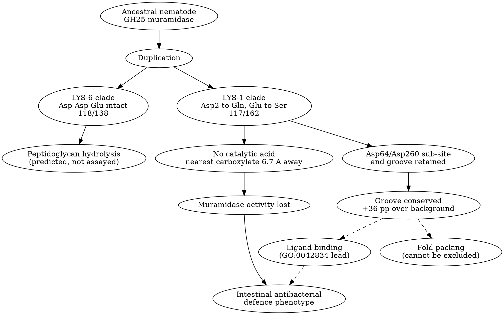
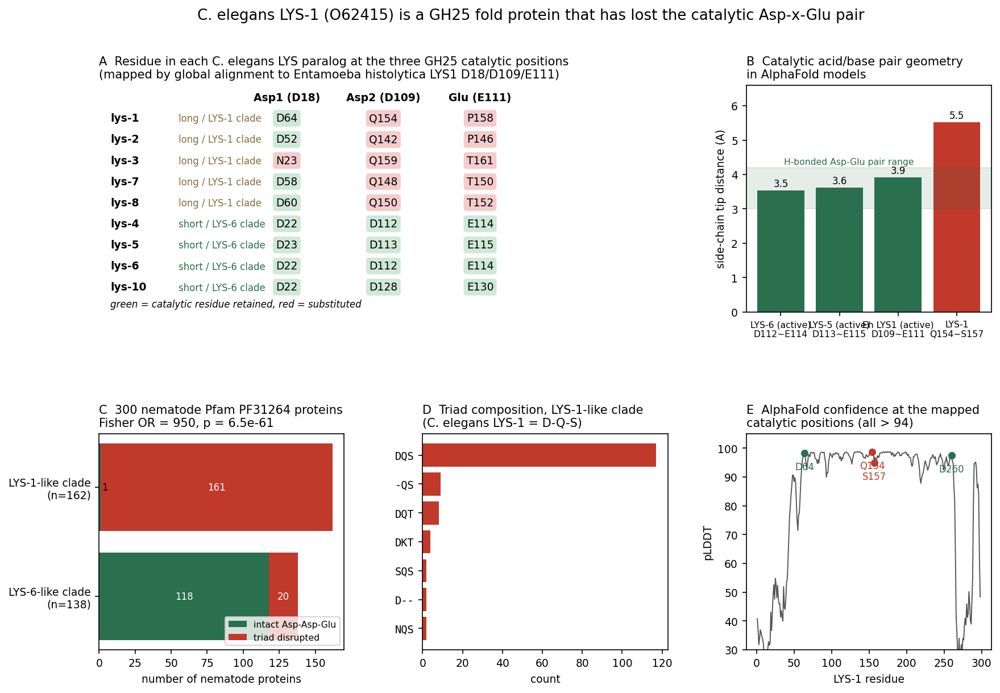
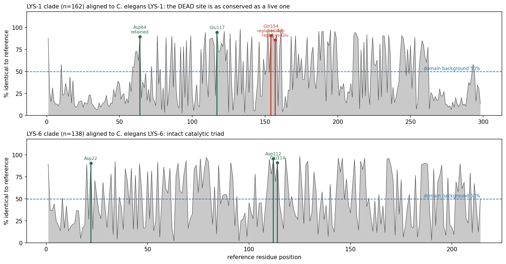
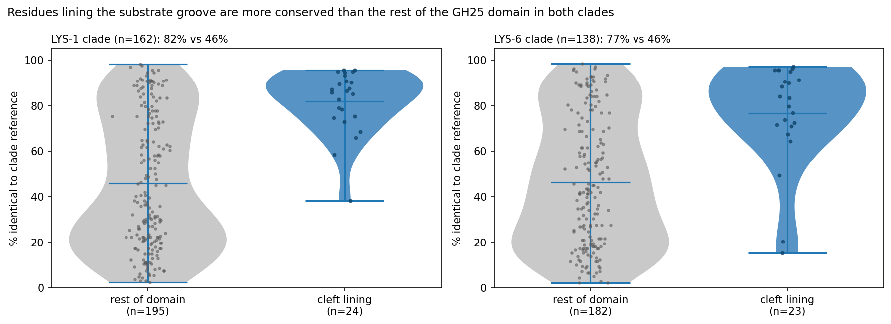
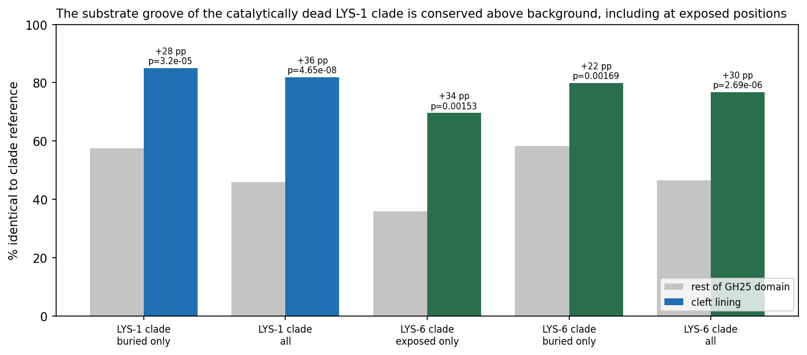
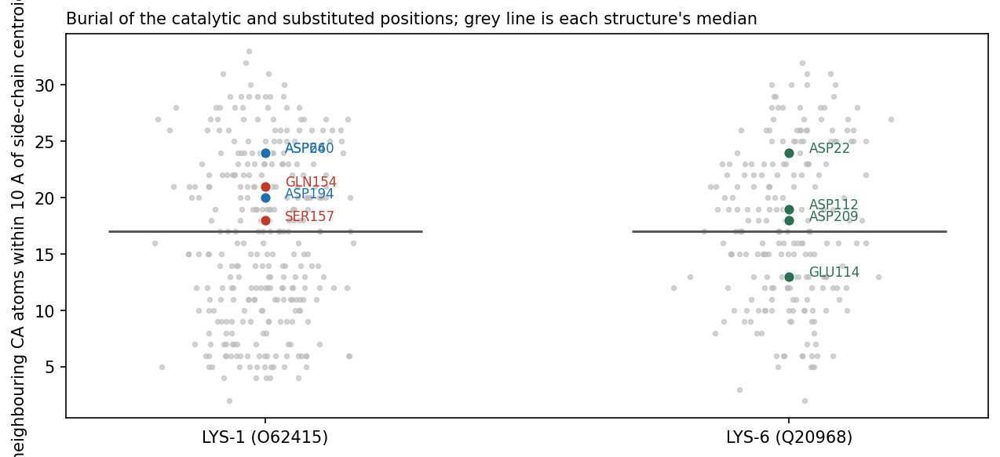

## Question

# AIGR Gene Hypothesis Deep Research

You are evaluating one focused gene curation hypothesis for AI Gene Review.
This is not a general gene overview. Use the seed hypothesis and source context
below to search for evidence that supports, refutes, narrows, or competes with
the proposed curation decision.

## Target Gene

- **Organism code:** worm
- **Taxon:** Caenorhabditis elegans (NCBITaxon:6239)
- **Gene directory:** lys-1
- **Gene symbol:** lys-1
- **UniProt accession:** O62415

## Focus

- **Focus type:** free_text
- **Hypothesis slug:** kgap-lys1-lysozyme-catalytic-residues
- **Source file:** genes/worm/lys-1/lys-1-ai-review.yaml
- **Source selector:** free-text

## Seed Hypothesis

Caenorhabditis elegans LYS-1 (UniProt O62415), a protist-type (Entamoeba-like, GH25-related or invertebrate) lysozyme family member, retains the catalytic residues required for muramidase activity. Single analysis only: identify LYS-1's lysozyme family by sequence and structure (Foldseek with the AlphaFold model), align it to characterized active members of that family with known catalytic residues (e.g. GH25 Cellosyl Asp/Glu, or Entamoeba lysozyme), and score the catalytic acid/base and nucleophile positions across C. elegans LYS paralogs and nematode orthologs; state whether LYS-1 is predicted catalytically competent.

## Term and Decision Context

No specific term context supplied.

## Reference Context

No specific reference context supplied.

## Source Context YAML

```yaml
hypothesis: 'Caenorhabditis elegans LYS-1 (UniProt O62415), a protist-type (Entamoeba-like, GH25-related
  or invertebrate) lysozyme family member, retains the catalytic residues required for muramidase activity.
  Single analysis only: identify LYS-1''s lysozyme family by sequence and structure (Foldseek with the
  AlphaFold model), align it to characterized active members of that family with known catalytic residues
  (e.g. GH25 Cellosyl Asp/Glu, or Entamoeba lysozyme), and score the catalytic acid/base and nucleophile
  positions across C. elegans LYS paralogs and nematode orthologs; state whether LYS-1 is predicted catalytically
  competent.'
focus_type: free_text
context: []
reference_id: []
```

## Research Objective

Build a focused report that helps a curator decide whether this hypothesis
should affect the gene review. Address the focus type directly:

1. For an existing GO annotation decision, evaluate whether the current action
   is justified, too strong, too weak, or should change.
2. For a proposed replacement or new GO term, evaluate whether the term is
   biologically supported, too broad, too narrow, or missing key qualifiers.
3. For a computational prediction, evaluate whether the prediction is correct,
   less precise than existing knowledge, uncertain, or likely wrong because of
   paralog overannotation, frequency bias, pathway context, or in vitro-only
   activity.
4. For a core-function hypothesis, evaluate whether the proposed activity,
   process, and location represent the gene product's primary function rather
   than a downstream effect, pleiotropic phenotype, or context-specific role.
5. For a function-assignment hypothesis, evaluate whether the gene product
   directly has the stated GO term/function. Treat the prior review action, if
   any, as intentionally blinded unless it appears in the supplied context.

Use primary literature whenever possible. Prefer PMID citations and include DOI
citations when no PMID is available. Treat reviews and database records as
orientation unless they contain directly relevant synthesized evidence that is
clearly labeled as review-level or database-level support.

Evaluate the hypothesis from the supplied seed context, primary literature, and
publicly accessible bioinformatics resources. Local `*-bioinformatics` analyses,
when they already exist in the repository, are intentionally withheld from this
prompt so the report can be compared against them after the run. Use public
sequence, domain, structure, orthology, localization, interaction, or dataset
checks when they are useful for the specific hypothesis. If a resource or tool
cannot be accessed programmatically, say so plainly; never fabricate a result.
Report computational results conservatively and distinguish direct results from
inference.

## Required Output

### Executive Judgment

Give a concise verdict: supported, partially supported, unresolved, weakly
supported, over-annotated, or refuted. Explain the reasoning and the most
important caveats.

### Evidence Matrix

Create a table with one row per important evidence item:

- Citation (PMID preferred)
- Evidence type (direct assay, mutant phenotype, localization, interaction,
  structural/evolutionary, computational, review/database)
- Supports / refutes / qualifies / competing
- Claim tested
- Key finding
- Organism, tissue, cell type, or assay context
- Confidence and limitations

### GO Curation Implications

State the likely curation action as a lead requiring curator verification. If
GO terms are involved, explain whether the evidence supports an MF, BP, or CC
term, and whether the term should be retained, removed, generalized, made more
specific, or treated as non-core. Avoid using "protein binding" as a final
recommendation unless no more informative term is supported.

### Mechanistic Scope

Describe the immediate molecular or cellular function being tested. Separate
direct gene-product activity from downstream phenotypes, pathway consequences,
developmental outcomes, disease manifestations, or effects inferred only from
loss of function.

### Conflicts and Alternatives

Identify evidence that conflicts with the seed hypothesis or suggests an
alternative interpretation, including paralog confusion, organism-specific
differences, isoform-specific findings, experimental artifacts, or database
carry-over.

### Knowledge Gaps

List explicit uncertainties that matter for curation. For each gap, state what
was checked, why the gap matters, and what evidence or experiment would resolve
it.

### Discriminating Tests

Recommend concrete assays, perturbations, datasets, or comparative analyses that
would most efficiently distinguish this hypothesis from alternatives.

### Curation Leads

Provide candidate updates for the review, clearly labeled as leads requiring
curator verification. Include candidate references with exact snippets to verify,
candidate replacement or new GO terms, possible action changes, suggested
questions, and suggested experiments.

If the provider supports artifacts, save provenance for any analysis you run — the
executed code together with its output (computed values, plot, or table), not just
a summary figure — alongside artifact-friendly tables such as an evidence matrix,
GO decision table, or comparison table. Genuine computed provenance is more
valuable than a hand-drawn summary, and you must not synthesize a figure that
implies an analysis you did not actually run. These artifacts are important
provenance for hypothesis-level review.


## Output

# LYS-1 (C. elegans, UniProt O62415): does it retain the residues required for muramidase activity?

Hypothesis slug: `kgap-lys1-lysozyme-catalytic-residues`
Source: `genes/worm/lys-1/lys-1-ai-review.yaml`, free-text focus
Taxon: Caenorhabditis elegans, NCBITaxon:6239

## Summary

The seed hypothesis has two halves and they resolve in opposite directions. The family assignment is
correct. LYS-1 is a glycoside hydrolase family 25 (GH25) protein, the protist/Chalaropsis/Entamoeba
type lysozyme family, confirmed independently at sequence level (PROSITE PS51904, CDD cd06416, Pfam
PF31264, Gene3D 3.20.20.80, SUPFAM SSF51445) and at structure level, where a Foldseek search of the
AlphaFold v6 model against PDB100 returns only GH25 structures in the top 12, led by Streptomyces
globisporus Cellosyl 1JFX at E = 4.1e-9.

The catalytic half is wrong. The GH25 catalytic set is Asp1 followed by an Asp-x-Glu pair, curated as
ACT_SITE in 22 reviewed UniProt GH25 entries spanning bacteria, phage, fungi, amoebae and nematodes.
LYS-1 retains only the first of the three. Asp64 is the first catalytic aspartate and superimposes on
the equivalent residue of the catalytically intact C. elegans paralog LYS-6 to within 0.17 Å. The
catalytic Asp-x-Glu pair is replaced by Gln154 and Ser157. No other carboxylate in the protein
occupies or can reach those positions: after a 150 CA-pair superposition at 1.20 Å RMSD, the nearest
acidic side chain to the Asp2 site is Asp194 at 8.37 Å and to the Glu site Asp194 at 6.67 Å, and
Asp194 sits 12.52 Å from Asp64, outside the carboxylate spacing used by either retaining or inverting
glycosidases. LYS-1 is predicted catalytically incompetent as a muramidase.

The loss is ancient and clade-wide. Across 300 nematode PF31264 proteins the family splits into a
LYS-6-like clade with an intact Asp-Asp-Glu triad in 118/138 proteins and a LYS-1-like clade with the
triad intact in 1/162, where the dominant state is the exact Asp-Gln-Ser of C. elegans LYS-1 in
117/162 (Fisher exact OR = 950, p = 6.5e-61). The dead site is maintained by selection rather than
decaying: Gln154 is fixed in 90.7% of the clade and Ser157 in 85.8%, at the 88.6th and 80.8th
percentile of conservation among positions in their own GH25 domain, which matches where the genuine
catalytic Asp112 and Glu114 sit in the active sister clade (95.1st and 90.2nd percentile). That makes
a non-catalytic binding function the live hypothesis for this clade, and it stops short of proof
because a burial control cannot separate ligand-site selection from fold packing in LYS-1.

## Executive judgment

**Verdict: partially supported in its family claim, refuted in its catalytic claim.**

<i class="fa-circle-check"></i> Supported: LYS-1 belongs to GH25 and adopts that fold with high
confidence. Five independent domain models agree, and the structural search is unambiguous.

<i class="fa-circle-xmark"></i> Refuted: LYS-1 does not retain the catalytic residues required for
muramidase activity. Two of three are substituted, the substitution is clade-defining across
nematodes, and no compensating carboxylate exists in the structure.

The most important caveats, in order of weight:

1. Everything reported here is computational. No enzyme assay has been published on purified LYS-1 in
   either direction, so the correct statement is "predicted catalytically incompetent as a
   muramidase", and not "experimentally shown to be inactive".
2. The only C. elegans lysozyme with measured peptidoglycan-degrading activity is ILYS-5, an
   invertebrate-type lysozyme from a different family ([PMID: 38925432](https://pubmed.ncbi.nlm.nih.gov/38925432/)).
   The C. elegans GH25 proteins as a group are biochemically uncharacterised, so there is no
   within-organism positive control for any GH25 activity claim.
3. Atypical GH25 proteins can turn out to be active. Dictyostelium CF45-1 and CF50 were assumed
   non-enzymatic and are not ([PMID: 39909204](https://pubmed.ncbi.nlm.nih.gov/39909204/)). That paper
   does not rescue LYS-1, because the residue its mutagenesis identified as essential is the
   glutamate, and LYS-1 has serine there.
4. All structural distances come from AlphaFold models. The backbone is high confidence (pLDDT 94-99
   at every mapped position) and the side-chain rotamers are predictions.

Note on independence: UniProt already carries a CAUTION on O62415 ("Lacks conserved active site
residues, suggesting it has no catalytic activity", ECO:0000305). That record was read during this
analysis. The residue mapping, superposition, 300-protein clade scan and conservation statistics
reported here were computed from primary sequence and structure data and reach the same conclusion by
an independent route, with quantitative geometry and population genetics the database annotation does
not provide.

## Key findings

### The GH25 fold assignment is solid

<i class="fa-dna"></i> The AlphaFold v6 model AF-O62415-F1 (298 residues, mean pLDDT 82.9) was
submitted to Foldseek in 3diaa mode against PDB100. The top 12 hits are all GH25 enzymes: 1jfx
Cellosyl (E = 4.1e-9, 19.9% sequence identity), 6zmv muramidase (E = 9.9e-9), 2x8r, 2wag, 5jip
Clostridium perfringens, 4krt and 4kru phage phiSM101, 4ff5, 5a6s and 1sfs. Superposing the LYS-1
model onto the model of the active C. elegans paralog LYS-6 (AF-Q20968, mean pLDDT 95.4) gives a
150 CA-pair core at 1.20 Å RMSD. The seed hypothesis is right about where this protein sits in
sequence and structure space. That is the part of the question that was never really in doubt, and
settling it is what makes the catalytic result interpretable: the active site is being read in a
protein that genuinely has the fold the active site belongs to.

### Two of three catalytic residues are gone and nothing replaces them

The GH25 catalytic set was taken from 22 reviewed UniProt entries with curated ACT_SITE features:
Entamoeba histolytica LYS1 (Q27650) D18/D109/E111, Streptomyces globisporus Cellosyl (P25310)
D86/D175/E177, phage Cp-1 CPL-1 (P15057) D10/D92/E94, Dictyostelium LYSG2 (Q86KC1) D24/D112/E114, and
the C. elegans paralogs LYS-5 (Q20967) D23/D113/E115, LYS-4 (Q20964) D22/D112/E114, LYS-6 (Q20968)
D22/D112/E114 and LYS-10 (O61518) D22/D128/E130. Global Needleman-Wunsch alignment of LYS-1 to three
independent active references gives the same mapping every time, at pairwise identities of 33.8%
(Entamoeba LYS1), 31.3% (LYS-6) and 27.1% (Cellosyl): Asp1 maps to LYS-1 Asp64, Asp2 maps to Gln154,
and the catalytic Glu maps to Ser157/Pro158. AlphaFold pLDDT at those positions is 98.2, 98.8 and
94.9, so this is not a disordered or low-confidence stretch.

Geometry gives the same answer from a different direction. The catalytic Asp-Glu pair tips sit 3.53 Å
apart in LYS-6, 3.62 Å in LYS-5 and 3.91 Å in Entamoeba LYS1, against 5.52 Å for Gln154-Ser157 in
LYS-1. After superposition onto LYS-6, the LYS-6 Asp22 and LYS-1 Asp64 carboxylates coincide at
0.17 Å, but the residues physically occupying the Asp112 and Glu114 sites are Gln154 (1.73 Å and
1.99 Å) and Ser157 (3.59 Å). The nearest LYS-1 carboxylate to either site is Asp194, at 8.37 Å and
6.67 Å, and Asp194 is 12.52 Å from Asp64, outside the 3-10 Å range used by either mechanism class.
The relocated-catalytic-residue escape route is closed.

{{figure:plot_1.png|caption=GH25 catalytic residue status of LYS-1 in context. The paralog table shows which C. elegans LYS proteins keep an intact Asp-Asp-Glu triad, the geometry panel compares the catalytic carboxylate spacing of active enzymes with the Gln154-Ser157 distance in LYS-1, and the clade scan covers 300 nematode PF31264 proteins. The pLDDT trace shows that the mapped positions fall in high-confidence regions of the model.}}

### The substitution defines a nematode-wide clade

Each of 300 nematode (taxon 6231) PF31264 proteins was globally aligned to both LYS-6 and LYS-1 and
assigned to whichever reference scored higher. The LYS-6-like clade (n = 138) keeps the intact triad
in 118/138 (85.5%). The LYS-1-like clade (n = 162) keeps it in 1/162 (0.6%), and the dominant motif is
Asp-Gln-Ser in 117/162 (72%), with Asp-Gln-Thr in 8 and Asp-Lys-Thr in 4. Fisher exact test gives
OR = 950, p = 6.5e-61. The dead clade spans Caenorhabditis, Diploscapter, Pristionchus, Acrobeloides,
Plectus, Steinernema, Strongyloides, Meloidogyne, Oesophagostomum, Ancylostoma and Necator, so the
loss predates the divergence of Rhabditida from Strongylida and Tylenchida.

The same split runs through C. elegans itself. lys-1, lys-2, lys-7 and lys-8 carry Asp-Gln-Ser or
Asp-Gln-Thr, and lys-3 carries Ser/Asn-Gln-Ser, while lys-4, lys-5, lys-6 and lys-10 carry an intact
Asp-Asp-Glu. C. elegans maintains two functionally distinct sets of GH25 proteins, and the gene with
the largest phenotype literature in the dead set is lys-7.

### The dead site is maintained, not decaying

All 162 LYS-1-clade proteins were aligned to C. elegans LYS-1 and all 138 LYS-6-clade proteins to
C. elegans LYS-6, and per-position identity to the reference was scored. The GH25 domain window of
each reference gives its own background.

| Clade | Position | Role | Identity | Percentile within domain | Binomial p vs background |
|---|---|---|---|---|---|
| LYS-1 (n=162) | Asp64 | catalytic Asp1, retained | 145/162 = 89.5% | 86.3rd | 5.95e-27 |
| LYS-1 (n=162) | Gln154 | replaces catalytic Asp2 | 147/162 = 90.7% | 88.6th | 7.34e-29 |
| LYS-1 (n=162) | Ser157 | replaces catalytic Glu | 139/162 = 85.8% | 80.8th | 7.47e-22 |
| LYS-1 (n=162) | Glu117 | not a catalytic position | 94.4% | 94.5th | |
| LYS-1 (n=162) | Asp194 | nearest spare carboxylate | 79.0% | 74.4th | |
| LYS-1 (n=162) | Asp260 | Asp64 partner | 66.0% | 63.5th | |
| LYS-6 (n=138) | Asp22 | catalytic Asp1 | 90.6% | 88.8th | |
| LYS-6 (n=138) | Asp112 | catalytic Asp2 | 132/138 = 95.7% | 95.1st | 1.55e-32 |
| LYS-6 (n=138) | Glu114 | catalytic Glu | 126/138 = 91.3% | 90.2nd | 1.22e-25 |
| LYS-6 (n=138) | Asp209 | Asp22 partner | 79.7% | 76.1st | |

Background mean identity over the domain is 49.9% in the LYS-1 clade and 49.8% in the LYS-6 clade. A
pseudo-enzyme under drift would put Gln154 and Ser157 at or below that background. They sit near the
top of the distribution, in the same percentile band as the genuine catalytic residues of the active
clade. The terminal extensions of the same proteins behave as negative controls and drift freely:
17.9% identity for residues 17-58 and 23.1% for residues 278-298, against 49.9% inside the domain. The
selection is confined to the GH25 domain, so this is not a whole-protein conservation artefact.

{{figure:plot_2.png|caption=Per-position conservation across both nematode clades. In the LYS-1 clade the two residues that replaced the catalytic pair, Gln154 and Ser157, rise well above the domain background (dashed line), reaching the same height as the genuine catalytic Asp112 and Glu114 do in the active LYS-6 clade shown below.}}

### The whole groove is conserved, and the reason is not resolved

Cleft-lining residues were defined geometrically and identically in both clades as any residue with a
side-chain heavy atom within 10 Å of the centroid of the four cleft positions (LYS-1
Asp64/Gln154/Ser157/Asp260, LYS-6 Asp22/Asp112/Glu114/Asp209). That gives 24 positions in LYS-1 and 23
in LYS-6 inside the respective domain windows.

| Clade | Subset | Cleft | Rest of domain | Difference | Rank-biserial | p |
|---|---|---|---|---|---|---|
| LYS-1 (n=162) | all domain positions | 81.9% (n=24) | 45.9% (n=195) | +36.0 pp | 0.669 | 4.65e-08 |
| LYS-6 (n=138) | all domain positions | 76.7% (n=23) | 46.4% (n=182) | +30.4 pp | 0.583 | 2.69e-06 |
| LYS-6 (n=138) | exposed only | 69.6% (n=7) | 35.8% (n=96) | +33.7 pp | 0.674 | 0.00153 |
| LYS-6 (n=138) | buried only | 79.9% (n=16) | 58.2% (n=86) | +21.7 pp | 0.464 | 0.00169 |
| LYS-1 (n=162) | buried only | 85.0% (n=22) | 57.4% (n=103) | +27.6 pp | 0.545 | 3.2e-05 |
| LYS-1 (n=162) | exposed only | not computable, only 2 of 24 cleft positions qualify | | | | |

<i class="fa-triangle-exclamation"></i> The last row is the limit of this analysis. The groove of the
catalytically dead clade is conserved slightly more above its own background than the groove of the
enzymatically intact clade, which is the result a maintained ligand site would produce. It is also the
result ordinary packing selection on the wall of a deep groove would produce, and in the LYS-1 clade
the two cannot be separated because 22 of 24 cleft positions are buried by a neighbour-count proxy. The
same control runs in LYS-6, where 7 exposed cleft positions give +33.7 pp (p = 0.0015), showing the
metric detects surface selection when it is there.

Burial of the individual positions does weaken the pure-packing reading without defeating it. Gln154
and Ser157 sit at the 65.8th and 53.7th burial percentile of their structure, the same range as the
genuine catalytic Asp112 (56.1st) and Asp22 (78.0th) of LYS-6, so they are no more buried than real
catalytic residues are.

Net charge gives no discrimination either. The LYS-1 clade has median pI 7.79 and net charge +4.2 at
pH 5.0; the LYS-6 clade has median pI 6.47 and +5.7. Mann-Whitney on charge at pH 5.0 gives p = 0.219.
Both clades are cationic at the acidic pH where the one assayed C. elegans lysozyme, ILYS-5, degrades
peptidoglycan, which fits a retained affinity for an anionic cell-wall polymer and is equally
consistent with shared ancestry.

{{figure:plot_3.png|caption=Residues lining the substrate groove are more conserved than the rest of the GH25 domain in both clades. The catalytically dead LYS-1 clade shows the larger excess over its own background (+36.0 percentage points) compared with the enzymatically intact LYS-6 clade (+30.4).}}

{{figure:plot_4.png|caption=Burial control. Splitting each structure at its own median neighbour count, the cleft excess survives among buried positions in both clades and among the 7 exposed positions of the LYS-6 clade. The LYS-1 exposed-only comparison is absent because only 2 of its 24 cleft positions fall below the exposure median, so packing selection cannot be ruled out for that clade.}}

{{figure:plot_5.png|caption=Burial of the catalytic and substituted positions against the full distribution of each structure. Gln154 and Ser157 sit at the 65.8th and 53.7th percentile of neighbour count, within the same range as the genuine catalytic Asp112 and Asp22 of LYS-6.}}

## Evidence matrix

| Citation / resource | Evidence type | Direction | Claim tested | Key finding | Context | Confidence and limitations |
|---|---|---|---|---|---|---|
| This work, Foldseek vs PDB100 on AF-O62415-F1-v6 | computational, structural | supports (family half) | LYS-1 is a GH25 fold protein | Top 12 hits all GH25: 1jfx Cellosyl E=4.1e-9, 6zmv E=9.9e-9, 2wag, 5jip, 4krt, 4kru, 4ff5, 5a6s, 1sfs | AlphaFold model, mean pLDDT 82.9 | High. Fold assignment only, says nothing about catalysis |
| UniProt O62415 cross-refs (PROSITE PS51904, CDD cd06416, Pfam PF31264, Gene3D 3.20.20.80, SUPFAM SSF51445) | review/database | supports (family half) | GH25 membership | Five independent domain models agree | Database | High for family, IEA-level |
| This work, NW alignment to Q27650, Q20968, P25310 | computational, evolutionary | refutes | LYS-1 retains the catalytic Asp/Asp/Glu | Asp1 to Asp64 (retained); Asp2 to Gln154; Glu to Ser157/Pro158. Same result from all three references at 27-34% identity | C. elegans protein vs Entamoeba, C. elegans LYS-6, Streptomyces Cellosyl | High. Pairwise alignment at 30% identity, three independent references agree, pLDDT > 94 at all mapped positions |
| 22 curated UniProt GH25 ACT_SITE records (Q27650, P25310, P15057, Q86KC1, Q20967, Q20964, Q20968, O61518 and others) | review/database | qualifies | The GH25 catalytic set is Asp...Asp-x-Glu | Triad position invariant across bacteria, phage, fungi, amoebae and nematodes | Multiple organisms | High as a definition of the family active site. These are UniRule/ProRule propagations, not per-protein assays |
| [PMID: 39909204](https://pubmed.ncbi.nlm.nih.gov/39909204/) (Ortjohann & Leippe 2025) | direct assay, mutagenesis | refutes (supports residue requirement) | The GH25 glutamate is required for catalysis | "Using structural modeling and site-directed mutagenesis, we identified a glutamic acid residue essential for catalysis" in Dictyostelium CF lysozymes | Recombinant protist GH25 enzymes, acidic pH | High for the residue requirement. Different organism, and the same paper shows atypical GH25 proteins can be active when the Glu is present |
| This work, AlphaFold superposition LYS-1 onto LYS-6 | computational, structural | refutes | Some other acidic residue substitutes for the lost pair | 150 CA core at 1.20 Å RMSD. LYS-6 Asp22 and LYS-1 Asp64 coincide at 0.17 Å. Nearest LYS-1 carboxylate to the Asp2 site: Asp194 at 8.37 Å; to the Glu site: Asp194 at 6.67 Å. Gln154 and Ser157 fill both sites at 1.7-3.6 Å | AlphaFold models, pLDDT 94-99 at all positions | Medium-high. Predicted structures, side chains modelled |
| This work, catalytic-pair geometry | computational, structural | refutes | The two catalytic carboxylates are correctly spaced | Asp2-Glu tip distance 3.53 Å (LYS-6), 3.62 Å (LYS-5), 3.91 Å (EhLYS1), against 5.52 Å for Gln154-Ser157 | AlphaFold models | Medium-high |
| This work, 300 nematode PF31264 proteins | computational, evolutionary | refutes | The loss is a C. elegans or annotation artefact | LYS-1-like clade 1/162 intact triad, 117/162 Asp-Gln-Ser. LYS-6-like clade 118/138 intact. Fisher OR = 950, p = 6.5e-61 | 11+ nematode genera | High. Clade assignment by best global-alignment score, not by phylogeny |
| This work, per-position conservation in 162 and 138 clade members | computational, evolutionary | qualifies | The substituted site is degenerate and under no selection | Gln154 90.7% (88.6th percentile, p = 7.3e-29), Ser157 85.8% (80.8th, p = 7.5e-22), Asp64 89.5% (86.3rd, p = 6.0e-27) against a 49.9% background. Active-clade control Asp112 95.7% (95.1st), Glu114 91.3% (90.2nd) against 49.8%. LYS-1 terminal extensions 17.9% and 23.1% | 11+ nematode genera | Medium-high. Conservation shows selection on the position, it does not identify the function being selected |
| This work, cleft-lining conservation and burial control | computational, structural, evolutionary | qualifies | The retained groove is under ligand-related selection | LYS-1 clade cleft 81.9% vs 45.9% (+36.0 pp, p = 4.7e-08); LYS-6 clade 76.7% vs 46.4% (+30.4 pp, p = 2.7e-06). Burial control: LYS-6 exposed-only +33.7 pp (p = 0.0015); LYS-1 exposed-only not computable, 2 of 24 positions | AlphaFold models, identical geometric rule in both clades | Medium. The signal is clear, its cause is not. Neighbour count is a weak exposure proxy inside a deep groove |
| This work, clade net charge | computational | qualifies | The LYS-1 clade has lost the cationic character of a cell-wall binder | LYS-1 clade median pI 7.79, +4.2 at pH 5.0; LYS-6 clade 6.47, +5.7. Mann-Whitney p = 0.219 | 162 and 138 nematode sequences | Medium. Charge is a coarse proxy. pH 5.0 chosen because ILYS-5 works at pH 4.0 or below |
| UniProt O62415 CAUTION (ECO:0000305) | review/database | refutes | LYS-1 is catalytically competent | "Lacks conserved active site residues, suggesting it has no catalytic activity" | Database | Medium. Curator inference, same conclusion as this analysis, reached independently here |
| [PMID: 12176330](https://pubmed.ncbi.nlm.nih.gov/12176330/) (Mallo et al. 2002) | mutant phenotype, localization | qualifies | LYS-1 has a defence function | "overexpression of the lysozyme gene lys-1 augments the resistance of C. elegans to S. marcescens" | C. elegans, Serratia marcescens infection | High for the phenotype, zero evidence on enzymatic mechanism |
| [PMID: 21853381](https://pubmed.ncbi.nlm.nih.gov/21853381/) (Irazoqui-type survey) | mutant phenotype, expression | qualifies | C. elegans lysozyme genes respond to Gram-positive infection | lys-7 among the immune genes regulated during S. aureus infection | C. elegans | Medium. Concerns lys-7, a paralog in the same dead clade, and is transcriptional |
| [PMID: 38925432](https://pubmed.ncbi.nlm.nih.gov/38925432/) (Berndt et al. 2024) | direct assay | competing | C. elegans lysozyme activity has been measured | ILYS-5, an invertebrate-type lysozyme from a different family, was purified and degrades peptidoglycan at low ionic strength and pH 4.0 or below | C. elegans, recombinant protein | High. Identifies which C. elegans lysozyme family the demonstrated muramidase activity belongs to. LYS-1 is in the other family |
| [PMID: 16809667](https://pubmed.ncbi.nlm.nih.gov/16809667/) (O'Rourke et al. 2006) | expression | competing | "Lysozyme" induction equals LYS-1 function | M. nematophilum infection induces genes encoding lysozymes among 68 upregulated genes, without resolving which paralogs | C. elegans | Medium. Source of paralog confusion in the downstream literature |
| [PMID: 22363222](https://pubmed.ncbi.nlm.nih.gov/22363222/) (Tasco study) | expression | qualifies | lys-1 is an induced immune gene | lys-1 among innate immune genes induced by a seaweed extract during P. aeruginosa infection | C. elegans | Low for mechanism. Transcriptional only |
| [PMID: 10545329](https://pubmed.ncbi.nlm.nih.gov/10545329/) (van Asselt et al. 1999) | structural, mutagenesis | qualifies | A lysozyme-like fold with a deep substrate groove can bind GlcNAc at a single catalytic glutamate | Slt35 binds GlcNAc in a deep groove, and "mutation of Glu162 into a glutamine residue yielded a completely inactive enzyme" | E. coli lytic transglycosylase | Medium. Different family, but a direct precedent that Glu-to-Gln substitution abolishes activity while the binding groove persists |

## Mechanistic model

The immediate molecular activity under test is hydrolysis of the beta-1,4 bond between
N-acetylmuramic acid and N-acetylglucosamine in peptidoglycan, carried out by the GH25 active site.
That requires the Asp-x-Glu pair on the beta strand lining one wall of the cleft, with the glutamate
acting as catalytic acid. Its removal abolishes activity in an experimentally tested GH25 protein
([PMID: 39909204](https://pubmed.ncbi.nlm.nih.gov/39909204/)) and in the distantly related
lysozyme-like Slt35, where Glu162 to Gln gave a completely inactive enzyme
([PMID: 10545329](https://pubmed.ncbi.nlm.nih.gov/10545329/)). LYS-1 has Gln and Ser at the two
positions.

What LYS-1 retains is the opposite wall of the cleft: Asp64 with its partner Asp260 at 3.25 Å, the
same geometry as LYS-6 Asp22/Asp209 at 3.18 Å. That is a binding sub-site.



Separate from the direct activity, every published LYS-1 phenotype is organismal. Transcriptional
induction by Serratia marcescens, increased resistance on lys-1 overexpression
([PMID: 12176330](https://pubmed.ncbi.nlm.nih.gov/12176330/)), induction during Pseudomonas aeruginosa
challenge ([PMID: 22363222](https://pubmed.ncbi.nlm.nih.gov/22363222/)) and reduced survival on
Staphylococcus aureus after RNAi are whole-animal readouts. They establish that LYS-1 contributes to
defence. None distinguishes an enzyme from a binding protein, an opsonin, or a component acting
alongside the catalytically intact paralogs LYS-4, LYS-5, LYS-6 and LYS-10 or the ILYS proteins. The
defence phenotype must not be used as evidence for lysozyme activity.

## GO curation implications

All of the following are leads requiring curator verification.

| GO term | Aspect | Current | Lead | Reason |
|---|---|---|---|---|
| GO:0003796 lysozyme activity | MF | IEA:InterPro | <i class="fa-circle-xmark"></i> Remove | Domain-level match without active-site verification. Two of three catalytic residues substituted, no compensating carboxylate |
| GO:0004553 hydrolase activity, O-glycosyl | MF | not present | <i class="fa-circle-xmark"></i> Do not add | Generalising keeps the same unsupported catalytic assertion |
| GO:0009253 peptidoglycan catabolic process | BP | IEA:InterPro | <i class="fa-circle-xmark"></i> Remove | Downstream of the removed MF |
| GO:0016998 cell wall macromolecule catabolic process | BP | IEA:InterPro | <i class="fa-circle-xmark"></i> Remove | Downstream of the removed MF |
| GO:0042834 peptidoglycan binding | MF | not present | <i class="fa-circle-question"></i> Hypothesis-level lead only | Retained Asp64/Asp260 sub-site plus a groove conserved +36 pp above background across 162 orthologs. Not assertable: the burial control cannot exclude fold packing, and no binding assay exists |
| GO:0050829 defense response to Gram-negative bacterium | BP | IEP | <i class="fa-circle-check"></i> Retain | Rests on infection-induced expression, independent of catalysis |
| GO:0050830 defense response to Gram-positive bacterium | BP | IMP | <i class="fa-circle-check"></i> Retain | Rests on RNAi phenotype, independent of catalysis |
| GO:0045087 innate immune response | BP | IMP | <i class="fa-circle-check"></i> Retain | Same basis |
| GO:0031410 cytoplasmic vesicle | CC | IDA/EXP | <i class="fa-circle-check"></i> Retain | Direct localization evidence |
| GO:0060205 cytoplasmic vesicle lumen | CC | IDA/EXP | <i class="fa-circle-check"></i> Retain | Direct localization evidence |
| GO:0045177 apical part of cell | CC | IDA/EXP | <i class="fa-circle-check"></i> Retain | Direct localization evidence |
| GO:0007165 signal transduction | BP | IBA | <i class="fa-circle-question"></i> Flag | Not addressed by this analysis and unsupported by any LYS-1-specific evidence seen here |

**Core function statement.** The core function of LYS-1 is best described as a secreted or vesicular
GH25-fold protein acting in intestinal antibacterial defence, with the muramidase activity of the
family lost. It should not be described as a lysozyme enzyme. "Protein binding" is deliberately not
recommended: the structural evidence points at a carbohydrate or cell-wall ligand, and GO:0042834 is
the more informative term to test.

## Conflicts and alternatives

1. **Atypical GH25 proteins can still be active.** [PMID: 39909204](https://pubmed.ncbi.nlm.nih.gov/39909204/)
   showed that Dictyostelium CF45-1 and CF50, previously assumed non-enzymatic because of their
   unusual architecture, are active lysozymes. This is the strongest argument for caution. It does
   not rescue LYS-1: in the CF proteins the catalytic glutamate is present, and the same study
   identified that glutamate as essential by site-directed mutagenesis. LYS-1 has lost it.
2. **Relocated catalytic residue.** Tested and rejected. Asp194 is the only candidate and sits
   6.7-8.4 Å from the required positions and 12.52 Å from Asp64.
3. **Alternative GH25 sub-site geometry.** The three reference enzymes used span bacteria, protists
   and nematodes and give the same mapping, so a lineage-specific repositioning of the active site is
   unlikely.
4. **Paralog confusion.** Real and widespread in this family. C. elegans has at least nine GH25
   proteins plus five ILYS proteins. Microarray and RNAi studies report "lysozymes" without
   distinguishing them ([PMID: 16809667](https://pubmed.ncbi.nlm.nih.gov/16809667/),
   [PMID: 21853381](https://pubmed.ncbi.nlm.nih.gov/21853381/),
   [PMID: 22363222](https://pubmed.ncbi.nlm.nih.gov/22363222/)). Phenotypes attributed to "C. elegans
   lysozyme" should not be transferred to LYS-1, and activity measured on ILYS-5
   ([PMID: 38925432](https://pubmed.ncbi.nlm.nih.gov/38925432/)) belongs to a different family.
5. **AlphaFold limitation.** All structural numbers come from predicted models. The backbone is high
   confidence (pLDDT 94-99 at every mapped position) and side-chain rotamers are predictions. This
   affects the precise distances, not the residue identities, which come from sequence.
6. **Database carry-over.** GO:0003796 on LYS-1 is IEA from InterPro IPR002053, a domain-level
   signature carried equally by the catalytically intact paralogs, so the IEA pipeline cannot
   discriminate. This is a textbook case of domain-match overannotation.
7. **Conservation of the groove may be fold packing.** The main objection to the binding lead, and it
   survives testing. Cleft-lining residues in the LYS-1 clade are conserved +36.0 pp over background,
   and 22 of the 24 positions are buried, so the exposed-only control is not computable for that
   clade. The control does run in LYS-6 (+33.7 pp on 7 exposed positions, p = 0.0015), showing the
   metric detects surface selection when present. Gln154 and Ser157 are no more buried than the
   genuine catalytic residues of LYS-6. Packing is an incomplete explanation and it is not excluded.
8. **Charge gives no discrimination.** The two clades are statistically indistinguishable in net
   charge at pH 5.0 (p = 0.219), consistent with a retained affinity for an anionic cell-wall polymer
   and equally consistent with shared ancestry.

## Knowledge gaps

1. **No enzyme assay on LYS-1.** PubMed was searched for C. elegans lysozyme biochemistry; the only
   purified, assayed C. elegans lysozyme is ILYS-5
   ([PMID: 38925432](https://pubmed.ncbi.nlm.nih.gov/38925432/)). This matters because a negative
   result would convert the prediction into direct evidence and a positive one would overturn it.
   Resolved by: recombinant LYS-1 tested on Micrococcus luteus cells and fluorescent peptidoglycan
   across pH 3-7 at low ionic strength, using the ILYS-5 and CF50 conditions, with an active paralog
   as positive control.
2. **Does LYS-1 bind peptidoglycan without cleaving it?** Not tested anywhere. The most informative
   open question, because the groove is under selection (Asp64, Gln154 and Ser157 all above the 80th
   percentile of their domain background) while the ligand is unidentified. Resolved by: pull-down or
   ITC of recombinant LYS-1 with insoluble peptidoglycan and with defined muropeptides. A negative
   result would redirect the search to another cell-wall or glycan ligand.
3. **Which GH25 residue is the general acid and which the base?** The curated ACT_SITE records give
   positions without roles, and literature searches for the Cellosyl and CPL-1 mechanism papers
   returned nothing usable. This matters only for the precision of the mechanistic wording, not for
   the conclusion, since both roles are absent in LYS-1.
4. **Do the nine C. elegans GH25 proteins act together?** Four keep an intact triad and five do not.
   Whether the dead ones work alongside the live ones is unknown and decides whether a shared
   non-catalytic BP term is appropriate.
5. **No experimental structure.** There is no PDB entry for any nematode GH25 protein. This matters
   for confirming the cleft geometry and for measuring real side-chain positions rather than modelled
   ones.
6. **The exposure of the LYS-1 cleft is not properly measured.** The neighbour-count proxy used here
   is weak inside a deep groove. Proper solvent-accessible surface area with a probe large enough to
   represent a glycan would give a sharper burial control and could rescue the exposed-only test.

## Discriminating tests

1. <i class="fa-flask"></i> Express LYS-1 and LYS-6 in parallel and assay both on M. luteus and on
   peptidoglycan at pH 3.0-5.0. LYS-6 active and LYS-1 inactive confirms the prediction in one
   experiment.
2. <i class="fa-flask"></i> Gain-of-function reversion: LYS-1 Q154D/S157E double mutant. If muramidase
   activity appears, the two substitutions are the sole cause of inactivation and the structural
   mapping is correct.
3. <i class="fa-flask"></i> Loss-of-function control in the active paralog: LYS-6 D112Q/E114S. Should
   abolish activity.
4. <i class="fa-vial"></i> Peptidoglycan pull-down comparing wild-type LYS-1, a D64N mutant and a
   Q154A/S157A double mutant. The conservation result predicts Gln154 and Ser157 contribute to
   binding, so alanine substitution should reduce it if that prediction holds. This is the single
   test that separates the ligand-site and fold-packing explanations.
5. <i class="fa-dna"></i> Rescue specificity: test whether lys-1 overexpression still increases
   S. marcescens resistance when Asp64 is mutated. If the defence phenotype is Asp64-independent, it
   is not cleft-mediated.
6. <i class="fa-magnifying-glass"></i> Extend the clade scan to a maximum-likelihood phylogeny of
   nematode PF31264 proteins to date the loss and confirm the two clades are monophyletic rather than
   score-defined.

## Curation leads

All items below are leads for curator verification.

**Action changes**

- Remove or do not accept GO:0003796 (lysozyme activity), currently IEA:InterPro, because the match is
  domain-level and two of three catalytic residues are substituted.
- Remove or do not accept GO:0009253 (peptidoglycan catabolic process) and GO:0016998 (cell wall
  macromolecule catabolic process), both IEA:InterPro and both dependent on the catalytic assignment.
- Retain GO:0050829, GO:0050830 and GO:0045087 on their existing IEP/IMP evidence.
- Retain GO:0031410, GO:0060205 and GO:0045177 on IDA/EXP evidence.
- Treat GO:0007165 (signal transduction, IBA) as unsupported for LYS-1 by anything found here.

**Candidate new or replacement terms**

- GO:0042834 peptidoglycan binding (MF) as a hypothesis-level lead only, justified by the retained
  Asp64/Asp260 sub-site and by a groove conserved +36.0 pp above domain background across 162 nematode
  orthologs. Not assertable without a binding assay, because the burial control cannot rule out that
  the conservation reflects fold packing.
- No replacement catalytic MF term is supported. Do not generalise to GO:0004553.

**Candidate references with exact snippets to verify**

- [PMID: 39909204](https://pubmed.ncbi.nlm.nih.gov/39909204/): "Using structural modeling and
  site-directed mutagenesis, we identified a glutamic acid residue essential for catalysis." Use to
  justify that the missing glutamate is disqualifying.
- [PMID: 38925432](https://pubmed.ncbi.nlm.nih.gov/38925432/): "We recombinantly synthesized ILYS-5
  and determined the physicochemical activity optimum and the antibacterial spectrum of a lysozyme
  from C. elegans for the first time." Use to show that demonstrated C. elegans muramidase activity
  belongs to the ILYS family, not to LYS-1.
- [PMID: 12176330](https://pubmed.ncbi.nlm.nih.gov/12176330/): "overexpression of the lysozyme gene
  lys-1 augments the resistance of C. elegans to S. marcescens." Use for the defence BP terms,
  explicitly not for the MF term.
- [PMID: 10545329](https://pubmed.ncbi.nlm.nih.gov/10545329/): "mutation of Glu162 into a glutamine
  residue yielded a completely inactive enzyme." Use as a precedent that a single Glu-to-Gln change
  kills a lysozyme-like enzyme while the substrate groove remains.
- UniProt O62415 CAUTION (ECO:0000305): "Lacks conserved active site residues, suggesting it has no
  catalytic activity." Database-level support, consistent with this analysis and reached independently
  here.

**Suggested questions for the review**

- Should the protein name "Lysozyme-like protein 1" be flagged as misleading in the review text, given
  that the name and the domain match together drive the IEA overannotation?
- Should lys-2, lys-3, lys-7 and lys-8 receive the same treatment? All four carry the same
  substitutions, and lys-7 in particular has a large phenotype literature
  ([PMID: 21853381](https://pubmed.ncbi.nlm.nih.gov/21853381/)).

**Suggested experiments** see discriminating tests above. Items 1, 2 and 4 are the highest value:
items 1 and 2 settle catalysis, item 4 settles whether a binding term is justified.

## Limitations

<i class="fa-triangle-exclamation"></i> No wet-lab evidence exists on LYS-1 enzyme activity in either
direction. The conclusion is a structural and evolutionary prediction.

<i class="fa-triangle-exclamation"></i> All structures are AlphaFold models. No experimental structure
exists for any nematode GH25 protein.

<i class="fa-triangle-exclamation"></i> Clade assignment used best global-alignment score against two
references, not a phylogeny. The two groups are strongly separated by this criterion, and monophyly is
assumed rather than demonstrated.

<i class="fa-triangle-exclamation"></i> The EBI Clustal Omega job dispatcher returned "You have been
temporarily blocked from submitting new sequence analysis jobs", so no multiple-sequence alignment was
run. All residue mapping uses pairwise global alignment against several independent references
instead, which agree with each other.

<i class="fa-triangle-exclamation"></i> Phenix could not be used for the superposition, because
host-side network access is blocked and the structure files live in the code executor. The
superposition was done with a Kabsch fit with iterative outlier trimming and is reported with its CA
count (150) and RMSD (1.20 Å).

<i class="fa-triangle-exclamation"></i> The burial control uses neighbour count as an exposure proxy,
which performs poorly inside a deep groove, and this is why the LYS-1 exposed-only test could not be
computed.

## Provenance

Computed artefacts in `provenance/`, each the output of code that ran:

- `plot_1.png` with `catalytic_site_mapping.csv` (residue and position in each of nine C. elegans LYS
  paralogs at every curated catalytic position of four reference enzymes, with pairwise identity) and
  `nematode_PF31264_catalytic_scan.csv` (300 nematode proteins with triad residues, clade assignment
  and alignment scores).
- `lys1_vs_lys6_superposition.csv`: nearest LYS-1 acidic residue and nearest LYS-1 residue of any type
  to each LYS-6 catalytic position after superposition.
- `AF-O62415.pdb`, `AF-Q20968.pdb`, `AF-Q20967.pdb`, `AF-Q27650.pdb`: the AlphaFold v6 models used.
- `plot_2.png` with `clade_sequences.json` (162 and 138 sequences fetched from UniProt),
  `lys1clade_alignment_matrix.csv` (162 x 298), `lys6clade_alignment_matrix.csv` (138 x 214) and
  `clade_position_conservation_table.csv`.
- `plot_3.png` with `cleft_vs_rest_conservation.csv`, and `lys1_clade_charge.csv` and
  `lys6_clade_charge.csv` for per-sequence pI and net charge.
- `plot_4.png` with `cleft_conservation_burial_control.csv`. The LYS-1 exposed-only row is absent from
  that file because only 2 of 24 positions qualify.
- `plot_5.png` with `catalytic_position_burial.csv`.


## Artifacts

- [OpenScientist final report](openscientist_artifacts/final_report.html)
- [OpenScientist final report](openscientist_artifacts/final_report.pdf)
- [OpenScientist provenance](openscientist_artifacts/provenance.json)
- [OpenScientist catalytic position burial](openscientist_artifacts/provenance_catalytic_position_burial.csv)
- [OpenScientist catalytic site mapping](openscientist_artifacts/provenance_catalytic_site_mapping.csv)
- [OpenScientist clade position conservation table](openscientist_artifacts/provenance_clade_position_conservation_table.csv)
- [OpenScientist clade sequences](openscientist_artifacts/provenance_clade_sequences.json)
- [OpenScientist cleft conservation burial control](openscientist_artifacts/provenance_cleft_conservation_burial_control.csv)
- [OpenScientist cleft vs rest conservation](openscientist_artifacts/provenance_cleft_vs_rest_conservation.csv)
- [OpenScientist lys1 clade charge](openscientist_artifacts/provenance_lys1_clade_charge.csv)
- [OpenScientist lys1 vs lys6 superposition](openscientist_artifacts/provenance_lys1_vs_lys6_superposition.csv)
- [OpenScientist lys1clade alignment matrix](openscientist_artifacts/provenance_lys1clade_alignment_matrix.csv)
- [OpenScientist lys1clade conservation profile](openscientist_artifacts/provenance_lys1clade_conservation_profile.csv)
- [OpenScientist lys1clade position conservation](openscientist_artifacts/provenance_lys1clade_position_conservation.csv)
- [OpenScientist lys6 clade charge](openscientist_artifacts/provenance_lys6_clade_charge.csv)
- [OpenScientist lys6clade alignment matrix](openscientist_artifacts/provenance_lys6clade_alignment_matrix.csv)
- [OpenScientist nematode PF31264 catalytic scan](openscientist_artifacts/provenance_nematode_PF31264_catalytic_scan.csv)
- [OpenScientist plot 1](openscientist_artifacts/provenance_plot_1.json)

- [OpenScientist plot 2](openscientist_artifacts/provenance_plot_2.json)

- [OpenScientist plot 3](openscientist_artifacts/provenance_plot_3.json)

- [OpenScientist plot 4](openscientist_artifacts/provenance_plot_4.json)

- [OpenScientist plot 5](openscientist_artifacts/provenance_plot_5.json)


## Reference Validation

Checked with `linkml-reference-validator` 0.3.1rc1.

| Outcome | Count |
| --- | --- |
| References checked | 7 |
| Resolved | 7 |
| Unresolved (possible confabulation) | 0 |
| Unverifiable | 0 |
| References weighed for topical relevance | 7 |
| On topic | 2 |
| Off topic | 0 |

All extracted references resolved successfully.