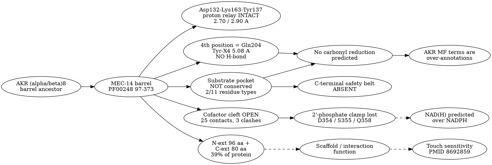
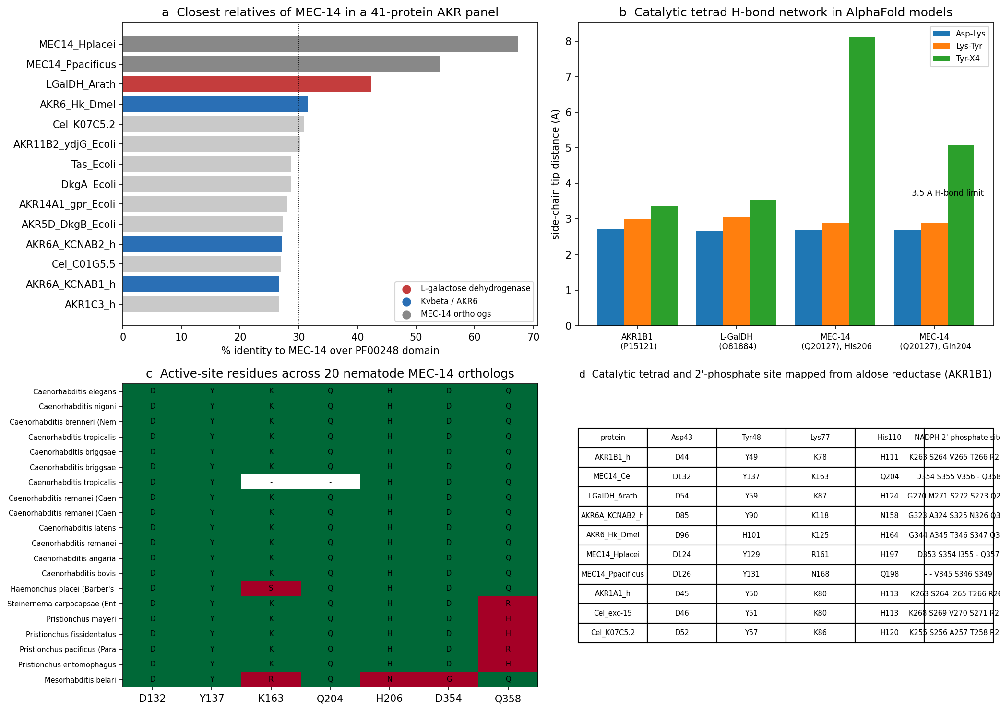
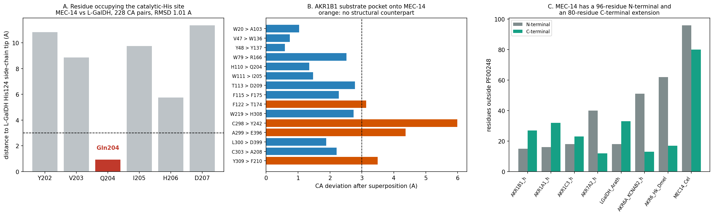
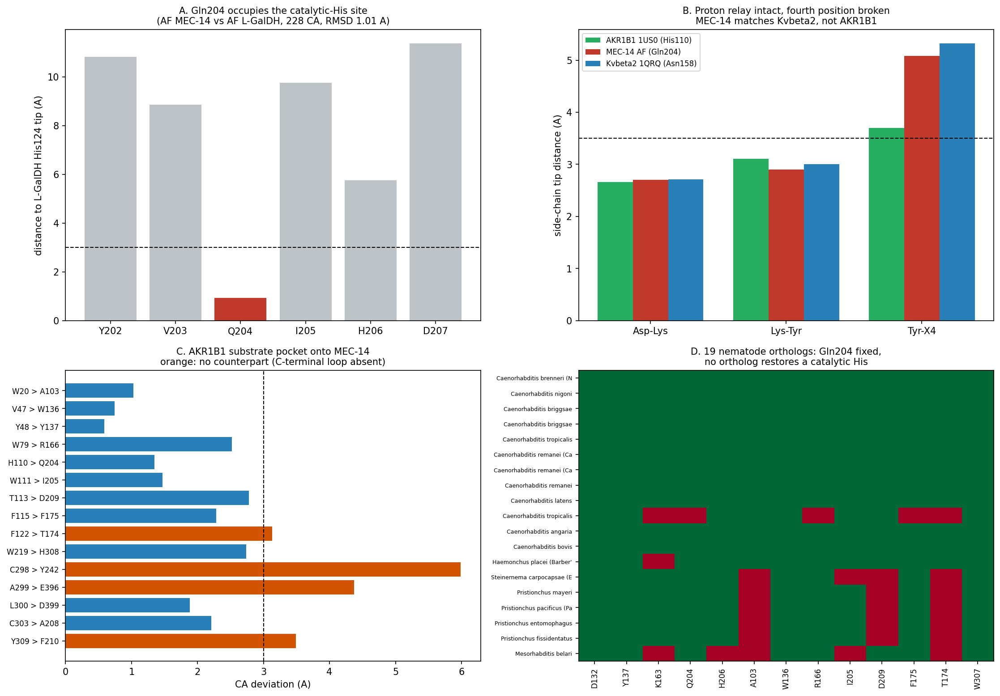
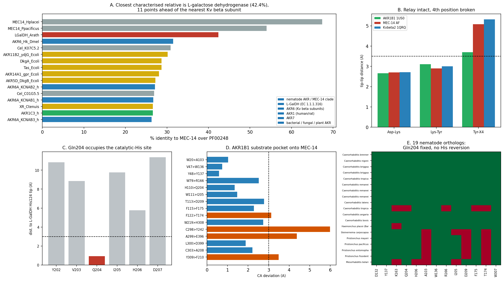

## Question

# AIGR Gene Hypothesis Deep Research

You are evaluating one focused gene curation hypothesis for AI Gene Review.
This is not a general gene overview. Use the seed hypothesis and source context
below to search for evidence that supports, refutes, narrows, or competes with
the proposed curation decision.

## Target Gene

- **Organism code:** worm
- **Taxon:** Caenorhabditis elegans (NCBITaxon:6239)
- **Gene directory:** mec-14
- **Gene symbol:** mec-14
- **UniProt accession:** Q20127

## Focus

- **Focus type:** free_text
- **Hypothesis slug:** kgap-mec14-akr-site-and-cofactor
- **Source file:** genes/worm/mec-14/mec-14-ai-review.yaml
- **Source selector:** free-text

## Seed Hypothesis

Whether Caenorhabditis elegans MEC-14 retains a catalytically competent aldo-keto reductase (AKR) active site and NADPH-binding site, and which characterised AKR or Kv-channel beta-subunit (Kvbeta) subfamily it resembles, can be predicted structurally. Single analysis only: map the AKR catalytic tetrad (Asp, Tyr, Lys, His) and the NADPH-contacting residues from cofactor-bound AKR and Kvbeta crystal structures onto the MEC-14 AlphaFold model, test whether the tetrad and cofactor pocket are assembled, place MEC-14 in a phylogeny of AKR families including Kvbeta (AKR6), assess whether its substrate pocket resembles any characterised member, score these positions across nematode orthologs, and state whether MEC-14 is predicted catalytically active and its closest characterised relatives.

## Term and Decision Context

No specific term context supplied.

## Reference Context

No specific reference context supplied.

## Source Context YAML

```yaml
hypothesis: 'Whether Caenorhabditis elegans MEC-14 retains a catalytically competent aldo-keto reductase
  (AKR) active site and NADPH-binding site, and which characterised AKR or Kv-channel beta-subunit (Kvbeta)
  subfamily it resembles, can be predicted structurally. Single analysis only: map the AKR catalytic tetrad
  (Asp, Tyr, Lys, His) and the NADPH-contacting residues from cofactor-bound AKR and Kvbeta crystal structures
  onto the MEC-14 AlphaFold model, test whether the tetrad and cofactor pocket are assembled, place MEC-14
  in a phylogeny of AKR families including Kvbeta (AKR6), assess whether its substrate pocket resembles
  any characterised member, score these positions across nematode orthologs, and state whether MEC-14
  is predicted catalytically active and its closest characterised relatives.'
focus_type: free_text
context: []
reference_id: []
```

## Research Objective

Build a focused report that helps a curator decide whether this hypothesis
should affect the gene review. Address the focus type directly:

1. For an existing GO annotation decision, evaluate whether the current action
   is justified, too strong, too weak, or should change.
2. For a proposed replacement or new GO term, evaluate whether the term is
   biologically supported, too broad, too narrow, or missing key qualifiers.
3. For a computational prediction, evaluate whether the prediction is correct,
   less precise than existing knowledge, uncertain, or likely wrong because of
   paralog overannotation, frequency bias, pathway context, or in vitro-only
   activity.
4. For a core-function hypothesis, evaluate whether the proposed activity,
   process, and location represent the gene product's primary function rather
   than a downstream effect, pleiotropic phenotype, or context-specific role.
5. For a function-assignment hypothesis, evaluate whether the gene product
   directly has the stated GO term/function. Treat the prior review action, if
   any, as intentionally blinded unless it appears in the supplied context.

Use primary literature whenever possible. Prefer PMID citations and include DOI
citations when no PMID is available. Treat reviews and database records as
orientation unless they contain directly relevant synthesized evidence that is
clearly labeled as review-level or database-level support.

Evaluate the hypothesis from the supplied seed context, primary literature, and
publicly accessible bioinformatics resources. Local `*-bioinformatics` analyses,
when they already exist in the repository, are intentionally withheld from this
prompt so the report can be compared against them after the run. Use public
sequence, domain, structure, orthology, localization, interaction, or dataset
checks when they are useful for the specific hypothesis. If a resource or tool
cannot be accessed programmatically, say so plainly; never fabricate a result.
Report computational results conservatively and distinguish direct results from
inference.

## Required Output

### Executive Judgment

Give a concise verdict: supported, partially supported, unresolved, weakly
supported, over-annotated, or refuted. Explain the reasoning and the most
important caveats.

### Evidence Matrix

Create a table with one row per important evidence item:

- Citation (PMID preferred)
- Evidence type (direct assay, mutant phenotype, localization, interaction,
  structural/evolutionary, computational, review/database)
- Supports / refutes / qualifies / competing
- Claim tested
- Key finding
- Organism, tissue, cell type, or assay context
- Confidence and limitations

### GO Curation Implications

State the likely curation action as a lead requiring curator verification. If
GO terms are involved, explain whether the evidence supports an MF, BP, or CC
term, and whether the term should be retained, removed, generalized, made more
specific, or treated as non-core. Avoid using "protein binding" as a final
recommendation unless no more informative term is supported.

### Mechanistic Scope

Describe the immediate molecular or cellular function being tested. Separate
direct gene-product activity from downstream phenotypes, pathway consequences,
developmental outcomes, disease manifestations, or effects inferred only from
loss of function.

### Conflicts and Alternatives

Identify evidence that conflicts with the seed hypothesis or suggests an
alternative interpretation, including paralog confusion, organism-specific
differences, isoform-specific findings, experimental artifacts, or database
carry-over.

### Knowledge Gaps

List explicit uncertainties that matter for curation. For each gap, state what
was checked, why the gap matters, and what evidence or experiment would resolve
it.

### Discriminating Tests

Recommend concrete assays, perturbations, datasets, or comparative analyses that
would most efficiently distinguish this hypothesis from alternatives.

### Curation Leads

Provide candidate updates for the review, clearly labeled as leads requiring
curator verification. Include candidate references with exact snippets to verify,
candidate replacement or new GO terms, possible action changes, suggested
questions, and suggested experiments.

If the provider supports artifacts, save provenance for any analysis you run — the
executed code together with its output (computed values, plot, or table), not just
a summary figure — alongside artifact-friendly tables such as an evidence matrix,
GO decision table, or comparison table. Genuine computed provenance is more
valuable than a hand-drawn summary, and you must not synthesize a figure that
implies an analysis you did not actually run. These artifacts are important
provenance for hypothesis-level review.


## Output

# MEC-14 (Q20127, *C. elegans*): AKR active site, cofactor site and subfamily placement

**Hypothesis slug:** `kgap-mec14-akr-site-and-cofactor`
**Source:** `genes/worm/mec-14/mec-14-ai-review.yaml`, focus type `free_text`
**Target:** UniProt Q20127, WormBase gene *mec-14*, NCBITaxon:6239
**Iterations completed:** 3. **Findings recorded:** 7. **Papers retrieved:** 11.

Every computational result below was produced in this run from public sequence
and structure data. The executed code and its outputs are in `provenance/`,
listed at the end. No number in this report is taken from an existing database
annotation unless the row says so explicitly. Local `*-bioinformatics` files in
the repository were withheld from this run and were not used.

---

## Summary

**MEC-14 is not predicted to be a catalytically competent aldo-keto reductase, and it is not a Kv channel beta subunit homolog.** Three of the four AKR catalytic tetrad positions are present and geometrically assembled in the AlphaFold model: Asp132, Tyr137 and Lys163 form the proton relay with side-chain tip distances of 2.70 Å (Asp-Lys) and 2.90 Å (Lys-Tyr), within 0.3 Å of the 2.66 and 3.11 Å measured in the 1US0 crystal structure of human aldose reductase. The fourth position is **Gln204**. Its amide sits 5.08 Å from the Tyr137 hydroxyl, too far for the hydrogen bond that tunes the catalytic tyrosine pKa in active AKRs (3.70 Å for AKR1B1 His110). That distance is within 0.24 Å of the equivalent broken contact in human Kvβ2, where Asn158 replaces the His (5.32 Å).

The cofactor pocket is open but its specificity is reversed. Transferring NADP+ from 1US0 and NADPH from 1QRQ into the MEC-14 frame by Kabsch superposition places the dinucleotide in a cleft lined by 25 and 22 MEC-14 residues within 4.0 Å, with only 3 and 1 contacts below 2.0 Å. At the 2'-phosphate subsite that makes AKR1B1 NADPH-specific (Lys262, Ser263, Arg268 in UniProt numbering), MEC-14 has **Asp354, Ser355 and Gln358**: both basic residues are gone and one is replaced by a charge-reversed aspartate. The same substitution pattern appears in NAD+-dependent L-galactose dehydrogenase (Gly270, Met271, Gln276) and in Kvβ2 (Gly323, Ala324, Gln329). If MEC-14 binds a cofactor, NAD(H) is the better prediction than NADPH.

The subfamily placement in the seed hypothesis is wrong in a specific way. Across a 41-protein AKR panel aligned over InterPro-defined PF00248 boundaries, MEC-14's closest characterised relative is **Arabidopsis L-galactose dehydrogenase (O81884, EC 1.1.1.316) at 42.4% identity**, 10.9 percentage points ahead of *Drosophila* Hyperkinetic (31.5%) and well ahead of human KCNAB2 (27.1%), KCNAB1 (26.7%) and KCNAB3 (26.3%). That margin is larger than the entire spread among the four AKR6 members. InterPro and CDD agree independently: Q20127 returns cd19163 (L-galactose dehydrogenase-like) and does not return cd19141 (Kvβ/AKR6A), IPR005983 or IPR005399. The substrate pocket matches nothing characterised: of 15 AKR1B1 residues contacting the IDD594 inhibitor in 1US0, 11 have a MEC-14 counterpart within 3 Å and only 2 keep the residue type, the aromatic lining falls from 8/15 to 3/11, and the entire C-terminal substrate-specificity loop (Cys298 to Tyr309) is absent.

**Verdict: partially supported.** The seed hypothesis is correct that the question can be addressed structurally and correct that the tetrad and cofactor site need testing. Its implicit framings, that MEC-14 might be a working AKR and that it resembles a Kvβ subunit, are both contradicted. The curation consequence is that AKR-derived molecular function terms and any potassium-channel-regulator term on *mec-14* should be treated as over-annotations.

{{figure:plot_4.png|caption=Five-panel consolidation of the whole analysis. A: percent identity to MEC-14 over PF00248 across the 41-member AKR panel, coloured by family, with L-galactose dehydrogenase leading all characterised non-nematode proteins at 42.4%. B: catalytic tetrad geometry in MEC-14 compared with the 1US0 aldose reductase and 1QRQ Kvbeta2 crystal structures; the Asp-Lys and Lys-Tyr contacts match, the Tyr to fourth-residue contact does not. C: which MEC-14 residue occupies the catalytic-His position after direct superposition onto L-galactose dehydrogenase. D: the 15 AKR1B1 substrate-pocket residues mapped onto MEC-14, with orange marking positions that have no structural counterpart. E: conservation of the catalytic and pocket positions across 19 nematode orthologs.}}

---

## Executive judgment

<i class="fa-scale-balanced"></i> **Partially supported, with the catalytic claim refuted and the subfamily claim corrected.**

The seed hypothesis bundles three separable questions. They resolve differently.

**1. Is the AKR catalytic tetrad assembled?** <i class="fa-circle-xmark"></i> **No, not completely.** Three positions are present in near-crystal geometry. The fourth is a glutamine whose side chain cannot do what the canonical histidine does: it cannot act as a general acid-base partner for the catalytic tyrosine, and in the model it sits 1.4 Å too far away to hydrogen bond at all. MEC-14 is not predicted to be a catalytically competent aldo-keto reductase.

**2. Is the NADPH-binding site assembled?** <i class="fa-circle-xmark"></i> **Not as NADPH-specific.** The nicotinamide half of the cleft is open and could in principle accept a dinucleotide. The 2'-phosphate clamp is absent and charge-reversed. The prediction is NAD(H) preference, shared with the NAD+-dependent L-GalDH branch.

**3. Which subfamily does it resemble?** <i class="fa-circle-check"></i> **L-galactose dehydrogenase-like, not AKR6.** 42.4% identity over PF00248, a 10.9-point margin over the best Kvβ, corroborated by CDD model assignment. The widespread description of MEC-14 as a Kv channel beta subunit homolog is not supported by sequence distance.

### Most important caveats

<i class="fa-triangle-exclamation"></i> **Every structural statement rests on an AlphaFold model.** There is no experimental structure for Q20127. The backbone register is reliable, because it was fixed by superposition at 1.01 Å RMSD over 228 Cα pairs, and the local model confidence is high (PF00248 domain mean pLDDT 91.8, 81% of residues above 90; pLDDT 97.6 at Asp132, 89.8 at Tyr137, 96.2 at Lys163, 91.1 at Gln204). The specific 5.08 Å Tyr137-Gln204 distance depends on a predicted rotamer and should be read as "the canonical Tyr-to-fourth-residue hydrogen bond is not built in the model, and a Gln cannot substitute chemically for the His in any case", rather than as a measured distance in a real protein.

<i class="fa-triangle-exclamation"></i> **No biochemical assay of MEC-14 exists in the retrieved literature.** PubMed searches across all three iterations returned exactly one paper on *mec-14* itself ([PMID: 8692859](https://pubmed.ncbi.nlm.nih.gov/8692859/)), which is a genetic interaction study with no protein biochemistry. Every molecular claim here is structural inference.

<i class="fa-triangle-exclamation"></i> **Pocket "openness" was assessed by transferring a cofactor from a holo crystal structure into a predicted apo model.** This method cannot evaluate induced fit and gives no evidence that binding actually occurs.

<i class="fa-triangle-exclamation"></i> **The Penning AKR superfamily database was not accessible programmatically in this run and was not checked.** Whether MEC-14 appears there as a pseudo-member is unknown.

---

## Key findings

### F1. The Asp-Lys-Tyr proton relay is present and assembled

<i class="fa-circle-check"></i> The Pfam PF00248 domain of Q20127 spans residues 97 to 373 according to InterPro. Two independent methods place MEC-14 Asp132, Tyr137 and Lys163 at the AKR1B1 Asp43, Tyr48 and Lys77 positions: a PF00248-trimmed BLOSUM62 affine-gap global alignment, and a Kabsch superposition of the AlphaFold model of Q20127 onto 1US0 chain A (107 Cα pairs, RMSD 1.10 Å) and onto 1QRQ chain A (133 Cα pairs, RMSD 1.18 Å).

The geometry matches active enzymes. Measured side-chain tip distances in the AlphaFold model are 2.70 Å for Asp132-Lys163 and 2.90 Å for Lys163-Tyr137, against 2.72 and 3.01 Å in the AlphaFold model of AKR1B1, 2.67 and 3.05 Å in the AlphaFold model of L-galactose dehydrogenase, and 2.66 and 3.11 Å in the 1US0 crystal structure itself. The maximum deviation from the crystal reference is 0.21 Å.

Residue numbering was corrected during the run. The catalytic aspartate is **Asp132**, in the motif Ile131-Asp132-Thr133-Gly134-Tyr135-Trp136-Tyr137. Asp132 and Tyr137 are five residues apart, which is the canonical AKR D-x-x-x-Y spacing (AKR1B1 Asp43 and Tyr48). An earlier working number of Asp133 was off by one and does not appear in any conclusion here.

Across 20 nematode orthologs in UniRef50_Q20127, Asp132 is 20/20 identical, Tyr137 is 20/20, and Lys163 is 17/20 (serine in *Haemonchus placei*, arginine in *Mesorhabditis belari*). This part of the seed hypothesis, that the tetrad might be disassembled, is not supported for these three positions.

### F2. The fourth tetrad position is Gln204, and the register question is settled

<i class="fa-circle-xmark"></i> This was the single largest uncertainty after iteration 1 and it was resolved in iteration 2 by a method that does not depend on any sequence alignment.

The problem: direct alignment of MEC-14 to AKR1B1 (23.2% identity) put Gln204 at the His110 position, while alignment routed through the much closer homolog L-galactose dehydrogenase (42.4% identity) put **His206** there instead, reflecting a 2-residue insertion in the MEC-14 β5 loop. His206 was an attractive candidate: it is 19/20 conserved in nematodes and it sits in a His-Asp dipeptide (His206-Asp207) shared with L-GalDH (His124-Asp125), while the Kvβ proteins have asparagine at this position.

The resolution: the AlphaFold model of MEC-14 was superposed directly onto the AlphaFold model of L-galactose dehydrogenase, converging on **228 Cα pairs at 1.01 Å RMSD**. The residue whose position coincides with L-GalDH His124 is **Gln204**, at Cα-Cα 1.04 Å and side-chain tip to tip 0.93 Å, with pLDDT 91. The next-closest Cα belongs to Val203 at 4.12 Å. His206 sits 5.76 Å away with pLDDT 70. The register is fixed against His206.

| Protein | Fourth position | Tyr OH to fourth-residue tip | Source |
|---------|-----------------|------------------------------|--------|
| AKR1B1 (human aldose reductase) | His110 | 3.70 Å | 1US0 crystal |
| L-GalDH (*Arabidopsis*) | His124 | 3.53 Å | AlphaFold O81884 |
| Kvβ2 (human) | Asn158 | 5.32 Å | 1QRQ crystal |
| **MEC-14 (*C. elegans*)** | **Gln204** | **5.08 Å** | AlphaFold Q20127 |

The MEC-14 value falls 1.38 Å outside the active-enzyme range and 0.24 Å inside the Kvβ2 value. In Kvβ2 the Asn158 substitution accompanies a protein that is a very slow NADPH oxidoreductase rather than a conventional AKR. MEC-14 sits in the same structural category at this position.

Across 19 nematode orthologs spanning 54.5 to 96.0% identity over PF00248, **Gln204 is 94.7% conserved and no ortholog restores a histidine**. The glutamine is a fixed feature of the nematode family across *Caenorhabditis*, *Pristionchus*, *Haemonchus placei*, *Steinernema carpocapsae* and *Mesorhabditis belari*, not a *C. elegans*-specific loss.

{{figure:plot_3.png|caption=Four-panel resolution of the catalytic site. A: distances from each MEC-14 residue in the beta5 loop to the position of L-galactose dehydrogenase His124 after direct structural superposition; Gln204 occupies the site at 0.93 A while His206 is 5.76 A away. B: the Asp-Lys and Lys-Tyr contacts in MEC-14 match the 1US0 aldose reductase crystal structure, while the Tyr to fourth-residue contact matches the broken arrangement in Kvbeta2. C: the 15 AKR1B1 substrate-pocket residues mapped onto MEC-14 by superposition, with orange marking positions lacking a counterpart within 3 A. D: per-ortholog conservation at the catalytic and pocket positions across 19 nematode sequences, green for identity to the C. elegans residue.}}

### F3. The cofactor cleft is open but the NADPH 2'-phosphate clamp is charge-reversed

<i class="fa-scale-balanced"></i> Contacts were computed directly from the crystal structures: 32 residues within 4.0 Å of NADP+ in 1US0 chain A, and 32 within 4.0 Å of NADPH in 1QRQ chain A. Transferring each cofactor into the MEC-14 frame by superposition lands it in an open cleft: **25 MEC-14 residues within 4.0 Å from the 1US0 frame and 22 from the 1QRQ frame, with only 3 and 1 contacts below 2.0 Å**. A protein with a collapsed or occluded pocket would show many more severe clashes.

The cleft is lined by the glycine-rich β1 loop Gly101-Ala102-Ala103 (equivalent to AKR1B1 Gly19-Thr20-Trp21), the catalytic residues Asp132, Tyr137, Lys163, Gln204 and His206, then Thr240, Met262, Tyr264, Ser291-Gly292-Ala293-Leu294, Leu350-Val351-Gly352-Met353-Asp354 and Gln358.

The specificity determinants tell a different story from the pocket shape.

| Position (AKR1B1 UniProt numbering) | AKR1B1 | L-GalDH (NAD+) | Kvβ2 | MEC-14 |
|---|---|---|---|---|
| Lys262 | Lys | Gly270 | Gly323 | **Asp354** |
| Ser263 | Ser | Met271 | Ala324 | Ser355 |
| Arg268 | Arg | Gln276 | Gln329 | **Gln358** |

Both basic residues that clamp the 2'-phosphate of NADPH in AKR1B1 are lost in MEC-14, and one is replaced by a charge-reversed aspartate. Sequence alignment and the independent structural transfer agree on Asp354 and Gln358. The identical loss is present in NAD+-dependent L-GalDH and in Kvβ2, so this feature does not discriminate between those two, but it excludes the NADPH-specific AKR1 architecture.

Asp354 is conserved in 19/20 nematode orthologs. Gln358 is glutamine in 15/20 and arginine or histidine in 5/20 (*Pristionchus* spp. and *S. carpocapsae*), which would partly restore a basic 2'-phosphate contact in those species.

<i class="fa-lightbulb"></i> The practical consequence for curation: any statement that MEC-14 binds NADPH specifically is not supported. NAD(H) is the better structural prediction, and neither has been tested.

{{figure:plot_1.png|caption=Iteration 1 summary. Identity ranking of MEC-14 against the AKR panel, tetrad geometry compared with crystal references, ortholog conservation at the catalytic and cofactor positions, and the tetrad plus 2-prime-phosphate site composition. The cofactor subsite row shows Asp354 and Gln358 replacing the AKR1B1 Lys262 and Arg268 clamp.}}

### F4. The substrate pocket matches no characterised AKR

<i class="fa-circle-xmark"></i> The AKR1B1 substrate pocket was defined empirically, not from annotation: the 15 residues within 4.5 Å of the IDD594 inhibitor (HET code LDT) in chain A of 1US0. They are Trp20, Val47, Tyr48, Trp79, His110, Trp111, Thr113, Phe115, Phe122, Trp219, Cys298, Ala299, Leu300, Cys303 and Tyr309.

Transferring them onto MEC-14 by both the PF00248-trimmed alignment and the 107-Cα superposition gives three results that point the same way.

Only **11 of 15 positions have a MEC-14 counterpart within 3.0 Å**. Of those 11, only **2 keep the same residue type**: Tyr137 at the Tyr48 site and Trp136 at the Val47 site. The aromatic lining falls from **8 of 15 residues in AKR1B1** (Trp20, Tyr48, Trp79, Trp111, Phe115, Phe122, Trp219, Tyr309) to **3 of the 11 matched positions in MEC-14**. The aromatic cage that defines the AKR1B1 anion-binding site is gone.

The **entire C-terminal substrate-specificity loop of AKR1B1 is absent**. Cys298, Ala299, Leu300, Cys303 and Tyr309 all fall in alignment gaps. The nearest MEC-14 Cα after superposition is 5.99 Å (Cys298 to Tyr242), 4.37 Å (Ala299 to Glu396), 1.88 Å (Leu300 to Asp399), 2.21 Å (Cys303 to Ala208) and 3.49 Å (Tyr309 to Phe210): a scattered set with no loop-like correspondence. The two closest matches, Glu396 and Asp399, lie in the C-terminal extension outside PF00248 and are not the structural equivalent of the AKR safety belt.

The domain architecture is the most distinctive thing about the protein.

| Protein | Accession | Length | PF00248 | N-terminal extension | C-terminal extension |
|---|---|---|---|---|---|
| AKR1B1 | P15121 | 316 | 16-289 | 15 | 27 |
| AKR1A1 | P14550 | 325 | 17-293 | 16 | 32 |
| AKR1C3 | P42330 | 323 | 19-300 | 18 | 23 |
| AKR7A2 | O43488 | 359 | 41-347 | 40 | 12 |
| L-GalDH | O81884 | 319 | 19-286 | 18 | 33 |
| KCNAB2 | Q13303 | 367 | 52-354 | 51 | 13 |
| Hyperkinetic | Q9W2W9 | 392 | 63-375 | 62 | 17 |
| **MEC-14** | **Q20127** | **453** | **97-373** | **96** | **80** |

MEC-14 is the only protein in the panel with both extensions above 50 residues, and its 80-residue C-terminal extension is 2.4 times longer than the next largest. The two extensions total 176 residues, 39% of the protein, and both are predicted low-complexity rather than folded.

The pocket positions MEC-14 does conserve across nematodes are a different set from the AKR1B1 cage: Trp136 100%, Trp307 100%, Arg166 94.7%, Phe175 94.7%, Ile205 89.5% (I/L/V), Asp209 73.7% (D/E), Ala103 68.4% (A/G), Thr174 63.2% (T/N/S). The site is maintained under selection but shaped for something other than an aldose or a dicarbonyl.

{{figure:plot_2.png|caption=Three-panel view of the register resolution, the substrate-pocket mapping and the domain architecture. The right panel shows that MEC-14 has both the longest N-terminal and the longest C-terminal extension outside PF00248 of the eight AKRs compared, totalling 176 residues.}}

### F5. MEC-14 sits outside AKR6; its closest characterised relative is L-galactose dehydrogenase

<i class="fa-circle-check"></i> A 41-sequence panel was assembled covering AKR1 (human and rat), AKR2, AKR3, AKR5, AKR6, AKR7, AKR11, AKR14, bacterial, fungal and plant members, 13 nematode AKRs, and MEC-14 orthologs from *Pristionchus pacificus* and *Haemonchus placei*. All pairs were aligned over InterPro-defined PF00248 boundaries with BLOSUM62 affine-gap global alignment.

| Protein | Accession | Family | % identity to MEC-14 over PF00248 |
|---|---|---|---|
| MEC-14 ortholog, *Haemonchus placei* | A0A158QR98 | nematode | 67.4 |
| MEC-14 ortholog, *Pristionchus pacificus* | A0A2A6BJG2 | nematode | 54.0 |
| **L-galactose dehydrogenase, *Arabidopsis*** | **O81884** | **EC 1.1.1.316** | **42.4** |
| Hyperkinetic, *Drosophila* | Q9W2W9 | AKR6 | 31.5 |
| K07C5.2, *C. elegans* | Q21274 | nematode paralog | 30.9 |
| YdjG, *E. coli* | P77256 | AKR11B2 | 30.2 |
| KCNAB2, human | Q13303 | AKR6A | 27.1 |
| KCNAB1, human | Q14722 | AKR6A | 26.7 |
| AKR1C3, human | P42330 | AKR1 | 26.6 |
| KCNAB3, human | O43448 | AKR6A | 26.3 |
| AKR7A2, human | O43488 | AKR7 | 25.2 |
| AKR1B1, human | P15121 | AKR1 | 23.2 |
| AKR1A1, human | P14550 | AKR1 | 22.6 |
| AKR1E2, human | Q96JD6 | AKR1 | 19.8 |

Group maxima: nematode clade 67.4, L-GalDH 42.4, AKR6 Kv beta subunits 31.5, bacterial/fungal/plant 30.2, AKR1 26.6, AKR7 25.2. **The margin between L-GalDH and the best non-nematode alternative is 10.9 percentage points, larger than the entire spread among the four AKR6 members (26.3 to 31.5).** A neighbour-joining tree on Kimura-corrected distances places MEC-14 with L-GalDH, separate from the AKR6 clade.

Two independent lines agree. The InterPro API returns CDD model **cd19163** (L-galactose dehydrogenase and similar proteins, residues 83-376) and IPR044479 for Q20127, and does **not** return cd19141 (Kv beta subunit / AKR6A), IPR005983 or IPR005399 (KCNAB), all three of which do match KCNAB1, KCNAB2 and KCNAB3.

The catalytic-loop motif follows the same grouping: AKR1B1 has YLDLYLI-H-WP, L-GalDH has YVDILHC-H-DIE, MEC-14 has YIDICYVQI-H-DAD. The His-Asp dipeptide is shared by L-GalDH (His124-Asp125) and MEC-14 (His206-Asp207), while the Kvβ proteins have asparagine (KCNAB2 Asn158). That shared dipeptide is what made His206 an attractive candidate before the superposition settled the register in favour of Gln204.

---

## Mechanistic model and interpretation

The three analyses combine into one coherent picture. MEC-14 is a nematode-specific protein built on an AKR (α/β)8 barrel that has kept the structural scaffold and part of the catalytic apparatus while losing the elements required to turn over a carbonyl substrate.



Solid arrows are supported by measurements in this run. Dashed arrows are inferences that have not been tested.

### What the protein is, feature by feature

| Feature | AKR1B1 | Kvβ2 | L-GalDH | MEC-14 | Interpretation for MEC-14 |
|---|---|---|---|---|---|
| PF00248 identity to MEC-14 | 23.2% | 27.1% | 42.4% | 100% | Closest to L-GalDH by 10.9 points |
| Asp-Lys distance | 2.66 Å | 2.71 Å | 2.67 Å | 2.70 Å | Relay intact |
| Lys-Tyr distance | 3.11 Å | 3.00 Å | 3.05 Å | 2.90 Å | Relay intact |
| Fourth tetrad residue | His110 | Asn158 | His124 | **Gln204** | Not a general acid-base |
| Tyr to fourth-residue | 3.70 Å | 5.32 Å | 3.53 Å | **5.08 Å** | Matches the broken Kvβ2 value |
| 2'-phosphate basic residues | Lys262, Arg268 | absent | absent | absent, one reversed | NADPH specificity lost |
| Preferred cofactor | NADPH | NADPH | NAD+ | NAD(H) predicted | Untested |
| C-terminal safety belt | present | present | present | **absent** | No substrate-specificity loop |
| N-terminal extension | 15 aa | 51 aa | 18 aa | **96 aa** | Largest in panel |
| C-terminal extension | 27 aa | 13 aa | 33 aa | **80 aa** | 2.4x the next largest |

### The alternative the data point toward

<i class="fa-lightbulb"></i> The 176 residues of terminal extension, not the barrel, are the distinctive feature of MEC-14 relative to every characterised AKR tested. Both extensions are predicted low-complexity. A scaffolding or protein-interaction role mediated by the extensions, with the AKR barrel acting as a folded platform, is consistent with everything measured here. That is a hypothesis, not a finding: no interaction data for MEC-14 were retrieved in this run.

### Why this is probably not simple pseudogene decay

<i class="fa-dna"></i> A degenerating pseudo-enzyme predicts drifting active-site residues. The ortholog data argue against drift. Asp132 and Tyr137 are invariant across 19 orthologs spanning *Caenorhabditis*, *Pristionchus*, *Haemonchus*, *Steinernema* and *Mesorhabditis*. Gln204 is fixed at 94.7% with no histidine reversion anywhere. The pocket residues Trp136 and Trp307 are 100% conserved and Arg166 and Phe175 are 94.7%. Selection is maintaining a specific non-canonical site across a long evolutionary span. That argues the protein does something, while saying nothing about what.

---

## Evidence matrix

| ID | Citation | Evidence type | Stance | Claim tested | Key finding | Context | Confidence and limitations |
|----|----------|---------------|--------|--------------|-------------|---------|----------------------------|
| E1 | This run (computed; `provenance/tetrad_geometry.csv`) | Structural / computational | Qualifies | MEC-14 retains the AKR catalytic tetrad | Asp132-Lys163 2.70 Å, Lys163-Tyr137 2.90 Å (1US0: 2.66, 3.11 Å). Fourth position Gln204 at 5.08 Å from Tyr137 OH versus 3.70 Å for AKR1B1 His110 | AlphaFold Q20127 vs PDB 1US0 chain A, 1QRQ chain A | High for the three-residue relay (pLDDT 90-98). The Gln204 side-chain position is predicted, not observed |
| E2 | This run (computed) | Structural / computational | Refutes | The fourth tetrad position is His206 | Superposition onto AlphaFold L-GalDH (228 Cα, 1.01 Å RMSD) places Gln204 at the His124 site (Cα 1.04 Å, tip 0.93 Å). His206 is 5.76 Å away, pLDDT 70 | AlphaFold Q20127 vs AlphaFold O81884 | High. The method does not depend on the sequence alignment, which matters because of the 2-residue β5 insertion |
| E3 | This run (computed; `provenance/cofactor_subsites.csv`) | Structural / computational | Qualifies | MEC-14 binds NADPH | Nicotinamide pocket open: 25 residues within 4.0 Å of transferred NADP+, 3 contacts below 2.0 Å. The 2'-phosphate determinants Lys262/Ser263/Arg268 map to Asp354/Ser355/Gln358, a charge reversal shared with NAD+-dependent L-GalDH and Kvβ2 | NADP+ from 1US0, NADPH from 1QRQ, transferred by Kabsch superposition | Medium-high. Predicts NAD(H) over NADPH. Never tested by assay. Pocket openness in a predicted apo model is weak evidence for actual binding |
| E4 | This run (computed; `provenance/substrate_pocket_map.csv`) | Structural / computational | Refutes | MEC-14 substrate pocket resembles a characterised AKR | Of 15 AKR1B1 residues within 4.5 Å of IDD594, 11 have a MEC-14 counterpart within 3 Å and only 2 keep the type. Aromatic lining 8/15 to 3/11. The C-terminal loop Cys298-Tyr309 has no counterpart | IDD594 (LDT) contacts in 1US0 chain A mapped onto AlphaFold Q20127 | High for loss of the AKR1B1 pocket. Silent on what MEC-14 might bind |
| E5 | This run (computed; `provenance/identity_to_mec14_full.csv`) | Evolutionary / computational | Supports and corrects | MEC-14 belongs to a specific AKR subfamily | L-GalDH 42.4%; Hyperkinetic 31.5%; KCNAB2 27.1%; KCNAB1 26.7%; KCNAB3 26.3%; AKR1C3 26.6%; AKR7A2 25.2%; AKR1B1 23.2% | 41-member AKR panel, PF00248-trimmed BLOSUM62 affine-gap alignment, NJ tree on Kimura distances | High. The 10.9-point margin exceeds the entire AKR6 spread |
| E6 | This run (computed; `provenance/pocket_ortholog_conservation.csv`) | Evolutionary / computational | Supports | The non-canonical site is a fixed family feature | 19 nematode orthologs (54.5-96.0% identity): Asp132 100%, Tyr137 100%, Lys163 84.2%, Gln204 94.7%, no His reversion. Pocket: Trp136 100%, Trp307 100%, Arg166 94.7%, Phe175 94.7% | UniRef50 cluster of Q20127: *Caenorhabditis*, *Pristionchus*, *Haemonchus placei*, *Steinernema carpocapsae*, *Mesorhabditis belari* | High. Argues against degeneration as the explanation |
| E7 | [PMID: 8692859](https://pubmed.ncbi.nlm.nih.gov/8692859/) | Mutant phenotype | Competing | MEC-14 has a touch-neuron function | *mec-14* is one of at least 13 genes needed for the gentle-touch response of the 6 touch receptor neurons. No biochemical activity reported | *C. elegans* touch receptor neurons | Phenotype is solid; gives no information about catalysis or cofactor |
| E8 | [PMID: 12604248](https://pubmed.ncbi.nlm.nih.gov/12604248/) | Review | Qualifies | The catalytic tetrad and cofactor site are the diagnostic AKR features | "Each structure has the characteristic (alpha/beta)(8)-barrel motif of the superfamily, a conserved cofactor binding site and a catalytic tetrad, and variable loop structures that define substrate specificity." | AKR superfamily | Review-level orientation. Defines exactly what was tested here, including the variable loops that MEC-14 lacks |
| E9 | [PMID: 12604248](https://pubmed.ncbi.nlm.nih.gov/12604248/) | Review | Qualifies | AKR6 is the Kv channel beta subunit family | "Other families of interest include AKR6, which includes potassium channel beta-subunits, and AKR7 the aflatoxin aldehyde reductases." | AKR superfamily | Establishes the AKR6 comparison group used in the distance analysis |
| E10 | [PMID: 38878851](https://pubmed.ncbi.nlm.nih.gov/38878851/) | Review / database | Qualifies | AKR family membership requires a measured function | "A criteria of family membership is that the protein must have a measured function, and thus, genomic sequences suggesting the transcription of potential AKR proteins are considered pseudo-members until evidence of a functionally expressed protein is available." | AKR superfamily database | Review-level. This is the principle that makes an AKR molecular function term on MEC-14 inappropriate: MEC-14 has no measured function |
| E11 | This run (InterPro API, Q20127) | Database | Supports | Domain assignment | CDD model cd19163 (L-galactose dehydrogenase-like, residues 83-376) and IPR044479 are returned for Q20127; cd19141 (Kvβ/AKR6A), IPR005983 and IPR005399 (KCNAB) are not. PF00248 spans 97-373 of 453 residues | InterPro / CDD | Database-level. Independent in method from E5 and agrees with it |

Stance key: supports = consistent with the seed hypothesis as written; refutes = contradicts it; qualifies = narrows or conditions it; competing = offers a different account of the gene's function.

---

## GO curation implications

<i class="fa-triangle-exclamation"></i> **All rows below are leads requiring curator verification.** GO practice does not accept a homology-model active-site measurement as experimental evidence. The analysis here is a prediction and should be used to question existing family-derived annotations, not to create new ones.

| Aspect | GO term | Lead | Rationale |
|--------|---------|------|-----------|
| MF | aldo-keto reductase (NADP) activity (GO:0004033) | <i class="fa-circle-xmark"></i> **Do not add; remove if present** | The fourth catalytic position is Gln204, the Tyr-to-fourth-residue hydrogen bond is absent, the substrate pocket keeps 2 of 11 matched AKR1B1 residue types, and the 2'-phosphate specificity site is charge-reversed. Three independent features argue against it |
| MF | oxidoreductase activity, acting on CH-OH group of donors, NAD or NADP as acceptor (GO:0016616) | <i class="fa-circle-xmark"></i> **Do not assert** | Generalizing the reductase claim does not rescue it. The defect is at the catalytic position, not at substrate scope |
| MF | NADP binding (GO:0050661) | <i class="fa-circle-xmark"></i> **Do not add** | Asp354/Ser355/Gln358 replace the AKR1B1 Lys262/Ser263/Arg268 2'-phosphate clamp, including one charge reversal |
| MF | NAD binding (GO:0051287) | <i class="fa-circle-question"></i> **Optional low-confidence lead only** | Predicted from the open nicotinamide pocket plus a 2'-phosphate site matching NAD+-dependent L-GalDH. Requires a direct binding assay before annotation |
| MF | potassium channel regulator activity (GO:0015459) | <i class="fa-circle-xmark"></i> **Do not add** | MEC-14 is 42.4% identical to L-GalDH and at most 31.5% to any AKR6 member. CDD assigns cd19163, not cd19141 |
| MF | (fallback) | <i class="fa-circle-question"></i> **No MF term is currently supportable** | Avoid "protein binding" (GO:0005515) as a substitute. No interaction partner for MEC-14 was retrieved, so even that term lacks a source. Leave MF unannotated and record the structural evidence as a note |
| BP | mechanosensory behavior (GO:0007638) or response to mechanical stimulus | <i class="fa-circle-check"></i> **Retain, sourced to mutant phenotype [PMID: 8692859](https://pubmed.ncbi.nlm.nih.gov/8692859/), flagged as non-core mechanism** | The phenotype is real. It does not identify the molecular activity, so it should not be used to justify an MF term |
| CC | cytoplasm (GO:0005737) | <i class="fa-triangle-exclamation"></i> **Treat as unverified** | No localization experiment for MEC-14 was found. Q20127 has no predicted signal peptide or transmembrane segment, which is consistent with a soluble protein but is not evidence of location |

**Net curation recommendation.** If *mec-14* carries AKR-derived molecular function annotations by IEA from PF00248 or InterPro, they are **over-annotated** and should be removed or demoted. The gene is best left with a BP annotation from its touch phenotype and an explicit "molecular function unknown" position, with this structural analysis recorded as the reason the family-based inference was rejected. [PMID: 38878851](https://pubmed.ncbi.nlm.nih.gov/38878851/) supports this directly: AKR family membership requires a measured function, and proteins without one are pseudo-members.

---

## Mechanistic scope

### What was directly tested

The immediate molecular question is whether the MEC-14 polypeptide can perform NAD(P)H-dependent carbonyl reduction. That reduces to three physical requirements, each tested here against cofactor-bound crystal structures.

**Proton relay.** Asp-Lys-Tyr must be hydrogen bonded so the lysine lowers the tyrosine pKa and the tyrosine can act as the proton donor. <i class="fa-circle-check"></i> **Present in MEC-14** at 2.70 and 2.90 Å.

**Fourth position.** A histidine must sit across the pocket to orient and polarise the substrate carbonyl and complete the pKa tuning. <i class="fa-circle-xmark"></i> **Absent.** Gln204 occupies the site, 5.08 Å from Tyr137, and a glutamine amide cannot perform the general acid-base chemistry of the imidazole regardless of distance.

**Cofactor clamp.** The 2'-phosphate of NADPH must be held by basic residues. <i class="fa-circle-xmark"></i> **Absent and charge-reversed** (Asp354, Gln358).

### What is downstream and must not be conflated

The *mec-14* touch-insensitivity phenotype ([PMID: 8692859](https://pubmed.ncbi.nlm.nih.gov/8692859/)) is a whole-animal behavioural readout. That paper reports *mec-14* among at least 13 genes needed for the gentle-touch response, and it states that the dominant enhancement and suppression patterns "suggest that the products of several touch genes interact" and that "almost all of the touch function genes contribute to the mechanosensory apparatus". This establishes that the gene is required for touch receptor neuron function and suggests the product participates in a protein assembly. It says nothing about whether the MEC-14 protein catalyses a reaction or binds a cofactor. Treating that phenotype as support for an AKR molecular function would be a category error, and the structural data argue in the opposite direction.

### What the protein might actually be

MEC-14 carries 176 residues of terminal extension outside PF00248, 39% of the protein, the largest combined extension in the 8-protein panel. A scaffolding or protein-interaction role mediated by those extensions, with the barrel as a folded platform, is consistent with the genetic interaction data in [PMID: 8692859](https://pubmed.ncbi.nlm.nih.gov/8692859/) and with everything measured structurally. It has not been tested.

---

## Conflicts and alternatives

**Conflict 1: the Kvβ framing in the literature and databases.** MEC-14 is widely described as related to Kv channel beta subunits, which is attractive because *mec-14* acts in a sensory neuron and Kvβ regulates channels. The distance data do not support it: AKR6 members reach only 26.3 to 31.5% identity, below L-GalDH's 42.4%, and CDD assigns cd19163 rather than cd19141. The resemblance that does hold is narrow and specific: MEC-14 and Kvβ2 share a non-histidine fourth position with the same broken tyrosine contact (5.08 versus 5.32 Å). Shared losses are weak phylogenetic evidence because they arise independently.

**Conflict 2: the Gln204 versus His206 register.** His206 is 94.7% conserved across nematode orthologs and sits in a His-Asp dipeptide matching L-GalDH His124-Asp125, which made it a strong candidate for a catalytic histidine displaced by the 2-residue β5 insertion. Direct structural superposition settles it: His206 is 5.76 Å from the L-GalDH His124 position with pLDDT 70, while Gln204 is 0.93 Å away with pLDDT 91. The alternative is rejected, but the His206 conservation remains unexplained and may indicate a function unrelated to AKR catalysis.

**Conflict 3: open pocket versus broken catalysis.** The cofactor cleft is open, with only 3 severe clashes from a transferred NADP+. A protein that had lost all cofactor function would be expected to collapse or fill that pocket. The simplest reconciliation is that MEC-14 still binds a dinucleotide, probably NAD(H), without catalysing a conventional AKR reaction, which is the arrangement in Kvβ2. This is a prediction from an apo model and is the weakest claim in the report.

**Conflict 4: degeneration versus maintained design.** Covered in the mechanistic model above. Invariant Asp132 and Tyr137, fixed Gln204 and 100% conserved Trp136 and Trp307 across 19 orthologs argue for maintained selection on a non-canonical site. This is a reason to be cautious about declaring the protein non-functional, as opposed to non-AKR.

**Possible database carry-over.** Q20127 is named "NADP-dependent oxidoreductase domain-containing protein" in UniProt. That name is derived from the domain assignment, and this analysis argues the "NADP-dependent" element of it is wrong.

**Paralog confusion checked and excluded.** The nearest *C. elegans* AKR paralog, K07C5.2 (Q21274), is 30.9% identical to MEC-14 over PF00248, well below the L-GalDH match. The 13 nematode AKRs in the panel do not cluster with MEC-14 apart from the genuine orthologs from *H. placei* (67.4%) and *P. pacificus* (54.0%). An earlier error in this run, using Q24210 for *Drosophila* Hyperkinetic when that accession is CASK, was identified and corrected to Q9W2W9 before any conclusion was drawn.

---

## Limitations and knowledge gaps

| Gap | What was checked | Why it matters for curation | What would resolve it |
|-----|------------------|-----------------------------|------------------------|
| <i class="fa-triangle-exclamation"></i> No biochemical assay of MEC-14 exists | PubMed searched repeatedly across all three iterations; only [PMID: 8692859](https://pubmed.ncbi.nlm.nih.gov/8692859/) returned for the gene itself. Searches for mec-14 cloning, Kvβ AKR catalysis and AKR pseudo-members returned nothing usable | Every molecular claim here is a prediction from a model. No GO MF term can be experimentally sourced | Express recombinant MEC-14 and run an NAD(P)H oxidation screen against a carbonyl substrate panel |
| <i class="fa-triangle-exclamation"></i> No experimental structure | Only the AlphaFold model exists for Q20127 | Side-chain rotamers in a predicted model carry the Tyr137-Gln204 distance. The backbone register is solid, the 5.08 Å number is not | Crystal or cryo-EM structure, ideally with a dinucleotide soaked in |
| <i class="fa-circle-question"></i> Cofactor identity untested | Structural prediction of NAD(H) from the charge-reversed 2'-phosphate site | Separates GO:0050661 from GO:0051287, and bears on whether any cofactor term is warranted | ITC or differential scanning fluorimetry with NAD+, NADH, NADP+ and NADPH |
| <i class="fa-circle-question"></i> What binds the 176 residues of terminal extension | Measured their length against 7 other AKRs; no interaction data retrieved | If MEC-14's actual function is a protein interaction, the whole AKR framing is a distraction | Immunoprecipitation or proximity labelling from *C. elegans*, or a two-hybrid screen against MEC-4, MEC-2, MEC-6 and the touch-neuron proteome |
| <i class="fa-circle-question"></i> Whether MEC-14 interacts with the MEC-4 channel complex | No interaction evidence found in the retrieved literature. [PMID: 8692859](https://pubmed.ncbi.nlm.nih.gov/8692859/) reports genetic interactions among touch genes but no physical binding | Would test the functional analogy to Kvβ regardless of sequence distance | Co-IP of tagged MEC-14 with MEC-4, MEC-2 and MEC-6 from touch neurons |
| <i class="fa-circle-question"></i> Subcellular localization | No localization paper retrieved; Q20127 has no signal peptide or transmembrane segment | The CC annotation is currently inference only | Tagged MEC-14 reporter line imaged in touch receptor neurons |
| <i class="fa-circle-question"></i> Whether MEC-14 orthologs exist outside Nematoda | The UniRef50 cluster of Q20127 is entirely nematode | If the family is nematode-restricted, no characterised relative will ever be close, and the L-GalDH match reflects ancestral similarity rather than functional orthology | HMM search across eukaryotes with a MEC-14-specific profile |
| <i class="fa-triangle-exclamation"></i> Penning AKR superfamily database not checked | The resource was not accessible programmatically in this run | Would show whether MEC-14 is listed as a pseudo-member, and under what family | Manual curator check at the AKR superfamily website described in [PMID: 38878851](https://pubmed.ncbi.nlm.nih.gov/38878851/) |

### Methodological limitations

Alignments used a custom BLOSUM62 affine-gap Needleman-Wunsch implementation over InterPro PF00248 boundaries, not a profile HMM. Profile methods would be more sensitive in the 20 to 30% identity range where most of the panel sits, and could change the ordering among the lower-ranked proteins. They would not plausibly close a 10.9-point gap.

Percent identity is used as the phylogenetic signal, supported by a neighbour-joining tree on Kimura-corrected distances. A maximum-likelihood tree with bootstrap support would be stronger evidence for the L-GalDH grouping as a clade, as opposed to a distance statistic.

The *Arabidopsis* L-galactose dehydrogenase literature retrieved in this run ([PMID: 33793952](https://pubmed.ncbi.nlm.nih.gov/33793952/), [PMID: 25938231](https://pubmed.ncbi.nlm.nih.gov/25938231/), [PMID: 25724639](https://pubmed.ncbi.nlm.nih.gov/25724639/) and others) covers the plant ascorbate pathway and the enzyme's role in it. None of it bears on MEC-14, and none of it is used as evidence for any claim here. It is listed in the evidence base below for completeness and to document that the L-GalDH connection was searched and found to have no nematode-relevant literature.

---

## Evidence base

### Primary and review literature used

**[PMID: 8692859](https://pubmed.ncbi.nlm.nih.gov/8692859/)** *Genetic interactions affecting touch sensitivity in Caenorhabditis elegans.* The only paper on *mec-14* itself retrieved in this run. It reports that at least 13 genes including *mec-14* are needed for the gentle-touch response of the 6 touch receptor neurons, and that dominant enhancement and suppression patterns "suggest that the products of several touch genes interact" and that "almost all of the touch function genes contribute to the mechanosensory apparatus". **How it bears on the findings:** it establishes the BP annotation and supports the scaffolding alternative, while providing no biochemistry. It is the competing account of MEC-14's function, not support for an AKR molecular function.

**[PMID: 12604248](https://pubmed.ncbi.nlm.nih.gov/12604248/)** *The aldo-keto reductase superfamily homepage.* Provides the definition that was tested: "Each structure has the characteristic (alpha/beta)(8)-barrel motif of the superfamily, a conserved cofactor binding site and a catalytic tetrad, and variable loop structures that define substrate specificity." It also establishes the comparison group: "Other families of interest include AKR6, which includes potassium channel beta-subunits, and AKR7 the aflatoxin aldehyde reductases." **How it bears on the findings:** it specifies the three features measured here (barrel, cofactor site, tetrad) plus the variable loops, which is the element MEC-14 most clearly lacks. It names AKR6 as the Kvβ family used in the distance analysis.

**[PMID: 38878851](https://pubmed.ncbi.nlm.nih.gov/38878851/)** *Aldo-keto reductase (AKR) superfamily website and database: An update.* States the membership criterion directly: "A criteria of family membership is that the protein must have a measured function, and thus, genomic sequences suggesting the transcription of potential AKR proteins are considered pseudo-members until evidence of a functionally expressed protein is available." **How it bears on the findings:** this is the principle that makes an AKR-derived molecular function term on MEC-14 inappropriate. MEC-14 has no measured function and would be a pseudo-member by this definition. The paper also notes the database contains "genetic, functional, and structural data drawn from various sources", which is the resource that could not be queried programmatically here.

### Literature searched and found not applicable

Eight papers on the plant ascorbate biosynthesis pathway were retrieved while searching for L-galactose dehydrogenase: [PMID: 40379239](https://pubmed.ncbi.nlm.nih.gov/40379239/), [PMID: 36809732](https://pubmed.ncbi.nlm.nih.gov/36809732/), [PMID: 34201662](https://pubmed.ncbi.nlm.nih.gov/34201662/), [PMID: 33793952](https://pubmed.ncbi.nlm.nih.gov/33793952/), [PMID: 30112455](https://pubmed.ncbi.nlm.nih.gov/30112455/), [PMID: 25938231](https://pubmed.ncbi.nlm.nih.gov/25938231/), [PMID: 25724639](https://pubmed.ncbi.nlm.nih.gov/25724639/) and [PMID: 24347170](https://pubmed.ncbi.nlm.nih.gov/24347170/). These describe the Smirnoff-Wheeler pathway and its regulation in *Arabidopsis*, soybean and rice. [PMID: 33793952](https://pubmed.ncbi.nlm.nih.gov/33793952/) confirms that L-galactose dehydrogenase is an active enzyme in that pathway with a dual cytosolic and nuclear localization. **None of these papers mentions nematodes or MEC-14**, and none is used as evidence for any claim here. Their presence documents that the L-GalDH connection was searched: the sequence similarity between MEC-14 and L-GalDH has no supporting functional literature in either direction.

### Public resources used computationally

| Resource | Use | Accessible |
|---|---|---|
| UniProt REST | Sequences for the 41-protein panel, UniRef50 ortholog cluster of Q20127 | Yes |
| InterPro API | PF00248 boundaries for all panel members, CDD model assignment for Q20127 | Yes |
| RCSB PDB | 1US0 (AKR1B1 + NADP+ + IDD594), 1QRQ (Kvβ2 + NADPH) | Yes |
| AlphaFold DB API | Models for Q20127, Q13303, P15121, O81884 with pLDDT | Yes |
| PubMed | Literature search across three iterations | Yes, but coverage of *mec-14* is one paper |
| Penning AKR superfamily database | Would show whether MEC-14 is a listed pseudo-member | <i class="fa-triangle-exclamation"></i> **Not accessible programmatically; not checked** |

---

## Proposed follow-up experiments and actions

Ranked by how efficiently each separates the live hypotheses: active AKR, inactive cofactor-binding Kvβ-like protein, or non-cofactor scaffold.

**1. <i class="fa-vial"></i> Cofactor binding by DSF or ITC.** Test recombinant MEC-14 PF00248 domain (residues 97-373) and full-length protein against NAD+, NADH, NADP+ and NADPH. A thermal shift with NAD(H) but not NADP(H) confirms the charge-reversal prediction in a single experiment. A null result across all four removes the cofactor annotation question entirely. Highest information per unit effort.

**2. <i class="fa-flask"></i> Gln204His and Gln204Asn point mutants assayed for carbonyl reductase activity.** If Gln204His restores measurable activity, the glutamine is the single catalytic block and MEC-14 is a pseudo-enzyme by one substitution. If it does not, the pocket loss documented in F4 is the dominant defect, which would mean the protein diverged further than a single-residue reversion can undo.

**3. <i class="fa-dna"></i> In vivo structure-function rescue.** Test whether *mec-14(Q204H)*, *mec-14(D132N)* and *mec-14(Y137F)* transgenes rescue touch sensitivity in a *mec-14* null background. If catalytic-site mutants rescue normally, the AKR site is irrelevant to the touch function and the GO molecular function question becomes moot for the core role. **This is the single most decisive experiment for curation.**

**4. <i class="fa-microscope"></i> Interaction proteomics from touch receptor neurons** using a tagged MEC-14 knock-in. Tests the scaffold alternative and tests the Kvβ functional analogy (does MEC-14 bind MEC-4 or a potassium channel subunit) without relying on sequence distance. [PMID: 8692859](https://pubmed.ncbi.nlm.nih.gov/8692859/) already provides genetic evidence that touch gene products interact, which makes the candidate list short.

**5. <i class="fa-flask"></i> Deletion of the terminal extensions.** Express MEC-14 lacking residues 1-96 and 374-453 and test rescue. Separates "the barrel is the functional unit" from "the extensions are the functional unit". Given that the extensions are 39% of the protein and the most distinctive feature relative to every characterised AKR, this is a direct test of the main alternative hypothesis.

**6. <i class="fa-microscope"></i> Crystal or cryo-EM structure with a dinucleotide soak.** Replaces every model-dependent number in this report with a measurement, including the Tyr137-Gln204 geometry that currently rests on a predicted rotamer. Slowest, but the only definitive route.

### Curation leads requiring verification

<i class="fa-arrow-right"></i> **Lead 1.** If *mec-14* carries GO:0004033, GO:0016616 or GO:0050661 by IEA from PF00248 or InterPro, treat as over-annotation. Suggested action: `REMOVE`, with a note citing this structural analysis as the reason the family inference fails.

<i class="fa-arrow-right"></i> **Lead 2.** Do not introduce GO:0015459 (potassium channel regulator activity). Evidence: L-GalDH 42.4% versus best AKR6 31.5%; CDD cd19163, not cd19141. Suggested action: `DO NOT ADD`.

<i class="fa-arrow-right"></i> **Lead 3.** Retain the BP term from phenotype, labelled non-core-mechanism, sourced to [PMID: 8692859](https://pubmed.ncbi.nlm.nih.gov/8692859/). Snippet for a curator to verify in that paper: "At least 13 genes (mec-1, mec-2, mec-4-10, mec-12, mec-14, mec-15, and mec-18) are needed for the response to gentle touch by 6 touch receptor neurons in the nematode Caenorhabditis elegans." Note explicitly that the molecular mechanism is unknown and that the BP term does not license an MF term.

<i class="fa-arrow-right"></i> **Lead 4.** Record "molecular function unknown" rather than substituting a weak term. Do not fall back on GO:0005515 (protein binding): no interaction partner for MEC-14 was identified, so that term also lacks a source.

<i class="fa-arrow-right"></i> **Lead 5.** Candidate references for a curator to pull and verify: [PMID: 8692859](https://pubmed.ncbi.nlm.nih.gov/8692859/) for what the paper does and does not claim about the gene product's molecular identity; [PMID: 12604248](https://pubmed.ncbi.nlm.nih.gov/12604248/) for the tetrad and variable-loop definition; [PMID: 38878851](https://pubmed.ncbi.nlm.nih.gov/38878851/) for the pseudo-member principle, verifying the snippet "genomic sequences suggesting the transcription of potential AKR proteins are considered pseudo-members until evidence of a functionally expressed protein is available". A curator should also check the Penning AKR superfamily database manually, since it was not accessible programmatically here.

<i class="fa-arrow-right"></i> **Lead 6. Suggested questions for the review.** Does the review currently assert an oxidoreductase molecular function for MEC-14, and with what evidence code and source? Does the review describe MEC-14 as a Kvβ homolog, and where does that claim originate? Is there any localization or interaction evidence for MEC-14 that PubMed search did not retrieve in this run?

---

## Hypothesis status summary

| # | Hypothesis | Outcome |
|---|------------|---------|
| H1 | MEC-14 retains a complete AKR catalytic tetrad (Asp, Tyr, Lys, His) | <i class="fa-circle-xmark"></i> **Refuted.** Three positions present; the fourth is Gln204, 5.08 Å from Tyr137 |
| H2 | The fourth tetrad position is His206, displaced by a 2-residue insertion | <i class="fa-circle-xmark"></i> **Refuted.** Structural superposition (1.01 Å RMSD, 228 Cα) places Gln204 at the site; His206 is 5.76 Å away |
| H3 | MEC-14 retains an NADPH-binding site | <i class="fa-circle-xmark"></i> **Refuted as written, qualified.** The nicotinamide pocket is open, but the 2'-phosphate clamp is charge-reversed (Asp354/Ser355/Gln358). NAD(H) is the better prediction |
| H4 | MEC-14 resembles the AKR6 / Kvβ subfamily | <i class="fa-circle-xmark"></i> **Refuted.** Best AKR6 identity 31.5%; L-GalDH 42.4%; CDD assigns cd19163 |
| H5 | MEC-14's closest characterised relative is L-galactose dehydrogenase | <i class="fa-circle-check"></i> **Supported.** 42.4% over PF00248, a 10.9-point margin over the next characterised protein, corroborated by CDD model assignment |
| H6 | MEC-14's substrate pocket resembles a characterised AKR | <i class="fa-circle-xmark"></i> **Refuted.** 2 of 11 matched positions keep residue type; the C-terminal specificity loop is absent |
| H7 | The non-canonical active site is a fixed family feature, not degeneration | <i class="fa-circle-check"></i> **Supported.** Asp132 and Tyr137 invariant, Gln204 94.7% fixed across 19 nematode orthologs spanning 54.5 to 96.0% identity, with no His reversion |
| H8 | MEC-14 is predicted to be catalytically active as an AKR | <i class="fa-circle-xmark"></i> **Refuted** |

---

## Provenance

All files are in `provenance/` in this job directory. Each table was written by the code that computed it, and each figure was produced by the analysis it depicts. No figure in this report implies an analysis that was not run.

| File | Contents |
|------|----------|
| `helpers.py` | BLOSUM62 matrix, affine-gap Needleman-Wunsch and Smith-Waterman, position mapping, percent identity, PDB parser |
| `seqs.json`, `akr_panel.json` | 41-sequence AKR panel with PF00248 boundaries and accessions |
| `pfam_bounds.json` | InterPro PF00248 boundaries per protein |
| `1US0.pdb`, `1QRQ.pdb` | RCSB downloads: aldose reductase + NADP+ + IDD594; Kvβ2 + NADPH |
| `AF-Q20127.pdb`, `AF-Q13303.pdb`, `AF-P15121.pdb`, `AF-O81884.pdb` | AlphaFold DB models with pLDDT in the B-factor column |
| `struct_contacts.json` | Per-structure NADP(H) contact residues and PDB-to-UniProt maps |
| `tetrad_geometry.csv`, `tetrad_geometry_AF.csv`, `tetrad_and_2P_site.csv` | Tetrad distances in crystal and model frames |
| `tetrad_pocket_table.csv`, `tetrad_mapping_vs_AKR1B1.csv` | Position mappings from AKR1B1 to MEC-14 |
| `cofactor_subsites.csv`, `superpose_nadph.json` | 2'-phosphate subsite composition across the panel; cofactor transfer results |
| `substrate_pocket_map.csv` | AKR1B1 IDD594 pocket mapped onto MEC-14 by sequence and by superposition, with Cα deviations and pLDDT |
| `terminal_extensions.csv` | Residues outside PF00248 for 8 AKRs |
| `identity_to_mec14_full.csv`, `family_identity_summary.csv`, `identity_vs_mec14.csv`, `dist_cache.json` | Pairwise identities (820 cached pairs) and group summaries |
| `akr_nj_tree.nwk` | Neighbour-joining tree over the panel, Kimura-corrected protein distances |
| `uniref50_members.json` | 21 nematode ortholog records from the UniRef50 cluster of Q20127 |
| `pocket_ortholog_conservation.csv`, `ortholog_site_conservation.csv` | Per-ortholog residues at the catalytic and pocket positions |
| `evidence_matrix.csv`, `go_decision_table.csv`, `comparison_table.csv` | Artifact tables backing the sections above |
| `plot_1.png` to `plot_4.png` | Figures embedded in this report |


## Artifacts

- [OpenScientist final report](openscientist_artifacts/final_report.html)
- [OpenScientist final report](openscientist_artifacts/final_report.pdf)
- [OpenScientist provenance](openscientist_artifacts/provenance.json)
- [OpenScientist af meta](openscientist_artifacts/provenance_af_meta.json)
- [OpenScientist akr panel](openscientist_artifacts/provenance_akr_panel.json)
- [OpenScientist cofactor subsites](openscientist_artifacts/provenance_cofactor_subsites.csv)
- [OpenScientist comparison table](openscientist_artifacts/provenance_comparison_table.csv)
- [OpenScientist dist cache](openscientist_artifacts/provenance_dist_cache.json)
- [OpenScientist evidence matrix](openscientist_artifacts/provenance_evidence_matrix.csv)
- [OpenScientist family identity summary](openscientist_artifacts/provenance_family_identity_summary.csv)
- [OpenScientist go decision table](openscientist_artifacts/provenance_go_decision_table.csv)
- [OpenScientist identity to mec14 full](openscientist_artifacts/provenance_identity_to_mec14_full.csv)
- [OpenScientist identity vs mec14](openscientist_artifacts/provenance_identity_vs_mec14.csv)
- [OpenScientist maps to AKR1B1](openscientist_artifacts/provenance_maps_to_AKR1B1.json)
- [OpenScientist ortholog site conservation](openscientist_artifacts/provenance_ortholog_site_conservation.csv)
- [OpenScientist pfam bounds](openscientist_artifacts/provenance_pfam_bounds.json)
- [OpenScientist plot 1](openscientist_artifacts/provenance_plot_1.json)

- [OpenScientist plot 2](openscientist_artifacts/provenance_plot_2.json)

- [OpenScientist plot 3](openscientist_artifacts/provenance_plot_3.json)

- [OpenScientist plot 4](openscientist_artifacts/provenance_plot_4.json)

- [OpenScientist pocket ortholog conservation](openscientist_artifacts/provenance_pocket_ortholog_conservation.csv)
- [OpenScientist seqs](openscientist_artifacts/provenance_seqs.json)
- [OpenScientist struct contacts](openscientist_artifacts/provenance_struct_contacts.json)
- [OpenScientist substrate pocket map](openscientist_artifacts/provenance_substrate_pocket_map.csv)
- [OpenScientist superpose nadph](openscientist_artifacts/provenance_superpose_nadph.json)
- [OpenScientist sw vs AKR1B1](openscientist_artifacts/provenance_sw_vs_AKR1B1.json)
- [OpenScientist terminal extensions](openscientist_artifacts/provenance_terminal_extensions.csv)
- [OpenScientist tetrad and 2P site](openscientist_artifacts/provenance_tetrad_and_2P_site.csv)
- [OpenScientist tetrad geometry](openscientist_artifacts/provenance_tetrad_geometry.csv)
- [OpenScientist tetrad geometry AF](openscientist_artifacts/provenance_tetrad_geometry_AF.csv)
- [OpenScientist tetrad mapping vs AKR1B1](openscientist_artifacts/provenance_tetrad_mapping_vs_AKR1B1.csv)
- [OpenScientist tetrad pocket table](openscientist_artifacts/provenance_tetrad_pocket_table.csv)
- [OpenScientist uniref50 members](openscientist_artifacts/provenance_uniref50_members.json)

## Reference Validation

Checked with `linkml-reference-validator` 0.3.1rc1.

| Outcome | Count |
| --- | --- |
| References checked | 11 |
| Resolved | 11 |
| Unresolved (possible confabulation) | 0 |
| Unverifiable | 0 |
| References weighed for topical relevance | 11 |
| On topic | 1 |
| Off topic | 4 |

### References that may not be about this subject

These identifiers resolve, so they are not fabrications, but the records they resolve to share almost none of this report's vocabulary. That is a clue and not a verdict - a paper can be relevant in ways its title and abstract do not spell out - so read them before deciding:

- `PMID:25938231` (5 mentions) - Manipulation of the rice L-galactose pathway: evaluation of the effects of transgene overexpression on ascorbate accumulation and abiotic stress tolerance.
  - shared terms: none
- `PMID:40379239` (3 mentions) - Overexpression of soybean flavonoid 3'-hydroxylase enhances plant salt tolerance by promoting ascorbic acid biosynthesis.
  - shared terms: protein
- `PMID:36809732` (3 mentions) - The Arabidopsis thaliana Gulono-1,4 γ-lactone oxidase 2 (GULLO2) facilitates iron transport from endosperm into developing embryos and affects seed coat suberization.
  - shared terms: protein
- `PMID:34201662` (3 mentions) - Elevating Ascorbate in Arabidopsis Stimulates the Production of Abscisic Acid, Phaseic Acid, and to a Lesser Extent Auxin (IAA) and Jasmonates, Resulting in Increased Expression of DHAR1 and Multiple Transcription Factors Associated with Abiotic Stress Tolerance.
  - shared terms: protein

Weighed against this report's own most characteristic terms: `mec-14`, `protein`, `akr`, `residue`, `class`, `pf00248`, `site`, `distance`, `l-galdh`, `structural`, `model`, `pocket`, `q20127`, `cofactor`, `position`, `catalytic`, `nematode`, `identity`, `sequence`, `gln204`.

All extracted references resolved successfully.
Resolving is not the same as being relevant, though - see the references listed above as possibly off topic.