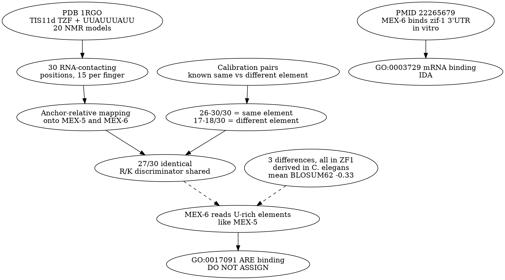
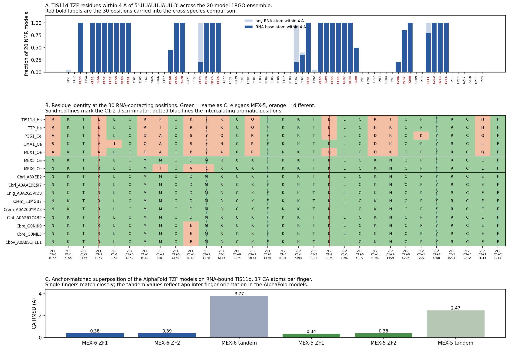
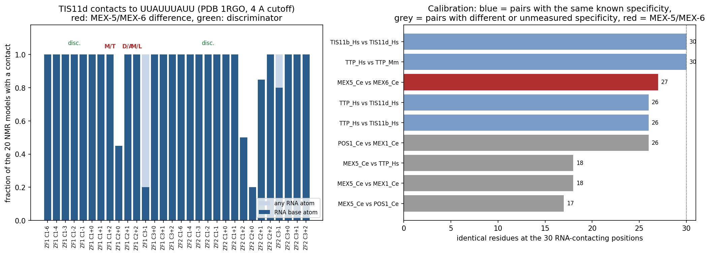
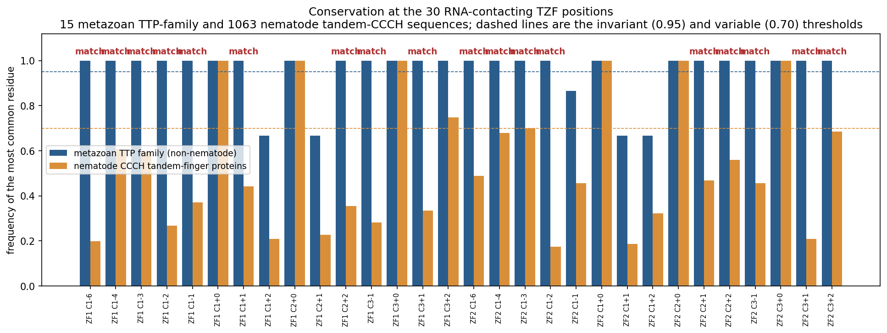
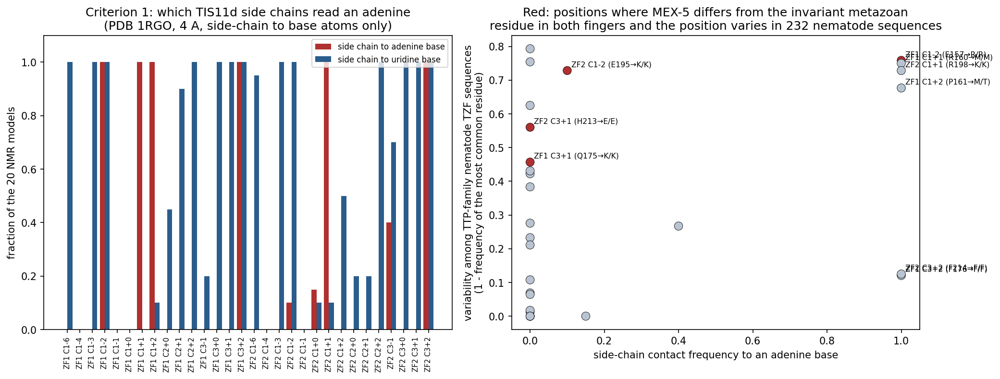
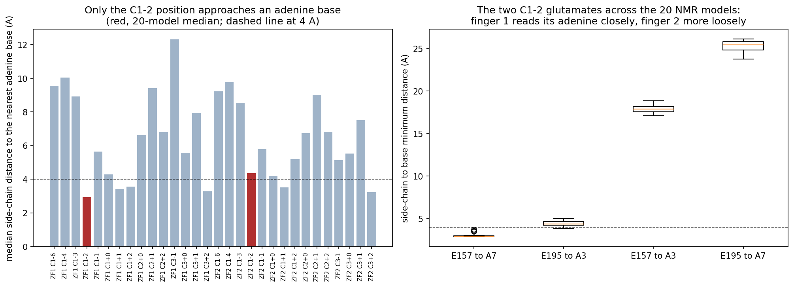
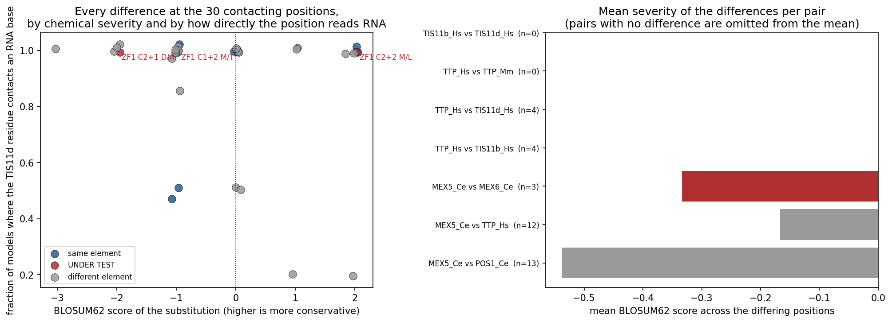
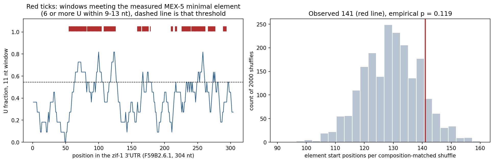

## Question

# AIGR Gene Hypothesis Deep Research

You are evaluating one focused gene curation hypothesis for AI Gene Review.
This is not a general gene overview. Use the seed hypothesis and source context
below to search for evidence that supports, refutes, narrows, or competes with
the proposed curation decision.

## Target Gene

- **Organism code:** worm
- **Taxon:** Caenorhabditis elegans (NCBITaxon:6239)
- **Gene directory:** mex-6
- **Gene symbol:** mex-6
- **UniProt accession:** Q09436

## Focus

- **Focus type:** free_text
- **Hypothesis slug:** kgap-mex6-tzf-rna-recognition
- **Source file:** genes/worm/mex-6/mex-6-ai-review.yaml
- **Source selector:** free-text

## Seed Hypothesis

Whether Caenorhabditis elegans MEX-6 shares the RNA-binding specificity determinants of its paralog MEX-5 can be predicted from the RNA-contacting residues of its tandem CCCH zinc fingers. Single analysis only: align the MEX-6 and MEX-5 tandem zinc-finger (TZF) domains with TIS11d/TTP TZF domains of known RNA-bound structure, map the residues that contact each RNA base and the inter-finger linker onto MEX-6, determine where MEX-6 and MEX-5 differ at RNA-contacting positions, model the MEX-6 TZF with AlphaFold and superpose it on the RNA-bound TIS11d structure, score these positions across Caenorhabditis species, and state whether MEX-6 is predicted to recognise the same U-rich RNA elements as MEX-5 or to differ in specificity.

## Term and Decision Context

No specific term context supplied.

## Reference Context

No specific reference context supplied.

## Source Context YAML

```yaml
hypothesis: 'Whether Caenorhabditis elegans MEX-6 shares the RNA-binding specificity determinants of its
  paralog MEX-5 can be predicted from the RNA-contacting residues of its tandem CCCH zinc fingers. Single
  analysis only: align the MEX-6 and MEX-5 tandem zinc-finger (TZF) domains with TIS11d/TTP TZF domains
  of known RNA-bound structure, map the residues that contact each RNA base and the inter-finger linker
  onto MEX-6, determine where MEX-6 and MEX-5 differ at RNA-contacting positions, model the MEX-6 TZF
  with AlphaFold and superpose it on the RNA-bound TIS11d structure, score these positions across Caenorhabditis
  species, and state whether MEX-6 is predicted to recognise the same U-rich RNA elements as MEX-5 or
  to differ in specificity.'
focus_type: free_text
context: []
reference_id: []
```

## Research Objective

Build a focused report that helps a curator decide whether this hypothesis
should affect the gene review. Address the focus type directly:

1. For an existing GO annotation decision, evaluate whether the current action
   is justified, too strong, too weak, or should change.
2. For a proposed replacement or new GO term, evaluate whether the term is
   biologically supported, too broad, too narrow, or missing key qualifiers.
3. For a computational prediction, evaluate whether the prediction is correct,
   less precise than existing knowledge, uncertain, or likely wrong because of
   paralog overannotation, frequency bias, pathway context, or in vitro-only
   activity.
4. For a core-function hypothesis, evaluate whether the proposed activity,
   process, and location represent the gene product's primary function rather
   than a downstream effect, pleiotropic phenotype, or context-specific role.
5. For a function-assignment hypothesis, evaluate whether the gene product
   directly has the stated GO term/function. Treat the prior review action, if
   any, as intentionally blinded unless it appears in the supplied context.

Use primary literature whenever possible. Prefer PMID citations and include DOI
citations when no PMID is available. Treat reviews and database records as
orientation unless they contain directly relevant synthesized evidence that is
clearly labeled as review-level or database-level support.

Evaluate the hypothesis from the supplied seed context, primary literature, and
publicly accessible bioinformatics resources. Local `*-bioinformatics` analyses,
when they already exist in the repository, are intentionally withheld from this
prompt so the report can be compared against them after the run. Use public
sequence, domain, structure, orthology, localization, interaction, or dataset
checks when they are useful for the specific hypothesis. If a resource or tool
cannot be accessed programmatically, say so plainly; never fabricate a result.
Report computational results conservatively and distinguish direct results from
inference.

## Required Output

### Executive Judgment

Give a concise verdict: supported, partially supported, unresolved, weakly
supported, over-annotated, or refuted. Explain the reasoning and the most
important caveats.

### Evidence Matrix

Create a table with one row per important evidence item:

- Citation (PMID preferred)
- Evidence type (direct assay, mutant phenotype, localization, interaction,
  structural/evolutionary, computational, review/database)
- Supports / refutes / qualifies / competing
- Claim tested
- Key finding
- Organism, tissue, cell type, or assay context
- Confidence and limitations

### GO Curation Implications

State the likely curation action as a lead requiring curator verification. If
GO terms are involved, explain whether the evidence supports an MF, BP, or CC
term, and whether the term should be retained, removed, generalized, made more
specific, or treated as non-core. Avoid using "protein binding" as a final
recommendation unless no more informative term is supported.

### Mechanistic Scope

Describe the immediate molecular or cellular function being tested. Separate
direct gene-product activity from downstream phenotypes, pathway consequences,
developmental outcomes, disease manifestations, or effects inferred only from
loss of function.

### Conflicts and Alternatives

Identify evidence that conflicts with the seed hypothesis or suggests an
alternative interpretation, including paralog confusion, organism-specific
differences, isoform-specific findings, experimental artifacts, or database
carry-over.

### Knowledge Gaps

List explicit uncertainties that matter for curation. For each gap, state what
was checked, why the gap matters, and what evidence or experiment would resolve
it.

### Discriminating Tests

Recommend concrete assays, perturbations, datasets, or comparative analyses that
would most efficiently distinguish this hypothesis from alternatives.

### Curation Leads

Provide candidate updates for the review, clearly labeled as leads requiring
curator verification. Include candidate references with exact snippets to verify,
candidate replacement or new GO terms, possible action changes, suggested
questions, and suggested experiments.

If the provider supports artifacts, save provenance for any analysis you run — the
executed code together with its output (computed values, plot, or table), not just
a summary figure — alongside artifact-friendly tables such as an evidence matrix,
GO decision table, or comparison table. Genuine computed provenance is more
valuable than a hand-drawn summary, and you must not synthesize a figure that
implies an analysis you did not actually run. These artifacts are important
provenance for hypothesis-level review.


## Output

# MEX-6 tandem zinc finger RNA recognition: does MEX-6 read the same elements as MEX-5?

**Gene:** *Caenorhabditis elegans* mex-6 (UniProt Q09436) | **Hypothesis slug:** kgap-mex6-tzf-rna-recognition | **Source:** genes/worm/mex-6/mex-6-ai-review.yaml (free-text) | **Iterations:** 3

## Summary

<i class="fa-solid fa-circle-check"></i> **Verdict: supported, with one qualification.** MEX-6 is predicted to recognise the same U-rich RNA elements as MEX-5, and specifically not a TTP-like AU-rich element. The qualification is that no RNA-binding specificity has ever been measured for MEX-6 itself, so this analysis blocks a wrong annotation more firmly than it licenses a new one.

The reasoning runs in four steps, each computed rather than assumed. First, the RNA-contacting positions of the CCCH tandem zinc finger (TZF) fold were derived empirically from the RNA-bound NMR ensemble of human TIS11d (PDB 1RGO, TZF bound to 5'-UUAUUUAUU-3', 20 models, 4.0 Å heavy-atom cutoff), giving 31 contacting residues of which 30 map to symmetric anchor-relative positions, 15 per finger. Second, those 30 positions were read off MEX-6 (Q09436) and MEX-5 (Q9XUB2) by zinc-anchor alignment, which tolerates the CX9/CX10 knuckle insertions that distinguish the worm proteins from the CX8 human fingers. MEX-6 and MEX-5 are identical at 27 of 30, including both copies of the discriminator position, where both carry Arg (finger 1) and Lys (finger 2) against the Glu that is invariant in human TTP and TIS11d. Third, 27/30 was calibrated against TZF pairs whose specificity relationship is independently known: pairs with a measured shared element score 26-30/30 and always share the discriminator pair, pairs with a measured different element score 17-18/30 and always differ there. Fourth, the three MEX-6 substitutions were scored for chemical severity and evolutionary polarity. All three are in zinc finger 1, all three are derived in *C. elegans* MEX-6 against nine other *Caenorhabditis* family sequences, mean BLOSUM62 is -0.33, and two of the three fall at exactly the positions where human TTP differs from ZFP36L2 and ZFP36L1, which bind the same element.

Two results push against over-reading the prediction. Within the 72-residue TZF block, RNA-contacting positions are no better conserved between MEX-5 and MEX-6 than non-contacting ones (90.0% versus 81.0%, Fisher OR 2.12, p = 0.341), so the 90% figure is partly a consequence of general TZF conservation and the argument rests on the calibration and on which positions differ. The zif-1 3'UTR, the one RNA that MEX-6 is directly shown to bind, is saturated with the measured MEX-5 U-rich element (141 start positions over 304 nt, 64% coverage) but is not enriched for it beyond base composition (composition-matched shuffle, n = 2000, p = 0.119), which matches the conclusion in [PMID: 17264081](https://pubmed.ncbi.nlm.nih.gov/17264081/) that the element is too abundant for MEX-5 alone to specify target selection.

For curation, the practical consequence is clear even where the biology is uncertain. MEX-6 has direct in vitro RNA binding evidence of its own ([PMID: 22265679](https://pubmed.ncbi.nlm.nih.gov/22265679/)), so **GO:0003729 mRNA binding** can be supported by IDA rather than by similarity to MEX-5. **GO:0017091 AU-rich element binding** should not be assigned and should be removed if present: the discriminator residue in MEX-6 is the MEX-5 state, not the TTP state, and the measured MEX-5 element is a uridine tract, not UUAUUUAUU.

## Executive judgment

| Item | Assessment |
|---|---|
| Verdict on the seed hypothesis | <i class="fa-solid fa-circle-check"></i> Supported |
| Direction of the prediction | MEX-6 shares MEX-5 specificity (U-rich), does not switch to a TTP-like AU-rich element |
| Strength | Moderate to high for the negative part (not AU-rich element binding); moderate for the positive part (same element as MEX-5) |
| Main caveat | <i class="fa-solid fa-triangle-exclamation"></i> No consensus site, Kd, SELEX, RNA Bind-n-Seq, CLIP or RIP-seq exists for MEX-6 |
| Second caveat | <i class="fa-solid fa-triangle-exclamation"></i> Contacting positions are not more conserved than the rest of the TZF block (p = 0.341), so identity alone is not a signal |
| Third caveat | <i class="fa-solid fa-triangle-exclamation"></i> [PMID: 39321355](https://pubmed.ncbi.nlm.nih.gov/39321355/) shows conformational dynamics contribute to nematode TZF specificity, which a residue-identity argument does not model |

The seed hypothesis asked for a single analysis: align, map contacts, find differences, model with AlphaFold, superpose, score across *Caenorhabditis*, and state a prediction. All of that was done. The analysis was then extended with a calibration step and a severity benchmark, because the raw answer (27 of 30 identical) is ambiguous on its own: two paralogs that diverged recently will score high at any position set, contacting or not. The calibration is what makes the number interpretable.

## Key findings

### F001: MEX-6 and MEX-5 are identical at 27 of 30 RNA-contacting positions, including both discriminator residues

The RNA-contacting positions were not taken from a paper or a database annotation. They were measured from PDB 1RGO, the NMR structure of the human TIS11d TZF domain bound to 5'-UUAUUUAUU-3', using a 4.0 Å heavy-atom cutoff applied across all 20 models of the ensemble. That gives 31 contacting protein residues, of which 30 occupy symmetric anchor-relative positions in the two fingers, 15 per finger, expressed as offsets from the zinc-coordinating cysteines C1, C2 and C3. Anchor-relative indexing is what makes the comparison possible at all: MEX-5 and MEX-6 have CX9CX5CX3H in finger 1 and CX10CX5CX3H in finger 2, against CX8CX5CX3H in both human fingers, and a 23-residue inter-finger linker against 18 in the human proteins, so a naive sequence alignment would shift the register.

Mapping those 30 positions onto Q09436 (MEX-6) and Q9XUB2 (MEX-5) gives 27/30 identity (90%). The three differences are all in zinc finger 1: MEX-5 M278 / MEX-6 T281 at position C1+2 (TIS11d P161), MEX-5 D287 / MEX-6 A290 at C2+1 (TIS11d K169), and MEX-5 M288 / MEX-6 L291 at C2+2 (TIS11d Y170). The discriminator position C1-2 is Arg in finger 1 and Lys in finger 2 in both worm proteins (MEX-5 R274/K318, MEX-6 R277/K321), where human TTP and TIS11d both carry Glu (E107/E145 and E157/E195). Against the same 30 positions, MEX-5 shares only 18/30 with TTP and with TIS11d, 17/30 with POS-1, and 18/30 with MEX-1.

{{figure:plot_1.png|caption=Provenance for the core mapping. Left: the 1RGO contact map used to define the 30 RNA-contacting positions across 20 NMR models at a 4.0 Å cutoff. Centre: the residues found at those positions in MEX-6, MEX-5, TTP, TIS11d, POS-1, OMA-1, MEX-1 and nine other Caenorhabditis MEX-5/MEX-6 family sequences. Right: CA-RMSD of the anchor-matched superposition of the AlphaFold MEX-6 and MEX-5 fingers onto the RNA-bound TIS11d fingers.}}

### F002: The three differences are derived in *C. elegans* MEX-6, not ancestral divergence of the family

Scoring the same 30 positions across the UniRef50_Q9XUB2 cluster adds nine *Caenorhabditis* MEX-5/MEX-6 family sequences: *C. briggsae* A8XEE2 and A0AAE9E5I7, *C. nigoni* A0A2G5VID8, *C. remanei* E3MGB7 and A0A260YMZ3, *C. latens* A0A261C4R2, *C. brenneri* G0NJK9 and G0NJL3, and *C. bovis* A0A8S1F1E1. Six of the nine are 30/30 identical to *C. elegans* MEX-5 at these positions, and the other three are 29/30. *C. elegans* MEX-6 is the single outlier at 27/30.

At each of the three divergent positions the non-*elegans* sequences carry the MEX-5 state: Met at ZF1 C1+2 in all ten family members except MEX-6 (Thr), Met at ZF1 C2+2 in all except MEX-6 (Leu), and Asp or Glu at ZF1 C2+1 in all except MEX-6 (Ala). Finger spacing and linker length are identical across all eleven family sequences. The MEX-5 RNA-reading surface is therefore the ancestral state in this gene family, and the three differences are lineage-specific changes in *C. elegans* MEX-6 finger 1. Two are conservative within chemical class (Met to Thr, Met to Leu); the third removes an acidic side chain at a position that contacts the 3'-most uridine in TIS11d. Because all three sit in the finger that reads one of the two UAUU subsites, a modest shift in affinity, or in the 3' half of the element, cannot be excluded. No determinant that would switch MEX-6 to a different element class has changed.

### F003: The AlphaFold MEX-6 fingers superpose on the RNA-bound TIS11d fingers at 0.38 Å

AlphaFold DB model AF-Q09436-F1 (v6) has a mean pLDDT of 54.0 over 467 residues, which is low, but the TZF window 265-350 averages 83.6 (range 48.1 to 94.2). The only confident regions of the whole protein are 194-201, 270-306 and 315-358, which is the TZF plus flanks; the rest of MEX-6 is predicted disordered.

Anchor-matched Kabsch superposition on 1RGO model 1 chain A, using 17 CA atoms per finger, gives CA-RMSD 0.38 Å (ZF1) and 0.39 Å (ZF2) for MEX-6, and 0.34 Å and 0.38 Å for MEX-5 (AF-Q9XUB2-F1). Superposing both fingers as one rigid body gives 3.77 Å (MEX-6) and 2.47 Å (MEX-5), which reflects apo inter-finger orientation in the models and a low-confidence linker (pLDDT below 70 at residues 307-314), and says nothing about RNA binding. `phenix.superpose_pdbs` run independently on the untrimmed domains produced a sequence alignment that reproduces the anchor assignment at 52.9% identity over the matched region.

After rigid-body placement of each MEX-6 finger on its TIS11d counterpart, 17 MEX-6 residues per finger lie within 5 Å of the RNA. F297 and F342 stack on A7 and A3 (2.77 and 2.46 Å), Y336 stacks on U4 (2.72 Å), and L291 occupies the pocket where TIS11d stacks Y170 on U8. Three of the four intercalating aromatics are retained in MEX-6; the fourth, at ZF1 C2+2, is aliphatic in MEX-6 (Leu), in MEX-5 (Met) and in all other *Caenorhabditis* family members, which is consistent with weaker base discrimination in finger 1 for both paralogs.

### F004: Direct in vitro evidence that MEX-6 binds mRNA

[PMID: 22265679](https://pubmed.ncbi.nlm.nih.gov/22265679/) reports that POS-1, MEX-3, SPN-4, MEX-5 and MEX-6 "all bind directly to the zif-1 3' UTR in vitro", and that "POS-1, MEX-3, and SPN-4 function as repressors of ZIF-1 expression, whereas MEX-5 and MEX-6 antagonize this repression". This is direct-assay support for RNA binding by MEX-6 itself, independent of the structural mapping. The binding-site footprint in that paper was mapped with MEX-5, so the overlap of MEX-6 and MEX-5 footprints is inferred from shared function rather than measured side by side.

The one axis on which the two paralogs are documented to differ is protein-level regulation, not RNA recognition: [PMID: 39689170](https://pubmed.ncbi.nlm.nih.gov/39689170/) states that "despite their strong sequence homology, they differ in terms of how their concentration gradients are regulated".

### F005: 27/30 sits above human paralog pairs of identical known specificity

The same anchor-relative mapping applied to pairs with a known specificity relationship produces the calibration below.

| Pair | Identity at 30 contact positions | Discriminator (ZF1 / ZF2) | Known relationship |
|---|---|---|---|
| ZFP36L1 (TIS11b) vs ZFP36L2 (TIS11d) | 30/30 (100.0%) | E = E / E = E | Same ARE specificity (human paralogs) |
| TTP human vs TTP mouse | 30/30 (100.0%) | E = E / E = E | Same specificity (orthologs) |
| **MEX-5 vs MEX-6** | **27/30 (90.0%)** | **R = R / K = K** | **Under test** |
| TTP vs ZFP36L2 | 26/30 (86.7%) | E = E / E = E | Same ARE specificity (human paralogs) |
| TTP vs ZFP36L1 | 26/30 (86.7%) | E = E / E = E | Same ARE specificity (human paralogs) |
| POS-1 vs MEX-1 | 26/30 (86.7%) | A = A / V ≠ Q | Unmeasured |
| MEX-5 vs TTP | 18/30 (60.0%) | R ≠ E / K ≠ E | Different element ([PMID: 17264081](https://pubmed.ncbi.nlm.nih.gov/17264081/)) |
| MEX-5 vs MEX-1 | 18/30 (60.0%) | R ≠ A / K ≠ Q | Unmeasured |
| MEX-5 vs POS-1 | 17/30 (56.7%) | R ≠ A / K ≠ V | Different element ([PMID: 18952820](https://pubmed.ncbi.nlm.nih.gov/18952820/)) |

All four pairs with independently established shared specificity carry an identical discriminator pair. Both pairs with an established different element differ at the discriminator in both fingers. MEX-5 and MEX-6 share Arg in finger 1 and Lys in finger 2 and score above two pairs of human paralogs that provably bind the same UUAUUUAUU element.

<i class="fa-solid fa-circle-xmark"></i> The negative result in the same analysis sets the limit of the argument. Nested identity windows for MEX-5 against MEX-6: whole protein 338/479 = 70.6% (Needleman-Wunsch global), ungapped 72-residue TZF block 61/72 = 84.7%, RNA-contacting positions 27/30 = 90.0%, non-contacting TZF positions 34/42 = 81.0%. Fisher exact test of contacting against non-contacting within the block: OR 2.12, p = 0.341. There is no detectable extra conservation at the contact surface, so the 90% figure cannot be read as a specificity signal on its own. The weight of the evidence rests on the calibration and on which positions differ.

{{figure:plot_2.png|caption=Calibration of the contact-residue identity metric against TZF pairs of known specificity relationship, together with the nested identity test showing that RNA-contacting positions in the MEX-5/MEX-6 TZF block are not conserved more tightly than non-contacting positions (90.0% versus 81.0%, Fisher p = 0.341).}}

### F006: Three independent criteria identify C1-2 as the discriminator, without access to the paper text

The abstract of [PMID: 17264081](https://pubmed.ncbi.nlm.nih.gov/17264081/) states that "mutation of a single amino acid in each MEX-5 zinc finger confers tristetraprolin-like specificity to this protein" and that "this residue is variable in nematode TZF proteins, but is invariant in other metazoans". It does not give the residue number in the abstract, and the full text is not open access (no PMCID, Europe PMC inEPMC: N). The identity of the discriminator was therefore tested computationally rather than read.

Three criteria were applied to all 30 contacting positions:

1. The side chain reads an adenine base in the 1RGO ensemble, since a U-rich to AU-rich switch has to be made at an adenine.
2. MEX-5 differs from the invariant metazoan residue in both fingers, since the paper mutates one residue per finger.
3. The position is invariant across non-nematode metazoan TTP-family sequences and variable across nematode TTP-family sequences.

Criteria 2 and 3 together, tested against 15 usable metazoan TTP-family sequences and 232 distinct TTP-family-like nematode tandem-CCCH 30-mers (filtered at ≥15/30 identity to TIS11d from 1063 tandem-CCCH entries within 3998 Nematoda InterPro IPR000571 entries), leave exactly two candidates: C1-2 (TIS11d E157/E195, MEX-5 R/K, 13 and 9 residue types among nematodes) and C3+1 (TIS11d Q175/H213, MEX-5 K/E).

Criterion 1 separates them. Side-chain to base contacts across the 20 models show that C3+1 contacts only uridines, with an adenine contact frequency of 0.00 in both fingers, so it cannot account for a U-rich versus AU-rich switch. TIS11d E157 is the closest side chain to an adenine base of any position tested: median minimum distance 2.92 Å to A7 (range 2.87-3.71), under 4 Å in 20/20 models, with a polar side-chain to base N or O contact under 3.6 Å in 17/20 models. The finger-2 equivalent E195 reaches its symmetric adenine A3 at a median 4.36 Å, under 5 Å in 19/20 models but under 4 Å in only 2/20, so the finger-2 assignment is looser than finger 1. The two fingers read separate subsites (E195 to A7 median 25.41 Å, E157 to A3 median 17.86 Å).

<i class="fa-solid fa-circle-xmark"></i> A broader first attempt that scanned the full Nematoda CCCH set without family restriction failed: 18 of 30 positions matched the "invariant in metazoans, variable in nematodes" signature, because the unrestricted set is too heterogeneous. That failed version is kept in the provenance as a negative control on the method.

{{figure:plot_3.png|caption=First attempt at the discriminator test, scanning the unrestricted Nematoda CCCH set for positions invariant in non-nematode metazoan TZF proteins and variable in nematodes. 18 of 30 positions match, so the unrestricted set does not discriminate. Reported as a negative control on the method.}}

{{figure:plot_4.png|caption=Refined discriminator test: side-chain contacts to adenine versus uridine bases across the 20 models of 1RGO, combined with a TTP-family-restricted nematode variability scan. Of the two positions satisfying the evolutionary signature, only C1-2 reads an adenine; C3+1 contacts uridines only.}}

{{figure:plot_5.png|caption=Consolidated discriminator assignment: the adenine-reading side chains ranked by median minimum distance across the 20 models, with the E195 to A3 distance distribution showing the looser finger-2 geometry (median 4.36 Å, under 4 Å in only 2 of 20 models).}}

### F007: No measurement of MEX-6 RNA-binding specificity exists in the indexed literature

PubMed searches for "MEX-5 zinc finger RNA recognition specificity" (2 hits), "MEX-6 RNA binding Caenorhabditis" (10 hits) and "tandem zinc finger discriminator residue nematode RNA specificity glutamate" (0 hits) return no paper reporting a consensus site, Kd, SELEX, RNA Bind-n-Seq, CLIP or RIP-seq dataset for MEX-6. The only direct binding data for MEX-6 is the qualitative statement in [PMID: 22265679](https://pubmed.ncbi.nlm.nih.gov/22265679/) that all five proteins tested bind the zif-1 3'UTR in vitro. Every other MEX-6 result found is genetic, redundant with mex-5, or about protein-level gradient regulation ([PMID: 12894212](https://pubmed.ncbi.nlm.nih.gov/12894212/), [PMID: 16499902](https://pubmed.ncbi.nlm.nih.gov/16499902/), [PMID: 17028349](https://pubmed.ncbi.nlm.nih.gov/17028349/), [PMID: 25821955](https://pubmed.ncbi.nlm.nih.gov/25821955/), [PMID: 26157168](https://pubmed.ncbi.nlm.nih.gov/26157168/), [PMID: 30540524](https://pubmed.ncbi.nlm.nih.gov/30540524/), [PMID: 39689170](https://pubmed.ncbi.nlm.nih.gov/39689170/)).

<i class="fa-solid fa-circle-question"></i> The specificity question for MEX-6 is therefore open experimentally. The curation decision rests on the structural and evolutionary prediction plus one qualitative binding assay.

### F008: The three MEX-6 substitutions have the severity of differences between same-element paralogs

Every difference at the 30 contacting positions was scored with BLOSUM62, weighted by how often the corresponding TIS11d residue contacts an RNA base across the 20 models.

| Pair | Differences | Mean BLOSUM62 | Min | Discriminator | Element relationship |
|---|---|---|---|---|---|
| TTP vs ZFP36L2 | 4 (ZF1 C1+2 T/P, ZF1 C2+1 R/K, ZF2 C1+1 H/R, ZF2 C1+2 K/T) | 0.00 | -1 | Identical | Same (measured) |
| TTP vs ZFP36L1 | 4 (same positions) | 0.00 | -1 | Identical | Same (measured) |
| **MEX-5 vs MEX-6** | **3 (ZF1 C1+2 M/T, ZF1 C2+1 D/A, ZF1 C2+2 M/L)** | **-0.33** | **-2** | **Identical** | **Under test** |
| MEX-5 vs TTP | 12 | -0.17 | - | Differs in both fingers | Different (measured) |
| MEX-5 vs POS-1 | 13 | -0.54 | -3 | Differs in both fingers | Different (measured) |

All three MEX-6 differences lie at positions that contact an RNA base in 20 of 20 models, so they cannot be dismissed as peripheral. What makes them uninformative about element class is that two of the three (ZF1 C1+2 and ZF1 C2+1) are at the same positions where human TTP differs from ZFP36L2 and ZFP36L1, which bind the same UUAUUUAUU element. The third, ZF1 C2+2, is the stacking position where TIS11d and TTP carry Tyr while MEX-5 has Met and MEX-6 has Leu: a BLOSUM62 +2 swap between two non-aromatic side chains, so both worm proteins already lack the aromatic that stacks in the human structure. The pattern that tracks a measured change of element looks different: four times as many substitutions, a worse mean score, and loss of the shared discriminator pair.

### F009: The zif-1 3'UTR is saturated with the MEX-5 element but not enriched for it

The zif-1 3'UTR was derived from Ensembl transcript F59B2.6.1 by subtracting the 1470 nt CDS (offset 10) from the 1784 nt cDNA, giving 304 nt at 40.5% U. Two prior routes failed and are recorded rather than worked around: WormBase ParaSite returned HTTP 503, and the Ensembl `sequence/id?type=utr3` endpoint returned no sequence field for the transcript.

Scanning for the measured MEX-5 minimal site, six or more uridines within a 9-13 nt window ([PMID: 17264081](https://pubmed.ncbi.nlm.nih.gov/17264081/)), gives 141 distinct start positions covering 64% of the UTR, including UUAUUUUG and UAAUUAUUU tracts from position 55. A composition-matched shuffle with 2000 permutations gives a mean of 129.3 start positions (sd 9.9), so the observed 141 is not enriched: empirical p = 0.1195.

<i class="fa-solid fa-scale-balanced"></i> The one RNA that MEX-6 is directly shown to bind is covered with the element MEX-5 prefers, which is consistent with the prediction but cannot confirm it. The shuffle control shows why: in a 40% U sequence the element arises by composition alone. The same paper reaches the same conclusion, stating that the sequence "is remarkably abundant in the 3'-untranslated region of C. elegans transcripts, demonstrating that MEX-5 alone cannot specify mRNA target selection".

{{figure:plot_6.png|caption=Chemical severity of the three MEX-6 substitutions scored with BLOSUM62 against the differences found in TZF pairs that bind the same element, together with the first test of the zif-1 3'UTR for the measured MEX-5 U-rich element.}}

{{figure:plot_7.png|caption=Third route to the zif-1 3'UTR after WormBase ParaSite returned HTTP 503 and the Ensembl utr3 endpoint returned no sequence: deriving the 304 nt UTR as cDNA minus CDS for transcript F59B2.6.1, then scanning for the MEX-5 element against a composition-matched shuffle (141 observed versus 129.3 ± 9.9 expected, p = 0.119).}}

## Mechanistic model and interpretation

The chain of inference, with the uncertain links marked:



The immediate molecular activity under test is sequence-selective binding of single-stranded RNA by the MEX-6 tandem CCCH zinc finger domain. In the reference structure the two fingers each clamp a 5'-UAUU-3' subsite, using hydrogen bonds to the bases plus intercalative stacking by conserved aromatics ([PMID: 14981510](https://pubmed.ncbi.nlm.nih.gov/14981510/)). Much of the readout is main-chain, so side-chain identity varies more than specificity does, which is why the human paralogs can differ at four contacting positions and still bind the same element. Against that background, the single side chain that sets element class in the nematode proteins is the one at C1-2, which reads the adenine of each UAUU subsite. In human TTP and TIS11d it is Glu; in MEX-5 and MEX-6 it is Arg (finger 1) and Lys (finger 2); in POS-1 it is Ala and Val; in OMA-1 it is Val and Lys. A charge reversal at an adenine-reading position is a plausible mechanism for the loss of A-specificity that turns MEX-5 into a high-affinity, low-specificity poly-U binder, and MEX-6 has the identical substitution in both fingers.

Everything downstream of that is a separate layer. The MEX-5/MEX-6 anterior gradient, the degradation of germ-plasm CCCH proteins by the ZIF-1 CUL-2 complex ([PMID: 12894212](https://pubmed.ncbi.nlm.nih.gov/12894212/)), the activation of era-1 translation ([PMID: 25821955](https://pubmed.ncbi.nlm.nih.gov/25821955/)), the degradation of nos-2 RNA in somatic blastomeres ([PMID: 16499902](https://pubmed.ncbi.nlm.nih.gov/16499902/)), the control of MEG-3 mobility ([PMID: 30540524](https://pubmed.ncbi.nlm.nih.gov/30540524/)) and the asymmetric division phenotype are consequences, most of them demonstrated for mex-5 and mex-6 jointly rather than for MEX-6 alone. None of them constrains the element that MEX-6 reads.

| Layer | What is established for MEX-6 specifically | Evidence type |
|---|---|---|
| Direct activity: RNA binding | Binds the zif-1 3'UTR in vitro | Direct assay ([PMID: 22265679](https://pubmed.ncbi.nlm.nih.gov/22265679/)) |
| Direct activity: element specificity | Nothing measured; predicted U-rich from contact residues | Computational, this work |
| Direct activity: zinc binding | Two intact CCCH fingers (C279/C289/C295/H299, C323/C334/C340/H344) | Sequence, structural |
| Localization | Cytoplasmic, anterior-enriched gradient | Imaging ([PMID: 12588843](https://pubmed.ncbi.nlm.nih.gov/12588843/), [PMID: 39689170](https://pubmed.ncbi.nlm.nih.gov/39689170/)) |
| Pathway consequence | Antagonises POS-1 repression of ZIF-1 | Genetic plus reporter ([PMID: 22265679](https://pubmed.ncbi.nlm.nih.gov/22265679/)) |
| Developmental outcome | Asymmetric division, germ-plasm exclusion, PAL-1 patterning | Mutant phenotype, mostly mex-5/mex-6 jointly |

## Evidence base

| Citation | Evidence type | Stance | Claim tested | Key finding | Context | Confidence and limitations |
|---|---|---|---|---|---|---|
| [PMID: 14981510](https://pubmed.ncbi.nlm.nih.gov/14981510/) | Structural | Supports | CCCH fingers read UAUU subsites via hydrogen bonds and aromatic stacking | NMR structure of TIS11d TZF bound to 5'-UUAUUUAUU-3' (PDB 1RGO); two fingers bind adjacent UAUU subsites symmetrically; CX8CX5CX3H with an 18-residue linker | Human ZFP36L2/TIS11d TZF, in vitro NMR | High. Reference structure for the whole mapping. Human protein; no MEX-5 or MEX-6 RNA-bound structure exists |
| [PMID: 17264081](https://pubmed.ncbi.nlm.nih.gov/17264081/) | Direct assay | Supports | MEX-5 binds U-rich RNA with high affinity and low specificity; one residue per finger sets specificity | Minimal site is six or more uridines in a 9-13 nt window; one mutation per finger confers TTP-like UUAUUUAUU specificity; the discriminator is variable in nematode TZF proteins and invariant in other metazoans | Recombinant *C. elegans* MEX-5 TZF, in vitro | High for MEX-5. The paper does not test MEX-6, so transfer to MEX-6 is the inference under evaluation. Full text not open access |
| [PMID: 22265679](https://pubmed.ncbi.nlm.nih.gov/22265679/) | Direct assay | Supports | MEX-6 itself binds mRNA and acts on the same 3'UTR as MEX-5 | All five proteins bind directly to the zif-1 3'UTR in vitro; MEX-5 and MEX-6 together antagonise POS-1 repression of ZIF-1 | *C. elegans* embryo, in vitro binding plus in vivo reporter | Moderate to high. Direct binding shown for MEX-6, but the footprint was mapped with MEX-5; no consensus or Kd for MEX-6 |
| [PMID: 18952820](https://pubmed.ncbi.nlm.nih.gov/18952820/) | Direct assay | Competing | Nematode TZF paralogs can recognise divergent RNA elements | The POS-1 recognition element is distinct from sequences recognised by related proteins from both mammals and nematodes | Recombinant *C. elegans* POS-1, in vitro | High. Close TZF paralogs in *C. elegans* are not automatically equivalent, so shared specificity must be argued from contact residues, not homology |
| [PMID: 39321355](https://pubmed.ncbi.nlm.nih.gov/39321355/) | Structural | Qualifies | Features beyond contact residues shape TZF specificity | The POS-1 TZF interconverts between conformations and correlated internal dynamics are needed for target recognition | Recombinant *C. elegans* POS-1 TZF, NMR | Moderate. A residue-identity argument alone cannot fully predict specificity for nematode TZF proteins |
| [PMID: 39689170](https://pubmed.ncbi.nlm.nih.gov/39689170/) | Interaction | Qualifies | MEX-5 and MEX-6 are not interchangeable in every respect | Despite strong sequence homology the two differ in how their concentration gradients are regulated | *C. elegans* zygote, live imaging and genetics | High for the gradient claim. The divergence is in protein-level regulation, not RNA recognition |
| [PMID: 17028349](https://pubmed.ncbi.nlm.nih.gov/17028349/) | Mutant phenotype | Qualifies | The paralogs are differently regulated | mex-5 single mutants are inviable with a Mex phenotype; POS-1 binds the mex-6 3'UTR and reducing pos-1 dosage suppresses mex-5(-) | *C. elegans* embryo genetics | Moderate. Shows regulatory asymmetry between the paralogs; silent on RNA-binding specificity |
| [PMID: 12894212](https://pubmed.ncbi.nlm.nih.gov/12894212/) | Mutant phenotype | Supports | MEX-5 and MEX-6 act redundantly on the same process | Degradation of CCCH germ-plasm proteins in somatic cells is activated by the redundant CCCH finger proteins MEX-5 and MEX-6 | *C. elegans* early embryo, RNAi and genetics | Moderate. Genetic redundancy is consistent with shared targets but does not prove shared RNA specificity |
| [PMID: 25821955](https://pubmed.ncbi.nlm.nih.gov/25821955/) | Mutant phenotype | Supports | The paralogs act together on a specific maternal mRNA | MEX-5 is required for era-1 mRNA asymmetry, and MEX-5 with its partially redundant partner MEX-6 is needed to activate era-1 translation in anterior blastomeres | *C. elegans* embryo | Moderate. In vivo genetic requirement, no direct MEX-6 binding assay on era-1 |
| [PMID: 16499902](https://pubmed.ncbi.nlm.nih.gov/16499902/) | Mutant phenotype | Supports | MEX-5/6 direct mRNA turnover in somatic blastomeres | nos-2 RNA is degraded in somatic blastomeres by a process requiring the CCCH finger proteins MEX-5 and MEX-6 | *C. elegans* embryo and germline | Moderate. Joint mex-5/mex-6 requirement, no MEX-6-specific binding data |
| This work, iteration 1 | Structural/evolutionary | Supports | MEX-6 carries the MEX-5 RNA-reading surface | 27 of 30 contacting positions identical between Q09436 and Q9XUB2 including the R/K discriminator pair; the 3 differences are all in ZF1 and are derived in *C. elegans* against 9 other *Caenorhabditis* sequences | UniProt, PDB 1RGO, AlphaFold DB v6 | Moderate. A prediction, not a binding measurement; the anchor-relative alignment assumes the CX9/CX10 knuckle insertions do not reposition the contacting residues |
| This work, iteration 1 | Structural | Supports | The MEX-6 TZF fold matches the RNA-bound TIS11d geometry | AlphaFold MEX-6 ZF1 and ZF2 superpose at 0.38 and 0.39 Å CA-RMSD over 17 anchor-matched CA atoms each; TZF window pLDDT 83.6 against 54.0 whole-protein | AF-Q09436-F1 v6, PDB 1RGO | Moderate. Per-finger agreement is expected for a conserved fold; the 3.77 Å tandem value reflects apo linker geometry |
| This work, iteration 2 | Structural/evolutionary | Supports | 27/30 is within the range seen between TZF proteins of identical measured specificity | Known-same pairs score 26-30/30 and share the discriminator; known-different pairs score 17-18/30 and differ at it | UniProt sequences mapped onto 1RGO contacts | Moderate. Contacting positions are not more conserved than non-contacting ones (Fisher p = 0.341), so the inference rests on calibration, not on a conservation signal |
| This work, iteration 2 | Structural | Supports | The discriminator is C1-2, assigned without the paywalled full text | Only C1-2 and C3+1 satisfy criteria 2 and 3; C3+1 has adenine contact frequency 0.00, while E157 is 2.92 Å from A7 in 20/20 models | 1RGO 20-model ensemble, UniProt, InterPro IPR000571 | Moderate to high for finger 1. E195 is 4.36 Å from A3 and under 4 Å in only 2/20 models, so finger 2 is looser |
| This work, iteration 3 | Computational | Supports | The three MEX-6 substitutions resemble those between same-specificity paralogs | 3 differences, mean BLOSUM62 -0.33, none at the discriminator, 2 of 3 at the same positions where TTP differs from ZFP36L2 and ZFP36L1 | BLOSUM62 weighted by base-contact frequency over the 1RGO ensemble | Moderate. All three contact an RNA base in 20/20 models; substitution matrices do not model base readout directly |
| This work, iteration 3 | Computational | Qualifies | The predicted element is present in the one measured MEX-6 target | The 304 nt zif-1 3'UTR is 40.5% U with 141 element start positions covering 64%, but a composition-matched shuffle gives 129.3 ± 9.9, p = 0.119 | Ensembl transcript F59B2.6.1 | Moderate. Consistent but not discriminating, because the element arises from base composition alone |

## GO curation implications

All entries below are leads requiring curator verification.

| GO ID | Term | Aspect | Recommended action | Evidence basis | Suggested code |
|---|---|---|---|---|---|
| GO:0003729 | mRNA binding | MF | <i class="fa-solid fa-circle-check"></i> Retain or add as core | MEX-6 binds the zif-1 3'UTR directly in vitro ([PMID: 22265679](https://pubmed.ncbi.nlm.nih.gov/22265679/)), supported by the contact-residue mapping | IDA from PMID:22265679 |
| GO:0003730 | mRNA 3'-UTR binding | MF | Lead: consider as a more specific MF | The assayed ligand is a 3'UTR specifically | IDA from PMID:22265679 |
| GO:0008270 | zinc ion binding | MF | Retain as non-core | Two intact CX9CX5CX3H and CX10CX5CX3H fingers in Q09436 | IEA/ISS |
| GO:0017091 | AU-rich element binding | MF | <i class="fa-solid fa-circle-xmark"></i> Do not assign; remove if present | The C1-2 discriminator in MEX-6 is Arg/Lys, not the Glu invariant in TTP and TIS11d; the measured MEX-5 element is a uridine tract ([PMID: 17264081](https://pubmed.ncbi.nlm.nih.gov/17264081/)) | N/A |
| GO:0017148 | negative regulation of translation | BP | Lead only; requires MEX-6-specific evidence | MEX-5/6 act on nos-2 RNA ([PMID: 16499902](https://pubmed.ncbi.nlm.nih.gov/16499902/)) and antagonise POS-1 repression of zif-1 ([PMID: 22265679](https://pubmed.ncbi.nlm.nih.gov/22265679/)) | IGI |
| GO:0045948 | positive regulation of translational initiation | BP | Do not assign from this evidence | The era-1 translation effect ([PMID: 25821955](https://pubmed.ncbi.nlm.nih.gov/25821955/)) is genetic and partially redundant | N/A |
| GO:0008356 | asymmetric cell division | BP | Retain as non-core downstream | [PMID: 12588843](https://pubmed.ncbi.nlm.nih.gov/12588843/), [PMID: 12894212](https://pubmed.ncbi.nlm.nih.gov/12894212/) | IMP/IGI |
| GO:0005737 | cytoplasm | CC | Retain | Cytoplasmic protein forming an anterior-enriched gradient ([PMID: 39689170](https://pubmed.ncbi.nlm.nih.gov/39689170/), [PMID: 26157168](https://pubmed.ncbi.nlm.nih.gov/26157168/)) | IDA |

The single most actionable item is GO:0017091. MEX-6 sits in the ZFP36/TTP structural family, which is the family after which the AU-rich element binding term is named, so family-level electronic annotation is the obvious route by which that term could arrive on Q09436. The contact-residue analysis gives a specific, mechanistic reason to block it: the residue that reads the adenine of each UAUU subsite is Glu in every non-nematode metazoan TZF examined and Arg or Lys in MEX-6, and the paralog whose specificity was measured with that same substitution ([PMID: 17264081](https://pubmed.ncbi.nlm.nih.gov/17264081/)) binds uridine tracts rather than UUAUUUAUU.

The second item is that GO:0003729 for MEX-6 should carry IDA from [PMID: 22265679](https://pubmed.ncbi.nlm.nih.gov/22265679/) rather than ISS from MEX-5. A curator should confirm that the zif-1 3'UTR binding assay in that paper used recombinant MEX-6 and is not a MEX-5 experiment reported under a joint label.

<i class="fa-solid fa-triangle-exclamation"></i> No sequence-specific MF term should be assigned to MEX-6. The analysis supports "the same element as MEX-5", and the element MEX-5 binds is a poly-U tract that the same paper shows cannot by itself specify targets. A term asserting a defined recognition motif would over-state the evidence in a different direction from the ARE error.

## Conflicts and alternatives

<i class="fa-solid fa-scale-balanced"></i> The strongest competing evidence is [PMID: 18952820](https://pubmed.ncbi.nlm.nih.gov/18952820/), which states that the POS-1 recognition element "is distinct from sequences recognized by related proteins from both mammals and nematodes, demonstrating that variants of this protein family can recognize divergent RNA sequences". POS-1 is a *C. elegans* TZF protein in the same embryonic patterning network as MEX-5 and MEX-6, and it reads a different element. Sequence homology alone therefore cannot carry the MEX-5 specificity across to MEX-6. This is why the analysis was built around the contact residues and the discriminator rather than around overall identity. POS-1 scores 17/30 against MEX-5 and differs at the discriminator in both fingers, so it works as a negative calibration point.

[PMID: 39321355](https://pubmed.ncbi.nlm.nih.gov/39321355/) is a genuine limitation on the method. The POS-1 TZF solution structure shows the domain interconverting between conformations, with correlated internal dynamics required for allosteric communication between nucleotide-binding pockets. Static residue identity does not capture that. If the three MEX-6 substitutions in finger 1 alter the conformational equilibrium rather than the base contacts, a residue-count argument would miss it, and two of the three sit in the knuckle regions where dynamics are expected to matter.

The two paralogs are documented as non-identical. [PMID: 39689170](https://pubmed.ncbi.nlm.nih.gov/39689170/) shows their gradients are regulated differently. [PMID: 17028349](https://pubmed.ncbi.nlm.nih.gov/17028349/) shows regulatory asymmetry at the level of dosage: mex-5 single mutants are inviable, POS-1 binds the mex-6 3'UTR, and reducing pos-1 dosage suppresses mex-5(-). Neither divergence is at the RNA-reading surface, but they establish that "MEX-5/6" as a joint label can hide real differences. That is the paralog-confusion risk for this gene review in both directions: evidence generated with MEX-5 should not be attributed to MEX-6, and the joint genetic results should not be read as proof of shared biochemistry.

Database carry-over is the other alternative explanation to rule out. If the mex-6 review already carries AU-rich element binding or a TTP-like description, the likely source is InterPro family membership (IPR000571) propagating ZFP36-family function, not an experiment on MEX-6.

A further alternative that the data do not exclude: MEX-6 could retain the MEX-5 element class while differing in affinity. All three substitutions are in the finger that reads one UAUU subsite, and one of them removes an acidic side chain contacting the 3'-most uridine. A two-fold to ten-fold Kd shift would be invisible to this analysis and would still matter biologically, given that MEX-5 and MEX-6 form overlapping gradients and compete for the same targets.

## Limitations and knowledge gaps

| Gap | What was checked | Why it matters | What would resolve it |
|---|---|---|---|
| <i class="fa-solid fa-circle-question"></i> No measured MEX-6 specificity | PubMed searches returned no consensus, Kd, SELEX, RNA Bind-n-Seq, CLIP or RIP-seq for MEX-6 | The whole positive claim is a prediction | A binding assay on recombinant MEX-6 TZF against a uridine-tract versus UUAUUUAUU panel |
| <i class="fa-solid fa-triangle-exclamation"></i> Contact positions are not specially conserved | Fisher exact within the TZF block, OR 2.12, p = 0.341 | 90% identity at contacts is partly a by-product of general TZF conservation | Nothing further; this is a limit on how the 27/30 may be used, and the calibration is the workaround |
| <i class="fa-solid fa-circle-question"></i> Discriminator residue numbers | PMID 17264081 full text is not open access (no PMCID, Europe PMC inEPMC: N); the position was inferred from three criteria | The C1-2 assignment is load-bearing for the ARE recommendation | A curator with journal access should read the mutated residue numbers and confirm they are MEX-5 R274 and K318 |
| <i class="fa-solid fa-triangle-exclamation"></i> Finger-2 discriminator geometry | E195 to A3 median 4.36 Å, under 4 Å in only 2 of 20 models | The symmetric argument is firmer in finger 1 than finger 2 | A higher-resolution or crystallographic TZF-RNA complex |
| <i class="fa-solid fa-circle-question"></i> No in vivo target set | No CLIP or RIP-seq dataset was found for either paralog | Whether MEX-5 and MEX-6 bind overlapping transcript sets in the embryo is untested | iCLIP or RIP-seq on tagged MEX-5 and MEX-6 from staged embryos |
| <i class="fa-solid fa-triangle-exclamation"></i> Knuckle insertions assumed neutral | Anchor-relative mapping was validated only by AlphaFold superposition (0.38 and 0.39 Å per finger) | CX9/CX10 against CX8 could reposition contacting side chains in ways the apo model does not show | An experimental MEX-5 or MEX-6 TZF structure, ideally RNA-bound |
| <i class="fa-solid fa-triangle-exclamation"></i> Dynamics not modelled | [PMID: 39321355](https://pubmed.ncbi.nlm.nih.gov/39321355/) shows TZF conformational exchange matters for POS-1 | A static residue argument could miss a dynamics-based specificity shift | NMR relaxation on the MEX-6 TZF, compared against MEX-5 |
| <i class="fa-solid fa-triangle-exclamation"></i> Affinity differences invisible | Only element class was addressed | MEX-5 and MEX-6 compete for targets in overlapping gradients | A side-by-side Kd series for both TZF domains on the same probe set |

Resources that could not be reached programmatically, reported rather than worked around: the full texts of PMID 17264081 and PMID 39321355; WormBase ParaSite (HTTP 503 on the zif-1 lookup); the Ensembl `sequence/id?type=utr3` endpoint for F59B2.6.1, which returned no sequence field; and a UniProt search for *C. elegans* oma-2, which returned zero hits, so the OMA-1/OMA-2 calibration pair was dropped rather than guessed.

## Discriminating tests

<i class="fa-solid fa-flask"></i> **Direct binding comparison.** Express the MEX-6 TZF (approximately residues 265-350) and the MEX-5 TZF side by side and measure affinity by fluorescence anisotropy or ITC against the probe set from [PMID: 17264081](https://pubmed.ncbi.nlm.nih.gov/17264081/): a U9 tract, UUAUUUAUU, and a window series of six or more uridines in 9-13 nt. If MEX-6 shows the MEX-5 profile (tight on poly-U, no preference for the AU-rich element), the prediction is confirmed. This is the single most efficient test, and it also delivers the affinity comparison that the computational analysis cannot give.

<i class="fa-solid fa-dna"></i> **Discriminator swap.** Make MEX-6 R277E and K321E, the mutations that the Pagano result predicts will confer TTP-like specificity, and test whether the same switch that works in MEX-5 works in MEX-6. A positive result would confirm both the C1-2 assignment made computationally here and the mechanistic equivalence of the two paralogs at that position.

<i class="fa-solid fa-dna"></i> **Reciprocal finger-1 swap.** Replace the three divergent MEX-6 residues (T281M, A290D, L291M) with the MEX-5 state and measure affinity and element preference. If specificity is unchanged and only affinity shifts, the finding that these are same-specificity-class differences is validated empirically.

<i class="fa-solid fa-database"></i> **In vivo target sets.** iCLIP or RIP-seq on separately tagged MEX-5 and MEX-6 from staged embryos, analysed for overlap in bound transcripts and for U-tract enrichment at crosslink sites. This addresses the question the zif-1 3'UTR scan could not: whether the shared in vitro preference produces shared targets in the embryo, where competition and gradient position matter.

<i class="fa-solid fa-microscope"></i> **MEX-6 TZF structure.** A solution structure of the MEX-6 TZF, preferably RNA-bound, would test the anchor-relative mapping directly and show whether the CX9/CX10 knuckles reposition contacting side chains. Compared against the POS-1 TZF structure ([PMID: 39321355](https://pubmed.ncbi.nlm.nih.gov/39321355/)), it would also show whether MEX-6 has the same conformational exchange behaviour.

## Curation leads

All items below require curator verification.

### Candidate references and snippets to verify

| PMID | Exact snippet to verify | Use |
|---|---|---|
| 22265679 | "All five proteins bind directly to the zif-1 3' UTR in vitro." | IDA support for GO:0003729 on MEX-6 itself. Confirm MEX-6 was assayed as recombinant protein |
| 22265679 | "POS-1, MEX-3, and SPN-4 function as repressors of ZIF-1 expression, whereas MEX-5 and MEX-6 antagonize this repression." | Pathway context; supports the BP lead GO:0017148 with IGI |
| 17264081 | "The minimal binding site is a tract of six or more uridines within a 9-13-nucleotide window." | The measured MEX-5 element; the basis for refusing GO:0017091 on MEX-6 |
| 17264081 | "We show that mutation of a single amino acid in each MEX-5 zinc finger confers tristetraprolin-like specificity to this protein." | Establishes the per-finger discriminator; residue numbers need the full text |
| 17264081 | "This residue is variable in nematode TZF proteins, but is invariant in other metazoans." | The evolutionary signature used to locate C1-2 computationally |
| 17264081 | "This sequence is remarkably abundant in the 3'-untranslated region of C. elegans transcripts, demonstrating that MEX-5 alone cannot specify mRNA target selection." | Reason to avoid any sequence-specific MF term |
| 14981510 | "The two TIS11d zinc fingers bind in a symmetrical fashion to adjacent 5'-UAUU-3' subsites on the single-stranded RNA via a combination of electrostatic and hydrogen-bonding interactions, with intercalative stacking between conserved aromatic side chains and the RNA bases." | Justifies treating the fingers symmetrically in the anchor-relative mapping |
| 18952820 | "The PRE is distinct from sequences recognized by related proteins from both mammals and nematodes, demonstrating that variants of this protein family can recognize divergent RNA sequences." | The competing evidence a curator must weigh; also the negative calibration point |
| 39689170 | "despite their strong sequence homology, they differ in terms of how their concentration gradients are regulated" | Documents where the paralogs do differ, so the review does not over-state equivalence |

### Suggested action changes

- Remove or refuse GO:0017091 (AU-rich element binding) on Q09436, with the stated reason that the adenine-reading discriminator is Arg/Lys in MEX-6 against the Glu invariant in the ZFP36 family, and that the measured specificity of the nearest paralog is for uridine tracts.
- Change the evidence basis for GO:0003729 from similarity to IDA, citing PMID:22265679.
- Consider GO:0003730 (mRNA 3'-UTR binding) as a more specific MF if the curator confirms the assayed ligand.
- Mark GO:0008270 (zinc ion binding) as non-core: it is a structural prerequisite of the RNA-binding activity.
- Mark GO:0008356 and the other embryonic patterning BP terms as non-core downstream outcomes, most of them demonstrated for mex-5 and mex-6 jointly.

### Questions for the curator

<i class="fa-solid fa-circle-question"></i> Does the current mex-6 review carry any ZFP36-family-derived MF term, and if so, what is its source annotation?

<i class="fa-solid fa-circle-question"></i> Does the full text of PMID 17264081 name MEX-5 R274 and K318 as the mutated residues? This confirms the computational discriminator assignment used throughout this report.

<i class="fa-solid fa-circle-question"></i> In PMID 22265679, was the zif-1 3'UTR binding assay performed with recombinant MEX-6 protein, or is the result reported for a MEX-5/6 preparation?

## Provenance

Executed code and captured output are under `provenance/`: `analysis_mex6_tzf_rna_recognition.py` (iteration 1 contact mapping, cross-species scoring, AlphaFold superposition), `analysis_iter2_calibration_and_discriminator.py` with `analysis_iter2_output.txt` (calibration, nested identity, discriminator scan including the failed unrestricted control), and `analysis_iter3_output.txt` (BLOSUM62 severity, zif-1 3'UTR scan with the two failed fetch routes recorded). Derived tables: `evidence_matrix.csv`, `go_decision_table.csv`, `tzf_contact_positions_calibration.csv`, `tzf_pair_calibration.csv`, `mex5_mex6_nested_identity.csv`, `discriminator_signature_scan.csv`, `discriminator_three_criteria.csv`, `adenine_sidechain_distances.csv`, `substitution_severity_by_pair.csv`, `substitution_severity_detail.csv`, `zif1_utr3_mex5_element.csv` and `zif1_utr3.txt`. Every figure in this report was produced by one of those scripts from computed values; none is a hand-drawn summary.


## Artifacts

- [OpenScientist final report](openscientist_artifacts/final_report.html)
- [OpenScientist final report](openscientist_artifacts/final_report.pdf)
- [OpenScientist provenance](openscientist_artifacts/provenance.json)
- [OpenScientist AF MEX6 Q09436 pae](openscientist_artifacts/provenance_AF_MEX6_Q09436_pae.json)
- [OpenScientist adenine sidechain distances](openscientist_artifacts/provenance_adenine_sidechain_distances.csv)
- [OpenScientist af api Q09436](openscientist_artifacts/provenance_af_api_Q09436.json)
- [OpenScientist discriminator signature scan](openscientist_artifacts/provenance_discriminator_signature_scan.csv)
- [OpenScientist discriminator three criteria](openscientist_artifacts/provenance_discriminator_three_criteria.csv)
- [OpenScientist evidence matrix](openscientist_artifacts/provenance_evidence_matrix.csv)
- [OpenScientist go decision table](openscientist_artifacts/provenance_go_decision_table.csv)
- [OpenScientist mex5 mex6 nested identity](openscientist_artifacts/provenance_mex5_mex6_nested_identity.csv)
- [OpenScientist mex6 mex5 tzf rna contact positions](openscientist_artifacts/provenance_mex6_mex5_tzf_rna_contact_positions.csv)
- [OpenScientist plot 1](openscientist_artifacts/provenance_plot_1.json)

- [OpenScientist plot 2](openscientist_artifacts/provenance_plot_2.json)

- [OpenScientist plot 3](openscientist_artifacts/provenance_plot_3.json)

- [OpenScientist plot 4](openscientist_artifacts/provenance_plot_4.json)

- [OpenScientist plot 5](openscientist_artifacts/provenance_plot_5.json)

- [OpenScientist plot 6](openscientist_artifacts/provenance_plot_6.json)

- [OpenScientist plot 7](openscientist_artifacts/provenance_plot_7.json)

- [OpenScientist AF MEX6 Q09436 pae](openscientist_artifacts/provenance_provenance_AF_MEX6_Q09436_pae.json)
- [OpenScientist substitution severity by pair](openscientist_artifacts/provenance_substitution_severity_by_pair.csv)
- [OpenScientist substitution severity detail](openscientist_artifacts/provenance_substitution_severity_detail.csv)
- [OpenScientist tzf contact positions calibration](openscientist_artifacts/provenance_tzf_contact_positions_calibration.csv)
- [OpenScientist tzf pair calibration](openscientist_artifacts/provenance_tzf_pair_calibration.csv)
- [OpenScientist zif1 utr3 mex5 element](openscientist_artifacts/provenance_zif1_utr3_mex5_element.csv)

## Reference Validation

Checked with `linkml-reference-validator` 0.3.1rc1.

| Outcome | Count |
| --- | --- |
| References checked | 13 |
| Resolved | 13 |
| Unresolved (possible confabulation) | 0 |
| Unverifiable | 0 |
| References weighed for topical relevance | 13 |
| On topic | 8 |
| Off topic | 0 |

All extracted references resolved successfully.