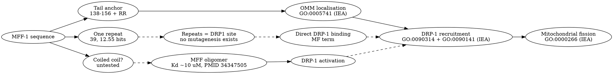
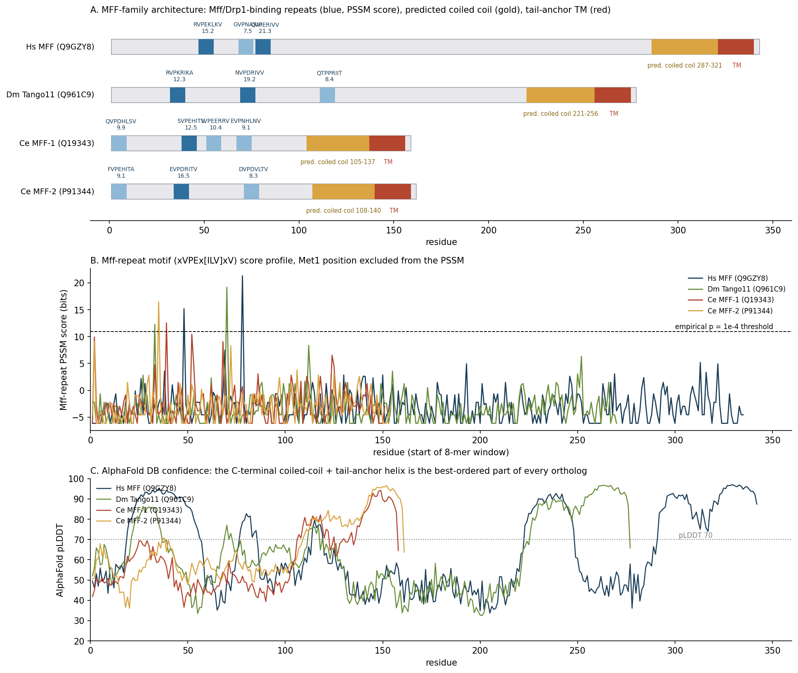
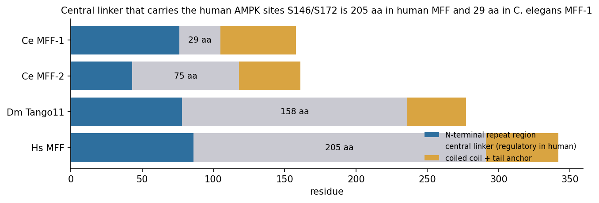
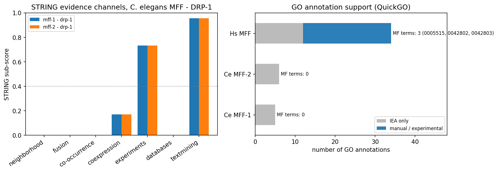
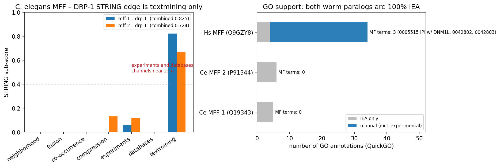
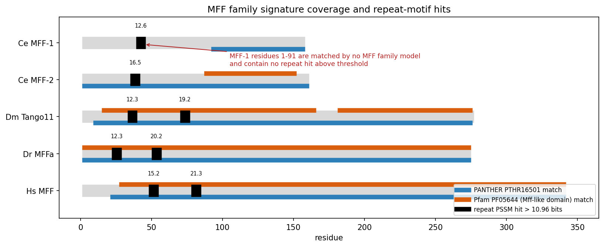
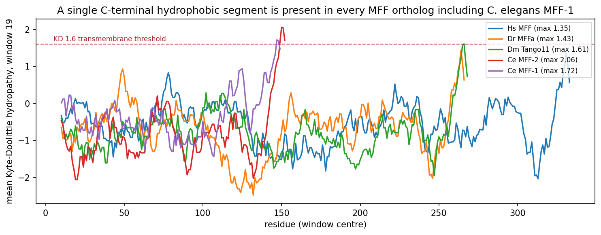

## Question

# AIGR Gene Hypothesis Deep Research

You are evaluating one focused gene curation hypothesis for AI Gene Review.
This is not a general gene overview. Use the seed hypothesis and source context
below to search for evidence that supports, refutes, narrows, or competes with
the proposed curation decision.

## Target Gene

- **Organism code:** worm
- **Taxon:** Caenorhabditis elegans (NCBITaxon:6239)
- **Gene directory:** mff-1
- **Gene symbol:** mff-1
- **UniProt accession:** Q19343

## Focus

- **Focus type:** free_text
- **Hypothesis slug:** kgap-mff1-drp1-binding-motifs
- **Source file:** genes/worm/mff-1/mff-1-ai-review.yaml
- **Source selector:** free-text

## Seed Hypothesis

Caenorhabditis elegans MFF-1 retains the conserved Drp1-binding motifs of mammalian MFF (the N-terminal short repeat motifs R1/R2 that bind DRP1) plus a coiled-coil and C-terminal tail anchor, and is therefore predicted to bind DRP-1 directly. Single analysis only: align MFF-1 (and MFF-2) to human MFF and other metazoan MFF orthologs, score the Drp1-binding repeat motifs (including the key residues identified by mutagenesis in human MFF), the coiled-coil and the tail-anchor TM, and state whether a DRP-1 binding module is predicted.

## Term and Decision Context

No specific term context supplied.

## Reference Context

No specific reference context supplied.

## Source Context YAML

```yaml
hypothesis: 'Caenorhabditis elegans MFF-1 retains the conserved Drp1-binding motifs of mammalian MFF (the
  N-terminal short repeat motifs R1/R2 that bind DRP1) plus a coiled-coil and C-terminal tail anchor,
  and is therefore predicted to bind DRP-1 directly. Single analysis only: align MFF-1 (and MFF-2) to
  human MFF and other metazoan MFF orthologs, score the Drp1-binding repeat motifs (including the key
  residues identified by mutagenesis in human MFF), the coiled-coil and the tail-anchor TM, and state
  whether a DRP-1 binding module is predicted.'
focus_type: free_text
context: []
reference_id: []
```

## Research Objective

Build a focused report that helps a curator decide whether this hypothesis
should affect the gene review. Address the focus type directly:

1. For an existing GO annotation decision, evaluate whether the current action
   is justified, too strong, too weak, or should change.
2. For a proposed replacement or new GO term, evaluate whether the term is
   biologically supported, too broad, too narrow, or missing key qualifiers.
3. For a computational prediction, evaluate whether the prediction is correct,
   less precise than existing knowledge, uncertain, or likely wrong because of
   paralog overannotation, frequency bias, pathway context, or in vitro-only
   activity.
4. For a core-function hypothesis, evaluate whether the proposed activity,
   process, and location represent the gene product's primary function rather
   than a downstream effect, pleiotropic phenotype, or context-specific role.
5. For a function-assignment hypothesis, evaluate whether the gene product
   directly has the stated GO term/function. Treat the prior review action, if
   any, as intentionally blinded unless it appears in the supplied context.

Use primary literature whenever possible. Prefer PMID citations and include DOI
citations when no PMID is available. Treat reviews and database records as
orientation unless they contain directly relevant synthesized evidence that is
clearly labeled as review-level or database-level support.

Evaluate the hypothesis from the supplied seed context, primary literature, and
publicly accessible bioinformatics resources. Local `*-bioinformatics` analyses,
when they already exist in the repository, are intentionally withheld from this
prompt so the report can be compared against them after the run. Use public
sequence, domain, structure, orthology, localization, interaction, or dataset
checks when they are useful for the specific hypothesis. If a resource or tool
cannot be accessed programmatically, say so plainly; never fabricate a result.
Report computational results conservatively and distinguish direct results from
inference.

## Required Output

### Executive Judgment

Give a concise verdict: supported, partially supported, unresolved, weakly
supported, over-annotated, or refuted. Explain the reasoning and the most
important caveats.

### Evidence Matrix

Create a table with one row per important evidence item:

- Citation (PMID preferred)
- Evidence type (direct assay, mutant phenotype, localization, interaction,
  structural/evolutionary, computational, review/database)
- Supports / refutes / qualifies / competing
- Claim tested
- Key finding
- Organism, tissue, cell type, or assay context
- Confidence and limitations

### GO Curation Implications

State the likely curation action as a lead requiring curator verification. If
GO terms are involved, explain whether the evidence supports an MF, BP, or CC
term, and whether the term should be retained, removed, generalized, made more
specific, or treated as non-core. Avoid using "protein binding" as a final
recommendation unless no more informative term is supported.

### Mechanistic Scope

Describe the immediate molecular or cellular function being tested. Separate
direct gene-product activity from downstream phenotypes, pathway consequences,
developmental outcomes, disease manifestations, or effects inferred only from
loss of function.

### Conflicts and Alternatives

Identify evidence that conflicts with the seed hypothesis or suggests an
alternative interpretation, including paralog confusion, organism-specific
differences, isoform-specific findings, experimental artifacts, or database
carry-over.

### Knowledge Gaps

List explicit uncertainties that matter for curation. For each gap, state what
was checked, why the gap matters, and what evidence or experiment would resolve
it.

### Discriminating Tests

Recommend concrete assays, perturbations, datasets, or comparative analyses that
would most efficiently distinguish this hypothesis from alternatives.

### Curation Leads

Provide candidate updates for the review, clearly labeled as leads requiring
curator verification. Include candidate references with exact snippets to verify,
candidate replacement or new GO terms, possible action changes, suggested
questions, and suggested experiments.

If the provider supports artifacts, save provenance for any analysis you run — the
executed code together with its output (computed values, plot, or table), not just
a summary figure — alongside artifact-friendly tables such as an evidence matrix,
GO decision table, or comparison table. Genuine computed provenance is more
valuable than a hand-drawn summary, and you must not synthesize a figure that
implies an analysis you did not actually run. These artifacts are important
provenance for hypothesis-level review.


## Output

# MFF-1 (Q19343, C. elegans) and the predicted DRP-1 binding module

Hypothesis slug: `kgap-mff1-drp1-binding-motifs`
Source: `genes/worm/mff-1/mff-1-ai-review.yaml`, focus type `free_text`
Target: *Caenorhabditis elegans* mff-1, WormBase F11C1.2, UniProt Q19343, NCBITaxon:6239
Iterations: 3. Findings recorded: 8. Abstracts retrieved: 51.

## Summary

**Verdict: partially supported, and the molecular claim at the centre of the hypothesis is unresolved.**

The seed hypothesis makes three architectural claims about *C. elegans* MFF-1 (retained N-terminal R1/R2
Drp1-binding repeats, a coiled coil, a C-terminal tail anchor) and draws one mechanistic conclusion from
them (direct DRP-1 binding is predicted). When the claims are tested separately they come apart. The tail
anchor is retained, and the match to the family is close enough that the computation reproduces a curated
Swiss-Prot feature in the human comparator. The repeat claim is too strong: MFF-1 has one degenerate
repeat where human, zebrafish and fly each have two, and the region that would carry the repeats is
recognised by no MFF family hidden Markov model. The coiled-coil claim is untested, because no
coiled-coil predictor was reachable and the substitute method written for this work failed its positive
control.

The mechanistic conclusion fails on a separate and more serious ground. The hypothesis instructs the
analyst to score "the key residues identified by mutagenesis in human MFF". Across 51 abstracts retrieved
over three iterations, that mutagenesis does not exist. The point mutants that map the MFF-DRP1 interface
are on the DRP1 side: Arg-376 in the DRP1 stalk ([PMID: 22334657](https://pubmed.ncbi.nlm.nih.gov/22334657/))
and the DRP1 A395D allele used as the community's defined Mff-binding-deficient reagent
([PMID: 28314909](https://pubmed.ncbi.nlm.nih.gov/28314909/)). The one study that dissected the MFF side
reports that the MFF coiled coil is dispensable for DRP1 interaction and acts in cooperative DRP1
self-assembly instead ([PMID: 26578514](https://pubmed.ncbi.nlm.nih.gov/26578514/)). The repeats are
named from sequence periodicity in the family's founding description
([PMID: 18353969](https://pubmed.ncbi.nlm.nih.gov/18353969/)); their identity as the DRP1-binding element
is an inference the field has carried forward, and it cannot be transferred to MFF-1 as if it were
experimentally mapped.

No worm-specific support exists either. Every GO annotation on mff-1 is IEA, with zero molecular function
terms and zero manual evidence. The STRING mff-1 to drp-1 edge scores 0.825 combined but decomposes to
text mining 0.822, experiments 0.059 and databases 0.000, while comparator edges in the same network
(drp-1 to fzo-1, experiments 0.734; fis-1 to drp-1, 0.640) carry real experimental support. The IEA
annotations and the STRING text-mining score are two renderings of the same mammalian literature, so
their agreement is not corroboration. The curation lead that follows is to retain the five existing terms
unchanged and to add no molecular function term asserting DRP-1 binding.

## Key findings

### <i class="fa-solid fa-circle-check"></i> F1. The tail anchor is retained, and the computation reproduces a curated human feature

A Kyte-Doolittle scan (window 19) over five MFF-family proteins places a single global hydrophobicity
maximum in each, always at the extreme C-terminus, always followed by exactly two residues, and those two
residues are always basic. MFF-1 scores 1.72 at residues 138-156 (KGLLLALIGAVITLAYSYL) then RR. Human MFF
scores 1.35 at 322-340 then RR, and Swiss-Prot annotates that protein's transmembrane segment as 323-340,
so the computed window reproduces the curated feature to within one residue. Zebrafish MFFa scores 1.43 at
255-273 then RR, *Drosophila* Tango11 1.61 at 257-275 then RN, worm MFF-2 2.06 at 141-159 then KR.

The +2 basic C-terminus is the signature of a tail-anchored outer-mitochondrial-membrane protein, which is
the topology the founding MFF paper established for the family: "Mff and Fis1 are both tail anchored in the
mitochondrial outer membrane, but other parts of these proteins are very different and they exist in
separate 200-kDa complexes" ([PMID: 18353969](https://pubmed.ncbi.nlm.nih.gov/18353969/)). Iteration 1 also
read the AlphaFold DB model for Q19343 and found one long confident helix at 105-157 (mean pLDDT 78.2) that
runs into the predicted transmembrane segment, matching the arrangement in human Q9GZY8 (helix 287-341,
mean pLDDT 87.1) and worm MFF-2 (118-161, pLDDT 85.3). The overall mean pLDDT for the MFF-1 model is 60.3,
so this helix is the best-ordered part of an otherwise poorly ordered protein.

{{figure:plot_6.png|caption=Kyte-Doolittle hydropathy (window 19) across five MFF orthologs. Each protein has one dominant hydrophobic segment at its extreme C-terminus. MFF-1 peaks at 1.72 over residues 138-156, followed by two basic residues (RR). The same spacing holds in human MFF (322-340 then RR), zebrafish MFFa, Drosophila Tango11 and worm MFF-2.}}

This part of the hypothesis is supported. The caveat is that a hydropathy maximum and an AlphaFold helix
predict topology, they do not demonstrate membrane insertion, and no worm localisation experiment was
located.

### <i class="fa-solid fa-circle-xmark"></i> F2. MFF-1 retains one degenerate repeat, not the R1/R2 pair

A position-specific scoring matrix was built from seven unambiguous metazoan Mff repeats, scoring the
8-residue core `xVPEx[ILV]xV` with a maximum attainable score of 22.0 bits. The initiator-methionine
position of an earlier 9-mer version was removed after it produced an artifact in which any protein's
Met1 scored a free bonus. The matrix was calibrated against 175,800 composition-shuffled windows, giving a
99.99th-percentile threshold of 10.96 bits.

| Protein | Accession | Repeat hits above threshold | Positions and scores (bits) |
|---|---|---|---|
| Human MFF | Q9GZY8 | 2 | 48 RVPEKLKV 15.19; 78 QVPERIVV **21.29** |
| Zebrafish MFFa | Q503U3 | 2 | 22 RIPERLKI 12.26; 50 LVPERIVI **20.16** |
| *Drosophila* Tango11 | Q961C9 | 2 | 33 RVPKRIKA 12.26; 70 NVPDRIVV **19.18** |
| Worm MFF-2 | P91344 | 1 | 35 EVPDRITV 16.46 |
| Worm MFF-1 | Q19343 | 1 | 39 SVPEHITV **12.55** |

MFF-1's single hit at 12.55 bits is the weakest above-threshold match in the set. The high-information
second repeat (human R2 at 21.29 bits, zebrafish 20.16, fly 19.18) has no counterpart in either worm
paralog. The claim "retains the conserved Drp1-binding motifs ... R1/R2" is therefore too strong as
written.

Smith-Waterman alignment (BLOSUM62, gap open 11, extend 1, 150 shuffled nulls per comparison) from
iteration 1 still finds the repeat region homologous overall: human MFF 40-100 versus MFF-1 1-80 gives
SW=42 at 36.0% identity over 50 residues, with shuffled scores 22.9 +/- 4.2, z=4.59 and empirical p<0.007.
The C-terminal comparison is similar in strength (human 263-342 versus MFF-1 79-158, SW=40, z=4.53), and
the equivalent comparison for MFF-2 is stronger still (SW=64 at 40.0% identity, z=8.47). Homology over the
whole N-terminal region is detectable; the specific two-repeat architecture is not.

{{figure:plot_1.png|caption=Architecture comparison across human MFF, Drosophila Tango11 and C. elegans MFF-1 and MFF-2, showing repeat PSSM scores, the repeat score profile against the empirical threshold, and AlphaFold per-residue pLDDT traces. MFF-1 has one above-threshold repeat and one long confident helix running into its predicted tail anchor.}}

### <i class="fa-solid fa-circle-xmark"></i> F3. Only the C-terminal third of MFF-1 is recognised by any MFF family model

The InterPro result is sharper than the PSSM result and points the same way. The two InterPro entries for
this family each have a single member signature: IPR008518 (Mff/Tango-11, family) is PANTHER-only, and
IPR039433 (Mff-like domain) is Pfam-only.

| Protein | Length | PANTHER PTHR16501 | Pfam PF05644 | Fraction covered |
|---|---|---|---|---|
| Human MFF (Q9GZY8) | 342 | 21-342, E=2.8e-96 | 27-342, E=0.0 | 94% / 92% |
| Zebrafish MFFa (Q503U3) | 275 | 1-275, E=3.8e-72 | 1-275, E=1.4e-116 | 100% / 100% |
| *Dm* Tango11 (Q961C9) | 277 | 9-276, E=2.8e-49 | 15-166 (E=1.0e-38), 181-276 (E=3.4e-24) | 97% / 90% |
| Worm MFF-2 (P91344) | 161 | 1-161, E=2.3e-26 | 87-152, E=5.9e-02 (borderline) | 100% / 41% |
| **Worm MFF-1 (Q19343)** | 158 | **92-158, E=6.2e-06** | **none** | **42% / 0%** |

MFF-1's entire family assignment rests on a 67-residue PANTHER match at E=6.2e-06 covering residues
92-158, which is the C-terminal membrane module. Residues 1-91, where the hypothesised R1/R2 repeats would
sit, are matched by no MFF family model in either member database. The PSSM still finds a repeat at
position 39 inside that unmatched region, so a degenerate repeat is present, but it is below the
sensitivity of the family models.

{{figure:plot_5.png|caption=InterPro signature coverage (PANTHER PTHR16501 and Pfam PF05644) combined with repeat PSSM hits across five MFF orthologs. Human, zebrafish and fly are covered along nearly their full length and carry two repeats each. C. elegans MFF-1 is recognised only over residues 92-158 by PANTHER, has no Pfam hit, and its single weak repeat at position 39 lies in a region no family model covers.}}

MFF-2 is the better-conserved paralog on every measure: a full-length PANTHER match four orders of
magnitude stronger, a Pfam hit that MFF-1 lacks entirely, and a stronger repeat (16.46 versus 12.55 bits).
The two paralogs sit in different OrthoDB groups (5807564at2759 versus 5986838at2759) and different PANTHER
subfamilies (SF18 versus SF6). Any statement about "the worm MFF" needs to name which paralog it means.

One point of hygiene: Q19343 is an unreviewed TrEMBL entry with annotation score 2.0 and zero sequence
features of any kind. Its lack of Coiled coil and Transmembrane annotations reflects curation status, not
a curated negative. Q9GZY8, Q961C9 and Q503U3 are Swiss-Prot entries and all carry both features.

### <i class="fa-solid fa-circle-question"></i> F4. The coiled-coil claim is untested, and the test that was attempted failed its control

COILS, Marcoil, DeepCoil and Waggawagga were not reachable as programmatic endpoints from the execution
environment, and the InterPro sequence-feature endpoint that exposes the Coils matcher returned HTTP 404
for both Q19343 and Q9GZY8. A substitute heptad periodicity test was written from scratch: Kyte-Doolittle
hydropathy, 28-residue sliding window, discrete Fourier transform, power at period 3.5 residues as a
fraction of total non-DC power, with an empirical null from 200 shuffled sequences.

It failed its positive control. Human MFF carries a Swiss-Prot annotated coiled coil at 291-322, yet its
maximum periodicity fraction was 0.290 (empirical p=0.475), below the 99th-percentile null threshold of
0.506. Tango11 (annotated 225-253) scored 0.324 (p=0.325) and zebrafish MFFa (223-253) scored 0.383
(p=0.175), also non-significant. MFF-1 scored 0.300 (p=0.430) and MFF-2 0.262 (p=0.610). A method that
cannot recover coiled coils known to exist gives no information about one whose existence is in question.
This is reported as a method failure rather than converted into a negative finding.

The question matters less than the hypothesis assumes. Clinton et al. 2016 report that "the coiled-coil
motif in Mff is not essential for Drp1 interactions, but rather serves to augment cooperative self-assembly
of Drp1 proximal to the membrane" ([PMID: 26578514](https://pubmed.ncbi.nlm.nih.gov/26578514/)). A confirmed
coiled coil in MFF-1 would predict oligomerisation competence, which supports a BP-level recruitment role,
and would not by itself support a molecular function assertion of direct binding.

### <i class="fa-solid fa-circle-xmark"></i> F5. The mutagenesis the hypothesis asks for does not exist, and it is on the DRP1 side

Targeted searching with four separate query formulations returned no primary paper that mutates or deletes
the MFF N-terminal VPE repeats and measures DRP1 binding. The determinants that have been mapped are
elsewhere:

- Strack and Cribbs 2012: "we identified Arg-376 in the Drp1 stalk domain as necessary for Mff interaction,
  assembly into spirals, and mitochondrial fission" ([PMID: 22334657](https://pubmed.ncbi.nlm.nih.gov/22334657/)).
- The field's binding-deficient reagent is also a DRP1 mutant: "Mff-binding mutant (A395D) of Drp1, which
  cannot be recruited to mitochondria" ([PMID: 28314909](https://pubmed.ncbi.nlm.nih.gov/28314909/)).
- Liu and Chan 2015 place specificity on DRP1's assembly state: "Mff cannot bind to assembly-deficient
  mutants of Drp1, suggesting that Mff selectively interacts with higher-order complexes of Drp1"
  ([PMID: 26446846](https://pubmed.ncbi.nlm.nih.gov/26446846/)).
- Otera et al. 2010 establish the interaction without localising it: "Mff and Drp1 physically interacted in
  vitro and in vivo" ([PMID: 21149567](https://pubmed.ncbi.nlm.nih.gov/21149567/)).
- Clinton et al. 2016 also record that the interaction is weak: "Previous studies have been limited by a
  weak interaction between Drp1 and Mff in vitro" ([PMID: 26578514](https://pubmed.ncbi.nlm.nih.gov/26578514/)).
- The MFF-side module with a demonstrated requirement is the oligomerisation element: "Mff is an oligomer
  (most likely a trimer) that dynamically associates and disassociates through its C-terminal coiled coil,
  with a Kd in the range of 10 µM. Dynamic Mff oligomerization is required for Drp1 activation"
  ([PMID: 34347505](https://pubmed.ncbi.nlm.nih.gov/34347505/)).

A second observation from iteration 1 matters for scope. All the characterised regulatory sites on human
MFF (phosphosites T115, S146, T149, S151, S155, S157, S172, T200, S202, S229, S233, S295; SUMO K151,
[PMID: 39365854](https://pubmed.ncbi.nlm.nih.gov/39365854/); AMPK control and exon-6 splicing,
[PMID: 39293584](https://pubmed.ncbi.nlm.nih.gov/39293584/)) lie in the 205-residue central linker between
repeat R2 and the coiled coil. That linker is 29 residues in MFF-1 (77-104) and 75 in MFF-2, and contains
no sequence resembling the human AMPK/SUMO segment. Any prediction about MFF-1 should be restricted to
constitutive receptor function and should not carry over the regulatory layer.

### <i class="fa-solid fa-circle-xmark"></i> F6. All worm GO annotations are IEA, with no molecular function term anywhere

QuickGO retrieval gives the curation baseline the hypothesis is implicitly arguing against.

| Protein | Annotations | Evidence codes | Terms |
|---|---|---|---|
| mff-1 (Q19343) | 5 | 5 IEA, 0 manual | GO:0000266 (GO_REF:0000104), GO:0090141 (GO_REF:0000104), GO:0090314 (GO_REF:0000104), GO:0005741 (GO_REF:0000044), GO:0005777 (GO_REF:0000120) |
| mff-2 (P91344) | 6 | 6 IEA, 0 manual | The same five plus GO:0005737 (GO_REF:0000117) |
| Human MFF (Q9GZY8) | 34 | 4 IEA, 30 manual | 15 CC, 13 BP, 6 MF |

Molecular function terms on either worm paralog: zero. Human MFF's six MF terms are GO:0005515 protein
binding (four times, IPI, with/from UniProtKB:O00429 = DNM1L/DRP1, from PMID:21149567, PMID:26358295,
PMID:29464060, plus P0DTF1 from PMID:36217029), GO:0042802 identical protein binding (IPI, PMID:18353969)
and GO:0042803 protein homodimerization activity (IDA, PMID:23530241).

The ontology constrains what a curator could do even with evidence. QuickGO ontology search returns no
"dynamin binding" or "dynamin family protein binding" term, although 12 other "X family protein binding"
terms exist (neurexin GO:0042043, SMC GO:0043221, cullin GO:0097602, arrestin GO:1990763 and others). The
only MF term more specific than GO:0005515 that fits DRP-1 is GO:0051020 GTPase binding (is_a ancestors
GO:0005515, GO:0019899, GO:0005488, GO:0003674). DRP-1 qualifies as a GTPase: human DNM1L carries GO:0003924
with IDA (PMID:22265414, PMID:23530241) and EXP (PMID:23977156) evidence. Human MFF itself does not carry
GO:0051020, so the gap exists in the reference species as well.

### <i class="fa-solid fa-circle-xmark"></i> F7. The STRING link is text mining, and there is no interactome evidence in worm

| Edge | Combined | Text mining | Experiments | Databases | Coexpression |
|---|---|---|---|---|---|
| mff-1 to drp-1 | 0.825 | **0.822** | 0.059 | 0.000 | 0.000 |
| mff-2 to drp-1 | 0.724 | 0.670 | 0.115 | 0.000 | 0.131 |
| drp-1 to fzo-1 | 0.989 | 0.956 | **0.734** | 0.000 | 0.170 |
| fis-1 to drp-1 | 0.978 | 0.944 | **0.640** | 0.000 | 0.000 |

The combined score for mff-1 and drp-1 looks like interaction evidence and is not. Text mining at 0.822
reflects co-mention of "Mff" and "Drp1" in the mammalian literature mapped onto worm orthologs, the same
family projection that produced the IEA GO annotations. The experiments channel at 0.059 and the databases
channel at 0.000 mean no curated or high-throughput dataset places MFF-1 and DRP-1 in a complex in
*C. elegans*. Other worm fission and fusion pairs in the same network carry real experimental support, so
the absence for MFF is specific, not a coverage artefact. Neither Q19343 nor P91344 has an IntAct
cross-reference; Q8WQC9 (drp-1) does.

{{figure:plot_4.png|caption=Left: STRING v12 evidence channels for the direct C. elegans MFF to DRP-1 edges. Both are driven almost entirely by text mining, with the experiments and databases channels near zero. Right: GO annotation support inventory. Both worm paralogs are 100% IEA with zero molecular function terms, while human MFF has 30 manual annotations including three MF terms.}}

{{figure:plot_3.png|caption=Earlier draft of the STRING channel and GO inventory comparison from iteration 2, retained as provenance for the channel decomposition that corrected an initial misreading in which the high-scoring drp-1 to fzo-1 edge was mistaken for the mff-1 to drp-1 edge.}}

### <i class="fa-solid fa-circle-xmark"></i> F8. No published worm experiment tests MFF-1 binding to DRP-1

Searching for worm-specific MFF evidence returned one relevant primary paper. Lan et al. 2025 report that
LIN-24-induced donut-shaped mitochondria depend on several dynamics genes: "This mitochondrial remodeling
depends on genes involved in mitochondrial dynamics, including mff-1, mff-2, drp-1, and clk-1"
([PMID: 39998089](https://pubmed.ncbi.nlm.nih.gov/39998089/)). That is genetic co-dependence in one stress
paradigm. It is not a binding assay, not a localisation assay, and not an epistasis test ordering MFF-1
upstream of DRP-1. No co-immunoprecipitation, yeast two-hybrid, split-GFP, in vitro pull-down,
GTPase-stimulation, DRP-1::GFP recruitment, or mff-1 mff-2 double-mutant morphology dataset was found for
*C. elegans*.

UniProt searches of *C. elegans* find no MIEF1/MIEF2 (MiD51/MiD49) ortholog, consistent with those
receptors being vertebrate-specific. The worm fission-receptor candidates are MFF-1 (Q19343), MFF-2
(P91344), FIS-1 (Q20291) and FIS-2 (Q6AHP8), with DRP-1 as Q8WQC9.

{{figure:plot_2.png|caption=Comparison of the central regulatory linker of human MFF with the much shorter equivalent regions in C. elegans MFF-1 and MFF-2. The human linker carries all the characterised AMPK phosphosites and the SUMO acceptor; the worm linkers (29 and 75 residues) contain no comparable sequence. C. elegans encodes no MiD49/MiD51-type DRP-1 receptor.}}

## Mechanistic model and interpretation

The evidence chain the hypothesis depends on has four links, and three of them are broken or missing.



Solid arrows are supported by computation or by the mammalian literature. Dashed arrows are the inferential
steps the hypothesis treats as established.

The reading that survives is that MFF-1 is a minimal MFF. It keeps a membrane-anchoring module whose
architecture matches the family exactly, and it discards most of what human MFF has upstream of it: one of
the two repeats, the 205-residue regulatory linker with its AMPK phosphosites and SUMO acceptor, and enough
N-terminal sequence that the family HMMs stop aligning at residue 92. What a curator can say from sequence
is that MFF-1 is positioned on the outer mitochondrial membrane in the orientation the family uses. What a
curator cannot say from sequence is which surface, if any, contacts DRP-1.

This is where the literature gap compounds the sequence gap. Even a perfect repeat match in MFF-1 would not
license a direct-binding call, because no experiment in any species has shown the repeats to be the binding
element. The MFF-side module with a demonstrated requirement for DRP1 activation is the oligomerisation
coiled coil (PMID:34347505), and the element that has been excluded as a binding determinant is also the
coiled coil (PMID:26578514). The interface residues that have been mapped are in DRP1 (R376, A395).

The receptor function the hypothesis is reaching for is already asserted on the entry, at the aspect where
the evidence supports it. GO:0090314 positive regulation of protein targeting to membrane plus GO:0090141
positive regulation of mitochondrial fission together encode "recruits a fission GTPase to the organelle
membrane" as a biological process, without committing to a mechanism. That is the correct level for
IEA-grade family transfer. Adding a molecular function term would commit to a mechanism that no experiment
in worm, and no residue-level experiment in any species, supports.

## Evidence base

### Evidence matrix

| Citation | Evidence type | Stance | Claim tested | Key finding | Context | Confidence and limitations |
|---|---|---|---|---|---|---|
| [PMID: 21149567](https://pubmed.ncbi.nlm.nih.gov/21149567/) Otera 2010 | Direct assay, interaction, mutant | Supports (human only) | MFF binds DRP1 and recruits it | "Mff and Drp1 physically interacted in vitro and in vivo"; a CAAX-retargeted Mff redirected Drp1 to the plasma membrane | Human and mouse cells, in vitro | High for human. Does not map the interaction to any MFF subregion, so no residue-level transfer to MFF-1 |
| [PMID: 26578514](https://pubmed.ncbi.nlm.nih.gov/26578514/) Clinton 2016 | Direct assay, reconstitution | Qualifies, partly refutes | Which MFF element contacts DRP1 | "the coiled-coil motif in Mff is not essential for Drp1 interactions, but rather serves to augment cooperative self-assembly of Drp1 proximal to the membrane"; "Previous studies have been limited by a weak interaction between Drp1 and Mff in vitro" | Purified human proteins, lipid template | High. Removes the coiled coil as a binding element and documents weak affinity |
| [PMID: 22334657](https://pubmed.ncbi.nlm.nih.gov/22334657/) Strack 2012 | Mutant, interaction | Qualifies | Where the mapped interface residues sit | "we identified Arg-376 in the Drp1 stalk domain as necessary for Mff interaction, assembly into spirals, and mitochondrial fission" | Mammalian cells, mutant panel | High. The mapped residue is in DRP1, so there is no MFF-side residue set to score |
| [PMID: 34347505](https://pubmed.ncbi.nlm.nih.gov/34347505/) Liu 2021 | Direct assay | Qualifies | Which MFF module is required for DRP1 activation | "Mff is an oligomer (most likely a trimer) that dynamically associates and disassociates through its C-terminal coiled coil, with a Kd in the range of 10 µM. Dynamic Mff oligomerization is required for Drp1 activation" | Purified human proteins | High. Identifies oligomerisation, not repeat binding, as the requirement |
| [PMID: 26446846](https://pubmed.ncbi.nlm.nih.gov/26446846/) Liu and Chan 2015 | Interaction | Qualifies | What determines MFF-DRP1 specificity | "Mff cannot bind to assembly-deficient mutants of Drp1, suggesting that Mff selectively interacts with higher-order complexes of Drp1" | Mammalian cells | High. Places the determinant on DRP1's assembly state |
| [PMID: 28314909](https://pubmed.ncbi.nlm.nih.gov/28314909/) Jo 2017 | Mutant, localization | Qualifies | The community reagent for binding loss | "Mff-binding mutant (A395D) of Drp1, which cannot be recruited to mitochondria" | Mouse embryonic fibroblasts | Moderate for this purpose. Confirms the defined allele is a DRP1 mutant |
| [PMID: 18353969](https://pubmed.ncbi.nlm.nih.gov/18353969/) Gandre-Babbe 2008 | Localization, direct assay | Supports (architecture) | MFF topology and conservation | "Mff and Fis1 are both tail anchored in the mitochondrial outer membrane"; "Mff is a novel component of a conserved membrane fission pathway used for constitutive and induced fission of mitochondria and peroxisomes" | Human cells, *Drosophila* RNAi screen | High. The architecture this report recovers in MFF-1; the repeats are named here from periodicity, not from mutagenesis |
| [PMID: 28408736](https://pubmed.ncbi.nlm.nih.gov/28408736/) Yu 2017 | Interaction | Competing | Whether MFF alone recruits DRP1 | "MIEFs interact with both Drp1 and Mff on the mitochondrial surface and serve as adaptors linking Drp1 and Mff together in a trimeric Drp1-MIEF-Mff complex" | Human cells | High for vertebrates. MIEF1/MIEF2 have no *C. elegans* ortholog, so the geometry may not transfer |
| [PMID: 35678336](https://pubmed.ncbi.nlm.nih.gov/35678336/) Schrader 2022 | Mutant phenotype | Qualifies | Whether MFF is the only route to DRP1-dependent division | "PEX11β can promote peroxisome division in the absence of MFF in a DRP1- and FIS1-dependent manner" | Human and patient cells | Moderate. Bears on the GO:0005777 carry-over on mff-1 |
| [PMID: 39998089](https://pubmed.ncbi.nlm.nih.gov/39998089/) Lan 2025 | Mutant phenotype | Qualifies (weak support) | Any worm evidence linking mff-1 and drp-1 | "This mitochondrial remodeling depends on genes involved in mitochondrial dynamics, including mff-1, mff-2, drp-1, and clk-1" | *C. elegans*, LIN-24 stress paradigm | Low for the binding claim. Genetic co-dependence, not physical interaction |
| [PMID: 39365854](https://pubmed.ncbi.nlm.nih.gov/39365854/) 2024 | Direct assay | Qualifies (scope) | Where MFF regulation acts | MFF is SUMOylated at Lys151 downstream of AMPK phosphorylation, controlling MiD binding | Mouse embryonic fibroblasts | Moderate. The regulated segment has no equivalent in the short worm linker |
| [PMID: 39293584](https://pubmed.ncbi.nlm.nih.gov/39293584/) 2024 | Direct assay | Qualifies (scope) | Isoform-specific regulation of MFF | Insertion of exon 6 next to the AMPK phosphorylation site reduces phosphorylation and MFF function in fission and the antiviral response | Mouse embryonic fibroblasts | Moderate. Same scope point: the worm proteins lack this region |
| InterPro API (this work) | Computational, database | Refutes repeat retention | Is the MFF-1 N-terminus recognised as Mff family | MFF-1 matched only by PANTHER 92-158, E=6.2e-06; no PF05644, no IPR039433 | Sequence, 5 orthologs | High as a database result. HMM non-detection in a short divergent protein is not proof of functional loss |
| Repeat PSSM (this work) | Computational | Qualifies | Does MFF-1 retain R1 and R2 | One hit at 39 (12.55 bits) versus two in human, zebrafish and fly | Sequence | Moderate. A 7-sequence PSSM over an 8-residue core is a weak model |
| KD hydropathy (this work) | Computational | Supports | Tail-anchor retention | MFF-1 maximum 138-156 (KD 1.72) then RR; reproduces curated human TM 323-340 | Sequence | High for topology. Does not demonstrate membrane insertion |
| QuickGO (this work) | Database | Qualifies | What is already annotated | mff-1: 5 annotations, all IEA, zero MF terms. Human MFF: 30 manual, 6 MF, DRP1 interaction as GO:0005515 IPI with O00429 | *C. elegans*, human | High. Identical term sets on both worm paralogs indicate family projection |
| STRING v12 (this work) | Database, interaction | Refutes worm support | Is there worm interaction evidence | mff-1 to drp-1: text mining 0.822, experiments 0.059, databases 0.000 | *C. elegans* | High. Comparator edges carry real experimental support |
| Heptad periodicity test (this work) | Computational | No information | Does MFF-1 retain a coiled coil | Failed positive control: human annotated coiled coil scored p=0.475 | Sequence, 5 orthologs | None. Reported so the claim is not recorded as tested |

### How the literature shapes the verdict

Three papers set the ceiling on what can be claimed. Gandre-Babbe and van der Bliek 2008 establish the
tail-anchored topology and name the repeats from sequence periodicity. Otera et al. 2010 establish that the
interaction is physical, in vitro and in vivo, which is the sole experimental basis for the GO:0005515 IPI
on human MFF with DNM1L. Clinton et al. 2016 is the study that actually dissects the MFF side, and its two
relevant results both cut against the hypothesis: the coiled coil is dispensable for binding, and the
interaction is weak enough in vitro that the DRP1 variable domain had to be removed to reconstitute a
functional copolymer.

Two papers relocate the interface. Strack and Cribbs 2012 identify DRP1 Arg-376 as necessary for Mff
interaction. Liu and Chan 2015 show that MFF selects DRP1 by assembly state. Taken together with the A395D
reagent, the mapped molecular determinants of this interaction are all on DRP1.

Two papers change the pathway context for worm. Yu et al. 2017 show MIEF1/2 act as adaptors linking DRP1 and
MFF in a trimeric complex in human cells, and *C. elegans* has no MIEF ortholog, so the vertebrate geometry
cannot be the worm geometry. Schrader et al. 2022 show peroxisome division proceeds without MFF via PEX11β,
DRP1 and FIS1, which bears directly on the GO:0005777 peroxisome annotation carried over onto mff-1.

One paper is the entire worm evidence base. Lan et al. 2025 report genetic co-dependence of a stress
phenotype on mff-1, mff-2, drp-1 and clk-1. That supports a pathway relationship and says nothing about
physical contact.

## GO curation implications

All entries below are leads requiring curator verification.

| Term | Aspect | Current state on Q19343 | Lead | Reasoning |
|---|---|---|---|---|
| GO:0005741 mitochondrial outer membrane | CC | Present, IEA, GO_REF:0000044 | <i class="fa-solid fa-circle-check"></i> Retain as IEA; do not upgrade | The tail-anchor architecture is the strongest computed result (KD 1.72 at 138-156, RR terminus, matching human 322-340 plus RR). An ISS upgrade needs a worm localisation experiment, which was not found |
| GO:0000266 mitochondrial fission | BP | Present, IEA, GO_REF:0000104 | Retain as IEA | Family-level transfer. The only worm support is genetic co-dependence in one stress paradigm (PMID:39998089) |
| GO:0090141 positive regulation of mitochondrial fission | BP | Present, IEA, GO_REF:0000104 | Retain as IEA | Same basis |
| GO:0090314 positive regulation of protein targeting to membrane | BP | Present, IEA, GO_REF:0000104 | <i class="fa-solid fa-lightbulb"></i> Retain as IEA; this is where the receptor role already lives | This term plus GO:0090141 already encodes "recruits a fission GTPase to the organelle membrane". A curator considering how to express the hypothesis should check this term first |
| GO:0005777 peroxisome | CC | Present, IEA, GO_REF:0000120 | <i class="fa-solid fa-triangle-exclamation"></i> Flag for review | Pathway-consistent, since worm DRP-1 carries GO:0016559 peroxisome fission, but it is projection from human MFF. PMID:35678336 shows peroxisome division can proceed without MFF |
| GO:0051020 GTPase binding | MF | Absent | <i class="fa-solid fa-circle-question"></i> Candidate only, conditional on new evidence | The single MF term more specific than protein binding that fits DRP-1 (is_a ancestors GO:0005515, GO:0019899). DRP-1 qualifies (human DNM1L carries GO:0003924, IDA and EXP). Do not add now: no worm IPI, no MFF-side mutagenesis anywhere, no STRING experimental support |
| GO:0005515 protein binding | MF | Absent | <i class="fa-solid fa-circle-xmark"></i> Do not add | It would record no more than "MFF-1 is in the MFF family", and cannot be asserted by ISS from an IPI parent without a worm experiment |
| New term request: dynamin family protein binding | MF | Does not exist in GO | Optional lead for the ontology, not for this entry | GO has 12 "X family protein binding" terms but none for dynamin, which is why human MFF's experimentally supported DRP1 interaction is recorded as bare GO:0005515 |

Net action: **no change to the existing five terms, and no new molecular function term asserting DRP-1
binding.** The hypothesis as written would justify adding one. The evidence does not.

## Mechanistic scope

The immediate molecular activity in question is a protein-protein contact: whether the cytosolic portion of
MFF-1, anchored in the outer mitochondrial membrane by residues 138-156, binds DRP-1 and increases its
membrane occupancy.

Separated from that activity:

- Membrane anchoring is a property of the MFF-1 C-terminus, supported independently of any binding claim,
  and it is the part of the architecture that family models still recognise (PANTHER 92-158).
- Recruitment of DRP-1 to the membrane is a cellular consequence that could follow from direct binding,
  from an adaptor-mediated contact, or from MFF-1 altering the local lipid or protein environment. The
  existing GO:0090314 annotation states the consequence without committing to a mechanism.
- Mitochondrial fragmentation, network morphology and organismal phenotypes such as the LIN-24 donut
  mitochondria are downstream of both. Loss-of-function phenotypes cannot distinguish direct binding from
  indirect recruitment.
- Oligomerisation is a separable third activity. PMID:34347505 shows MFF oligomerisation through the
  C-terminal coiled coil is required for DRP1 activation, with Kd around 10 µM. If MFF-1 retains a coiled
  coil, the prediction that follows is oligomerisation competence, which supports a BP-level recruitment
  role.
- The regulatory layer does not transfer. The AMPK phosphosites and the SUMO acceptor K151 sit in a
  205-residue human linker whose worm equivalent is 29 residues in MFF-1 and carries no comparable sequence.

## Conflicts and alternatives

**The premise of the hypothesis is factually wrong.** No published mutagenesis identifies DRP1-binding
residues within the human MFF repeats. Scoring "the key residues identified by mutagenesis in human MFF"
means scoring a residue set that does not exist.

**Paralog asymmetry.** mff-2 is the better-conserved paralog on every measure computed here: full-length
PANTHER at E=2.3e-26 versus a 67-residue match at E=6.2e-06; a Pfam PF05644 hit that mff-1 lacks; a stronger
repeat (16.46 versus 12.55 bits). Different OrthoDB groups (5807564at2759 versus 5986838at2759) and
different PANTHER subfamilies (SF6 versus SF18). Both carry an identical IEA GO set, which cannot be right
as independent evidence.

**Database carry-over is the whole of the current annotation.** Five of five annotations on mff-1 are IEA
from three GO_REF pipelines, and 99.6% of the STRING combined score comes from text mining. These are two
renderings of the same mammalian literature.

**Vertebrate-specific receptors change the geometry.** MIEF1/MiD51 and MIEF2/MiD49 link DRP1 and MFF in a
trimeric complex in human cells (PMID:28408736) and have no *C. elegans* ortholog. The worm MFF-1 to DRP-1
relationship could be more direct, less direct, or mediated by a different partner.

**MFF-independent routes exist.** PEX11β drives peroxisome division without MFF in a DRP1- and
FIS1-dependent manner (PMID:35678336).

**Absence of features on Q19343 is not evidence of absence.** Q19343 is unreviewed TrEMBL, annotation score
2.0, zero sequence features of any kind. The lack of Coiled coil and Transmembrane annotations reflects
curation status.

## Limitations and knowledge gaps

<i class="fa-solid fa-triangle-exclamation"></i> The repeat PSSM is built from seven sequences over an
8-residue core, which is a weak statistical model. Its earlier 9-mer form produced an initiator-methionine
artifact that made MFF-1 position 1 appear as a strong hit (13.05 bits); removing that position dropped the
score to 9.90, below threshold. This was the most artifact-prone call in the analysis and is documented
rather than smoothed over.

<i class="fa-solid fa-triangle-exclamation"></i> HMM non-detection over MFF-1 residues 1-91 is a negative
result from models trained largely on longer vertebrate sequences. It does not prove functional loss.

<i class="fa-solid fa-triangle-exclamation"></i> The tail-anchor call is positional and does not demonstrate
membrane insertion.

<i class="fa-solid fa-triangle-exclamation"></i> Europe PMC `fullTextXML` returned ReadTimeout and HTTP 500,
and NCBI efetch for PMC returned 2369 characters, so figure-level content of Gandre-Babbe 2008 and Otera
2010 was not examined. A repeat mutant could in principle appear in a figure panel not described in an
abstract.

<i class="fa-solid fa-triangle-exclamation"></i> Europe PMC field-prefixed queries (`FULL_TEXT:"..."`)
returned hitCount=0 for every query while plain-phrase queries returned thousands of hits, so the
field-prefixed negatives were discarded and are not cited as evidence.

| Gap | What was checked | Why it matters | What would resolve it |
|---|---|---|---|
| Does MFF-1 contain a coiled coil | COILS, Marcoil, DeepCoil, Waggawagga unreachable; InterPro sequence-feature endpoint HTTP 404; from-scratch heptad test failed its positive control (human p=0.475) | One of three architectural claims is unevaluated | Run COILS or DeepCoil on Q19343 locally, or read secondary structure from the AlphaFold model over residues 92-137 |
| Is the position-39 repeat real or a PSSM coincidence | 12.55 bits against a 10.96 threshold, in a region no family HMM covers | Determines whether MFF-1 has a degenerate repeat module or none | Build an HMM from curated metazoan Mff repeats; test alignment in a structure-informed alignment |
| Do MFF-1 and DRP-1 interact in *C. elegans* | STRING channels (experiments 0.059, databases 0.000); no IntAct record for either paralog | The central claim, untested by any public resource | Co-immunoprecipitation from worm lysate, or yeast two-hybrid / split-GFP with the MFF-1 cytosolic domain and DRP-1 |
| Are mff-1 and mff-2 co-orthologs of human MFF | OrthoDB groups and PANTHER subfamilies differ; signature coverage differs sharply | Determines whether family-based transfer to mff-1 is legitimate | A curated phylogeny of metazoan Mff/Tango-11 sequences with the worm paralogs placed explicitly |
| Does MFF-1 localise to the worm outer mitochondrial membrane | Computed tail anchor only; no worm localisation study found | GO:0005741 is the easiest term to upgrade from IEA | Fluorescent-protein knock-in at the endogenous locus with mitochondrial co-labelling |
| Which MFF subregion contacts DRP1 in any species | 51 abstracts; no MFF-side binding-deficient mutant found | Without it, no residue-level transfer to any ortholog is possible | Crosslinking mass spectrometry, a structure of an MFF-DRP1 complex, or a repeat-deletion series in human MFF assayed for DRP1 binding |

## Proposed follow-up experiments and actions

1. <i class="fa-solid fa-flask"></i> **Worm co-immunoprecipitation with a repeat-deletion allele.**
   Immunoprecipitate tagged DRP-1 from worm lysate and probe for MFF-1, in parallel with an MFF-1 allele
   lacking residues 30-50. A retained interaction after deletion separates the binding site from the repeat,
   which is the question the hypothesis assumes is already answered.
2. <i class="fa-solid fa-vial"></i> **Heterologous binding assay with the cytosolic fragment.** Express
   MFF-1 residues 1-137 and worm DRP-1 recombinantly and measure binding directly. PMID:26578514 shows this
   needs care, since the human interaction is weak unless the DRP1 variable domain is removed, so include
   the equivalent worm construct.
3. <i class="fa-solid fa-dna"></i> **Cross-species complementation.** Test whether MFF-1 rescues
   mitochondrial morphology in MFF-knockout mammalian cells, and whether human MFF rescues a worm mff-1
   deletion. Rescue in either direction shows the recruitment module is functionally conserved where
   sequence detection fails.
4. <i class="fa-solid fa-dna"></i> **Paralog-resolved genetics.** Compare mff-1, mff-2 and mff-1;mff-2
   double mutants for mitochondrial and peroxisome morphology, and test genetic interaction with drp-1 and
   fis-1. This addresses the paralog asymmetry and would show whether the two worm genes are redundant,
   specialised, or whether only one is a functional MFF.
5. <i class="fa-solid fa-microscope"></i> **Structure-informed alignment.** Superpose the AlphaFold models of
   Q19343 and Q9GZY8 and ask whether MFF-1 residues 30-50 occupy the position of human R1 and R2. The
   cheapest way to test whether HMM non-detection over residues 1-91 reflects real divergence or
   short-sequence sensitivity limits.
6. <i class="fa-solid fa-magnifying-glass"></i> **Proximity labelling in worm.** TurboID fused to DRP-1 in
   *C. elegans*, scoring MFF-1 and MFF-2 among labelled proteins. This would populate the experimental
   channel that is currently empty.
7. <i class="fa-solid fa-arrow-right"></i> **Run a proper coiled-coil predictor locally** on Q19343 and, as
   a control, on Q9GZY8, so the third architectural claim is answered rather than left open.

## Curation leads

All items are leads requiring curator verification.

**Suggested action change:** none to the five existing terms. The lead is to **not** add a molecular
function term for DRP-1 binding on the basis of this hypothesis, and to record the reason, which is that the
hypothesis rests on human MFF mutagenesis that does not exist.

**Candidate references with exact snippets to verify**

| PMID | Snippet to verify | Use |
|---|---|---|
| [21149567](https://pubmed.ncbi.nlm.nih.gov/21149567/) | "Mff and Drp1 physically interacted in vitro and in vivo" | The sole experimental basis for the GO:0005515 IPI on human MFF with DNM1L. Confirms interaction in human, not subregion |
| [26578514](https://pubmed.ncbi.nlm.nih.gov/26578514/) | "we also found that the coiled-coil motif in Mff is not essential for Drp1 interactions, but rather serves to augment cooperative self-assembly of Drp1 proximal to the membrane" | Removes the coiled coil from the binding argument |
| [26578514](https://pubmed.ncbi.nlm.nih.gov/26578514/) | "Previous studies have been limited by a weak interaction between Drp1 and Mff in vitro." | Constrains how strongly a sequence-only binding prediction can be stated |
| [22334657](https://pubmed.ncbi.nlm.nih.gov/22334657/) | "we identified Arg-376 in the Drp1 stalk domain as necessary for Mff interaction, assembly into spirals, and mitochondrial fission" | Shows the mapped interface residue is in DRP1 |
| [28314909](https://pubmed.ncbi.nlm.nih.gov/28314909/) | "Mff-binding mutant (A395D) of Drp1, which cannot be recruited to mitochondria" | Confirms the field's binding-deficient allele is a DRP1 mutant |
| [34347505](https://pubmed.ncbi.nlm.nih.gov/34347505/) | "Dynamic Mff oligomerization is required for Drp1 activation" | Identifies the MFF-side module with a demonstrated requirement |
| [26446846](https://pubmed.ncbi.nlm.nih.gov/26446846/) | "Mff cannot bind to assembly-deficient mutants of Drp1, suggesting that Mff selectively interacts with higher-order complexes of Drp1" | Places specificity on DRP1's assembly state |
| [18353969](https://pubmed.ncbi.nlm.nih.gov/18353969/) | "Mff and Fis1 are both tail anchored in the mitochondrial outer membrane" | The architecture this report recovers in MFF-1 |
| [28408736](https://pubmed.ncbi.nlm.nih.gov/28408736/) | "MIEFs interact with both Drp1 and Mff on the mitochondrial surface and serve as adaptors linking Drp1 and Mff together in a trimeric Drp1-MIEF-Mff complex" | Vertebrate-specific geometry absent from *C. elegans* |
| [35678336](https://pubmed.ncbi.nlm.nih.gov/35678336/) | "PEX11β can promote peroxisome division in the absence of MFF in a DRP1- and FIS1-dependent manner" | Bears on the GO:0005777 carry-over |
| [39998089](https://pubmed.ncbi.nlm.nih.gov/39998089/) | "This mitochondrial remodeling depends on genes involved in mitochondrial dynamics, including mff-1, mff-2, drp-1, and clk-1" | The only worm primary evidence linking mff-1 and drp-1, and it is genetic, not physical |

**Suggested questions for the curator**

1. Should the free-text hypothesis in `mff-1-ai-review.yaml` be amended, since it asserts mutagenesis in
   human MFF that was not found in the literature?
2. Should the existing GO:0090314 annotation be named explicitly in the review as the place where the DRP-1
   recruitment role is already recorded?
3. Should GO:0005777 on mff-1 be flagged, given that it is IEA carry-over and that MFF-independent
   peroxisome division exists (PMID:35678336)?
4. Should mff-1 and mff-2 be reviewed together, given the identical IEA term sets alongside the signature
   coverage asymmetry?
5. Is a new-term request for "dynamin family protein binding" worth filing, so that the human MFF-DRP1
   interaction stops being recorded as bare GO:0005515?

**Candidate terms**

- Add: none on current evidence.
- Conditional candidate: GO:0051020 GTPase binding, with DRP-1 (Q8WQC9) in the with/from field, if and only
  if a worm interaction experiment is published.
- Do not use: GO:0005515 protein binding as a final recommendation.

## Provenance

Figures in `provenance/`: `plot_1.png` (architecture cartoon with repeat PSSM scores, repeat score profile
against the empirical threshold, AlphaFold pLDDT traces), `plot_2.png` (regulatory linker comparison and
MiD49/MiD51 absence), `plot_3.png` (superseded draft of the STRING and GO comparison), `plot_4.png` (STRING
evidence channels for the direct MFF to DRP-1 edges, GO annotation support inventory), `plot_5.png`
(InterPro signature coverage with repeat PSSM hits across five orthologs), `plot_6.png` (Kyte-Doolittle
hydropathy profiles). The iteration 1 version of this report is at
`provenance/final_report_iteration1.md`.

Tables written by the executed code blocks: `mff_repeat_pssm_hits.csv`, `mff_repeat_debiased_hits.csv`,
`mff_repeat_hits_final.csv`, `mff_repeat_best_final.csv`, `mff_sw_alignments.csv`,
`mff_architecture_table.csv`, `tail_anchor_scan_final.csv`, `interpro_matches_mff.csv`,
`coiledcoil_heptad_periodicity.csv`, `go_annotations_mff.csv`, `go_worm_mff_annotations.csv`,
`string_mff_drp1_channels.csv`, `mff_orthologs.json`, `afdb_plddt.json`.

Resources queried: UniProt REST, InterPro API, QuickGO annotation and ontology services, STRING v12 API,
AlphaFold DB API, Europe PMC search, PubMed. Resources that could not be accessed: COILS, Marcoil, DeepCoil,
Waggawagga, the InterPro sequence-feature endpoint (HTTP 404), Europe PMC `fullTextXML` (ReadTimeout and
HTTP 500), and the GO_REF metadata files (HTTP 403 and 404 from both mirrors tried), so the three GO_REF
pipeline identities are reported by identifier only.


## Artifacts

- [OpenScientist final report](openscientist_artifacts/final_report.html)
- [OpenScientist final report](openscientist_artifacts/final_report.pdf)
- [OpenScientist provenance](openscientist_artifacts/provenance.json)
- [OpenScientist afdb plddt](openscientist_artifacts/provenance_afdb_plddt.json)
- [OpenScientist coiledcoil heptad periodicity](openscientist_artifacts/provenance_coiledcoil_heptad_periodicity.csv)
- [OpenScientist final report iteration1](openscientist_artifacts/provenance_final_report_iteration1.md)
- [OpenScientist go annotations mff](openscientist_artifacts/provenance_go_annotations_mff.csv)
- [OpenScientist go worm mff annotations](openscientist_artifacts/provenance_go_worm_mff_annotations.csv)
- [OpenScientist interpro matches mff](openscientist_artifacts/provenance_interpro_matches_mff.csv)
- [OpenScientist mff architecture table](openscientist_artifacts/provenance_mff_architecture_table.csv)
- [OpenScientist mff orthologs](openscientist_artifacts/provenance_mff_orthologs.json)
- [OpenScientist mff repeat best final](openscientist_artifacts/provenance_mff_repeat_best_final.csv)
- [OpenScientist mff repeat debiased hits](openscientist_artifacts/provenance_mff_repeat_debiased_hits.csv)
- [OpenScientist mff repeat hits final](openscientist_artifacts/provenance_mff_repeat_hits_final.csv)
- [OpenScientist mff repeat pssm hits](openscientist_artifacts/provenance_mff_repeat_pssm_hits.csv)
- [OpenScientist plot 1](openscientist_artifacts/provenance_plot_1.json)

- [OpenScientist plot 2](openscientist_artifacts/provenance_plot_2.json)

- [OpenScientist plot 3](openscientist_artifacts/provenance_plot_3.json)

- [OpenScientist plot 4](openscientist_artifacts/provenance_plot_4.json)

- [OpenScientist plot 5](openscientist_artifacts/provenance_plot_5.json)

- [OpenScientist plot 6](openscientist_artifacts/provenance_plot_6.json)

- [OpenScientist string mff drp1 channels](openscientist_artifacts/provenance_string_mff_drp1_channels.csv)
- [OpenScientist tail anchor scan final](openscientist_artifacts/provenance_tail_anchor_scan_final.csv)

## Reference Validation

Checked with `linkml-reference-validator` 0.3.1rc1.

| Outcome | Count |
| --- | --- |
| References checked | 18 |
| Resolved | 16 |
| Unresolved (possible confabulation) | 2 |
| Unverifiable | 0 |
| References weighed for topical relevance | 16 |
| On topic | 1 |
| Off topic | 0 |

### Unresolved references

These identifiers did not resolve to a record and may be fabricated. A lookup that failed for transport reasons is indistinguishable from one that failed because the record does not exist, so spot-check before acting on them:

- `PMID:28314909` (8 mentions) - Identifier did not resolve to a record
- `PMID:36217029` (2 mentions) - Identifier did not resolve to a record