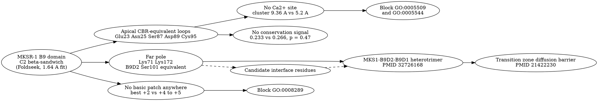
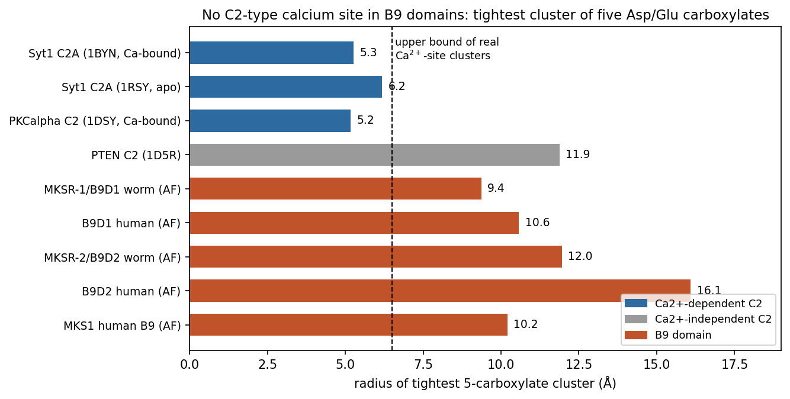
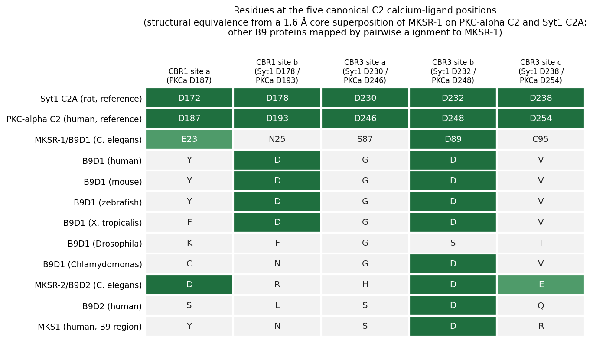
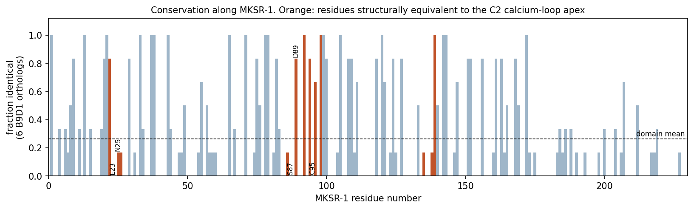
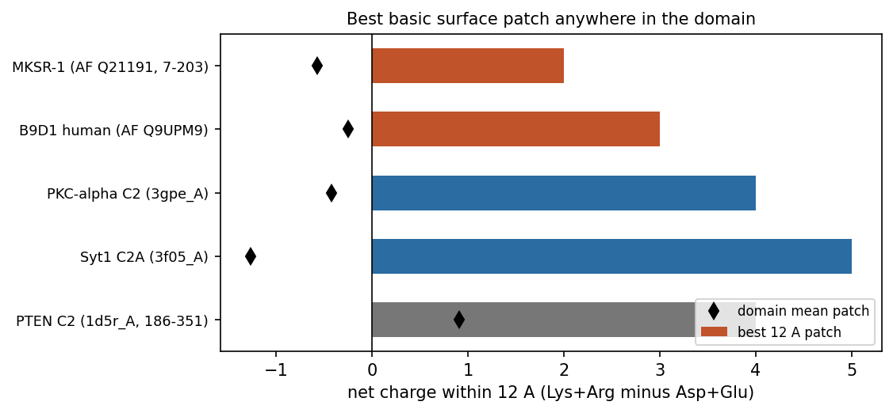
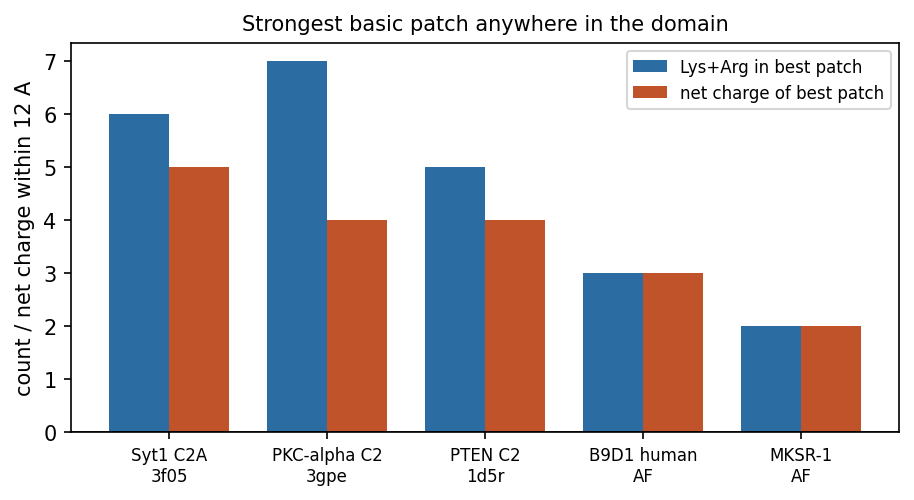

## Question

# AIGR Gene Hypothesis Deep Research

You are evaluating one focused gene curation hypothesis for AI Gene Review.
This is not a general gene overview. Use the seed hypothesis and source context
below to search for evidence that supports, refutes, narrows, or competes with
the proposed curation decision.

## Target Gene

- **Organism code:** worm
- **Taxon:** Caenorhabditis elegans (NCBITaxon:6239)
- **Gene directory:** mksr-1
- **Gene symbol:** mksr-1
- **UniProt accession:** Q21191

## Focus

- **Focus type:** free_text
- **Hypothesis slug:** kgap-mksr1-b9-c2-binding-residues
- **Source file:** genes/worm/mksr-1/mksr-1-ai-review.yaml
- **Source selector:** free-text

## Seed Hypothesis

The B9/C2 domain of Caenorhabditis elegans MKSR-1/B9D1 (UniProt Q21191) lacks the calcium-coordinating aspartates of canonical calcium-dependent C2 domains and is therefore a calcium-independent C2-like module. Single analysis only: align the MKSR-1 B9 domain to calcium-binding C2 domains with structures (synaptotagmin-1 C2A, PKCalpha C2) and to the other B9-family proteins (MKS-1/MKS1, MKSR-2/B9D2), score the calcium-binding loop aspartates and the basic lipid-binding residues, and use an AlphaFold model to report whether a calcium-binding site or a basic membrane-binding surface is conserved across orthologs.

## Term and Decision Context

No specific term context supplied.

## Reference Context

No specific reference context supplied.

## Source Context YAML

```yaml
hypothesis: 'The B9/C2 domain of Caenorhabditis elegans MKSR-1/B9D1 (UniProt Q21191) lacks the calcium-coordinating
  aspartates of canonical calcium-dependent C2 domains and is therefore a calcium-independent C2-like
  module. Single analysis only: align the MKSR-1 B9 domain to calcium-binding C2 domains with structures
  (synaptotagmin-1 C2A, PKCalpha C2) and to the other B9-family proteins (MKS-1/MKS1, MKSR-2/B9D2), score
  the calcium-binding loop aspartates and the basic lipid-binding residues, and use an AlphaFold model
  to report whether a calcium-binding site or a basic membrane-binding surface is conserved across orthologs.'
focus_type: free_text
context: []
reference_id: []
```

## Research Objective

Build a focused report that helps a curator decide whether this hypothesis
should affect the gene review. Address the focus type directly:

1. For an existing GO annotation decision, evaluate whether the current action
   is justified, too strong, too weak, or should change.
2. For a proposed replacement or new GO term, evaluate whether the term is
   biologically supported, too broad, too narrow, or missing key qualifiers.
3. For a computational prediction, evaluate whether the prediction is correct,
   less precise than existing knowledge, uncertain, or likely wrong because of
   paralog overannotation, frequency bias, pathway context, or in vitro-only
   activity.
4. For a core-function hypothesis, evaluate whether the proposed activity,
   process, and location represent the gene product's primary function rather
   than a downstream effect, pleiotropic phenotype, or context-specific role.
5. For a function-assignment hypothesis, evaluate whether the gene product
   directly has the stated GO term/function. Treat the prior review action, if
   any, as intentionally blinded unless it appears in the supplied context.

Use primary literature whenever possible. Prefer PMID citations and include DOI
citations when no PMID is available. Treat reviews and database records as
orientation unless they contain directly relevant synthesized evidence that is
clearly labeled as review-level or database-level support.

Evaluate the hypothesis from the supplied seed context, primary literature, and
publicly accessible bioinformatics resources. Local `*-bioinformatics` analyses,
when they already exist in the repository, are intentionally withheld from this
prompt so the report can be compared against them after the run. Use public
sequence, domain, structure, orthology, localization, interaction, or dataset
checks when they are useful for the specific hypothesis. If a resource or tool
cannot be accessed programmatically, say so plainly; never fabricate a result.
Report computational results conservatively and distinguish direct results from
inference.

## Required Output

### Executive Judgment

Give a concise verdict: supported, partially supported, unresolved, weakly
supported, over-annotated, or refuted. Explain the reasoning and the most
important caveats.

### Evidence Matrix

Create a table with one row per important evidence item:

- Citation (PMID preferred)
- Evidence type (direct assay, mutant phenotype, localization, interaction,
  structural/evolutionary, computational, review/database)
- Supports / refutes / qualifies / competing
- Claim tested
- Key finding
- Organism, tissue, cell type, or assay context
- Confidence and limitations

### GO Curation Implications

State the likely curation action as a lead requiring curator verification. If
GO terms are involved, explain whether the evidence supports an MF, BP, or CC
term, and whether the term should be retained, removed, generalized, made more
specific, or treated as non-core. Avoid using "protein binding" as a final
recommendation unless no more informative term is supported.

### Mechanistic Scope

Describe the immediate molecular or cellular function being tested. Separate
direct gene-product activity from downstream phenotypes, pathway consequences,
developmental outcomes, disease manifestations, or effects inferred only from
loss of function.

### Conflicts and Alternatives

Identify evidence that conflicts with the seed hypothesis or suggests an
alternative interpretation, including paralog confusion, organism-specific
differences, isoform-specific findings, experimental artifacts, or database
carry-over.

### Knowledge Gaps

List explicit uncertainties that matter for curation. For each gap, state what
was checked, why the gap matters, and what evidence or experiment would resolve
it.

### Discriminating Tests

Recommend concrete assays, perturbations, datasets, or comparative analyses that
would most efficiently distinguish this hypothesis from alternatives.

### Curation Leads

Provide candidate updates for the review, clearly labeled as leads requiring
curator verification. Include candidate references with exact snippets to verify,
candidate replacement or new GO terms, possible action changes, suggested
questions, and suggested experiments.

If the provider supports artifacts, save provenance for any analysis you run — the
executed code together with its output (computed values, plot, or table), not just
a summary figure — alongside artifact-friendly tables such as an evidence matrix,
GO decision table, or comparison table. Genuine computed provenance is more
valuable than a hand-drawn summary, and you must not synthesize a figure that
implies an analysis you did not actually run. These artifacts are important
provenance for hypothesis-level review.


## Output

# MKSR-1 (Q21191) B9/C2 domain: is the calcium site degenerate?

Hypothesis slug: `kgap-mksr1-b9-c2-binding-residues`
Gene: *Caenorhabditis elegans* mksr-1 (B9D1 ortholog), UniProt Q21191, NCBITaxon:6239
Source: `genes/worm/mksr-1/mksr-1-ai-review.yaml`, focus type `free_text`

Seed hypothesis: the B9/C2 domain of MKSR-1 lacks the calcium-coordinating aspartates of
canonical calcium-dependent C2 domains and is therefore a calcium-independent C2-like module.

## Summary

<i class="fa-solid fa-circle-check"></i> **Verdict: supported, on computational evidence only.**

The MKSR-1 B9 domain is a C2-fold beta-sandwich, and the calcium site of that fold is gone.
A Foldseek 3Di+AA search of the AlphaFold model against PDB100 returns 171 hits whose entire
top tier are C2 domains (ITCH C2 at E = 1.0e-4, NEDD4L C2 at 2.1e-4, PLC-delta1 C2 at 2.8e-4,
Munc13-1 C2B at 4.4e-4), with PKC-alpha C2 and synaptotagmin-1 C2A further down. Refined core
superposition gives 1.64 A RMSD over 51 Calpha against PKC-alpha C2 (3gpe) and 1.57 A over 56
Calpha against Syt1 C2A (3f05). That fold equivalence is established here by structure
comparison, because no CATH 2.60.40.150 or SCOP SSF49562 assignment exists for any B9 protein.
The comparison to synaptotagmin and PKC-alpha that the seed hypothesis asks for is therefore
structurally meaningful, and the absence of their calcium ligands is an informative negative.

Two independent tests show the calcium site is absent. An unsupervised geometric test, which
searched for the tightest cluster of five Asp/Glu carboxylate carbons without any knowledge of
which residues bind calcium, rediscovered the published ligands in both positive controls
(Syt1 C2A 1BYN at 5.26 A, PKC-alpha C2 1DSY at 5.17 A) and returned 9.36 A for MKSR-1 and
10.21-16.09 A for every other B9 protein, at or beyond the calcium-independent PTEN C2 control
(11.88 A). Residue-level mapping through the 1.6 A superposition puts Glu23, Asn25, Ser87,
Asp89 and Cys95 at the five canonical aspartate positions, with pLDDT 87-94, so the finding is
not a disordered-loop artefact. Across ten B9 proteins from six species, three of the five
positions are never acidic. The polybasic lipid surface is absent too: at the position
equivalent to the PKC-alpha PtdIns(4,5)P2 site, MKSR-1 carries net -1 charge against net +2 in
PKC-alpha, and a scan of every residue centre in the whole domain finds no basic patch
stronger than net +2 from two lysines, against +4 to +5 from five to seven basic residues in
PKC-alpha C2, Syt1 C2A and PTEN C2.

<i class="fa-solid fa-triangle-exclamation"></i> Two limits bound the verdict. No experimental
structure exists for any B9-family protein (RCSB returns zero entries for Q21191, Q9UPM9,
Q9BPU9, Q9NXB0 and Q9N423), so every structural statement is a prediction from AlphaFold
models. No calcium-binding or lipid-binding assay has ever been published on a B9 protein, so
there is no experimental test of the claim in either direction. The hypothesis is well
supported as a prediction and untested as a measurement. The curation value is preventive:
QuickGO shows Q21191 carries no GO:0005509, GO:0046872, GO:0008289 or GO:0005544 today, so
this evidence serves to block a future IEA or ISS propagation of those terms from the InterPro
entry name "B9-type C2 domain" rather than to remove an existing annotation.

## Executive judgment

**Supported, on computational evidence only.**

The negative part of the hypothesis holds under every test applied. The positive part, that
the domain is "a calcium-independent C2-like module", is the correct reading of the evidence,
provided it is not extended to "binds membrane in a calcium-independent way". Nothing in this
analysis supports membrane binding by MKSR-1 through either mechanism. PTEN C2, the standard
calcium-independent membrane-binding C2, has a positive mean surface charge across the whole
domain (+0.90 per 12 A patch). MKSR-1 is negative on the same measure (-0.57).

The single conserved acidic position, the D232/D248-equivalent Asp89, is not enough to build a
site. A canonical C2 calcium site needs about five carboxylates converging on a sub-7 A
cluster, and the mapped metal positions in the MKSR-1 frame have at most two carboxylates
within 8 A.

The strongest caveat is that AlphaFold models carry the whole structural argument. The
argument survives that caveat better than most structure-derived claims would, because it
turns on residue identity (Ser, Asn, Cys at positions that must be Asp) and on counting
carboxylates, both of which are insensitive to the backbone errors AlphaFold typically makes,
and because the five positions in question have pLDDT 87-94.

## Key findings

### <i class="fa-solid fa-circle-check"></i> F1. The B9 domain is a genuine C2-fold beta-sandwich

The Foldseek 3Di+AA search of AF-Q21191-F1-model_v6 against PDB100 returned 171 hits. The top
tier is entirely C2 domains: ITCH C2 (2nq3_A, E = 1.0e-4, 9.7% identity), NEDD4-like C2
(2nsq_A, 2.1e-4), PLC-delta1 C2 in its Ba2+ complex (1djh_B, 2.8e-4), calcium-free Munc13-1
C2B (6nyc_A, 4.4e-4), plant extended-synaptotagmin C2A (7as6_A, 4.9e-4), with PKC-alpha C2
(3gpe_A, 8.8e-3, 16.9% identity) and Syt1 C2A (3f05_A, 1.2e-2, 12.1%) further down. Sequence
identity over these alignments is 9.7-16.9%, so the assignment comes from structure, not from
sequence similarity.

Refining the Foldseek residue correspondence with Kabsch superposition and iterative outlier
trimming gives 1.64 A RMSD over 51 Calpha with 3gpe and 1.57 A over 56 Calpha with 3f05. The
residue-identity sanity check of the mapping was 100% on both query and target. InterPro
assigns IPR010796 "B9-type C2 domain" (PROSITE profile PS51381) to Q21191 residues 7-203, but
there is no CATH 2.60.40.150 or SCOP SSF49562 (CaLB/C2) record for any B9 protein, which rules
out database carry-over as the source of the fold call.

Three of the nearest structural neighbours (Munc13-1 C2B in its calcium-free form, ITCH C2,
NEDD4L C2) are themselves calcium-independent C2 domains, which places MKSR-1 in that class
from the start.

### <i class="fa-solid fa-circle-check"></i> F2. The five-aspartate calcium site is absent by two independent tests

The geometric test was deliberately blind to annotation. For each structure it found the
tightest cluster of five Asp/Glu carboxylate carbons (Asp CG, Glu CD), with AlphaFold models
filtered to pLDDT >= 70. It recovered the true ligands in both positive controls without being
told them: Asp172, Asp178, Asp230, Asp232 and Asp238 in Syt1 C2A (1BYN, radius 5.26 A) and
Asp187, Asp193, Asp246, Asp248 and Asp254 in PKC-alpha C2 (1DSY, 5.17 A). Apo Syt1 C2A (1RSY)
gives 6.18 A, so the signature does not depend on a bound metal.

| structure | class | cluster radius (A) | residues found |
|---|---|---|---|
| Syt1 C2A 1BYN (Ca-bound) | Ca2+-dependent C2 | 5.26 | D172, D178, D230, D232, D238 |
| PKC-alpha C2 1DSY (Ca-bound) | Ca2+-dependent C2 | 5.17 | D187, D193, D246, D248, D254 |
| Syt1 C2A 1RSY (apo) | Ca2+-dependent C2 | 6.18 | D172, D178, D230, D232, D238 |
| MKS1 human B9 region (AF Q9NXB0) | B9 | 10.21 | E326, D328, D405, E413, E481 |
| MKSR-1 (AF Q21191, 7-203) | B9 | 9.36 | E19, D57, D63, D164, E166 |
| B9D1 human (AF Q9UPM9) | B9 | 10.58 | E24, D26, D27, D93, D98 |
| PTEN C2 1D5R | Ca2+-independent C2 | 11.88 | E256, D268, D324, D326, D331 |
| MKSR-2 (AF Q9N423) | B9 | 11.95 | D18, D84, E90, E121, E122 |
| B9D2 human (AF Q9BPU9) | B9 | 16.09 | E3, D62, E160, D169, E174 |

{{figure:plot_1.png|caption=Figure 1. Tightest cluster of five carboxylate carbons in each domain. The test is unsupervised and rediscovered the published calcium ligands in both positive controls (blue, 5.2-6.2 A). Every B9 domain (orange) falls at or beyond the calcium-independent PTEN C2 control (grey, 11.9 A).}}

The residue-level test used the 1.6 A core superposition. The MKSR-1 residues structurally
equivalent to the canonical ligands are Glu23 (PKC-alpha D187, pLDDT 92), Asn25 (Syt1 D178 and
PKC-alpha D193, pLDDT 94), Ser87 (Syt1 D230 and PKC-alpha D246, pLDDT 94), Asp89 (Syt1 D232
and PKC-alpha D248, pLDDT 87) and Cys95 (Syt1 D238 and PKC-alpha D254, pLDDT 88). Syt1 D172
falls in a gap with no aligned residue. Transforming the three PKC-alpha calcium ions and the
Syt1 C2A Mn2+ ion into the MKSR-1 frame places them in a pocket lined by Ser87, Lys88, Asp89,
Lys93, Asp94, Cys95, Asn25 and Glu23, with at most two carboxylates within 8 A where five are
required.

Cross-species comparison by pairwise Needleman-Wunsch (BLOSUM62, gap open -11, extend -1;
22.9-30.8% identity to MKSR-1) shows the degeneracy is family-wide.

| protein | % id to MKSR-1 | D187-eq | D193-eq | D246-eq | D248-eq | D254-eq |
|---|---|---|---|---|---|---|
| MKSR-1 (*C. elegans*) | 100 | E | N | S | D | C |
| B9D1 human | 28.0 | Y | D | G | D | V |
| B9D1 mouse | 29.0 | Y | D | G | D | V |
| B9D1 zebrafish | 30.8 | Y | D | G | D | V |
| B9D1 *X. tropicalis* | 30.8 | F | D | G | D | V |
| B9D1 *Drosophila* | 25.7 | K | F | G | S | T |
| B9D1 *Chlamydomonas* | 26.7 | C | N | G | D | V |
| MKSR-2 (*C. elegans*) | 22.9 | D | R | H | D | E |
| B9D2 human | 29.4 | S | L | S | D | Q |
| MKS1 human (B9 region) | 26.9 | Y | N | S | D | R |

{{figure:plot_2.png|caption=Figure 2. Residues at the five canonical C2 calcium-ligand positions. Acidic residues are shaded. Only the D248-equivalent position is acidic in most B9 proteins; the D246-equivalent and D254-equivalent positions are never acidic in any of the ten proteins examined.}}

Only the D232/D248-equivalent position is acidic in most orthologs. Three of the five
positions are never acidic in any B9 protein examined.

### <i class="fa-solid fa-circle-xmark"></i> F3. No polybasic phosphoinositide surface at the canonical position

Using the superposition onto PKC-alpha C2 bound to Ca2+ and PtdIns(4,5)P2 (PDB 3GPE), the PIP2
head-group centroid was transformed into the MKSR-1 frame. PKC-alpha presents 5 Lys/Arg and 3
Asp/Glu within 10 A of that point (net +2), the lysine-rich beta3-beta4 cluster that binds the
inositol phosphates. MKSR-1 presents 1 Lys/Arg and 2 Asp/Glu at the structurally equivalent
position (Lys29, Asp94, Glu139; net -1). Around the calcium cluster itself (12 A sphere),
PKC-alpha has 3 Lys/Arg against 5 Asp/Glu (net -2) and MKSR-1 has 2 Lys/Arg against 5 Asp/Glu
(Glu22, Glu23, Lys88, Asp89, Lys93, Asp94, Glu139; net -3). The MKSR-1 apex is mildly acidic
and mixed in charge.

This is a meaningful negative and not an untested one, because the ligand is present in the
compartment. 2D STED imaging localises PI(4,5)P2 and PI(3,4,5)P3 to distinct ring-shaped
subdomains at the inner transition zone membrane
([PMID: 33996795](https://pubmed.ncbi.nlm.nih.gov/33996795/)), which is where MKSR-1 sits.

### <i class="fa-solid fa-circle-xmark"></i> F4. No basic patch anywhere in the domain, not only at the canonical position

The obvious escape from F3 is that the basic surface moved. A scan over every residue centre
(CB, or CA for Gly), counting Lys/Arg and Asp/Glu side-chain tips within 12 A, tests that
without assuming where a site would be.

| structure | strongest patch centre | Lys+Arg | Asp+Glu | net | domain mean net per patch | n centres |
|---|---|---|---|---|---|---|
| Syt1 C2A 3f05_A | Lys190 | 6 | 1 | +5 | -1.27 | 134 |
| PKC-alpha C2 3gpe_A | Ser208 | 7 | 3 | +4 | -0.42 | 137 |
| PTEN C2 1d5r_A (186-351) | Val216 | 5 | 1 | +4 | **+0.90** | 135 |
| B9D1 human AF Q9UPM9 | Gly113 | 3 | 0 | +3 | -0.25 | 146 |
| MKSR-1 AF Q21191 (7-203) | Val8 | 2 | 0 | **+2** | **-0.57** | 144 |

{{figure:plot_4.png|caption=Figure 4. Net charge of the strongest 12 A surface patch in each domain (bars) and the mean patch charge across the whole domain (diamonds). PTEN C2 is the calcium-independent membrane-binding control and is the only domain here with a positive mean surface charge. MKSR-1 is negative on the same measure.}}

PTEN C2 binds membrane without calcium through a basic surface, and it carries a positive mean
surface charge over the entire domain. MKSR-1 has the opposite sign. The MKSR-1 patch has only
two members, Lys71 and Lys172.

### <i class="fa-solid fa-scale-balanced"></i> F5. The two invariant lysines sit at the far pole, with the mapped interface

Lys71 and Lys172 are invariant in all six B9D1 orthologs, including *Chlamydomonas*, and the
equivalent positions are Lys or Arg in 15 of 18 tests across nine B9 proteins. That sounds like
a site until the baseline is checked: 19 of 197 domain positions (9.6%) are identical in all
six orthologs (Gly13, Pro21, Val33, Asp37, Trp38, Gly43, Pro65, Lys71, Trp78, Pro79, Gly92,
Gly98, Tyr99, Pro105, Pro120, Glu139, Asp142, Pro143, Lys172), and Lys/Arg are not enriched
among them (2 of 19 invariant among 19 Lys/Arg positions against 17 of 178 elsewhere, Fisher
odds ratio 1.11, p = 1.00).

In the AlphaFold model the two NZ atoms are 10.2 A apart (pLDDT 95 and 90). Lys71 has 21 Calpha
within 10 A against a domain median of 16, so it is partly buried. Their Calpha atoms lie 35.2
A and 39.9 A from the centroid of the calcium-loop-equivalent apex, at the opposite pole of the
sandwich. The only charged tips within 12 A of their midpoint are Lys71 (5.1 A), Lys172 (5.1
A), Lys3 (7.5 A), Asp175 (11.1 A) and Asp5 (11.2 A).

{{figure:plot_5.png|caption=Figure 5. Basic-residue count and net charge of the strongest patch in each domain. MKSR-1 has two basic residues against five to seven in the three C2 controls, which is too few and too dispersed to make a lipid-binding surface.}}

### <i class="fa-solid fa-circle-xmark"></i> F6. No conservation signal at the calcium-loop apex

Per-residue identity to MKSR-1 was computed from six pairwise alignments against B9D1 from
human (Q9UPM9), mouse (Q9R1S0), zebrafish (Q503B7), *X. tropicalis* (Q5BJ61), *Drosophila*
(Q9VF59) and *Chlamydomonas* (A8J3B5). Over the InterPro B9 domain (residues 7-203), the 30
residues within 12 A of the mapped calcium site average 0.233 identity against 0.266 for the
other 167 residues, with a whole-domain mean of 0.261. Mann-Whitney U = 2314, p = 0.47,
rank-biserial r = -0.08. Only Gly92, Gly98 and Glu139 are identical in all six orthologs within
the apex; Glu22, Asp89 and Asp94 are identical in five of six.

{{figure:plot_3.png|caption=Figure 3. Per-residue identity to MKSR-1 across six B9D1 orthologs. Orange marks the 30 residues structurally equivalent to the C2 calcium-loop apex. The apex averages 0.233 identity against 0.266 for the rest of the domain (p = 0.47), so it carries no elevated constraint.}}

A functional ligand site usually shows elevated constraint. The apex shows none. This is a
sequence-based line of evidence independent of the geometric test, and it is a null, so it
cannot exclude a modest constraint difference or a nematode-specific site.

### <i class="fa-solid fa-circle-question"></i> F7. The mapped B9 interface is 35.5 A from the calcium loops

Superposition of AF-Q9BPU9 (human B9D2) onto 3gpe_A gives 1.67 A RMSD over 44 of 86 core
Calpha. Mapping the PKC-alpha calcium positions into the B9D2 frame places the site next to
Ser82, Asp84 (nearest carboxylate at 3.4 A), Gly87, Arg88, Cys89 and Gln90. B9D2 residue 101 is
Ser, and its Calpha lies 35.5 A from that mapped site, with 14 Calpha neighbours within 10 A
against a domain median of 16 (37th percentile, so exposed). The p.Ser101Arg substitution
abrogates the B9D2-MKS1 interaction in Meckel syndrome
([PMID: 21763481](https://pubmed.ncbi.nlm.nih.gov/21763481/)).

The one surface in the B9 family with mutational evidence is at the opposite pole from the
degenerate calcium loops. Losing the calcium site says nothing about the integrity of the MKS1
interface, and the apical loops are not the mapped interface.

### <i class="fa-solid fa-triangle-exclamation"></i> F8. All structural claims rest on AlphaFold models

RCSB PDB search by UniProt accession returned zero entries for Q21191, Q9UPM9, Q9BPU9, Q9NXB0
and Q9N423. No experimental structure of any B9-family protein exists. The analyses used
AlphaFold DB models (model_v6), restricted to residues with pLDDT >= 70. The five MKSR-1
positions equivalent to the canonical calcium ligands have pLDDT 92, 94, 94, 87 and 88.

### <i class="fa-solid fa-database"></i> F9. The hypothesis bears on a prospective annotation

QuickGO for Q21191 returns GO:0005515 protein binding (IPI; PMIDs 14704431, 18337471,
19123269), GO:0035869 ciliary transition zone (IDA,
[PMID: 21422230](https://pubmed.ncbi.nlm.nih.gov/21422230/)) and GO:0036038 MKS complex (IBA).
There is no GO:0005509 calcium ion binding, GO:0046872 metal ion binding, GO:0008289 lipid
binding or GO:0005544 calcium-dependent phospholipid binding. The same query for Q9UPM9 and
Q9N423 returns no calcium or lipid terms either.

## Evidence matrix

| # | Citation | Evidence type | Stance | Claim tested | Key finding | Organism / assay context | Confidence and limitations |
|---|---|---|---|---|---|---|---|
| 1 | This job (Foldseek 3Di+AA vs PDB100, 171 hits) | Computational, structure search | Qualifies (establishes the fold) | Is the B9 domain a C2 domain at all? | Entire top tier is C2 domains: 2nq3_A ITCH C2 (E = 1.0e-4), 2nsq_A NEDD4L C2 (2.1e-4), 1djh_B PLC-delta1 C2 (2.8e-4), 6nyc_A Munc13-1 C2B (4.4e-4), 7as6_A plant E-Syt C2A (4.9e-4); 3gpe_A PKC-alpha C2 (8.8e-3), 3f05_A Syt1 C2A (1.2e-2) | AlphaFold query vs experimental targets | High for the fold. Identity 9.7-16.9%, so the call is structural. No CATH or SCOP C2 record exists for B9 proteins, which rules out carry-over |
| 2 | This job (unsupervised 5-carboxylate cluster) | Computational, structure geometry | Supports | Does MKSR-1 have five carboxylates arranged as a C2 calcium site? | 1BYN 5.26 A, 1DSY 5.17 A, 1RSY 6.18 A; PTEN C2 1D5R 11.88 A; MKSR-1 9.36 A, B9D1 10.58 A, MKSR-2 11.95 A, B9D2 16.09 A, MKS1 B9 10.21 A | Experimental controls, AlphaFold models at pLDDT >= 70 | High. The search is blind to annotation and rediscovered the real ligands in both controls |
| 3 | This job (1BYN, 1DSY coordination shells) | Computational, from experimental structures | Qualifies (validates row 2) | Are the thresholds right? | 1BYN Ca272 contacts D172, D178, D230, F231(O), D232; 1DSY Ca501 contacts M186(O), D187, D246, D248, D254 | NMR and X-ray calcium complexes | High. Confirms five carboxylates within 3.3 A is the geometry being tested |
| 4 | This job (core superposition, residue equivalence) | Computational, structure alignment | Supports | What occupies the ligand positions? | MKSR-1 vs 3gpe 1.64 A / 51 Calpha, vs 3f05 1.57 A / 56 Calpha. D187 to Glu23 (pLDDT 92), D193 to Asn25 (94), D246 to Ser87 (94), D248 to Asp89 (87), D254 to Cys95 (88); Syt1 D172 in a gap. Mapped ions have at most two carboxylates within 8 A | AlphaFold model vs experimental C2 structures | Moderate to high. One of five positions is acidic where five are needed. pLDDT 87-94 rules out model disorder |
| 5 | This job (10 B9 proteins, pairwise NW) | Computational, sequence | Supports | Is the degeneracy *C. elegans* specific? | Three of five positions never acidic in any B9 protein; only the D248-equivalent is acidic in most | Six species, 22.9-30.8% identity | Moderate. Low identity makes single-position calls uncertain; the pattern is consistent across all ten proteins |
| 6 | This job (charge at the 3GPE PIP2 site) | Computational, structure | Supports | Is a basic lipid surface conserved? | PKC-alpha 5 Lys/Arg vs 3 Asp/Glu within 10 A (net +2); MKSR-1 1 Lys/Arg (Lys29) vs 2 Asp/Glu (Asp94, Glu139), net -1 | AlphaFold model vs 3GPE ternary complex | Moderate. Model surface charge is approximate; the sign of the difference is unambiguous |
| 7 | This job (whole-domain basic-patch scan) | Computational, structure | Supports | Is there a displaced basic surface? | Strongest patch: Syt1 C2A +5 (6 basic), PKC-alpha C2 +4 (7), PTEN C2 +4 (5), B9D1 +3 (3), MKSR-1 +2 (2). Mean patch charge: MKSR-1 -0.57, B9D1 -0.25, PTEN C2 +0.90 | AlphaFold models at pLDDT >= 70 vs experimental C2 structures | Moderate to high. Scans every residue centre, so it assumes no site location. PTEN C2 is the positive control and has the opposite sign |
| 8 | This job (apex conservation, six orthologs) | Computational, sequence | Supports (negative result) | Is the apex under elevated constraint? | Apex 0.233 (n = 30) vs rest 0.266 (n = 167), whole domain 0.261. Mann-Whitney U = 2314, p = 0.47, r = -0.08 | Human, mouse, zebrafish, *X. tropicalis*, *Drosophila*, *Chlamydomonas* | Moderate. A null with six sequences has limited power |
| 9 | This job (Lys71/Lys172 geometry and conservation) | Computational, sequence and structure | Qualifies | Do the two basic residues look functional? | Both invariant in 6/6 orthologs, but 19 of 197 positions are invariant and Lys/Arg are not enriched among them (Fisher OR 1.11, p = 1.00). NZ-NZ 10.2 A; Lys71 has 21 Calpha within 10 A vs median 16; 35.2 A and 39.9 A from the apex | AlphaFold model, pLDDT 95 and 90 | Moderate. Invariance is real but unremarkable against the baseline |
| 10 | This job (RCSB search by accession) | Resource query | Qualifies | Is there experimental structural evidence? | Zero entries for Q21191, Q9UPM9, Q9BPU9, Q9NXB0, Q9N423 | RCSB search API | High. All structural claims above are predictions |
| 11 | This job (QuickGO for Q21191) | Resource query | Qualifies | What does GO assert today? | GO:0005515 (IPI; PMIDs 14704431, 18337471, 19123269), GO:0035869 (IDA, PMID 21422230), GO:0036038 (IBA). No GO:0005509, GO:0046872, GO:0008289, GO:0005544 | EBI QuickGO REST | High. The hypothesis concerns a prospective annotation |
| 12 | [PMID: 19208769](https://pubmed.ncbi.nlm.nih.gov/19208769/) | Experimental, genetics and localisation | Qualifies | What is the B9 domain known to do? | "An identifying feature of MKS1 ... is the presence of a B9 domain of unknown function"; the domain occurs exclusively within a family of three proteins; MKS-1, MKSR-1 and MKSR-2 localise co-dependently to transition zones and basal bodies | *C. elegans* sensory cilia; human cells | High for the statement that no biochemical function is assigned to the domain |
| 13 | [PMID: 21422230](https://pubmed.ncbi.nlm.nih.gov/21422230/) | Experimental, genetics and imaging | Qualifies | What does MKSR-1 do in the worm? | The B9 proteins act with MKS-3, MKS-5, MKS-6, NPHP-1 and NPHP-4 to "establish basal body/TZ membrane attachments" and "restrict accumulation of nonciliary components within the ciliary compartment" | *C. elegans* sensory cilia | High. Source of the IDA transition-zone term. Membrane attachment is a module property, not demonstrated for the B9 domain alone |
| 14 | [PMID: 32726168](https://pubmed.ncbi.nlm.nih.gov/32726168/) | Experimental, interaction mapping and rescue | Supports an alternative function | Does the B9 domain mediate protein assembly? | "We here demonstrate the interaction mode of these B9D proteins to be MKS1-B9D2-B9D1 and demonstrate their interdependent localization to the TZ"; complex formation is required for the ciliary membrane diffusion barrier | Human RPE1 knockout and rescue | High for the heterotrimer and its requirement for the barrier |
| 15 | [PMID: 21763481](https://pubmed.ncbi.nlm.nih.gov/21763481/) | Experimental, interaction and variant | Qualifies | Does the mapped interface coincide with the calcium loops? | "With coimmunoprecipitation and mass spectrometric analyses, we found that Mks1, B9d1, and B9d2 interact physically"; the B9D2 p.Ser101Arg variant abrogates the MKS1 interaction. Structural mapping in this job puts Ser101 35.5 A from the calcium-loop apex | Mouse and human, co-IP and mass spectrometry; AlphaFold mapping | Moderate for the distance (model-based); high for the physical interaction |
| 16 | [PMID: 33996795](https://pubmed.ncbi.nlm.nih.gov/33996795/) | Experimental, 2D STED | Qualifies | Is the C2 lipid ligand present where MKSR-1 works? | PI(4,5)P2 and PI(3,4,5)P3 occupy distinct subdomains at the inner transition zone membrane, mapped by stimulated emission depletion microscopy | Mammalian cells | High. The absent basic surface is a negative about the protein, not about ligand availability |
| 17 | [PMID: 33193692](https://pubmed.ncbi.nlm.nih.gov/33193692/) | Experimental, patient variant and cell assay | Supports an alternative function | Is the B9 domain required for complex integrity? | The MKS1 c.1058delG mutation "disrupts the B9 domain of MKS1, attenuates the interactions with B9D2, and impairs its ciliary localization at the transition zone" | Joubert syndrome patient; cultured cells | Moderate. Frameshift truncations disrupt folding broadly, so this maps the domain to the interaction without resolving residues |
| 18 | [PMID: 35360848](https://pubmed.ncbi.nlm.nih.gov/35360848/) | Experimental, patient variants and cell assay | Supports an alternative function | Same, independent family | Two MKS1 mutations "disrupted the B9-C2 domain of the MKS1 protein and attenuated the interactions with B9D2" | Meckel syndrome family; cultured cells | Moderate. Same caveat about truncating alleles |
| 19 | [PMID: 22152675](https://pubmed.ncbi.nlm.nih.gov/22152675/) | Experimental, genetic interaction | Qualifies | Does MKSR-1 act in a defined module? | *C. elegans* JBTS-14/TMEM237 shows functional interactions with MKS-2/TMEM216, MKSR-1/B9D1 and MKSR-2/B9D2 in basal body-TZ anchoring | *C. elegans*, zebrafish, mammalian cells | High for the genetic interactions; it does not address the domain's biochemistry |
| 20 | [PMID: 16790935](https://pubmed.ncbi.nlm.nih.gov/16790935/) | Structural, comparative | Qualifies (reference point) | What does a calcium-competent C2A look like? | Rabphilin-3A C2A "contains all the conserved acidic residues responsible for calcium binding", with a large positively charged belt on its electrostatic surface | Rabbit/rat protein, 1.92 A crystal structure | High. The contrast with MKSR-1 (one acidic position of five, negative mean surface charge) is the point |
| 21 | [PMID: 39894825](https://pubmed.ncbi.nlm.nih.gov/39894825/) | Experimental, cell and animal | Competing interpretation (supports the alternative) | Can a C2 domain work without calcium? | PLC-eta2 and its isolated C2 domain "participate in the pathological signaling of RA FLSs in a calcium-independent manner through protein-protein interactions", disrupting the HRAS-RAF1 interaction | Mouse and human fibroblast-like synoviocytes | High for the precedent. A C2 domain acting purely as a protein-interaction module is an established mode |

## Mechanistic model

The immediate molecular question is whether one surface of one domain can bind a metal ion and
an anionic lipid. The answer from six computational tests is no, for both. The cellular
functions that MKSR-1 is known to have come from protein-protein assembly in the MKS module
and sit on the opposite face of the same beta-sandwich.



The two poles of the sandwich are 35-40 A apart and are mechanistically separable. The apical
pole carries the degenerate calcium loops with a mixed Lys/Asp composition (Lys88-Asp89-His90
... Lys93-Asp94) and no conservation signal. The far pole carries the only residue in the
family with mutational evidence (B9D2 Ser101) and the only two invariant basic residues (Lys71,
Lys172). Membrane attachment is a property that the MKS module shows as a whole
([PMID: 21422230](https://pubmed.ncbi.nlm.nih.gov/21422230/)), and nothing in this analysis
assigns it to the MKSR-1 B9 domain.

Direct activity tested here, against downstream effects not tested:

| level | statement | status in this analysis |
|---|---|---|
| Direct domain property | Five-carboxylate calcium site | <i class="fa-solid fa-circle-xmark"></i> absent by geometry and by residue identity |
| Direct domain property | Polybasic PIP2 surface at the canonical position | <i class="fa-solid fa-circle-xmark"></i> absent, net -1 vs +2 |
| Direct domain property | Any basic patch elsewhere in the domain | <i class="fa-solid fa-circle-xmark"></i> absent, best +2 from two lysines |
| Direct domain property | Hydrophobic loop insertion into bilayer | <i class="fa-solid fa-circle-question"></i> not tested |
| Direct domain property | Protein-protein interface | <i class="fa-solid fa-circle-check"></i> supported by PMIDs 32726168, 21763481, mapped to the far pole |
| Complex level | MKS1-B9D2-B9D1 heterotrimer | <i class="fa-solid fa-circle-check"></i> PMID 32726168 |
| Cellular level | Transition zone localisation | <i class="fa-solid fa-circle-check"></i> PMIDs 19208769, 21422230 |
| Cellular level | Diffusion barrier for ciliary membrane proteins | <i class="fa-solid fa-circle-check"></i> PMID 32726168, module-level |
| Organism level | Ciliary gate defects, lifespan interactions | <i class="fa-solid fa-circle-check"></i> PMIDs 19208769, 21422230, downstream of the module |

## GO curation implications

<i class="fa-solid fa-arrow-right"></i> All of the following are leads requiring curator
verification. None should be entered without a curator checking the underlying evidence.

**1. Block calcium and lipid terms on B9-family proteins.** Do not add GO:0005509 calcium ion
binding, GO:0046872 metal ion binding, GO:0005544 calcium-dependent phospholipid binding or
GO:0008289 lipid binding to Q21191, and block IEA or ISS propagation of those terms from
generic C2 signatures. InterPro entry IPR010796 is named "B9-type C2 domain" and PROSITE
PS51381 is a C2-like profile. Neither asserts calcium binding, but the entry name is an obvious
route for an automated pipeline to infer one. Evidence rows 2, 4, 5, 6 and 7 give a curator the
residue-level and surface-level evidence to reject the transfer. The same applies to human B9D1
(Q9UPM9), human B9D2 (Q9BPU9), human MKS1 (Q9NXB0) and *C. elegans* MKSR-2 (Q9N423).

**2. The better molecular function lead is complex assembly, not bare protein binding.**
GO:0005515 is already present with three IPI references, so re-asserting it adds nothing. The
candidate improvement is a term capturing participation in the MKS1-B9D2-B9D1 assembly with the
interactor named in an annotation extension, supported by
[PMID: 32726168](https://pubmed.ncbi.nlm.nih.gov/32726168/) for the human orthologs (ISS to the
worm) and by [PMID: 19208769](https://pubmed.ncbi.nlm.nih.gov/19208769/) for the co-dependent
localisation of MKS-1, MKSR-1 and MKSR-2 in *C. elegans*. A curator must decide whether the
worm evidence is direct enough for IPI or whether ISS from the human heterotrimer is the honest
code. This is an MF-adjacent and CC-adjacent decision; the strongest supported statement is
complex membership.

**3. Retain the cellular component terms.** GO:0035869 ciliary transition zone (IDA,
[PMID: 21422230](https://pubmed.ncbi.nlm.nih.gov/21422230/)) and GO:0036038 MKS complex (IBA)
are correctly supported and need no change. GO:0036038 could be upgraded from IBA if a curator
accepts PMIDs 21422230 and 19208769 as direct worm evidence for complex membership.

**4. Free-text wording for the review record.** The defensible statement is: the B9 domain
adopts a C2-like beta-sandwich by structure prediction, and both the calcium-binding loops and
the polybasic lipid surface of calcium-dependent C2 domains are degenerate, so no
calcium-dependent membrane-binding function should be inferred from the domain name. The
wording must say that this rests on AlphaFold models and that no binding assay has been
reported for any B9 protein.

## Conflicts and alternatives

No published result conflicts with the hypothesis, because no one has measured calcium or lipid
binding by a B9 protein. The alternatives below are untested rather than competing.

<i class="fa-solid fa-circle-check"></i> **Alternative A: the B9 domain is a protein-protein
interaction module and the C2 fold is a scaffold.** Supported by
[PMID: 32726168](https://pubmed.ncbi.nlm.nih.gov/32726168/) (MKS1-B9D2-B9D1 interaction mode),
by [PMID: 21763481](https://pubmed.ncbi.nlm.nih.gov/21763481/) (physical interaction by co-IP
and mass spectrometry, and the p.Ser101Arg variant), and by two patient-variant studies in
which B9-domain mutations attenuate the MKS1-B9D2 interaction
([PMID: 33193692](https://pubmed.ncbi.nlm.nih.gov/33193692/),
[PMID: 35360848](https://pubmed.ncbi.nlm.nih.gov/35360848/)). This is the leading alternative
and it is compatible with the hypothesis. A calcium-independent C2 domain acting purely through
protein-protein contacts has direct precedent in PLC-eta2, whose isolated C2 domain disrupts
the HRAS-RAF1 interaction "in a calcium-independent manner"
([PMID: 39894825](https://pubmed.ncbi.nlm.nih.gov/39894825/)).

<i class="fa-solid fa-circle-xmark"></i> **Alternative B: the B9 domain binds membrane without
calcium, as PTEN C2 does.** Refuted for the electrostatic mechanism by evidence rows 6 and 7.
The surface at the canonical lipid position is net negative, and a scan of every residue centre
finds no basic patch stronger than net +2 from two lysines, one of them partly buried. PTEN C2
has +4 from five basic residues and a positive mean surface charge over the whole domain. A
non-electrostatic mechanism (hydrophobic loop insertion) remains untested.

<i class="fa-solid fa-circle-xmark"></i> **Alternative C: a nematode-specific calcium site at a
non-canonical position.** The carboxylate-cluster search was unsupervised over the whole domain
and found nothing tighter than 9.36 A, against 5.17-6.18 A for real sites. This argues against
a displaced site in MKSR-1.

<i class="fa-solid fa-triangle-exclamation"></i> **Alternative D: the AlphaFold model misplaces
the loops.** The five relevant positions have pLDDT 87-94, and the argument turns on residue
identity (Glu, Asn, Ser, Asp, Cys where five Asp are required) rather than on exact loop
conformation, so this is unlikely to change the conclusion. It does mean a curator should treat
the result as ISM-grade.

**Paralog and database checks.** The analysis covered all three B9 paralogs in both *C.
elegans* (MKS-1, MKSR-1, MKSR-2) and human (MKS1, B9D1, B9D2), so paralog confusion is not a
route to a different answer: all of them fail the calcium test. The fold call does not come
from a database record, because no CATH or SCOP C2 assignment exists for any B9 protein. The
InterPro name "B9-type C2 domain" is the one piece of database text that could drive an
over-annotation, which is exactly what lead 1 addresses.

## Limitations and knowledge gaps

<i class="fa-solid fa-triangle-exclamation"></i> **No experimental structure of any B9
protein.** Checked by RCSB search on five accessions, all returning zero. Everything structural
here is a prediction. Resolution: a crystal or cryo-EM structure of the MKS1-B9D2-B9D1
heterotrimer, which would settle the fold, the interfaces and whether any metal is present.

<i class="fa-solid fa-triangle-exclamation"></i> **No calcium-binding measurement on any B9
protein.** Checked by literature search; the B9 domain is described as "of unknown function"
([PMID: 19208769](https://pubmed.ncbi.nlm.nih.gov/19208769/)) and no later paper reports a
binding assay. This matters because the hypothesis is a negative claim, and a negative claim
backed only by prediction cannot support an experimental GO evidence code. Resolution: ITC or
NMR calcium titration on the recombinant domain.

<i class="fa-solid fa-triangle-exclamation"></i> **No lipid-binding assay.** The electrostatic
route is now excluded computationally (row 7), so the open question is narrower: whether a
hydrophobic loop or a partner protein mediates the membrane attachment that the MKS module as a
whole shows ([PMID: 21422230](https://pubmed.ncbi.nlm.nih.gov/21422230/)). Resolution: liposome
co-sedimentation with and without calcium.

<i class="fa-solid fa-circle-question"></i> **The B9D1-B9D2 and B9D2-MKS1 interfaces are mapped
by one missense variant each.** B9D2 p.Ser101Arg
([PMID: 21763481](https://pubmed.ncbi.nlm.nih.gov/21763481/)) is the only residue-resolution
data point; the MKS1 alleles in PMIDs 33193692 and 35360848 are frameshifts and truncations,
which disrupt folding broadly and do not localise an interface. The contact surfaces are
unknown.

<i class="fa-solid fa-circle-question"></i> **Whether the worm proteins reproduce the human
heterotrimer architecture.** This is inferred from co-dependent localisation
([PMID: 19208769](https://pubmed.ncbi.nlm.nih.gov/19208769/)), not from a reconstituted
complex. It matters for whether ISS from PMID 32726168 to Q21191 is justified.

<i class="fa-solid fa-triangle-exclamation"></i> **Statistical power of the conservation
tests.** Six orthologs give limited power. The apex result (p = 0.47) is a null and cannot
exclude a modest constraint difference. The Lys/Arg enrichment test (Fisher OR 1.11, p = 1.00)
is likewise underpowered with 19 invariant positions. A full-family constraint analysis with
hundreds of sequences would resolve both.

<i class="fa-solid fa-triangle-exclamation"></i> **Tools that could not be used.** EMBL-EBI
Clustal Omega REST returned HTTP 400 with a temporary block message, so multiple alignment was
replaced by pairwise Needleman-Wunsch with BLOSUM62 implemented locally. Biopython is not
importable in this executor, so PDB parsing, Kabsch superposition and alignment were written
directly. Local `*-bioinformatics` analyses in the repository were withheld from this run by
design and were not consulted.

## Proposed follow-up experiments and actions

<i class="fa-solid fa-flask"></i> **1. Calcium titration by NMR or ITC.** Recombinant MKSR-1 B9
domain (residues 7-203) and human B9D1, with Syt1 C2A as the positive control. Prediction: no
detectable binding up to millimolar calcium. A measured Kd below 1 mM would refute the
hypothesis. This is the single most direct test.

<i class="fa-solid fa-vial"></i> **2. Liposome co-sedimentation with PI(4,5)P2 vesicles, plus
and minus calcium.** Prediction: no calcium dependence and weak or absent binding, given the
net negative surface. Binding in either condition would locate a membrane surface and send
attention to a face of the sandwich not yet considered.

<i class="fa-solid fa-microscope"></i> **3. Structure of the MKS1-B9D2-B9D1 heterotrimer by
cryo-EM or crystallography.** This converts the whole analysis from prediction to observation,
and resolves the interfaces that the two patient-variant studies could only localise to the
domain.

<i class="fa-solid fa-dna"></i> **4. Charge-reversal mutagenesis at the three invariant apex
residues** (Gly92, Gly98, Glu139 in MKSR-1), assayed for transition-zone localisation and
diffusion-barrier function in *C. elegans*. If the apex has no ligand-binding function, these
should be better tolerated than interface mutations such as B9D2 p.Ser101Arg.

<i class="fa-solid fa-dna"></i> **5. Mutate Lys71 and Lys172,** the only invariant basic
residues in the domain, and assay MKSR-1 transition-zone localisation, MKS-1 and MKSR-2
co-dependence, and the diffusion barrier. From their position (35-40 A from the calcium loops,
at the pole that carries the B9D2 Ser101 interface, with Lys71 partly buried), the prediction
is a structural or interaction defect.

<i class="fa-solid fa-magnifying-glass"></i> **6. Full-family constraint analysis.** Build a
large B9 alignment (hundreds of sequences from Pfam PF07162) and recompute per-position
constraint. This would give the conservation tests real power and would identify the residues
that do carry a signal, which are the candidates for the interface.

## Curation leads

| Lead | Target | Proposed evidence | Status |
|---|---|---|---|
| <i class="fa-solid fa-circle-xmark"></i> Block GO:0005509, GO:0046872, GO:0005544, GO:0008289 | Q21191, Q9UPM9, Q9BPU9, Q9NXB0, Q9N423 | This analysis, evidence rows 2, 4, 5, 6, 7 | Preventive. No such term is present today, so this is a guard against IEA or ISS transfer from the InterPro entry name |
| <i class="fa-solid fa-arrow-right"></i> Replace bare GO:0005515 with a complex-assembly statement naming the interactor | Q21191 | [PMID: 32726168](https://pubmed.ncbi.nlm.nih.gov/32726168/) (ISS from human), [PMID: 19208769](https://pubmed.ncbi.nlm.nih.gov/19208769/) (worm co-dependence) | Needs curator verification of term choice and evidence code |
| <i class="fa-solid fa-arrow-right"></i> Consider upgrading GO:0036038 MKS complex from IBA | Q21191 | [PMID: 21422230](https://pubmed.ncbi.nlm.nih.gov/21422230/), [PMID: 19208769](https://pubmed.ncbi.nlm.nih.gov/19208769/) | Needs curator judgement on whether the worm evidence is direct |
| <i class="fa-solid fa-circle-check"></i> Retain GO:0035869 ciliary transition zone (IDA) | Q21191 | [PMID: 21422230](https://pubmed.ncbi.nlm.nih.gov/21422230/) | No change needed |
| <i class="fa-solid fa-book-open"></i> Add a free-text note on the degenerate calcium site | `mksr-1-ai-review.yaml` | This analysis, with the AlphaFold caveat stated explicitly | Ready; wording given in GO curation implications item 4 |

### Exact snippets for a curator to verify

- [PMID: 19208769](https://pubmed.ncbi.nlm.nih.gov/19208769/): "An identifying feature of MKS1,
  one of six MKS-associated proteins, is the presence of a B9 domain of unknown function." Also:
  "all Caenorhabditis elegans B9-domain-containing proteins, MKS-1 and MKS-1-related proteins 1
  and 2 (MKSR-1, MKSR-2), localize to transition zones/basal bodies of sensory cilia. Their
  subcellular localization is largely co-dependent".
- [PMID: 32726168](https://pubmed.ncbi.nlm.nih.gov/32726168/): "We here demonstrate the
  interaction mode of these B9D proteins to be MKS1-B9D2-B9D1 and demonstrate their
  interdependent localization to the TZ." Also: "formation of the B9D protein complex is crucial
  for creating a diffusion barrier for ciliary membrane proteins."
- [PMID: 21763481](https://pubmed.ncbi.nlm.nih.gov/21763481/): "With coimmunoprecipitation and
  mass spectrometric analyses, we found that Mks1, B9d1, and B9d2 interact physically".
- [PMID: 21422230](https://pubmed.ncbi.nlm.nih.gov/21422230/): "MKS/MKSR/NPHP proteins establish
  basal body/TZ membrane attachments before or coinciding with intraflagellar transport-dependent
  axoneme extension and subsequently restrict accumulation of nonciliary components within the
  ciliary compartment."
- [PMID: 33193692](https://pubmed.ncbi.nlm.nih.gov/33193692/): "the c.1058delG mutation disrupts
  the B9 domain of MKS1, attenuates the interactions with B9D2, and impairs its ciliary
  localization at the transition zone".
- [PMID: 35360848](https://pubmed.ncbi.nlm.nih.gov/35360848/): "these two mutations disrupted the
  B9-C2 domain of the MKS1 protein and attenuated the interactions with B9D2, the essential
  component of the ciliary transition zone".
- [PMID: 39894825](https://pubmed.ncbi.nlm.nih.gov/39894825/): "PLCη2 and PLCη2_C2 participate in
  the pathological signaling of RA FLSs in a calcium-independent manner through protein-protein
  interactions."
- [PMID: 16790935](https://pubmed.ncbi.nlm.nih.gov/16790935/): "this C2 domain contains all the
  conserved acidic residues responsible for calcium binding", the contrast case.

### Questions for the curator

1. Does the AI review text for mksr-1 make, or risk implying, a calcium-dependent membrane
   function from the C2 domain name? If so, the free-text note in lead 4 replaces it.
2. Is ISS from human B9D1 (PMID 32726168) acceptable for a complex-assembly term on Q21191, or
   should the worm co-dependence data (PMID 19208769) carry it as IPI?
3. Should the preventive block on calcium and lipid terms be recorded on the worm review alone
   or propagated to the human B9D1, B9D2 and MKS1 review records, where the same evidence
   applies?

## Provenance

Every number in this report comes from code executed in this job. The code and its printed
output are saved alongside the report.

- `provenance/mksr1_b9_c2_analysis.py`: consolidated code for every analysis, including the PDB
  parser, Kabsch superposition with iterative outlier trimming, the carboxylate-cluster search,
  the basic-patch scan, the Needleman-Wunsch implementation with embedded BLOSUM62, and the
  Foldseek, AlphaFold, RCSB and QuickGO API calls.
- `provenance/mksr1_b9_c2_results.md`: sections 1-11, holding the computed tables and the
  verbatim printed output of each block.
- `provenance/plot_1.png` through `provenance/plot_5.png`: the five figures embedded above.

Services used: UniProt REST, AlphaFold DB API (model_v6), RCSB PDB search API, InterPro API,
EBI QuickGO REST, Foldseek web API (search.foldseek.com), NCBI PubMed. Services that failed and
were replaced: EMBL-EBI Clustal Omega REST (HTTP 400, temporary block).


## Artifacts

- [OpenScientist final report](openscientist_artifacts/final_report.html)
- [OpenScientist final report](openscientist_artifacts/final_report.pdf)
- [OpenScientist provenance](openscientist_artifacts/provenance.json)
- [OpenScientist cons](openscientist_artifacts/provenance_cons.json)
- [OpenScientist mksr1 b9 c2 results](openscientist_artifacts/provenance_mksr1_b9_c2_results.md)
- [OpenScientist patchscan](openscientist_artifacts/provenance_patchscan.json)
- [OpenScientist plot 1](openscientist_artifacts/provenance_plot_1.json)

- [OpenScientist plot 2](openscientist_artifacts/provenance_plot_2.json)

- [OpenScientist plot 3](openscientist_artifacts/provenance_plot_3.json)

- [OpenScientist plot 4](openscientist_artifacts/provenance_plot_4.json)

- [OpenScientist plot 5](openscientist_artifacts/provenance_plot_5.json)


## Reference Validation

Checked with `linkml-reference-validator` 0.3.1rc1.

| Outcome | Count |
| --- | --- |
| References checked | 10 |
| Resolved | 10 |
| Unresolved (possible confabulation) | 0 |
| Unverifiable | 0 |
| Quoted claims checked | 1 |
| Quoted claims found in source | 1 |
| Quoted claims **not** found in source | 0 |
| References weighed for topical relevance | 10 |
| On topic | 1 |
| Off topic | 0 |

All extracted references resolved successfully.