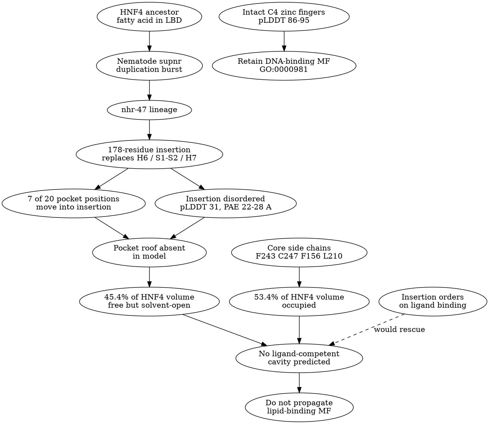
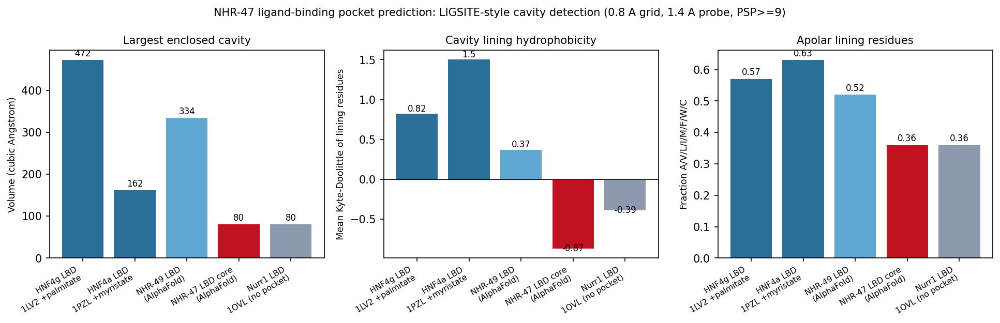
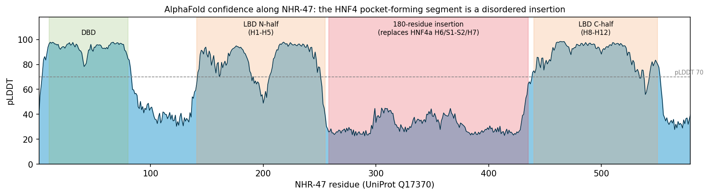
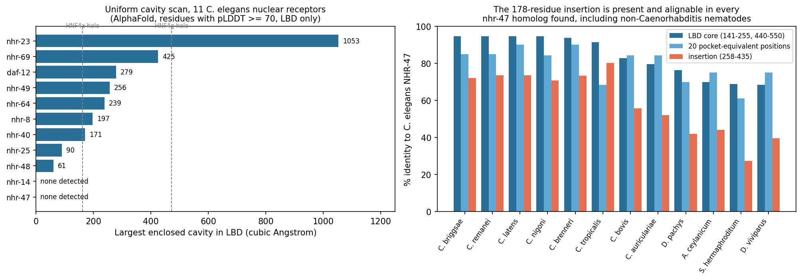
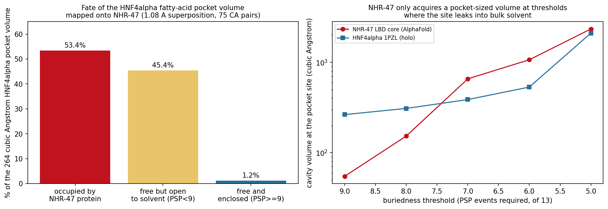

## Question

# AIGR Gene Hypothesis Deep Research

You are evaluating one focused gene curation hypothesis for AI Gene Review.
This is not a general gene overview. Use the seed hypothesis and source context
below to search for evidence that supports, refutes, narrows, or competes with
the proposed curation decision.

## Target Gene

- **Organism code:** worm
- **Taxon:** Caenorhabditis elegans (NCBITaxon:6239)
- **Gene directory:** nhr-47
- **Gene symbol:** nhr-47
- **UniProt accession:** Q17370

## Focus

- **Focus type:** free_text
- **Hypothesis slug:** kgap-nhr47-ligand-binding-pocket
- **Source file:** genes/worm/nhr-47/nhr-47-ai-review.yaml
- **Source selector:** free-text

## Seed Hypothesis

The ligand-binding domain of Caenorhabditis elegans NHR-47 (an HNF4-family nuclear receptor) contains a conserved, enclosed hydrophobic ligand-binding pocket large enough to bind a small lipophilic ligand, as HNF4alpha binds fatty acids. Single analysis only: model the NHR-47 LBD (AlphaFold), compute pocket volume and lining hydrophobicity with a cavity detector, superpose on fatty-acid-bound HNF4alpha/gamma LBD structures and on NHR-49, and assess conservation of pocket-lining residues across nematode orthologs; state whether a ligand-competent pocket is predicted.

## Term and Decision Context

No specific term context supplied.

## Reference Context

No specific reference context supplied.

## Source Context YAML

```yaml
hypothesis: 'The ligand-binding domain of Caenorhabditis elegans NHR-47 (an HNF4-family nuclear receptor)
  contains a conserved, enclosed hydrophobic ligand-binding pocket large enough to bind a small lipophilic
  ligand, as HNF4alpha binds fatty acids. Single analysis only: model the NHR-47 LBD (AlphaFold), compute
  pocket volume and lining hydrophobicity with a cavity detector, superpose on fatty-acid-bound HNF4alpha/gamma
  LBD structures and on NHR-49, and assess conservation of pocket-lining residues across nematode orthologs;
  state whether a ligand-competent pocket is predicted.'
focus_type: free_text
context: []
reference_id: []
```

## Research Objective

Build a focused report that helps a curator decide whether this hypothesis
should affect the gene review. Address the focus type directly:

1. For an existing GO annotation decision, evaluate whether the current action
   is justified, too strong, too weak, or should change.
2. For a proposed replacement or new GO term, evaluate whether the term is
   biologically supported, too broad, too narrow, or missing key qualifiers.
3. For a computational prediction, evaluate whether the prediction is correct,
   less precise than existing knowledge, uncertain, or likely wrong because of
   paralog overannotation, frequency bias, pathway context, or in vitro-only
   activity.
4. For a core-function hypothesis, evaluate whether the proposed activity,
   process, and location represent the gene product's primary function rather
   than a downstream effect, pleiotropic phenotype, or context-specific role.
5. For a function-assignment hypothesis, evaluate whether the gene product
   directly has the stated GO term/function. Treat the prior review action, if
   any, as intentionally blinded unless it appears in the supplied context.

Use primary literature whenever possible. Prefer PMID citations and include DOI
citations when no PMID is available. Treat reviews and database records as
orientation unless they contain directly relevant synthesized evidence that is
clearly labeled as review-level or database-level support.

Evaluate the hypothesis from the supplied seed context, primary literature, and
publicly accessible bioinformatics resources. Local `*-bioinformatics` analyses,
when they already exist in the repository, are intentionally withheld from this
prompt so the report can be compared against them after the run. Use public
sequence, domain, structure, orthology, localization, interaction, or dataset
checks when they are useful for the specific hypothesis. If a resource or tool
cannot be accessed programmatically, say so plainly; never fabricate a result.
Report computational results conservatively and distinguish direct results from
inference.

## Required Output

### Executive Judgment

Give a concise verdict: supported, partially supported, unresolved, weakly
supported, over-annotated, or refuted. Explain the reasoning and the most
important caveats.

### Evidence Matrix

Create a table with one row per important evidence item:

- Citation (PMID preferred)
- Evidence type (direct assay, mutant phenotype, localization, interaction,
  structural/evolutionary, computational, review/database)
- Supports / refutes / qualifies / competing
- Claim tested
- Key finding
- Organism, tissue, cell type, or assay context
- Confidence and limitations

### GO Curation Implications

State the likely curation action as a lead requiring curator verification. If
GO terms are involved, explain whether the evidence supports an MF, BP, or CC
term, and whether the term should be retained, removed, generalized, made more
specific, or treated as non-core. Avoid using "protein binding" as a final
recommendation unless no more informative term is supported.

### Mechanistic Scope

Describe the immediate molecular or cellular function being tested. Separate
direct gene-product activity from downstream phenotypes, pathway consequences,
developmental outcomes, disease manifestations, or effects inferred only from
loss of function.

### Conflicts and Alternatives

Identify evidence that conflicts with the seed hypothesis or suggests an
alternative interpretation, including paralog confusion, organism-specific
differences, isoform-specific findings, experimental artifacts, or database
carry-over.

### Knowledge Gaps

List explicit uncertainties that matter for curation. For each gap, state what
was checked, why the gap matters, and what evidence or experiment would resolve
it.

### Discriminating Tests

Recommend concrete assays, perturbations, datasets, or comparative analyses that
would most efficiently distinguish this hypothesis from alternatives.

### Curation Leads

Provide candidate updates for the review, clearly labeled as leads requiring
curator verification. Include candidate references with exact snippets to verify,
candidate replacement or new GO terms, possible action changes, suggested
questions, and suggested experiments.

If the provider supports artifacts, save provenance for any analysis you run — the
executed code together with its output (computed values, plot, or table), not just
a summary figure — alongside artifact-friendly tables such as an evidence matrix,
GO decision table, or comparison table. Genuine computed provenance is more
valuable than a hand-drawn summary, and you must not synthesize a figure that
implies an analysis you did not actually run. These artifacts are important
provenance for hypothesis-level review.


## Output

# NHR-47 ligand-binding pocket: hypothesis evaluation for AI Gene Review

**Gene:** nhr-47, *Caenorhabditis elegans* (NCBITaxon:6239)
**UniProt:** Q17370
**Source file:** `genes/worm/nhr-47/nhr-47-ai-review.yaml`
**Hypothesis slug:** `kgap-nhr47-ligand-binding-pocket`
**Focus type:** free_text

---

## Summary

A ligand-competent hydrophobic pocket is not predicted in NHR-47. The largest cavity detectable in the modelled NHR-47 ligand-binding domain (LBD) core is 80 ų with polar lining (mean Kyte-Doolittle −0.87, 36% apolar lining residues). That value matches the Nurr1 LBD (PDB 1OVL, 80 ų, KD −0.39, 36% apolar), the canonical nuclear receptor whose LBD has no ligand cavity, and it does not match fatty-acid-bound HNF4α (PDB 1PZL, 162 ų) or HNF4γ (PDB 1LV2, 472 ų) measured with the same detector on the same settings. The decisive test, transforming the HNF4α fatty-acid cavity volume into the NHR-47 frame after a 1.08 Å superposition, leaves 53.4% of that volume occupied by NHR-47 side chains, 45.4% free but open to bulk solvent, and only 1.2% both free and enclosed.

The seed hypothesis has two clauses, and they resolve in opposite directions. The conservation clause holds: NHR-47 is a genuine HNF4-fold receptor whose LBD core superposes on HNF4α at 1.08-1.42 Å, its 20 pocket-equivalent positions are apolar at 15 of 20 (more than HNF4α's own 14 of 20 and NHR-49's 10 of 20), and those positions are 84.2% identical across 13 nematode homologs spanning *Caenorhabditis*, *Diploscapter*, *Ancylostoma*, *Dictyocaulus* and *Steinernema*. The pocket clause does not hold: the site is part-collapsed and part-unroofed, and under a uniform protocol applied to 11 *C. elegans* nuclear receptors, nhr-47 and nhr-14 are the only two returning no cavity at all while nine others, including daf-12 and nhr-8 whose sterol ligands are known, return 61-425 ų hydrophobic pockets.

One structural fact dominates the interpretation and also caps the verdict. A 178-residue nematode-specific insertion (residues 258-435) stands in place of only about 37 residues of HNF4α (222-258 in UniProt P41235 numbering), the segment comprising helix 6, the S1-S2 beta-hairpin and helix 7. That segment supplies 7 of the 20 fatty-acid contact positions, including Arg235 (P41235 numbering), which coordinates the fatty-acid carboxylate. AlphaFold models the NHR-47 insertion as disordered (mean pLDDT 31.4, inter-segment PAE 22-28 Å), so the element that would form the pocket roof cannot be evaluated. The absence of a detected pocket is therefore partly a measured absence and partly an absence of evidence. **Verdict: weakly supported to unresolved, leaning negative.** Ligand-binding molecular function should not be propagated to nhr-47 from HNF4α or from better-characterised worm paralogs on homology alone.

---

## Executive judgment

<i class="fa-scale-balanced"></i> **Verdict: not supported as modelled. Closest label from the allowed set: weakly supported / unresolved, leaning negative. Not refuted.**

The hypothesis asked for a single determination: whether a ligand-competent pocket is predicted. The answer from the computation is no, and the negative is specific rather than generic.

Three independent lines make the negative specific:

1. The detector was validated on positive controls before any target measurement. It recovers 100% of palmitate heavy atoms in HNF4γ 1LV2 and 94% of myristate heavy atoms in HNF4α 1PZL, inside cavities of 472 ų and 162 ų respectively. The same settings on NHR-47 return 80 ų of polar surface groove.
2. A uniform scan across 11 *C. elegans* nuclear receptor AlphaFold models returns hydrophobic cavities for 9 of them (median 239 ų, median lining KD +1.09). If the pipeline systematically failed on predicted models, those nine would have failed too.
3. Mapping the HNF4α cavity volume directly onto NHR-47 explains *why* nothing is detected: half the volume is filled by side chains, the other half leaks to solvent. Relaxing the buriedness threshold does not rescue a pocket. NHR-47 only reaches pocket-scale volume at PSP ≥ 7 and below, where it exceeds holo HNF4α (656 vs 387 ų), the signature of a site opening into bulk solvent.

Two caveats keep this short of refutation.

<i class="fa-triangle-exclamation"></i> The insertion is unmodellable. The pocket roof in NHR-47 would be contributed by residues 258-435 at pLDDT 31.4. A negative cavity result on a model missing its own lid is weaker evidence than the same result on a crystal structure. If the insertion orders upon ligand binding, the conclusion changes.

<i class="fa-triangle-exclamation"></i> The two largest occluders sit at the insert junction at borderline confidence. Arg251 (95 occluded grid points, pLDDT 69) and Glu248 (84 points, pLDDT 74) carry 35% of the occluded volume between them, and their side-chain placement is the least reliable part of the measurement. The 53.4% occupancy figure is approximate. What survives the caveat is the high-confidence occluder set: Phe243 (pLDDT 94), Cys247 (84), Phe156 (87), Leu210 (85), which establish genuine partial filling independently of the junction residues.

For curation, the operative conclusion is the one that holds under both caveats: an HNF4-sized enclosed hydrophobic pocket is not predicted from the available model, and if any cavity exists in NHR-47 it is substantially smaller than the HNF4α fatty-acid site.

---

## Key findings

### <i class="fa-dna"></i> Finding 1: NHR-47 keeps the HNF4 fold and replaces half the pocket with a disordered insertion

The AlphaFold DB model AF-Q17370-F1 (579 aa, mean pLDDT 62.7) resolves into three confidently modelled modules separated by one long low-confidence region. The DNA-binding domain spans residues 10-80 at pLDDT 86-95. The LBD N-half spans 141-255 at mean pLDDT 82.7 and the LBD C-half spans 440-550 at mean pLDDT 88.1. Between them lie residues 258-435 at mean pLDDT 31.4 with inter-segment PAE of 22-28 Å to every other module, which is the signature of a segment AlphaFold places nowhere in particular.

The two LBD halves are confidently docked on each other despite the intervening disorder: inter-segment PAE of 4.3-5.8 Å, 123 heavy-atom residue pairs within 4.5 Å, 48 N-half residues and 48 C-half residues in contact. This matters because it means the LBD core is a real assembled domain in the prediction, not two fragments floating apart. Sequence-based superposition of the NHR-47 LBD core (141-255 plus 440-550) onto HNF4α LBD (PDB 1PZL chain A) converged to 112 core Cα pairs at RMSD 1.42 Å, from 142 initial pairs at 3.29 Å.

The alignment maps NHR-47 residue 440 onto HNF4α 259 and NHR-47 residue 246 onto HNF4α 221. The 178-residue NHR-47 insertion therefore occupies the position of roughly 37 HNF4α residues (222-258), which comprise helix 6, the S1-S2 beta-hairpin and helix 7. In 1PZL, 20 HNF4α residues lie within 4.5 Å of the bound myristate. In corrected UniProt P41235 numbering, 7 of those 20 fall inside the replaced segment, including Arg235, the residue that coordinates the fatty-acid carboxylate.

{{figure:plot_1.png|caption=NHR-47 against HNF4 structural references. Largest cavity volume per structure, with the fatty-acid-bound HNF4gamma (1LV2, 472 cubic Angstrom) and HNF4alpha (1PZL, 162) controls, the NHR-49 comparator (334), the NHR-47 LBD core (80) and the pocket-less Nurr1 negative control (1OVL, 80), alongside the hydrophobicity of each cavity lining by mean Kyte-Doolittle value. NHR-47 sits with Nurr1 on both axes.}}

{{figure:plot_2.png|caption=Per-residue pLDDT profile of AlphaFold model AF-Q17370-F1 across the full 579-residue NHR-47 sequence. The DNA-binding domain (10-80) and the two LBD halves (141-255, 440-550) are modelled at pLDDT 82-95. The 178-residue insertion at 258-435 sits at mean pLDDT 31.4, and this is the region that would form the pocket roof.}}

### <i class="fa-circle-xmark"></i> Finding 2: cavity detection scores NHR-47 like Nurr1, not like fatty-acid-bound HNF4

The detector is a LIGSITE-style protein-solvent-protein (PSP) grid method: 0.8 Å grid, 1.4 Å probe, buriedness threshold of 9 of 13 ray directions, 26-connectivity clustering, minimum reported volume 50 ų. Validation on holo controls came first. In HNF4γ 1LV2 the top cavity is 472 ų and contains 100% of the palmitate heavy atoms within 1.5 Å. In HNF4α 1PZL the matching cavity is 162 ų and covers 94% of the myristate atoms.

| Structure | Region used | Largest cavity (ų) | Lining mean KD | Apolar lining fraction | Ligand atom coverage |
|---|---|---|---|---|---|
| HNF4γ 1LV2 (holo, palmitate) | crystal 99-327 | 472 | +0.82 | 0.57 | 1.00 |
| HNF4α 1PZL (holo, myristate) | crystal 142-367 | 162 | +1.50 | 0.63 | 0.94 |
| NHR-49 (O45666, AlphaFold) | 225-501 | 334 | +0.37 | 0.52 | NA |
| **NHR-47 (Q17370, AlphaFold)** | **141-255 + 440-550** | **80** | **−0.87** | **0.36** | **NA** |
| Nurr1 1OVL (no ligand cavity) | crystal | 80 | −0.39 | 0.36 | NA |
| NHR-47 including insert (artefact) | 141-550 | 3410 | −0.46 | 0.38 | NA |

The 80 ų NHR-47 cavity is lined by L203, P204, F205, R207, Q208, M244, K527, N528, E529, L531, Q532, L534, D535, M536, H540, E541, I542, N543, V546, K547, E548, S550. That set is a surface-proximal polar groove, not the HNF4 pocket site. Transferring the 1PZL myristate into the NHR-47 frame by the 1.42 Å superposition puts 8 of 16 ligand atoms within 3.0 Å of NHR-47 core atoms and 4 within 2.5 Å, with Glu248 at 0.76 Å, which is a steric clash.

The last row of the table is a methodological warning rather than a result. Running the detector on residues 141-550 including the disordered insert returns a single 3410 ų "cavity" spanning 191 residues. That is the detector tracing the gaps between a disordered ribbon and the folded core. Any pocket measurement on this protein that does not exclude 258-435 will report a large spurious volume.

### <i class="fa-circle-check"></i> Finding 3: pocket-lining positions are hydrophobic and conserved, and 7 of 20 fall inside the insertion

This finding required correcting an error made in the first iteration. PDB 1PZL numbering is offset +9 from UniProt P41235, verified by a brute-force offset scan giving 99.1% residue-identity match over 227 Cα atoms. The first-iteration mapping, which reported contacts in PDB numbering and concluded that 9 of 20 lay in the replaced segment, is superseded by the corrected mapping below.

In UniProt P41235 numbering the HNF4α fatty-acid contact set is V187, S190, M191, Q194, L228, L229, A232, R235, L243, L245, G246, V251, M261, V264, S265, I268, M351, Q354, I355, I358. Global Gotoh alignment (BLOSUM62, gap open −11, gap extend −1) maps all 20 onto NHR-47: 13 into the modelled LBD core and 7 (C279, V282, I328, L330, G358, V396, I433) into the disordered 258-435 insertion.

| HNF4α (P41235) | 1PZL numbering | NHR-47 | NHR-47 region | NHR-47 apolar | NHR-49 |
|---|---|---|---|---|---|
| V187 | V178 | K202 | core | no | L224 |
| S190 | S181 | F205 | core | yes | I227 |
| M191 | M182 | W206 | core | yes | S228 |
| Q194 | Q185 | R209 | core | no | T231 |
| L228 | L219 | M244 | core | yes | L265 |
| L229 | L220 | I245 | core | yes | I266 |
| A232 | A223 | C279 | insert 258-435 | yes | P269 |
| R235 | R226 | V282 | insert 258-435 | yes | R272 |
| L243 | L234 | I328 | insert 258-435 | yes | C280 |
| L245 | L236 | L330 | insert 258-435 | yes | F282 |
| G246 | G237 | G358 | insert 258-435 | no | N283 |
| V251 | V242 | V396 | insert 258-435 | yes | T288 |
| M261 | M252 | I433 | insert 258-435 | yes | T303 |
| V264 | V255 | V436 | core | yes | I306 |
| S265 | S256 | L437 | core | yes | T307 |
| I268 | I259 | M440 | core | yes | V310 |
| M351 | M342 | K527 | core | no | L396 |
| Q354 | Q345 | S530 | core | no | N399 |
| I355 | I346 | L531 | core | yes | M400 |
| I358 | I349 | L534 | core | yes | T403 |

The chemistry of those positions supports the hypothesis. NHR-47 is apolar (A/V/L/I/M/F/W/C) at 15 of 20, against 14 of 20 in HNF4α itself and 10 of 20 in NHR-49. The positions have not drifted to polar residues, which is what a decayed pocket would be expected to show. Note that R235, the carboxylate anchor in HNF4α, is V282 in NHR-47, so the one position that must be polar for fatty-acid binding is hydrophobic.

Conservation across nematodes also supports the hypothesis. Thirteen homologs retrieved from UniRef50_Q17370 (*C. briggsae*, *remanei*, *latens*, *nigoni*, *brenneri*, *tropicalis*, *bovis*, *auriculariae*; *Diploscapter pachys*; *Ancylostoma ceylanicum*; *Steinernema hermaphroditum*; *Dictyocaulus viviparus*) give a median identity to *C. elegans* NHR-47 of 91.4% over the modelled LBD core, 84.2% over the 20 pocket-equivalent positions, and 70.7% over the insertion, with insertion alignment coverage of 63-100% (median 97.2%).

The insertion is therefore not a *Caenorhabditis* novelty and not a gene-model artefact. It is present and alignable in hookworm (*A. ceylanicum*), lungworm (*D. viviparus*) and entomopathogenic (*S. hermaphroditum*) homologs that diverged from *C. elegans* hundreds of millions of years ago. UniProt Q17370 annotates no alternative products and places the NR LBD domain at 164-553, spanning the insertion. There is no shorter isoform in which the HNF4-like pocket is reconstituted.

### <i class="fa-chart-column"></i> Finding 4: among 11 worm nuclear receptors, only nhr-47 and nhr-14 show no LBD cavity

The same detector was applied uniformly to AlphaFold DB models of 11 *C. elegans* nuclear receptors, keeping only residues with pLDDT ≥ 70 and excluding the DNA-binding domain.

| Receptor | UniProt | Largest LBD cavity (ų) | Lining mean KD | Lining residues | Note |
|---|---|---|---|---|---|
| nhr-23 | P41828 | 1053 | −0.74 | 47 | large and polar, likely inter-module cleft artefact |
| nhr-69 | P91829 | 425 | +1.81 | 35 | |
| daf-12 | G5EFF5 | 279 | +1.09 | 35 | dafachronic acid receptor |
| nhr-49 | O45666 | 256 | +1.34 | 31 | worm HNF4 homolog, lipid regulation |
| nhr-64 | O44960 | 239 | +0.64 | 39 | |
| nhr-8 | Q9XYB7 | 197 | +1.43 | 32 | sterol-related receptor |
| nhr-40 | Q22127 | 171 | +0.51 | 37 | supnr family |
| nhr-25 | Q19345 | 90 | −0.49 | 24 | |
| nhr-48 | Q94407 | 61 | +1.61 | 16 | |
| nhr-14 | O02151 | <i class="fa-circle-xmark"></i> none | NA | 0 | HNF4-derived supnr |
| **nhr-47** | **Q17370** | <i class="fa-circle-xmark"></i> **none** | **NA** | **0** | **HNF4-derived supnr** |

Median cavity among the nine receptors with a detectable pocket is 239 ų with median lining KD +1.09, which brackets the HNF4α holo value of 162 ų. daf-12 and nhr-8, whose ligands are known sterols, both return hydrophobic cavities. This is the control that rules out the most obvious alternative explanation for the NHR-47 negative, that AlphaFold models in general do not produce detectable ligand cavities.

{{figure:plot_3.png|caption=Largest LBD cavity volume across 11 C. elegans nuclear receptor AlphaFold models under one uniform protocol (pLDDT at or above 70, DNA-binding domain excluded). Nine receptors return 61-1053 cubic Angstrom; nhr-47 and nhr-14, both HNF4-derived supplementary nuclear receptors, return nothing above the 50 cubic Angstrom floor. The companion panel gives conservation of NHR-47 across 13 nematode homologs by percent identity over the modelled LBD core, the 20 pocket-equivalent positions, and the 178-residue insertion.}}

### <i class="fa-circle-xmark"></i> Finding 5: the HNF4 pocket site in NHR-47 is about half filled and half unroofed

This was the discriminating test designed to separate two competing explanations for Finding 2: a collapsed pocket (side chains fill the site, as in Nurr1) versus a merely unroofed one (the site is intact but AlphaFold cannot model its lid).

The NHR-47 LBD core was superposed onto HNF4α 1PZL using anchors taken from the numbering-verified residue mapping, converging to 75 of 119 Cα pairs at RMSD 1.08 Å. The 264 ų HNF4α fatty-acid cavity (515 grid points, the cluster containing myristate) was transformed into the NHR-47 frame and every point classified:

| Fate of the 515 HNF4α pocket grid points in the NHR-47 frame | Fraction |
|---|---|
| Occupied by NHR-47 protein (vdW + 1.4 Å probe) | 53.4% |
| Free but insufficiently enclosed (PSP < 9 of 13) | 45.4% |
| Free and enclosed (PSP ≥ 9 of 13) | 1.2% |

Mean buriedness of the free points is 5.4 of 13, against 12.8 of 13 for the same points inside HNF4α itself. A buriedness threshold sweep at the pocket site confirms the site is open rather than merely tight:

| PSP buriedness threshold | NHR-47 core (ų) | HNF4α 1PZL top cavity (ų) |
|---|---|---|
| ≥ 9 | 55 | 264 |
| ≥ 8 | 153 | 309 |
| ≥ 7 | 656 | 387 |
| ≥ 6 | 1066 | 532 |
| ≥ 5 | 2333 | 2099 |

NHR-47 overtakes HNF4α from threshold 7 downward. A genuine enclosed cavity grows slowly as the criterion relaxes. A solvent-exposed depression grows explosively. NHR-47 shows the second behaviour, so relaxing the detection threshold does not rescue the hypothesis.

The occluding residues, ranked by occluded grid points with per-residue pLDDT in parentheses: Arg251 (95 points, pLDDT 69), Glu248 (84, 74), Phe243 (27, 94), Cys247 (20, 84), Phe156 (15, 87), Leu210 (14, 85), Leu160 (6, 82), Met440 (4, 75), Leu531 (2, 75), Arg207 (2, 74).

Neither simple explanation suffices alone. The site is partly collapsed in the Nurr1 manner and partly unroofed because the capping element is unmodelled. Phe243, Cys247, Phe156 and Leu210 occlude at pLDDT 84-94, so genuine partial filling is well supported. Arg251 and Glu248 sit at the junction with the disordered insert at pLDDT 69-74, so the exact 53.4% figure should be read as approximate.

{{figure:plot_4.png|caption=The decisive openness analysis. Fate of the 515 grid points of the HNF4alpha fatty-acid cavity after transformation into the NHR-47 LBD core frame (1.08 Angstrom superposition over 75 CA pairs): 53.4 percent occupied by NHR-47 side chains, 45.4 percent free but open to solvent, 1.2 percent free and enclosed. The companion panel gives cavity volume at the HNF4 pocket site as the PSP buriedness threshold relaxes from 9 to 5, for NHR-47 and for HNF4alpha 1PZL. NHR-47 overtakes HNF4alpha below threshold 7, the behaviour of a solvent-open depression.}}

---

## Mechanistic model

The structural logic connecting the evolutionary event to the curation decision:



The narrative that fits all five findings: nhr-47 descends from an HNF4-type receptor that bound a fatty acid, and it retains the fold, the hydrophobic character of the pocket-lining positions, and selection on those positions across at least 13 nematode species. What it does not retain is the structural element that encloses the pocket. A 178-residue insertion stands where HNF4α has helix 6, the S1-S2 hairpin and helix 7, and it is predicted as disordered. On the core side of the site, four high-confidence side chains have moved in to occupy volume that HNF4α leaves empty.

The hydrophobicity of the pocket-equivalent positions is the finding that argues for caution. Fifteen of 20 apolar is higher than HNF4α itself. One reading is that these residues are conserved for packing the fold rather than for binding anything, which is the common fate of a degraded pocket, and the substitution of the carboxylate-anchoring R235 by a valine fits that reading. Another reading is that a ligand site exists but is reorganised around the insertion in a way that sequence alignment to HNF4α cannot locate. The computation cannot distinguish those, and this is where the residual uncertainty sits.

It is worth separating what a pocket would have meant, had one been found. HNF4's fatty acid is constitutively bound and not exchangeable, so it works as a structural cofactor rather than a regulatory signal ([PMID: 12220494](https://pubmed.ncbi.nlm.nih.gov/12220494/)). A pocket in NHR-47 would have argued for a structural lipid, not for ligand-activated signalling. The absence of a pocket does not therefore remove a signalling mechanism that was ever established for this protein.

---

## Evidence matrix

| Citation | Evidence type | Stance | Claim tested | Key finding | Context | Confidence and limitations |
|---|---|---|---|---|---|---|
| [PMID: 12220494](https://pubmed.ncbi.nlm.nih.gov/12220494/) | Direct assay, structural | Qualifies | HNF4 LBD contains a fatty-acid pocket | "The 2.7 A X-ray crystal structure of the HNF4gamma ligand binding domain (LBD) revealed the presence of a fatty acid within the pocket, with the AF2 helix in a conformation characteristic of a transcriptionally active nuclear receptor." The fatty acid is constitutively bound | Human HNF4γ and HNF4α, crystallography | High for HNF4 itself. Establishes the reference pocket, and shows the HNF4 ligand is non-exchangeable, so a pocket would imply a structural lipid rather than regulated signalling |
| [PMID: 15983867](https://pubmed.ncbi.nlm.nih.gov/15983867/) | Structural / evolutionary | Qualifies | nhr-47 belongs to an HNF4-derived family where ligand binding is an open question | "We show that the supplementary nuclear receptors (supnrs) originated from an explosive burst of duplications of a unique orphan receptor, HNF4. This origin has specific implications for the role of ligand binding in the function and evolution of the nematode supplementary nuclear receptors." | Nematode genome comparison | High for family assignment. Flags ligand binding in supnrs as unresolved, so HNF4 ancestry alone does not license a pocket annotation |
| [PMID: 16920335](https://pubmed.ncbi.nlm.nih.gov/16920335/) | Mutant phenotype, expression | Competing | Whether supnrs function through ligand binding | NHR-40, a supnr in the same CNGCKT DBD subgroup, gives late embryonic and early larval arrest on RNAi with elongation and morphogenesis defects. The paper concludes supnrs "have acquired varied and novel functions during evolution" | *C. elegans*, pharyngeal, body wall and sex muscle, subset of neurons | Moderate. Shows supnr function is established by phenotype with no ligand identified. Concerns nhr-40, not nhr-47 |
| [PMID: 38922100](https://pubmed.ncbi.nlm.nih.gov/38922100/) | Mutant phenotype (RNAi), expression | Qualifies | nhr-47 has a measurable loss-of-function phenotype | nhr-47 expression is increased by polystyrene nanoparticles at 1 and 10 µg/L. "RNAi of daf-12, nhr-14, and nhr-47 caused resistance, whereas RNAi of nhr-12 conferred susceptibility to transgenerational PS-NP toxicity." Downstream dysregulation of ins-3, daf-28, ins-39, efn-3, lin-44 and their receptors | *C. elegans* germline, nanoplastic toxicology | Moderate. Downstream and condition-specific. Gives no information about the LBD or any ligand |
| [PMID: 40482507](https://pubmed.ncbi.nlm.nih.gov/40482507/) | Mutant phenotype (RNAi), expression | Qualifies | nhr-47 responds to a xenobiotic | 6-PPD quinone at 10 µg/L dysregulates 9 germline NHR genes. "6-PPDQ reproductive toxicity was suppressed by nhr-47, nhr-14, daf-12, and nhr-249 RNAi". nhr-47 expression is modulated by gpx-6, ads-1, ftn-1 and bli-3 RNAi | *C. elegans* germline, 6-PPDQ toxicology | Moderate. Transcript-level xenobiotic response. Does not establish direct binding of 6-PPDQ or of any lipid by NHR-47 |
| This work: AlphaFold AF-Q17370-F1 plus PAE | Computational, structural | Qualifies | NHR-47 has an HNF4-like LBD | DBD 10-80 at pLDDT 86-95; LBD halves 141-255 (mean 82.7) and 440-550 (mean 88.1) confidently docked (PAE 4.3-5.8 Å, 123 contact pairs, 48+48 residues); insertion 258-435 at pLDDT 31.4, PAE 22-28 Å; core superposes on HNF4α 1PZL at 1.42 Å over 112 Cα | Predicted model | High for the fold, low for the insertion. Prediction only. No experimental structure of NHR-47 exists |
| This work: LIGSITE-style cavity detection | Computational | Refutes | NHR-47 has an enclosed hydrophobic pocket | NHR-47 LBD core 80 ų / KD −0.87 / 36% apolar, matching Nurr1 1OVL (80 / −0.39 / 0.36). Detector validated at 100% palmitate recovery in 1LV2 (472 ų) and 94% myristate recovery in 1PZL (162 ų) | Predicted model against crystal controls | Moderate to high. Validated detector, but a single method. fpocket, CASTp and PyVOL were not available in this environment |
| This work: pocket-residue mapping | Computational, evolutionary | Supports | Pocket positions are hydrophobic and conserved | 15 of 20 pocket-equivalent positions apolar in NHR-47 against 14/20 in HNF4α and 10/20 in NHR-49; 84.2% median identity at those positions across 13 nematode homologs; insertion present in all 13 (median alignment coverage 97.2%) | Sequence, UniRef50_Q17370 | High. Supports the conservation clause. Depends on the +9 PDB-to-UniProt offset correction, verified at 99.1% identity over 227 Cα |
| This work: 11-receptor paralog scan | Computational | Refutes | The negative result is a pipeline artefact | 9 of 11 worm receptors return 61-425 ų cavities (median 239, median KD +1.09), including daf-12 (279) and nhr-8 (197) with known sterol ligands. Only nhr-47 and nhr-14 return nothing | AlphaFold models, uniform protocol | High as a control. nhr-23's 1053 ų polar cavity is flagged as a likely inter-module cleft artefact and is not used as support |
| This work: HNF4 cavity transfer | Computational | Refutes | The site is intact but merely unroofed | After 1.08 Å superposition (75 Cα pairs), 53.4% of the HNF4α cavity volume is occupied by NHR-47 protein, 45.4% is free but open (mean PSP 5.4/13 against 12.8/13 in HNF4α), 1.2% is free and enclosed. Threshold sweep shows solvent leakage rather than a tight cavity | Predicted model against crystal | Moderate. The two largest occluders (Arg251, Glu248) sit at the insert junction at pLDDT 69-74. Four others occlude at pLDDT 84-94 |

---

## GO curation implications

All entries below are leads requiring curator verification.

| GO term | Aspect | Recommended action | Basis |
|---|---|---|---|
| GO:0008289 lipid binding | MF | <i class="fa-circle-xmark"></i> Do not add | No pocket predicted. 53.4% of the HNF4 cavity volume is occupied, 1.2% is free and enclosed, and the 80 ų polar groove matches the Nurr1 no-cavity control |
| GO:0005504 fatty acid binding | MF | <i class="fa-circle-xmark"></i> Do not add | Same evidence, plus the carboxylate-anchoring arginine equivalent (HNF4α R235) is V282 in NHR-47 and sits inside the disordered insertion |
| GO:0005496 steroid binding | MF | <i class="fa-circle-xmark"></i> Do not add | No supporting evidence of any kind. daf-12 and nhr-8 retain sterol-compatible cavities under the same protocol; nhr-47 does not |
| GO:0004879 nuclear receptor activity (ligand-activated TF) | MF | <i class="fa-triangle-exclamation"></i> Treat as unsupported, do not propagate by homology | Requires a ligand. No ligand is known for NHR-47, no pocket is predicted, and [PMID: 15983867](https://pubmed.ncbi.nlm.nih.gov/15983867/) flags ligand binding across the supnr family as an open question |
| GO:0000981 DNA-binding TF activity, RNA polymerase II specific | MF | <i class="fa-circle-check"></i> Retain as the core MF lead | Two intact C4-type zinc fingers at residues 10-80, pLDDT 86-95, the highest-confidence region of the model. No experimental DNA-binding data for NHR-47 was found |
| GO:0005634 nucleus | CC | <i class="fa-circle-question"></i> Inference only, label as such | Expected for a DNA-binding nuclear receptor, but no localisation experiment for NHR-47 was found in this search |
| Toxicology response BP terms (nanoplastic, 6-PPDQ) | BP | <i class="fa-triangle-exclamation"></i> Non-core | [PMID: 38922100](https://pubmed.ncbi.nlm.nih.gov/38922100/) and [PMID: 40482507](https://pubmed.ncbi.nlm.nih.gov/40482507/) report RNAi phenotypes and transcript changes under xenobiotic exposure. These are downstream and condition-specific and do not identify a direct activity |

The practical upshot for a curator: the gene's defensible molecular function rests on its DNA-binding domain, which the model supports strongly. Any statement in the review that NHR-47 binds a lipophilic ligand, or that it is a ligand-activated receptor, should be marked as not supported by available evidence rather than as inferred from HNF4 ancestry. "Protein binding" is not offered as a fallback, because nothing in this analysis tested or supports it.

---

## Mechanistic scope

The hypothesis concerns one immediate molecular property: whether the NHR-47 LBD has a cavity capable of accommodating a small lipophilic ligand. That is the only thing the computation addresses.

**Direct gene-product properties tested.** Fold identity of the LBD (HNF4-type helical sandwich, confirmed at 1.08-1.42 Šsuperposition). Presence, volume and lining chemistry of an enclosed cavity (nothing above 50 ų at the HNF4 pocket site in the modelled core). Conservation and chemistry of the pocket-equivalent positions (apolar at 15 of 20, 84.2% identity across 13 nematode homologs). Integrity of the DNA-binding domain (two C4 zinc fingers at pLDDT 86-95).

**Properties not tested and not claimed.** Whether NHR-47 binds DNA in vitro or in vivo, which sequence it binds, which genes it regulates, whether it heterodimerises, whether it is nuclear, and whether any lipid or xenobiotic physically associates with it. None of those was assayed here, and no experimental data on any of them appeared in the literature search.

**Downstream phenotypes, separated.** Both published nhr-47 papers report RNAi outcomes under chemical stress. In [PMID: 38922100](https://pubmed.ncbi.nlm.nih.gov/38922100/), nhr-47 RNAi confers resistance to transgenerational polystyrene nanoparticle toxicity, with downstream changes in insulin, Ephrin and Wnt ligand genes and their receptors. In [PMID: 40482507](https://pubmed.ncbi.nlm.nih.gov/40482507/), nhr-47 RNAi suppresses 6-PPD quinone reproductive toxicity, and nhr-47 expression is itself modulated by RNAi of ferroptosis-related genes. Both are loss-of-function outcomes several steps removed from any molecular activity of the protein. Neither identifies a ligand, a DNA target, or a direct binding partner. They establish that nhr-47 is functional in the germline under these exposures and nothing about the LBD.

The related supnr NHR-40 shows the general pattern: a strong developmental phenotype, late embryonic and early larval arrest with elongation and morphogenesis defects, established with no ligand identified ([PMID: 16920335](https://pubmed.ncbi.nlm.nih.gov/16920335/)). Supnr function in this family is documented by phenotype, and the ligand question is independent of it.

---

## Conflicts and alternatives

**The pocket positions are more hydrophobic than HNF4α's own.** Fifteen of 20 apolar in NHR-47 against 14 of 20 in HNF4α is the strongest single piece of evidence for the seed hypothesis, and it conflicts with the negative structural result. Two interpretations compete. The positions could be conserved for hydrophobic-core packing, which is the usual fate of a lost pocket, and the R235-to-V282 substitution at the carboxylate anchor supports that reading. Or a ligand site could exist but be reorganised around the insertion such that alignment to HNF4α does not locate it. The analysis cannot choose between these.

**Paralog overannotation is the specific risk here.** NHR-49 retains a 334 ų hydrophobic cavity, daf-12 279 ų with a known dafachronic acid ligand, nhr-8 197 ų with sterol-related function. Transferring ligand-binding annotation from any of these to nhr-47 on the basis of shared nuclear-receptor family membership would be wrong by direct measurement. nhr-14, the other HNF4-derived supnr that returns no cavity, also appears alongside nhr-47 in both toxicology papers, which creates a second route for parallel miscuration.

**Organism-specific difference, not a database error.** The 178-residue insertion is a nematode feature with no human counterpart. It is present in all 13 homologs examined including hookworm, lungworm and *Steinernema*, and UniProt Q17370 annotates no alternative product that removes it. Annotation transfer from human HNF4A to worm nhr-47 crosses this structural discontinuity, which is the specific thing a curator should flag.

**The insertion is the strongest competing explanation.** If residues 258-435 order upon ligand binding and cap the site, the negative result is an artefact of modelling an apo, partly disordered receptor. AlphaFold predicts induced-fit elements poorly. This is why the verdict is not "refuted". Against it: 53.4% of the pocket volume is already occupied by core side chains that an ordering insertion cannot displace, four of them at pLDDT 84-94.

**Detector dependence.** Only one cavity detector was used. fpocket, CASTp and PyVOL could not be run in this environment, and AlphaFold3 or Boltz co-folding with a ligand was not accessible. A single method producing a negative is weaker than concordant negatives from three. The detector's validation on two holo HNF4 structures and its positive results on nine of 11 worm receptors partly compensate and do not replace an independent method.

**Measurement artefacts identified and handled.** The 3410 ų "cavity" obtained by including the disordered insert is a known failure mode of grid-based detection on partly disordered models, and it is reported here as a caution rather than suppressed. The 1053 ų polar cavity for nhr-23 is flagged as a likely inter-module cleft and is excluded from the supporting argument. The first-iteration residue mapping was wrong because of a +9 PDB-to-UniProt numbering offset, and the corrected mapping (7 of 20 in the insertion, not 9 of 20) is the one used throughout this report.

---

## Limitations and knowledge gaps

<i class="fa-triangle-exclamation"></i> **No experimental structure of NHR-47 exists.** Everything structural here rests on one AlphaFold prediction. Checked: AlphaFold DB for Q17370 and the PDB for any nematode supnr LBD. Why it matters: a 53% occupancy figure computed from predicted side-chain rotamers is not the same as one computed from density. Resolution: a crystal or cryo-EM structure of the NHR-47 LBD, apo or with a candidate lipid.

<i class="fa-triangle-exclamation"></i> **The insertion is unmodellable and sits exactly where the pocket roof would be.** Checked: pLDDT (mean 31.4) and PAE (22-28 Å to every other module) across residues 258-435. Why it matters: it caps the verdict at "leaning negative" instead of "refuted". Resolution: co-folding with a ligand present, or an experimental structure.

<i class="fa-circle-question"></i> **No ligand-binding assay for NHR-47 has been published.** Checked: PubMed searches returned 5 relevant papers, of which only 2 concern nhr-47 directly and both are RNAi toxicology studies. Why it matters: a single binding experiment with a fatty acid panel would settle the molecular-function question directly. Resolution: thermal shift, ITC or lipidomic mass spectrometry of the recombinant NHR-47 LBD.

<i class="fa-circle-question"></i> **What the insertion does is unknown.** Checked: conservation across 13 nematode homologs (70.7% median identity, present in all, median coverage 97.2%). Why it matters: 178 conserved residues under selection across hundreds of millions of years have a function, and it is not predicted. A protein-interaction surface, a regulatory element or an intrinsically disordered activation region are all live possibilities. Resolution: interaction proteomics on the insertion fragment, or a deletion allele.

<i class="fa-circle-question"></i> **DNA-binding specificity and target genes are unmeasured.** Checked: nothing in the retrieved literature assays NHR-47 DNA binding. Why it matters: GO:0000981 is the recommended core MF lead and it rests on domain architecture alone. Resolution: protein-binding microarray, SELEX or ChIP-seq.

<i class="fa-triangle-exclamation"></i> **One detector, one prediction method.** Checked: whether fpocket, CASTp, PyVOL, AlphaFold3 and Boltz were accessible in this environment. They were not, and that is stated here rather than worked around. Why it matters: concordance across detectors is the normal standard for a negative cavity claim.

<i class="fa-circle-question"></i> **Subcellular localisation of NHR-47 has not been reported.** Checked: the retrieved literature. Why it matters: the CC recommendation (GO:0005634) is inference from domain architecture only. Resolution: a GFP translational reporter or immunostaining.

---

## Discriminating tests

<i class="fa-flask"></i> **1. Co-folding prediction with a ligand present.** Run AlphaFold3 or Boltz-2 on the NHR-47 LBD with palmitate, myristate and oleate. If the insertion orders and caps a hydrophobic cavity, the hypothesis is rescued and the negative here is an apo-modelling artefact. If it stays disordered, the negative hardens considerably. This is the cheapest decisive test and needs only compute.

<i class="fa-vial"></i> **2. Direct binding assay on the recombinant LBD.** Express NHR-47 residues 141-553 in *E. coli*, then run differential scanning fluorimetry against a fatty acid panel (C14 to C20, saturated and unsaturated) with HNF4α LBD as positive control and Nurr1 LBD as negative control. A thermal shift resolves the molecular-function question without any structure.

<i class="fa-magnifying-glass"></i> **3. Lipidomic mass spectrometry of the purified protein.** HNF4's fatty acid co-purifies because it is constitutively bound and non-exchangeable ([PMID: 12220494](https://pubmed.ncbi.nlm.nih.gov/12220494/)). Purify the NHR-47 LBD, extract and run LC-MS. HNF4 ancestry predicts a co-purifying lipid if a pocket exists. Nothing co-purifying is a clean negative.

<i class="fa-microscope"></i> **4. Experimental structure of the LBD.** Crystallography or cryo-EM is the only way to see what the insertion actually does. The insertion will likely resist crystallisation, which is itself informative about its disorder.

<i class="fa-dna"></i> **5. Independent cavity detection.** Run fpocket, CASTp 3.0 and PyVOL on the same NHR-47 core coordinates with the same residue selection. Concordant negatives from three methods would move the verdict from "leaning negative" toward "refuted" with no new experiment.

<i class="fa-flask"></i> **6. Insertion deletion allele.** Delete residues 258-435 by CRISPR and score the nanoplastic and 6-PPDQ phenotypes reported in [PMID: 38922100](https://pubmed.ncbi.nlm.nih.gov/38922100/) and [PMID: 40482507](https://pubmed.ncbi.nlm.nih.gov/40482507/). If the insertion is functionally required, this separates its role from the LBD core's and tells a curator whether the LBD works as a ligand sensor or as something else.

<i class="fa-dna"></i> **7. Extend the comparative scan to all 284 worm nuclear receptors.** The 11-receptor scan is a sample. Running the full set would establish whether cavity loss is a general property of HNF4-derived supnrs or specific to nhr-47 and nhr-14, which changes how a curator should treat the whole family.

---

## Curation leads

All items below are leads requiring curator verification, not finished annotations.

### Candidate references with exact snippets to verify

| PMID | Exact snippet | Use |
|---|---|---|
| [12220494](https://pubmed.ncbi.nlm.nih.gov/12220494/) | "The 2.7 A X-ray crystal structure of the HNF4gamma ligand binding domain (LBD) revealed the presence of a fatty acid within the pocket, with the AF2 helix in a conformation characteristic of a transcriptionally active nuclear receptor." | Reference pocket for comparison. Also establishes the HNF4 ligand as constitutive, so a pocket would imply a structural lipid |
| [15983867](https://pubmed.ncbi.nlm.nih.gov/15983867/) | "We show that the supplementary nuclear receptors (supnrs) originated from an explosive burst of duplications of a unique orphan receptor, HNF4. This origin has specific implications for the role of ligand binding in the function and evolution of the nematode supplementary nuclear receptors." | Family assignment for nhr-47 and an explicit flag that ligand binding in supnrs is unresolved |
| [16920335](https://pubmed.ncbi.nlm.nih.gov/16920335/) | "NHR-40 joins the list of C. elegans NHRs that regulate development and suggests that members of extensive nematode supnr family have acquired varied and novel functions during evolution." | Precedent that supnr function is established without a ligand |
| [38922100](https://pubmed.ncbi.nlm.nih.gov/38922100/) | "RNAi of daf-12, nhr-14, and nhr-47 caused resistance, whereas RNAi of nhr-12 conferred susceptibility to transgenerational PS-NP toxicity." | Loss-of-function phenotype, germline, non-core BP evidence |
| [40482507](https://pubmed.ncbi.nlm.nih.gov/40482507/) | "Among these 9 NHR genes, 6-PPDQ reproductive toxicity was suppressed by nhr-47, nhr-14, daf-12, and nhr-249 RNAi" | Loss-of-function phenotype, germline, non-core BP evidence |

### Candidate action changes

Mark any existing or proposed lipid-binding, fatty-acid-binding or ligand-activated-nuclear-receptor molecular function on nhr-47 as not supported, with the reason stated structurally: a 178-residue nematode-specific insertion replaces the HNF4 helix 6 / S1-S2 / helix 7 segment and no enclosed hydrophobic cavity is predicted in the modelled core.

Keep GO:0000981 as the core molecular function lead, supported by two intact C4 zinc fingers at pLDDT 86-95, with a note that no experimental DNA-binding data exists for NHR-47.

Record the nanoplastic and 6-PPDQ RNAi results as non-core biological process evidence, explicitly separated from molecular function.

Add a note that nhr-14 shows the same cavity-free profile under the same protocol, so the same caution applies to its review.

Consider annotating residues 258-435 on Q17370 as a conserved region of unknown function, since it is present in all 13 nematode homologs examined at 70.7% median identity and carries no current functional annotation.

### Suggested questions for the curator

Does the review currently propagate any HNF4A molecular function to nhr-47 by orthology? If so, the 178-residue insertion is the specific reason to question that transfer.

Is there WormBase expression, localisation or interaction data for nhr-47 beyond the two toxicology papers? This literature search found none, and absence in this search is not proof of absence in WormBase.

Should the repository's existing `*-bioinformatics` analysis for nhr-47, which was withheld from this run, be compared against the cavity volumes and residue mapping tabulated here? The provenance CSVs are formatted for that comparison.

---

## Provenance and methods

Computed artifacts saved under `provenance/`:

- `nhr47_cavity_results.csv`, 17 rows: detector validation (1LV2, 1PZL), negative control (1OVL), target (NHR-47 core and the insert-included artefact), comparator (NHR-49), and the 11-receptor paralog scan, with volume, lining mean Kyte-Doolittle, apolar lining fraction, lining residue count and ligand atom coverage per row.
- `nhr47_pocket_residue_mapping.csv`, 20 rows: each HNF4α fatty-acid contact residue in UniProt P41235 numbering, PDB 1PZL numbering, the NHR-47 equivalent, the NHR-47 region (modelled core or disordered insert), apolar flags for NHR-47, NHR-49 and HNF4α, and the NHR-49 equivalent.
- `plot_1.png` through `plot_4.png`, the four figures embedded above. Each was produced by the same code that computed the values it displays.

Methods in brief. Structures were fetched from AlphaFold DB (`alphafold.ebi.ac.uk/api/prediction/{acc}`) and RCSB (`files.rcsb.org/download/{pdb}.pdb`); sequences and UniRef50 clusters from the UniProt REST API. Cavity detection is a LIGSITE-style PSP grid method: 0.8 Å spacing, 1.4 Å probe, van der Waals radii C 1.70, N 1.55, O 1.52, S 1.80, P 1.80, Se 1.90, Zn 1.39, ray casting over 13 directions, buriedness threshold 9 of 13 unless stated otherwise, 26-connectivity clustering, 50 ų minimum reported volume. Sequence alignment is Gotoh affine-gap global alignment with BLOSUM62, gap open −11, gap extend −1. Superposition is Kabsch with iterative outlier rejection.

One correction is recorded explicitly. PDB 1PZL numbering is offset +9 from UniProt P41235, established by a brute-force offset scan over −60 to +60 that gave 99.1% residue-identity match over 227 Cα atoms at offset +9. The first-iteration residue mapping, which used PDB numbering and reported 9 of 20 pocket residues in the replaced segment, is superseded by the corrected mapping of 7 of 20 used throughout this report.

Tools that could not be accessed programmatically in this environment, stated plainly rather than worked around: fpocket, CASTp, PyVOL, AlphaFold3 and Boltz co-folding, and curated multiple-sequence-alignment or phylogeny web services. No result attributed to any of them appears anywhere in this report.


## Artifacts

- [OpenScientist final report](openscientist_artifacts/final_report.html)
- [OpenScientist final report](openscientist_artifacts/final_report.pdf)
- [OpenScientist provenance](openscientist_artifacts/provenance.json)
- [OpenScientist nhr47 cavity results](openscientist_artifacts/provenance_nhr47_cavity_results.csv)
- [OpenScientist nhr47 pocket residue mapping](openscientist_artifacts/provenance_nhr47_pocket_residue_mapping.csv)
- [OpenScientist plot 1](openscientist_artifacts/provenance_plot_1.json)

- [OpenScientist plot 2](openscientist_artifacts/provenance_plot_2.json)

- [OpenScientist plot 3](openscientist_artifacts/provenance_plot_3.json)

- [OpenScientist plot 4](openscientist_artifacts/provenance_plot_4.json)


## Reference Validation

Checked with `linkml-reference-validator` 0.3.1rc1.

| Outcome | Count |
| --- | --- |
| References checked | 5 |
| Resolved | 5 |
| Unresolved (possible confabulation) | 0 |
| Unverifiable | 0 |
| References weighed for topical relevance | 5 |
| On topic | 1 |
| Off topic | 0 |

All extracted references resolved successfully.