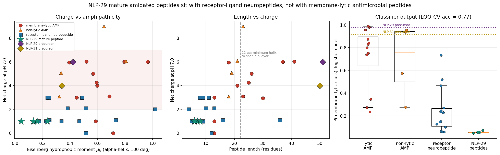
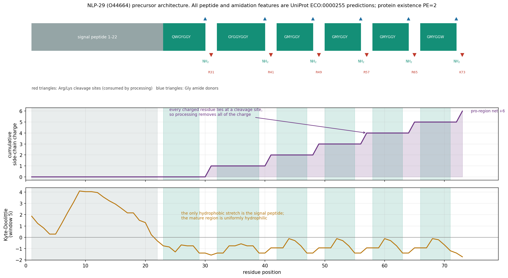
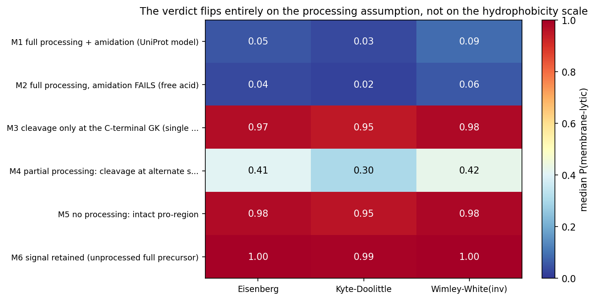

## Question

# AIGR Gene Hypothesis Deep Research

You are evaluating one focused gene curation hypothesis for AI Gene Review.
This is not a general gene overview. Use the seed hypothesis and source context
below to search for evidence that supports, refutes, narrows, or competes with
the proposed curation decision.

## Target Gene

- **Organism code:** worm
- **Taxon:** Caenorhabditis elegans (NCBITaxon:6239)
- **Gene directory:** nlp-29
- **Gene symbol:** nlp-29
- **UniProt accession:** O44664

## Focus

- **Focus type:** free_text
- **Hypothesis slug:** kgap-nlp29-peptide-physicochemistry
- **Source file:** genes/worm/nlp-29/nlp-29-ai-review.yaml
- **Source selector:** free-text

## Seed Hypothesis

The mature amidated peptides processed from Caenorhabditis elegans NLP-29 are short neuropeptide-like YGGYG/GGARAF-type peptides whose physicochemistry (length, charge, amphipathicity) is incompatible with direct membrane-lytic antimicrobial action, favouring receptor-mediated signalling (e.g. via NPR-12). Single analysis only: predict the processed peptides from the NLP-29 precursor using dibasic/monobasic cleavage and C-terminal Gly amidation rules, compute net charge, hydrophobic moment and helical propensity for each, and compare with benchmark membrane-active antimicrobial peptides and with receptor-ligand neuropeptides; state which mode the peptides favour.

## Term and Decision Context

No specific term context supplied.

## Reference Context

No specific reference context supplied.

## Source Context YAML

```yaml
hypothesis: 'The mature amidated peptides processed from Caenorhabditis elegans NLP-29 are short neuropeptide-like
  YGGYG/GGARAF-type peptides whose physicochemistry (length, charge, amphipathicity) is incompatible with
  direct membrane-lytic antimicrobial action, favouring receptor-mediated signalling (e.g. via NPR-12).
  Single analysis only: predict the processed peptides from the NLP-29 precursor using dibasic/monobasic
  cleavage and C-terminal Gly amidation rules, compute net charge, hydrophobic moment and helical propensity
  for each, and compare with benchmark membrane-active antimicrobial peptides and with receptor-ligand
  neuropeptides; state which mode the peptides favour.'
focus_type: free_text
context: []
reference_id: []
```

## Research Objective

Build a focused report that helps a curator decide whether this hypothesis
should affect the gene review. Address the focus type directly:

1. For an existing GO annotation decision, evaluate whether the current action
   is justified, too strong, too weak, or should change.
2. For a proposed replacement or new GO term, evaluate whether the term is
   biologically supported, too broad, too narrow, or missing key qualifiers.
3. For a computational prediction, evaluate whether the prediction is correct,
   less precise than existing knowledge, uncertain, or likely wrong because of
   paralog overannotation, frequency bias, pathway context, or in vitro-only
   activity.
4. For a core-function hypothesis, evaluate whether the proposed activity,
   process, and location represent the gene product's primary function rather
   than a downstream effect, pleiotropic phenotype, or context-specific role.
5. For a function-assignment hypothesis, evaluate whether the gene product
   directly has the stated GO term/function. Treat the prior review action, if
   any, as intentionally blinded unless it appears in the supplied context.

Use primary literature whenever possible. Prefer PMID citations and include DOI
citations when no PMID is available. Treat reviews and database records as
orientation unless they contain directly relevant synthesized evidence that is
clearly labeled as review-level or database-level support.

Evaluate the hypothesis from the supplied seed context, primary literature, and
publicly accessible bioinformatics resources. Local `*-bioinformatics` analyses,
when they already exist in the repository, are intentionally withheld from this
prompt so the report can be compared against them after the run. Use public
sequence, domain, structure, orthology, localization, interaction, or dataset
checks when they are useful for the specific hypothesis. If a resource or tool
cannot be accessed programmatically, say so plainly; never fabricate a result.
Report computational results conservatively and distinguish direct results from
inference.

## Required Output

### Executive Judgment

Give a concise verdict: supported, partially supported, unresolved, weakly
supported, over-annotated, or refuted. Explain the reasoning and the most
important caveats.

### Evidence Matrix

Create a table with one row per important evidence item:

- Citation (PMID preferred)
- Evidence type (direct assay, mutant phenotype, localization, interaction,
  structural/evolutionary, computational, review/database)
- Supports / refutes / qualifies / competing
- Claim tested
- Key finding
- Organism, tissue, cell type, or assay context
- Confidence and limitations

### GO Curation Implications

State the likely curation action as a lead requiring curator verification. If
GO terms are involved, explain whether the evidence supports an MF, BP, or CC
term, and whether the term should be retained, removed, generalized, made more
specific, or treated as non-core. Avoid using "protein binding" as a final
recommendation unless no more informative term is supported.

### Mechanistic Scope

Describe the immediate molecular or cellular function being tested. Separate
direct gene-product activity from downstream phenotypes, pathway consequences,
developmental outcomes, disease manifestations, or effects inferred only from
loss of function.

### Conflicts and Alternatives

Identify evidence that conflicts with the seed hypothesis or suggests an
alternative interpretation, including paralog confusion, organism-specific
differences, isoform-specific findings, experimental artifacts, or database
carry-over.

### Knowledge Gaps

List explicit uncertainties that matter for curation. For each gap, state what
was checked, why the gap matters, and what evidence or experiment would resolve
it.

### Discriminating Tests

Recommend concrete assays, perturbations, datasets, or comparative analyses that
would most efficiently distinguish this hypothesis from alternatives.

### Curation Leads

Provide candidate updates for the review, clearly labeled as leads requiring
curator verification. Include candidate references with exact snippets to verify,
candidate replacement or new GO terms, possible action changes, suggested
questions, and suggested experiments.

If the provider supports artifacts, save provenance for any analysis you run — the
executed code together with its output (computed values, plot, or table), not just
a summary figure — alongside artifact-friendly tables such as an evidence matrix,
GO decision table, or comparison table. Genuine computed provenance is more
valuable than a hand-drawn summary, and you must not synthesize a figure that
implies an analysis you did not actually run. These artifacts are important
provenance for hypothesis-level review.


## Output

# AIGR deep research report: nlp-29 peptide physicochemistry and mode of action

**Gene:** *Caenorhabditis elegans* **nlp-29** (UniProt O44664, WormBase WBGene00003767, ORF B0213.4, NCBITaxon:6239)
**Hypothesis slug:** `kgap-nlp29-peptide-physicochemistry`
**Source:** `genes/worm/nlp-29/nlp-29-ai-review.yaml`, selector `free-text`
**Iterations completed:** 3. **Findings recorded:** 11. **Papers reviewed:** 16.

---

## Summary

The seed hypothesis is **partially supported**, and the GO annotation it bears on, **GO:0140912 membrane destabilizing activity**, is **over-annotated** on nlp-29.

The computational half of the hypothesis holds. Rule-based processing of the NLP-29 precursor (signal peptide 1-22, cleavage C-terminal to mono/dibasic K/R at 31, 41, 49, 57, 65, 73, C-terminal Gly as amide donor) reproduced the UniProt-annotated peptide set exactly, 6 of 6: QWGYGGY-NH2, GYGGYGGY-NH2, GMYGGY-NH2 (three copies) and GMYGGW-NH2. These peptides are 6-8 residues long and carry **zero charged side chains**. Their entire net charge of +0.99 at pH 7 comes from the free alpha-amino group. Eisenberg hydrophobic moment is 0.045-0.236 against a membrane-lytic benchmark median of 0.590, the fraction of cationic residues sits 2.80 standard deviations below the lytic distribution, and the moment sits 2.38 to 3.59 below it. Maximum extended length is 20-27 Å against a bilayer hydrocarbon core of roughly 30 Å, and a Gly+Pro fraction of 0.43-0.63 with a Pace-Scholtz helix penalty of 0.71-0.82 kcal/mol/residue removes the amphipathic helix that lysis requires. A logistic classifier trained on 12 lytic AMPs against 14 receptor-ligand neuropeptides (leave-one-out accuracy 0.77 against a 0.54 majority baseline) assigns these peptides P(membrane-lytic) = 0.047-0.071, against a lytic median of 0.814 and a neuropeptide median of 0.189. Their nearest benchmark neighbours are Met-enkephalin (YGGFM) and Leu-enkephalin (YGGFL).

Two parts of the hypothesis do not hold. The motif description "YGGYG/GGARAF-type" is half wrong: **GGARAF is absent from NLP-29 and from the entire nlp-27 to nlp-31 cluster**, occurring only in nlp-9 and nlp-21 across all 4,490 reviewed *C. elegans* proteins. More importantly, the proposed alternative mechanism is probably the wrong alternative. The only direct in vitro assay anywhere in this peptide family, [PMID: 27672387](https://pubmed.ncbi.nlm.nih.gov/27672387/), tested synthetic NLP-31 against *Burkholderia pseudomallei* and found **no membrane disruption by SYTOX green**, with **DNA binding by gel retardation** and loss of bacterial viability. That is a third mode, non-lytic killing through an intracellular nucleic-acid target, which the seed hypothesis did not consider and which sits alongside the genuinely well-supported NPR-12 receptor signalling rather than replacing it.

The decisive caveat is that the hypothesis and the annotation it challenges rest on the same unmeasured step. Every arginine that makes the NLP-29 pro-region cationic (R31, R41, R49, R57, R65) sits at a predicted cleavage site. Across six processing models and three hydrophobicity scales, median P(membrane-lytic) is **0.021-0.086 when processing is complete** and **0.946-0.997 when the pro-region stays intact**, while scale choice moves the median by at most 0.053 within a model. All six Peptide features and all six amidation sites on O44664 carry ECO:0000255 (predicted), protein existence is PE=2 (transcript level), and a Europe PMC full-text search for the literal sequences returned **zero hits**. These peptides have never been synthesised, detected by mass spectrometry, or assayed. The physicochemical argument therefore shows that GO:0140912 is unsupported; it cannot refute it, because the opposite conclusion would follow just as readily from a different and equally unobserved processing assumption.

---

## Executive judgment

<i class="fa-scale-balanced"></i> **Verdict: partially supported. GO:0140912 membrane destabilizing activity on nlp-29 is over-annotated.**

Three claims are bundled in the seed hypothesis and they do not share a verdict.

| Claim | Verdict | Basis |
|---|---|---|
| The processed peptides are short, uncharged, non-amphipathic and incompatible with membrane lysis | <i class="fa-solid fa-circle-check"></i> Supported, conditional on processing | F001, F008 |
| The peptides are "YGGYG/GGARAF-type" | <i class="fa-solid fa-circle-xmark"></i> Half refuted | F005: GGARAF is in nlp-9 and nlp-21 only |
| The favoured mode is receptor-mediated signalling via NPR-12 | <i class="fa-scale-balanced"></i> Supported genetically, but incomplete | F004 supports NPR-12; F009 shows a competing non-lytic antimicrobial mode |
| GO:0140912 is justified on nlp-29 | <i class="fa-solid fa-circle-xmark"></i> Over-annotated | F006, F011 |

The reasoning runs as follows. GO:0140912 on nlp-29 carries **NAS** evidence, the weakest code available, from [PMID: 40226512](https://pubmed.ncbi.nlm.nih.gov/40226512/), a knock-in NLP-29::mKate2 reporter study whose experimental content is secretion into the cuticle after genetic or physical damage. That paper reports no membrane-binding, liposome-leakage, bacterial-killing or MIC experiment. The term is used on only two *C. elegans* genes, hpo-27 and nlp-29. The computational prediction points away from lysis under exactly the processing model UniProt itself annotates. The family's one direct assay excludes membrane disruption. No published assay of any synthetic NLP-29 peptide against any microbe exists.

<i class="fa-triangle-exclamation"></i> The caveat that limits the verdict: the intact secreted pro-region (residues 23-73, 51 aa, net charge +5.98, μH 0.422) scores P(membrane-lytic) = 0.976, above the lytic benchmark median. If the species reaching the cuticle is the uncleaved pro-region, GO:0140912 would be defensible for a reason nobody has yet tested.

---

## Key findings

### F001: the mature peptides sit outside membrane-lytic space <i class="fa-solid fa-circle-check"></i>

In-silico processing of UniProt O44664 (73 aa) reproduced the UniProt-annotated peptide set 6 of 6. Net charge was computed at pH 7.0 by Henderson-Hasselbalch with the C-terminus amidated and therefore uncharged; the hydrophobic moment used the Eisenberg consensus scale at 100° periodicity with the window set to peptide length; helix propensity used the Pace-Scholtz scale.

| Property | NLP-29 peptides (n=6) | Lytic AMP benchmark (n=12) | z-score |
|---|---|---|---|
| Length (aa) | 6-8 | median 24 [13, 41] | −1.70 to −1.90 |
| Net charge, pH 7 | +0.99 (all six) | median +4.12 [−0.01, +6.01] | −1.45 |
| Fraction K+R | 0.000 | median 0.182 [0.08, 0.33] | −2.80 |
| Eisenberg μH | 0.045-0.236 | median 0.590 [0.39, 0.97] | −2.38 to −3.59 |
| Gly+Pro fraction | 0.43-0.63 | low | — |
| Helix penalty (kcal/mol/res) | 0.71-0.82 | low | — |
| P(membrane-lytic) | 0.047-0.071 | median 0.814 | — |

The lytic benchmark set was magainin-2, melittin, cecropin A, LL-37, PGLa, protegrin-1, indolicidin, temporin A, HNP-1, hBD-2, aurein 1.2 and pleurocidin. The receptor-neuropeptide set (n=14) had a classifier median of 0.189. Mann-Whitney tests between the two benchmark classes confirmed that the features separate them: length U=154.5, p=0.0003, rank-biserial +0.84; net charge U=140.0, p=0.0041, +0.67; μH U=135.5, p=0.0087, +0.61.

The failure is structural rather than statistical. Classical lysis needs an electrostatic approach to anionic microbial membranes, which requires cationic side chains that these peptides do not have. It then needs insertion of an amphipathic segment long enough to traverse or thin the bilayer, which a 20-27 Å fully extended hexapeptide cannot do against a ~30 Å hydrocarbon core. It needs a helix, which a Gly+Pro fraction up to 0.63 prevents.

{{figure:plot_1.png|caption=NLP-29 precursor processing prediction and peptide physicochemistry against benchmarks. Left, net charge against Eisenberg hydrophobic moment: the six predicted mature peptides cluster with receptor-ligand neuropeptides at low charge and low moment, far from the 12 membrane-lytic AMPs. Centre, length against net charge. Right, distribution of logistic P(membrane-lytic) by class, with the NLP-29 peptides at 0.047-0.071 against a lytic median of 0.814.}}

### F002 and F008: the verdict is governed by the processing assumption <i class="fa-triangle-exclamation"></i>

The secreted NLP-29 precursor after signal-peptide removal (QWGYGGYGRGYGGYGGYGRGMYGGYGRGMYGGYGRGMYGGYGRGMYGGWGK, 51 aa) has net charge +5.98, fraction K+R 0.118, μH 0.422, and classifier P(membrane-lytic) = 0.976. The six processed peptides score 0.047-0.071. The gap is roughly 14 to 20 fold in modelled odds and is driven entirely by the five Arg residues that are consumed as cleavage sites.

To test whether this conclusion depends on an arbitrary choice of hydrophobicity scale, six processing models were scored under three scales, 18 combinations in total.

| Processing model | Eisenberg | Kyte-Doolittle | Wimley-White (inv.) |
|---|---|---|---|
| M1 full processing + amidation (the UniProt model) | 0.054 | 0.033 | 0.086 |
| M2 full processing, amidation fails (free acid) | 0.035 | 0.021 | 0.057 |
| M3 cleavage only at the C-terminal GK | 0.971 | 0.946 | 0.980 |
| M4 partial processing, alternate sites only | 0.407 | 0.301 | 0.423 |
| M5 no processing, intact pro-region | 0.976 | 0.955 | 0.984 |
| M6 signal peptide retained, full precursor | 0.996 | 0.989 | 0.997 |

Within any one model the three scales span at most 0.053 in median probability. Across models the span is 0.962. The scale choice is irrelevant; the proteolysis is everything.

{{figure:plot_3.png|caption=Sensitivity of the membrane-lytic classification to six processing models and three hydrophobicity scales. Median P(membrane-lytic) is 0.021-0.086 under full processing and 0.946-0.997 when the cationic pro-region stays intact. Scale choice shifts the median by at most 0.053 within a model.}}

### F006 and F011: the annotation at stake rests on a non-traceable author statement <i class="fa-solid fa-circle-xmark"></i>

The GO API (api.geneontology.org, WB:WBGene00003767) returns these annotations for nlp-29:

| GO ID | Aspect | Term | Evidence | Reference |
|---|---|---|---|---|
| GO:0140912 | MF | membrane destabilizing activity | **NAS** | PMID:40226512 |
| GO:0071855 | MF | neuropeptide receptor binding | ISM | PMID:11717458 |
| GO:0061760 | BP | antifungal innate immune response | IEP | PMID:15048112 |
| GO:0005576 | CC | extracellular region | IDA + ISM + IEA | PMID:40226512, PMID:11717458, GO_REF:0000044 |

Both molecular function terms on this gene are unassayed, and they point in opposite mechanistic directions. [PMID: 40226512](https://pubmed.ncbi.nlm.nih.gov/40226512/) states: *"Using the NLP-29::mKate2 reporter, we demonstrate that NLP-29 is secreted into the cuticle upon genetic or physical cuticle damage."* That is the full experimental content of the reference cited for a membrane-destabilization term. It supports GO:0005576 and says nothing about membranes.

Across the cluster, nlp-29 is the only member carrying GO:0140912, while the paralog carrying the [PMID: 27672387](https://pubmed.ncbi.nlm.nih.gov/27672387/) results holds GO:0003690 (dsDNA binding, IDA), GO:0031640 (killing of cells of another organism, IDA), GO:0042742 and GO:0050832, all IDA, plus GO:0050829 IMP. The better-evidenced mechanism sits on a paralog; the unevidenced one sits on nlp-29.

{{figure:plot_2.png|caption=NLP-29 precursor architecture with predicted cleavage sites and Gly amide donors, cumulative side-chain charge along the sequence, and the Kyte-Doolittle hydropathy profile. All five pro-region arginines (R31, R41, R49, R57, R65) coincide with cleavage sites, so the pro-region charge of +5.98 collapses to +0.99 per peptide on processing.}}

### F009: the one direct assay in the family excludes lysis <i class="fa-vial"></i>

[PMID: 27672387](https://pubmed.ncbi.nlm.nih.gov/27672387/) assayed synthetic NLP-31 against *Burkholderia pseudomallei*. The abstract states: *"The SYTOX green assay demonstrated that NLP-31 and Y43C5A.3 did not disrupt the B. pseudomallei membrane"* and *"gel retardation assays revealed that both peptides were able to bind to DNA and interfere with bacterial viability"*. SYTOX green uptake is the standard reporter of membrane permeabilisation, and it was negative.

The transfer of this result to nlp-29 rests on near-identity in the features that govern lysis:

| | NLP-31 (O44662) | NLP-29 (O44664) |
|---|---|---|
| Pro-region length | 53 aa | 51 aa |
| Net charge, pH 7 | +5.98 | +5.98 |
| Arg / Lys | 5 / 1 | 5 / 1 |
| Gly fraction | 0.528 | 0.510 |
| Tyr fraction | 0.264 | 0.235 |
| Eisenberg μH | 0.525 | 0.422 |
| RRR stretch | absent | absent |

The assayed peptide is not a physicochemical outlier, which makes the by-similarity expectation for NLP-29 a non-lytic, intracellular-target mechanism of the buforin II / Bac7 / apidaecin class.

### F003: gene-specific genetic evidence is absent <i class="fa-dna"></i>

Europe PMC full text of [PMID: 18636113](https://pubmed.ncbi.nlm.nih.gov/18636113/) states: *"When we assayed the survival of the null mutant strain nlp-29(tm1931), which cannot make any NLP-29, we saw no marked change in its resistance to D. coniospora infection nor its lifespan in the absence of infection"*, and *"Abrogation of the function of nlp-31 does not have a significant effect on survival either"*. The positive in vivo result is gain-of-function and cluster-level: transgenic worms carrying supernumerary copies of the whole six-gene locus, with 3 to 8 fold increased expression of all six genes, survived *D. coniospora* infection significantly better than non-transgenic siblings (p<0.001). The paper's own abstract frames it that way: *"We focus on the nlp-29 cluster of six AMP genes and show that it enhances pathogen resistance in vivo."*

Redundancy across five near-identical paralogs can mask a single-gene requirement, so this is not evidence that nlp-29 does nothing. It is evidence that no phenotype has been attributed to nlp-29 alone.

### F004: NPR-12 receptor signalling is the best-supported direct activity <i class="fa-brain"></i>

Two independent laboratories, using different phenotypes and different neuron classes, converge on an NLP-29 to NPR-12 relationship. [PMID: 29301098](https://pubmed.ncbi.nlm.nih.gov/29301098/) reports: *"We further identify an orphan G protein-coupled receptor NPR-12 (neuropeptide receptor 12) acting in neurons as a receptor for NLP-29 and demonstrate that the autophagic machinery is involved cell autonomously downstream of NPR-12 to transduce degeneration signals."* [PMID: 33259791](https://pubmed.ncbi.nlm.nih.gov/33259791/) reports: *"We show for one AMP, neuropeptide-like protein (NLP)-29, that it acts through the neuropeptide receptor NPR-12 in locomotion-controlling neurons that are presynaptic to RIS and that depolarize this neuron to induce sleep."* Both are cross-tissue results: the peptide is made in the epidermis and acts on neuronal receptors, which matches the physicochemistry of the processed peptides.

<i class="fa-circle-question"></i> Neither study reports a cell-free binding assay or heterologous GPCR activation with defined synthetic NLP-29 peptides, so which of the six amidated peptides is the NPR-12 agonist is unknown, and a direct-versus-indirect genetic relationship is not formally excluded.

### F007: the peptides have never been observed <i class="fa-triangle-exclamation"></i>

Every sequence feature on UniProt O44664 carries ECO:0000255 (match to sequence model): the signal peptide 1-22, all six Peptide features (23-29, 32-39, 42-47, 50-55, 58-63, 66-71) and all six amidation sites (Tyr29, Tyr39, Tyr47, Tyr55, Tyr63, Trp71). No feature carries ECO:0000269. Protein existence is PE=2. A Europe PMC full-text search for "QWGYGGY" OR "GMYGGY" OR "GYGGYGGY" returned 0 hits across the entire open full-text corpus.

My rule-based prediction reproducing UniProt 6 of 6 confirms internal consistency of the rules. It is not independent validation, since UniProt's ECO:0000255 call almost certainly used the same rules.

### F010: paralog label correction, with a residual discrepancy <i class="fa-magnifying-glass"></i>

UniProt REST `/stream` with `fields=accession,gene_names` returns O44662 = nlp-31 (B0213.6), O44663 = nlp-30, O44664 = nlp-29 (B0213.4), O44665 = nlp-28, O44666 = nlp-27 (B0213.2). On that mapping the RRR-containing sequence `MISTSSLLILVVLLACFMAASAQWGYGGMPYGGYGGMGGYGMGGYGMGYRRRMWGSPYGGYGGYGGYGGWGK` is **nlp-27**, with pro-region net charge +3.98 and 3 Arg, the lowest in the cluster. Iteration 1 labelled this sequence NLP-31; that label was wrong and is corrected in `provenance/nlp29_cluster_corrected_mapping.csv`.

Separately, the GO API returns subject labels placing the PMID:27672387 IDAs on WBGene00003769 = nlp-31 and a single GO:0050829 IMP on WBGene00003765 = nlp-27. The UniProt accession ordering and the WBGene ordering have not been reconciled here, and I am not asserting which is authoritative. The nlp-29 = O44664 = B0213.4 = WBGene00003767 chain is confirmed by both sources and is unaffected.

---

## Evidence matrix

Machine-readable version: `provenance/nlp29_evidence_matrix.csv`.

| ID | Citation | Evidence type | Stance | Claim tested | Key finding | Context | Confidence and limitations |
|---|---|---|---|---|---|---|---|
| E1 | [PMID: 27672387](https://pubmed.ncbi.nlm.nih.gov/27672387/) | Direct in vitro assay | <i class="fa-solid fa-circle-xmark"></i> Refutes lytic mode | Do NLP-29-family peptides kill by membrane disruption? | SYTOX green showed no *B. pseudomallei* membrane disruption by synthetic NLP-31; gel retardation showed DNA binding and loss of viability | Synthetic peptide, *B. pseudomallei*, in vitro | High for NLP-31, moderate transferred to NLP-29. Tests a paralog. Species assayed is the predicted mature region, not the individually amidated 6-8mers. One bacterial species |
| E2 | [PMID: 40226512](https://pubmed.ncbi.nlm.nih.gov/40226512/) | Localization, knock-in reporter | Qualifies | Does the GO:0140912 reference support membrane destabilizing activity? | NLP-29::mKate2 is secreted into the cuticle after genetic or physical damage; no membrane assay reported | *C. elegans*, in vivo imaging | High for localization, none for mechanism. Cited as NAS support for a mechanism term it does not test |
| E3 | [PMID: 18636113](https://pubmed.ncbi.nlm.nih.gov/18636113/) | Mutant phenotype, genetics | Qualifies | Is nlp-29 individually required for antifungal resistance? | *nlp-29(tm1931)* null shows no marked change in resistance to *D. coniospora*; resistance gain comes from overexpressing the six-gene cluster (p<0.001) | *C. elegans*, *D. coniospora* infection | High. Redundancy across five near-identical paralogs can mask a single-gene requirement |
| E4 | [PMID: 15048112](https://pubmed.ncbi.nlm.nih.gov/15048112/) | Expression profiling | Supports antimicrobial framing | Is nlp-29 an infection-induced putative AMP gene? | *"Expression of two of these peptides, NLP-29 and NLP-31, was differentially regulated by fungal and bacterial infection"* | *C. elegans*, TLR-independent response | High for induction. IEP-grade evidence for a defense response, not a molecular function |
| E5 | [PMID: 29301098](https://pubmed.ncbi.nlm.nih.gov/29301098/) | Interaction, genetic epistasis | <i class="fa-solid fa-circle-check"></i> Supports receptor arm | Does NLP-29 act through a GPCR? | NPR-12 identified as a neuronal receptor for NLP-29, with autophagy acting cell-autonomously downstream | *C. elegans*, neurons, dendrite degeneration | Moderate to high. No cell-free binding or heterologous activation assay with defined peptides |
| E6 | [PMID: 33259791](https://pubmed.ncbi.nlm.nih.gov/33259791/) | Genetics, circuit | <i class="fa-solid fa-circle-check"></i> Supports receptor arm | Independent test of NLP-29 to NPR-12 | NLP-29 acts through NPR-12 in locomotion-controlling neurons presynaptic to RIS, depolarizing RIS to induce sleep | *C. elegans*, neurons | Moderate. Same limitation on direct binding |
| E7 | UniProtKB:O44664 | Database record | Qualifies | Are the mature NLP-29 peptides experimentally established? | All 6 Peptide features and all 6 amidation sites are ECO:0000255; protein existence PE=2 | Sequence annotation | High that they are predicted, none that they are observed |
| E8 | This analysis, `nlp29_peptide_physicochemistry.csv` | Computational | <i class="fa-solid fa-circle-check"></i> Supports non-lytic | Do the predicted peptides fall in lytic AMP space? | 6/6 match to UniProt. Length 6-8, zero charged side chains, net +0.99, μH 0.045-0.236, extended length 20-27 Å. P(lytic) 0.047-0.071 vs lytic median 0.814 | Eisenberg scale, 100°, LOO accuracy 0.77 vs 0.54 | High as a prediction, conditional on processing. Descriptors miss aggregation, Tyr interfacial binding, oligomerisation |
| E9 | This analysis, `nlp29_robustness_processing_models.csv` | Computational sensitivity | Qualifies both sides | How robust is the non-lytic verdict? | Median P(lytic) 0.021-0.086 under full processing, 0.946-0.997 with an intact pro-region. Scale shifts the median by ≤0.053 within a model | 6 models × 3 scales | High. The classifier gives a ranking on 30 benchmark peptides, not a calibrated probability of biological lysis |
| E10 | This analysis, `nlp29_cluster_corrected_mapping.csv` | Comparative sequence | Supports transfer of E1 | Is NLP-31 physicochemically representative of NLP-29? | Pro-region 53 vs 51 aa, charge +5.98 vs +5.98, Arg 5 vs 5. The RRR stretch belongs to nlp-27 (O44666), the least cationic member at +3.98 | UniProt O44662-O44666 | High for the physicochemistry. UniProt accession order and GO WBGene labels for nlp-27 vs nlp-31 are not reconciled |

---

## Mechanistic model

```dot
digraph nlp29 {
  rankdir=LR;
  "Fungal infection\nor cuticle wounding" -> "p38 MAPK / STA-2\nepidermal signalling";
  "p38 MAPK / STA-2\nepidermal signalling" -> "nlp-29 transcription\n(IEP, PMID 15048112)";
  "nlp-29 transcription\n(IEP, PMID 15048112)" -> "NLP-29 precursor\n73 aa, PE=2";
  "NLP-29 precursor\n73 aa, PE=2" -> "Secreted pro-region\n51 aa, +5.98, P(lytic)=0.98" [label="signal cleavage"];
  "Secreted pro-region\n51 aa, +5.98, P(lytic)=0.98" -> "Cuticle / apical ECM\n(IDA, PMID 40226512)";
  "Secreted pro-region\n51 aa, +5.98, P(lytic)=0.98" -> "6 amidated peptides\n6-8 aa, +0.99, P(lytic)=0.05" [label="convertase + PAM\nNEVER OBSERVED", style=dashed];
  "6 amidated peptides\n6-8 aa, +0.99, P(lytic)=0.05" -> "NPR-12 GPCR\nneuronal signalling" [style=dashed];
  "NPR-12 GPCR\nneuronal signalling" -> "Dendrite degeneration\nSleep after wounding";
  "6 amidated peptides\n6-8 aa, +0.99, P(lytic)=0.05" -> "Non-lytic killing\nDNA binding (paralog IDA)" [style=dashed];
  "Secreted pro-region\n51 aa, +5.98, P(lytic)=0.98" -> "Membrane destabilization\nGO:0140912, NAS only" [style=dashed];
}
```



The chain from infection to transcription to secretion is solid. The step marked "NEVER OBSERVED" is the hinge. Everything downstream of it is dashed because the species that exists in the worm has not been determined.

What the analysis constrains: if NLP-29 is processed and amidated as UniProt predicts, the products cannot act as pore-forming or carpet-mechanism AMPs, for the three structural reasons given in F001, and no hydrophobicity scale rescues that conclusion.

What it does not constrain: whether processing goes to completion in vivo; whether the Tyr-rich composition supports interfacial membrane binding without permeabilisation, a real mode for aromatic-rich peptides that these descriptors do not capture; whether the peptides act individually or as a stoichiometric mixture; whether NPR-12 binds any NLP-29 peptide directly.

The frame that best fits current evidence: nlp-29 encodes a damage- and infection-induced secreted precursor that reaches the cuticle. Its processed products are enkephalin-sized, uncharged, Gly/Tyr-rich peptides. The one family member tested kills bacteria without lysing them, by binding DNA. The gene is dispensable individually and functional in aggregate across the cluster. Two independent studies place it upstream of a neuronal GPCR. Direct lysis is the least supported of the available options.

---

## GO curation implications

<i class="fa-triangle-exclamation"></i> **All recommendations below are leads requiring curator verification.**

| GO ID | Aspect | Term | Current evidence | Recommendation | Rationale |
|---|---|---|---|---|---|
| GO:0140912 | MF | membrane destabilizing activity | NAS, PMID:40226512 | <i class="fa-solid fa-circle-xmark"></i> **Remove, or demote to non-core with an explicit note** | The cited paper contains no membrane assay. NAS is the weakest code. Predicted mature peptides score P(lytic) 0.047-0.071. The family's only direct assay excludes membrane disruption. Used on only two worm genes |
| GO:0071855 | MF | neuropeptide receptor binding | ISM | **Retain; upgrade to IGI or IPI if the NPR-12 genetics qualify** | Supported by architecture and by PMID:29301098 and PMID:33259791, though no direct binding assay exists for the NLP-29 peptides |
| GO:0061760 | BP | antifungal innate immune response | IEP, PMID:15048112 | **Retain, mark non-core, `involved_in`, low confidence** | Induction is well established. The *nlp-29* null has no marked phenotype; the effect belongs to the cluster |
| GO:0005576 | CC | extracellular region | IDA, PMID:40226512 | **Retain; consider a more specific child** | The knock-in reporter shows secretion into the cuticle. An apical extracellular matrix or cuticle child term would be more informative |

Two further points. Do **not** substitute GO:0005515 protein binding for GO:0140912. If the mechanism term is removed, leave the MF slot carrying only GO:0071855 rather than filling it with an uninformative parent. Separately, a better-supported mechanism exists on a paralog: GO:0003690 dsDNA binding (IDA) and GO:0031640 killing of cells of another organism (IDA), both from PMID:27672387. Transferring either to nlp-29 would require an explicit ISS/ISO annotation naming the paralog in the `with` field. It is defensible on physicochemical grounds (E10) and is far better supported than GO:0140912, and it is a transfer that must be labelled as one.

---

## Conflicts and alternatives

**Conflict 1.** The two MF terms on nlp-29 point in opposite mechanistic directions. GO:0140912 implies direct membrane action; GO:0071855 implies receptor engagement. Neither rests on an assay (NAS and ISM). They coexist because neither was tested.

**Conflict 2, unresolved.** The paralog accession-to-symbol discrepancy described in F010. UniProt gene names place the RRR-containing sequence on nlp-27 (O44666); GO WBGene labels place the PMID:27672387 IDAs on WBGene00003769 = nlp-31, and the paper's abstract names NLP-31. I have not reconciled the two orderings and am not asserting which is authoritative. This is itself a curation lead, because paralog identity in a five-member near-identical cluster is a known source of annotation error.

**Alternative 1, strongest.** Non-lytic intracellular-target antimicrobial action, supported directly by PMID:27672387 and by composition. The Gly/Tyr/Pro-rich, low-charge character resembles the proline-rich non-lytic class more than the helical lytic class.

**Alternative 2, the main threat to the verdict.** The active species is the unprocessed pro-region: +5.98, μH 0.422, 51 residues, P(lytic) 0.955-0.984. If secretion into the cuticle precedes or bypasses convertase processing, GO:0140912 could be right for a reason nobody has tested.

**Alternative 3.** A structural role in the apical extracellular matrix. Gly- and Tyr-rich peptides are typical matrix components, and Tyr permits di-tyrosine cross-linking. No evidence tests this, and it predicts no antimicrobial activity at all.

**Alternative 4.** Receptor-mediated signalling via NPR-12, the seed hypothesis's own proposal, supported by architecture and by two independent genetic studies but by no binding assay.

---

## Limitations and knowledge gaps

<i class="fa-triangle-exclamation"></i> Everything computational here is sequence-based prediction. The classifier is trained on 30 benchmark peptides and returns a ranking, not a calibrated probability of biological membrane lysis; leave-one-out accuracy of 0.77 against a 0.54 baseline is modest and the benchmark set is small. Charge, moment and helix-propensity descriptors do not capture aggregation, Tyr-mediated interfacial binding, oligomerisation, or synergy within a peptide mixture, all plausible for this composition.

| Gap | What was checked | Why it matters | What would resolve it |
|---|---|---|---|
| No NLP-29 peptide has ever been observed | UniProt feature evidence codes (all ECO:0000255), PE level (2), Europe PMC full-text search for the literal sequences (0 hits) | The whole argument operates on predicted species | <i class="fa-vial"></i> LC-MS/MS of cuticle or secretome |
| Processing state in vivo is unknown | Six processing models scored | This single unknown determines the mechanistic verdict (0.02 to 0.997) | <i class="fa-vial"></i> Targeted MS for amidated masses and the intact pro-region |
| No binding assay for NLP-29 to NPR-12 | Both genetic papers read | Would upgrade GO:0071855 from ISM | <i class="fa-flask"></i> Heterologous GPCR activation |
| No membrane assay on NLP-29 itself | PubMed and Europe PMC searched; only the paralog was assayed | GO:0140912 is asserted without any such assay on this gene | <i class="fa-flask"></i> SYTOX green or calcein release |
| Individual vs mixture activity | Not testable computationally | Six 6-8mers at low individual concentration behave differently from one 51-mer | <i class="fa-flask"></i> Assay individually and as a six-peptide mixture |
| Paralog identity discrepancy | UniProt `/stream` and GO API both queried, results disagree in ordering | Determines whether the PMID:27672387 IDAs can be transferred | <i class="fa-magnifying-glass"></i> Check WormBase gene models directly |

Tool access limited the literature reach in two places, stated here rather than filled in. QuickGO was unreachable from the execution environment throughout, and api.geneontology.org was used instead. Several Europe PMC full-text requests timed out and were not retried to completion. The local `*-bioinformatics` analyses in the repository were withheld from this run by design, so no comparison against them was possible.

---

## Discriminating tests

Ordered by how decisively each resolves the verdict.

1. <i class="fa-vial"></i> **LC-MS/MS of *C. elegans* cuticle or secretome after wounding**, searching for the six predicted amidated masses and for the intact pro-region. This resolves the single assumption on which everything turns. Detecting amidated QWGYGGY-NH2 and the GMYGGY-NH2 series would make the non-lytic verdict firm; detecting the intact pro-region would reopen GO:0140912. The established *C. elegans* peptidomics protocols ([PMID: 29476518](https://pubmed.ncbi.nlm.nih.gov/29476518/), [PMID: 38549024](https://pubmed.ncbi.nlm.nih.gov/38549024/)) describe both discovery and targeted quantification workflows suited to this.
2. <i class="fa-flask"></i> **SYTOX green or calcein-release permeabilisation on the synthetic amidated NLP-29 peptides**, individually and as a six-peptide mixture, against *E. coli*, *B. pseudomallei* and *D. coniospora*, with magainin-2 as positive control and the NLP-31 preparation from PMID:27672387 as comparator. This is the direct test of GO:0140912.
3. <i class="fa-flask"></i> **Gel retardation and intracellular localisation on the same synthetic peptides**, testing whether the DNA-binding mechanism transfers from NLP-31 to NLP-29.
4. <i class="fa-brain"></i> **Receptor engagement**: calcium mobilisation or BRET in a heterologous system expressing NPR-12, challenged with each amidated peptide. Resolves alternative 4 and would upgrade GO:0071855 from ISM.
5. <i class="fa-microscope"></i> **Circular dichroism** of the peptides in buffer, SDS and bicelles. The prediction is no induced helix. Observed helicity would weaken the structural argument.
6. <i class="fa-dna"></i> **An amidation-dead or processing-dead knock-in** (mutating the Gly amide donors or the cleavage Arg residues), tested for any *nlp-29*-dependent component of resistance and for the NPR-12-dependent sleep and dendrite phenotypes. This tests the processing requirement in vivo without needing purified peptide.

---

## Curation leads

<i class="fa-triangle-exclamation"></i> **Every lead below requires curator verification. None should be applied without independent checking of gene identity and cited evidence.**

1. **Re-examine GO:0140912 on WBGene00003767.** Snippet to verify in PMID:40226512: *"Using the NLP-29::mKate2 reporter, we demonstrate that NLP-29 is secreted into the cuticle upon genetic or physical cuticle damage."* Confirm the paper contains no membrane assay, then remove the term or demote it with a note. Action change: **remove or demote to non-core**.
2. **Record the PMID:27672387 result as conflicting evidence on nlp-29** even if no term is transferred. Snippets to verify: *"The SYTOX green assay demonstrated that NLP-31 and Y43C5A.3 did not disrupt the B. pseudomallei membrane"* and *"gel retardation assays revealed that both peptides were able to bind to DNA and interfere with bacterial viability"*. Candidate terms for an explicit ISS transfer, if the curator judges the paralog similarity sufficient: **GO:0003690 double-stranded DNA binding** and **GO:0031640 killing of cells of another organism**.
3. **Resolve the nlp-27 / nlp-31 accession-to-symbol discrepancy** between UniProt O44662-O44666 gene names and the WBGene labels used in GO, then re-check that the PMID:27672387 IDAs sit on the gene the paper assayed. This is a verification task, not a conclusion.
4. **Correct the hypothesis text at source** in `genes/worm/nlp-29/nlp-29-ai-review.yaml`: GGARAF is not present in NLP-29 or the cluster; it occurs in nlp-9 and nlp-21 only. YGGYG is correct and appears in nlp-24, 25, 27, 28, 29, 30, 31, 33, 34.
5. **Flag the six Peptide and six amidation features as predicted in any downstream use.** They are ECO:0000255 and are routinely read as if observed.
6. **Consider a cuticle or apical extracellular matrix child term in place of the bare GO:0005576**, on the strength of PMID:40226512, subject to curator verification that the imaging supports the more specific compartment.
7. **Flag GO:0061760 as cluster-level.** Snippet to verify in PMID:18636113: *"We focus on the nlp-29 cluster of six AMP genes and show that it enhances pathogen resistance in vivo."* The *nlp-29* single null has no marked phenotype.
8. **Consider upgrading GO:0071855 from ISM** on the strength of PMID:29301098 and PMID:33259791, if the genetic evidence meets the standard for IGI.

---

## Evidence base

| PMID | What it contributes | Stance |
|---|---|---|
| [15048112](https://pubmed.ncbi.nlm.nih.gov/15048112/) | Discovery of the cluster; nlp-29 and nlp-31 differentially regulated by fungal and bacterial infection. Source of the GO:0061760 IEP | Supports the antimicrobial framing, orientation only |
| [18636113](https://pubmed.ncbi.nlm.nih.gov/18636113/) | *nlp-29(tm1931)* null has no marked resistance change; cluster overexpression does confer resistance (p<0.001) | Qualifies: removes gene-specific support |
| [27672387](https://pubmed.ncbi.nlm.nih.gov/27672387/) | The family's only direct in vitro assay. No SYTOX green membrane disruption; DNA binding by gel retardation | Refutes the lytic mode for the assayed peptide |
| [29301098](https://pubmed.ncbi.nlm.nih.gov/29301098/) | NPR-12 identified as a neuronal receptor for NLP-29, with autophagy downstream | Supports receptor signalling |
| [33259791](https://pubmed.ncbi.nlm.nih.gov/33259791/) | NLP-29 acts through NPR-12 in neurons presynaptic to RIS to induce sleep | Independent support for receptor signalling |
| [40226512](https://pubmed.ncbi.nlm.nih.gov/40226512/) | Knock-in NLP-29::mKate2 shows secretion into the cuticle after damage. The NAS reference for GO:0140912 | Supports GO:0005576; does not test membranes |
| [29476518](https://pubmed.ncbi.nlm.nih.gov/29476518/), [38549024](https://pubmed.ncbi.nlm.nih.gov/38549024/) | *C. elegans* peptidomics protocols for discovery and targeted quantification of endogenous neuropeptides | Methodological route to the test that would resolve the central gap |
| [18394898](https://pubmed.ncbi.nlm.nih.gov/18394898/), [21178429](https://pubmed.ncbi.nlm.nih.gov/21178429/), [22470487](https://pubmed.ncbi.nlm.nih.gov/22470487/), [22546897](https://pubmed.ncbi.nlm.nih.gov/22546897/), [34056565](https://pubmed.ncbi.nlm.nih.gov/34056565/) | Upstream regulation of *nlp-29* transcription by p38 MAPK, NIPI-3, NIPI-4, HSP-3, FASN-1 and STA-2 | Establishes the induction pathway; says nothing about peptide mechanism |
| [22395785](https://pubmed.ncbi.nlm.nih.gov/22395785/) | High-throughput RNAi screening using a *nlp-29* promoter GFP reporter | Methodological; confirms *nlp-29* induction is a standard readout |
| [33650869](https://pubmed.ncbi.nlm.nih.gov/33650869/), [34478982](https://pubmed.ncbi.nlm.nih.gov/34478982/) | NPR-12 among neuronal GPCRs mediating responses to polystyrene nanoparticles | Peripheral; indicates NPR-12 has signalling roles beyond the NLP-29 axis |

---

## Provenance

Executed code and its outputs are saved under `provenance/`:

- `nlp29_peptide_physicochemistry.csv`, 38 rows: 6 NLP-29 mature peptides, the NLP-29 pro-region, a paralog pro-region, 12 lytic AMPs, 4 non-lytic AMPs, 14 receptor neuropeptides, with length, net charge, cationic fraction, μH, mean hydrophobicity, GRAVY, helix penalty, Gly+Pro fraction, Boman index, aromatic content, maximum extended length and P(membrane-lytic).
- `nlp29_robustness_processing_models.csv`, 18 rows: 3 scales × 6 processing models with leave-one-out accuracy, peptide count and min/max/median P(lytic).
- `nlp29_cluster_corrected_mapping.csv`, 5 rows: the corrected accession-to-symbol mapping with pro-region charge, Arg and Lys counts, μH, Gly and Tyr fractions and helix penalty.
- `nlp29_evidence_matrix.csv`, 10 rows, the matrix reproduced above.
- `nlp29_GO_decision_table.csv`, 4 rows, the decision table reproduced above.
- `plot_1.png`, `plot_2.png`, `plot_3.png`, embedded above.

No figure in this report implies an analysis that was not run.


## Artifacts

- [OpenScientist final report](openscientist_artifacts/final_report.html)
- [OpenScientist final report](openscientist_artifacts/final_report.pdf)
- [OpenScientist provenance](openscientist_artifacts/provenance.json)
- [OpenScientist plot 1](openscientist_artifacts/provenance_plot_1.json)

- [OpenScientist plot 2](openscientist_artifacts/provenance_plot_2.json)

- [OpenScientist plot 3](openscientist_artifacts/provenance_plot_3.json)

- [OpenScientist nlp29 GO decision table](openscientist_artifacts/provenance_provenance_nlp29_GO_decision_table.csv)
- [OpenScientist nlp29 cluster corrected mapping](openscientist_artifacts/provenance_provenance_nlp29_cluster_corrected_mapping.csv)
- [OpenScientist nlp29 evidence matrix](openscientist_artifacts/provenance_provenance_nlp29_evidence_matrix.csv)
- [OpenScientist nlp29 peptide physicochemistry](openscientist_artifacts/provenance_provenance_nlp29_peptide_physicochemistry.csv)
- [OpenScientist nlp29 robustness processing models](openscientist_artifacts/provenance_provenance_nlp29_robustness_processing_models.csv)

## Reference Validation

Checked with `linkml-reference-validator` 0.3.1rc1.

| Outcome | Count |
| --- | --- |
| References checked | 17 |
| Resolved | 17 |
| Unresolved (possible confabulation) | 0 |
| Unverifiable | 0 |
| References weighed for topical relevance | 17 |
| On topic | 3 |
| Off topic | 1 |

### References that may not be about this subject

These identifiers resolve, so they are not fabrications, but the records they resolve to share almost none of this report's vocabulary. That is a clue and not a verdict - a paper can be relevant in ways its title and abstract do not spell out - so read them before deciding:

- `PMID:11717458` (3 mentions) - Identification of neuropeptide-like protein gene families in Caenorhabditiselegans and other species.
  - shared terms: gene, genetic

Weighed against this report's own most characteristic terms: `nlp-29`, `peptide`, `class`, `membrane`, `processing`, `pro-region`, `assay`, `cluster`, `npr-12`, `binding`, `charge`, `cuticle`, `gene`, `nlp-31`, `direct`, `receptor`, `paralog`, `genetic`, `lytic`, `model`.

All extracted references resolved successfully.
Resolving is not the same as being relevant, though - see the references listed above as possibly off topic.