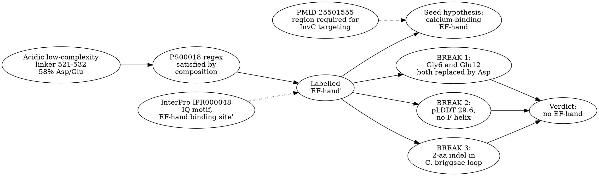
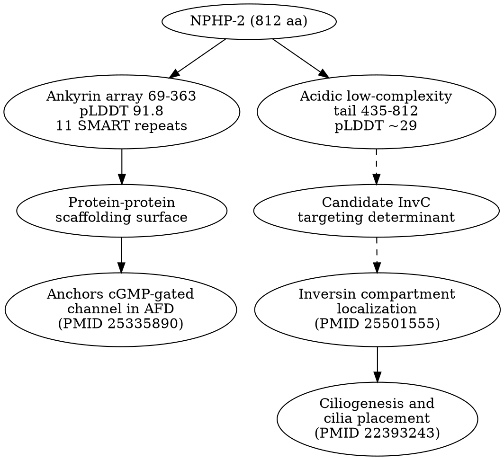
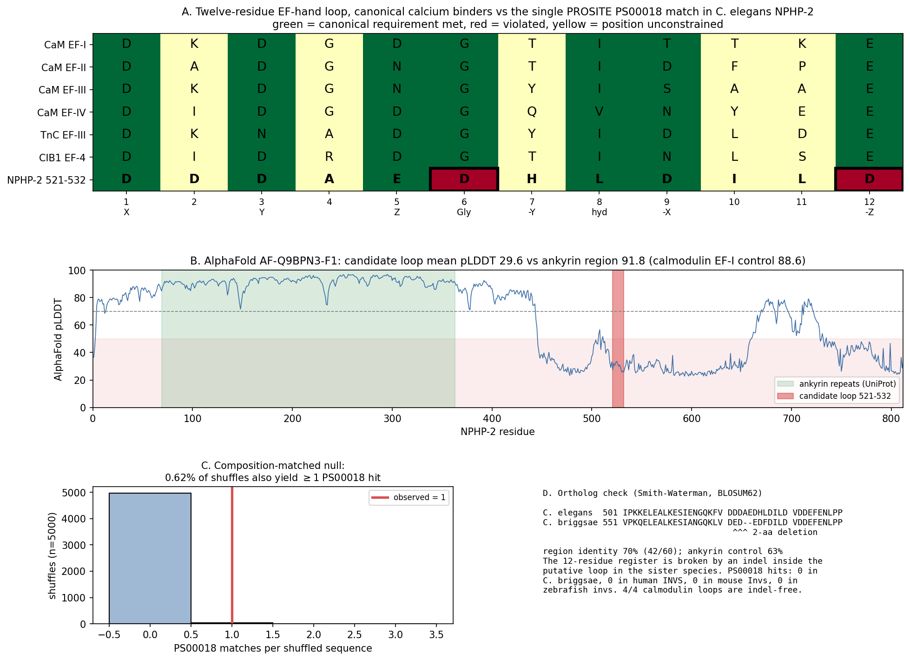
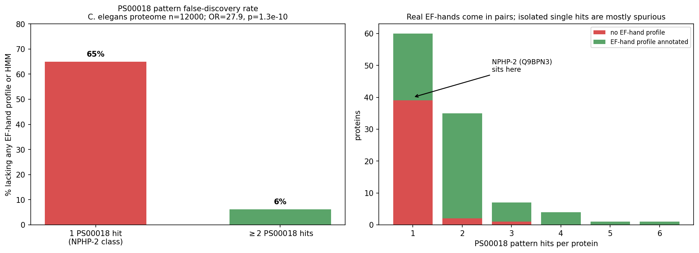

## Question

# AIGR Gene Hypothesis Deep Research

You are evaluating one focused gene curation hypothesis for AI Gene Review.
This is not a general gene overview. Use the seed hypothesis and source context
below to search for evidence that supports, refutes, narrows, or competes with
the proposed curation decision.

## Target Gene

- **Organism code:** worm
- **Taxon:** Caenorhabditis elegans (NCBITaxon:6239)
- **Gene directory:** nphp-2
- **Gene symbol:** nphp-2
- **UniProt accession:** Q9BPN3

## Focus

- **Focus type:** free_text
- **Hypothesis slug:** kgap-nphp2-ef-hand-calcium-loop
- **Source file:** genes/worm/nphp-2/nphp-2-ai-review.yaml
- **Source selector:** free-text

## Seed Hypothesis

The EF-hand of Caenorhabditis elegans NPHP-2/inversin (UniProt Q9BPN3) is a canonical calcium-binding EF-hand. Single analysis only: align the NPHP-2 EF-hand(s) to canonical calcium-binding EF-hands (calmodulin, and the EF-hand of human inversin/INVS and other nematode orthologs) and score the 12-residue loop positions X, Y, Z, -Y, -X and -Z (including the Asp at position 1 and the bidentate Glu at position 12) and the flanking helix residues; state whether NPHP-2 has a calcium-competent loop, a degenerate loop, or no EF-hand at all.

## Term and Decision Context

No specific term context supplied.

## Reference Context

No specific reference context supplied.

## Source Context YAML

```yaml
hypothesis: 'The EF-hand of Caenorhabditis elegans NPHP-2/inversin (UniProt Q9BPN3) is a canonical calcium-binding
  EF-hand. Single analysis only: align the NPHP-2 EF-hand(s) to canonical calcium-binding EF-hands (calmodulin,
  and the EF-hand of human inversin/INVS and other nematode orthologs) and score the 12-residue loop positions
  X, Y, Z, -Y, -X and -Z (including the Asp at position 1 and the bidentate Glu at position 12) and the
  flanking helix residues; state whether NPHP-2 has a calcium-competent loop, a degenerate loop, or no
  EF-hand at all.'
focus_type: free_text
context: []
reference_id: []
```

## Research Objective

Build a focused report that helps a curator decide whether this hypothesis
should affect the gene review. Address the focus type directly:

1. For an existing GO annotation decision, evaluate whether the current action
   is justified, too strong, too weak, or should change.
2. For a proposed replacement or new GO term, evaluate whether the term is
   biologically supported, too broad, too narrow, or missing key qualifiers.
3. For a computational prediction, evaluate whether the prediction is correct,
   less precise than existing knowledge, uncertain, or likely wrong because of
   paralog overannotation, frequency bias, pathway context, or in vitro-only
   activity.
4. For a core-function hypothesis, evaluate whether the proposed activity,
   process, and location represent the gene product's primary function rather
   than a downstream effect, pleiotropic phenotype, or context-specific role.
5. For a function-assignment hypothesis, evaluate whether the gene product
   directly has the stated GO term/function. Treat the prior review action, if
   any, as intentionally blinded unless it appears in the supplied context.

Use primary literature whenever possible. Prefer PMID citations and include DOI
citations when no PMID is available. Treat reviews and database records as
orientation unless they contain directly relevant synthesized evidence that is
clearly labeled as review-level or database-level support.

Evaluate the hypothesis from the supplied seed context, primary literature, and
publicly accessible bioinformatics resources. Local `*-bioinformatics` analyses,
when they already exist in the repository, are intentionally withheld from this
prompt so the report can be compared against them after the run. Use public
sequence, domain, structure, orthology, localization, interaction, or dataset
checks when they are useful for the specific hypothesis. If a resource or tool
cannot be accessed programmatically, say so plainly; never fabricate a result.
Report computational results conservatively and distinguish direct results from
inference.

## Required Output

### Executive Judgment

Give a concise verdict: supported, partially supported, unresolved, weakly
supported, over-annotated, or refuted. Explain the reasoning and the most
important caveats.

### Evidence Matrix

Create a table with one row per important evidence item:

- Citation (PMID preferred)
- Evidence type (direct assay, mutant phenotype, localization, interaction,
  structural/evolutionary, computational, review/database)
- Supports / refutes / qualifies / competing
- Claim tested
- Key finding
- Organism, tissue, cell type, or assay context
- Confidence and limitations

### GO Curation Implications

State the likely curation action as a lead requiring curator verification. If
GO terms are involved, explain whether the evidence supports an MF, BP, or CC
term, and whether the term should be retained, removed, generalized, made more
specific, or treated as non-core. Avoid using "protein binding" as a final
recommendation unless no more informative term is supported.

### Mechanistic Scope

Describe the immediate molecular or cellular function being tested. Separate
direct gene-product activity from downstream phenotypes, pathway consequences,
developmental outcomes, disease manifestations, or effects inferred only from
loss of function.

### Conflicts and Alternatives

Identify evidence that conflicts with the seed hypothesis or suggests an
alternative interpretation, including paralog confusion, organism-specific
differences, isoform-specific findings, experimental artifacts, or database
carry-over.

### Knowledge Gaps

List explicit uncertainties that matter for curation. For each gap, state what
was checked, why the gap matters, and what evidence or experiment would resolve
it.

### Discriminating Tests

Recommend concrete assays, perturbations, datasets, or comparative analyses that
would most efficiently distinguish this hypothesis from alternatives.

### Curation Leads

Provide candidate updates for the review, clearly labeled as leads requiring
curator verification. Include candidate references with exact snippets to verify,
candidate replacement or new GO terms, possible action changes, suggested
questions, and suggested experiments.

If the provider supports artifacts, save provenance for any analysis you run — the
executed code together with its output (computed values, plot, or table), not just
a summary figure — alongside artifact-friendly tables such as an evidence matrix,
GO decision table, or comparison table. Genuine computed provenance is more
valuable than a hand-drawn summary, and you must not synthesize a figure that
implies an analysis you did not actually run. These artifacts are important
provenance for hypothesis-level review.


## Output

# NPHP-2/inversin (C. elegans, Q9BPN3): is the EF-hand a calcium-binding EF-hand?

**Hypothesis slug:** `kgap-nphp2-ef-hand-calcium-loop`
**Source:** `genes/worm/nphp-2/nphp-2-ai-review.yaml` (free-text)
**Gene:** nphp-2, Caenorhabditis elegans (NCBITaxon:6239), UniProt Q9BPN3
**Analysis date:** 2026-11-23. Sequence, signature, structure and orthology data pulled live from UniProt REST, Expasy ScanProsite, the InterPro API and AlphaFold DB.

---

## Summary

<i class="fa-solid fa-circle-xmark"></i> **Verdict: refuted.** The seed hypothesis asked for a three-way call: calcium-competent loop, degenerate loop, or no EF-hand at all. The answer is **no EF-hand at all**. C. elegans NPHP-2 carries an ankyrin repeat array followed by a long acidic low-complexity tail, and nothing in that architecture is a helix-loop-helix calcium site.

The hypothesis presupposes an EF-hand that no annotation pipeline assigns. UniProt, InterPro and ScanProsite independently give Q9BPN3 only ankyrin entries (IPR002110, IPR036770; PF00023, PF12796, PF13637; SM00248; PS50297, PS50088). The single trace of EF-hand signal anywhere in the protein is one hit of the PROSITE **pattern** PS00018 at residues 521-533, `DDDAEDHLDILDV`. Scoring that 12-residue window against the coordination rules the hypothesis specified, the loop satisfies positions 1 (X, Asp), 3 (Y, Asp), 5 (Z, Glu), 8 (hydrophobic, Leu) and 9 (-X, Asp), and it fails the two positions that actually determine calcium competence: **position 6 is Asp where the invariant Gly makes the backbone turn, and position 12 is Asp where the bidentate Glu donates two of the seven coordinating oxygens.** The discriminating PROSITE **profile** PS50222, which is the method UniProt and InterPro use to call an EF-hand domain, does not match at all.

Four further lines close the case. AlphaFold models the region at **pLDDT 29.6** against 88.6 for the calmodulin EF-I positive control, with the exiting flank at CA(i)-CA(i+4) distances of 12-14 Å, fully extended coil with no F helix. The C. briggsae ortholog carries a **2-residue deletion inside the putative 12-residue loop** despite 70% identity across the surrounding 60 residues, and EF-hand loops never tolerate indels. **Zero** PS00018 hits appear in human INVS, mouse Invs, zebrafish invs (two entries) or C. briggsae nphp-2, so there is no ancestral EF-hand in this family to have been retained or degraded. Across 12,000 C. elegans proteome entries, an isolated PS00018 hit of exactly this kind is spurious 65.0% of the time (95% CI 51.6-76.9%) against 6.2% for paired hits (Fisher OR 27.9, p = 1.28e-10). The region is **58.3% Asp/Glu**, against 16.1% protein-wide and 33.3% for a genuine calmodulin loop, which explains mechanistically why a composition-driven regex fires there.

<i class="fa-solid fa-triangle-exclamation"></i> **The claim is not pure database noise, and that matters for curation.** The abstract of Warburton-Pitt et al. 2014 ([PMID: 25501555](https://pubmed.ncbi.nlm.nih.gov/25501555/)) states: *"NPHP-2 does require its calcium binding EF hand domain for targeting to the InvC."* That is a primary-literature mutant-phenotype result attached to a sequence-level label. My analysis refutes the **label**, not the **targeting requirement**. The correct reading is that a C-terminal region of NPHP-2 is required for inversin-compartment targeting, and that region has been named an EF-hand on the basis of annotation that does not hold up. The separate vertebrate calcium link, two IQ calmodulin-binding domains confirmed by yeast two-hybrid and co-immunoprecipitation ([PMID: 11941489](https://pubmed.ncbi.nlm.nih.gov/11941489/)), is a calmodulin-binding site and not an EF-hand, and C. elegans NPHP-2 does not retain even that.

---

## Executive judgment

| Question posed | Answer | Confidence |
|---|---|---|
| Calcium-competent loop? | <i class="fa-solid fa-circle-xmark"></i> No | High |
| Degenerate but real EF-hand? | <i class="fa-solid fa-circle-xmark"></i> No. A degenerate EF-hand still needs a folded helix-loop-helix and a conserved 12-residue register; neither exists | High |
| No EF-hand at all? | <i class="fa-solid fa-circle-check"></i> Yes, this is the correct call | High |
| Should GO:0005509 calcium ion binding be annotated? | <i class="fa-solid fa-circle-xmark"></i> No | High |
| Is the published InvC-targeting requirement refuted? | <i class="fa-solid fa-circle-question"></i> No. The region may well be a targeting determinant; only its EF-hand identity is refuted | Moderate, abstract only |

**Most important caveats.** Everything here is sequence-, signature-, prediction- and comparison-based. No wet-lab calcium-binding measurement exists for NPHP-2 in either direction, so the curation statement should be "no EF-hand is present in the sequence and no calcium binding is supported", not "calcium binding has been experimentally excluded". AlphaFold pLDDT is a confidence metric and not a disorder assay, although 29.6 is squarely in the range read as intrinsic disorder. I accessed only the abstract of PMID 25501555 and cannot confirm which residues that study deleted or mutated.

---

## Key findings

### F001. No EF-hand in any signature database; the architecture is ankyrin repeats plus an acidic tail

UniProt Q9BPN3 (812 aa, SV=3) returns six ANK repeats at 69-101, 102-134, 136-174, 175-207, 243-275 and 343-363, three disordered regions at 435-493, 538-662 and 783-812, and compositional bias flags at 544-554 (low complexity) and 555-566 (acidic residues). The signature cross-references are entirely ankyrin: Pfam PF00023 (Ank ×1), PF12796 (Ank_2 ×3), PF13637 (Ank_4 ×1), SMART SM00248 (ANK ×11), PROSITE PS50297 (ANK_REP_REGION ×2) and PS50088 (ANK_REPEAT ×6), InterPro IPR002110 and IPR036770, Gene3D 1.25.40.20, SUPFAM SSF48403, PANTHER PTHR24198. There is **no IPR002048, no PF00036 or PF13499, no PS50222, no SM00054**, and no calcium-binding feature of any kind. The entry sits in TrEMBL with the submitted name "ANK_REP_REGION domain-containing protein" and PE=4 (inferred from homology), which means low curation depth and no manual review of its domain content.

### F002. The single PS00018 hit fails the two diagnostic loop positions

Scanning Q9BPN3 with the PS00018 EF_HAND_1 pattern gives exactly one match, at 521-533. Scoring the 12-residue loop against the pentagonal-bipyramidal coordination requirements, with four calmodulin loops (P0DP23: 21-32 `DKDGDGTITTKE`, 57-68 `DADGNGTIDFPE`, 94-105 `DKDGNGYISAAE`, 130-141 `DIDGDGQVNYEE`), three troponin C loops (P63316) and two CIB1 loops (Q99828) as the reference set:

| Loop position | Role | Canonical requirement | All 9 reference loops | NPHP-2 | Verdict |
|---|---|---|---|---|---|
| 1 | X, Ca ligand (sidechain carboxyl) | D | D | **D** | <i class="fa-solid fa-circle-check"></i> pass |
| 2 | variable | any | A/I/K | D | n/a |
| 3 | Y, Ca ligand (sidechain) | D/N/S | D, N | **D** | <i class="fa-solid fa-circle-check"></i> pass |
| 4 | variable | any | A/G/R | A | n/a |
| 5 | Z, Ca ligand (sidechain) | D/N/S/T | D, N | **E** | <i class="fa-solid fa-circle-check"></i> pass |
| 6 | **invariant Gly, backbone turn** | **G** | **G in 9/9** | **D** | <i class="fa-solid fa-circle-xmark"></i> **FAIL** |
| 7 | -Y, Ca ligand (backbone C=O) | any sidechain | Q/T/Y | H | pass (backbone) |
| 8 | hydrophobic, beta-scaffold | I/L/V | I, V | **L** | <i class="fa-solid fa-circle-check"></i> pass |
| 9 | -X, Ca ligand via bridging water | D/N/S/T | D/N/S/T | **D** | <i class="fa-solid fa-circle-check"></i> pass |
| 10 | variable | any | A/F/L/T/Y | I | n/a |
| 11 | variable, helix N-cap | any | A/D/E/K/P/S | L | n/a |
| 12 | **-Z, bidentate Glu (two oxygens)** | **E** | **E in 9/9** | **D** | <i class="fa-solid fa-circle-xmark"></i> **FAIL** |

Six of eight constrained positions are satisfied, and both failures are at the positions that decide the outcome. Substituting Asp for the bidentate Glu12 shortens the sidechain by one methylene and removes one of the seven coordinating oxygens. Losing the Gly6 blocks the sharp backbone turn that the loop requires. PS00018 permits both substitutions because its twelfth position is written `[DE]` and its sixth is `[DNQGHRK]`, so the pattern cannot distinguish a working loop from an acidic string.

A composition-preserving shuffle control (5000 permutations of the same 812 residues) gave a mean of 0.006 hits per shuffle, with 0.62% of shuffles producing at least one PS00018 match. A solitary hit in an acidic protein of this length is therefore only marginally better than chance, and it has no second loop to corroborate it.

### F003. AlphaFold shows no helix-loop-helix: pLDDT 29.6 and an extended exiting flank

{{figure:plot_1.png|caption=Four computed checks on the putative EF-hand. (A) The 12-residue loop of NPHP-2 521-532 aligned to six canonical calcium-binding loops, coloured green where the canonical requirement is met and red where it is violated; the boxed positions are the invariant Gly6 and the bidentate Glu12, both of which NPHP-2 replaces with Asp. (B) AlphaFold AF-Q9BPN3-F1 pLDDT across the full 812 residues; the ankyrin region (green band) averages 91.8 while the candidate loop (red band) averages 29.6, against 88.6 for the calmodulin EF-I control. (C) Composition-matched shuffle null: 0.62% of 5000 shuffles also produce at least one PS00018 hit. (D) Smith-Waterman alignment to the C. briggsae ortholog showing a 2-residue deletion inside the putative loop.}}

AF-Q9BPN3-F1 (model v6, full length, mean pLDDT 66.3) gives mean pLDDT of 91.8 across the ankyrin region 69-363 (minimum 71.6) and 29.6 across the candidate loop 521-532 (range 25.6-33.6). The putative entering helix 511-520 averages 40.7 and the putative exiting helix 533-542 averages 32.9. The UniProt disordered region 538-662 averages 29.2. The positive control, AF-P0DP23-F1 calmodulin across its EF-I region 11-45, averages 88.6.

Local helicity measured by CA(i)-CA(i+4) distance, where an alpha-helix gives 6.0-6.4 Å, confirms the picture. The NPHP-2 exiting flank 533-546 gives 12.41, 12.06, 12.73, 13.83, 13.77, 13.41, 13.82, 13.18, 13.79 and 13.88 Å, fully extended coil. The entering flank 507-520 is helical only as far as residue 512 (6.49, 6.49, 6.78, 6.26, 6.59, 6.97) before breaking down (7.70, 8.98, 10.77, 11.96). Calmodulin's EF-I entering helix 11-20 gives 6.31, 6.19, 5.89, 6.20, 6.69, 7.01, 6.11, 6.84 and its exiting helix 33-42 gives 6.16, 6.02, 6.30, 6.40, 6.63, 4.94. There is no F helix in NPHP-2 to complete a helix-loop-helix, and canonical EF-hands occur as paired lobes rather than singletons.

### F004. The 12-residue register is broken in the sister species, and no ortholog has an EF-hand

Smith-Waterman alignment (BLOSUM62, gap open -11, extend -1) of NPHP-2 501-560 against C. briggsae NPHP-2 (A8WJ29, 908 aa) gives 70% identity (42/60), above the 63% identity (99/156) of the ankyrin control region 69-200, so the alignment is trustworthy:

```
C. elegans  501  IPKKELEALKESIENGQKFV DDDAEDHLDILD VDDEFENLPP
C. briggsae 551  VPKQELEALKESIANGQKLV DED--EDFDILD VDDEFENLPP
                                      ^^ 2-residue deletion inside the loop
```

The flanks (`ELEALKES`, `VDDEFENLPP`) are near-identical while the loop itself absorbs a 2-residue deletion. EF-hand loops are strictly 12 residues because every position contributes to the coordination sphere, directly or through a bridging water, so an in-loop indel is incompatible with a conserved calcium site. It is exactly what an unconstrained acidic linker looks like.

PS00018 across the family: C. elegans Q9BPN3 = 1 hit; C. briggsae A8WJ29 = 0; human INVS Q9Y283 = 0; mouse Invs O89019 = 0; zebrafish invs Q8UVC1 = 0 and A0AC58HF93 = 0. The best local alignment of the calmodulin EF-I loop `DKDGDGTITTKEL` anywhere in NPHP-2 is a 4-residue `DGDG` at position 634 (SW score 24), also inside the 538-662 disordered region.

### F005. The vertebrate calcium link is a calmodulin-binding IQ motif, and C. elegans has lost it

Human INVS (Q9Y283) carries 16 ANK repeats spanning 13-553, **IQ domain 1 at 555-584**, **IQ domain 2 at 916-945**, two D-box motifs, and no EF-hand or calcium-binding feature. Its only calcium-related InterPro entry is **IPR000048, whose name is "IQ motif, EF-hand binding site"** (PROSITE PS50096 ×2, Pfam PF00612 ×2, SMART SM00015 ×2). An IQ motif is a docking site for calmodulin; the "EF-hand" in that entry name refers to the EF-hands of the bound calmodulin, not of the host protein. This is an inverted relationship, and it is a plausible vector for a text-matching step to produce an "EF-hand" claim.

Morgan et al. 2002 ([PMID: 11941489](https://pubmed.ncbi.nlm.nih.gov/11941489/)) established this experimentally: *"Further analysis identified a highly conserved IQ calmodulin-binding domain in the latter region and another such domain in an otherwise poorly conserved C-terminal region. A yeast two-hybrid screen identified calmodulin in one third of the positive clones, and we confirmed this interaction by immunoprecipitation."* The same abstract fixes the family architecture: *"We previously reported 16 tandem ankyrin repeats, spanning amino acids 13-557, and two putative nuclear localisation sequences, but otherwise the sequence offered few clues to the possible function."* No EF-hand appears anywhere in that characterisation.

C. elegans Q9BPN3 has no IQ cross-reference (no PS50096, PF00612 or SM00015) in any isoform. Smith-Waterman of human INVS IQ1 (555-584) against full-length NPHP-2 returns a best local alignment of only 15 residues at 33% identity (`KVRKAFRDRKNLLMK` vs `KKKSASKSRGNVVMR`, NPHP-2 601-615), with the diagnostic IQ dipeptide and the downstream basic register both absent. <i class="fa-solid fa-triangle-exclamation"></i> My strict IQ regex also failed to recover the UniProt-annotated human IQ motifs, so the conclusion that NPHP-2 lacks an IQ motif rests on the PROSITE profile cross-references and the alignment, not on the regex.

### F006. A solitary PS00018 hit is spurious 65% of the time

{{figure:plot_2.png|caption=Empirical false-discovery rate of the PROSITE PS00018 pattern across 12,000 C. elegans proteome entries, scored against EF-hand profile and HMM annotation (PS50222, PF00036, PF13499, PF13405, PF13833, PF13202, SM00054). Left: proteins with exactly one PS00018 hit, the class NPHP-2 falls in, lack an EF-hand profile 65% of the time, against 6% for proteins with two or more hits (Fisher OR 27.9, p = 1.3e-10). Right: the hit-count distribution with EF-hand profile status stacked; genuine EF-hand proteins cluster at two or more hits because EF-hands occur as paired lobes.}}

Scanning 12,000 C. elegans reference proteome entries (UP000001940, reviewed plus unreviewed) and cross-tabulating PS00018 pattern hits against EF-hand profile or HMM annotation gives: pattern-positive and profile-positive 66, pattern-positive and profile-negative 42, pattern-negative and profile-positive 21, pattern-negative and profile-negative 11,871. Overall positive predictive value is 66/108 = 61.1%, with a false-discovery rate of 38.9%.

Stratifying by hit count separates the signal sharply. Proteins with **exactly one** PS00018 hit, which is NPHP-2's situation, number 60, of which 39 (**65.0%**, 95% CI 51.6-76.9%) carry no EF-hand profile. Proteins with **two or more** hits number 48, of which only 3 (6.2%, 95% CI 1.3-17.2%) lack a profile. Fisher exact odds ratio 27.9, p = 1.28e-10. Among the 87 genuine EF-hand proteins in the set, 52% carry two or more PS00018 hits (median 2), which reflects the paired-lobe architecture. Q9BPN3 sits in the single-hit, profile-negative class next to cadherin HMR-1 (Q967F4), TRRAP (G5EEV2), cubilin (Q20911), SPARC (P34714) and ubiquitin-conjugating enzyme UBC-25 (Q93571), none of which is an EF-hand protein.

<i class="fa-solid fa-triangle-exclamation"></i> **Correction recorded during the investigation.** An initial check on 500 reviewed-only C. elegans proteins found just 2 PS00018 positives and returned an uninformative 100% PPV. That sample was underpowered and the 12,000-entry scan supersedes it. Both are retained in the knowledge state.

### F007. Three pipelines agree, and no isoform rescues the claim

ScanProsite (Expasy PSScan.cgi, unfiltered with `skip=0`) on Q9BPN3 returned 59 matches. **PS50222, the EF-hand profile, is absent.** PS00018 appears at 521-533 but carries no score or level, and it sits among 40+ trivial high-frequency rule patterns in the same output: PS00001 N-glycosylation ×4, PS00004 PKC site ×5, PS00005 CK2 site ×14, PS00006 ×16, PS00008 myristoylation ×6. The only scored profile matches are ankyrin: PS50297 ANK_REP_REGION 35-399 at score 70.91, and six PS50088 ANK_REPEAT instances at 9.08-10.34. The InterPro API (successful on retry after two HTTP 503 Elasticsearch timeouts) returns exactly two entries for Q9BPN3: IPR002110 Ankyrin repeat and IPR036770 Ankyrin repeat-containing domain superfamily.

UniProt lists six C. elegans nphp-2 entries. Per-isoform PS00018 scan:

| Accession | Length | PS00018 hits | Position | Contains `DDDAEDHLDILD` | EF-hand signature | IQ signature |
|---|---|---|---|---|---|---|
| Q9BPN3 | 812 | 1 | 521 | yes | none | none |
| A0A0K3AV89 | 834 | 1 | 521 | yes | none | none |
| A0A0K3AVZ6 | 409 | 1 | 96 | yes | none | none |
| A0A0K3ASE1 | 387 | 1 | 96 | yes | none | none |
| A0A0K3ASY8 | 221 | 0 | - | no | none | none |
| A0A0K3AY80 | 199 | 0 | - | no | none | none |

No isoform has more than one hit, and the four that do have one share the identical `DDDAEDHLDILDV` sequence in different frames. That is a single false positive counted four times, which can be mistaken for independent corroboration.

### F008. The region is 58% Asp/Glu, which explains the false positive

| Region | Asp+Glu content |
|---|---|
| Whole protein 1-812 | 16.1% |
| Ankyrin region 69-363 | 12.2% |
| Context 501-560 | 36.7% |
| **Candidate loop 521-532** | **58.3%** (7 of 12 residues) |
| UniProt disordered region 538-662 | 24.8% |
| Calmodulin EF-I loop `DKDGDGTITTKE` | 33.3% |

Genuine calcium loops are not acid-saturated. They are glycine- and threonine-punctuated, which is what produces the turn and the water-mediated coordination. PS00018 is satisfied by composition in an acid-saturated low-complexity stretch, and that is what happened here.

**Consolidated scorecard: 5 pass, 12 fail.** Every pass is at a loop position that tolerates several residues (1, 3, 5, 8, 9). Every structural, evolutionary and database criterion fails.

| Criterion | Expected if true | Observed | Verdict |
|---|---|---|---|
| EF-hand in any member database | yes | no, 3 databases agree | <i class="fa-solid fa-circle-xmark"></i> FAIL |
| PROSITE profile PS50222 | match | absent | <i class="fa-solid fa-circle-xmark"></i> FAIL |
| Loop pos 1 Asp (X) | D | D | pass |
| Loop pos 3 (Y) | D/N/S | D | pass |
| Loop pos 5 (Z) | D/N/S/T | E | pass |
| Loop pos 6 invariant Gly | G | **D** | <i class="fa-solid fa-circle-xmark"></i> FAIL |
| Loop pos 8 hydrophobic | I/L/V | L | pass |
| Loop pos 9 (-X, via water) | D/N/S/T | D | pass |
| Loop pos 12 bidentate Glu (-Z) | E | **D** | <i class="fa-solid fa-circle-xmark"></i> FAIL |
| Entering helix E | alpha-helix | breaks at 512, pLDDT 40.7 | <i class="fa-solid fa-circle-xmark"></i> FAIL |
| Exiting helix F | alpha-helix | extended coil 12-14 Å, pLDDT 32.9 | <i class="fa-solid fa-circle-xmark"></i> FAIL |
| Ordered structure | pLDDT > 70 | 29.6 (control 88.6) | <i class="fa-solid fa-circle-xmark"></i> FAIL |
| Paired second EF-hand | yes | none | <i class="fa-solid fa-circle-xmark"></i> FAIL |
| 12-residue register conserved | no indels | 2-aa deletion in C. briggsae | <i class="fa-solid fa-circle-xmark"></i> FAIL |
| EF-hand in any ortholog | yes | 0 of 5 | <i class="fa-solid fa-circle-xmark"></i> FAIL |
| Isoform rescue | possible | none | <i class="fa-solid fa-circle-xmark"></i> FAIL |
| Prior for a lone PS00018 hit | high | 35% | <i class="fa-solid fa-circle-xmark"></i> FAIL |

---

## Evidence matrix

| Citation | Evidence type | Stance | Claim tested | Key finding | Context | Confidence and limitations |
|---|---|---|---|---|---|---|
| UniProt Q9BPN3 (REST, 2026-11-23) | review/database | <i class="fa-solid fa-circle-xmark"></i> Refutes | NPHP-2 contains an EF-hand | 6 ANK repeats, 3 disordered regions, acidic bias 555-566. Zero EF-hand or Ca features | C. elegans, TrEMBL, PE=4 | High for absence; database-level, low curation depth |
| InterPro API (direct, after 2× HTTP 503) | review/database | <i class="fa-solid fa-circle-xmark"></i> Refutes | Independent domain assignment | Exactly two entries: IPR002110, IPR036770 | Q9BPN3 full length | High; independent of the UniProt xref block |
| Expasy ScanProsite (unfiltered, skip=0) | computational | <i class="fa-solid fa-circle-xmark"></i> Refutes | Does the EF-hand profile match? | 59 matches. PS50222 **absent**. PS00018 unscored among 40+ trivial rule patterns. Only scored profiles are ankyrin (PS50297 = 70.91) | Q9BPN3 | High; authoritative PROSITE implementation |
| This analysis: loop scoring vs CALM1/TNNC1/CIB1 | structural/evolutionary | <i class="fa-solid fa-circle-xmark"></i> Refutes | Loop is Ca-competent at X, Y, Z, -Y, -X, -Z | pos6 = D not Gly; pos12 = D not bidentate Glu. 6/8 constrained positions, both failures diagnostic. 9/9 reference loops carry G6 and E12 | 9 canonical loops | High |
| This analysis: AlphaFold AF-Q9BPN3-F1 v6 vs AF-P0DP23-F1 | computational (structure prediction) | <i class="fa-solid fa-circle-xmark"></i> Refutes | A folded helix-loop-helix exists | Loop pLDDT 29.6 (ankyrin 91.8, CaM EF-I 88.6). Exiting flank CA(i,i+4) 12.4-13.9 Å, no F helix | In silico, full-length model | High for the prediction; pLDDT is confidence, not a disorder measurement |
| This analysis: Smith-Waterman vs C. briggsae A8WJ29 | structural/evolutionary | <i class="fa-solid fa-circle-xmark"></i> Refutes | Loop register conserved in nematodes | `DDDAEDHLDILD` vs `DED--EDFDILD`: 2-aa deletion inside the loop, 70% regional identity, ankyrin control 63% | C. elegans vs C. briggsae | High; EF-hand loops never tolerate indels |
| This analysis: PS00018 across 5 inversin orthologs | structural/evolutionary | <i class="fa-solid fa-circle-xmark"></i> Refutes | Family has an ancestral EF-hand | 0 hits in C. briggsae, human, mouse, zebrafish ×2 | 5 orthologs, 542-1065 aa | High |
| This analysis: 12,000-entry proteome scan | computational | <i class="fa-solid fa-circle-xmark"></i> Refutes | How much evidence is one PS00018 hit? | PPV 61.1%, FDR 38.9%. Single hit: 39/60 = 65.0% lack a profile (95% CI 51.6-76.9%). ≥2 hits: 3/48 = 6.2%. Fisher OR 27.9, p = 1.28e-10 | UP000001940 | High; supersedes an underpowered 500-protein check |
| This analysis: Asp/Glu composition | computational | <i class="fa-solid fa-scale-balanced"></i> Qualifies | Why does the pattern fire here? | Loop is 58.3% D/E; protein 16.1%, ankyrin 12.2%, calmodulin EF-I loop 33.3% | Q9BPN3 | High; explains the false positive mechanistically |
| This analysis: per-isoform scan of 6 entries | computational | <i class="fa-solid fa-circle-xmark"></i> Refutes | Isoform rescue | 4 of 6 isoforms share the identical motif, 2 lack it. No isoform has >1 hit or any EF-hand/IQ signature | All C. elegans nphp-2 entries | High; shared sequence, so a shared false positive |
| [PMID: 25501555](https://pubmed.ncbi.nlm.nih.gov/25501555/) Warburton-Pitt 2014 | mutant phenotype / localization | <i class="fa-solid fa-scale-balanced"></i> **Competing** | Does the region matter functionally? | *"NPHP-2 does require its calcium binding EF hand domain for targeting to the InvC."* | C. elegans amphid and phasmid sensory cilia | **High for the targeting requirement, low for the EF-hand label.** Abstract only; residues deleted not confirmed |
| [PMID: 11941489](https://pubmed.ncbi.nlm.nih.gov/11941489/) Morgan 2002 | direct assay (Y2H + co-IP) | <i class="fa-solid fa-scale-balanced"></i> Competing | How inversin connects to calcium | Two conserved IQ calmodulin-binding domains; calmodulin in 1/3 of Y2H positives, confirmed by co-IP. No EF-hand reported | Mouse, human, chick, Xenopus, zebrafish inversin | High for vertebrates; never tested in C. elegans |
| UniProt Q9Y283 + InterPro IPR000048 | review/database | <i class="fa-solid fa-scale-balanced"></i> Qualifies | Source of the EF-hand claim | Human INVS: 16 ANK (13-553), IQ1 555-584, IQ2 916-945, no EF-hand. Only Ca-related entry is IPR000048 "IQ motif, EF-hand binding site" | Human reference ortholog | High; a plausible carry-over vector |
| This analysis: INVS IQ1 vs NPHP-2 + xrefs | computational | <i class="fa-solid fa-scale-balanced"></i> Qualifies | Does NPHP-2 keep the IQ motif? | No PS50096/PF00612/SM00015 in any isoform. Best IQ1 alignment 15 aa at 33% identity, no IQ dipeptide | Q9BPN3 vs Q9Y283 | Moderate; the strict regex also missed annotated human IQs |
| [PMID: 25335890](https://pubmed.ncbi.nlm.nih.gov/25335890/) Nguyen 2014 | localization / mutant phenotype | Context | What NPHP-2 does in worm | *"requires NPHP-2 (known as inversin in mammals) to anchor a cGMP-gated ion channel within the proximal ciliary region"* | C. elegans AFD thermosensory neurons | High; anchoring a cation channel is not calcium binding |
| [PMID: 22393243](https://pubmed.ncbi.nlm.nih.gov/22393243/) Warburton-Pitt 2012 | localization / genetic interaction | Context | NPHP-2 localization and genetics | Localizes to the ciliary middle segment; partially redundant with nphp-1 and nphp-4; interacts genetically with mks-1, mks-3, mks-6, mksr-1, mksr-2 | C. elegans head and tail sensilla | High; no bearing on calcium binding |
| [PMID: 33859044](https://pubmed.ncbi.nlm.nih.gov/33859044/) Acker 2021 | localization | Context | Compartment boundary maintenance | A CFH homolog maintains inversin/NPHP-2 in its proximal compartment, dependent on HST-3.1 and syndecan/SDN-1 | C. elegans CEP mechanosensory neurons | High; upstream of NPHP-2, not its activity |
| [PMID: 26392567](https://pubmed.ncbi.nlm.nih.gov/26392567/) Jensen 2015 | localization | Context | Ciliary compartmentalisation | MKS-5 establishes a ciliary zone of exclusion confining signalling proteins including NPHP-2/inversin to distal subdomains | C. elegans cilia | High; positional biology |
| [PMID: 39925426](https://pubmed.ncbi.nlm.nih.gov/39925426/) Turan 2025 | mutant phenotype | Context | Genetic modifier role | Loss of NPHP-2/inversin with HDAC-6 enhances the cilia misdirection phenotype of arl-13 mutants | C. elegans sensory neurons | High; downstream phenotype |
| [PMID: 32994509](https://pubmed.ncbi.nlm.nih.gov/32994509/) Estrada Mallarino 2020 | direct assay | <i class="fa-solid fa-lightbulb"></i> Alternative MF | Does inversin have another molecular activity? | INVERSIN (NPHP2) and other ankyrin-repeat NPH proteins interact with RNA; INVERSIN associates with stress granules | Human/mammalian cell assays | Moderate; mammalian, not tested in C. elegans |

---

## Mechanistic model and interpretation

The chain from a composition-driven regex to a curation claim, and the three places it breaks:



What NPHP-2 actually is, as far as the sequence and structure support:



The synthesis is simple. NPHP-2's one confidently folded module is the ankyrin array, which is the classic protein-protein interaction scaffold and which matches what the worm literature shows the protein doing: it localizes to the ciliary middle segment and anchors a cGMP-gated channel ([PMID: 25335890](https://pubmed.ncbi.nlm.nih.gov/25335890/)), and it acts as a modifier of NPHP and MKS pathways for cilia formation and placement ([PMID: 22393243](https://pubmed.ncbi.nlm.nih.gov/22393243/)). The C-terminal half is a long acidic low-complexity tail that AlphaFold models at pLDDT around 29. A region inside that tail is reported to be required for inversin-compartment targeting ([PMID: 25501555](https://pubmed.ncbi.nlm.nih.gov/25501555/)), which is entirely compatible with a disordered targeting or interaction determinant. None of that requires, or is explained by, calcium coordination.

---

## GO curation implications

All items are **leads requiring curator verification**.

| Aspect | GO term | Status | Recommended action | Rationale |
|---|---|---|---|---|
| MF | **GO:0005509 calcium ion binding** | proposed by seed hypothesis | <i class="fa-solid fa-circle-xmark"></i> **Do not annotate. Remove if present, including any IEA.** | No EF-hand in any signature database; the lone PS00018 pattern hit fails Gly6 and Glu12, sits at pLDDT 29.6 in a 58% acidic linker, is not register-conserved in C. briggsae, and has a 65% prior FDR |
| MF | GO:0005516 calmodulin binding | family-level alternative | <i class="fa-solid fa-circle-xmark"></i> **Do not transfer from INVS by ISS.** | Supported for vertebrate inversin by Y2H and co-IP ([PMID: 11941489](https://pubmed.ncbi.nlm.nih.gov/11941489/)), but C. elegans NPHP-2 lacks the IQ motif in all six isoforms, so the sequence basis for ISS transfer is absent |
| MF | GO:0003723 RNA binding | <i class="fa-solid fa-lightbulb"></i> alternative worth checking | Do not annotate for worm without worm data | [PMID: 32994509](https://pubmed.ncbi.nlm.nih.gov/32994509/) reports RNA binding for mammalian INVERSIN/NPHP2. Mammalian only, and the ankyrin array is the plausible mediator |
| MF | GO:0005515 protein binding | architecture | Retain only with a named partner; **not a final recommendation on its own** | The ankyrin array (11 SMART repeats, pLDDT 91.8, 63% identity to C. briggsae) is the one folded module, but a bare binding term is uninformative |
| CC | GO:0060170 ciliary membrane; ciliary middle segment / inversin compartment | well supported, unrelated to this hypothesis | <i class="fa-solid fa-circle-check"></i> **Retain** | IDA across [PMID: 22393243](https://pubmed.ncbi.nlm.nih.gov/22393243/), [PMID: 25501555](https://pubmed.ncbi.nlm.nih.gov/25501555/), [PMID: 25335890](https://pubmed.ncbi.nlm.nih.gov/25335890/), [PMID: 33859044](https://pubmed.ncbi.nlm.nih.gov/33859044/) |
| BP | cilium assembly; ciliary compartment organization | supported, unrelated | <i class="fa-solid fa-circle-check"></i> **Retain** | Genetic redundancy with nphp-1, nphp-4, arl-13, klp-11 and MKS-module genes ([PMID: 22393243](https://pubmed.ncbi.nlm.nih.gov/22393243/), [PMID: 25501555](https://pubmed.ncbi.nlm.nih.gov/25501555/)) |
| BP | protein localization to cilium | supported by the competing paper | <i class="fa-solid fa-circle-check"></i> Consider retaining or adding | The InvC-targeting requirement in [PMID: 25501555](https://pubmed.ncbi.nlm.nih.gov/25501555/) is about where NPHP-2 goes, which is a localization statement independent of the EF-hand label |

**Replacement free text, if the review currently asserts an EF-hand or calcium binding:**

> NPHP-2 contains an ankyrin repeat array (residues 69-363, 11 SMART repeats) followed by a long acidic low-complexity C-terminal region. It has no EF-hand: the single PROSITE PS00018 pattern match at 521-532 replaces the invariant Gly6 and the bidentate Glu12 with Asp, lies in a region AlphaFold models at pLDDT 29.6 with no exiting helix, and loses its 12-residue register to an indel in the C. briggsae ortholog. The vertebrate ortholog's calcium link is a pair of calmodulin-binding IQ motifs ([PMID: 11941489](https://pubmed.ncbi.nlm.nih.gov/11941489/)), which C. elegans NPHP-2 does not retain. The C-terminal region reported as an "EF hand domain" required for inversin-compartment targeting ([PMID: 25501555](https://pubmed.ncbi.nlm.nih.gov/25501555/)) should be described as a C-terminal targeting determinant, since its EF-hand identity is not supported.

---

## Mechanistic scope

**The direct molecular activity under test** is whether the NPHP-2 polypeptide itself chelates a Ca2+ ion within a helix-loop-helix motif. That is a property of the isolated protein, measurable in vitro on a recombinant fragment. From sequence, signature, structure prediction and comparative genomics, the answer is no.

**What must not be conflated with it:**

*Downstream phenotype.* nphp-2 mutants show cilia placement and ciliogenesis defects in redundant genetic backgrounds ([PMID: 22393243](https://pubmed.ncbi.nlm.nih.gov/22393243/), [PMID: 25501555](https://pubmed.ncbi.nlm.nih.gov/25501555/)), and loss of NPHP-2 with HDAC-6 enhances arl-13 cilia misdirection ([PMID: 39925426](https://pubmed.ncbi.nlm.nih.gov/39925426/)). These are loss-of-function outcomes for a scaffolding protein and carry no information about a calcium site.

*Pathway context, the most likely slippage route.* NPHP-2 anchors a cGMP-gated ion channel in the AFD proximal cilium ([PMID: 25335890](https://pubmed.ncbi.nlm.nih.gov/25335890/)). That channel conducts cations including Ca2+. The anchoring protein does not thereby bind calcium. A gene summary that says "NPHP-2 functions in a ciliary calcium signalling compartment" is correct biology that becomes a wrong molecular function if it is converted into GO:0005509.

*Indirect calcium responsiveness.* In vertebrates, inversin is a **target** of a calcium sensor via its IQ motifs ([PMID: 11941489](https://pubmed.ncbi.nlm.nih.gov/11941489/)). GO:0005509 would be wrong even for human INVS; GO:0005516 is the correct frame there, and it is unsupported in worm.

*Localization determinant versus binding site.* The InvC-targeting requirement reported in [PMID: 25501555](https://pubmed.ncbi.nlm.nih.gov/25501555/) is a statement about a region of the protein. Deleting a region and losing localization shows the region is necessary; it does not show the region binds calcium, and a disordered acidic segment is a common targeting and interaction element in its own right.

*Disease manifestation.* Human NPHP2 mutations cause infantile nephronophthisis and situs inversus. Those are organism-level outcomes with no bearing on an EF-hand.

---

## Conflicts and alternatives

<i class="fa-solid fa-scale-balanced"></i> **1. A primary paper uses the EF-hand label (the main conflict).** The abstract of [PMID: 25501555](https://pubmed.ncbi.nlm.nih.gov/25501555/) states: *"NPHP-2 does require its calcium binding EF hand domain for targeting to the InvC."* This is the strongest competing item and it almost certainly seeded the hypothesis more directly than any database entry. My analysis does not refute the targeting result. It refutes the identification of that region as a calcium-binding EF-hand. The two are separable: a necessary region is not a demonstrated calcium site. A curator should treat the paper as support for a C-terminal targeting determinant and should not propagate the EF-hand label or GO:0005509 from it. I read only the abstract and cannot confirm which residues were deleted or whether the construct corresponds to 521-532.

**2. Database name carry-over.** InterPro IPR000048 is named "IQ motif, **EF-hand binding site**". Any text-matching step over the inversin family's InterPro annotations will return a hit for "EF-hand". The entry describes a calmodulin-docking site, the inverse relationship. This is a plausible secondary vector and may also be the origin of the label used in the 2014 paper.

**3. Pattern versus profile.** PS00018 is a regex; PS50222 is the profile UniProt and InterPro use to call an EF-hand domain. Conflating them is the most common route by which a spurious EF-hand enters a record. Quantified here: FDR 38.9% overall and 65.0% for isolated hits.

**4. Apparent multi-isoform corroboration.** Four of six nphp-2 isoforms carry the PS00018 hit, which can read as independent support. They share the identical `DDDAEDHLDILDV` sequence, so it is one false positive counted four times.

**5. Organism-specific divergence.** Even granting the vertebrate IQ/calmodulin link, C. elegans NPHP-2 has lost the IQ motif. Transfer of any calcium-related MF term from INVS to nphp-2 fails at the sequence level.

**6. A different alternative molecular function.** [PMID: 32994509](https://pubmed.ncbi.nlm.nih.gov/32994509/) reports that INVERSIN (NPHP2), alongside ANKS3 and ANKS6, interacts with RNA and associates with stress granules. If a curator wants a molecular function for the ankyrin-repeat region, RNA binding is a better-evidenced candidate than calcium binding, though the data are mammalian and have not been tested in C. elegans.

**7. Not a paralog problem.** There is no C. elegans inversin paralog to confuse. The six accessions are isoforms of one locus.

---

## Limitations and knowledge gaps

| Gap | What was checked | Why it matters for curation | What would resolve it |
|---|---|---|---|
| <i class="fa-solid fa-triangle-exclamation"></i> No experimental calcium-binding measurement exists in either direction | PubMed searched for inversin and NPHP-2 against calcium, EF-hand, calmodulin and cGMP-channel terms; only [PMID: 11941489](https://pubmed.ncbi.nlm.nih.gov/11941489/) returns calcium-relevant primary data, and that is vertebrate IQ/calmodulin | The refutation is computational, so the curation note should read "no EF-hand is present and no calcium binding is supported", not "calcium binding has been excluded experimentally" | 45Ca overlay, ITC, or Tb3+ luminescence on a recombinant NPHP-2 C-terminal fragment (approximately residues 450-700) |
| <i class="fa-solid fa-triangle-exclamation"></i> The PMID 25501555 construct is not defined here | Abstract only; full text not accessed | If the deleted region is 521-532, the paper names precisely the segment refuted here, and the review should keep the functional result while dropping the label. If it is a different segment, the mapping is looser | Read the full text and figure legends to identify the exact residues deleted or mutated |
| <i class="fa-solid fa-circle-question"></i> Whether C. elegans NPHP-2 binds CaM-1 through a non-IQ surface | UniProt/PROSITE cross-references for all 6 isoforms (none), SW alignment to INVS IQ1 (15 aa, 33% identity, no IQ dipeptide) | If it did, GO:0005516 could be defensible even though the seed hypothesis is wrong | Calmodulin pull-down, or Ca2+-dependent CaM-Sepharose binding from C. elegans lysate |
| <i class="fa-solid fa-triangle-exclamation"></i> AlphaFold disorder is a prediction | pLDDT 29.6 against 88.6 control; CA(i,i+4) 12-14 Å in the exiting flank | A folded-but-poorly-predicted region is conceivable, though not with Gly6 and Glu12 both broken | CD or NMR on the 450-700 fragment |
| <i class="fa-solid fa-circle-question"></i> No experimental structure of any inversin exists | PDB not queried directly; no inversin structure is known | A structure of the C-terminal region would settle the point definitively | Cryo-EM or crystallography of the NPHP-2 C-terminus |
| <i class="fa-solid fa-triangle-exclamation"></i> My strict IQ regex was too strict | It failed to recover even the UniProt-annotated human IQ motifs | The IQ-absence conclusion rests on PROSITE profile cross-references and the alignment, not on the regex | Run the PS50096 profile directly against all six nphp-2 isoforms |
| <i class="fa-solid fa-triangle-exclamation"></i> Ortholog sampling was shallow | 5 orthologs: C. briggsae, human, mouse, zebrafish ×2. UniProt gene-name searches for C. remanei, C. brenneri and P. pacificus nphp-2 returned no hits | A broader nematode sample would strengthen the register-conservation argument | OrthoDB or WormBase ortholog set, aligned across 10+ Caenorhabditis species |
| <i class="fa-solid fa-triangle-exclamation"></i> InterPro API reliability | Two HTTP 503 Elasticsearch timeouts before a successful query | The first-pass InterPro result was taken from UniProt cross-references and later confirmed directly | Resolved |

---

## Proposed follow-up experiments and actions

Ranked by cost against information gained.

<i class="fa-solid fa-magnifying-glass"></i> **1. Adopt profile-over-pattern as a curation rule.** Accept EF-hand calls only at profile or HMM level (PS50222, PF00036, SM00054), never from PS00018 alone. This single rule would have prevented the hypothesis. Cost: minutes. It generalises to every gene in the review set.

<i class="fa-solid fa-book-open"></i> **2. Read the full text of [PMID: 25501555](https://pubmed.ncbi.nlm.nih.gov/25501555/).** Identify the exact construct behind *"NPHP-2 does require its calcium binding EF hand domain for targeting to the InvC"*. This determines whether the review keeps a targeting statement over a renamed region or needs a broader rewrite. Cost: one paper.

<i class="fa-solid fa-dna"></i> **3. Register-conservation check across a wider nematode set.** Align the candidate loop across 10+ Caenorhabditis orthologs from WormBase or OrthoDB and reject any loop interrupted by an indel. Already decisive at n = 1 sister species; a wider sample makes it unarguable.

<i class="fa-solid fa-flask"></i> **4. 45Ca overlay or ITC on recombinant NPHP-2 residues 450-700**, with calmodulin as the positive control and a pos-12 Glu-to-Gln mutant as the negative. This is the direct experimental test the literature lacks, and it would convert a computational refutation into an assayed one.

<i class="fa-solid fa-vial"></i> **5. Calmodulin pull-down from C. elegans lysate** with tagged NPHP-2, to test the competing GO:0005516 hypothesis rather than the refuted GO:0005509 one.

<i class="fa-solid fa-flask"></i> **6. Mutational rescue, if a curator maintains the loop is functional.** `D526G` plus `D532E` should restore the Gly6 and Glu12 positions. Failure of that double mutant to bind calcium in vitro would confirm that no scaffold exists to rescue.

<i class="fa-solid fa-microscope"></i> **7. Separate binding from compartment biology.** GCaMP ciliary Ca2+ imaging in nphp-2 mutant AFD and amphid neurons distinguishes "NPHP-2 binds calcium" from "NPHP-2 scaffolds a compartment in which calcium signalling happens". Only the latter is plausible, and it is the reading consistent with [PMID: 25335890](https://pubmed.ncbi.nlm.nih.gov/25335890/).

---

## Curation leads (all require curator verification)

**Action changes**

- Remove or reject any GO:0005509 calcium ion binding annotation, and any free-text EF-hand claim, for nphp-2.
- Record the provenance as a PROSITE pattern-level false positive, with a secondary contribution from the InterPro IPR000048 entry name and from the EF-hand label used in [PMID: 25501555](https://pubmed.ncbi.nlm.nih.gov/25501555/).
- Do not substitute GO:0005516 calmodulin binding by ISS from INVS.
- Keep the InvC-targeting result from [PMID: 25501555](https://pubmed.ncbi.nlm.nih.gov/25501555/) while renaming the region.

**Candidate references with exact snippets to verify**

- [PMID: 25501555](https://pubmed.ncbi.nlm.nih.gov/25501555/), Warburton-Pitt et al. 2014, *The nphp-2 and arl-13 genetic modules interact to regulate ciliogenesis and ciliary microtubule patterning in C. elegans*:
  > "NPHP-2 does require its calcium binding EF hand domain for targeting to the InvC."

  This is the sentence a curator should check against the paper's figures. It supports a region requirement, not a calcium-binding activity.

- [PMID: 11941489](https://pubmed.ncbi.nlm.nih.gov/11941489/), Morgan et al. 2002, *The left-right determinant inversin has highly conserved ankyrin repeat and IQ domains and interacts with calmodulin*:
  > "Further analysis identified a highly conserved IQ calmodulin-binding domain in the latter region and another such domain in an otherwise poorly conserved C-terminal region. A yeast two-hybrid screen identified calmodulin in one third of the positive clones, and we confirmed this interaction by immunoprecipitation."

  and

  > "The gene disrupted in this mouse encodes a 1062-amino-acid protein, inversin. We previously reported 16 tandem ankyrin repeats, spanning amino acids 13-557, and two putative nuclear localisation sequences, but otherwise the sequence offered few clues to the possible function."

- [PMID: 25335890](https://pubmed.ncbi.nlm.nih.gov/25335890/), Nguyen et al. 2014:
  > "requires NPHP-2 (known as inversin in mammals) to anchor a cGMP-gated ion channel within the proximal ciliary region"

  Useful as the pathway-context item that should not be converted into a calcium-binding MF.

**Suggested questions for the curator**

1. Does the review's free text assert an EF-hand or calcium binding for nphp-2, and does it cite [PMID: 25501555](https://pubmed.ncbi.nlm.nih.gov/25501555/), InterPro IPR000048, or a bare PS00018 hit?
2. Is any IEA GO:0005509 annotation present on WB gene nphp-2 or on UniProt Q9BPN3? If so, it should be reported upstream as a pattern-level false positive.
3. Should the review state positively that NPHP-2 lacks both an EF-hand and the IQ motif present in vertebrate inversin? This is a reusable negative.
4. Should the C-terminal region be redescribed as an "inversin-compartment targeting determinant" so the functional result in PMID 25501555 survives the loss of the EF-hand label?

**Suggested experiments:** items 4 and 5 under Proposed follow-up experiments.

---

## Provenance artifacts

Saved under `provenance/`. Each file is the direct output of executed code, not a hand-drawn summary.

| File | Contents |
|---|---|
| `ef_hand_loop_scoring.csv` | Per-position scoring of NPHP-2 521-532 against 6 canonical EF-hand loops |
| `ps00018_specificity_celegans_proteome.csv` | PS00018 hit counts and EF-hand profile status for 12,000 C. elegans proteome entries |
| `ps00018_fdr_by_hitcount.csv` | False-discovery rates with 95% CIs, stratified by single against paired hits |
| `nphp2_isoform_scan.csv` | Per-isoform PS00018 scan of all 6 C. elegans nphp-2 entries |
| `final_verdict_table.csv` | The 17-criterion scorecard |
| `evidence_matrix.csv` | Evidence matrix in machine-readable form |
| `go_decision_table.csv` | GO decision table in machine-readable form |
| `plot_1.png` | Loop position matrix, AlphaFold pLDDT profile, shuffle null, ortholog register alignment |
| `plot_2.png` | PS00018 FDR by hit count, and hit-count distribution with EF-profile status |

**Resources that could not be used as planned, stated plainly:** the InterPro API returned HTTP 503 (Elasticsearch slot timeout) on two attempts before succeeding on a third; UniProt gene-name searches for nphp-2 in C. remanei, C. brenneri and P. pacificus returned no entries, so the nematode ortholog sample is limited to C. briggsae; the full text of PMID 25501555 was not accessed, only the abstract; and no HMMER or InterProScan job was run locally, so the EF-hand profile absence rests on ScanProsite and on the InterPro and UniProt cross-reference blocks.


## Artifacts

- [OpenScientist final report](openscientist_artifacts/final_report.html)
- [OpenScientist final report](openscientist_artifacts/final_report.pdf)
- [OpenScientist provenance](openscientist_artifacts/provenance.json)
- [OpenScientist plot 1](openscientist_artifacts/provenance_plot_1.json)

- [OpenScientist plot 2](openscientist_artifacts/provenance_plot_2.json)

- [OpenScientist ef hand loop scoring](openscientist_artifacts/provenance_provenance_ef_hand_loop_scoring.csv)
- [OpenScientist evidence matrix](openscientist_artifacts/provenance_provenance_evidence_matrix.csv)
- [OpenScientist final verdict table](openscientist_artifacts/provenance_provenance_final_verdict_table.csv)
- [OpenScientist go decision table](openscientist_artifacts/provenance_provenance_go_decision_table.csv)
- [OpenScientist nphp2 isoform scan](openscientist_artifacts/provenance_provenance_nphp2_isoform_scan.csv)
- [OpenScientist ps00018 fdr by hitcount](openscientist_artifacts/provenance_provenance_ps00018_fdr_by_hitcount.csv)
- [OpenScientist ps00018 specificity celegans proteome](openscientist_artifacts/provenance_provenance_ps00018_specificity_celegans_proteome.csv)

## Reference Validation

Checked with `linkml-reference-validator` 0.3.1rc1.

| Outcome | Count |
| --- | --- |
| References checked | 8 |
| Resolved | 8 |
| Unresolved (possible confabulation) | 0 |
| Unverifiable | 0 |
| Quoted claims checked | 1 |
| Quoted claims found in source | 0 |
| Quoted claims **not** found in source | 1 |
| References weighed for topical relevance | 8 |
| On topic | 0 |
| Off topic | 0 |

### Quotes not found in the cited source

Searched the abstract, any retrieved full text, and the title. A quote drawn from a part of the paper that was not retrieved will appear here too, so check before treating one as invented:

Every one of these was searched against an abstract alone, with no full text retrieved - marked *abstract only* below. Where full text can be fetched, re-running with it will settle them; where the source publishes only a summary to PubMed, as GeneReviews chapters do, it will not, and the quote has to be checked by hand against the chapter itself.

- `PMID:25335890` *(abstract only)*: "The gene disrupted in this mouse encodes a 1062-amino-acid protein, inversin. We previously reported 16 tandem ankyrin repeats, spanning amino acids 13-557, and two putative nuclear localisation sequences, but otherwise the sequence offered few clues to the possible function."
  - closest text in source: "One compartment, a bona fide cilium, is delineated by proteins associated with Bardet-Biedl syndrome (BBS), Meckel syndrome and nephronophthisis at its base, and requires NPHP-2 (known as inversin in mammals) to anchor a cGMP-gated ion channel within the proximal ciliary region"