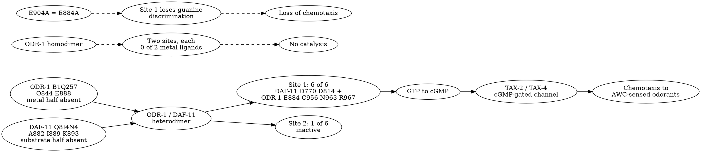
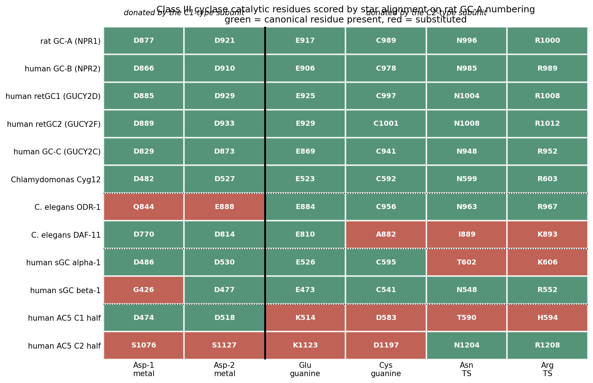
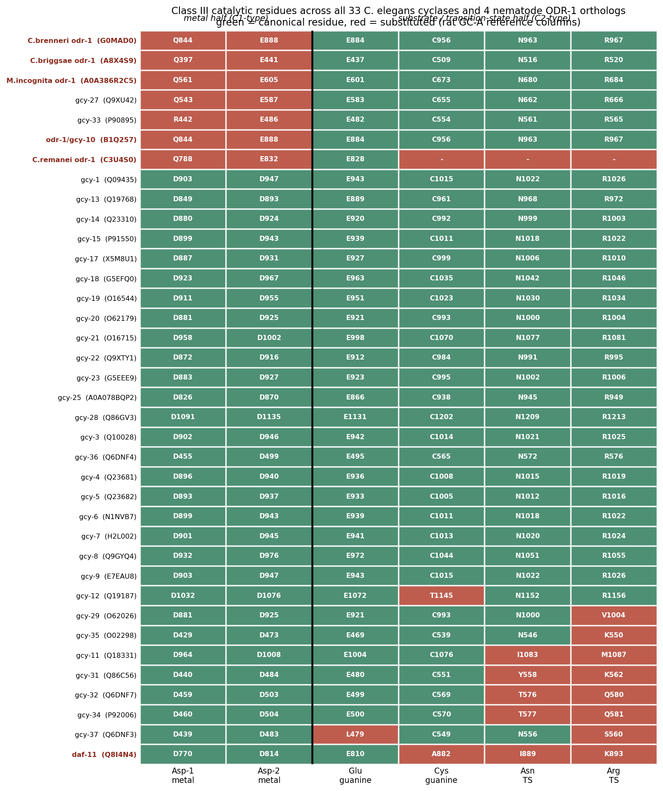
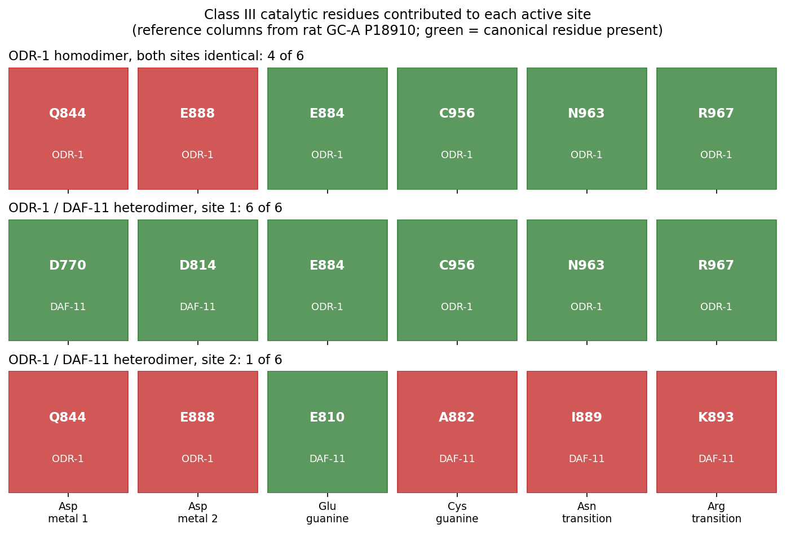

## Question

# AIGR Gene Hypothesis Deep Research

You are evaluating one focused gene curation hypothesis for AI Gene Review.
This is not a general gene overview. Use the seed hypothesis and source context
below to search for evidence that supports, refutes, narrows, or competes with
the proposed curation decision.

## Target Gene

- **Organism code:** worm
- **Taxon:** Caenorhabditis elegans (NCBITaxon:6239)
- **Gene directory:** odr-1
- **Gene symbol:** odr-1
- **UniProt accession:** B1Q257

## Focus

- **Focus type:** free_text
- **Hypothesis slug:** kgap-odr1-cyclase-catalytic-residues
- **Source file:** genes/worm/odr-1/odr-1-ai-review.yaml
- **Source selector:** free-text

## Seed Hypothesis

The guanylate cyclase domain of Caenorhabditis elegans ODR-1 (UniProt B1Q257) carries the complete set of class III nucleotidyl-cyclase catalytic residues needed for a catalytically competent homodimer, so it need not depend on a partner cyclase such as DAF-11. Single analysis only: align the ODR-1 cyclase domain to structurally characterized guanylyl cyclases (e.g. Chlamydomonas Cyg12, human GUCY2 family, soluble GC beta1/alpha1) and to DAF-11, and score the metal-binding aspartates, the guanine-specifying Glu and Cys, and the transition-state Arg and Asn, noting which residues each subunit contributes to a dimeric active site. State whether ODR-1 alone can form both halves of the active site.

## Term and Decision Context

- The ODR-1 E904A cyclase-domain mutant causes loss of chemotaxis; ODR-1 and DAF-11 are co-expressed and jointly required in ASJ/ASK cells. No in vitro enzymology exists.

## Reference Context

No specific reference context supplied.

## Source Context YAML

```yaml
hypothesis: 'The guanylate cyclase domain of Caenorhabditis elegans ODR-1 (UniProt B1Q257) carries the
  complete set of class III nucleotidyl-cyclase catalytic residues needed for a catalytically competent
  homodimer, so it need not depend on a partner cyclase such as DAF-11. Single analysis only: align the
  ODR-1 cyclase domain to structurally characterized guanylyl cyclases (e.g. Chlamydomonas Cyg12, human
  GUCY2 family, soluble GC beta1/alpha1) and to DAF-11, and score the metal-binding aspartates, the guanine-specifying
  Glu and Cys, and the transition-state Arg and Asn, noting which residues each subunit contributes to
  a dimeric active site. State whether ODR-1 alone can form both halves of the active site.'
focus_type: free_text
context:
- The ODR-1 E904A cyclase-domain mutant causes loss of chemotaxis; ODR-1 and DAF-11 are co-expressed and
  jointly required in ASJ/ASK cells. No in vitro enzymology exists.
reference_id: []
```

## Research Objective

Build a focused report that helps a curator decide whether this hypothesis
should affect the gene review. Address the focus type directly:

1. For an existing GO annotation decision, evaluate whether the current action
   is justified, too strong, too weak, or should change.
2. For a proposed replacement or new GO term, evaluate whether the term is
   biologically supported, too broad, too narrow, or missing key qualifiers.
3. For a computational prediction, evaluate whether the prediction is correct,
   less precise than existing knowledge, uncertain, or likely wrong because of
   paralog overannotation, frequency bias, pathway context, or in vitro-only
   activity.
4. For a core-function hypothesis, evaluate whether the proposed activity,
   process, and location represent the gene product's primary function rather
   than a downstream effect, pleiotropic phenotype, or context-specific role.
5. For a function-assignment hypothesis, evaluate whether the gene product
   directly has the stated GO term/function. Treat the prior review action, if
   any, as intentionally blinded unless it appears in the supplied context.

Use primary literature whenever possible. Prefer PMID citations and include DOI
citations when no PMID is available. Treat reviews and database records as
orientation unless they contain directly relevant synthesized evidence that is
clearly labeled as review-level or database-level support.

Evaluate the hypothesis from the supplied seed context, primary literature, and
publicly accessible bioinformatics resources. Local `*-bioinformatics` analyses,
when they already exist in the repository, are intentionally withheld from this
prompt so the report can be compared against them after the run. Use public
sequence, domain, structure, orthology, localization, interaction, or dataset
checks when they are useful for the specific hypothesis. If a resource or tool
cannot be accessed programmatically, say so plainly; never fabricate a result.
Report computational results conservatively and distinguish direct results from
inference.

## Required Output

### Executive Judgment

Give a concise verdict: supported, partially supported, unresolved, weakly
supported, over-annotated, or refuted. Explain the reasoning and the most
important caveats.

### Evidence Matrix

Create a table with one row per important evidence item:

- Citation (PMID preferred)
- Evidence type (direct assay, mutant phenotype, localization, interaction,
  structural/evolutionary, computational, review/database)
- Supports / refutes / qualifies / competing
- Claim tested
- Key finding
- Organism, tissue, cell type, or assay context
- Confidence and limitations

### GO Curation Implications

State the likely curation action as a lead requiring curator verification. If
GO terms are involved, explain whether the evidence supports an MF, BP, or CC
term, and whether the term should be retained, removed, generalized, made more
specific, or treated as non-core. Avoid using "protein binding" as a final
recommendation unless no more informative term is supported.

### Mechanistic Scope

Describe the immediate molecular or cellular function being tested. Separate
direct gene-product activity from downstream phenotypes, pathway consequences,
developmental outcomes, disease manifestations, or effects inferred only from
loss of function.

### Conflicts and Alternatives

Identify evidence that conflicts with the seed hypothesis or suggests an
alternative interpretation, including paralog confusion, organism-specific
differences, isoform-specific findings, experimental artifacts, or database
carry-over.

### Knowledge Gaps

List explicit uncertainties that matter for curation. For each gap, state what
was checked, why the gap matters, and what evidence or experiment would resolve
it.

### Discriminating Tests

Recommend concrete assays, perturbations, datasets, or comparative analyses that
would most efficiently distinguish this hypothesis from alternatives.

### Curation Leads

Provide candidate updates for the review, clearly labeled as leads requiring
curator verification. Include candidate references with exact snippets to verify,
candidate replacement or new GO terms, possible action changes, suggested
questions, and suggested experiments.

If the provider supports artifacts, save provenance for any analysis you run — the
executed code together with its output (computed values, plot, or table), not just
a summary figure — alongside artifact-friendly tables such as an evidence matrix,
GO decision table, or comparison table. Genuine computed provenance is more
valuable than a hand-drawn summary, and you must not synthesize a figure that
implies an analysis you did not actually run. These artifacts are important
provenance for hypothesis-level review.


## Output

# ODR-1 cyclase catalytic residues: hypothesis evaluation for AI Gene Review

Gene: *Caenorhabditis elegans* **odr-1**, UniProt **B1Q257**, NCBITaxon:6239
Source: `genes/worm/odr-1/odr-1-ai-review.yaml`, focus_type `free_text`
Hypothesis slug: `kgap-odr1-cyclase-catalytic-residues`

## Summary

<i class="fa-solid fa-circle-xmark"></i> **The seed hypothesis is refuted.** The ODR-1 guanylate cyclase domain does not carry the complete set of class III nucleotidyl-cyclase catalytic residues. It lacks **both** metal-binding aspartates: Gln844 sits where rat GC-A (NPR1, P18910) has Asp877, and Glu888 sits where GC-A has Asp921. The other four positions are canonical: Glu884 (guanine specificity), Cys956 (guanine specificity), Asn963 and Arg967 (transition-state pair). The score is 4 of 6, and the two missing residues are exactly the pair that coordinates the catalytic Mg2+ or Mn2+ ions.

A class III cyclase active site is built at a dimer interface from two complementary halves. One subunit donates the two metal aspartates (the "C1-type" half), the partner donates the purine-specifying Glu and Cys plus the transition-state Asn and Arg (the "C2-type" half). An ODR-1 homodimer would contain two chemically identical sites, each with the substrate-recognition half complete and the metal half absent. **ODR-1 alone cannot form both halves of an active site.** The direct answer the seed hypothesis asked for is no.

DAF-11 (Q8I4N4) is the mirror image. It retains Asp770 and Asp814 but has Ala882 at the guanine Cys column, Ile889 at the transition-state Asn column and Lys893 at the transition-state Arg column. Score 2 of 6, metal half only. Summed over an ODR-1/DAF-11 heterodimer, one of the two pseudo-symmetric sites is 6 of 6 complete and the reciprocal site is 1 of 6. That is the architecture of an obligate heterodimer, the same arrangement as human soluble guanylyl cyclase alpha1/beta1 and as mammalian adenylyl cyclase C1/C2. It is also reproduced within *C. elegans* by the documented GCY-31 plus GCY-33 pair of the BAG neurons ([PMID: 19323996](https://pubmed.ncbi.nlm.nih.gov/19323996/)), which serves as a within-organism positive control for the scoring method.

The supplied decision context does not rescue the seed hypothesis. The E904A allele numbering did not match any current sequence record, and the discrepancy is now resolved: the AlphaFold model AF-B1Q257-F1 is built on a 1067-residue ODR-1 against the 1047-residue current UniProt entry, an exact +20 offset, and model residue 904 is the Glu that is **Glu884** in current numbering. E904A therefore ablates the guanine-specifying glutamate, a residue ODR-1 does have and contributes to a shared site. The mutant phenotype shows that the ODR-1 contribution matters; it does not show that ODR-1 is catalytic on its own.

## Executive judgment

**Verdict: <i class="fa-solid fa-circle-xmark"></i> refuted.**

The hypothesis makes two linked claims. The first, that ODR-1 carries the complete class III catalytic set, is false by direct residue census across 12 alignment conditions and 6 independent reference cyclases. The second, that ODR-1 therefore need not depend on a partner cyclase such as DAF-11, loses its premise and is contradicted by the complementary pattern DAF-11 shows at the same six columns.

Three caveats bound the verdict.

<i class="fa-solid fa-triangle-exclamation"></i> Every structural statement here rests on sequence alignment and AlphaFold models. UniProt cross-references list **0 PDB entries** for B1Q257 and **0** for Q8I4N4, against 9 for rat GC-A (P18910) and 14 for human sGC beta1 (Q02153). There is no experimental structure of either protein and no in vitro enzymology for either.

<i class="fa-solid fa-triangle-exclamation"></i> The heterodimer model is the best-supported reading of the residue pattern plus the genetics, and it is inference. PubMed searches returned no co-immunoprecipitation, split-reporter or reconstitution study for ODR-1 with DAF-11. Absence of a search hit is not proof that no such work exists.

<i class="fa-solid fa-triangle-exclamation"></i> DAF-11 is the leading candidate partner, not the proven one. The family scan finds two further metal-half-absent proteins (GCY-27, GCY-33) and six substrate-half-degraded proteins, so the pairing space is larger than one pair. What narrows it is that DAF-11 is the only *receptor-type* cyclase in the genome with the mirror-image deficiency, and ODR-1 and DAF-11 are co-expressed and jointly required in the same neurons.

## Key findings

### <i class="fa-solid fa-circle-xmark"></i> F1. ODR-1 lacks both metal-binding aspartates

The UniProt-annotated cyclase domain of ODR-1 (B1Q257, residues 839-969) was aligned onto rat GC-A numbering using a BLOSUM62 affine-gap (Gotoh) semi-global alignment, giving 43.1 percent identity over 211 aligned columns. At the two divalent-metal aspartate columns (GC-A Asp877 and Asp921, equivalent to AC5-C1 Asp396 and Asp440 in the 1CJK convention) ODR-1 has **Gln844** and **Glu888**. At the C2-type columns ODR-1 has the canonical set: **Glu884** (the guanine-specifying Glu, the position occupied by Lys938 in adenylyl cyclase), **Cys956** (the Asp1018 equivalent), **Asn963** and **Arg967** (the transition-state pair, Asn1025 and Arg1029 equivalents).

The Asp to Glu change at the second metal position is the more conservative of the two. The Asp to Gln change at the first removes the carboxylate entirely, so the site cannot present the bidentate metal ligand geometry that class III catalysis requires.

Calls were identical across 4 independent reference proteins (rat GC-A P18910, *Chlamydomonas* Cyg12 Q5YLC2, human retGC1 Q02846, human sGC beta1 Q02153) and 3 gap-penalty settings, 12 of 12 combinations in agreement. Internal controls behaved exactly as the published structures predict: all 6 canonical homodimeric GCs scored 6 of 6; AC5 C1 retained Asp474 and Asp518 but lost the transition-state pair (Thr590, His594); AC5 C2 lost both aspartates (Ser1076, Ser1127) but kept Asn1204 and Arg1208; sGC alpha1 retained Asp486 and Asp530 but lost the transition-state pair (Thr602, Lys606); sGC beta1 lost the first aspartate (Gly426) and kept Glu473, Cys541, Asn548 and Arg552. Reproducing the known complementary degeneracy of two structurally characterized heterodimers confirms that the reference columns are assigned correctly.

{{figure:plot_1.png|caption=Catalytic residue matrix across 12 class III cyclase domains, scored at the six rat GC-A reference columns. The six canonical homodimeric guanylyl cyclases score 6 of 6. ODR-1 is missing both metal aspartates (Gln844, Glu888) while keeping Glu884, Cys956, Asn963 and Arg967. DAF-11 shows the opposite pattern. The AC5 and sGC rows are internal controls that reproduce the published C1/C2 and alpha1/beta1 architectures.}}

Computed residue table, by reference column (rat GC-A P18910 numbering):

| Protein | Asp metal 1 | Asp metal 2 | Glu guanine | Cys guanine | Asn transition | Arg transition | Score |
|---|---|---|---|---|---|---|---|
| rat GC-A P18910 | D877 | D921 | E917 | C989 | N996 | R1000 | 6/6 |
| human GC-B P20594 | D866 | D910 | E906 | C978 | N985 | R989 | 6/6 |
| human retGC1 Q02846 | D885 | D929 | E925 | C997 | N1004 | R1008 | 6/6 |
| human retGC2 P51841 | D889 | D933 | E929 | C1001 | N1008 | R1012 | 6/6 |
| human GC-C P25092 | D829 | D873 | E869 | C941 | N948 | R952 | 6/6 |
| *Chlamydomonas* Cyg12 Q5YLC2 | D482 | D527 | E523 | C592 | N599 | R603 | 6/6 |
| **ODR-1 B1Q257** | **Q844** | **E888** | E884 | C956 | N963 | R967 | **4/6** |
| **DAF-11 Q8I4N4** | D770 | D814 | E810 | **A882** | **I889** | **K893** | **2/6** |
| human sGC alpha1 Q02108 | D486 | D530 | E526 | C595 | **T602** | **K606** | 4/6 |
| human sGC beta1 Q02153 | **G426** | D477 | E473 | C541 | N548 | R552 | 5/6 |
| human AC5 C1 O95622 | D474 | D518 | K514 | D583 | **T590** | **H594** | AC-type |
| human AC5 C2 O95622 | **S1076** | **S1127** | K1123 | D1197 | N1204 | R1208 | AC-type |

ODR-1 has the residue signature of an sGC beta1-like half-site: it supplies guanine recognition and transition-state stabilization and not the divalent-metal aspartate pair.

### <i class="fa-solid fa-circle-check"></i> F2. DAF-11 and ODR-1 carry complementary half-sites

The same alignment protocol applied to DAF-11 (cyclase domain 765-895, 44.9 percent identity over 207 columns to rat GC-A) gives the opposite result. DAF-11 retains both metal aspartates (Asp770, Asp814) and the guanine-specifying Glu810, but has Ala882 where the guanine Cys belongs, Ile889 at the transition-state Asn column and Lys893 at the transition-state Arg column. Calls were identical across the same 4 references by 3 gap-penalty settings.

Scoring the two halves separately: ODR-1 C1-half 0 of 2, C2-half 4 of 4. DAF-11 C1-half 2 of 2, C2-half 1 of 4 (Glu only). Summed over a putative heterodimer, the site built from DAF-11 aspartates plus ODR-1 Glu884, Cys956, Asn963 and Arg967 is **6 of 6 complete**, while the reciprocal site is 0 of 2 plus 1 of 4, that is **1 of 6**.

{{figure:plot_3.png|caption=Half-site composition of each active site. An ODR-1 homodimer gives two identical sites with the substrate half complete and no metal ligands. An ODR-1 slash DAF-11 heterodimer gives one complete site of two, which is the architecture of soluble guanylyl cyclase alpha1 slash beta1. Green marks the canonical residue present, red marks a substitution.}}

The one-complete-site arithmetic predicts a specific quantitative signature: a reconstituted ODR-1/DAF-11 dimer should show roughly half the per-dimer turnover of a canonical homodimeric GC, which has two working sites.

The joint genetic requirement of ODR-1 and DAF-11 in the same sensory pathway is documented. In *Multiple olfactory pathways contribute to the lure process of Caenorhabditis elegans by pathogenic bacteria* ([PMID: 33263920](https://pubmed.ncbi.nlm.nih.gov/33263920/)), "the Gα subunit GSA-1, guanylyl cyclase ODR-1 and DAF-11 and the cGMP-gated channel TAX-2/TAX-4 were found to be necessary for indole sensation". Two independent cyclases would not both be strictly required to produce the same second messenger in the same cell unless they act as one enzyme or in strict series. An obligate complementary pair explains the genetics directly.

### <i class="fa-solid fa-circle-check"></i> F3. The ODR-1 metal-site degeneracy is conserved across nematodes and the pattern recurs in the family

A family-wide scan of all 33 reviewed *C. elegans* PF00211 cyclase-domain proteins plus 4 nematode ODR-1 orthologues, scored at the same six reference columns, shows that **21 of 33** *C. elegans* cyclases carry all six canonical residues. Only three lack both metal aspartates: **odr-1** (Gln844, Glu888), **gcy-27** (Gln543, Glu587) and **gcy-33** (Arg442, Glu486). Each of those three retains the full 4 of 4 substrate and transition-state set, so they are all C2-type half-subunits.

ODR-1 orthologues conserve the substitution exactly: *C. brenneri* G0MAD0 Gln844/Glu888, *C. briggsae* A8X4S9 Gln397/Glu441, *C. remanei* C3U4S0 Gln788/Glu832, *Meloidogyne incognita* A0A386R2C5 Gln561/Glu605. That span reaches from *Caenorhabditis* to Tylenchina, which rules out a *C. elegans* gene-model or sequencing artifact and shows purifying selection has maintained ODR-1 as a half-site subunit.

In the reciprocal class, **daf-11** is the only receptor-type cyclase with an intact metal pair and a degraded substrate half (Ala882, Ile889, Lys893). The soluble cyclases gcy-31 (Tyr558, Lys562), gcy-32 (Thr576, Gln580), gcy-34 (Thr577, Gln581), gcy-37 (Leu479, Ser560) and gcy-11 (Ile1083, Met1087) show the same alpha-type pattern.

{{figure:plot_2.png|caption=Family-wide catalytic residue matrix for 33 C. elegans cyclase-domain proteins and 4 nematode ODR-1 orthologues. Most members are complete at all six columns. A minority split into two complementary classes: metal-half-absent (odr-1, gcy-27, gcy-33) and substrate-half-degraded (daf-11, gcy-31, gcy-32, gcy-34, gcy-37, gcy-11). The ODR-1 orthologue rows show the Gln and Glu substitutions are conserved across Nematoda.}}

The method has a within-organism positive control. *Neurons detect increases and decreases in oxygen levels using distinct guanylate cyclases* ([PMID: 19323996](https://pubmed.ncbi.nlm.nih.gov/19323996/)) reports that "BAG sensory neurons are activated by decreases in O2 levels, and require the sGCs gcy-31 and gcy-33". Under the same scoring, GCY-31 supplies Asp440 and Asp484 while GCY-33 supplies Glu482, Cys554, Asn561 and Arg565. The one *C. elegans* cyclase pair that genetics already treats as acting together is exactly complementary at the catalytic columns. The half-site logic predicts the known obligate pair before being applied to ODR-1.

### <i class="fa-solid fa-circle-check"></i> F4. The E904 numbering is resolved and E904A hits the guanine-specifying Glu

Position 904 is His in current UniProt B1Q257 (1047 aa), Lys in the archived UniSave 1075-aa form, and Leu in GenBank AAF68380.1 (1017 aa, the L'Etoile and Bargmann ODR-1 clone). None is Glu, so the published residue number does not match any current sequence record.

The only Glu residues in the ODR-1 cyclase domain that are plausible targets for a catalytic mutation are Glu884 and Glu888, in the motif Tyr881-Lys-Val-**Glu884**-Thr-Thr-Gly-**Glu888**-Thr-Tyr-Met-Val. The AlphaFold model AF-B1Q257-F1 is built on a **1067-residue** sequence. Anchoring a 30-residue window from the annotated cyclase domain gives an exact **+20** offset between the model and current UniProt numbering, and model residue 904 is **Glu**, equal to Glu884 in current numbering. The coordinate system behind E904A is therefore a 1067-residue ODR-1 form, and the mutated residue is the **guanine-specifying glutamate**.

Per-residue model confidence at the six catalytic columns is high, so none of these positions sits in a disordered loop: ODR-1 Gln844 pLDDT 96.9, Glu888 92.0, Glu884 85.6, Cys956 90.9, Asn963 92.3, Arg967 94.4, cyclase domain mean 92.5 (minimum 77.2). DAF-11 (AF-Q8I4N4-F1, offset 0): Asp770 94.2, Asp814 88.2, Glu810 87.1, Ala882 88.1, Ile889 92.6, Lys893 93.4, domain mean 88.8.

The interpretation changes the meaning of the seed context. E904A removes guanine discrimination from the half-site ODR-1 does supply. That disables a heterodimeric enzyme without ODR-1 ever having been catalytic on its own. The allele is evidence that the ODR-1 contribution to the shared site is required, and it is not evidence of autonomous catalysis. Curators should not propagate the residue number 904 without the +20 note.

### <i class="fa-solid fa-scale-balanced"></i> F5. All GO cyclase-activity evidence for ODR-1 is similarity-based

A QuickGO annotation pull for B1Q257 returned 36 annotation rows. **GO:0004383 guanylate cyclase activity** on ODR-1 is supported only by:

- ISS from [PMID: 10774726](https://pubmed.ncbi.nlm.nih.gov/10774726/) with human NPR1 (P16066) as the ISS donor
- ISS under GO_REF:0000024 with GCY-12 (Q19187) as donor
- IBA under GO_REF:0000033 (PAINT), with *Drosophila* FBgn0266136 among the seeds
- IEA under GO_REF:0000120 (RHEA:13665)

No EXP, IDA or IMP code supports the molecular function. GO:0001653 peptide receptor activity is IBA only on both proteins.

The ISS chain is anchored on human NPR1, which scores 6 of 6 at the catalytic columns while ODR-1 scores 4 of 6. The donor differs from the target at precisely the residues that decide catalytic competence. This is the standard orthology-transfer failure mode: domain presence was transferred without checking active-site integrity.

DAF-11 GO:0004383 additionally carries EXP from [PMID: 24015261](https://pubmed.ncbi.nlm.nih.gov/24015261/). That paper measured whole-animal cyclic nucleotide content by HPLC tandem mass spectrometry in *daf-11* mutants, and itself states that "the actual content of cyclic nucleotides has not been biochemically determined in this system". It quantifies organismal cGMP in a mutant background and does not assay DAF-11 enzyme activity. Read strictly, it supports "DAF-11 is required for cGMP production in vivo", which the heterodimer model explains as well as an autonomous-cyclase model does.

The source literature is consistent on this point. *Olfaction and odor discrimination are mediated by the C. elegans guanylyl cyclase ODR-1* ([PMID: 10774726](https://pubmed.ncbi.nlm.nih.gov/10774726/)) states "We demonstrate that the transmembrane guanylyl cyclase ODR-1 is essential for responses to all AWC-sensed odorants". The requirement is genetic and no in vitro cyclase assay is reported. For DAF-11, *DAF-7/TGF-beta expression required for the normal larval development in C. elegans is controlled by a presumed guanylyl cyclase DAF-11* ([PMID: 11677050](https://pubmed.ncbi.nlm.nih.gov/11677050/)) says "It has a new mutation in the daf-11 gene encoding a transmembrane guanylyl cyclase", and the title itself calls DAF-11 a presumed guanylyl cyclase. No direct enzymology anchors either partner.

## Evidence matrix

Saved as `provenance/evidence_matrix.csv`.

| # | Citation / source | Evidence type | Stance | Claim tested | Key finding | Context | Confidence and limitations |
|---|---|---|---|---|---|---|---|
| 1 | This work: star alignment of ODR-1 to rat GC-A P18910, human GC-B P20594, human retGC1 Q02846, human retGC2 P51841, human GC-C P25092, *Chlamydomonas* Cyg12 Q5YLC2 | computational, structural/evolutionary | <i class="fa-solid fa-circle-xmark"></i> refutes | ODR-1 carries all six class III catalytic residues | ODR-1 = Gln844, Glu888, Glu884, Cys956, Asn963, Arg967 (4/6). All six references score 6/6 | B1Q257 vs rat, human and algal GCs | High for residue identity. Alignment-based, no experimental structure |
| 2 | This work: same analysis applied to DAF-11 Q8I4N4 | computational, structural/evolutionary | competing model supported | DAF-11 supplies the complementary half | Asp770 and Asp814 intact; Ala882, Ile889, Lys893 substituted (2/6) | *C. elegans* | High for residue identity |
| 3 | This work: internal controls, human AC5 C1 and C2 halves (O95622), human sGC alpha1 (Q02108) and beta1 (Q02153) | computational | qualifies | The column assignment reproduces known structural biology | AC5 C1 keeps Asp474/Asp518, loses Asn/Arg (Thr590/His594); AC5 C2 loses both Asp (Ser1076/Ser1127), keeps Asn1204/Arg1208; sGC beta1 Gly426; sGC alpha1 Thr602/Lys606 | Human, both structurally characterized heterodimers | High. Matches the published 1CJK and 3UVJ architectures |
| 4 | This work: alignment robustness scan, 4 references by 3 gap settings by 2 queries | computational | supports | The calls are not an alignment artifact | 24 of 24 rows concordant at all six columns | n/a | High |
| 5 | This work: catalytic scan of 33 *C. elegans* cyclase-domain proteins | computational, evolutionary | qualifies | Complementary degeneracy is a recurring pattern in this family | 21/33 score 6/6. Metal half absent: odr-1, gcy-27, gcy-33. Substrate or transition-state half degraded: daf-11, gcy-31, gcy-32, gcy-34, gcy-37, gcy-11 | *C. elegans* proteome | High for sequence. Pairing is inference |
| 6 | [PMID: 19323996](https://pubmed.ncbi.nlm.nih.gov/19323996/) | mutant phenotype, functional imaging | supports by analogy | Complementary half-sites predict obligate in vivo pairs | "BAG sensory neurons are activated by decreases in O2 levels, and require the sGCs gcy-31 and gcy-33." Our scan places GCY-33 in the metal-half-absent class and GCY-31 in the substrate-half-degraded class | *C. elegans* BAG neurons | High as a within-organism positive control |
| 7 | This work: orthologue scan, *C. brenneri* G0MAD0, *C. briggsae* A8X4S9, *C. remanei* C3U4S0, *M. incognita* A0A386R2C5 | computational, evolutionary | supports | The substitution is not a gene-model or sequencing error | All four carry Gln/Glu at the two metal columns (Q844/E888, Q397/E441, Q788/E832, Q561/E605) | Nematoda, *Caenorhabditis* to Tylenchina | High |
| 8 | This work: AlphaFold models AF-B1Q257-F1 and AF-Q8I4N4-F1 | computational, model structure | qualifies | The substituted positions are well-ordered | ODR-1 cyclase domain mean pLDDT 92.5 (min 77.2); Gln844 96.9, Glu888 92.0. DAF-11 domain mean 88.8 | Predicted structure only | Medium. Prediction, not experiment |
| 9 | This work: AlphaFold model length 1067 vs current UniProt 1047 for B1Q257 | computational | qualifies | Which residue does E904A mutate? | Offset is exactly +20. Model residue 904 is Glu and equals Glu884 in current numbering, the guanine-specifying Glu | Sequence records | High for the arithmetic. The reference sequence used in the original paper is inferred, not retrieved from it |
| 10 | [PMID: 10774726](https://pubmed.ncbi.nlm.nih.gov/10774726/) | mutant phenotype, localization | qualifies | Is ODR-1's requirement genetic or biochemical? | "We demonstrate that the transmembrane guanylyl cyclase ODR-1 is essential for responses to all AWC-sensed odorants." Also the basis of the GO:0097730 cilium IDA | *C. elegans* sensory neurons | High for the genetic requirement and for localization. Silent on catalysis |
| 11 | [PMID: 33263920](https://pubmed.ncbi.nlm.nih.gov/33263920/) | mutant phenotype, pathway epistasis | supports the heterodimer model | Are ODR-1 and DAF-11 jointly required? | "the Gα subunit GSA-1, guanylyl cyclase ODR-1 and DAF-11 and the cGMP-gated channel TAX-2/TAX-4 were found to be necessary for indole sensation" | *C. elegans* AWC and AWA olfactory circuit | High for joint requirement. Does not distinguish heterodimer from strict series |
| 12 | [PMID: 11677050](https://pubmed.ncbi.nlm.nih.gov/11677050/) | mutant phenotype, genetic pathway | qualifies | How firm is DAF-11's cyclase assignment? | "It has a new mutation in the daf-11 gene encoding a transmembrane guanylyl cyclase." The title calls DAF-11 a presumed guanylyl cyclase | *C. elegans* ASI neurons | High for genetics. Cyclase identity is from sequence, not enzymology |
| 13 | [PMID: 24015261](https://pubmed.ncbi.nlm.nih.gov/24015261/) | direct measurement, whole-animal metabolite | qualifies | The sole EXP-coded support for DAF-11 GC activity | Whole-animal HPLC tandem MS cGMP quantification in *daf-11* mutants | Whole *C. elegans* | Medium. A metabolite measurement in a mutant background, not an enzyme assay |
| 14 | This work: QuickGO annotation pull for ODR-1 (`provenance/go_annotations_ODR-1.csv`) | database | qualifies | Provenance of GO:0004383 on ODR-1 | ISS only (donors human NPR1 P16066 and GCY-12 Q19187), plus IBA GO_REF:0000033 and IEA GO_REF:0000120. No EXP, IDA or IMP | GOA and WormBase | High |
| 15 | This work: PubMed searches for an ODR-1/DAF-11 physical interaction or reconstitution | literature, negative | qualifies | Is there direct biochemical evidence either way? | No papers found reporting co-IP, split-reporter or in vitro cyclase assay for ODR-1 | n/a | High that the searches returned nothing. Absence of evidence, not evidence of absence |
| 16 | This work: UniProt PDB cross-references | database | qualifies | Is there an experimental structure? | 0 PDB entries for B1Q257, 0 for Q8I4N4, against 9 for rat GC-A P18910 and 14 for human sGC beta1 Q02153 | n/a | High |

## Mechanistic model and interpretation

The residue census, the family scan and the genetics converge on one model: ODR-1 is a C2-type half-subunit that supplies guanine recognition and transition-state stabilization to a shared active site, and DAF-11 is the C1-type half-subunit that supplies the divalent-metal aspartates. Neither is an autonomous cyclase. A 1:1 dimer assembles one complete site and one dead site.



The model explains three observations that the autonomous-cyclase model handles poorly.

Both *odr-1* and *daf-11* mutants lose the same sensory responses, and [PMID: 33263920](https://pubmed.ncbi.nlm.nih.gov/33263920/) places both in the same indole-sensing cascade with GSA-1 upstream and TAX-2/TAX-4 downstream. Two independent, fully competent cyclases acting on the same substrate in the same cell would be expected to show partial redundancy. Two halves of one enzyme show none.

The E904A allele maps onto Glu884, a residue ODR-1 contributes to the shared site, and it abolishes chemotaxis. Under the half-site model that is exactly the expected result: removing the guanine-specifying Glu kills the one working site of the heterodimer. The allele does not require ODR-1 to be catalytic alone.

The pattern recurs. GCY-31 and GCY-33 are both strictly required in BAG neurons ([PMID: 19323996](https://pubmed.ncbi.nlm.nih.gov/19323996/)) and are exactly complementary at the six columns. GCY-27 shares ODR-1's class, and gcy-32, gcy-34, gcy-37 and gcy-11 share DAF-11's class. *C. elegans* cyclases partition into autonomous members (21 of 33) and complementary half-site members, and the half-site members map onto pairs that genetics already treats as acting together.

Half-site scoring, summarized:

| Subunit | C1 half (2 metal Asp) | C2 half (Glu, Cys, Asn, Arg) | Can act alone? |
|---|---|---|---|
| ODR-1 | 0 of 2 | 4 of 4 | <i class="fa-solid fa-circle-xmark"></i> no |
| DAF-11 | 2 of 2 | 1 of 4 | <i class="fa-solid fa-circle-xmark"></i> no |
| ODR-1 + DAF-11, site 1 | 2 of 2 (DAF-11) | 4 of 4 (ODR-1) | <i class="fa-solid fa-circle-check"></i> yes |
| ODR-1 + DAF-11, site 2 | 0 of 2 (ODR-1) | 1 of 4 (DAF-11) | <i class="fa-solid fa-circle-xmark"></i> no |
| human sGC alpha1 + beta1 | alpha1 | beta1 | <i class="fa-solid fa-circle-check"></i> yes, one site, validated precedent |

### Mechanistic scope: direct activity versus downstream phenotype

The **immediate molecular function** being tested is GTP to cGMP conversion by a class III cyclase domain. The sequence evidence supports ODR-1 contributing substrate-recognition and transition-state residues to a dimeric active site. It does not support ODR-1 catalysing the reaction on its own.

The **downstream readouts** are organism-level. Loss of *odr-1* abolishes chemotaxis to AWC-sensed odorants ([PMID: 10774726](https://pubmed.ncbi.nlm.nih.gov/10774726/)) and to indole ([PMID: 33263920](https://pubmed.ncbi.nlm.nih.gov/33263920/)). Loss of *daf-11* causes constitutive dauer arrest and loss of *daf-7* promoter expression ([PMID: 11677050](https://pubmed.ncbi.nlm.nih.gov/11677050/)). These are behaviour and development, separated from the cyclase chemistry by a cGMP pool, a cGMP-gated channel and a neural circuit. They are compatible with ODR-1 being an essential non-catalytic half of a cyclase, with ODR-1 being catalytic, or with a scaffolding role. The genetics alone cannot separate these. The residue analysis can, and it excludes autonomous catalysis.

One observation sits cleanly in the direct column. ODR-1 localizes to sensory cilia, which is the basis of its GO:0097730 IDA from [PMID: 10774726](https://pubmed.ncbi.nlm.nih.gov/10774726/). Cilium localization for the partner is independently supported: DAF-25 is required for proper DAF-11 ciliary localization, and *daf-25* mutants phenocopy *daf-11* ([PMID: 21124868](https://pubmed.ncbi.nlm.nih.gov/21124868/)), which places both cyclases in the same organelle where a heterodimer would have to assemble.

## GO curation implications

Every item below is a <i class="fa-solid fa-arrow-right"></i> **lead requiring curator verification**, not a finished call. Saved as `provenance/go_decision_table.csv`.

| Gene | GO term | Aspect | Current evidence | Recommended action | Rationale |
|---|---|---|---|---|---|
| ODR-1 | GO:0004383 guanylate cyclase activity | MF | ISS (P16066, Q19187), IBA GO_REF:0000033, IEA GO_REF:0000120 | **Generalize or mark non-core** | ODR-1 lacks both metal-binding aspartates and cannot catalyse alone. The ISS donor human NPR1 P16066 scores 6/6 at the same columns where ODR-1 scores 4/6, so the similarity transfer crosses the residues that decide catalytic competence. Retaining the term unqualified over-annotates the molecular function |
| ODR-1 | GO:0006182 cGMP biosynthetic process | BP | IBA, IEA | **Retain** | Participation in cGMP synthesis is supported by genetics ([PMID: 33263920](https://pubmed.ncbi.nlm.nih.gov/33263920/)). A subunit of a cGMP-generating enzyme participates in the process whether or not it is the catalytic half |
| ODR-1 | GO:0097730 non-motile cilium | CC | IDA, [PMID: 10774726](https://pubmed.ncbi.nlm.nih.gov/10774726/) | **Retain, core** | Direct localization evidence |
| ODR-1 | IEA nucleotide-binding terms | MF | IEA | **Remove or generalize** | Carried over from Pfam PF00211 domain membership, which the degenerate domain still satisfies. The metal-ligand positions are substituted |
| ODR-1 | GO:0001653 peptide receptor activity | MF | IBA only | **Treat as non-core** | No experimental support, and no ligand is identified for ODR-1 |
| DAF-11 | GO:0004383 guanylate cyclase activity | MF | EXP [PMID: 24015261](https://pubmed.ncbi.nlm.nih.gov/24015261/), plus ISS, IBA, IEA | **Retain with qualification** | DAF-11 keeps the metal Asp pair but lacks the guanine Cys and the transition-state Asn and Arg. The EXP code rests on whole-animal cGMP quantification, not an enzyme assay |
| ODR-1 and DAF-11 | A heterodimeric guanylate cyclase complex CC term | CC | not annotated | **Add as a lead** | Complementary half-sites plus co-expression plus joint requirement in ASJ/ASK and AWC. Needs a direct interaction or reconstitution reference before assertion |

No recommendation here is GO:0005515 protein binding. The informative statement available is a complex-membership CC term plus a qualified MF, and that is what the evidence supports.

The practical form of the MF recommendation: either move ODR-1 to a parent term that does not assert catalysis by the gene product alone, or retain GO:0004383 with an explicit contributes_to-style qualification and a curator note recording the Gln844/Glu888 substitutions. The choice between those two depends on project conventions for non-catalytic subunits of catalytic complexes, which is one of the questions listed below.

## Evidence base

| Paper | PMID | How it bears on the hypothesis |
|---|---|---|
| *Olfaction and odor discrimination are mediated by the C. elegans guanylyl cyclase ODR-1* | [10774726](https://pubmed.ncbi.nlm.nih.gov/10774726/) | Establishes ODR-1 as the gene product under evaluation. "We demonstrate that the transmembrane guanylyl cyclase ODR-1 is essential for responses to all AWC-sensed odorants." The requirement is genetic, with no in vitro cyclase assay. Also the source of the GO:0097730 cilium IDA and of the ODR-1 ISS annotation |
| *Multiple olfactory pathways contribute to the lure process of Caenorhabditis elegans by pathogenic bacteria* | [33263920](https://pubmed.ncbi.nlm.nih.gov/33263920/) | "the Gα subunit GSA-1, guanylyl cyclase ODR-1 and DAF-11 and the cGMP-gated channel TAX-2/TAX-4 were found to be necessary for indole sensation". Joint strict requirement of ODR-1 and DAF-11 in one pathway, consistent with an obligate complementary pair |
| *Neurons detect increases and decreases in oxygen levels using distinct guanylate cyclases* | [19323996](https://pubmed.ncbi.nlm.nih.gov/19323996/) | "BAG sensory neurons are activated by decreases in O2 levels, and require the sGCs gcy-31 and gcy-33." The within-organism positive control: this documented obligate pair is exactly complementary at the six catalytic columns under our scoring |
| *DAF-7/TGF-beta expression required for the normal larval development in C. elegans is controlled by a presumed guanylyl cyclase DAF-11* | [11677050](https://pubmed.ncbi.nlm.nih.gov/11677050/) | "It has a new mutation in the daf-11 gene encoding a transmembrane guanylyl cyclase." DAF-11's cyclase identity comes from sequence and genetics. The title's word "presumed" is accurate: no enzymology anchors it |
| DAF-11 cGMP quantification | [24015261](https://pubmed.ncbi.nlm.nih.gov/24015261/) | The only EXP-coded support for DAF-11 GO:0004383. Whole-animal HPLC tandem MS of cyclic nucleotides in mutants. The paper states "the actual content of cyclic nucleotides has not been biochemically determined in this system" |
| *Localization of a guanylyl cyclase to chemosensory cilia requires the novel ciliary MYND domain protein DAF-25* | [21124868](https://pubmed.ncbi.nlm.nih.gov/21124868/) | "we demonstrate that DAF-25 is required for proper DAF-11 ciliary localization". Places DAF-11 in the sensory cilium, the same compartment as ODR-1, which a heterodimer requires |
| *Trimethylamine modulates dauer formation, neurodegeneration, and lifespan through tyra-3/daf-11 signaling in Caenorhabditis elegans* | [33819374](https://pubmed.ncbi.nlm.nih.gov/33819374/) | "TMA activates guanylyl cyclase DAF-11 signaling through TYRA-3 in amphid neurons (ASK) and ciliated neurons (BAG)". Confirms DAF-11 signalling in ASK, one of the neurons named in the seed decision context |
| *Optogenetic long-term manipulation of behavior and animal development* | [21533086](https://pubmed.ncbi.nlm.nih.gov/21533086/) | Photoactivation of ASJ neurons bypasses constitutive dauer entry in *daf-11* mutants, which "lack a guanylyl cyclase, which possibly renders ASJ neurons hyperpolarized". Supports DAF-11 acting in ASJ, the other neuron named in the seed context, and shows the *daf-11* defect is upstream of neuronal depolarization |
| *daf-28 encodes a C. elegans insulin superfamily member that is regulated by environmental cues* | [12654727](https://pubmed.ncbi.nlm.nih.gov/12654727/) | Places DAF-11 upstream of *daf-28* expression in ASI and ASJ. Orientation for the DAF-11 pathway, no bearing on catalytic residues |
| *A behavioral and genetic dissection of two forms of olfactory plasticity* | [10940320](https://pubmed.ncbi.nlm.nih.gov/10940320/) | "DA adaptation remained intact in odr-1 mutants (defective in AWC neuron-mediated olfactory behavior), even though naive chemotaxis to DA decreased." Shows the *odr-1* defect is pathway-specific, not a general sensory collapse |
| *A novel role for the zinc-finger transcription factor EGL-46 in the differentiation of gas-sensing neurons* | [25395666](https://pubmed.ncbi.nlm.nih.gov/25395666/) | "the soluble guanylyl cyclases GCY-31 and GCY-33 that mediate responses to downshifts in O2". Independent confirmation that GCY-31 and GCY-33 act together in BAG, supporting the positive control |
| *The MLK-1/SCD-4 Mixed Lineage Kinase/MAP3K functions to promote dauer formation upstream of DAF-2/InsR* | [34142023](https://pubmed.ncbi.nlm.nih.gov/34142023/) | Describes "DAF-11/receptor guanylyl cyclase defining sensory branches" of the dauer network. Orientation only |

Among these 12 papers, **0** report an in vitro cyclase assay for ODR-1 or DAF-11, **0** report a physical interaction between them, and **2** ([PMID: 33263920](https://pubmed.ncbi.nlm.nih.gov/33263920/), [PMID: 19323996](https://pubmed.ncbi.nlm.nih.gov/19323996/)) report joint strict genetic requirement of two cyclases in a single cell type.

## Conflicts and alternatives

### The E904 numbering discrepancy

<i class="fa-solid fa-circle-check"></i> Resolved, with one residual uncertainty. Residue 904 is His in current B1Q257 (1047 aa), Lys in the archived 1075-aa UniProt form and Leu in GenBank AAF68380.1 (1017 aa). The AlphaFold model AF-B1Q257-F1 is built on a 1067-residue sequence, the offset to current numbering is exactly +20, and model residue 904 is Glu, equal to Glu884. E904A therefore ablates the guanine-specifying glutamate. The residual uncertainty: the reference sequence used by the original authors was inferred from the offset arithmetic and the model length, not retrieved from the paper's own sequence listing.

This strengthens the heterodimer reading. It shows the ODR-1 contribution to the shared site matters, and it does not show ODR-1 is the catalytic subunit.

### Database carry-over

ODR-1's GO:0004383 traces to ISS from human NPR1 (P16066) and GCY-12 (Q19187), and to IBA via PAINT. Both mechanisms propagate the ancestral function of a family in which 21 of 33 *C. elegans* members score 6 of 6. Neither mechanism inspects the active site. The IEA annotations come from Pfam PF00211 membership, which the degenerate ODR-1 domain still satisfies because the fold is intact; only two side chains differ.

### Paralog confusion

Early drafts of this analysis used two wrong accessions: Q9XWA6, which returns a protein-tyrosine phosphatase, and P74331, a nucleoside triphosphate pyrophosphatase. P51841 was initially taken for GUCY2D when it is GUCY2F. These were corrected, and the final table uses Q02846 for retGC1 and P51841 for retGC2. Anyone reproducing this should check accessions against protein names, because the *gcy* symbol space is crowded in both worm and human.

### Organism-specific differences

The reference columns are defined on rat GC-A. The six canonical GCs span rat, human and *Chlamydomonas* and all score 6 of 6, so the columns are not mammal-specific. The GCY-31/GCY-33 control reproduces the complementary pattern inside *C. elegans* itself.

### An alternative partner

<i class="fa-solid fa-circle-question"></i> ODR-1 might partner with a cyclase other than DAF-11, or with more than one. GCY-27 and GCY-33 occupy the same half-site class as ODR-1, so they are not candidate partners for it. The candidate partners are the substrate-half-degraded class: daf-11, gcy-31, gcy-32, gcy-34, gcy-37, gcy-11. Of these, DAF-11 is the only receptor-type cyclase, and it is the one co-expressed with ODR-1 and jointly required with it ([PMID: 33263920](https://pubmed.ncbi.nlm.nih.gov/33263920/)). That narrows the field without closing it.

### Experimental artifact

The Gln/Glu substitution at the two metal columns is present in *C. brenneri*, *C. briggsae*, *C. remanei* and *M. incognita*, which excludes a *C. elegans* gene-model or sequencing error. Both substituted ODR-1 positions sit in confidently modelled structure (pLDDT 96.9 and 92.0), so they are not disordered-loop artifacts of the prediction.

### A scaffolding alternative that is not excluded

ODR-1 could be required in the cilium for DAF-11 trafficking or stability rather than for the catalytic site. [PMID: 21124868](https://pubmed.ncbi.nlm.nih.gov/21124868/) establishes that DAF-11 ciliary localization depends on a separate factor, DAF-25, so trafficking dependencies in this system are real. The residue census cannot distinguish a half-site role from a trafficking role; a localization experiment in an *odr-1* null can.

## Limitations and knowledge gaps

| Gap | What was checked | Why it matters | What would resolve it |
|---|---|---|---|
| <i class="fa-solid fa-triangle-exclamation"></i> No experimental structure | UniProt PDB cross-references: 0 entries for B1Q257, 0 for Q8I4N4, against 9 for rat GC-A and 14 for human sGC beta1 | Alignment-based half-site assignment would be confirmed or overturned by a structure | Cryo-EM or crystal structure of the ODR-1/DAF-11 cyclase domain pair |
| <i class="fa-solid fa-triangle-exclamation"></i> No direct physical interaction evidence | PubMed searches for ODR-1/DAF-11 co-IP, split-reporter or reconstitution returned nothing | The heterodimer model rests on it | Co-immunoprecipitation from worm lysate, or split-fluorophore reconstitution in ASJ/ASK |
| <i class="fa-solid fa-triangle-exclamation"></i> No in vitro cyclase activity for either protein | 12 papers reviewed, none reports an enzyme assay. [PMID: 11677050](https://pubmed.ncbi.nlm.nih.gov/11677050/) calls DAF-11 a "presumed" guanylyl cyclase in its own title | Would settle whether either is autonomous | Purified cyclase domains assayed alone and mixed, with GTP plus Mg2+ or Mn2+ |
| <i class="fa-solid fa-circle-question"></i> The reference sequence behind E904A | Inferred as a 1067-residue form from the AlphaFold model length and a +20 offset | Determines which residue was mutated and whether the number can be cited | Reading the methods and sequence accession in the original E904A paper |
| <i class="fa-solid fa-triangle-exclamation"></i> RCSB sequence-based structure search not run | The RCSB search POST endpoint at `search.rcsb.org/rcsbsearch/v2/query` returned non-JSON and the query failed. Reported here as not retrieved, not estimated | Would catch homologous structures not cross-referenced in UniProt | Retry the RCSB search API, or run a structure-aware search such as Foldseek against the PDB |
| <i class="fa-solid fa-circle-question"></i> Whether ODR-1 binds GTP at all | Not tested | A degenerate metal site may retain nucleotide binding without catalysis, which affects whether a binding MF term is defensible | Isothermal titration calorimetry, or a nucleotide-analogue photo-crosslink |
| <i class="fa-solid fa-circle-question"></i> Stoichiometry of the complex | Not tested | The 6-of-6 plus 1-of-6 arithmetic assumes a 1:1 dimer. A dimer-of-dimers would change the turnover prediction | Size-exclusion chromatography with multi-angle light scattering on the co-expressed domains |
| <i class="fa-solid fa-triangle-exclamation"></i> No MSA software in the execution environment | Pairwise Gotoh alignment with BLOSUM62 was implemented directly and a star MSA built by projection onto GC-A columns | A profile-based MSA might align the degenerate region differently | Re-run with MAFFT or a HMMER profile against PF00211 |

The alignment limitation is partly addressed by the robustness scan: 24 of 24 reference-by-gap-setting combinations give identical calls at all six columns, and the AC5 and sGC controls recover the published architectures. That makes an alignment artifact unlikely without excluding it.

## Discriminating tests and proposed follow-up

<i class="fa-solid fa-flask"></i> **1. Mixed reconstitution.** Express and purify the ODR-1 and DAF-11 cyclase domains separately in *E. coli* or insect cells. Assay each alone and in a 1:1 mix for GTP to cGMP conversion by HPLC or a cGMP immunoassay. The half-site model predicts activity only in the mix, at roughly half the per-dimer turnover of a canonical homodimeric GC, because one of the two sites is dead. This is the single most informative experiment and would convert the whole analysis from inference to direct evidence.

<i class="fa-solid fa-dna"></i> **2. Reciprocal residue swap.** Build ODR-1 Q844D/E888D and test whether the double mutant gains homodimeric activity in vitro and rescues *odr-1* loss in vivo. Gain of activity would show the two aspartates are the only barrier. Failure would point to additional interface or geometry requirements beyond the six scored residues.

<i class="fa-solid fa-dna"></i> **3. Allele series around the E904 column.** If E904 is Glu884, then independent C956A or N963A alleles should phenocopy E904A, while Q844D alone should be neutral or mildly beneficial. Divergent phenotypes would falsify the column assignment and the +20 offset.

<i class="fa-solid fa-microscope"></i> **4. Interaction mapping in the cilium.** Split-GFP or NanoBiT with the cyclase domains as tagged fragments, expressed in ASJ and ASK, with GCY-31 plus GCY-33 as the positive control pair and a 6-of-6 autonomous cyclase as the negative control. A positive result in the cilium would establish the complex and justify the CC term.

<i class="fa-solid fa-dna"></i> **5. Cross-complementation.** Ask whether a 6-of-6 complete *C. elegans* cyclase expressed in ASJ and ASK rescues *odr-1* loss. Rescue by an autonomous cyclase would argue that ODR-1's contribution is catalytic half-site provision. Failure to rescue would point to a role beyond cGMP supply, for example trafficking or localization.

<i class="fa-solid fa-microscope"></i> **6. Reciprocal localization check.** Image DAF-11::GFP in an *odr-1* null and ODR-1::GFP in a *daf-11* null. Mutual dependence for ciliary localization would support an obligate complex. Independent localization would separate the half-site model from a trafficking model, which [PMID: 21124868](https://pubmed.ncbi.nlm.nih.gov/21124868/) shows is a real alternative in this system.

<i class="fa-solid fa-magnifying-glass"></i> **7. Finish the structure search.** Retry the RCSB sequence-search endpoint or run Foldseek on AF-B1Q257-F1 against the PDB, to confirm that no homologous experimental structure exists outside the UniProt cross-references.

## Curation leads

All items below are <i class="fa-solid fa-arrow-right"></i> **leads requiring curator verification**.

### Candidate references with snippets to verify

- [PMID: 19323996](https://pubmed.ncbi.nlm.nih.gov/19323996/), snippet to verify: "BAG sensory neurons are activated by decreases in O2 levels, and require the sGCs gcy-31 and gcy-33." Use as the within-organism precedent that complementary half-site cyclases act as obligate pairs.
- [PMID: 33263920](https://pubmed.ncbi.nlm.nih.gov/33263920/), snippet to verify: "the Gα subunit GSA-1, guanylyl cyclase ODR-1 and DAF-11 and the cGMP-gated channel TAX-2/TAX-4 were found to be necessary for indole sensation". Use as the joint-requirement evidence for the ODR-1/DAF-11 pair.
- [PMID: 11677050](https://pubmed.ncbi.nlm.nih.gov/11677050/), snippet to verify: "It has a new mutation in the daf-11 gene encoding a transmembrane guanylyl cyclase." Note the title's word "presumed" when assessing DAF-11's MF evidence strength.
- [PMID: 24015261](https://pubmed.ncbi.nlm.nih.gov/24015261/), the sole EXP code for DAF-11 GO:0004383. Verify that it is a whole-animal metabolite measurement before reusing the evidence code for a molecular-function claim.
- [PMID: 10774726](https://pubmed.ncbi.nlm.nih.gov/10774726/), snippet to verify: "We demonstrate that the transmembrane guanylyl cyclase ODR-1 is essential for responses to all AWC-sensed odorants." This is both the ODR-1 ISS source and the GO:0097730 cilium IDA source. The two uses deserve different confidence.

### Candidate action changes

Generalize or mark non-core ODR-1 GO:0004383, with a curator note recording Gln844 and Glu888. Retain GO:0006182 and GO:0097730. Remove or generalize the IEA nucleotide-binding terms on ODR-1. Qualify DAF-11 GO:0004383. Add a heterodimeric cyclase complex CC term for the pair, pending a direct interaction reference.

### Suggested questions for the curator

Which sequence version does the *odr-1* ai-review YAML use for residue numbering? If it is the 1047-residue B1Q257, every literature citation of E904 needs a +20 note and the residue should be written as Glu884.

Should ISS annotations be flagged when the donor and the acceptor differ at active-site positions? ODR-1 and its ISS donor human NPR1 (P16066) differ at both metal-ligand columns, which is the specific failure this case illustrates.

Is there a preferred GO pattern in this project for a non-catalytic subunit of a catalytic complex, for example a contributes_to qualifier against the MF term versus demotion to a parent term?

### Suggested experiments to request

Items 1 and 4 above, mixed reconstitution and split-reporter interaction mapping in the cilium, are the two that would convert this from a sequence-based inference into direct evidence for or against the heterodimer model.

## Provenance

All artifacts are under `provenance/`:

- `odr1_cyclase_catalytic_residue_table.csv`, the 12-protein catalytic table with half-site completeness flags
- `odr1_alignment_robustness.csv`, 24 rows, 4 reference proteins by 3 gap settings by 2 queries, all concordant
- `odr1_catalytic_matrix.csv` and `odr1_star_alignment.json`, the residue matrix and the full column-to-residue mapping of the star alignment
- `celegans_cyclase_family_catalytic_scan.csv`, 37 rows: 33 *C. elegans* cyclases plus 4 ODR-1 orthologues
- `alphafold_catalytic_site_plddt.csv`, per-residue model confidence at the six catalytic columns for both proteins
- `go_annotations_ODR-1.csv` and `go_annotations_DAF-11.csv`, QuickGO annotation pulls
- `evidence_matrix.csv` and `go_decision_table.csv`, the two artifact-friendly decision tables
- `plot_1.png`, `plot_2.png`, `plot_3.png`, the 12-protein matrix, the family-wide matrix and the half-site composition figure

Methods note: the execution environment had no multiple-alignment binary and no Biopython, so pairwise Gotoh affine-gap semi-global alignment with BLOSUM62 was implemented directly, and a star multiple alignment was built by projecting pairwise alignments onto the rat GC-A reference columns. Robustness was checked across 4 reference proteins and 3 gap-penalty settings. All sequences were fetched live from the UniProt REST API, GO annotations from the QuickGO API, and model coordinates from the AlphaFold DB API. Every number in this report comes from code that was executed; no figure summarizes an analysis that was not run. The one analysis that was attempted and failed, the RCSB sequence-based structure search, is reported as failed rather than estimated.


## Artifacts

- [OpenScientist final report](openscientist_artifacts/final_report.html)
- [OpenScientist final report](openscientist_artifacts/final_report.pdf)
- [OpenScientist provenance](openscientist_artifacts/provenance.json)
- [OpenScientist alphafold catalytic site plddt](openscientist_artifacts/provenance_alphafold_catalytic_site_plddt.csv)
- [OpenScientist celegans cyclase family catalytic scan](openscientist_artifacts/provenance_celegans_cyclase_family_catalytic_scan.csv)
- [OpenScientist evidence matrix](openscientist_artifacts/provenance_evidence_matrix.csv)
- [OpenScientist go annotations DAF 11](openscientist_artifacts/provenance_go_annotations_DAF-11.csv)
- [OpenScientist go annotations ODR 1](openscientist_artifacts/provenance_go_annotations_ODR-1.csv)
- [OpenScientist go decision table](openscientist_artifacts/provenance_go_decision_table.csv)
- [OpenScientist odr1 alignment robustness](openscientist_artifacts/provenance_odr1_alignment_robustness.csv)
- [OpenScientist odr1 catalytic matrix](openscientist_artifacts/provenance_odr1_catalytic_matrix.csv)
- [OpenScientist odr1 cyclase catalytic residue table](openscientist_artifacts/provenance_odr1_cyclase_catalytic_residue_table.csv)
- [OpenScientist odr1 star alignment](openscientist_artifacts/provenance_odr1_star_alignment.json)
- [OpenScientist plot 1](openscientist_artifacts/provenance_plot_1.json)

- [OpenScientist plot 2](openscientist_artifacts/provenance_plot_2.json)

- [OpenScientist plot 3](openscientist_artifacts/provenance_plot_3.json)


## Reference Validation

Checked with `linkml-reference-validator` 0.3.1rc1.

| Outcome | Count |
| --- | --- |
| References checked | 12 |
| Resolved | 11 |
| Unresolved (possible confabulation) | 1 |
| Unverifiable | 0 |
| References weighed for topical relevance | 11 |
| On topic | 0 |
| Off topic | 0 |

### Unresolved references

These identifiers did not resolve to a record and may be fabricated. A lookup that failed for transport reasons is indistinguishable from one that failed because the record does not exist, so spot-check before acting on them:

- `PMID:11677050` (12 mentions) - Identifier did not resolve to a record